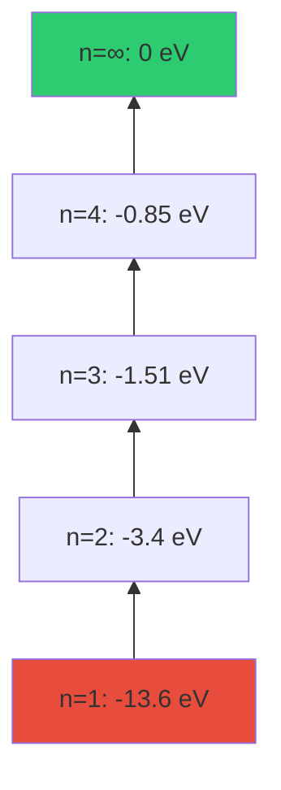

> Master Bohr's postulates, orbital radii, electron velocities, and energy levels for hydrogen-like atoms.

## Introduction

In 1913, **Niels Bohr** proposed a revolutionary model of the atom that successfully explained the hydrogen spectrum. While later superseded by quantum mechanics, Bohr’s model remains essential for JEE and provides intuitive understanding of atomic structure.

> **★ Key point · Oppenheimer's Atomic Understanding**
>
> In *Oppenheimer* (2023), the scientists’ understanding of atomic structure started with Bohr’s model! The film shows how these “planetary” orbits of electrons helped physicists unlock nuclear energy. Bohr even appears as a character, discussing quantum theory with Oppenheimer. The discrete energy levels you’ll learn here are the foundation of understanding how atoms work!

---

## Interactive: Bohr Model Visualization

Click the buttons to see energy absorption and emission as electrons jump between orbits:

---

## Bohr’s Postulates

### Postulate 1: Quantized Orbits

Electrons revolve around the nucleus in **fixed circular orbits** called stationary states or energy levels. While in these orbits, electrons **do not radiate energy**.

### Postulate 2: Quantized Angular Momentum

The angular momentum of an electron is quantized:

$$\boxed{mvr = n\frac{h}{2\pi} = n\hbar}$$

where:

- $n$ = principal quantum number (1, 2, 3, &mldr;)
- $\hbar$ = reduced Planck’s constant = $\frac{h}{2\pi}$

### Postulate 3: Energy Transitions

Energy is absorbed or emitted **only** when an electron jumps between orbits:

$$\boxed{\Delta E = E_2 - E_1 = h\nu}$$

- **Absorption**: electron jumps to higher orbit (n₁ → n₂, where n₂ > n₁)
- **Emission**: electron falls to lower orbit (n₂ → n₁)

> **◐ In simple terms · Neon Signs in Stranger Things**
>
> Ever wondered why neon signs in *Stranger Things* (2024) glow with specific colors? That’s Bohr’s 3rd postulate in action! When electricity excites atoms, electrons jump to higher orbits. When they fall back down, they emit light of EXACTLY the right frequency. Different atoms = different colors. The Upside Down’s eerie lighting? All atomic physics!

---

## Interactive Demo: Bohr’s Model

Watch how electrons transition between energy levels. See absorption and emission in action:

---

## Derivation of Key Formulas

For a hydrogen-like atom with nuclear charge $Ze$:

### Balancing Forces

Centripetal force = Electrostatic attraction:

$$\frac{mv^2}{r} = \frac{kZe^2}{r^2}$$

where $k = \frac{1}{4\pi\epsilon_0} = 9 \times 10^9$ N·m²/C²

### Combining with Angular Momentum

From $mvr = n\hbar$, we get $v = \frac{n\hbar}{mr}$

Substituting and solving:

---

## Results for Hydrogen-like Atoms

### 1. Radius of nth Orbit

$$\boxed{r_n = \frac{0.529 \times n^2}{Z} \text{ Å}}$$

or in SI units:

$$r_n = \frac{n^2 h^2 \epsilon_0}{\pi m Z e^2}$$

**Key observations:**

- Radius increases as $n^2$
- Radius decreases with increasing $Z$
- First Bohr radius ($a_0$) for H = 0.529 Å

### 2. Velocity in nth Orbit

$$\boxed{v_n = \frac{2.18 \times 10^6 \times Z}{n} \text{ m/s}}$$

**Key observations:**

- Velocity decreases as $\frac{1}{n}$
- Velocity increases with $Z$
- Electron in 1st orbit of H has velocity ≈ c/137

### 3. Energy of nth Orbit

$$\boxed{E_n = -\frac{13.6 \times Z^2}{n^2} \text{ eV}}$$

or in Joules:

$$E_n = -\frac{2.18 \times 10^{-18} \times Z^2}{n^2} \text{ J}$$

**Key observations:**

- Energy is **negative** (bound state)
- Energy increases (becomes less negative) with n
- Ground state energy of H = -13.6 eV
- At n = ∞, E = 0 (ionization)

> **★ Key point · Memory Aid**
>
> Remember the magic numbers:
>
> - **0.529** Å for radius

> - **2.18 × 10⁶** m/s for velocity

> - **13.6** eV for energy

---

## Energy Level Diagram



| n | Energy (eV) | Radius (Å) | Velocity (m/s) |
| --- | --- | --- | --- |
| 1 | -13.6 | 0.529 | 2.18 × 10⁶ |
| 2 | -3.4 | 2.116 | 1.09 × 10⁶ |
| 3 | -1.51 | 4.761 | 0.727 × 10⁶ |
| 4 | -0.85 | 8.464 | 0.545 × 10⁶ |
| ∞ | 0 | ∞ | 0 |

---

## Important Relationships

### Energy Ratios

For hydrogen-like atoms:

$$\frac{E_{n_1}}{E_{n_2}} = \frac{n_2^2}{n_1^2}$$

### Orbital Period

Time for one revolution:

$$T_n = \frac{2\pi r_n}{v_n} \propto \frac{n^3}{Z^2}$$

### Frequency of Revolution

$$f_n = \frac{v_n}{2\pi r_n} \propto \frac{Z^2}{n^3}$$

---

## Calculations

### Example 1: Comparing Radii

**Problem:** Find the radius of the 3rd orbit of Li²⁺.

**Solution:**
For Li²⁺: Z = 3, n = 3

$$r_3 = \frac{0.529 \times 3^2}{3} = \frac{0.529 \times 9}{3} = 1.587 \text{ Å}$$

Note: This equals the first Bohr radius of hydrogen times 3!

### Example 2: Energy Difference

**Problem:** Calculate the energy required to excite an electron from n=2 to n=4 in hydrogen.

**Solution:**

$$\Delta E = E_4 - E_2 = -\frac{13.6}{16} - \left(-\frac{13.6}{4}\right)$$

$$\Delta E = -0.85 + 3.4 = 2.55 \text{ eV}$$

---

## Ionization Energy

**Ionization energy** is the energy needed to remove an electron from ground state to infinity:

$$IE = E_\infty - E_1 = 0 - (-13.6 Z^2) = 13.6 Z^2 \text{ eV}$$

For hydrogen: IE = 13.6 eV = 2.18 × 10⁻¹⁸ J

> **★ Key point · For JEE**
>
> Common hydrogen-like species:
>
> - H (Z=1): IE = 13.6 eV

> - He⁺ (Z=2): IE = 54.4 eV

> - Li²⁺ (Z=3): IE = 122.4 eV

---

## Practice Problems

1. Calculate the velocity of electron in the 2nd orbit of He⁺.
2. In which orbit of hydrogen atom will the electron have the same energy as in the first orbit of Li²⁺?
3. Find the ratio of kinetic energies of electrons in the 1st and 3rd orbits of hydrogen.

> **↗ Connection · Quick Check**
>
> Total energy of electron in nth orbit = -½ × Potential energy = -(Kinetic energy). Verify this!

---

---

## Related Topics

### Within Atomic Structure

- [Electromagnetic Radiation](../electromagnetic-radiation/index.md) — Light as waves and photons
- [Photoelectric Effect](../photoelectric-effect/index.md) — Einstein’s particle theory of light
- [Hydrogen Spectrum](../hydrogen-spectrum/index.md) — Bohr model explains spectral lines!
- [Quantum Mechanical Model](../quantum-model/index.md) — Modern replacement for Bohr’s model

### Cross-Subject: Physics Connections

- [Circular Motion](../../../physics/kinematics/circular-motion/index.md) — Electron orbits use same concepts!
- [Electrostatics](../../../physics/electrostatics/index.md) — Coulomb force between nucleus and electron
- [Centripetal Force](../../../physics/laws-of-motion/index.md) — What keeps electrons in orbit

### Cross-Subject: Math Connections

- [Sequences and Series](../../../mathematics/sequences-series/index.md) — Energy level patterns (1/n²)

---

From TestGuru · our mock-test platform

## You've read Bohr's Atomic Model.You've read this topic. Find out what you actually got.

A free JEE Main mock with this chapter in it, and a report that shows which sub-topics cost you marks.

[Take a free JEE Main mock →](https://app.testguru.co/signup?tg_chapter=atomic-structure&tg_exam=jee-main&tg_page=%2Fchemistry%2Fatomic-structure%2Fbohr-model%2F&tg_subject=chemistry&utm_campaign=notes-jee-main-free-test&utm_content=article-end&utm_medium=referral&utm_source=jeenotes)
Free, no card. Opens TestGuru in a new tab.

## Stay exam-ready

One email every Sunday: new notes, the week's hardest challenge question and a revision plan.One email every Sunday.

## Comments

Have a question or spotted a mistake? Join the discussion below.

Advertisement

Advertisement

---

## Extracted page code (interactive scripts & widgets)


### inline-script-16

```js
if(!document.getElementById("animation-fullscreen-overlay")){const e=document.createElement("div");e.id="animation-fullscreen-overlay",e.className="animation-fullscreen-overlay",e.innerHTML=`
      <div class="fullscreen-modal">
        <div class="fullscreen-header">
          <span class="fullscreen-title">Interactive Demo</span>
          <button class="fullscreen-close-btn" onclick="JEEAnimations.closeFullscreen()" title="Close (Esc)" aria-label="Close fullscreen">
            <svg width="24" height="24" viewBox="0 0 24 24" fill="none" stroke="currentColor" stroke-width="2" stroke-linecap="round" stroke-linejoin="round">
              <line x1="18" y1="6" x2="6" y2="18"></line>
              <line x1="6" y1="6" x2="18" y2="18"></line>
            </svg>
          </button>
        </div>
        <div class="fullscreen-content"></div>
      </div>
    `,document.body.appendChild(e),document.addEventListener("keydown",function(e){e.key==="Escape"&&document.body.classList.contains("animation-fullscreen-active")&&JEEAnimations.closeFullscreen()}),e.addEventListener("click",function(t){t.target===e&&JEEAnimations.closeFullscreen()})}
```


### inline-script-17

```js
if(!document.getElementById("animation-fullscreen-overlay")){const e=document.createElement("div");e.id="animation-fullscreen-overlay",e.className="animation-fullscreen-overlay",e.innerHTML=`
      <div class="fullscreen-modal">
        <div class="fullscreen-header">
          <span class="fullscreen-title">Interactive Demo</span>
          <button class="fullscreen-close-btn" onclick="JEEAnimations.closeFullscreen()" title="Close (Esc)" aria-label="Close fullscreen">
            <svg width="24" height="24" viewBox="0 0 24 24" fill="none" stroke="currentColor" stroke-width="2" stroke-linecap="round" stroke-linejoin="round">
              <line x1="18" y1="6" x2="6" y2="18"></line>
              <line x1="6" y1="6" x2="18" y2="18"></line>
            </svg>
          </button>
        </div>
        <div class="fullscreen-content"></div>
      </div>
    `,document.body.appendChild(e),document.addEventListener("keydown",function(e){e.key==="Escape"&&document.body.classList.contains("animation-fullscreen-active")&&JEEAnimations.closeFullscreen()}),e.addEventListener("click",function(t){t.target===e&&JEEAnimations.closeFullscreen()})}
```


### inline-script-18

```js
(function(){var t,e=document.getElementById("disqus-load");if(!e)return;t=!1,e.addEventListener("click",function(){if(t)return;t=!0,e.setAttribute("disabled","disabled"),e.textContent="Loading comments…",window.disqus_config=function(){this.page.url="https://jeenotes.in/chemistry/atomic-structure/bohr-model/",this.page.identifier="/chemistry/atomic-structure/bohr-model/"};var s=document,n=s.createElement("script");n.src="https://https-jeenotes-in.disqus.com/embed.js",n.setAttribute("data-timestamp",+new Date),n.onload=function(){e.style.display="none"},n.onerror=function(){t=!1,e.removeAttribute("disabled"),e.textContent="Could not load comments. Tap to retry"},(s.head||s.body).appendChild(n)})})()
```


### inline-script-19

```js
(function(){var t,e=document.currentScript.previousElementSibling;function n(){(window.adsbygoogle=window.adsbygoogle||[]).push({})}if(!window.ResizeObserver||e.clientWidth>0){n();return}t=new ResizeObserver(function(){e.clientWidth>0&&(t.disconnect(),n())}),t.observe(e)})()
```


### interactive-widget-1

```html
<div class="animation-wrapper" data-animation="bohrModel" id="anim-bohrModel-1795396418779211171"><div class="animation-header"><button aria-label="Toggle fullscreen" class="anim-fullscreen-btn" onclick='JEEAnimations.toggleFullscreen("anim-bohrModel-1795396418779211171")' title="Fullscreen (F)">
<svg class="fullscreen-icon-expand" fill="none" height="18" stroke="currentColor" stroke-linecap="round" stroke-linejoin="round" stroke-width="2" viewbox="0 0 24 24" width="18"><polyline points="15 3 21 3 21 9"></polyline><polyline points="9 21 3 21 3 15"></polyline><line x1="21" x2="14" y1="3" y2="10"></line><line x1="3" x2="10" y1="21" y2="14"></line></svg>
<svg class="fullscreen-icon-collapse" fill="none" height="18" stroke="currentColor" stroke-linecap="round" stroke-linejoin="round" stroke-width="2" viewbox="0 0 24 24" width="18"><polyline points="4 14 10 14 10 20"></polyline><polyline points="20 10 14 10 14 4"></polyline><line x1="14" x2="21" y1="10" y2="3"></line><line x1="3" x2="10" y1="21" y2="14"></line></svg>
<span class="fullscreen-text">Fullscreen</span></button></div><div class="animation-content"><noscript><div class="callout callout-warning"><div class="callout-title">JavaScript Required</div><p>This interactive animation requires JavaScript to be enabled.</p></div></noscript></div></div>
```


### interactive-widget-2

```html
<div class="animation-wrapper" data-animation="bohrModel" id="anim-bohrModel-1795396418779378611"><div class="animation-header"><button aria-label="Toggle fullscreen" class="anim-fullscreen-btn" onclick='JEEAnimations.toggleFullscreen("anim-bohrModel-1795396418779378611")' title="Fullscreen (F)">
<svg class="fullscreen-icon-expand" fill="none" height="18" stroke="currentColor" stroke-linecap="round" stroke-linejoin="round" stroke-width="2" viewbox="0 0 24 24" width="18"><polyline points="15 3 21 3 21 9"></polyline><polyline points="9 21 3 21 3 15"></polyline><line x1="21" x2="14" y1="3" y2="10"></line><line x1="3" x2="10" y1="21" y2="14"></line></svg>
<svg class="fullscreen-icon-collapse" fill="none" height="18" stroke="currentColor" stroke-linecap="round" stroke-linejoin="round" stroke-width="2" viewbox="0 0 24 24" width="18"><polyline points="4 14 10 14 10 20"></polyline><polyline points="20 10 14 10 14 4"></polyline><line x1="14" x2="21" y1="10" y2="3"></line><line x1="3" x2="10" y1="21" y2="14"></line></svg>
<span class="fullscreen-text">Fullscreen</span></button></div><div class="animation-content"><noscript><div class="callout callout-warning"><div class="callout-title">JavaScript Required</div><p>This interactive animation requires JavaScript to be enabled.</p></div></noscript></div></div>
```


---

_Source: [https://jeenotes.in/chemistry/atomic-structure/bohr-model/](https://jeenotes.in/chemistry/atomic-structure/bohr-model/) · raw HTML: `offline/chemistry/atomic-structure/bohr-model/index.html`_
