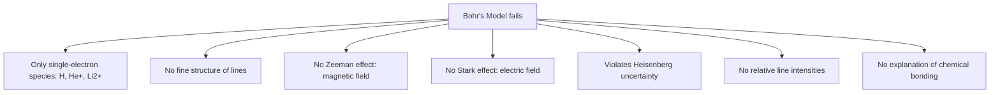

> All key Atomic Structure formulas: photon energy, Bohr model, Rydberg, de Broglie, uncertainty, quantum numbers & nodes for JEE Main & Advanced quick revision.

Every must-know formula, constant, and high-yield fact from the Atomic Structure chapter, grouped by sub-topic for last-minute revision.

## Key Constants

| Constant | Symbol | Value |
| --- | --- | --- |
| Planck’s constant | $h$ | $6.626 \times 10^{-34}$ J·s |
| Speed of light | $c$ | $3 \times 10^8$ m/s |
| Rydberg constant | $R_H$ | $1.097 \times 10^7$ m⁻¹ |
| First Bohr radius | $a_0$ | $0.529$ Å |
| Coulomb constant | $k = \frac{1}{4\pi\epsilon_0}$ | $9 \times 10^9$ N·m²/C² |
| Electron mass | $m_e$ | $9.1 \times 10^{-31}$ kg |
| eV to Joule | — | $1\text{ eV} = 1.6 \times 10^{-19}$ J |

> **★ Key point · Unit shortcuts**
>
> 1 nm = 10⁻⁹ m  |  1 Å = 10⁻¹⁰ m  |  1 pm = 10⁻¹² m. Visible light: 400 nm (violet) → 700 nm (red).

---

## Electromagnetic Radiation

| Quantity | Formula | Notes |
| --- | --- | --- |
| Wave relation | $c = \nu\lambda$ | $c = 3\times10^8$ m/s in vacuum |
| Wave number | $\bar{\nu} = \dfrac{1}{\lambda}$ | unit m⁻¹ |
| Photon energy | $E = h\nu = \dfrac{hc}{\lambda}$ | higher $\nu$ → higher $E$ |
| Photon momentum | $p = \dfrac{h}{\lambda} = \dfrac{E}{c}$ | photons are massless but carry momentum |

$$\boxed{E = h\nu = \frac{hc}{\lambda}}$$

> **⚠ Trap · Energy vs intensity**
>
> Photon **energy** depends on frequency ($E = h\nu$); **intensity** depends on the number of photons per second. Do not mix these up.

---

## Photoelectric Effect

$$\boxed{h\nu = \phi + \tfrac{1}{2}mv_{max}^2 = h\nu_0 + KE_{max}}$$

| Quantity | Formula | Notes |
| --- | --- | --- |
| Work function | $\phi = h\nu_0$ | minimum energy to eject electron |
| Maximum KE | $KE_{max} = h\nu - \phi$ | depends only on frequency |
| Stopping potential | $eV_0 = KE_{max} = h\nu - \phi$ | $V_0 = \dfrac{h(\nu - \nu_0)}{e}$ |
| Threshold wavelength | $\lambda_0 = \dfrac{hc}{\phi}$ | maximum $\lambda$ that still ejects |
| Maximum velocity | $v_{max} = \sqrt{\dfrac{2(h\nu - \phi)}{m}}$ | — |

**$V_0$ vs $\nu$ graph:** slope $= \dfrac{h}{e}$, x-intercept $= \nu_0$, y-intercept $= -\dfrac{\phi}{e}$.

> **★ Key point · High-yield facts**
>
> Below $\nu_0$: no emission at any intensity. One photon ejects at most one electron. $KE_{max}$ and $V_0$ are independent of intensity. Threshold frequency is a **minimum**; threshold wavelength is a **maximum**.

---

## Bohr’s Model (hydrogen-like, nuclear charge $Ze$)

**Postulates:** quantized circular orbits (no radiation in a stationary state), quantized angular momentum, and energy emitted/absorbed only on transitions.

$$\boxed{mvr = \frac{nh}{2\pi} = n\hbar} \qquad \boxed{\Delta E = E_2 - E_1 = h\nu}$$

| Quantity | Formula | Scaling |
| --- | --- | --- |
| Force balance | $\dfrac{mv^2}{r} = \dfrac{kZe^2}{r^2}$ | — |
| Radius of nth orbit | $r_n = \dfrac{0.529\,n^2}{Z}$ Å | $r_n \propto \dfrac{n^2}{Z}$ |
| Velocity in nth orbit | $v_n = \dfrac{2.18\times10^6\,Z}{n}$ m/s | $v_n \propto \dfrac{Z}{n}$ |
| Energy of nth orbit | $E_n = -\dfrac{13.6\,Z^2}{n^2}$ eV | $= -\dfrac{2.18\times10^{-18}Z^2}{n^2}$ J |
| Energy ratio | $\dfrac{E_{n_1}}{E_{n_2}} = \dfrac{n_2^2}{n_1^2}$ | — |
| Orbital period | $T_n = \dfrac{2\pi r_n}{v_n}$ | $\propto \dfrac{n^3}{Z^2}$ |
| Frequency of revolution | $f_n = \dfrac{v_n}{2\pi r_n}$ | $\propto \dfrac{Z^2}{n^3}$ |
| Ionization energy | $IE = 0 - E_1 = 13.6\,Z^2$ eV | from ground state to $\infty$ |

$$\boxed{r_n = \frac{0.529\,n^2}{Z}\ \text{Å} \qquad E_n = -\frac{13.6\,Z^2}{n^2}\ \text{eV}}$$

**Hydrogen energy levels:** $E_1 = -13.6$, $E_2 = -3.4$, $E_3 = -1.51$, $E_4 = -0.85$ eV; $E_\infty = 0$.

**Ionization energies:** H (Z=1) → 13.6 eV; He⁺ (Z=2) → 54.4 eV; Li²⁺ (Z=3) → 122.4 eV.

> **★ Key point · Magic numbers + energy identity**
>
> Memorize **0.529** Å, **2.18 × 10⁶** m/s, **13.6** eV. Also: Total energy $= -\,KE = \tfrac{1}{2}\,PE$, i.e. $E_n = -KE$.

---

## Hydrogen Spectrum

$$\boxed{\frac{1}{\lambda} = \bar{\nu} = R_H Z^2\left(\frac{1}{n_1^2} - \frac{1}{n_2^2}\right)}$$

with $n_2 > n_1$ (final state $n_1$). Equivalently $h\nu = -13.6 Z^2\left(\frac{1}{n_2^2} - \frac{1}{n_1^2}\right)$ eV.

| Series | $n_1$ | Region | $\lambda_{limit}$ (nm) |
| --- | --- | --- | --- |
| Lyman | 1 | UV | 91.2 |
| Balmer | 2 | Visible | 364.6 |
| Paschen | 3 | Infrared | 820.4 |
| Brackett | 4 | Far IR | — |
| Pfund | 5 | Far IR | — |

| Quantity | Formula | Notes |
| --- | --- | --- |
| Series limit | $\dfrac{1}{\lambda_{limit}} = R_H Z^2 \dfrac{1}{n_1^2}$ | $n_2 \to \infty$ (shortest $\lambda$) |
| Lines from level $n$ | $N = \dfrac{n(n-1)}{2}$ | electron de-exciting from $n$ to ground |
| Lines for $n_2 \to n_1$ | $N = \dfrac{(n_2-n_1)(n_2-n_1+1)}{2}$ | — |

> **★ Key point · Spectrum mnemonics**
>
> **L**yman → lowest level (n=1) → UV; **B**almer → n=2 → Visible (only series in visible); Paschen/Brackett/Pfund → IR. First line of a series = longest $\lambda$; series limit = shortest $\lambda$. For He⁺ multiply by $Z^2 = 4$.

---

## Dual Nature of Matter

$$\boxed{\lambda = \frac{h}{mv} = \frac{h}{p}}$$

| Quantity | Formula | Notes |
| --- | --- | --- |
| de Broglie (KE form) | $\lambda = \dfrac{h}{\sqrt{2m\,KE}}$ | same KE → $\lambda \propto \dfrac{1}{\sqrt{m}}$ |
| Accelerated charge $q$ through $V$ | $\lambda = \dfrac{h}{\sqrt{2mqV}}$ | $KE = qV$ |
| Electron through $V$ (volts) | $\lambda = \dfrac{12.27}{\sqrt{V}}$ Å | quick-calc shortcut |
| Thermal wavelength | $\lambda = \dfrac{h}{\sqrt{3mkT}}$ | particles at temperature $T$ |
| Bohr quantization | $2\pi r = n\lambda$ | gives $mvr = \dfrac{nh}{2\pi}$ |

### Heisenberg Uncertainty Principle

$$\boxed{\Delta x \cdot \Delta p \geq \frac{h}{4\pi}}$$

Equivalent forms: $\Delta x \cdot m\Delta v \geq \dfrac{h}{4\pi}$ and $\Delta E \cdot \Delta t \geq \dfrac{h}{4\pi}$.

> **★ Key point · Remember**
>
> $\lambda \propto \tfrac{1}{m}$ and $\lambda \propto \tfrac{1}{v}$; same KE → $\lambda \propto \tfrac{1}{\sqrt{m}}$; same momentum → same $\lambda$. Conjugate pairs: $(x, p)$, $(E, t)$, $(\theta, L)$. Uncertainty is a fundamental property of nature, not a measurement limit.

---

## Quantum Mechanical Model

| Item | Expression | Notes |
| --- | --- | --- |
| Schrödinger equation | $\hat{H}\psi = E\psi$ | $\dfrac{\partial^2\psi}{\partial x^2}+\dfrac{\partial^2\psi}{\partial y^2}+\dfrac{\partial^2\psi}{\partial z^2}+\dfrac{8\pi^2 m}{h^2}(E-V)\psi = 0$ |
| Probability density | $\lvert\psi\rvert^2$ | $\psi$ must be single-valued, continuous, finite |
| Normalization | $\int \lvert\psi\rvert^2\,dV = 1$ | total probability = 1 |
| Orbital angular momentum | $L = \sqrt{l(l+1)}\cdot\dfrac{h}{2\pi}$ | depends on $l$ |
| Spin angular momentum | $S = \sqrt{s(s+1)}\cdot\dfrac{h}{2\pi} = \sqrt{\tfrac{3}{4}}\cdot\dfrac{h}{2\pi}$ | $s = \tfrac{1}{2}$ |

### Four Quantum Numbers

| QN | Symbol | Allowed values | Determines |
| --- | --- | --- | --- |
| Principal | $n$ | $1, 2, 3, \dots$ | shell, size, energy |
| Azimuthal | $l$ | $0$ to $(n-1)$ | subshell, shape |
| Magnetic | $m_l$ | $-l$ to $+l$ ($2l+1$ values) | orbital orientation |
| Spin | $m_s$ | $+\tfrac{1}{2}$ or $-\tfrac{1}{2}$ | electron spin |

**Counts:** orbitals in a subshell $= 2l+1$; orbitals in a shell $= n^2$; max electrons in subshell $= 2(2l+1)$; max electrons in shell $= 2n^2$.

> **★ Key point · Validity checks**
>
> $l < n$ always; $m_l$ ranges $-l \dots +l$. No 1p, 2d, 3f. For H-like atoms energy depends only on $n$ ($3s=3p=3d$); in multi-electron atoms it depends on $n$ and $l$.

---

## Shapes of Orbitals & Nodes

| Node type | Formula | Description |
| --- | --- | --- |
| Radial nodes | $n - l - 1$ | spherical surfaces |
| Angular nodes | $l$ | planes or cones |
| Total nodes | $n - 1$ | sum of both |

| Quantity | Formula | Notes |
| --- | --- | --- |
| Radial probability | $P(r) = 4\pi r^2 \lvert\psi\rvert^2$ | 1s peak at $r = a_0 = 0.529$ Å |

| Subshell | $l$ | Shape | Angular nodes | $m_l$ values |
| --- | --- | --- | --- | --- |
| s | 0 | Sphere | 0 | 0 |
| p | 1 | Dumbbell (starts n=2) | 1 plane | $-1, 0, +1$ |
| d | 2 | 4-lobed / ring (starts n=3) | 2 planes | $-2 \dots +2$ |
| f | 3 | Complex (starts n=4) | 3 planes | $-3 \dots +3$ |

> **⚠ Trap · Radial vs angular nodes**
>
> Radial nodes depend on both $n$ and $l$ (spherical surfaces); angular nodes depend only on $l$ (planes/cones). Quick check: 3d → 0 radial, 2 angular; 4s → 3 radial, 0 angular.

---

## Electronic Configuration

### Filling order (Aufbau / $(n+l)$ rule)

$$1s < 2s < 2p < 3s < 3p < 4s < 3d < 4p < 5s < 4d < 5p < 6s < 4f < 5d < 6p < 7s < 5f < 6d < 7p$$

Lower $(n+l)$ fills first; for equal $(n+l)$, lower $n$ fills first.

| Rule | Statement |
| --- | --- |
| Aufbau | Fill orbitals in order of increasing energy |
| Pauli exclusion | No two electrons share all four quantum numbers (max 2 per orbital, opposite spins) |
| Hund’s rule | Singly fill degenerate orbitals with parallel spins before pairing |

| Subshell | Max electrons |
| --- | --- |
| s | 2 |
| p | 6 |
| d | 10 |
| f | 14 |

### Must-know exceptions (extra stability of half / fully-filled subshells)

| Element | Z | Expected | Actual |
| --- | --- | --- | --- |
| Cr | 24 | [Ar] 4s² 3d⁴ | **[Ar] 4s¹ 3d⁵** |
| Cu | 29 | [Ar] 4s² 3d⁹ | **[Ar] 4s¹ 3d¹⁰** |
| Mo | 42 | [Kr] 5s² 4d⁴ | [Kr] 5s¹ 4d⁵ |
| Ag | 47 | [Kr] 5s² 4d⁹ | [Kr] 5s¹ 4d¹⁰ |
| Au | 79 | [Xe] 6s² 4f¹⁴ 5d⁹ | [Xe] 6s¹ 4f¹⁴ 5d¹⁰ |

**Stable configurations:** fully filled s², p⁶, d¹⁰, f¹⁴; half filled p³, d⁵, f⁷.

### Ions and magnetism

- **Cations:** remove electrons from the outermost shell first — for transition metals, **4s before 3d** (in ions 3d lies below 4s). e.g. Fe ([Ar] 3d⁶ 4s²) → Fe²⁺ ([Ar] 3d⁶).
- **Anions:** add electrons to the lowest available orbital. e.g. O ([He] 2s² 2p⁴) → O²⁻ ([Ne]).
- **Magnetism:** unpaired electrons → paramagnetic; all paired → diamagnetic.

> **★ Key point · Aufbau diagonal**
>
> Diagonal arrow order: 1s → 2s → 2p → 3s → 3p → 4s → 3d → 4p → 5s → 4d → 5p → 6s → 4f → 5d → 6p → 7s → 5f → 6d → 7p.

---

## Limitations of Bohr’s Model



---

## One-Glance Headline Formulas

$$E = \frac{hc}{\lambda} \quad\bullet\quad h\nu = \phi + KE_{max} \quad\bullet\quad r_n = \frac{0.529\,n^2}{Z}\,\text{Å} \quad\bullet\quad E_n = -\frac{13.6\,Z^2}{n^2}\,\text{eV}$$

$$\frac{1}{\lambda} = R_H Z^2\!\left(\frac{1}{n_1^2}-\frac{1}{n_2^2}\right) \quad\bullet\quad \lambda = \frac{h}{mv} \quad\bullet\quad \Delta x\,\Delta p \geq \frac{h}{4\pi} \quad\bullet\quad N = \frac{n(n-1)}{2}$$

## Keep studying this chapter

- [Atomic Structure chapter notes](../index.md)
- [Atomic Structure previous year questions](../previous-year-questions/index.md)

From TestGuru · our mock-test platform

## You've read Atomic Structure Formula Sheet.You've read this topic. Find out what you actually got.

A free JEE Main mock with this chapter in it, and a report that shows which sub-topics cost you marks.

[Take a free JEE Main mock →](https://app.testguru.co/signup?tg_chapter=atomic-structure&tg_exam=jee-main&tg_page=%2Fchemistry%2Fatomic-structure%2Fformula-sheet%2F&tg_subject=chemistry&utm_campaign=notes-jee-main-free-test&utm_content=article-end&utm_medium=referral&utm_source=jeenotes)
Free, no card. Opens TestGuru in a new tab.

## Stay exam-ready

One email every Sunday: new notes, the week's hardest challenge question and a revision plan.One email every Sunday.

## Comments

Have a question or spotted a mistake? Join the discussion below.

Advertisement

Advertisement

---

## Extracted page code (interactive scripts & widgets)


### inline-script-14

```js
(function(){var t,e=document.getElementById("disqus-load");if(!e)return;t=!1,e.addEventListener("click",function(){if(t)return;t=!0,e.setAttribute("disabled","disabled"),e.textContent="Loading comments…",window.disqus_config=function(){this.page.url="https://jeenotes.in/chemistry/atomic-structure/formula-sheet/",this.page.identifier="/chemistry/atomic-structure/formula-sheet/"};var s=document,n=s.createElement("script");n.src="https://https-jeenotes-in.disqus.com/embed.js",n.setAttribute("data-timestamp",+new Date),n.onload=function(){e.style.display="none"},n.onerror=function(){t=!1,e.removeAttribute("disabled"),e.textContent="Could not load comments. Tap to retry"},(s.head||s.body).appendChild(n)})})()
```


### inline-script-15

```js
(function(){var t,e=document.currentScript.previousElementSibling;function n(){(window.adsbygoogle=window.adsbygoogle||[]).push({})}if(!window.ResizeObserver||e.clientWidth>0){n();return}t=new ResizeObserver(function(){e.clientWidth>0&&(t.disconnect(),n())}),t.observe(e)})()
```


---

_Source: [https://jeenotes.in/chemistry/atomic-structure/formula-sheet/](https://jeenotes.in/chemistry/atomic-structure/formula-sheet/) · raw HTML: `offline/chemistry/atomic-structure/formula-sheet/index.html`_
