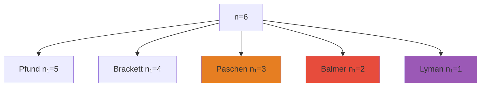

> Master spectral series, Rydberg formula, and the limitations of Bohr's model for JEE Chemistry.

## Introduction

The hydrogen spectrum was a major puzzle before Bohr’s model. When hydrogen gas is excited, it emits light at specific wavelengths—not a continuous spectrum. Bohr’s model beautifully explains these discrete spectral lines.

---

## Origin of Spectral Lines

When an electron transitions between energy levels, it emits or absorbs a photon with energy equal to the difference:

$$\Delta E = h\nu = E_{n_2} - E_{n_1}$$

Using Bohr’s energy formula:

$$h\nu = -13.6 Z^2 \left(\frac{1}{n_2^2} - \frac{1}{n_1^2}\right) \text{ eV}$$

---

## Rydberg Formula

### For Wavelength

$$\boxed{\frac{1}{\lambda} = R_H Z^2 \left(\frac{1}{n_1^2} - \frac{1}{n_2^2}\right)}$$

where:

- $R_H = 1.097 \times 10^7$ m⁻¹ (Rydberg constant)
- $n_1$ = lower energy level (final state)
- $n_2$ = higher energy level (initial state)
- $n_2 > n_1$ for emission

### For Wave Number

$$\bar{\nu} = \frac{1}{\lambda} = R_H Z^2 \left(\frac{1}{n_1^2} - \frac{1}{n_2^2}\right)$$

> **⚠ Trap · Sign Convention**
>
> Always ensure $n_2 > n_1$ to get a positive value for $\frac{1}{\lambda}$.

---

## Spectral Series

Each series is named after its discoverer and corresponds to transitions ending at a specific level:



| Series | n₁ | n₂ | Region | Formula |
| --- | --- | --- | --- | --- |
| **Lyman** | 1 | 2, 3, 4&mldr; | UV | $\frac{1}{\lambda} = R_H\left(\frac{1}{1^2} - \frac{1}{n^2}\right)$ |
| **Balmer** | 2 | 3, 4, 5&mldr; | Visible | $\frac{1}{\lambda} = R_H\left(\frac{1}{2^2} - \frac{1}{n^2}\right)$ |
| **Paschen** | 3 | 4, 5, 6&mldr; | Infrared | $\frac{1}{\lambda} = R_H\left(\frac{1}{3^2} - \frac{1}{n^2}\right)$ |
| **Brackett** | 4 | 5, 6, 7&mldr; | Far IR | $\frac{1}{\lambda} = R_H\left(\frac{1}{4^2} - \frac{1}{n^2}\right)$ |
| **Pfund** | 5 | 6, 7, 8&mldr; | Far IR | $\frac{1}{\lambda} = R_H\left(\frac{1}{5^2} - \frac{1}{n^2}\right)$ |

> **★ Key point · Memory Aid**
>
> **L**yman → **L**owest level (n=1) → **U**ltraviolet  

> **B**almer → **B**eautiful colors (n=2) → **V**isible  

> **P**aschen, **B**rackett, **P**fund → (n=3,4,5) → **I**nfrared

### Interactive Demo: Explore Hydrogen Spectral Series

Watch electron transitions between energy levels and see how different spectral series are formed. Observe the Lyman, Balmer, and Paschen series.

---

## Series Limits

### Definition

The **series limit** is the shortest wavelength (highest energy) transition in each series, occurring when $n_2 → ∞$.

$$\frac{1}{\lambda_{limit}} = R_H Z^2 \times \frac{1}{n_1^2}$$

### Series Limits for Hydrogen

| Series | λ_limit (nm) |
| --- | --- |
| Lyman | 91.2 |
| Balmer | 364.6 |
| Paschen | 820.4 |

---

## Number of Spectral Lines

When an electron is excited to level $n$, the total number of possible emission lines is:

$$\boxed{N = \frac{n(n-1)}{2}}$$

For transition from $n_2$ to $n_1$:

$$N = \frac{(n_2 - n_1)(n_2 - n_1 + 1)}{2}$$

### Example:

From n=4 to n=1:

$$N = \frac{4 \times 3}{2} = 6 \text{ lines}$$

These are: 4→3, 4→2, 4→1, 3→2, 3→1, 2→1

---

## Calculations

### Example 1: First Line of Lyman Series

**Problem:** Calculate the wavelength of the first line of the Lyman series.

**Solution:**
First line: n₁ = 1, n₂ = 2

$$\frac{1}{\lambda} = R_H\left(1 - \frac{1}{4}\right) = R_H \times \frac{3}{4}$$

$$\frac{1}{\lambda} = 1.097 \times 10^7 \times \frac{3}{4} = 8.228 \times 10^6 \text{ m}^{-1}$$

$$\lambda = 121.6 \text{ nm (UV region)}$$

### Example 2: Balmer Series Limit

**Problem:** Find the series limit of the Balmer series.

**Solution:**
Series limit: n₁ = 2, n₂ → ∞

$$\frac{1}{\lambda} = R_H\left(\frac{1}{4} - 0\right) = \frac{R_H}{4}$$

$$\lambda = \frac{4}{R_H} = \frac{4}{1.097 \times 10^7} = 364.6 \text{ nm}$$

### Example 3: Identifying a Transition

**Problem:** A hydrogen line has wavelength 656.3 nm. Identify the transition.

**Solution:**
656.3 nm is in the visible region → Balmer series (n₁ = 2)

$$\frac{1}{656.3 \times 10^{-9}} = 1.097 \times 10^7 \left(\frac{1}{4} - \frac{1}{n_2^2}\right)$$

Solving: $\frac{1}{n_2^2} = \frac{1}{4} - \frac{1}{8} = \frac{1}{8}$

Wait, let me recalculate:

$$1.524 \times 10^6 = 1.097 \times 10^7 \left(0.25 - \frac{1}{n_2^2}\right)$$

$$\frac{1}{n_2^2} = 0.25 - 0.139 = 0.111 ≈ \frac{1}{9}$$

So $n_2 = 3$. This is the **Hα line** (first line of Balmer series).

---

## Limitations of Bohr’s Model

> **★ Key point · Why Bohr's Model Fails**
>
> 1. **Only works for single-electron species** (H, He⁺, Li²⁺)

> 2. **Cannot explain fine structure** of spectral lines

> 3. **Cannot explain Zeeman effect** (splitting in magnetic field)

> 4. **Cannot explain Stark effect** (splitting in electric field)

> 5. **Violates Heisenberg uncertainty principle** (defines both position and momentum)

> 6. **Cannot explain relative intensities** of spectral lines

> 7. **No explanation for chemical bonding**

### What’s Next?

These limitations led to the development of:

- de Broglie’s wave-particle duality
- Heisenberg’s uncertainty principle
- Schrödinger’s wave equation

---

## JEE Important Points

1. **Lyman series** has the shortest wavelengths (highest energy)
2. **First line** of any series has the longest wavelength in that series
3. **Series limit** has the shortest wavelength in each series
4. For He⁺, multiply $R_H$ by $Z^2 = 4$
5. Balmer series is the only one in **visible region** for hydrogen

---

## Practice Problems

1. Calculate the wavelength of the third line of the Balmer series.
2. In which series does the line with λ = 1875 nm belong?
3. Find the ratio of longest wavelengths in Lyman and Balmer series.

> **↗ Connection · Quick Check**
>
> The ionization energy of hydrogen can be calculated from the Lyman series limit. Verify that it equals 13.6 eV.

---

From TestGuru · our mock-test platform

## You've read Hydrogen Spectrum.You've read this topic. Find out what you actually got.

A free JEE Main mock with this chapter in it, and a report that shows which sub-topics cost you marks.

[Take a free JEE Main mock →](https://app.testguru.co/signup?tg_chapter=atomic-structure&tg_exam=jee-main&tg_page=%2Fchemistry%2Fatomic-structure%2Fhydrogen-spectrum%2F&tg_subject=chemistry&utm_campaign=notes-jee-main-free-test&utm_content=article-end&utm_medium=referral&utm_source=jeenotes)
Free, no card. Opens TestGuru in a new tab.

## Stay exam-ready

One email every Sunday: new notes, the week's hardest challenge question and a revision plan.One email every Sunday.

## Comments

Have a question or spotted a mistake? Join the discussion below.

Advertisement

Advertisement

---

## Extracted page code (interactive scripts & widgets)


### inline-script-16

```js
if(!document.getElementById("animation-fullscreen-overlay")){const e=document.createElement("div");e.id="animation-fullscreen-overlay",e.className="animation-fullscreen-overlay",e.innerHTML=`
      <div class="fullscreen-modal">
        <div class="fullscreen-header">
          <span class="fullscreen-title">Interactive Demo</span>
          <button class="fullscreen-close-btn" onclick="JEEAnimations.closeFullscreen()" title="Close (Esc)" aria-label="Close fullscreen">
            <svg width="24" height="24" viewBox="0 0 24 24" fill="none" stroke="currentColor" stroke-width="2" stroke-linecap="round" stroke-linejoin="round">
              <line x1="18" y1="6" x2="6" y2="18"></line>
              <line x1="6" y1="6" x2="18" y2="18"></line>
            </svg>
          </button>
        </div>
        <div class="fullscreen-content"></div>
      </div>
    `,document.body.appendChild(e),document.addEventListener("keydown",function(e){e.key==="Escape"&&document.body.classList.contains("animation-fullscreen-active")&&JEEAnimations.closeFullscreen()}),e.addEventListener("click",function(t){t.target===e&&JEEAnimations.closeFullscreen()})}
```


### inline-script-17

```js
(function(){var t,e=document.getElementById("disqus-load");if(!e)return;t=!1,e.addEventListener("click",function(){if(t)return;t=!0,e.setAttribute("disabled","disabled"),e.textContent="Loading comments…",window.disqus_config=function(){this.page.url="https://jeenotes.in/chemistry/atomic-structure/hydrogen-spectrum/",this.page.identifier="/chemistry/atomic-structure/hydrogen-spectrum/"};var s=document,n=s.createElement("script");n.src="https://https-jeenotes-in.disqus.com/embed.js",n.setAttribute("data-timestamp",+new Date),n.onload=function(){e.style.display="none"},n.onerror=function(){t=!1,e.removeAttribute("disabled"),e.textContent="Could not load comments. Tap to retry"},(s.head||s.body).appendChild(n)})})()
```


### inline-script-18

```js
(function(){var t,e=document.currentScript.previousElementSibling;function n(){(window.adsbygoogle=window.adsbygoogle||[]).push({})}if(!window.ResizeObserver||e.clientWidth>0){n();return}t=new ResizeObserver(function(){e.clientWidth>0&&(t.disconnect(),n())}),t.observe(e)})()
```


### interactive-widget-1

```html
<div class="animation-wrapper" data-animation="bohrModel" id="anim-bohrModel-1795396418781501473"><div class="animation-header"><button aria-label="Toggle fullscreen" class="anim-fullscreen-btn" onclick='JEEAnimations.toggleFullscreen("anim-bohrModel-1795396418781501473")' title="Fullscreen (F)">
<svg class="fullscreen-icon-expand" fill="none" height="18" stroke="currentColor" stroke-linecap="round" stroke-linejoin="round" stroke-width="2" viewbox="0 0 24 24" width="18"><polyline points="15 3 21 3 21 9"></polyline><polyline points="9 21 3 21 3 15"></polyline><line x1="21" x2="14" y1="3" y2="10"></line><line x1="3" x2="10" y1="21" y2="14"></line></svg>
<svg class="fullscreen-icon-collapse" fill="none" height="18" stroke="currentColor" stroke-linecap="round" stroke-linejoin="round" stroke-width="2" viewbox="0 0 24 24" width="18"><polyline points="4 14 10 14 10 20"></polyline><polyline points="20 10 14 10 14 4"></polyline><line x1="14" x2="21" y1="10" y2="3"></line><line x1="3" x2="10" y1="21" y2="14"></line></svg>
<span class="fullscreen-text">Fullscreen</span></button></div><div class="animation-content"><noscript><div class="callout callout-warning"><div class="callout-title">JavaScript Required</div><p>This interactive animation requires JavaScript to be enabled.</p></div></noscript></div></div>
```


---

_Source: [https://jeenotes.in/chemistry/atomic-structure/hydrogen-spectrum/](https://jeenotes.in/chemistry/atomic-structure/hydrogen-spectrum/) · raw HTML: `offline/chemistry/atomic-structure/hydrogen-spectrum/index.html`_
