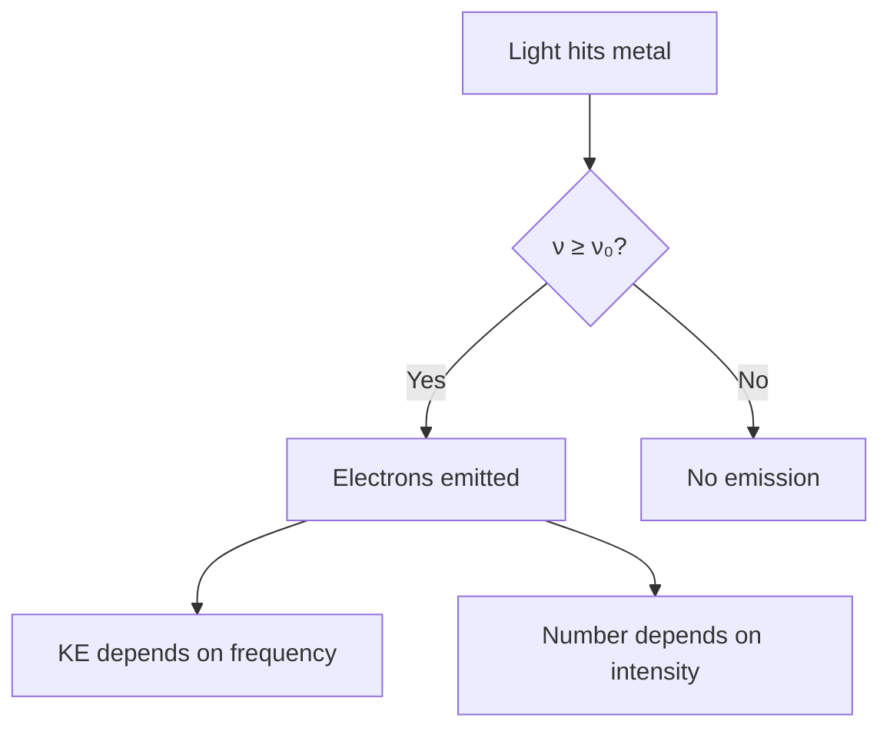

> Master Einstein's photoelectric effect, threshold frequency, work function, and stopping potential for JEE.

## Introduction

The **photoelectric effect** is the emission of electrons from a metal surface when light of sufficient frequency shines on it. This phenomenon provided crucial evidence for the particle nature of light and earned Einstein the Nobel Prize in 1921.

> **★ Key point · Automatic Doors & Oppenheimer**
>
> Ever wondered how automatic doors at malls know you’re there? They use the **photoelectric effect**! A beam of light hits a sensor, and when you break the beam, the change in current triggers the door. This same principle — light as particles (photons) — is what the scientists in *Oppenheimer* (2023) built upon to understand atomic physics!

### Historical Context

Classical wave theory predicted:

- Higher intensity should give electrons more energy
- Any frequency should eventually cause emission

**Experiments showed otherwise!** This led to the quantum explanation.

---

## Experimental Observations

### Key Findings

1. **Threshold frequency ($\nu_0$)**: Below this frequency, no electrons are emitted regardless of intensity
2. **Instantaneous emission**: Electrons are emitted immediately (within 10⁻⁹ s), not gradually
3. **Intensity effect**: More intensity = more electrons, but NOT higher kinetic energy
4. **Frequency effect**: Higher frequency = higher kinetic energy of emitted electrons



---

## Einstein’s Explanation

Einstein (1905) proposed that light consists of **photons**, each carrying energy $E = h\nu$.

### The Photoelectric Equation

$$\boxed{h\nu = \phi + \frac{1}{2}mv_{max}^2}$$

or equivalently:

$$\boxed{h\nu = h\nu_0 + KE_{max}}$$

where:

- $h\nu$ = Energy of incident photon
- $\phi = h\nu_0$ = **Work function** (minimum energy to remove electron)
- $\frac{1}{2}mv_{max}^2 = KE_{max}$ = Maximum kinetic energy of electron
- $\nu_0$ = Threshold frequency

### Interactive Demo: Visualize Photoelectric Effect

See how light photons eject electrons from a metal surface based on frequency and intensity.

### Understanding Work Function

The work function ($\phi$) is the **minimum energy needed to remove an electron** from the metal surface.

| Metal | Work Function (eV) |
| --- | --- |
| Cesium (Cs) | 2.14 |
| Potassium (K) | 2.30 |
| Sodium (Na) | 2.75 |
| Zinc (Zn) | 4.33 |
| Platinum (Pt) | 5.65 |

> **★ Key point · JEE Tip**
>
> Alkali metals have low work functions, making them ideal for photoelectric devices. Cesium is most commonly used.

---

## Stopping Potential

When a negative potential is applied to the collector, it can stop the most energetic electrons.

> **◐ In simple terms · Iron Man's Arc Reactor**
>
> In *Iron Man*, Tony Stark’s arc reactor produces high-energy electrons. To “stop” electrons (like in photoelectric experiments), you need to apply a voltage. The faster the electrons (higher KE), the more voltage needed. That’s why higher frequency light = harder to stop electrons = higher stopping potential!

### Definition

**Stopping potential ($V_0$)**: The minimum negative potential needed to stop all photoelectrons.

$$\boxed{eV_0 = KE_{max} = h\nu - \phi}$$

or:

$$V_0 = \frac{h\nu - \phi}{e} = \frac{h(\nu - \nu_0)}{e}$$

### Graphical Analysis

Plotting $V_0$ vs $\nu$:

- **Slope** = $\frac{h}{e}$ (universal constant)
- **x-intercept** = threshold frequency $\nu_0$
- **y-intercept** = $-\frac{\phi}{e}$

---

## Threshold Wavelength

Since $\nu_0 = \frac{c}{\lambda_0}$, we can also define:

$$\boxed{\lambda_0 = \frac{hc}{\phi}}$$

- If $\lambda < \lambda_0$: emission occurs
- If $\lambda > \lambda_0$: no emission

> **⚠ Trap · Common Mistake**
>
> Remember:
>
> - Threshold **frequency** is the **minimum** required

> - Threshold **wavelength** is the **maximum** allowed
>
> Don’t mix these up in problems!

---

## Problem Solving Strategy

### Step-by-step Approach

1. **Identify given values**: frequency/wavelength, work function, KE
2. **Convert units**: Ensure consistent units (eV or J)
3. **Apply Einstein’s equation**: $h\nu = \phi + KE_{max}$
4. **Solve for unknown**

### Example 1: Finding KE

**Problem:** Light of wavelength 200 nm falls on a metal with work function 4.2 eV. Find the maximum KE of photoelectrons.

**Solution:**

1. Energy of photon:

   $$E = \frac{hc}{\lambda} = \frac{6.626 \times 10^{-34} \times 3 \times 10^8}{200 \times 10^{-9}} = 9.94 \times 10^{-19} \text{ J}$$

$$E = \frac{9.94 \times 10^{-19}}{1.6 \times 10^{-19}} = 6.21 \text{ eV}$$
2. Apply equation:

   $$KE_{max} = E - \phi = 6.21 - 4.2 = 2.01 \text{ eV}$$

### Example 2: Finding Threshold Frequency

**Problem:** The work function of sodium is 2.75 eV. Calculate its threshold wavelength.

**Solution:**

$$\lambda_0 = \frac{hc}{\phi} = \frac{6.626 \times 10^{-34} \times 3 \times 10^8}{2.75 \times 1.6 \times 10^{-19}}$$

$$\lambda_0 = 4.52 \times 10^{-7} \text{ m} = 452 \text{ nm}$$

This is in the blue-violet region of visible light.

---

## Important Points for JEE

> **★ Key point · Key Concepts**
>
> 1. Photoelectric effect proves **particle nature** of light

> 2. One photon ejects at most **one electron**

> 3. Below threshold frequency: **no emission** regardless of intensity

> 4. Stopping potential is **independent of intensity**

> 5. Maximum KE depends only on **frequency** (not intensity)

### Quick Formulas

| Quantity | Formula |
| --- | --- |
| Work function | $\phi = h\nu_0$ |
| Maximum KE | $KE_{max} = h\nu - \phi$ |
| Stopping potential | $V_0 = \frac{KE_{max}}{e}$ |
| Threshold wavelength | $\lambda_0 = \frac{hc}{\phi}$ |
| Maximum velocity | $v_{max} = \sqrt{\frac{2(h\nu - \phi)}{m}}$ |

---

## Practice Problems

1. Light of frequency $1.5 \times 10^{15}$ Hz ejects electrons with maximum KE of 2 eV. Find the work function.
2. Two metals A and B have work functions 4 eV and 2 eV. What is the ratio of their threshold wavelengths?
3. If the intensity of light is doubled (keeping frequency same), how does the stopping potential change?

> **↗ Connection · Quick Check**
>
> Can red light (λ = 700 nm) cause photoemission from sodium (φ = 2.75 eV)? Calculate and verify.

---

From TestGuru · our mock-test platform

## You've read Photoelectric Effect.You've read this topic. Find out what you actually got.

A free JEE Main mock with this chapter in it, and a report that shows which sub-topics cost you marks.

[Take a free JEE Main mock →](https://app.testguru.co/signup?tg_chapter=atomic-structure&tg_exam=jee-main&tg_page=%2Fchemistry%2Fatomic-structure%2Fphotoelectric-effect%2F&tg_subject=chemistry&utm_campaign=notes-jee-main-free-test&utm_content=article-end&utm_medium=referral&utm_source=jeenotes)
Free, no card. Opens TestGuru in a new tab.

## Stay exam-ready

One email every Sunday: new notes, the week's hardest challenge question and a revision plan.One email every Sunday.

## Comments

Have a question or spotted a mistake? Join the discussion below.

Advertisement

Advertisement

---

## Extracted page code (interactive scripts & widgets)


### inline-script-16

```js
if(!document.getElementById("animation-fullscreen-overlay")){const e=document.createElement("div");e.id="animation-fullscreen-overlay",e.className="animation-fullscreen-overlay",e.innerHTML=`
      <div class="fullscreen-modal">
        <div class="fullscreen-header">
          <span class="fullscreen-title">Interactive Demo</span>
          <button class="fullscreen-close-btn" onclick="JEEAnimations.closeFullscreen()" title="Close (Esc)" aria-label="Close fullscreen">
            <svg width="24" height="24" viewBox="0 0 24 24" fill="none" stroke="currentColor" stroke-width="2" stroke-linecap="round" stroke-linejoin="round">
              <line x1="18" y1="6" x2="6" y2="18"></line>
              <line x1="6" y1="6" x2="18" y2="18"></line>
            </svg>
          </button>
        </div>
        <div class="fullscreen-content"></div>
      </div>
    `,document.body.appendChild(e),document.addEventListener("keydown",function(e){e.key==="Escape"&&document.body.classList.contains("animation-fullscreen-active")&&JEEAnimations.closeFullscreen()}),e.addEventListener("click",function(t){t.target===e&&JEEAnimations.closeFullscreen()})}
```


### inline-script-17

```js
(function(){var t,e=document.getElementById("disqus-load");if(!e)return;t=!1,e.addEventListener("click",function(){if(t)return;t=!0,e.setAttribute("disabled","disabled"),e.textContent="Loading comments…",window.disqus_config=function(){this.page.url="https://jeenotes.in/chemistry/atomic-structure/photoelectric-effect/",this.page.identifier="/chemistry/atomic-structure/photoelectric-effect/"};var s=document,n=s.createElement("script");n.src="https://https-jeenotes-in.disqus.com/embed.js",n.setAttribute("data-timestamp",+new Date),n.onload=function(){e.style.display="none"},n.onerror=function(){t=!1,e.removeAttribute("disabled"),e.textContent="Could not load comments. Tap to retry"},(s.head||s.body).appendChild(n)})})()
```


### inline-script-18

```js
(function(){var t,e=document.currentScript.previousElementSibling;function n(){(window.adsbygoogle=window.adsbygoogle||[]).push({})}if(!window.ResizeObserver||e.clientWidth>0){n();return}t=new ResizeObserver(function(){e.clientWidth>0&&(t.disconnect(),n())}),t.observe(e)})()
```


### interactive-widget-1

```html
<div class="animation-wrapper" data-animation="photoelectricEffect" id="anim-photoelectricEffect-1795396418771306535"><div class="animation-header"><button aria-label="Toggle fullscreen" class="anim-fullscreen-btn" onclick='JEEAnimations.toggleFullscreen("anim-photoelectricEffect-1795396418771306535")' title="Fullscreen (F)">
<svg class="fullscreen-icon-expand" fill="none" height="18" stroke="currentColor" stroke-linecap="round" stroke-linejoin="round" stroke-width="2" viewbox="0 0 24 24" width="18"><polyline points="15 3 21 3 21 9"></polyline><polyline points="9 21 3 21 3 15"></polyline><line x1="21" x2="14" y1="3" y2="10"></line><line x1="3" x2="10" y1="21" y2="14"></line></svg>
<svg class="fullscreen-icon-collapse" fill="none" height="18" stroke="currentColor" stroke-linecap="round" stroke-linejoin="round" stroke-width="2" viewbox="0 0 24 24" width="18"><polyline points="4 14 10 14 10 20"></polyline><polyline points="20 10 14 10 14 4"></polyline><line x1="14" x2="21" y1="10" y2="3"></line><line x1="3" x2="10" y1="21" y2="14"></line></svg>
<span class="fullscreen-text">Fullscreen</span></button></div><div class="animation-content"><noscript><div class="callout callout-warning"><div class="callout-title">JavaScript Required</div><p>This interactive animation requires JavaScript to be enabled.</p></div></noscript></div></div>
```


---

_Source: [https://jeenotes.in/chemistry/atomic-structure/photoelectric-effect/](https://jeenotes.in/chemistry/atomic-structure/photoelectric-effect/) · raw HTML: `offline/chemistry/atomic-structure/photoelectric-effect/index.html`_
