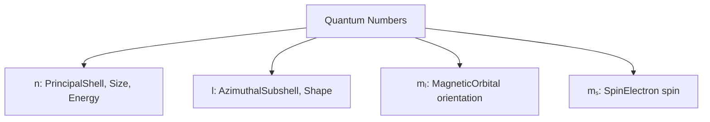

> Master the Schrödinger equation, wave functions, and quantum numbers for JEE Chemistry.

## Introduction

The quantum mechanical model, developed by Schrödinger, Heisenberg, and others in the 1920s, replaced Bohr’s model with a more accurate description of atomic structure based on probability rather than definite orbits.

---

## Schrödinger Wave Equation

### The Equation

$$\hat{H}\psi = E\psi$$

or in full form for a hydrogen atom:

$$\frac{\partial^2 \psi}{\partial x^2} + \frac{\partial^2 \psi}{\partial y^2} + \frac{\partial^2 \psi}{\partial z^2} + \frac{8\pi^2 m}{h^2}(E - V)\psi = 0$$

where:

- $\psi$ = wave function
- $E$ = total energy
- $V$ = potential energy
- $\hat{H}$ = Hamiltonian operator

> **◐ In simple terms · You Don't Need to Solve It!**
>
> For JEE, you need to understand the **concepts and implications**, not solve the equation.

---

## Wave Function (ψ)

### Physical Meaning

The wave function $\psi$ itself has no direct physical meaning, but:

$$|\psi|^2 = \text{Probability density}$$

This gives the probability of finding an electron at a given point.

### Key Properties

1. $\psi$ must be **single-valued** (one value at each point)
2. $\psi$ must be **continuous** (no breaks)
3. $\psi$ must be **finite** (no infinite values)
4. Total probability must equal 1: $\int |\psi|^2 dV = 1$

### Orbitals vs Orbits

| Bohr’s Orbit | Quantum Orbital |
| --- | --- |
| Definite circular path | 3D region of probability |
| Electron has fixed position | Electron has probability distribution |
| 2D picture | 3D wave function |

---

## Quantum Numbers

Four quantum numbers completely describe an electron’s state:



---

## 1. Principal Quantum Number (n)

### Definition

Describes the **shell** and determines the **size and energy** of the orbital.

### Allowed Values

$$n = 1, 2, 3, 4, ... \text{ (positive integers)}$$

### Significance

| n | Shell | Max electrons (2n²) |
| --- | --- | --- |
| 1 | K | 2 |
| 2 | L | 8 |
| 3 | M | 18 |
| 4 | N | 32 |

- **Energy**: $E \propto -\frac{1}{n^2}$ (for H-like atoms)
- **Size**: $r \propto n^2$

---

## 2. Azimuthal/Angular Momentum Quantum Number (l)

### Definition

Describes the **subshell** and determines the **shape** of the orbital.

### Allowed Values

$$l = 0, 1, 2, ..., (n-1)$$

For each n, there are n possible values of l.

### Subshell Notation

| l | Subshell | Shape | Number of orbitals |
| --- | --- | --- | --- |
| 0 | s | Spherical | 1 |
| 1 | p | Dumbbell | 3 |
| 2 | d | Double dumbbell | 5 |
| 3 | f | Complex | 7 |

### Angular Momentum

$$L = \sqrt{l(l+1)} \cdot \frac{h}{2\pi}$$

> **★ Key point · Valid Subshells**
>
> - n=1: only 1s (l=0)

> - n=2: 2s, 2p (l=0,1)

> - n=3: 3s, 3p, 3d (l=0,1,2)

> - n=4: 4s, 4p, 4d, 4f (l=0,1,2,3)
>
> No 1p, 2d, 3f etc.!

---

## 3. Magnetic Quantum Number (mₗ)

### Definition

Describes the **orientation** of the orbital in space.

### Allowed Values

$$m_l = -l, -(l-1), ..., 0, ..., (l-1), +l$$

Total values = (2l + 1)

### Examples

| Subshell | l | mₗ values | Number of orbitals |
| --- | --- | --- | --- |
| s | 0 | 0 | 1 |
| p | 1 | -1, 0, +1 | 3 |
| d | 2 | -2, -1, 0, +1, +2 | 5 |
| f | 3 | -3, -2, -1, 0, +1, +2, +3 | 7 |

### Interactive Demo: Visualize 3D Orbital Shapes

Explore the shapes of s, p, d, and f orbitals in three dimensions.

---

## 4. Spin Quantum Number (mₛ)

### Definition

Describes the **intrinsic angular momentum** (spin) of the electron.

### Allowed Values

$$m_s = +\frac{1}{2} \text{ or } -\frac{1}{2}$$

- $+\frac{1}{2}$: spin up (↑)
- $-\frac{1}{2}$: spin down (↓)

### Spin Angular Momentum

$$S = \sqrt{s(s+1)} \cdot \frac{h}{2\pi} = \sqrt{\frac{3}{4}} \cdot \frac{h}{2\pi}$$

---

## Summary Table

| Quantum Number | Symbol | Values | Determines |
| --- | --- | --- | --- |
| Principal | n | 1, 2, 3, &mldr; | Shell, size, energy |
| Azimuthal | l | 0 to (n-1) | Subshell, shape |
| Magnetic | mₗ | -l to +l | Orbital orientation |
| Spin | mₛ | ±½ | Electron spin |

---

## Counting Electrons

### Maximum Electrons

- **In an orbital**: 2 (opposite spins)
- **In a subshell**: 2(2l + 1)
- **In a shell**: 2n²

| Shell | Subshells | Total orbitals | Max electrons |
| --- | --- | --- | --- |
| K (n=1) | 1s | 1 | 2 |
| L (n=2) | 2s, 2p | 1+3=4 | 8 |
| M (n=3) | 3s, 3p, 3d | 1+3+5=9 | 18 |
| N (n=4) | 4s, 4p, 4d, 4f | 1+3+5+7=16 | 32 |

---

## Quantum Number Problems

### Example 1: Valid Set

**Problem:** Which set is valid? (n, l, mₗ, mₛ)
a) (2, 2, 0, +½)
b) (3, 2, -2, -½)
c) (2, 1, 2, +½)

**Solution:**

- a) Invalid: l cannot equal n (l must be < n)
- b) **Valid**: n=3, l=2 (d subshell), mₗ=-2 (allowed for l=2), mₛ=-½ (correct)
- c) Invalid: mₗ=2 not allowed when l=1 (range is -1 to +1)

### Example 2: Electron Count

**Problem:** How many electrons in an atom can have n=3, l=2?

**Solution:**
n=3, l=2 → 3d subshell
Number of orbitals = 2(2)+1 = 5
Maximum electrons = 5 × 2 = **10**

### Example 3: Possible Sets

**Problem:** How many possible sets of quantum numbers exist for n=2?

**Solution:**
For n=2: l = 0, 1

| l | mₗ | mₛ | Total |
| --- | --- | --- | --- |
| 0 | 0 | ±½ | 2 |
| 1 | -1, 0, +1 | ±½ each | 6 |

**Total = 8** (which equals 2n² = 2×4 = 8, correct!)

---

## Key Points for JEE

> **★ Key point · Remember These!**
>
> 1. l is always less than n

> 2. mₗ ranges from -l to +l

> 3. Each orbital holds maximum 2 electrons

> 4. No two electrons can have all four quantum numbers same (Pauli)

> 5. Number of orbitals in a subshell = 2l + 1

> 6. Number of orbitals in a shell = n²

---

## Practice Problems

1. Write all possible sets of quantum numbers for 3p electrons.
2. An electron has quantum numbers n=4, l=2. What are the possible values of mₗ?
3. How many orbitals in an atom can have n=4 and mₗ=0?

> **↗ Connection · Quick Check**
>
> Why can’t two electrons in the same orbital have the same spin?

---

From TestGuru · our mock-test platform

## You've read Quantum Mechanical Model.You've read this topic. Find out what you actually got.

A free JEE Main mock with this chapter in it, and a report that shows which sub-topics cost you marks.

[Take a free JEE Main mock →](https://app.testguru.co/signup?tg_chapter=atomic-structure&tg_exam=jee-main&tg_page=%2Fchemistry%2Fatomic-structure%2Fquantum-model%2F&tg_subject=chemistry&utm_campaign=notes-jee-main-free-test&utm_content=article-end&utm_medium=referral&utm_source=jeenotes)
Free, no card. Opens TestGuru in a new tab.

## Stay exam-ready

One email every Sunday: new notes, the week's hardest challenge question and a revision plan.One email every Sunday.

## Comments

Have a question or spotted a mistake? Join the discussion below.

Advertisement

Advertisement

---

## Extracted page code (interactive scripts & widgets)


### inline-script-16

```js
if(!document.getElementById("animation-fullscreen-overlay")){const e=document.createElement("div");e.id="animation-fullscreen-overlay",e.className="animation-fullscreen-overlay",e.innerHTML=`
      <div class="fullscreen-modal">
        <div class="fullscreen-header">
          <span class="fullscreen-title">Interactive Demo</span>
          <button class="fullscreen-close-btn" onclick="JEEAnimations.closeFullscreen()" title="Close (Esc)" aria-label="Close fullscreen">
            <svg width="24" height="24" viewBox="0 0 24 24" fill="none" stroke="currentColor" stroke-width="2" stroke-linecap="round" stroke-linejoin="round">
              <line x1="18" y1="6" x2="6" y2="18"></line>
              <line x1="6" y1="6" x2="18" y2="18"></line>
            </svg>
          </button>
        </div>
        <div class="fullscreen-content"></div>
      </div>
    `,document.body.appendChild(e),document.addEventListener("keydown",function(e){e.key==="Escape"&&document.body.classList.contains("animation-fullscreen-active")&&JEEAnimations.closeFullscreen()}),e.addEventListener("click",function(t){t.target===e&&JEEAnimations.closeFullscreen()})}
```


### inline-script-17

```js
(function(){var t,e=document.getElementById("disqus-load");if(!e)return;t=!1,e.addEventListener("click",function(){if(t)return;t=!0,e.setAttribute("disabled","disabled"),e.textContent="Loading comments…",window.disqus_config=function(){this.page.url="https://jeenotes.in/chemistry/atomic-structure/quantum-model/",this.page.identifier="/chemistry/atomic-structure/quantum-model/"};var s=document,n=s.createElement("script");n.src="https://https-jeenotes-in.disqus.com/embed.js",n.setAttribute("data-timestamp",+new Date),n.onload=function(){e.style.display="none"},n.onerror=function(){t=!1,e.removeAttribute("disabled"),e.textContent="Could not load comments. Tap to retry"},(s.head||s.body).appendChild(n)})})()
```


### inline-script-18

```js
(function(){var t,e=document.currentScript.previousElementSibling;function n(){(window.adsbygoogle=window.adsbygoogle||[]).push({})}if(!window.ResizeObserver||e.clientWidth>0){n();return}t=new ResizeObserver(function(){e.clientWidth>0&&(t.disconnect(),n())}),t.observe(e)})()
```


### interactive-widget-1

```html
<div class="animation-wrapper" data-animation="orbitalShapes" id="anim-orbitalShapes-1795396418785938286"><div class="animation-header"><button aria-label="Toggle fullscreen" class="anim-fullscreen-btn" onclick='JEEAnimations.toggleFullscreen("anim-orbitalShapes-1795396418785938286")' title="Fullscreen (F)">
<svg class="fullscreen-icon-expand" fill="none" height="18" stroke="currentColor" stroke-linecap="round" stroke-linejoin="round" stroke-width="2" viewbox="0 0 24 24" width="18"><polyline points="15 3 21 3 21 9"></polyline><polyline points="9 21 3 21 3 15"></polyline><line x1="21" x2="14" y1="3" y2="10"></line><line x1="3" x2="10" y1="21" y2="14"></line></svg>
<svg class="fullscreen-icon-collapse" fill="none" height="18" stroke="currentColor" stroke-linecap="round" stroke-linejoin="round" stroke-width="2" viewbox="0 0 24 24" width="18"><polyline points="4 14 10 14 10 20"></polyline><polyline points="20 10 14 10 14 4"></polyline><line x1="14" x2="21" y1="10" y2="3"></line><line x1="3" x2="10" y1="21" y2="14"></line></svg>
<span class="fullscreen-text">Fullscreen</span></button></div><div class="animation-content"><noscript><div class="callout callout-warning"><div class="callout-title">JavaScript Required</div><p>This interactive animation requires JavaScript to be enabled.</p></div></noscript></div></div>
```


---

_Source: [https://jeenotes.in/chemistry/atomic-structure/quantum-model/](https://jeenotes.in/chemistry/atomic-structure/quantum-model/) · raw HTML: `offline/chemistry/atomic-structure/quantum-model/index.html`_
