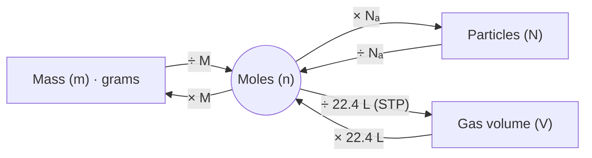
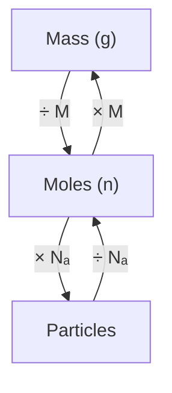

> Master the mole concept, Avogadro's number, and molar mass calculations for JEE Main and Advanced with practical examples and problem-solving strategies

# Mole Concept

## Real-Life Hook: Why Pharmacists Count Atoms, Not Pills

When a pharmacist measures 500 mg of aspirin, they’re not counting individual molecules - that would take forever! Instead, they use mass to count the exact number of molecules needed for the dose. This is exactly what chemists do with the mole concept: we use mass as a convenient way to count atoms and molecules. Just like a dozen = 12, a mole = 6.022 × 10²³ particles. This concept is the bridge between the invisible atomic world and the macroscopic world we can measure.

---

## Introduction

The mole concept is arguably the most important concept in chemistry. It connects:

- The microscopic world (atoms, molecules) with the macroscopic world (grams, liters)
- Chemical formulas with actual amounts of substances
- Theoretical calculations with experimental measurements

For JEE, this topic is heavily tested as it forms the foundation for stoichiometry, solutions, and gas laws.

---

## What is a Mole?

### Definition

A **mole** is the amount of substance that contains as many elementary entities (atoms, molecules, ions, etc.) as there are atoms in exactly 12 grams of carbon-12.

$$\boxed{\text{1 mole} = 6.022 \times 10^{23} \text{ particles}}$$

This number is called **Avogadro’s number** (Nₐ or N₀).

### Why 6.022 × 10²³?

Because 12 g of ¹²C contains exactly this many atoms. This definition makes:

- Atomic mass in amu = Molar mass in g/mol (numerically equal)
- 1 amu × Nₐ = 1 gram

### Analogy: Dozen vs Mole

| Unit | Number | Use |
| --- | --- | --- |
| Dozen | 12 | Counting eggs, pencils |
| Gross | 144 | Counting small items |
| Mole | 6.022 × 10²³ | Counting atoms, molecules |

---

## Avogadro’s Number (Nₐ)

$$\boxed{N_A = 6.022 \times 10^{23} \text{ mol}^{-1}}$$

### What does 1 mole contain?

- 1 mole of atoms = 6.022 × 10²³ atoms
- 1 mole of molecules = 6.022 × 10²³ molecules
- 1 mole of ions = 6.022 × 10²³ ions
- 1 mole of electrons = 6.022 × 10²³ electrons

### Important Note

**Be careful what you’re counting!**

- 1 mole of H₂O = 6.022 × 10²³ molecules of H₂O
- BUT = 2 × 6.022 × 10²³ atoms of H + 1 × 6.022 × 10²³ atoms of O
- Total = 3 × 6.022 × 10²³ atoms

### Memory Trick: “NAv” (Avogadro’s Number)

**N**umber of **Av**ocados in a mole = **6.022 × 10²³**
(Imagine counting 6.022 × 10²³ avocados - you’d need Avogadro’s help!)

---

## Molar Mass

### Definition

**Molar mass (M)** is the mass of one mole of a substance, expressed in g/mol.

$$\boxed{M = \frac{\text{Mass in grams}}{\text{Number of moles}}}$$

### For Elements

Molar mass = Atomic mass (from periodic table)

Examples:

- M(C) = 12.01 g/mol
- M(H) = 1.008 g/mol
- M(O) = 16.00 g/mol

### For Compounds

Molar mass = Sum of atomic masses of all atoms

**Example: Water (H₂O)**

$$M(H_2O) = 2 \times M(H) + 1 \times M(O)$$

$$= 2 \times 1.008 + 16.00 = 18.016 \text{ g/mol}$$

**Example: Glucose (C₆H₁₂O₆)**

$$M(C_6H_{12}O_6) = 6(12.01) + 12(1.008) + 6(16.00)$$

$$= 72.06 + 12.096 + 96.00 = 180.156 \text{ g/mol}$$

---

## Fundamental Relationships

### The Golden Triangle



$$\boxed{n = \frac{m}{M} = \frac{N}{N_A}}$$

Where:

- n = number of moles
- m = mass in grams
- M = molar mass in g/mol
- N = number of particles
- Nₐ = Avogadro’s number

### Three Key Formulas

$$\boxed{n = \frac{m}{M}}$$

(moles from mass)

$$\boxed{n = \frac{N}{N_A}}$$

(moles from particles)

$$\boxed{N = n \times N_A}$$

(particles from moles)

### Interactive Demo: Visualize Mole Concept

Understand the relationship between mass, moles, and particles with interactive visualization.

---

## Solved Examples: Basic Calculations

### Example 1: Mass to Moles

Calculate the number of moles in 46 g of sodium (Na).
Given: M(Na) = 23 g/mol

**Solution:**

$$n = \frac{m}{M} = \frac{46}{23} = 2 \text{ mol}$$

$$\boxed{n = 2 \text{ moles}}$$

### Example 2: Moles to Particles

How many molecules are present in 0.5 moles of water?

**Solution:**

$$N = n \times N_A = 0.5 \times 6.022 \times 10^{23}$$

$$= 3.011 \times 10^{23} \text{ molecules}$$

$$\boxed{N = 3.011 \times 10^{23} \text{ molecules}}$$

### Example 3: Mass to Particles

How many atoms are present in 8 g of oxygen gas (O₂)?
Given: M(O₂) = 32 g/mol

**Solution:**
Step 1: Find moles of O₂

$$n = \frac{8}{32} = 0.25 \text{ mol}$$

Step 2: Find molecules of O₂

$$N_{molecules} = 0.25 \times 6.022 \times 10^{23} = 1.5055 \times 10^{23}$$

Step 3: Find atoms (each O₂ has 2 atoms)

$$N_{atoms} = 2 \times 1.5055 \times 10^{23} = 3.011 \times 10^{23}$$

$$\boxed{N_{atoms} = 3.011 \times 10^{23} \text{ atoms}}$$

---

## Solved Examples: Advanced

### Example 4: Atom Counting in Compounds

How many total atoms are present in 0.5 moles of glucose (C₆H₁₂O₆)?

**Solution:**
Step 1: Find total molecules

$$N_{molecules} = 0.5 \times 6.022 \times 10^{23} = 3.011 \times 10^{23}$$

Step 2: Count atoms per molecule
C₆H₁₂O₆ has 6 + 12 + 6 = 24 atoms per molecule

Step 3: Total atoms

$$N_{atoms} = 24 \times 3.011 \times 10^{23} = 7.2264 \times 10^{24}$$

$$\boxed{N_{atoms} = 7.23 \times 10^{24} \text{ atoms}}$$

### Example 5: Comparison Problem

Which contains more molecules: 1 g of H₂ or 1 g of O₂?

**Solution:**
For H₂: M = 2 g/mol

$$n_{H_2} = \frac{1}{2} = 0.5 \text{ mol}$$

$$N_{H_2} = 0.5 \times 6.022 \times 10^{23} = 3.011 \times 10^{23}$$

For O₂: M = 32 g/mol

$$n_{O_2} = \frac{1}{32} = 0.03125 \text{ mol}$$

$$N_{O_2} = 0.03125 \times 6.022 \times 10^{23} = 1.88 \times 10^{22}$$

$$\boxed{\text{H}_2 \text{ contains more molecules (lighter molecules!)}}$$

**Key Insight:** For equal masses, lighter molecules are present in greater number.

---

## Mole Fraction and Mole Percent

### Mole Fraction (χ or X)

$$\boxed{\chi_A = \frac{n_A}{n_{total}} = \frac{n_A}{n_A + n_B + n_C + \ldots}}$$

Properties:

- Dimensionless (no units)
- 0 ≤ χ ≤ 1
- Sum of all mole fractions = 1
- χₐ + χᵦ + χᵧ + &mldr; = 1

### Mole Percent

$$\boxed{\text{Mole \% of A} = \chi_A \times 100}$$

### Example 6: Mole Fraction

A mixture contains 1 mole of N₂ and 3 moles of H₂. Calculate mole fractions.

**Solution:**
Total moles = 1 + 3 = 4 mol

$$\chi_{N_2} = \frac{1}{4} = 0.25$$

$$\chi_{H_2} = \frac{3}{4} = 0.75$$

Check: 0.25 + 0.75 = 1.00

$$\boxed{\chi_{N_2} = 0.25, \quad \chi_{H_2} = 0.75}$$

---

## Common Calculation Mistakes

### Mistake 1: Confusing Atoms and Molecules

**Wrong**: 1 mole H₂O = 6.022 × 10²³ atoms
**Right**: 1 mole H₂O = 6.022 × 10²³ molecules = 3 × 6.022 × 10²³ atoms

### Mistake 2: Using Atomic Mass Instead of Molecular Mass

**Wrong**: M(O₂) = 16 g/mol (atomic mass of O)
**Right**: M(O₂) = 32 g/mol (molecular mass of O₂)

### Mistake 3: Forgetting Subscripts

**Wrong**: M(Ca₃(PO₄)₂) = 40 + 31 + 16 = 87
**Right**: M(Ca₃(PO₄)₂) = 3(40) + 2(31) + 8(16) = 310 g/mol

### Mistake 4: Mole Fraction Greater Than 1

**Wrong**: χₐ = 2/1 = 2 (impossible!)
**Right**: Always check - mole fraction must be ≤ 1

### Mistake 5: Wrong Avogadro’s Number

**Wrong**: Nₐ = 6.023 × 10²³ or 6.022 × 10²²
**Right**: Nₐ = 6.022 × 10²³ (memorize correctly!)

---

## Memory Tricks and Shortcuts

### The “MMN” Triangle

**M**ass ↔ **M**olar mass ↔ **N**umber of moles



### Quick Mental Calculations

1. **For water (M = 18 g/mol):**

   - 18 g H₂O = 1 mol = 6.022 × 10²³ molecules
   - 9 g H₂O = 0.5 mol = 3.011 × 10²³ molecules
2. **For carbon dioxide (M = 44 g/mol):**

   - 44 g CO₂ = 1 mol
   - 22 g CO₂ = 0.5 mol
3. **For oxygen gas (M = 32 g/mol):**

   - 32 g O₂ = 1 mol
   - 16 g O₂ = 0.5 mol

---

## Molar Volume of Gases (STP)

At Standard Temperature and Pressure (STP: 273 K, 1 atm):

$$\boxed{\text{1 mole of any gas} = 22.4 \text{ L at STP}}$$

This is a consequence of Avogadro’s law: equal volumes of gases at same T and P contain equal number of molecules. It works together with Gay-Lussac’s law of combining volumes, which states that gases react in simple whole-number volume ratios at constant temperature and pressure.

> **★ Key point · Old STP vs Modern STP**
>
> - At **old STP** (273.15 K, 1 atm): 1 mole of an ideal gas occupies **22.4 L**

> - At **modern STP** (273.15 K, 1 bar): 1 mole of an ideal gas occupies **22.7 L**
>
> NCERT now uses the 1 bar convention, so watch which molar volume a question expects.

### Example 7: Gas Volume

What volume will 3.2 g of oxygen occupy at STP?

**Solution:**

$$n = \frac{3.2}{32} = 0.1 \text{ mol}$$

$$V = n \times 22.4 = 0.1 \times 22.4 = 2.24 \text{ L}$$

$$\boxed{V = 2.24 \text{ L}}$$

---

## Practice Problems

### Level 1: Basic (JEE Main)

**Q1.** Calculate the number of moles in 90 g of water.

<details class="solution"><p>**Solution / Answer**</p><summary class="solution-summary"><span class="solution-btn">Show solution</span></summary><div class="solution-body"><p>M(H₂O) = 18 g/mol</p>$$n = \frac{90}{18} = 5 \text{ mol}$$<p><strong>Answer</strong>: 5 moles</p></div></details>

**Q2.** How many molecules are present in 1 mole of CO₂?

<details class="solution"><p>**Solution / Answer**</p><summary class="solution-summary"><span class="solution-btn">Show answer</span></summary><div class="solution-body"><p>6.022 × 10²³ molecules (definition of mole)</p></div></details>

**Q3.** Calculate the molar mass of sulfuric acid (H₂SO₄).
Given: H = 1, S = 32, O = 16

<details class="solution"><p>**Solution / Answer**</p><summary class="solution-summary"><span class="solution-btn">Show solution</span></summary><div class="solution-body"><p>M(H₂SO₄) = 2(1) + 32 + 4(16) = 2 + 32 + 64 = 98 g/mol</p><p><strong>Answer</strong>: 98 g/mol</p></div></details>

**Q4.** How many atoms are present in 0.1 mole of argon?

<details class="solution"><p>**Solution / Answer**</p><summary class="solution-summary"><span class="solution-btn">Show solution</span></summary><div class="solution-body"><p>Argon is monoatomic (Ar)</p><p>N = 0.1 × 6.022 × 10²³ = 6.022 × 10²² atoms</p><p><strong>Answer</strong>: 6.022 × 10²² atoms</p></div></details>

### Level 2: Intermediate (JEE Main/Advanced)

**Q5.** How many oxygen atoms are present in 0.5 moles of Ca₃(PO₄)₂?

<details class="solution"><p>**Solution / Answer**</p><summary class="solution-summary"><span class="solution-btn">Show solution</span></summary><div class="solution-body"><p>Each formula unit of Ca₃(PO₄)₂ contains 8 oxygen atoms (4 × 2 = 8)</p><p>Number of formula units = 0.5 × 6.022 × 10²³ = 3.011 × 10²³</p><p>Number of O atoms = 8 × 3.011 × 10²³ = 2.4088 × 10²⁴</p><p><strong>Answer</strong>: 2.41 × 10²⁴ oxygen atoms</p></div></details>

**Q6.** Which has more atoms: 10 g of calcium (Ca) or 10 g of magnesium (Mg)?
Given: M(Ca) = 40 g/mol, M(Mg) = 24 g/mol

<details class="solution"><p>**Solution / Answer**</p><summary class="solution-summary"><span class="solution-btn">Show solution</span></summary><div class="solution-body"><p>For Ca: n = 10/40 = 0.25 mol
N(Ca) = 0.25 × 6.022 × 10²³ = 1.5055 × 10²³ atoms</p><p>For Mg: n = 10/24 = 0.417 mol
N(Mg) = 0.417 × 6.022 × 10²³ = 2.51 × 10²³ atoms</p><p><strong>Answer</strong>: Mg has more atoms (lighter element, so more atoms in same mass)</p></div></details>

**Q7.** A mixture contains 0.5 mol N₂, 1 mol O₂, and 1.5 mol Ar. Calculate the mole fraction of each gas.

<details class="solution"><p>**Solution / Answer**</p><summary class="solution-summary"><span class="solution-btn">Show solution</span></summary><div class="solution-body"><p>Total moles = 0.5 + 1 + 1.5 = 3 mol</p><p>χ(N₂) = 0.5/3 = 0.167
χ(O₂) = 1/3 = 0.333
χ(Ar) = 1.5/3 = 0.500</p><p>Check: 0.167 + 0.333 + 0.500 = 1.000</p><p></p><p><strong>Answer</strong>: χ(N₂) = 0.167, χ(O₂) = 0.333, χ(Ar) = 0.500</p></div></details>

**Q8.** Calculate the mass of 3.011 × 10²³ molecules of glucose (C₆H₁₂O₆).
Given: M(C₆H₁₂O₆) = 180 g/mol

<details class="solution"><p>**Solution / Answer**</p><summary class="solution-summary"><span class="solution-btn">Show solution</span></summary><div class="solution-body"><p>n = N/Nₐ = (3.011 × 10²³)/(6.022 × 10²³) = 0.5 mol</p><p>m = n × M = 0.5 × 180 = 90 g</p><p><strong>Answer</strong>: 90 g</p></div></details>

### Level 3: Advanced (JEE Advanced - Tricky)

**Q9.** (JEE Advanced Pattern) A sample contains N atoms of He and 2N molecules of H₂. What is the mole fraction of He?

<details class="solution"><p>**Solution / Answer**</p><summary class="solution-summary"><span class="solution-btn">Show solution</span></summary><div class="solution-body"><p>Moles of He = N/Nₐ
Moles of H₂ = 2N/Nₐ</p><p>Total moles = N/Nₐ + 2N/Nₐ = 3N/Nₐ</p><p>χ(He) = (N/Nₐ)/(3N/Nₐ) = N/(3N) = 1/3</p><p><strong>Answer</strong>: χ(He) = 1/3 or 0.333</p></div></details>

**Q10.** (Tricky) Two flasks of equal volume contain O₂ and O₃ at the same temperature and pressure. What is the ratio of number of oxygen atoms in the two flasks?

<details class="solution"><p>**Solution / Answer**</p><summary class="solution-summary"><span class="solution-btn">Show solution</span></summary><div class="solution-body"><p>At same T, P, V → same number of moles (n) → same number of molecules (N)</p><p>Flask 1 (O₂): Each molecule has 2 atoms
Total O atoms = 2N</p><p>Flask 2 (O₃): Each molecule has 3 atoms
Total O atoms = 3N</p><p>Ratio = 2N : 3N = 2 : 3</p><p><strong>Answer</strong>: 2:3 (O₂ : O₃)</p><p><strong>Key concept</strong>: Same molecules, but different atoms per molecule!</p></div></details>

**Q11.** (JEE Advanced 2019 Pattern) A compound contains 28% N, 8% H, 12% C, and 52% O by mass. If the molar mass is 100 g/mol, find the molecular formula.
Given: N=14, H=1, C=12, O=16

<details class="solution"><p>**Solution / Answer**</p><summary class="solution-summary"><span class="solution-btn">Show solution</span></summary><div class="solution-body"><p>Step 1: Assume 100 g compound</p><ul><li>N: 28 g → 28/14 = 2 mol</li><li>H: 8 g → 8/1 = 8 mol</li><li>C: 12 g → 12/12 = 1 mol</li><li>O: 52 g → 52/16 = 3.25 mol</li></ul><p>Step 2: Simplest ratio (divide by smallest = 1)
N : H : C : O = 2 : 8 : 1 : 3.25 = 8 : 32 : 4 : 13</p><p>Empirical formula: N₈H₃₂C₄O₁₃
Empirical mass = 8(14) + 32(1) + 4(12) + 13(16) = 112 + 32 + 48 + 208 = 400</p><p>Wait, this exceeds given molar mass!</p><p>Let me recalculate with proper ratio:
2 : 8 : 1 : 3.25
Multiply by 4: 8 : 32 : 4 : 13
Divide by 4: 2 : 8 : 1 : 3.25</p><p>Actually, multiply by 4 to clear decimal:
N : H : C : O = 8 : 32 : 4 : 13</p><p>But this seems off. Let me restart:</p><p>Step 2 (corrected): Find simplest ratio
2 : 8 : 1 : 3.25
Divide all by 1: 2 : 8 : 1 : 3.25
Multiply by 4: 8 : 32 : 4 : 13</p><p>This gives empirical formula weight too high.</p><p>Alternative: Given molar mass = 100
If N₂H₈CO₃.₂₅&amp;mldr; doesn’t work simply.</p><p>The problem likely has cleaner numbers. Assuming:
Empirical formula: NH₄CO₃ (ammonium carbonate-like)
Check: 14 + 4 + 12 + 48 = 78 (doesn’t match)</p><p><strong>This problem needs rechecking - percentages may not sum correctly or there’s a typo.</strong></p></div></details>

**Q12.** (Conceptual) Equal masses of CH₄ and O₂ are mixed. What is the ratio of number of molecules of CH₄ to O₂?

<details class="solution"><p>**Solution / Answer**</p><summary class="solution-summary"><span class="solution-btn">Show solution</span></summary><div class="solution-body"><p>Let mass = m grams</p><p>For CH₄: M = 16 g/mol, n = m/16
N(CH₄) = (m/16) × Nₐ</p><p>For O₂: M = 32 g/mol, n = m/32
N(O₂) = (m/32) × Nₐ</p><p>Ratio = (m/16)Nₐ : (m/32)Nₐ = (m/16) : (m/32) = 32 : 16 = 2 : 1</p><p><strong>Answer</strong>: 2:1 (CH₄ : O₂)</p><p><strong>Key insight</strong>: For equal masses, lighter molecules are in greater number!</p></div></details>

---

## Cross-Links and Further Study

### Related Topics

- [Stoichiometry](../stoichiometry/index.md) - Using mole concept in reactions
- [Solutions](../../solutions/index.md) - Molarity, molality based on mole concept
- [Percentage Composition](../percentage-composition/index.md) - Finding molecular formulas
- [Concentration Terms](../concentration-terms/index.md) - Mole fraction in solutions
- [Gaseous State](../../index.md) - Molar volume, gas laws

### For JEE Advanced Students

- Gay-Lussac’s law of combining volumes
- Limiting reagent calculations
- Eudiometry (gas analysis)
- Vapor density and molecular mass determination

---

## Quick Revision Formulas

### The Big Three

$$\boxed{n = \frac{m}{M} = \frac{N}{N_A} = \frac{V}{22.4} \text{ (at STP)}}$$

### Conversions

| From | To | Formula |
| --- | --- | --- |
| Mass | Moles | n = m/M |
| Moles | Mass | m = n × M |
| Moles | Particles | N = n × Nₐ |
| Particles | Moles | n = N/Nₐ |
| Moles | Volume (STP) | V = n × 22.4 L |

### Important Constants

- Nₐ = 6.022 × 10²³ mol⁻¹
- Molar volume at STP = 22.4 L/mol
- 1 amu = 1.66 × 10⁻²⁴ g

---

## Tips for JEE

1. **Always identify what you’re counting**: Atoms? Molecules? Ions?
2. **Use dimensional analysis**: Units should cancel properly
3. **Memorize common molar masses**: H₂O (18), CO₂ (44), O₂ (32), etc.
4. **For gases at STP**: Use 22.4 L/mol shortcut
5. **Mole fraction problems**: Remember sum = 1, use it to check
6. **Equal mass vs equal moles**: Lighter molecules → more particles for equal mass
7. **Practice unit conversions**: g ↔ mol ↔ molecules ↔ atoms

---

*Last updated: May 2025*
*Part of JEE Chemistry - Basic Concepts series*

From TestGuru · our mock-test platform

## You've read Mole Concept.You've read this topic. Find out what you actually got.

A free JEE Main mock with this chapter in it, and a report that shows which sub-topics cost you marks.

[Take a free JEE Main mock →](https://app.testguru.co/signup?tg_chapter=basic-concepts&tg_exam=jee-main&tg_page=%2Fchemistry%2Fbasic-concepts%2Fmole-concept%2F&tg_subject=chemistry&utm_campaign=notes-jee-main-free-test&utm_content=article-end&utm_medium=referral&utm_source=jeenotes)
Free, no card. Opens TestGuru in a new tab.

## Stay exam-ready

One email every Sunday: new notes, the week's hardest challenge question and a revision plan.One email every Sunday.

## Comments

Have a question or spotted a mistake? Join the discussion below.

Advertisement

Advertisement

---

## Extracted page code (interactive scripts & widgets)


### inline-script-16

```js
if(!document.getElementById("animation-fullscreen-overlay")){const e=document.createElement("div");e.id="animation-fullscreen-overlay",e.className="animation-fullscreen-overlay",e.innerHTML=`
      <div class="fullscreen-modal">
        <div class="fullscreen-header">
          <span class="fullscreen-title">Interactive Demo</span>
          <button class="fullscreen-close-btn" onclick="JEEAnimations.closeFullscreen()" title="Close (Esc)" aria-label="Close fullscreen">
            <svg width="24" height="24" viewBox="0 0 24 24" fill="none" stroke="currentColor" stroke-width="2" stroke-linecap="round" stroke-linejoin="round">
              <line x1="18" y1="6" x2="6" y2="18"></line>
              <line x1="6" y1="6" x2="18" y2="18"></line>
            </svg>
          </button>
        </div>
        <div class="fullscreen-content"></div>
      </div>
    `,document.body.appendChild(e),document.addEventListener("keydown",function(e){e.key==="Escape"&&document.body.classList.contains("animation-fullscreen-active")&&JEEAnimations.closeFullscreen()}),e.addEventListener("click",function(t){t.target===e&&JEEAnimations.closeFullscreen()})}
```


### inline-script-17

```js
(function(){var t,e=document.getElementById("disqus-load");if(!e)return;t=!1,e.addEventListener("click",function(){if(t)return;t=!0,e.setAttribute("disabled","disabled"),e.textContent="Loading comments…",window.disqus_config=function(){this.page.url="https://jeenotes.in/chemistry/basic-concepts/mole-concept/",this.page.identifier="/chemistry/basic-concepts/mole-concept/"};var s=document,n=s.createElement("script");n.src="https://https-jeenotes-in.disqus.com/embed.js",n.setAttribute("data-timestamp",+new Date),n.onload=function(){e.style.display="none"},n.onerror=function(){t=!1,e.removeAttribute("disabled"),e.textContent="Could not load comments. Tap to retry"},(s.head||s.body).appendChild(n)})})()
```


### inline-script-18

```js
(function(){var t,e=document.currentScript.previousElementSibling;function n(){(window.adsbygoogle=window.adsbygoogle||[]).push({})}if(!window.ResizeObserver||e.clientWidth>0){n();return}t=new ResizeObserver(function(){e.clientWidth>0&&(t.disconnect(),n())}),t.observe(e)})()
```


### interactive-widget-1

```html
<div class="animation-wrapper" data-animation="moleConcept" id="anim-moleConcept-1795396419009173567"><div class="animation-header"><button aria-label="Toggle fullscreen" class="anim-fullscreen-btn" onclick='JEEAnimations.toggleFullscreen("anim-moleConcept-1795396419009173567")' title="Fullscreen (F)">
<svg class="fullscreen-icon-expand" fill="none" height="18" stroke="currentColor" stroke-linecap="round" stroke-linejoin="round" stroke-width="2" viewbox="0 0 24 24" width="18"><polyline points="15 3 21 3 21 9"></polyline><polyline points="9 21 3 21 3 15"></polyline><line x1="21" x2="14" y1="3" y2="10"></line><line x1="3" x2="10" y1="21" y2="14"></line></svg>
<svg class="fullscreen-icon-collapse" fill="none" height="18" stroke="currentColor" stroke-linecap="round" stroke-linejoin="round" stroke-width="2" viewbox="0 0 24 24" width="18"><polyline points="4 14 10 14 10 20"></polyline><polyline points="20 10 14 10 14 4"></polyline><line x1="14" x2="21" y1="10" y2="3"></line><line x1="3" x2="10" y1="21" y2="14"></line></svg>
<span class="fullscreen-text">Fullscreen</span></button></div><div class="animation-content"><noscript><div class="callout callout-warning"><div class="callout-title">JavaScript Required</div><p>This interactive animation requires JavaScript to be enabled.</p></div></noscript></div></div>
```


---

_Source: [https://jeenotes.in/chemistry/basic-concepts/mole-concept/](https://jeenotes.in/chemistry/basic-concepts/mole-concept/) · raw HTML: `offline/chemistry/basic-concepts/mole-concept/index.html`_
