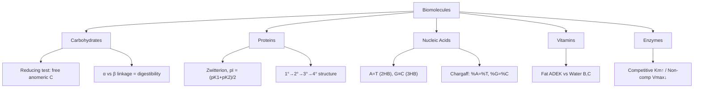

> All key Biomolecules formulas, reactions & facts for JEE Chemistry — carbohydrates, proteins, nucleic acids, vitamins & enzymes quick revision for JEE Main & Advanced.

Last-minute revision sheet for Biomolecules. Since this is a largely descriptive chapter, this sheet front-loads the few genuine formulas (peptide-count, pI, Chargaff, enzyme catalysis) and then packs the rest as high-yield reactions, structural facts, and reference tables. Everything here is drawn straight from the chapter pages.

> **★ Key point · How to use this sheet**
>
> The boxed relations are the only “plug-in” formulas in this chapter. The real marks come from the **reaction outcomes, reducing/non-reducing logic, base-pairing, and deficiency-disease tables** below — scan them like flashcards.

---

## Core Formulas & Relations

These are the only true formulas in the chapter — memorise them cold.

| Quantity | Formula | Notes |
| --- | --- | --- |
| Number of peptides | $n^m$ | $n$ = different amino acids, $m$ = peptide length |
| Isoelectric point | $\text{pI} = \dfrac{\text{pK}_1 + \text{pK}_2}{2}$ | For amino acids without ionizable R group |
| Holoenzyme | Apoenzyme + Cofactor | Apoenzyme alone is inactive |
| Enzyme catalysis | $\text{E} + \text{S} \leftrightarrow \text{ES} \rightarrow \text{E} + \text{P}$ | Enzyme regenerated |

$$\boxed{\text{Number of peptides} = n^m}$$

$$\boxed{\text{pI} = \frac{\text{pK}_1 + \text{pK}_2}{2}}$$

$$\boxed{\text{Apoenzyme} + \text{Cofactor} = \text{Holoenzyme (active)}}$$

$$\boxed{\text{E} + \text{S} \leftrightarrow \text{ES} \rightarrow \text{E} + \text{P}}$$

> **★ Key point · Peptide diversity quick numbers**
>
> With 20 amino acids: dipeptides $= 20^2 = 400$; tripeptides $= 20^3 = 8{,}000$; decapeptides $= 20^{10} \approx$ 10 trillion. This is the standard JEE counting question.

---

## Carbohydrates

### General Formulas

$$\boxed{\text{C}_n(\text{H}_2\text{O})_m}$$

| Class | Formula | Examples |
| --- | --- | --- |
| Monosaccharide (hexose) | $\text{C}_6\text{H}_{12}\text{O}_6$ | Glucose, fructose, galactose |
| Disaccharide | $\text{C}_{12}\text{H}_{22}\text{O}_{11}$ | Sucrose, maltose, lactose |
| Polysaccharide | $(\text{C}_6\text{H}_{10}\text{O}_5)_n$ | Starch, cellulose, glycogen |

### Glucose — Key Structural Facts

- **Aldohexose** ($\text{C}_6\text{H}_{12}\text{O}_6$), **4 chiral centres** (C2, C3, C4, C5).
- **D-configuration**: OH on C5 is on the right (Fischer).
- Exists ~99% in cyclic (pyranose) form via intramolecular hemiacetal (C5-OH attacks C1=O).

| Anomer | OH at C1 (Haworth) | % at equilibrium | Specific rotation |
| --- | --- | --- | --- |
| α-D-glucose | Down (axial) | 36% | +112° |
| β-D-glucose | Up (equatorial) | 64% | +19° |

**Mutarotation:** equilibrium specific rotation $= 0.36(+112°) + 0.64(+19°) = +52.5°$. β is more stable (equatorial OH).

### Reactions of Glucose

$$\text{Glucose} \xrightarrow{[\text{O}],\ \text{Br}_2/\text{H}_2\text{O}} \text{Gluconic acid} \quad(\text{C1 oxidised})$$

$$\text{Glucose} \xrightarrow{\text{conc. HNO}_3} \text{Glucaric (saccharic) acid} \quad(\text{C1 \& C6 oxidised})$$

$$\text{Glucose} \xrightarrow{\text{NaBH}_4\ \text{or}\ \text{H}_2/\text{Ni}} \text{Sorbitol (glucitol)}$$

$$\text{Glucose} + 5(\text{CH}_3\text{CO})_2\text{O} \rightarrow \text{Glucose pentaacetate} \quad(\text{proves 5 OH groups})$$

$$\text{Glucose} + \text{CH}_3\text{OH} \xrightarrow{\text{HCl}} \text{Methyl glucoside} + \text{H}_2\text{O}$$

$$\text{Glucose} \xrightarrow{\text{Fehling's}} \text{red ppt of Cu}_2\text{O} \quad(\text{reducing-sugar test})$$

- **Prolonged HI** on glucose → **n-hexane** (proves straight chain of 6 carbons).

### Fructose

- **Ketohexose** ($\text{C}_6\text{H}_{12}\text{O}_6$), ketone at C2, **3 chiral centres** (C3, C4, C5 — one less than glucose).
- Forms 5-membered **furanose** ring; reducing sugar; sweetest natural sugar.

### Disaccharides

| Sugar | Units | Glycosidic linkage | Reducing? |
| --- | --- | --- | --- |
| Sucrose | Glucose + Fructose | α(1→2) | **No** (both anomeric C tied) |
| Maltose | Glucose + Glucose | α(1→4) | Yes |
| Lactose | Galactose + Glucose | β(1→4) | Yes |

$$\text{Sucrose} + \text{H}_2\text{O} \xrightarrow{\text{H}^+\ \text{or invertase}} \text{Glucose} + \text{Fructose} \quad(\text{invert sugar})$$

$$\text{Maltose} + \text{H}_2\text{O} \xrightarrow{\text{maltase}} 2\ \text{Glucose}$$

$$\text{Lactose} + \text{H}_2\text{O} \xrightarrow{\text{lactase}} \text{Glucose} + \text{Galactose}$$

> **★ Key point · Invert sugar rotation**
>
> Sucrose $[\alpha] = +66.5°$; on hydrolysis → glucose $(+52.5°)$ + fructose $(-92°)$, mixture becomes **laevorotatory** ($\approx -20°$). Sign inverts (+ → −), hence “invert sugar.”

### Polysaccharides

| Polysaccharide | Monomer | Linkage | Key point |
| --- | --- | --- | --- |
| Amylose (starch, 20–30%) | α-D-glucose | α(1→4) | Linear, blue with iodine |
| Amylopectin (starch, 70–80%) | α-D-glucose | α(1→4) + α(1→6) | Branched |
| Cellulose | β-D-glucose | β(1→4) | Indigestible (no cellulase) |
| Glycogen | α-D-glucose | α(1→4) + α(1→6) | “Animal starch,” highly branched |

$$\text{Starch} \xrightarrow{\text{diastase}} \text{Maltose} \xrightarrow{\text{maltase}} \text{Glucose}$$

> **★ Key point · Starch vs cellulose digestion**
>
> Humans have **α-amylase** (breaks α-1,4) so starch is digestible, but **lack cellulase** (β-1,4) so cellulose passes as fibre. α vs β linkage decides everything.

---

## Proteins & Amino Acids

### Structure & Zwitterion

$$\boxed{\text{H}_2\text{N–CHR–COOH}} \qquad \text{Zwitterion: } {}^{+}\text{H}_3\text{N–CHR–COO}^{-}$$

- α-amino acid: -NH₂ and -COOH on same (α) carbon; **chiral except glycine** (R = H).
- 20 common amino acids, all **L-form**.
- Zwitterion (dominant at neutral pH) explains: **high melting point** (e.g. glycine MP 232°C), water-soluble / non-polar-insoluble, amphoteric.

| pH region | Net charge | Form |
| --- | --- | --- |
| pH < pI | Positive | Cation |
| pH = pI | Zero | Zwitterion |
| pH > pI | Negative | Anion |

**Essential amino acids** mnemonic: “PVT TIM HALL” (Phe, Val, Thr, Trp, Ile, Met, His, Arg, Leu, Lys).

### Peptide Bond

$$\text{–COOH} + \text{H}_2\text{N–} \rightarrow \text{–CO–NH–} + \text{H}_2\text{O}$$

- **-CO-NH-** amide linkage; resonance-stabilised, **partial double-bond character**.
- C–N bond length **132 pm** (between single 147 pm and double 127 pm) → **planar**, restricted rotation, usually **trans**.
- Named **N-terminus → C-terminus** (e.g. Gly-Ala-Ser).

### Protein Structure Levels

| Level | What | Bonds | Example |
| --- | --- | --- | --- |
| Primary (1°) | Amino-acid sequence | Peptide bonds | Gly-Ala-Val… |
| Secondary (2°) | Local folding (α-helix, β-sheet) | H-bonds (backbone) | α-keratin, silk fibroin |
| Tertiary (3°) | Overall 3D shape | All interactions (H-bond, ionic, S-S, hydrophobic) | Enzyme active site |
| Quaternary (4°) | Multiple subunits | Same as 3° | Hemoglobin (2α + 2β) |

- **α-helix:** right-handed, **3.6 amino acids/turn**, H-bond between C=O of residue n and N-H of residue (n+4).
- **β-pleated sheet:** extended zigzag, H-bonds between adjacent chains (parallel/antiparallel).

> **★ Key point · Denaturation ≠ hydrolysis**
>
> Denaturation (heat, pH change, heavy metals, organic solvents, detergents) destroys 2°/3°/4° structure and **biological activity** but leaves the **primary structure intact**. Hydrolysis breaks peptide bonds (destroys 1°).

---

## Nucleic Acids

### Building Block

$$\boxed{\text{Nucleotide} = \text{Sugar} + \text{Base} + \text{Phosphate}}$$

$$\text{Nucleoside} = \text{Sugar} + \text{Base} \quad(\text{no phosphate})$$

| Component | DNA | RNA |
| --- | --- | --- |
| Sugar | 2-Deoxyribose (no OH at C2′) | Ribose (OH at C2′) |
| Bases | A, G, C, **T** | A, G, C, **U** |
| Strands | Double helix (antiparallel) | Usually single |
| Stability | More stable | Less stable |

- **Purines** (double ring): Adenine, Guanine — “PURe As Gold.”
- **Pyrimidines** (single ring): Cytosine, Thymine, Uracil — “CUT the PY.”
- Backbone = **sugar–phosphate** via **phosphodiester** linkage; 5′→3′ direction.

### Base Pairing & Chargaff’s Rules

$$A = T \ (2\ \text{H-bonds}) \qquad G \equiv C \ (3\ \text{H-bonds})$$

$$\boxed{[\text{A}] = [\text{T}], \quad [\text{G}] = [\text{C}]}$$

$$[\text{A}] + [\text{G}] = [\text{T}] + [\text{C}] \quad(\%\text{purines} = \%\text{pyrimidines})$$

- DNA double helix (Watson-Crick, 1953): right-handed, **diameter 2 nm**, one turn **3.4 nm = 10 base pairs**.
- Melting temperature: $T_m \propto \%\text{GC content}$ (G≡C has 3 H-bonds, stronger).

### Central Dogma

$$\text{DNA} \xrightarrow{\text{Replication}} \text{DNA} \xrightarrow{\text{Transcription}} \text{RNA} \xrightarrow{\text{Translation}} \text{Protein}$$

- **Codon** = triplet of bases; $4^3 = 64$ codons for 20 amino acids → **degenerate** code.
- **Start:** AUG (methionine). **Stop:** UAA, UAG, UGA.

> **★ Key point · Chargaff shortcut**
>
> Given %A, instantly: %T = %A, then %G = %C = (100 − 2·%A)/2. E.g. 30% A → 30% T, 20% G, 20% C.

---

## Vitamins

### Classification

$$\boxed{\text{Fat-soluble: A, D, E, K (``ADEK'')} \qquad \text{Water-soluble: B-complex \& C}}$$

- **Fat-soluble (ADEK):** stored in liver/adipose, **toxic in excess** (hypervitaminosis), no daily intake needed.
- **Water-soluble (B, C):** not stored (excreted in urine), **no toxicity**, need regular intake.

### Vitamin → Chemical Name → Deficiency

| Vitamin | Chemical name | Type | Deficiency disease |
| --- | --- | --- | --- |
| A | Retinol | Fat | Night blindness, Xerophthalmia |
| D | Calciferol (D₂ ergocalciferol, D₃ cholecalciferol) | Fat | Rickets, Osteomalacia |
| E | α-Tocopherol | Fat | Rare (hemolytic anemia) |
| K | Phylloquinone (K₁), Menaquinone (K₂) | Fat | Hemorrhage |
| B₁ | Thiamine | Water | Beriberi |
| B₂ | Riboflavin | Water | Ariboflavinosis (cheilosis) |
| B₃ | Niacin | Water | Pellagra (3D: dermatitis, diarrhea, dementia) |
| B₆ | Pyridoxine | Water | Anemia, dermatitis |
| B₉ | Folic acid | Water | Megaloblastic anemia |
| B₁₂ | Cobalamin | Water | Pernicious anemia |
| C | L-Ascorbic acid | Water | Scurvy |

> **★ Key point · Unique vitamin facts (high-yield)**
>
> **D** = only vitamin the body can synthesize (UV on 7-dehydrocholesterol). **K** = made by gut bacteria (newborns need an injection). **B₁₂** = only vitamin from animal sources only, only one containing a metal (**cobalt**). **C** = destroyed by heat.

---

## Enzymes

### Specificity Types

| Type | Acts on | Example |
| --- | --- | --- |
| Absolute | One substrate only | Urease (urea only) |
| Group | Specific functional group | Alcohol dehydrogenase |
| Linkage | Specific bond type | Proteases (peptide), lipases (ester), amylases (α-1,4) |
| Stereochemical | Distinguishes stereoisomers | L-amino acid oxidase; maltase (α not β) |

### Models & Energetics

- **Lock-and-key** (Fischer, 1894): rigid, exact fit.
- **Induced fit** (Koshland, 1958): flexible, active site molds to substrate — modern, accepted model.
- Enzyme **lowers activation energy (Eₐ)** but **does NOT change ΔG** (affects rate, not equilibrium).

### Factors Affecting Activity

| Factor | Effect |
| --- | --- |
| Temperature | Optimum ~37°C; **Q₁₀ ≈ 2** (rate doubles per 10°C); high temp → denaturation |
| pH | Each enzyme has optimum (pepsin 1.5–2.0, salivary amylase 6.7–7.0, trypsin 7.5–8.5, arginase 9.5–10.0) |
| [S] | Low [S]: rate ∝ [S] (1st order); high [S]: rate = Vmax (zero order) |
| [E] | Rate ∝ [E] at constant [S] |

- **Km (Michaelis constant):** [S] at which $V = V_{max}/2$; **low Km = high affinity**, high Km = low affinity.

### Enzyme Inhibition (master this table)

| Type | Binding site | Reversible? | Vmax | Km | Overcome by ↑[S]? |
| --- | --- | --- | --- | --- | --- |
| Competitive | Active site | Yes | Unchanged | **Increases** | **Yes** |
| Non-competitive | Allosteric site | Yes | **Decreases** | Unchanged | **No** |
| Irreversible | Active site (covalent) | No | Decreases | Variable | **No** |

- Competitive example: **malonate** vs succinate dehydrogenase.
- Non-competitive example: **heavy metals** (Hg²⁺, Pb²⁺) on -SH groups.
- Irreversible example: **nerve gases (DFP, Sarin)** on acetylcholinesterase; **penicillin** on cell-wall synthesis.

### Vitamin-Derived Coenzymes

| Vitamin | Coenzyme | Role |
| --- | --- | --- |
| B₁ (Thiamine) | TPP | Decarboxylation |
| B₂ (Riboflavin) | FAD, FMN | Redox |
| B₃ (Niacin) | NAD⁺, NADP⁺ | Redox |
| B₅ (Pantothenic acid) | Coenzyme A | Acyl transfer |
| B₆ (Pyridoxine) | PLP | Amino-acid metabolism |

### Enzyme Classes (IUPAC)

Oxidoreductases (redox) · Transferases (group transfer) · Hydrolases (hydrolysis) · Lyases (add/remove to form double bonds) · Isomerases (rearrangement) · Ligases (join using ATP).

> **★ Key point · Inhibition mnemonic**
>
> **Competitive** changes **Km** (↑, overcome by ↑[S]); **Non-competitive** changes **Vmax** (↓, cannot be overcome). “Competition is about concentration.”

---

## One-Glance Summary Map



---

## Related Pages

- [Carbohydrates](../carbohydrates/index.md)
- [Proteins](../proteins/index.md)
- [Nucleic Acids](../nucleic-acids/index.md)
- [Vitamins](../vitamins/index.md)
- [Enzymes](../enzymes/index.md)

From TestGuru · our mock-test platform

## You've read Biomolecules Formula Sheet.You've read this topic. Find out what you actually got.

A free JEE Main mock with this chapter in it, and a report that shows which sub-topics cost you marks.

[Take a free JEE Main mock →](https://app.testguru.co/signup?tg_chapter=biomolecules&tg_exam=jee-main&tg_page=%2Fchemistry%2Fbiomolecules%2Fformula-sheet%2F&tg_subject=chemistry&utm_campaign=notes-jee-main-free-test&utm_content=article-end&utm_medium=referral&utm_source=jeenotes)
Free, no card. Opens TestGuru in a new tab.

## Stay exam-ready

One email every Sunday: new notes, the week's hardest challenge question and a revision plan.One email every Sunday.

## Comments

Have a question or spotted a mistake? Join the discussion below.

Advertisement

Advertisement

---

## Extracted page code (interactive scripts & widgets)


### inline-script-14

```js
(function(){var t,e=document.getElementById("disqus-load");if(!e)return;t=!1,e.addEventListener("click",function(){if(t)return;t=!0,e.setAttribute("disabled","disabled"),e.textContent="Loading comments…",window.disqus_config=function(){this.page.url="https://jeenotes.in/chemistry/biomolecules/formula-sheet/",this.page.identifier="/chemistry/biomolecules/formula-sheet/"};var s=document,n=s.createElement("script");n.src="https://https-jeenotes-in.disqus.com/embed.js",n.setAttribute("data-timestamp",+new Date),n.onload=function(){e.style.display="none"},n.onerror=function(){t=!1,e.removeAttribute("disabled"),e.textContent="Could not load comments. Tap to retry"},(s.head||s.body).appendChild(n)})})()
```


### inline-script-15

```js
(function(){var t,e=document.currentScript.previousElementSibling;function n(){(window.adsbygoogle=window.adsbygoogle||[]).push({})}if(!window.ResizeObserver||e.clientWidth>0){n();return}t=new ResizeObserver(function(){e.clientWidth>0&&(t.disconnect(),n())}),t.observe(e)})()
```


---

_Source: [https://jeenotes.in/chemistry/biomolecules/formula-sheet/](https://jeenotes.in/chemistry/biomolecules/formula-sheet/) · raw HTML: `offline/chemistry/biomolecules/formula-sheet/index.html`_
