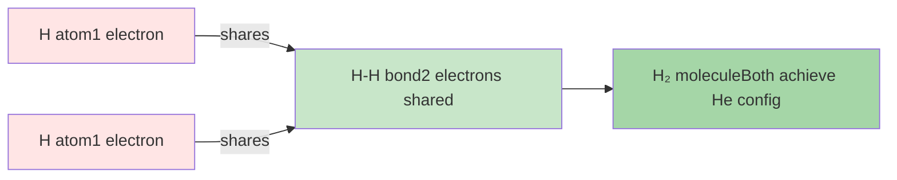
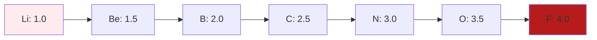
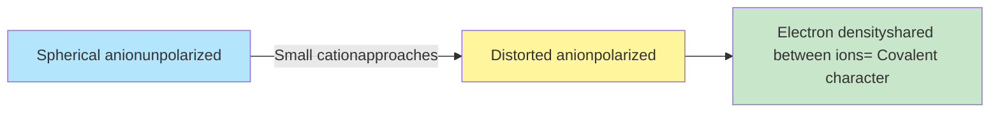

> Master covalent bond formation, Lewis structures, electronegativity, bond parameters, and polar vs nonpolar bonds for JEE Main & Advanced.

## Prerequisites

Before studying covalent bonding, review:

- [Atomic Structure](../../atomic-structure/index.md) — Understanding orbitals and electrons
- [Electronic Configuration](../../atomic-structure/electronic-configuration/index.md) — Valence electrons
- [Ionic Bonding](../ionic-bonding/index.md) — Contrast between electron transfer and sharing

---

## The Hook: Diamond vs Graphite Paradox

> **★ Key point · Connect: The Carbon Mystery**
>
> **Same element. Completely different properties.**
>
> **Diamond:** Hardest natural substance, insulator, transparent, priceless jewelry

> **Graphite:** Soft enough for pencils, conductor, black, costs pennies
>
> How can the **same atom** (carbon) create materials so different? The answer isn’t *what* atoms are bonded—it’s **how** they’re bonded!
>
> In *Oppenheimer* (2023), the physicists used graphite as a moderator in nuclear reactors, but diamond wouldn’t work. Why? Because **covalent bonding** creates different structures with wildly different properties. Master this chapter, and you’ll understand everything from DNA to semiconductors to the fuel in your car!
>
> **JEE Reality Check:** This topic is a **goldmine**—expect 4-5 questions worth 16-20 marks! Lewis structures, formal charge, and bond parameters are JEE favorites.

---

## The Core Concept

### What is a Covalent Bond?

A **covalent bond** is formed by **mutual sharing** of electrons between two atoms to achieve stable electronic configuration (usually octet).



**In simple terms:** Instead of one atom stealing electrons (ionic), two atoms **share** electrons like roommates sharing rent. Both benefit, both achieve stability!

---

## Formation of Covalent Bonds

### The Octet Rule

Atoms tend to **gain, lose, or share** electrons to achieve **8 electrons** in their valence shell (noble gas configuration).

**Exceptions:**

- **H, He:** Need only **2 electrons** (duet rule)
- **Be, B:** Can have **less than 8** (electron deficient: BeCl₂, BF₃)
- **P, S, Cl, Br, I:** Can have **more than 8** (expanded octet: PCl₅, SF₆, IF₇)

> **◐ In simple terms · Why Octet?**
>
> Noble gases (He, Ne, Ar) are extremely stable because of filled valence shells. Other atoms “want” this stability—so they share electrons to simulate a noble gas configuration!
>
> **ns²np⁶** = the magic configuration (8 electrons for most elements)

---

## Lewis Dot Structures

### How to Draw Lewis Structures

**Step 1:** Count total valence electrons
**Step 2:** Identify central atom (usually least electronegative, never H)
**Step 3:** Connect atoms with single bonds
**Step 4:** Complete octets of outer atoms (except H)
**Step 5:** Place remaining electrons on central atom
**Step 6:** If central atom doesn’t have octet, form multiple bonds

### Example: CO₂

**Step 1:** Total electrons = 4 (C) + 2×6 (O) = 16

**Step 2:** Central atom = C (less electronegative than O)

**Step 3-4:** Initial structure

```fallback
O - C - O  (uses 4 electrons, 12 remaining)
```

**Step 5:** Complete octets

```fallback
:Ö: - C - :Ö:  (each O has 6 more electrons as lone pairs)
```

**Step 6:** C only has 4 electrons! Form double bonds:

```fallback
O=C=O  (each O has 2 lone pairs, C has 8 electrons)
```

**Final Lewis structure:**

$$\boxed{\text{:}\ddot{O}=C=\ddot{O}\text{:}}$$

### Interactive Demo: Visualize Molecular Bonding

See how atoms share electrons to form covalent bonds. Explore different molecular geometries and electron sharing patterns.

---

## Formal Charge: The Stability Predictor

### Formula

$$\boxed{\text{Formal Charge} = V - L - \frac{B}{2}}$$

Where:

- **V** = Valence electrons in free atom
- **L** = Lone pair electrons
- **B** = Bonding electrons (shared electrons)

**Alternative formula:**

$$\text{FC} = V - (\text{Lone pairs} + \text{Number of bonds})$$

### Rules for Stability

> **★ Key point · Formal Charge Guidelines**
>
> **Most stable structure:**
>
> 1. **Lowest total formal charges** (ideally all zeros)

> 2. **Negative FC on more electronegative atom**

> 3. **Adjacent atoms should NOT have same sign charges**

> 4. **Large negative/positive charges are unstable**
>
> **Memory trick:** “Low FC, Negative on Electronegative, No Like charges = Stable WINNER”

### Example: CO₃²⁻ (Carbonate Ion)

**Structure 1:** One C=O double bond, two C-O single bonds

```fallback
For C: FC = 4 - 0 - 8/2 = 0
For O (double bond): FC = 6 - 4 - 4/2 = 0
For O (single bond): FC = 6 - 6 - 2/2 = -1 (two of these)
```

Total charge = 0 + 0 + (-1) + (-1) = **-2** ✓ (matches ion charge!)

**Resonance:** The double bond can be with any of the three oxygens, so we have **3 resonance structures**.

> **↗ Connection · Quick Check**
>
> **Question:** Why is CO₂ linear and stable, but CO₃²⁻ needs a negative charge?
>
> **Answer:** CO₂ has 16 electrons (matches two C=O bonds perfectly). CO₃²⁻ has 24 electrons—too many for three C=O double bonds, so some must be single bonds with lone pairs (creating negative charges on O atoms).

---

## Bond Parameters

### 1. Bond Length

**Definition:** Equilibrium distance between nuclei of two bonded atoms.

**Factors affecting bond length:**

| Factor | Effect | Example |
| --- | --- | --- |
| **Bond order** | Higher order → **Shorter** bond | C-C (154 pm) > C=C (134 pm) > C≡C (120 pm) |
| **Atomic size** | Larger atoms → **Longer** bond | C-F (138 pm) < C-Cl (177 pm) < C-Br (194 pm) < C-I (214 pm) |
| **Hybridization** | More s-character → **Shorter** | sp (50% s) < sp² (33% s) < sp³ (25% s) |

**Memory trick:** “Triple bonds are **tight**, single bonds are **spacious**!”

### 2. Bond Angle

**Definition:** Angle between two adjacent bonds at an atom.

| Molecule | Hybridization | Bond Angle |
| --- | --- | --- |
| BeCl₂ | sp | 180° |
| BF₃ | sp² | 120° |
| CH₄ | sp³ | 109.5° |
| NH₃ | sp³ | 107° (lone pair repulsion) |
| H₂O | sp³ | 104.5° (two lone pairs) |

### 3. Bond Order

**Definition:** Number of electron pairs shared between two atoms.

$$\boxed{\text{Bond Order} = \frac{\text{Number of bonds}}{2\text{ (for bond pairs)}}}$$

**Simple counting method:**

- Single bond: Bond order = **1**
- Double bond: Bond order = **2**
- Triple bond: Bond order = **3**

**For resonance structures:**

$$\text{Bond Order} = \frac{\text{Total bonds between two atoms}}{\text{Number of resonance structures}}$$

**Example:** In CO₃²⁻, each C-O bond has:

- Total bonds: 1 double + 2 singles = 4 bonds for 3 C-O bonds
- Bond order = 4/3 = **1.33**

### 4. Bond Energy (Bond Enthalpy)

**Definition:** Energy required to break **one mole** of bonds in gaseous state.

$$\text{H-H}(g) \rightarrow 2\text{H}(g) \quad \Delta H = +436 \text{ kJ/mol}$$

**Trend:**

- Higher bond order → **Higher** bond energy
- Shorter bond → **Higher** bond energy

| Bond | Bond Energy (kJ/mol) |
| --- | --- |
| C-C | 348 |
| C=C | 614 |
| C≡C | 839 |
| C-H | 413 |
| O-H | 463 |
| N≡N | 946 (strongest!) |

> **★ Key point · JEE Shortcut**
>
> **Stronger bond = Shorter bond = Higher bond energy = Higher bond order**
>
> All four properties correlate! If one increases, all increase (generally).

---

## Electronegativity: The Electron Puller

### Definition

**Electronegativity (EN):** The ability of an atom in a molecule to attract shared electrons toward itself.

**Pauling Scale (most common):**

$$\boxed{\text{F} > \text{O} > \text{N} \approx \text{Cl} > \text{Br} > \text{C} \approx \text{S} \approx \text{I} > \text{H} > \text{P}}$$

**Actual values:**

| Element | Electronegativity |
| --- | --- |
| F | 4.0 |
| O | 3.5 |
| N, Cl | 3.0 |
| Br | 2.8 |
| C | 2.5 |
| H | 2.1 |
| P | 2.1 |

**Memory trick:** “FONCl Brings Charges” → F, O, N, Cl have highest EN

### Trends in the Periodic Table

**Across a period (left → right):** EN **increases**

- Reason: Nuclear charge increases, atomic size decreases

**Down a group (top → bottom):** EN **decreases**

- Reason: Atomic size increases, shielding increases



---

## Polar vs Nonpolar Bonds

### Nonpolar Covalent Bond

**ΔEN ≈ 0** (electronegativity difference near zero)

Electrons shared **equally** between atoms.

**Examples:**

- H-H (ΔEN = 0)
- C-C (ΔEN = 0)
- Cl-Cl (ΔEN = 0)

### Polar Covalent Bond

**0 < ΔEN < 1.7**

Electrons shared **unequally**—partial charges develop.

**Example: H-Cl**

- EN(H) = 2.1, EN(Cl) = 3.0
- ΔEN = 0.9 → **polar covalent**
- Chlorine pulls electrons more → δ⁻ on Cl, δ⁺ on H

$$\boxed{H^{\delta+} - Cl^{\delta-}}$$

### Ionic Bond

**ΔEN > 1.7**

Complete electron transfer (covered in previous chapter).

> **★ Key point · Quick Decision Chart**
>
> **ΔEN = 0:** Nonpolar covalent (H₂, Cl₂, O₂)

> **ΔEN = 0.1 - 0.4:** Weakly polar (C-H)

> **ΔEN = 0.4 - 1.7:** Polar covalent (H-Cl, C-O, C-N)

> **ΔEN > 1.7:** Ionic (NaCl, MgO)
>
> **JEE tip:** If they ask “which bond is most polar?” → find **largest ΔEN**!

---

## Dipole Moment: Measuring Polarity

### Definition

**Dipole moment (μ):** Product of charge (q) and distance of separation (d).

$$\boxed{\mu = q \times d}$$

**Units:** Debye (D), where 1 D = 3.34 × 10⁻³⁰ C·m

### Vector Nature

Dipole moment is a **vector** — direction matters!

**Convention:** Arrow points from **positive to negative** (or sometimes δ⁺ → δ⁻)

### Molecular Dipole Moment

For polyatomic molecules, **vector sum** of all bond dipoles determines net dipole.

**Examples:**

**CO₂:** Linear, symmetrical

```fallback
O=C=O
← →  (dipoles cancel)
Net μ = 0 (nonpolar molecule despite polar C=O bonds!)
```

**H₂O:** Bent, asymmetrical

```fallback
H
    \
     O
    /
   H
Net μ = 1.85 D (polar molecule!)
```

**CCl₄:** Tetrahedral, symmetrical

```fallback
All four C-Cl dipoles cancel due to symmetry
Net μ = 0 (nonpolar!)
```

**CHCl₃:** Tetrahedral, asymmetrical

```fallback
Three Cl atoms pull more than one H
Net μ = 1.04 D (polar!)
```

> **⚠ Trap · Common Mistake: Polar Bonds ≠ Polar Molecule**
>
> **Mistake:** “CO₂ has polar C=O bonds, so it must be polar!”
>
> **Correct thinking:**
>
> - Individual bonds CAN be polar

> - But if molecule is **symmetrical**, dipoles **cancel**

> - Result: **Nonpolar molecule**
>
> **Examples of nonpolar molecules with polar bonds:**
>
> - CO₂ (linear)

> - BF₃ (trigonal planar)

> - CCl₄ (tetrahedral)

> - PCl₅ (trigonal bipyramidal)

> - SF₆ (octahedral)

---

## Fajan’s Rules (Revisited for Covalent Character)

When we studied [ionic bonding](../ionic-bonding/index.md), we saw that “ionic” compounds can have covalent character. Now we understand **why**!

### Polarization

**Polarization:** Distortion of electron cloud of an ion by the electric field of a nearby ion.



### Fajan’s Rules Summary

**Covalent character INCREASES when:**

1. **Cation is small** (high charge density → strong polarizing power)

   - Li⁺ > Na⁺ > K⁺
2. **Cation has high charge** (more polarizing)

   - Al³⁺ > Mg²⁺ > Na⁺
3. **Anion is large** (easily polarizable)

   - I⁻ > Br⁻ > Cl⁻ > F⁻
4. **Cation has pseudo noble gas configuration** (18e⁻ or 18+2e⁻)

   - Ag⁺ (4d¹⁰) > Na⁺ (noble gas)
   - Cu⁺ (3d¹⁰) has high polarizing power

> **↗ Connection · Application Example**
>
> **Question:** Why is AgCl insoluble in water but NaCl is highly soluble?
>
> **Answer:**
>
> - Ag⁺ has 18e⁻ configuration (pseudo noble gas) → highly polarizing

> - AgCl has **significant covalent character** (polarization)

> - Covalent compounds are **less soluble** in polar solvents like water

> - NaCl is truly ionic → dissolves easily in water
>
> **Proof:** AgCl is white (covalent compounds often colored/white), has low melting point compared to typical ionic compounds, and is used in photographic films (covalent character helps sensitivity to light).

---

## Resonance: When One Structure Isn’t Enough

### Definition

**Resonance:** When a molecule can be represented by two or more Lewis structures that differ **only in electron positions**, not atom positions.

The actual structure is a **resonance hybrid**—a blend of all resonance forms.

### Rules for Resonance

1. **Same atomic positions** (only electrons move)
2. **Same number of paired/unpaired electrons**
3. All structures must be **valid Lewis structures**
4. Lower energy (more stable) structures **contribute more** to hybrid

### Example: Benzene (C₆H₆)

**Two equivalent resonance structures:**

```fallback
H         H
     \       /
      C=C-C
     /  |  \
   H-C  C-C-H
      \ | /
       C=C
      /   \
     H     H

↔ (double bonds alternate positions)
```

**Reality:** All C-C bonds are **equal** (139 pm), intermediate between C-C (154 pm) and C=C (134 pm)

Bond order = **1.5** for each C-C bond

### Example: Ozone (O₃)

**Two resonance structures:**

$$O=\ddot{O}-\ddot{O} \leftrightarrow \ddot{O}-\ddot{O}=O$$

**Result:** Both O-O bonds are equal with bond order = **1.5**

> **★ Key point · Resonance Stability**
>
> **More resonance structures = More stable molecule**
>
> Why? Energy is distributed over multiple bonds, lowering overall energy.
>
> **Examples:**
>
> - Benzene: 2 equivalent structures → very stable (aromatic stability)

> - Carbonate (CO₃²⁻): 3 equivalent structures → stable

> - Nitrate (NO₃⁻): 3 equivalent structures → stable
>
> **JEE tip:** If a question asks “which is more stable?” and options include resonance, **choose the one with more resonance structures**!

---

## Memory Tricks & Patterns

### Bond Parameter Correlations

**“Triple bonds are Short, Strong, and Stingy with length!”**

| Property | Single < Double < Triple |
| --- | --- |
| Bond Order | 1 < 2 < 3 |
| Bond Energy | Weak < Medium < Strong |
| Bond Length | Long < Medium < Short |

### Electronegativity Trends

**“FONCl Browns Crackers In Homes”**

- F, O, N, Cl, Br, C, I, H (descending order)

### Formal Charge Quick Calculation

**For common atoms:**

- C with 4 bonds, no lone pairs → FC = 0 ✓
- N with 3 bonds, 1 lone pair → FC = 0 ✓
- O with 2 bonds, 2 lone pairs → FC = 0 ✓
- O with 1 bond, 3 lone pairs → FC = -1 (anion)
- N with 4 bonds, no lone pairs → FC = +1 (cation)

---

## When to Use Covalent Bonding Concepts

> **★ Key point · Decision Tree**
>
> **Use Lewis structures when:**
>
> - Predicting molecular formulas and shapes

> - Calculating formal charges for stability

> - Drawing resonance structures
>
> **Use electronegativity when:**
>
> - Predicting bond polarity (polar vs nonpolar)

> - Comparing bond strengths (more EN difference → more polar → stronger)

> - Determining dipole moments
>
> **Use bond parameters when:**
>
> - Comparing stability (higher BO → more stable)

> - Estimating enthalpy changes (ΔH = Σbonds broken - Σbonds formed)

> - Understanding reactivity (weaker bonds break first)
>
> **Use Fajan’s rules when:**
>
> - Predicting ionic vs covalent character

> - Explaining solubility (AgCl, BeCl₂)

> - Understanding color/properties of “ionic” compounds

---

## Common Mistakes to Avoid

> **⚠ Trap #1: Octet Violation**
>
> **Mistake:** Assuming ALL atoms need exactly 8 electrons
>
> **Exceptions you MUST remember:**
>
> - **H, He:** 2 electrons (duet)

> - **Be, B:** Less than 8 (BeCl₂ has 4, BF₃ has 6 on central atom)

> - **Elements with d-orbitals (period 3+):** Can exceed 8

>   - PCl₅: P has 10 electrons

>   - SF₆: S has 12 electrons

>   - IF₇: I has 14 electrons
>
> **Why?** Period 3+ elements have vacant d-orbitals for electron accommodation!

> **⚠ Trap #2: Dipole Moment Confusion**
>
> **Mistake:** “Polar bonds → Polar molecule”
>
> **Correct approach:**
>
> 1. Identify polar bonds (ΔEN > 0)

> 2. Draw molecular geometry

> 3. Check symmetry — if **symmetrical**, dipoles cancel → **nonpolar**
>
> **Classic JEE traps:**
>
> - CO₂: Polar bonds, but **linear** → μ = 0 (nonpolar)

> - BCl₃: Polar bonds, but **trigonal planar** → μ = 0

> - CCl₄: Polar bonds, but **tetrahedral symmetry** → μ = 0
>
> **Polar despite bonds:** H₂O, NH₃, CHCl₃ (asymmetrical!)

> **⚠ Trap #3: Formal Charge ≠ Oxidation State**
>
> **Mistake:** Using formal charge and oxidation state interchangeably
>
> **Formal charge:** Assumes **equal sharing** of bonding electrons

> **Oxidation state:** Assumes **complete transfer** to more electronegative atom
>
> **Example: CO molecule**
>
> - Formal charges: C (0), O (0) — structure is :C≡O:

> - Oxidation states: C (+2), O (-2)
>
> **For JEE:** Use formal charge for **structure stability**, oxidation state for **redox reactions**!

---

## Practice Problems

### Level 1: Foundation (NCERT Style)

> **↗ Connection · Problem 1**
>
> **Question:** Draw the Lewis structure of H₂O and calculate formal charges.
>
> **Solution:**
>
> **Step 1:** Total electrons = 2(1) + 6 = 8
>
> **Step 2:** Central atom = O
>
> **Step 3:** Connect H-O-H (uses 4 electrons)
>
> **Step 4:** Complete octet of O (4 more electrons as 2 lone pairs)
>
> **Final structure:**
>
> ```fallback

> H

>     \

>      O: (2 lone pairs)

>     /

>    H

> ```
>
> **Formal charges:**
>
> - O: FC = 6 - 4 - 4/2 = 0

> - H: FC = 1 - 0 - 2/2 = 0
>
> **Answer:** All formal charges are zero → stable structure ✓

> **↗ Connection · Problem 2**
>
> **Question:** Arrange the following in order of increasing bond length:

> C-C, C=C, C≡C
>
> **Solution:**

> Higher bond order → shorter bond
>
> - C≡C: Triple bond, bond order = 3

> - C=C: Double bond, bond order = 2

> - C-C: Single bond, bond order = 1
>
> **Answer:** C≡C < C=C < C-C
>
> **Actual values:** 120 pm < 134 pm < 154 pm

---

### Level 2: JEE Main Type

> **↗ Connection · Problem 3**
>
> **Question:** Which of the following has zero dipole moment?

> (A) H₂O (B) NH₃ (C) BF₃ (D) CHCl₃
>
> **Solution:**
>
> (A) **H₂O:** Bent shape (104.5°) → asymmetrical → μ ≠ 0
>
> (B) **NH₃:** Trigonal pyramidal → asymmetrical → μ ≠ 0
>
> (C) **BF₃:** Trigonal planar (120°) → **symmetrical** → μ = 0 ✓
>
> (D) **CHCl₃:** Tetrahedral but three Cl and one H → **asymmetrical** → μ ≠ 0
>
> **Answer:** (C) BF₃
>
> **Explanation:** BF₃ is planar and symmetrical. The three B-F bond dipoles cancel perfectly due to 120° angles.

> **↗ Connection · Problem 4**
>
> **Question:** Calculate the bond order of O₂⁻ (superoxide ion).
>
> Using Lewis structure:
>
> - O₂ has 12 valence electrons

> - O₂⁻ has 13 valence electrons
>
> **Lewis structure:** :Ö-Ö̈: with one extra electron
>
> - One O-O single bond (2 electrons)

> - One O=O double bond contribution

> - Total bonds ≈ 1.5
>
> **Bond order = 1.5**
>
> **Alternative:** Will be confirmed by MOT (coming in molecular orbital theory!)
>
> **Answer:** Bond order = 1.5

---

### Level 3: JEE Advanced Type

> **↗ Connection · Problem 5: Resonance Challenge**
>
> **Question:** Draw all resonance structures of the carbonate ion (CO₃²⁻) and calculate:

> (a) C-O bond order

> (b) Formal charge on each atom in one structure
>
> **Solution:**
>
> **(a) Resonance structures:**
>
> ```fallback

> Structure 1:        Structure 2:        Structure 3:

>    O⁻                  O                   O

>    |                   ||                  |

>    C                   C                   C

>   / \\                / \                 // \

>  O   O⁻              O⁻  O⁻              O⁻   O⁻

> ```
>
> Each structure has:
>
> - One C=O double bond

> - Two C-O single bonds
>
> **Total bonds for 3 C-O bonds:** 1(double) + 2(single) = 4 bonds distributed among 3 positions
>
> **Bond order = 4/3 ≈ 1.33**
>
> **(b) Formal charges (Structure 1):**
>
> - C: FC = 4 - 0 - 8/2 = 0

> - O (double bonded): FC = 6 - 4 - 4/2 = 0

> - O (single bonded): FC = 6 - 6 - 2/2 = -1 (×2)
>
> Total charge = 0 + 0 + (-1) + (-1) = **-2** ✓ (matches ion charge!)
>
> **Answer:**

> (a) Bond order = 1.33

> (b) FC: C = 0, O(double) = 0, O(single) = -1 each

> **↗ Connection · Problem 6: Multi-Concept**
>
> **Question:** Explain why BeCl₂ is linear and covalent despite Be being a metal and Cl being a non-metal.
>
> **Solution:**
>
> **Part 1: Why linear?**
>
> - Be has 2 valence electrons

> - Forms 2 bonds with 2 Cl atoms

> - No lone pairs on Be

> - VSEPR: 2 bond pairs, 0 lone pairs → **linear** (180°)

> - Hybridization: **sp** (will study in hybridization chapter)
>
> **Part 2: Why covalent?**
>
> Applying **Fajan’s rules:**
>
> 1. Be²⁺ is **very small** (31 pm) → high charge density

> 2. Be²⁺ has **+2 charge** → high polarizing power

> 3. Cl⁻ is **relatively large** (181 pm) → polarizable

> 4. Result: Be²⁺ **distorts** Cl⁻ electron cloud → **covalent character**
>
> **Evidence of covalent character:**
>
> - BeCl₂ is **molecular** (exists as discrete molecules)

> - Low melting point (405°C vs typical ionic >800°C)

> - Soluble in organic solvents (like ether, benzene)

> - Poor conductor even in molten state
>
> **Answer:** BeCl₂ is linear due to sp hybridization (2 bond pairs, no lone pairs) and is covalent due to high polarizing power of small Be²⁺ ion (Fajan’s rules).

---

## Quick Revision Box

| Situation | Formula/Approach |
| --- | --- |
| **Drawing Lewis structure** | Count e⁻ → Central atom → Connect → Octets → Multiple bonds if needed |
| **Formal charge** | FC = V - L - B/2 (want zeros!) |
| **Bond order** | Single = 1, Double = 2, Triple = 3; or (bonds/positions) for resonance |
| **Polar vs nonpolar bond** | ΔEN < 0.4: nonpolar; 0.4-1.7: polar; >1.7: ionic |
| **Polar molecule?** | Check symmetry! Symmetrical → μ = 0 |
| **Covalent character** | Small cation + Large anion + High charge |

### Must-Remember Values

| Bond | Length (pm) | Energy (kJ/mol) |
| --- | --- | --- |
| C-C | 154 | 348 |
| C=C | 134 | 614 |
| C≡C | 120 | 839 |
| C-H | 109 | 413 |
| O=O | 121 | 498 |
| N≡N | 110 | 946 |

### Electronegativity Scale

F (4.0) > O (3.5) > N = Cl (3.0) > Br (2.8) > C (2.5) > H = P (2.1)

---

## Real-World Applications

> **◐ In simple terms · Where Covalent Bonding Rules**
>
> **1. Organic Chemistry = Covalent Chemistry**

> Every organic compound (from DNA to plastics) is held together by covalent bonds!
>
> **2. Semiconductors:** Silicon (Si-Si covalent bonds) in computer chips. Understanding band gaps = understanding covalent bonding!
>
> **3. Polymers:** Nylon, polyester, PVC — all long chains of covalent bonds. The strength of materials depends on bond strength!
>
> **4. Medicine:** Drug molecules bind to receptors via weak covalent-like interactions (hydrogen bonds, van der Waals). Understanding polarity helps design better drugs!
>
> **5. Graphene & Carbon Nanotubes:** Strongest materials known! All due to sp² covalent bonding in carbon sheets.
>
> **6. Fuel Combustion:** Breaking C-H and C-C bonds releases energy. Bond energy calculations predict fuel efficiency!

---

## Teacher’s Summary

> **★ Key point · Key Takeaways**
>
> **1. Covalent bonding = electron sharing for mutual stability**
>
> - Octet rule guides formation (8 electrons in valence shell)

> - Exceptions: H (2), Be/B (<8), Period 3+ (>8 with d-orbitals)
>
> **2. Lewis structures + formal charge = stability predictor**
>
> - Draw all possible structures, calculate FC

> - Lowest FC, negative on EN atom = most stable

> - Resonance: multiple structures → hybrid reality
>
> **3. Bond parameters are interconnected**
>
> - Higher bond order → Shorter length, Higher energy, More stable

> - Triple > Double > Single (in strength and shortness)
>
> **4. Electronegativity determines polarity**
>
> - ΔEN: 0 (nonpolar) → 0.4-1.7 (polar covalent) → >1.7 (ionic)

> - Polar bonds ≠ polar molecule (check symmetry!)

> - Dipole moment = vector sum of bond dipoles
>
> **5. Fajan’s rules explain covalent character in “ionic” bonds**
>
> - Small cation + large anion + high charge → polarization → covalent character

> - Explains why AgCl, BeCl₂, AlCl₃ behave covalently
>
> **6. For JEE:**
>
> - Master Lewis structures (appears in 50% of bonding questions!)

> - Remember electronegativity scale (F > O > N ≈ Cl)

> - Know bond parameter correlations (saves calculation time)

> - Apply Fajan’s rules for tricky character prediction
>
> **“In covalent bonds, sharing is caring — but electronegativity determines who gets the bigger share!”**

---

## Related Topics

### Within Chemical Bonding

- [Ionic Bonding](../ionic-bonding/index.md) - Electron transfer vs sharing, Fajan’s rules
- [VSEPR Theory](../vsepr-theory/index.md) - Predicting molecular shapes from Lewis structures
- [Hybridization](../hybridization/index.md) - How orbitals mix to form bonds
- [Molecular Orbital Theory](../molecular-orbital-theory/index.md) - Advanced bonding theory
- [Hydrogen Bonding](../hydrogen-bonding/index.md) - Special dipole-dipole interaction

### Atomic Structure Foundation

- [Orbital Shapes](../../atomic-structure/orbital-shapes/index.md) - s, p, d orbitals in bonding
- [Electronic Configuration](../../atomic-structure/electronic-configuration/index.md) - Valence electrons
- [Quantum Model](../../atomic-structure/quantum-model/index.md) - Wave function basis

### Periodic Classification Links

- [Periodic Trends](../../periodic-classification/periodic-trends/index.md) - Electronegativity, atomic size trends
- [p-Block Introduction](../../periodic-classification/p-block-introduction/index.md) - Non-metal bonding

### Organic Chemistry Applications

- [Organic Principles - Hybridization](../../organic-principles/hybridization/index.md) - sp³, sp², sp in organic molecules
- [Electronic Effects](../../organic-principles/electronic-effects/index.md) - Inductive and resonance effects
- [Hydrocarbons](../../hydrocarbons/index.md) - C-C and C-H bonding
- [Benzene](../../hydrocarbons/benzene/index.md) - Resonance in aromatic systems

### Physical Chemistry Connections

- [Thermodynamics - Enthalpy](../../thermodynamics/enthalpy/index.md) - Bond energy and enthalpy calculations
- [Thermochemistry](../../thermodynamics/thermochemistry/index.md) - Calculating reaction enthalpy from bond energies
- [Coordination Compounds](../../coordination-compounds/index.md) - Coordinate covalent bonds

### Cross-Subject: Physics

- [Electrostatics](../../../physics/electrostatics/index.md) - Coulomb’s law in dipoles
- [Electric Dipole](../../../physics/electrostatics/electric-dipole/index.md) - Dipole moment in detail

### Cross-Subject: Math

- [Vector Algebra](../../../mathematics/vector-algebra/index.md) - Dipole moment as vector addition
- [Trigonometry](../../../mathematics/trigonometry/index.md) - Bond angle calculations

---

From TestGuru · our mock-test platform

## You've read Covalent Bonding.You've read this topic. Find out what you actually got.

A free JEE Main mock with this chapter in it, and a report that shows which sub-topics cost you marks.

[Take a free JEE Main mock →](https://app.testguru.co/signup?tg_chapter=chemical-bonding&tg_exam=jee-main&tg_page=%2Fchemistry%2Fchemical-bonding%2Fcovalent-bonding%2F&tg_subject=chemistry&utm_campaign=notes-jee-main-free-test&utm_content=article-end&utm_medium=referral&utm_source=jeenotes)
Free, no card. Opens TestGuru in a new tab.

## Stay exam-ready

One email every Sunday: new notes, the week's hardest challenge question and a revision plan.One email every Sunday.

## Comments

Have a question or spotted a mistake? Join the discussion below.

Advertisement

Advertisement

---

## Extracted page code (interactive scripts & widgets)


### inline-script-16

```js
if(!document.getElementById("animation-fullscreen-overlay")){const e=document.createElement("div");e.id="animation-fullscreen-overlay",e.className="animation-fullscreen-overlay",e.innerHTML=`
      <div class="fullscreen-modal">
        <div class="fullscreen-header">
          <span class="fullscreen-title">Interactive Demo</span>
          <button class="fullscreen-close-btn" onclick="JEEAnimations.closeFullscreen()" title="Close (Esc)" aria-label="Close fullscreen">
            <svg width="24" height="24" viewBox="0 0 24 24" fill="none" stroke="currentColor" stroke-width="2" stroke-linecap="round" stroke-linejoin="round">
              <line x1="18" y1="6" x2="6" y2="18"></line>
              <line x1="6" y1="6" x2="18" y2="18"></line>
            </svg>
          </button>
        </div>
        <div class="fullscreen-content"></div>
      </div>
    `,document.body.appendChild(e),document.addEventListener("keydown",function(e){e.key==="Escape"&&document.body.classList.contains("animation-fullscreen-active")&&JEEAnimations.closeFullscreen()}),e.addEventListener("click",function(t){t.target===e&&JEEAnimations.closeFullscreen()})}
```


### inline-script-17

```js
(function(){var t,e=document.getElementById("disqus-load");if(!e)return;t=!1,e.addEventListener("click",function(){if(t)return;t=!0,e.setAttribute("disabled","disabled"),e.textContent="Loading comments…",window.disqus_config=function(){this.page.url="https://jeenotes.in/chemistry/chemical-bonding/covalent-bonding/",this.page.identifier="/chemistry/chemical-bonding/covalent-bonding/"};var s=document,n=s.createElement("script");n.src="https://https-jeenotes-in.disqus.com/embed.js",n.setAttribute("data-timestamp",+new Date),n.onload=function(){e.style.display="none"},n.onerror=function(){t=!1,e.removeAttribute("disabled"),e.textContent="Could not load comments. Tap to retry"},(s.head||s.body).appendChild(n)})})()
```


### inline-script-18

```js
(function(){var t,e=document.currentScript.previousElementSibling;function n(){(window.adsbygoogle=window.adsbygoogle||[]).push({})}if(!window.ResizeObserver||e.clientWidth>0){n();return}t=new ResizeObserver(function(){e.clientWidth>0&&(t.disconnect(),n())}),t.observe(e)})()
```


### interactive-widget-1

```html
<div class="animation-wrapper" data-animation="molecularGeometry" id="anim-molecularGeometry-1795396419181138828"><div class="animation-header"><button aria-label="Toggle fullscreen" class="anim-fullscreen-btn" onclick='JEEAnimations.toggleFullscreen("anim-molecularGeometry-1795396419181138828")' title="Fullscreen (F)">
<svg class="fullscreen-icon-expand" fill="none" height="18" stroke="currentColor" stroke-linecap="round" stroke-linejoin="round" stroke-width="2" viewbox="0 0 24 24" width="18"><polyline points="15 3 21 3 21 9"></polyline><polyline points="9 21 3 21 3 15"></polyline><line x1="21" x2="14" y1="3" y2="10"></line><line x1="3" x2="10" y1="21" y2="14"></line></svg>
<svg class="fullscreen-icon-collapse" fill="none" height="18" stroke="currentColor" stroke-linecap="round" stroke-linejoin="round" stroke-width="2" viewbox="0 0 24 24" width="18"><polyline points="4 14 10 14 10 20"></polyline><polyline points="20 10 14 10 14 4"></polyline><line x1="14" x2="21" y1="10" y2="3"></line><line x1="3" x2="10" y1="21" y2="14"></line></svg>
<span class="fullscreen-text">Fullscreen</span></button></div><div class="animation-content"><noscript><div class="callout callout-warning"><div class="callout-title">JavaScript Required</div><p>This interactive animation requires JavaScript to be enabled.</p></div></noscript></div></div>
```


---

_Source: [https://jeenotes.in/chemistry/chemical-bonding/covalent-bonding/](https://jeenotes.in/chemistry/chemical-bonding/covalent-bonding/) · raw HTML: `offline/chemistry/chemical-bonding/covalent-bonding/index.html`_
