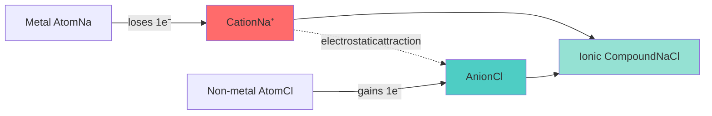

> Master ionic bond formation, lattice energy calculations, Born-Haber cycle, and Fajan's rules for JEE Main & Advanced.

## Prerequisites

Before diving into ionic bonding, make sure you understand:

- [Electronic Configuration](../../atomic-structure/electronic-configuration/index.md) — To predict ion formation
- [Periodic Properties](../../periodic-classification/index.md) — Ionization energy and electron affinity trends
- [Atomic Structure basics](../../atomic-structure/index.md) — Understanding of valence electrons

---

## The Hook: Salt to Circuit Boards

> **★ Key point · Connect: From Kitchen to Technology**
>
> Ever wondered why **salt** dissolves in water but **oil** doesn’t? Why do surgeons use saline solution (salt water) for medical procedures? Why can salt water conduct electricity but pure water can’t?
>
> The answer lies in **ionic bonding** — one of nature’s most powerful forces! From the salt in your food to the lithium-ion battery in your smartphone, ionic compounds are everywhere. In *Oppenheimer* (2023), the atomic bomb’s trigger mechanism used ionic compounds that conduct electricity. Understanding ionic bonds isn’t just chemistry—it’s understanding the technology that powers modern life!
>
> **JEE Perspective:** 3-4 questions appear every year on lattice energy, Born-Haber cycle, and ionic vs covalent character. Master this, and you’ve secured 12-16 marks!

---

## The Core Concept

### What is an Ionic Bond?

An **ionic bond** is the electrostatic force of attraction between oppositely charged ions formed by **complete transfer** of electrons from a metal to a non-metal.



**In simple terms:** Think of it like a magnetic attraction. Metals lose electrons to become positive (like losing negative charge makes you positive), non-metals gain electrons to become negative. Opposites attract — that’s your ionic bond!

---

## Formation of Ionic Bonds

### Step-by-Step Process

For NaCl formation:

**Step 1: Ionization of Metal**

$$\text{Na}(g) \rightarrow \text{Na}^+(g) + e^- \quad \Delta H = +496 \text{ kJ/mol}$$

**Step 2: Electron Affinity of Non-metal**

$$\text{Cl}(g) + e^- \rightarrow \text{Cl}^-(g) \quad \Delta H = -349 \text{ kJ/mol}$$

**Step 3: Lattice Formation**

$$\text{Na}^+(g) + \text{Cl}^-(g) \rightarrow \text{NaCl}(s) \quad \Delta H = -788 \text{ kJ/mol}$$

> **◐ In simple terms · Energy Insight**
>
> Notice that steps 1 and 2 **require/release** energy but don’t make the process favorable. The **huge energy release** in step 3 (lattice formation) is what makes ionic bond formation energetically favorable!
>
> **Net Energy:** +496 - 349 - 788 = **-641 kJ/mol** (exothermic, hence favorable!)

### Interactive Demo: Visualize Ionic Bond Formation

Watch electron transfer from sodium to chlorine and ionic lattice formation.

---

## Lattice Energy: The Powerhouse

### Definition

**Lattice Energy (U)** is the energy **released** when one mole of an ionic compound is formed from gaseous ions under standard conditions.

$$M^+(g) + X^-(g) \rightarrow MX(s) + \text{Lattice Energy}$$

**Alternative Definition:** Energy **required** to completely separate one mole of ionic solid into gaseous ions.

$$MX(s) + \text{Energy} \rightarrow M^+(g) + X^-(g)$$

> **⚠ Trap · Sign Convention Alert!**
>
> **Formation definition:** Lattice energy is **negative** (exothermic)

> **Dissociation definition:** Lattice energy is **positive** (endothermic)
>
> JEE problems can use either! Read carefully. NCERT uses formation (negative), but many books use dissociation (positive).

---

## Born-Landé Equation

The theoretical calculation of lattice energy:

$$\boxed{U = -\frac{N_A M z^+ z^- e^2}{4\pi\epsilon_0 r_0}\left(1 - \frac{1}{n}\right)}$$

Where:

- $N_A$ = Avogadro’s number
- $M$ = Madelung constant (geometry dependent)
- $z^+, z^-$ = charges on cation and anion
- $r_0$ = interionic distance
- $n$ = Born exponent (8-12, usually 9)

**Simplified for JEE:**

$$\boxed{U \propto \frac{z^+ \times z^-}{r_0}}$$

**In simple terms:** Lattice energy depends on **charge** (more charge = more energy) and **size** (smaller ions = more energy).

---

## Factors Affecting Lattice Energy

### 1. Charge on Ions

Higher charge → **Higher** lattice energy

| Compound | Charges | Lattice Energy (kJ/mol) |
| --- | --- | --- |
| NaCl | +1, -1 | 788 |
| MgO | +2, -2 | 3850 |
| Al₂O₃ | +3, -2 | ~15,000 |

**Memory Trick:** “Double charge, **quadruple** the attraction!” (because charge product increases)

### 2. Size of Ions

Smaller ions → **Higher** lattice energy (closer approach = stronger force)

| Compound | Cation Radius (pm) | Lattice Energy (kJ/mol) |
| --- | --- | --- |
| LiF | Li⁺: 76 | 1037 |
| NaF | Na⁺: 102 | 923 |
| KF | K⁺: 138 | 821 |
| RbF | Rb⁺: 152 | 785 |

> **★ Key point · JEE Shortcut**
>
> **Compare lattice energies instantly:**
>
> Same anion, different cations: **Smaller cation wins**

> Same cation, different anions: **Smaller anion wins**

> Different charges: **Higher charge wins** (dominates over size!)
>
> Example: MgO > NaCl (charge dominates) > KCl (size effect)

---

## Born-Haber Cycle: The Masterpiece

### What is it?

A **thermochemical cycle** that applies Hess’s Law to calculate lattice energy indirectly using other measurable quantities.

### The Cycle for NaCl

```mermaid
graph TD
    A[Na(s) + ½Cl₂(g)] -->|ΔHf = -411| B[NaCl(s)]
    A -->|ΔHsub = +108| C[Na(g) + ½Cl₂(g)]
    C -->|IE = +496| D[Na⁺(g) + ½Cl₂(g) + e⁻]
    D -->|½D = +121| E[Na⁺(g) + Cl(g) + e⁻]
    E -->|EA = -349| F[Na⁺(g) + Cl⁻(g)]
    F -->|U = ?| B

    style A fill:#e8f5e9
    style B fill:#c8e6c9
    style F fill:#ffccbc
```

### The Equation

$$\boxed{\Delta H_f = \Delta H_{sub} + \frac{1}{2}D + IE + EA + U}$$

Where:

- $\Delta H_f$ = Enthalpy of formation (negative for stable compounds)
- $\Delta H_{sub}$ = Sublimation energy of metal
- $D$ = Bond dissociation energy of non-metal (½D for Cl₂, O₂)
- $IE$ = Ionization energy of metal
- $EA$ = Electron affinity of non-metal (negative)
- $U$ = Lattice energy (to be calculated)

### Rearranging for Lattice Energy

$$\boxed{U = \Delta H_f - \Delta H_{sub} - \frac{1}{2}D - IE - EA}$$

---

## Memory Tricks & Patterns

### Born-Haber Mnemonic

**“Super Ionized Elephants Eat Lettuce”**

- **S**ublimation: Take metal from solid to gas
- **I**onization: Remove electron from metal
- **E**lectron gain (EA): Non-metal gains electron
- **E**lectrostatic attraction: Formation (lattice energy)
- **L**eads to formation enthalpy

### Pattern Recognition

> **★ Key point · Lattice Energy Trends**
>
> **Down a group:**

> LiF > NaF > KF > RbF > CsF (decreasing U)

> Reason: Increasing cation size
>
> **Across a period:**

> MgO > MgS > MgSe > MgTe (decreasing U)

> Reason: Increasing anion size
>
> **Charge effect dominates:**

> Al₂O₃ > MgO > LiF > NaCl

> Reason: Charge product (3×2 > 2×2 > 1×1)

---

## Ionic vs Covalent Character

### When Does Ionic Character Dominate?

An ionic compound forms when:

1. **Large difference in electronegativity** (ΔEN > 1.7)
2. **Low ionization energy** of metal
3. **High electron affinity** of non-metal
4. **Large lattice energy** (makes process favorable)

### Fajan’s Rules: When Ionic Becomes Covalent

Even in “ionic” compounds, there’s some **covalent character** due to **polarization**:

> **◐ In simple terms · Fajan's Rules for Covalent Character**
>
> **Covalent character INCREASES when:**
>
> 1. **Cation is small** (high charge density)
>
>    - Li⁺ > Na⁺ > K⁺ (more covalent)

> 2. **Cation has high charge**
>
>    - Fe³⁺ > Fe²⁺ (more covalent)

> 3. **Anion is large** (easily polarizable)
>
>    - I⁻ > Br⁻ > Cl⁻ > F⁻ (more covalent)

> 4. **Cation has pseudo noble gas configuration** (18e⁻ or 18+2e⁻)
>
>    - Ag⁺ (4d¹⁰) more polarizing than Na⁺ (noble gas)

>    - Cu⁺, Hg²⁺ are highly polarizing
>
> **Memory:** “Small Cation, Large Anion → Covalent fashion!”

### Examples

| Compound | Character | Reason |
| --- | --- | --- |
| NaF | Highly ionic | Large size difference, F⁻ small |
| LiI | Covalent character | Li⁺ small, I⁻ large, polarization |
| AgCl | Covalent character | Ag⁺ has 18e⁻ config, polarizing |
| AlCl₃ | Covalent | Al³⁺ small with high charge |

---

## When to Use Ionic Bonding Concepts

> **★ Key point · Decision Tree**
>
> **Use lattice energy when:**
>
> - Comparing stability of ionic compounds

> - Calculating enthalpy changes using Born-Haber

> - Predicting solubility (high U → less soluble in water)

> - Explaining melting points (high U → high MP)
>
> **Use Fajan’s rules when:**
>
> - Predicting bond character (ionic vs covalent)

> - Explaining solubility in non-polar solvents (AlCl₃, BeCl₂)

> - Understanding color of compounds (covalent character → colored)

> - Predicting hydration vs hydrolysis
>
> **JEE Tip:** If question asks “which is more ionic?” → think size and charge. If it asks “which has covalent character?” → apply Fajan’s rules!

---

## Common Mistakes to Avoid

> **⚠ Trap #1: Sign of Lattice Energy**
>
> **Mistake:** Confusing formation vs dissociation definitions
>
> **Correct Approach:**
>
> - Formation: $M^+(g) + X^-(g) \rightarrow MX(s)$ → **Negative** (energy released)

> - Dissociation: $MX(s) \rightarrow M^+(g) + X^-(g)$ → **Positive** (energy required)
>
> In Born-Haber cycle, if calculating U from formation data, expect **negative** value!

> **⚠ Trap #2: Bond Dissociation Energy**
>
> **Mistake:** Forgetting to divide by 2 for diatomic molecules
>
> **Correct:**

> For Cl₂: Use **½D** in Born-Haber (only ½ mole Cl₂ needed)

> For O₂: Use **½D** for oxide formation
>
> Don’t use full D value — you’ll get the wrong answer!

> **⚠ Trap #3: Comparing Lattice Energies**
>
> **Mistake:** Ignoring charge when comparing sizes
>
> **Example:** Which has higher lattice energy: MgO or LiF?
>
> **Wrong thinking:** “Li⁺ smaller than Mg²⁺, so LiF wins”

> **Correct thinking:** MgO has **2×2 charge product**, LiF has **1×1**. Charge dominates!
>
> **Answer:** MgO » LiF (3850 vs 1037 kJ/mol)

---

## Practice Problems

### Level 1: Foundation (NCERT Style)

> **↗ Connection · Problem 1**
>
> **Question:** Arrange the following in order of increasing lattice energy:

> NaCl, MgO, KCl, CaO
>
> **Solution:**

> Strategy: Compare charges first, then sizes
>
> - MgO and CaO: 2×2 charge → higher U than 1×1 compounds

> - Between MgO and CaO: Mg²⁺ smaller than Ca²⁺ → MgO > CaO

> - Between NaCl and KCl: Na⁺ smaller than K⁺ → NaCl > KCl
>
> **Answer:** KCl < NaCl < CaO < MgO
>
> **Actual values:** KCl (717) < NaCl (788) < CaO (3520) < MgO (3850) kJ/mol

> **↗ Connection · Problem 2**
>
> **Question:** Why is MgCl₂ more ionic than AlCl₃?
>
> **Solution:**

> Apply Fajan’s rules!
>
> Al³⁺ vs Mg²⁺:
>
> - Al³⁺ has higher charge (+3 vs +2)

> - Al³⁺ is smaller (67 pm vs 86 pm)

> - Both have same anion Cl⁻
>
> According to Fajan’s rules: Smaller cation with higher charge → more polarizing → more covalent character
>
> Therefore: AlCl₃ has more covalent character, MgCl₂ is more ionic.
>
> **Proof:** AlCl₃ is covalent (sublimes at 180°C), MgCl₂ is ionic (melts at 714°C)

---

### Level 2: JEE Main Type

> **↗ Connection · Problem 3**
>
> **Question:** Calculate the lattice energy of NaCl using the following data:
>
> - ΔH_f(NaCl) = -411 kJ/mol

> - ΔH_sub(Na) = +108 kJ/mol

> - IE(Na) = +496 kJ/mol

> - ½D(Cl₂) = +121 kJ/mol

> - EA(Cl) = -349 kJ/mol
>
> **Solution:**

> Using Born-Haber cycle:
>
> $$\Delta H_f = \Delta H_{sub} + IE + \frac{1}{2}D + EA + U$$

$$-411 = 108 + 496 + 121 + (-349) + U$$

$$-411 = 376 + U$$

$$U = -411 - 376 = -787 \text{ kJ/mol}$$
>
> **Answer:** Lattice energy = **-787 kJ/mol** (or +787 kJ/mol for dissociation)
>
> **JEE Tip:** Always check if your answer is reasonable. U for NaCl should be around -788 kJ/mol.

> **↗ Connection · Problem 4**
>
> **Question:** Among the following, which has the **maximum** covalent character?

> (A) NaF (B) NaCl (C) NaBr (D) NaI
>
> **Solution:**

> Applying Fajan’s rules — cation same (Na⁺), compare anions:
>
> - F⁻ smallest → least polarizable → **least** covalent

> - I⁻ largest → most polarizable → **most** covalent
>
> Order of covalent character: NaI > NaBr > NaCl > NaF
>
> **Answer:** (D) NaI
>
> **Practical proof:** NaF highly ionic (MP 993°C), NaI has more covalent character (MP 661°C)

---

### Level 3: JEE Advanced Type

> **↗ Connection · Problem 5**
>
> **Question:** The lattice energy of an ionic compound MX (where M²⁺ and X²⁻) is four times that of NaCl. If the interionic distance in MX is the same as NaCl, identify the possible compound.
>
> **Solution:**

> From Born-Landé equation:
>
> $$U \propto \frac{z^+ \times z^-}{r_0}$$
>
> For NaCl: $z^+ \times z^- = 1 \times 1 = 1$, $U_{NaCl} = U_0$
>
> For MX: $z^+ \times z^- = 2 \times 2 = 4$, $U_{MX} = 4U_0$ (given same r₀)
>
> This matches! Charge product is 4 times.
>
> **Possible compounds with M²⁺ and X²⁻:**
>
> - MgO (Mg²⁺, O²⁻) ✓

> - CaO (Ca²⁺, O²⁻) ✓

> - SrO (Sr²⁺, O²⁻) ✓
>
> But we need **same interionic distance** as NaCl (r₀ = 282 pm):
>
> - MgO: r₀ = 212 pm ✗

> - CaO: r₀ = 240 pm ✗
>
> **Trick:** This is a theoretical problem. In reality, no M²⁺X²⁻ compound has exactly same r₀ as NaCl. The concept being tested is the **charge effect** on lattice energy.
>
> **Answer:** The compound would be any M²⁺X²⁻ oxide like **MgO** (conceptually), but strictly speaking, the interionic distance condition cannot be met perfectly.

> **↗ Connection · Problem 6: Multi-concept**
>
> **Question:** The electron affinity of chlorine is 3.7 eV. Using the following data, calculate the lattice energy of NaCl:
>
> - ΔH_f(NaCl) = -4.24 eV/molecule

> - ΔH_sub(Na) = 1.12 eV/atom

> - IE(Na) = 5.14 eV/atom

> - D(Cl₂) = 2.52 eV/molecule
>
> **Solution:**

> Born-Haber cycle (per molecule):
>
> $$\Delta H_f = \Delta H_{sub} + IE + \frac{1}{2}D + EA + U$$

$$-4.24 = 1.12 + 5.14 + \frac{2.52}{2} + (-3.7) + U$$

$$-4.24 = 1.12 + 5.14 + 1.26 - 3.7 + U$$

$$-4.24 = 3.82 + U$$

$$U = -8.06 \text{ eV/molecule}$$
>
> **Converting to kJ/mol:**
>
> $$U = -8.06 \times 96.5 = -778 \text{ kJ/mol}$$
>
> **Answer:** Lattice energy = **-778 kJ/mol** (close to actual value of -788)
>
> **JEE Advanced Twist:** This tests unit conversion (eV → kJ/mol) and careful arithmetic!

---

## Quick Revision Box

| Situation | Formula/Approach |
| --- | --- |
| **Compare lattice energies** | Higher charge > Smaller size |
| **Born-Haber calculation** | $U = \Delta H_f - \Delta H_{sub} - IE - \frac{1}{2}D - EA$ |
| **Ionic vs covalent** | ΔEN > 1.7 → ionic, ΔEN < 1.7 → covalent |
| **Covalent character** | Small cation + large anion + high charge |
| **Melting point trend** | Higher U → Higher MP |
| **Solubility in water** | Lower U → More soluble (easier to overcome) |

### Important Values to Remember

| Compound | Lattice Energy (kJ/mol) |
| --- | --- |
| LiF | 1037 |
| NaCl | 788 |
| MgO | 3850 |
| CaO | 3520 |

---

## Real-World Applications

> **◐ In simple terms · Where Ionic Bonding Matters**
>
> **1. Batteries:** Lithium-ion batteries use Li⁺ ions moving between electrodes. The small size and high charge density of Li⁺ makes it perfect for energy storage!
>
> **2. Medicine:** Saline solution (NaCl in water) conducts electricity and matches body fluid composition — essential for surgeries and IVs.
>
> **3. Water Softeners:** Replace Ca²⁺ and Mg²⁺ (hard water ions) with Na⁺ using ion exchange resins.
>
> **4. Cement:** CaO (quicklime) is crucial in cement. Its high lattice energy means it releases huge energy when hydrated — that’s what makes concrete harden!
>
> **5. Fertilizers:** K⁺, NO₃⁻, PO₄³⁻ ions from ionic salts dissolve in soil water and are absorbed by plants.

---

## Teacher’s Summary

> **★ Key point · Key Takeaways**
>
> **1. Ionic bonding = complete electron transfer + electrostatic attraction**
>
> - Metals lose, non-metals gain electrons

> - Large ΔEN (>1.7) favors ionic bonding
>
> **2. Lattice energy is the KEY to understanding ionic compounds**
>
> - Formula: $U \propto \frac{z^+ \times z^-}{r_0}$

> - Higher charge and smaller size → Higher U → Higher MP, lower solubility
>
> **3. Born-Haber cycle connects thermodynamics to ionic bonding**
>
> - Apply Hess’s Law to calculate lattice energy

> - Remember: $U = \Delta H_f - \Delta H_{sub} - IE - \frac{1}{2}D - EA$
>
> **4. Fajan’s rules explain covalent character in ionic compounds**
>
> - Small cation + large anion + high charge → polarization → covalent character

> - AgCl, AlCl₃, BeCl₂ are “ionic” but behave covalently
>
> **5. For JEE:**
>
> - Master Born-Haber calculations (100% expected!)

> - Compare lattice energies quickly (charge first, then size)

> - Apply Fajan’s rules for bond character questions
>
> **“In ionic bonding, charge rules the game — but size plays when charge is the same!”**

---

## Related Topics

### Within Chemical Bonding

- [Covalent Bonding](../covalent-bonding/index.md) - Electron sharing instead of transfer
- [VSEPR Theory](../vsepr-theory/index.md) - Molecular shapes (mostly covalent)
- [Hybridization](../hybridization/index.md) - Orbital mixing in covalent bonds
- [Hydrogen Bonding](../hydrogen-bonding/index.md) - Intermolecular forces in ionic hydrates

### Cross-Chapter Links

- [Electronic Configuration](../../atomic-structure/electronic-configuration/index.md) - Predicting ion formation
- [Periodic Trends](../../periodic-classification/periodic-trends/index.md) - IE and EA trends
- [s-Block Elements](../../periodic-classification/s-block-elements/index.md) - Common ionic compounds
- [Thermodynamics - Enthalpy](../../thermodynamics/enthalpy/index.md) - Hess’s Law and Born-Haber
- [Thermodynamics - First Law](../../thermodynamics/first-law/index.md) - Energy conservation in lattice formation
- [Coordination Compounds](../../coordination-compounds/index.md) - Metal complexes with ionic character
- [Solutions - Colligative Properties](../../solutions/colligative-properties/index.md) - Ionic compound dissociation
- [Ionic Equilibrium](../../equilibrium/ionic-equilibrium/index.md) - Dissolution equilibrium

### Foundation Topics

- [Atomic Structure - Bohr Model](../../atomic-structure/bohr-model/index.md) - Energy levels and ion formation
- [Mole Concept](../../basic-concepts/mole-concept/index.md) - Calculations in ionic compounds

### Cross-Subject: Physics

- [Electrostatics](../../../physics/electrostatics/index.md) - Coulomb’s Law for ionic attraction
- [Electric Potential](../../../physics/electrostatics/electric-potential/index.md) - Energy in electric fields
- [Electric Field](../../../physics/electrostatics/electric-field/index.md) - Field around ions

---

From TestGuru · our mock-test platform

## You've read Ionic Bonding.You've read this topic. Find out what you actually got.

A free JEE Main mock with this chapter in it, and a report that shows which sub-topics cost you marks.

[Take a free JEE Main mock →](https://app.testguru.co/signup?tg_chapter=chemical-bonding&tg_exam=jee-main&tg_page=%2Fchemistry%2Fchemical-bonding%2Fionic-bonding%2F&tg_subject=chemistry&utm_campaign=notes-jee-main-free-test&utm_content=article-end&utm_medium=referral&utm_source=jeenotes)
Free, no card. Opens TestGuru in a new tab.

## Stay exam-ready

One email every Sunday: new notes, the week's hardest challenge question and a revision plan.One email every Sunday.

## Comments

Have a question or spotted a mistake? Join the discussion below.

Advertisement

Advertisement

---

## Extracted page code (interactive scripts & widgets)


### inline-script-16

```js
if(!document.getElementById("animation-fullscreen-overlay")){const e=document.createElement("div");e.id="animation-fullscreen-overlay",e.className="animation-fullscreen-overlay",e.innerHTML=`
      <div class="fullscreen-modal">
        <div class="fullscreen-header">
          <span class="fullscreen-title">Interactive Demo</span>
          <button class="fullscreen-close-btn" onclick="JEEAnimations.closeFullscreen()" title="Close (Esc)" aria-label="Close fullscreen">
            <svg width="24" height="24" viewBox="0 0 24 24" fill="none" stroke="currentColor" stroke-width="2" stroke-linecap="round" stroke-linejoin="round">
              <line x1="18" y1="6" x2="6" y2="18"></line>
              <line x1="6" y1="6" x2="18" y2="18"></line>
            </svg>
          </button>
        </div>
        <div class="fullscreen-content"></div>
      </div>
    `,document.body.appendChild(e),document.addEventListener("keydown",function(e){e.key==="Escape"&&document.body.classList.contains("animation-fullscreen-active")&&JEEAnimations.closeFullscreen()}),e.addEventListener("click",function(t){t.target===e&&JEEAnimations.closeFullscreen()})}
```


### inline-script-17

```js
(function(){var t,e=document.getElementById("disqus-load");if(!e)return;t=!1,e.addEventListener("click",function(){if(t)return;t=!0,e.setAttribute("disabled","disabled"),e.textContent="Loading comments…",window.disqus_config=function(){this.page.url="https://jeenotes.in/chemistry/chemical-bonding/ionic-bonding/",this.page.identifier="/chemistry/chemical-bonding/ionic-bonding/"};var s=document,n=s.createElement("script");n.src="https://https-jeenotes-in.disqus.com/embed.js",n.setAttribute("data-timestamp",+new Date),n.onload=function(){e.style.display="none"},n.onerror=function(){t=!1,e.removeAttribute("disabled"),e.textContent="Could not load comments. Tap to retry"},(s.head||s.body).appendChild(n)})})()
```


### inline-script-18

```js
(function(){var t,e=document.currentScript.previousElementSibling;function n(){(window.adsbygoogle=window.adsbygoogle||[]).push({})}if(!window.ResizeObserver||e.clientWidth>0){n();return}t=new ResizeObserver(function(){e.clientWidth>0&&(t.disconnect(),n())}),t.observe(e)})()
```


### interactive-widget-1

```html
<div class="animation-wrapper" data-animation="ionicBonding" id="anim-ionicBonding-1795396419171094681"><div class="animation-header"><button aria-label="Toggle fullscreen" class="anim-fullscreen-btn" onclick='JEEAnimations.toggleFullscreen("anim-ionicBonding-1795396419171094681")' title="Fullscreen (F)">
<svg class="fullscreen-icon-expand" fill="none" height="18" stroke="currentColor" stroke-linecap="round" stroke-linejoin="round" stroke-width="2" viewbox="0 0 24 24" width="18"><polyline points="15 3 21 3 21 9"></polyline><polyline points="9 21 3 21 3 15"></polyline><line x1="21" x2="14" y1="3" y2="10"></line><line x1="3" x2="10" y1="21" y2="14"></line></svg>
<svg class="fullscreen-icon-collapse" fill="none" height="18" stroke="currentColor" stroke-linecap="round" stroke-linejoin="round" stroke-width="2" viewbox="0 0 24 24" width="18"><polyline points="4 14 10 14 10 20"></polyline><polyline points="20 10 14 10 14 4"></polyline><line x1="14" x2="21" y1="10" y2="3"></line><line x1="3" x2="10" y1="21" y2="14"></line></svg>
<span class="fullscreen-text">Fullscreen</span></button></div><div class="animation-content"><noscript><div class="callout callout-warning"><div class="callout-title">JavaScript Required</div><p>This interactive animation requires JavaScript to be enabled.</p></div></noscript></div></div>
```


---

_Source: [https://jeenotes.in/chemistry/chemical-bonding/ionic-bonding/](https://jeenotes.in/chemistry/chemical-bonding/ionic-bonding/) · raw HTML: `offline/chemistry/chemical-bonding/ionic-bonding/index.html`_
