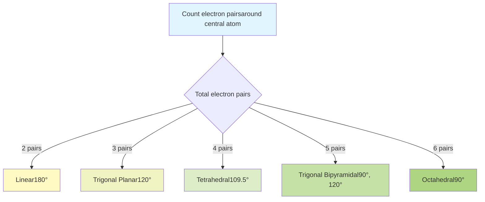

> Master VSEPR theory, predict molecular geometries, understand electron pair repulsions, and solve JEE problems on molecular shapes.

## Prerequisites

Before diving into VSEPR theory, review:

- [Covalent Bonding](../covalent-bonding/index.md) — Lewis structures and electron pairs
- [Lewis Dot Structures](../covalent-bonding/index.md#lewis-dot-structures) — Drawing molecular structures
- [Electronic Configuration](../../atomic-structure/electronic-configuration/index.md) — Understanding valence electrons

---

## The Hook: Why Water Isn’t Linear

> **★ Key point · Connect: The 104.5° That Changed Everything**
>
> **Imagine if water was linear (H-O-H at 180°) instead of bent (104.5°)&mldr;**
>
> - Ice wouldn’t float → oceans would freeze from bottom up → **no marine life**

> - Water wouldn’t be such a good solvent → **no biochemistry, no life**

> - Snowflakes wouldn’t have their beautiful hexagonal shapes
>
> **One tiny angle difference = The difference between a living planet and a dead rock!**
>
> In *Interstellar* (2014), they search for planets with liquid water. But it’s not just H₂O that matters — it’s the **bent shape** that gives water its unique properties! The reason? **VSEPR Theory** — Valence Shell Electron Pair Repulsion.
>
> **JEE Reality:** This is a **free marks** topic! 2-3 guaranteed questions every year worth 8-12 marks. Master the patterns, and you’ll solve these in under 30 seconds each!

---

## The Core Concept

### What is VSEPR Theory?

**VSEPR Theory** predicts the 3D shapes of molecules based on one simple idea:

$$\boxed{\text{Electron pairs repel each other and arrange to minimize repulsion}}$$

**In simple terms:** Imagine balloons tied together at a central point. The balloons naturally spread out as far as possible to minimize bumping into each other. That’s exactly what electron pairs do around an atom!

### The Fundamental Principle

**Electron pairs** (bonding + lone pairs) around a central atom arrange themselves to be **as far apart as possible** to minimize repulsion.



---

## VSEPR Methodology: The 4-Step Process

### Step 1: Draw Lewis Structure

Identify central atom, count valence electrons, distribute as bonds and lone pairs.

### Step 2: Count Electron Pairs

**Steric Number (SN) = Number of bonding pairs + Number of lone pairs**

**Important:** Count **multiple bonds as ONE bonding region** (double = 1, triple = 1)

### Step 3: Determine Electron Geometry

Based on total electron pairs (SN), determine how electron pairs arrange in space.

### Step 4: Determine Molecular Geometry

Consider only **atoms** (ignore lone pairs) to determine molecular shape.

> **★ Key point · Golden Rule**
>
> **Electron geometry** (includes lone pairs) determines **electron arrangement**
>
> **Molecular geometry** (only atoms) determines **molecular shape**
>
> **Example:** H₂O
>
> - Electron geometry: **Tetrahedral** (4 electron pairs)

> - Molecular geometry: **Bent** (only 2 H atoms visible)
>
> **JEE Trap:** Questions ask for “shape” → they want **molecular geometry**, not electron geometry!

---

## Repulsion Order: Who Pushes Harder?

Not all electron pairs repel equally! **Lone pairs occupy more space** than bonding pairs.

$$\boxed{\text{LP-LP} > \text{LP-BP} > \text{BP-BP}}$$

Where:

- **LP** = Lone Pair
- **BP** = Bonding Pair

**Why?** Lone pairs are held by only one nucleus (the central atom), so they spread out more. Bonding pairs are held by two nuclei, so they’re more compressed.

### Effect on Bond Angles

More lone pairs → **Smaller bond angles**

**Example: CH₄ vs NH₃ vs H₂O**

| Molecule | LP | BP | Bond Angle | Reason |
| --- | --- | --- | --- | --- |
| CH₄ | 0 | 4 | 109.5° | Standard tetrahedral |
| NH₃ | 1 | 3 | 107° | 1 LP pushes BP’s closer |
| H₂O | 2 | 2 | 104.5° | 2 LP’s push BP’s even closer |

**Memory trick:** “More Lone, Less Angle!” → Each lone pair reduces angle by ~2.5°

---

## The Complete VSEPR Guide

### 2 Electron Pairs (SN = 2)

#### Linear Geometry (180°)

**Electron Geometry:** Linear
**Molecular Geometries:** 1 shape possible

**Type: AX₂ (2 BP, 0 LP) — LINEAR**

**Example:** BeCl₂, CO₂, HCN

```fallback
Cl-Be-Cl    or    O=C=O
    180°           180°
```

**Visual Description:**

- **Linear:** Like a straight rod
- Both atoms on opposite sides of central atom
- Bond angle = **180°**

> **◐ In simple terms · CO₂ Visualization**
>
> Imagine a barbell with weights on both ends. The central carbon is the bar, and the oxygen atoms are the weights on opposite ends. Perfectly straight, perfectly balanced.
>
> **Why linear?** 2 electron regions want to be **as far apart as possible** → 180° is maximum separation!

---

### 3 Electron Pairs (SN = 3)

**Electron Geometry:** Trigonal Planar (120°)

#### Type 1: AX₃ (3 BP, 0 LP) — TRIGONAL PLANAR

**Example:** BF₃, BCl₃, CO₃²⁻, NO₃⁻

```fallback
F
     |
 F—B—F
   120°
```

**Visual Description:**

- **Trigonal Planar:** Like a Mercedes-Benz logo
- All atoms in the **same plane**
- Three arms at **120°** angles
- Flat, symmetrical

**Example:** BF₃ (boron trifluoride)

- B at center, 3 F atoms around it
- All in one plane, 120° apart
- Looks like three spokes of a wheel

#### Type 2: AX₂E (2 BP, 1 LP) — BENT/V-SHAPED

**Example:** SO₂, O₃, NO₂⁻

```fallback
O
  //
 S
  \
   O
  ~120° (actually ~119°)
```

**Visual Description:**

- **Bent:** Like a boomerang
- Two atoms bonded, one lone pair (invisible)
- Lone pair pushes atoms closer
- Bond angle < 120° (usually ~119° for SO₂)

> **↗ Connection · Quick Comparison**
>
> **CO₂ (linear) vs SO₂ (bent) — Why different?**
>
> **CO₂:** C has 4 valence e⁻, forms 2 double bonds → 2 bonding regions, 0 LP → **linear**
>
> **SO₂:** S has 6 valence e⁻, forms 2 double bonds → 2 bonding regions, 1 LP → **bent**
>
> **JEE Trick:** Even though both have O=X=O formula, **count lone pairs**!

---

### 4 Electron Pairs (SN = 4)

**Electron Geometry:** Tetrahedral (109.5°)

#### Type 1: AX₄ (4 BP, 0 LP) — TETRAHEDRAL

**Example:** CH₄, CCl₄, NH₄⁺, SO₄²⁻

```fallback
H
       |
   H—C—H
       |
       H
   109.5°
```

**Visual Description:**

- **Tetrahedral:** Like a triangular pyramid
- 4 atoms arranged at corners of a tetrahedron
- Central atom at the center
- All bond angles = **109.5°**
- 3D structure (NOT flat!)

**Imagine:** A tripod with one leg pointing up and three pointing down (but more symmetrical). Or a soccer ball’s stitching at a vertex.

#### Type 2: AX₃E (3 BP, 1 LP) — TRIGONAL PYRAMIDAL

**Example:** NH₃, PCl₃, H₃O⁺

```fallback
N
     /|\
    H H H
    ~107°
```

**Visual Description:**

- **Trigonal Pyramidal:** Like a tripod or a stool
- 3 atoms form a triangular base
- Central atom **above** the base (not in the plane!)
- Lone pair at the top (invisible)
- Bond angle ≈ **107°** (less than 109.5° due to LP repulsion)

**Imagine:** A three-legged camera tripod. The camera (central atom) sits above the three legs (bonded atoms). There’s an invisible fourth leg (lone pair) pointing up.

#### Type 3: AX₂E₂ (2 BP, 2 LP) — BENT/V-SHAPED

**Example:** H₂O, H₂S, SCl₂

```fallback
O:  (2 lone pairs)
   / \
  H   H
 104.5°
```

**Visual Description:**

- **Bent:** Like a boomerang or an open book
- 2 atoms bonded at an angle
- 2 lone pairs (invisible) push from opposite sides
- Bond angle ≈ **104.5°** (H₂O), smaller than 109.5°

**Imagine:** Take a tetrahedral structure, remove two opposite corners (atoms), replace with lone pairs. The remaining two atoms form a bent shape.

> **⚠ Trap · Common Mistake: Bent from 3 EP vs 4 EP**
>
> **Two types of bent shapes — DON’T confuse!**
>
> **Bent from 3 electron pairs (AX₂E):**
>
> - Example: SO₂

> - Electron geometry: Trigonal planar

> - Bond angle ≈ 119-120°
>
> **Bent from 4 electron pairs (AX₂E₂):**
>
> - Example: H₂O

> - Electron geometry: Tetrahedral

> - Bond angle ≈ 104-105°
>
> **JEE Trap:** Both are “bent,” but different angles! Always count total electron pairs first!

---

### 5 Electron Pairs (SN = 5)

**Electron Geometry:** Trigonal Bipyramidal (90° and 120°)

**Key Feature:** TWO types of positions:

- **Axial:** 2 positions above and below (90° to equatorial)
- **Equatorial:** 3 positions in the middle plane (120° to each other)

**Important:** Lone pairs ALWAYS occupy **equatorial positions** first (less repulsion!)

#### Type 1: AX₅ (5 BP, 0 LP) — TRIGONAL BIPYRAMIDAL

**Example:** PCl₅, PF₅

```fallback
Cl (axial)
       |
Cl—P—Cl  (equatorial, 120° apart)
       |
      Cl (axial)
```

**Visual Description:**

- **Trigonal Bipyramidal:** Like two triangular pyramids joined at the base
- 3 atoms in the middle (equatorial) at 120°
- 2 atoms above and below (axial) at 90° to equatorial
- NOT all bond angles equal!

**Imagine:** A bow tie or two Egyptian pyramids stuck together base-to-base.

#### Type 2: AX₄E (4 BP, 1 LP) — SEE-SAW/DISTORTED TETRAHEDRAL

**Example:** SF₄, XeO₂F₂

```fallback
F (axial)
       |
    F—S—F (equatorial)
       |
      F (axial)
  (LP at equatorial)
```

**Visual Description:**

- **See-Saw:** Like a playground see-saw or teeter-totter
- Lone pair occupies one equatorial position
- 2 axial atoms (above/below)
- 2 equatorial atoms (one position empty due to LP)
- Asymmetrical, distorted

**Bond angles:** ~90° (axial-equatorial), ~120° (equatorial-equatorial), but distorted by LP

**Imagine:** A see-saw at a playground — two kids on the ends (axial), one kid on one side (equatorial), empty seat on other side (lone pair).

#### Type 3: AX₃E₂ (3 BP, 2 LP) — T-SHAPED

**Example:** ClF₃, BrF₃

```fallback
F
      |
    F—Cl—F
   (2 LP at equatorial)
```

**Visual Description:**

- **T-Shaped:** Like the letter “T”
- 2 lone pairs occupy equatorial positions
- 2 atoms at axial positions (up and down)
- 1 atom at remaining equatorial position
- Forms a T

**Bond angles:** ~90° (axial to equatorial), slightly less than 90° due to LP repulsion

**Imagine:** A capital letter T. The vertical part has atoms at top and bottom (axial), the horizontal part has one atom extending to the side (equatorial).

#### Type 4: AX₂E₃ (2 BP, 3 LP) — LINEAR

**Example:** XeF₂, I₃⁻

```fallback
F—Xe—F
(3 LP at equatorial)
```

**Visual Description:**

- **Linear:** Straight line (like AX₂)
- 3 lone pairs occupy ALL equatorial positions
- 2 atoms at axial positions (least repulsion)
- Bond angle = **180°**

**Imagine:** A barbell again, but with invisible balloons (lone pairs) in the middle plane pushing the atoms to opposite sides.

> **★ Key point · 5 Electron Pairs Memory Trick**
>
> **“Lone pairs love the equator!”** — They always go to equatorial positions first.
>
> **Why?** Equatorial positions have 2 neighbors at 90° (axial positions have 3 neighbors at 90°). Lone pairs need more space, so they choose the less crowded equatorial spots!
>
> **Patterns:**
>
> - 0 LP: Trigonal bipyramidal (all atoms)

> - 1 LP: See-saw (LP at equatorial)

> - 2 LP: T-shaped (both LP at equatorial)

> - 3 LP: Linear (all LP at equatorial, atoms at axial)

---

### 6 Electron Pairs (SN = 6)

**Electron Geometry:** Octahedral (90°)

**Key Feature:** All 6 positions are **equivalent** (unlike TBP)

#### Type 1: AX₆ (6 BP, 0 LP) — OCTAHEDRAL

**Example:** SF₆, PF₆⁻, [Fe(CN)₆]³⁻

```fallback
F
      |
  F—S—F
      |
      F
(+ 1 F front, 1 F back)
```

**Visual Description:**

- **Octahedral:** Like two square pyramids joined at the base
- 6 atoms at corners of an octahedron
- All bond angles = **90°**
- Highly symmetrical

**Imagine:** A die (6-sided cube) with atoms at each face’s center. Or two Egyptian pyramids (square base) stuck together.

#### Type 2: AX₅E (5 BP, 1 LP) — SQUARE PYRAMIDAL

**Example:** BrF₅, IF₅, [NiCN₅]³⁻

```fallback
F
      |
  F—Br—F
   | |
    F—F
(LP opposite to apex)
```

**Visual Description:**

- **Square Pyramidal:** Like the Egyptian pyramids
- 4 atoms form a square base
- 1 atom at the apex (top)
- Lone pair at the bottom (opposite to apex)

**Bond angles:** ~90° (mostly), slightly distorted by LP

**Imagine:** The Great Pyramid of Giza — square base, apex at top, lone pair hidden underground.

#### Type 3: AX₄E₂ (4 BP, 2 LP) — SQUARE PLANAR

**Example:** XeF₄, ICl₄⁻, [PtCl₄]²⁻

```fallback
F
    |
F—Xe—F
    |
    F
(2 LP above and below plane)
```

**Visual Description:**

- **Square Planar:** Like a flat square
- 4 atoms at corners of a square
- 2 lone pairs above and below the plane
- All atoms in **one plane**
- Bond angles = **90°**

**Imagine:** A perfectly flat piece of paper with atoms at the four corners. Lone pairs are ghosts floating above and below the paper.

---

## Summary Table: All VSEPR Shapes

| SN | Formula | BP | LP | Electron Geometry | Molecular Geometry | Bond Angle | Example |
| --- | --- | --- | --- | --- | --- | --- | --- |
| 2 | AX₂ | 2 | 0 | Linear | **Linear** | 180° | CO₂, BeCl₂ |
| 3 | AX₃ | 3 | 0 | Trigonal planar | **Trigonal planar** | 120° | BF₃, CO₃²⁻ |
| 3 | AX₂E | 2 | 1 | Trigonal planar | **Bent** | ~120° | SO₂, NO₂⁻ |
| 4 | AX₄ | 4 | 0 | Tetrahedral | **Tetrahedral** | 109.5° | CH₄, NH₄⁺ |
| 4 | AX₃E | 3 | 1 | Tetrahedral | **Trigonal pyramidal** | ~107° | NH₃, PCl₃ |
| 4 | AX₂E₂ | 2 | 2 | Tetrahedral | **Bent** | ~104.5° | H₂O, H₂S |
| 5 | AX₅ | 5 | 0 | TBP | **Trigonal bipyramidal** | 90°, 120° | PCl₅ |
| 5 | AX₄E | 4 | 1 | TBP | **See-saw** | <90°, <120° | SF₄ |
| 5 | AX₃E₂ | 3 | 2 | TBP | **T-shaped** | ~90° | ClF₃ |
| 5 | AX₂E₃ | 2 | 3 | TBP | **Linear** | 180° | XeF₂, I₃⁻ |
| 6 | AX₆ | 6 | 0 | Octahedral | **Octahedral** | 90° | SF₆ |
| 6 | AX₅E | 5 | 1 | Octahedral | **Square pyramidal** | ~90° | BrF₅ |
| 6 | AX₄E₂ | 4 | 2 | Octahedral | **Square planar** | 90° | XeF₄ |

### Interactive Demo: Explore VSEPR Molecular Geometries

Use this interactive 3D visualization to explore all VSEPR geometries. Select preset molecules like CH4, NH3, H2O, or customize electron pair counts. Drag to rotate the model and observe how lone pairs affect bond angles. Watch the difference between electron geometry and molecular geometry in real-time!

> **★ Key point · How to Use This Visualization**
>
> 1. **Select a Preset**: Choose from common molecules like CH4, NH3, H2O, SF6, XeF4, etc.

> 2. **Custom Mode**: Use sliders to set total electron pairs (2-6) and lone pairs

> 3. **Rotate**: Drag on the molecule to rotate it in 3D space

> 4. **Observe**: Watch how lone pairs (purple clouds) push bonding pairs closer together

> 5. **Compare**: Notice the difference between electron geometry and molecular geometry!
>
> **Key Insight**: The visualization shows LP-LP > LP-BP > BP-BP repulsion - lone pairs compress bond angles!

---

## Memory Tricks & Patterns

### The Lone Pair Effect

**“Each lonely pair steals 2.5° from the party!”**

For tetrahedral base (109.5°):

- 0 LP: CH₄ = 109.5°
- 1 LP: NH₃ = 107° (−2.5°)
- 2 LP: H₂O = 104.5° (−5°)

### Shape Family Tree

```fallback
2 EP: Linear only
3 EP: Planar (flat) shapes only
4 EP: 3D shapes start
5 EP: Complex shapes, LP prefer equatorial
6 EP: 3D symmetrical shapes
```

### Visual Mnemonics

**BeCl₂:** **Be**comes **L**inear (180°)
**BF₃:** **B**oron **F**orms **T**rigonal planar (120°)
**CH₄:** **C**arbon **H**as **T**etrahedral (109.5°)
**NH₃:** **N**itrogen’s **P**yramid (107°)
**H₂O:** **H**ighly **B**ent (104.5°)
**PCl₅:** **P**hosphor **BP** shape (Bipyramidal)
**SF₆:** **S**ulfur **O**ctahedral (6 faces)

---

## Special Cases and Exceptions

### Multiple Bonds Count as ONE Region

> **★ Key point · Critical VSEPR Rule**
>
> **Double and triple bonds count as ONE electron region for VSEPR!**
>
> **Example: CO₂**
>
> - Lewis structure: O=C=O

> - You might think “4 bonds = 4 regions”

> - **WRONG!** Each C=O is **one bonding region**

> - Total: **2 regions** → Linear
>
> **Example: HCN**
>
> - Lewis structure: H-C≡N

> - H-C is 1 region, C≡N is 1 region

> - Total: **2 regions** → Linear

### Expanded Octets (Period 3 and Beyond)

Elements in **Period 3 and higher** can accommodate **more than 8 electrons** using vacant d-orbitals.

**Examples:**

- PCl₅: P has 10 electrons (5 bonds)
- SF₆: S has 12 electrons (6 bonds)
- IF₇: I has 14 electrons (7 bonds)

**Why?** They have accessible 3d, 4d, 5d orbitals for electron accommodation.

### Resonance Doesn’t Change Shape

**Example: CO₃²⁻**

- Has 3 resonance structures (double bond rotates)
- But VSEPR shape remains **trigonal planar**
- Why? Average bond order doesn’t change electron regions

---

## Common Mistakes to Avoid

> **⚠ Trap #1: Confusing Electron and Molecular Geometry**
>
> **Mistake:** Saying H₂O is “tetrahedral”
>
> **Correct:**
>
> - H₂O has **tetrahedral electron geometry** (4 electron pairs)

> - But **bent molecular geometry** (only 2 H atoms visible)
>
> **JEE questions ask for “shape of molecule”** → Answer = **Bent**, not tetrahedral!
>
> **Rule:** Unless specifically asked for “electron geometry,” always give **molecular geometry**!

> **⚠ Trap #2: Counting Multiple Bonds Wrong**
>
> **Mistake:** Counting C=O double bond as 2 bonding regions
>
> **Correct:** C=O is **ONE bonding region** (even though it has 2 bonds)
>
> **Example:** CO₂
>
> - Wrong count: 4 bonds → 4 regions → tetrahedral

> - Correct count: 2 bonding regions (each C=O) → Linear ✓

> **⚠ Trap #3: Forgetting Lone Pairs on Central Atom**
>
> **Mistake:** Drawing Lewis structure but not identifying lone pairs on central atom
>
> **Example:** SO₂
>
> - S has 6 valence electrons

> - Forms 2 double bonds (uses 4 electrons)

> - **Remaining 2 electrons = 1 lone pair** ← Don’t forget this!

> - Result: 2 BP + 1 LP → Bent, not linear
>
> **JEE Tip:** After drawing Lewis structure, **ALWAYS count lone pairs on central atom**!

---

## Practice Problems

### Level 1: Foundation (NCERT Style)

> **↗ Connection · Problem 1**
>
> **Question:** Predict the shape of the following molecules:

> (a) BeCl₂ (b) BF₃ (c) CH₄
>
> **Solution:**
>
> **(a) BeCl₂:**
>
> - Be has 2 valence electrons

> - Forms 2 bonds with Cl

> - SN = 2 (2 BP, 0 LP)

> - **Shape: Linear** (180°)
>
> **(b) BF₃:**
>
> - B has 3 valence electrons

> - Forms 3 bonds with F

> - SN = 3 (3 BP, 0 LP)

> - **Shape: Trigonal planar** (120°)
>
> **(c) CH₄:**
>
> - C has 4 valence electrons

> - Forms 4 bonds with H

> - SN = 4 (4 BP, 0 LP)

> - **Shape: Tetrahedral** (109.5°)

> **↗ Connection · Problem 2**
>
> **Question:** Why is H₂O bent and not linear?
>
> **Solution:**
>
> **Lewis structure of H₂O:**
>
> - O has 6 valence electrons

> - Forms 2 bonds with H (uses 2 electrons)

> - Remaining 4 electrons = 2 lone pairs
>
> **VSEPR Analysis:**
>
> - Total electron pairs = 2 BP + 2 LP = 4

> - Electron geometry: Tetrahedral

> - Molecular geometry: **Bent** (only 2 H atoms)

> - Bond angle ≈ 104.5° (less than 109.5° due to LP-LP repulsion)
>
> **Answer:** H₂O is bent because oxygen has **2 lone pairs** that repel the bonding pairs, creating a bent shape instead of linear.

---

### Level 2: JEE Main Type

> **↗ Connection · Problem 3**
>
> **Question:** Arrange the following in order of increasing bond angle:

> H₂O, NH₃, CH₄, BF₃
>
> **Solution:**
>
> **Step 1:** Identify shapes and electron pairs
>
> - **H₂O:** 2 BP, 2 LP → Bent (tetrahedral base) → ~104.5°

> - **NH₃:** 3 BP, 1 LP → Trigonal pyramidal → ~107°

> - **CH₄:** 4 BP, 0 LP → Tetrahedral → 109.5°

> - **BF₃:** 3 BP, 0 LP → Trigonal planar → 120°
>
> **Step 2:** Order by bond angle
>
> H₂O (104.5°) < NH₃ (107°) < CH₄ (109.5°) < BF₃ (120°)
>
> **Answer:** H₂O < NH₃ < CH₄ < BF₃
>
> **JEE Tip:** More lone pairs → smaller bond angle (for same electron geometry)

> **↗ Connection · Problem 4**
>
> **Question:** Which of the following has a square planar shape?

> (A) CCl₄ (B) XeF₄ (C) NH₄⁺ (D) SF₄
>
> **Solution:**
>
> **(A) CCl₄:**
>
> - C has 4 valence e⁻, 4 Cl atoms

> - SN = 4 (4 BP, 0 LP) → **Tetrahedral** ✗
>
> **(B) XeF₄:**
>
> - Xe has 8 valence e⁻, 4 F atoms

> - 4 bonds use 4 electrons, remaining 4 = 2 LP

> - SN = 6 (4 BP, 2 LP) → **Square planar** ✓
>
> **(C) NH₄⁺:**
>
> - N has 5 valence e⁻, but +1 charge → 4 electrons

> - 4 bonds, 0 LP

> - SN = 4 (4 BP, 0 LP) → **Tetrahedral** ✗
>
> **(D) SF₄:**
>
> - S has 6 valence e⁻, 4 F atoms

> - 4 bonds, 1 LP

> - SN = 5 (4 BP, 1 LP) → **See-saw** ✗
>
> **Answer:** (B) XeF₄

---

### Level 3: JEE Advanced Type

> **↗ Connection · Problem 5: Multi-Molecule Comparison**
>
> **Question:** Among NH₃, NH₄⁺, and NH₂⁻, which has:

> (a) The largest bond angle?

> (b) The smallest bond angle?

> Explain with reasoning.
>
> **Solution:**
>
> **NH₃ (Ammonia):**
>
> - N has 5 valence e⁻, 3 H atoms

> - 3 BP, 1 LP

> - Shape: Trigonal pyramidal

> - Bond angle ≈ **107°**
>
> **NH₄⁺ (Ammonium ion):**
>
> - N has 5 valence e⁻, +1 charge → 4 electrons available for bonding

> - 4 BP, 0 LP

> - Shape: Tetrahedral

> - Bond angle = **109.5°**
>
> **NH₂⁻ (Amide ion):**
>
> - N has 5 valence e⁻, −1 charge → 6 electrons total

> - 2 H atoms → 2 BP, 2 LP

> - Shape: Bent

> - Bond angle ≈ **104.5°**
>
> **Answers:**

> (a) **Largest bond angle:** NH₄⁺ (109.5°) — no lone pairs!

> (b) **Smallest bond angle:** NH₂⁻ (104.5°) — 2 lone pairs compress the most!
>
> **Pattern:** As LP increases, bond angle decreases
>
> - 0 LP: 109.5°

> - 1 LP: ~107°

> - 2 LP: ~104.5°

> **↗ Connection · Problem 6: Complex Shape Prediction**
>
> **Question:** Predict the shape of ClF₃ and explain why all bond angles are NOT equal.
>
> **Solution:**
>
> **Step 1: Lewis structure**
>
> - Cl has 7 valence e⁻, 3 F atoms

> - 3 bonds use 3 electrons, remaining 4 = 2 LP

> - Total: 3 BP + 2 LP = 5 electron pairs
>
> **Step 2: Electron geometry**
>
> - 5 electron pairs → Trigonal bipyramidal
>
> **Step 3: Place lone pairs**
>
> - Lone pairs prefer **equatorial positions** (less repulsion)

> - 2 LP occupy 2 equatorial spots

> - 3 F atoms: 2 at axial, 1 at remaining equatorial
>
> **Step 4: Molecular shape**
>
> - **T-shaped** (3 atoms, 2 LP)
>
> **Step 5: Bond angles**
>
> - Axial F—Cl—Equatorial F: ~90° (but slightly less due to LP repulsion)

> - Axial F—Cl—Axial F: ~180° (slightly less)
>
> **Why not equal?** The 2 lone pairs at equatorial positions repel the bonding pairs unevenly:
>
> - LP-BP repulsion > BP-BP repulsion

> - Axial bonds are pushed slightly toward each other

> - Equatorial bond is pushed away from LP’s
>
> **Answer:** ClF₃ is **T-shaped** with bond angles ≈ 87-88° (F-Cl-F, axial to equatorial) and ~175° (axial to axial), not exactly 90° and 180° due to lone pair repulsions.

---

## Quick Revision Box

| Total EP | 0 LP | 1 LP | 2 LP | 3 LP |
| --- | --- | --- | --- | --- |
| **2** | Linear (180°) | — | — | — |
| **3** | Trig. planar (120°) | Bent (~120°) | — | — |
| **4** | Tetrahedral (109.5°) | Trig. pyramidal (~107°) | Bent (~104.5°) | — |
| **5** | TBP (90°, 120°) | See-saw | T-shaped (~90°) | Linear (180°) |
| **6** | Octahedral (90°) | Sq. pyramidal | Sq. planar (90°) | — |

### Most Tested Molecules in JEE

| Molecule | Shape | Bond Angle | Key Feature |
| --- | --- | --- | --- |
| CO₂ | Linear | 180° | Double bonds count as 1 region |
| H₂O | Bent | 104.5° | 2 LP compress angle |
| NH₃ | Trig. pyramidal | 107° | 1 LP reduces angle |
| CH₄ | Tetrahedral | 109.5° | Perfect tetrahedral |
| PCl₅ | Trig. bipyramidal | 90°, 120° | 2 different angles |
| SF₆ | Octahedral | 90° | All positions equivalent |
| XeF₂ | Linear | 180° | 3 LP at equatorial |
| XeF₄ | Square planar | 90° | 2 LP above/below plane |

---

## Real-World Applications

> **◐ In simple terms · Why Molecular Shapes Matter**
>
> **1. Drug Design:**

> Drugs fit into enzyme active sites like a key in a lock. The **shape** of the molecule determines if it fits!
>
> - Example: Inhibitor drugs are designed to be exact shapes to block enzyme activity
>
> **2. Smell and Taste:**

> Your nose and tongue detect molecules based on **shape**, not just composition!
>
> - Limonene (lemon scent) vs Carvone (mint scent) — same formula, different shapes!
>
> **3. DNA Structure:**

> The double helix exists because of the **bent shape of water** that stabilizes it through hydrogen bonding. Linear water → No DNA → No life!
>
> **4. Ozone Layer:**

> O₃ is **bent** (not linear like O₂), which makes it absorb UV radiation differently. The bent shape is crucial for protecting Earth from harmful UV!
>
> **5. Catalysts:**

> Transition metal complexes have specific shapes (octahedral, square planar) that determine their catalytic activity. Wrong shape → No catalysis!

---

## Teacher’s Summary

> **★ Key point · Key Takeaways**
>
> **1. VSEPR = Electron pairs minimize repulsion**
>
> - Count total electron pairs (bonding + lone)

> - Arrange to maximize separation

> - Simple concept, powerful predictions!
>
> **2. Electron geometry ≠ Molecular geometry**
>
> - Electron geometry: includes lone pairs

> - Molecular geometry: only atoms (what you “see”)

> - JEE asks for molecular geometry!
>
> **3. Repulsion order determines angles**
>
> - LP-LP > LP-BP > BP-BP

> - More lone pairs → Smaller bond angles

> - Each LP reduces angle by ~2.5° (tetrahedral base)
>
> **4. Multiple bonds = ONE bonding region**
>
> - C=O, C≡N count as 1 region each

> - Don’t count individual bonds in multiple bonds!
>
> **5. For 5 EP: Lone pairs love equatorial**
>
> - Equatorial positions have less repulsion

> - Fill equatorial first with LP’s

> - Determines see-saw, T-shaped, linear shapes
>
> **6. Patterns for quick solving:**
>
> - 2 EP → Linear (only 1 option)

> - 3 EP → Planar/Bent (2 options)

> - 4 EP → Tetrahedral/Pyramidal/Bent (3 options)

> - 5 EP → TBP/See-saw/T/Linear (4 options!)

> - 6 EP → Octahedral/Sq.Pyramidal/Sq.Planar (3 options)
>
> **7. JEE Strategy:**
>
> - Draw Lewis structure (10 sec)

> - Count BP and LP (5 sec)

> - Look up table/remember pattern (5 sec)

> - **Total: 20 seconds per question!**
>
> **“Lone pairs are like invisible bullies — they take up more space and push everyone else closer together!”**

---

## Related Topics

### Within Chemical Bonding

- [Covalent Bonding](../covalent-bonding/index.md) - Lewis structures, sigma and pi bonds
- [Hybridization](../hybridization/index.md) - Why these shapes exist (VBT explanation)
- [Molecular Orbital Theory](../molecular-orbital-theory/index.md) - Advanced bonding perspective
- [Ionic Bonding](../ionic-bonding/index.md) - Comparison with ionic structures
- [Hydrogen Bonding](../hydrogen-bonding/index.md) - Shape and polarity effects

### Atomic Structure Foundation

- [Orbital Shapes](../../atomic-structure/orbital-shapes/index.md) - s, p, d orbital geometry
- [Electronic Configuration](../../atomic-structure/electronic-configuration/index.md) - Valence electrons

### Organic Chemistry Applications

- [Organic Principles - Hybridization](../../organic-principles/hybridization/index.md) - Carbon geometry in organic molecules
- [Reaction Intermediates](../../organic-principles/reaction-intermediates/index.md) - Carbocation (sp2) and carbanion shapes
- [Aldehydes and Ketones](../../oxygen-compounds/aldehydes-ketones/index.md) - Carbonyl geometry

### Coordination Chemistry

- [Coordination Compounds](../../coordination-compounds/index.md) - Complex ion geometry
- [Crystal Field Theory](../../coordination-compounds/crystal-field-theory/index.md) - d-orbital splitting

### Inorganic Applications

- [p-Block Elements](../../p-block-elements/index.md) - Oxoacid structures
- [Group 15](../../p-block-elements/group-15/index.md) - NH3, PCl5 shapes
- [Group 16](../../p-block-elements/group-16/index.md) - H2O, H2S shapes

### Physics Connection

- [Electrostatics](../../../physics/electrostatics/index.md) - Charge repulsion basics
- [Electric Dipole](../../../physics/electrostatics/electric-dipole/index.md) - Molecular polarity

### Mathematics

- [Vector Algebra](../../../mathematics/vector-algebra/index.md) - Dipole moment vector addition

---

From TestGuru · our mock-test platform

## You've read VSEPR Theory and Molecular Shapes.You've read this topic. Find out what you actually got.

A free JEE Main mock with this chapter in it, and a report that shows which sub-topics cost you marks.

[Take a free JEE Main mock →](https://app.testguru.co/signup?tg_chapter=chemical-bonding&tg_exam=jee-main&tg_page=%2Fchemistry%2Fchemical-bonding%2Fvsepr-theory%2F&tg_subject=chemistry&utm_campaign=notes-jee-main-free-test&utm_content=article-end&utm_medium=referral&utm_source=jeenotes)
Free, no card. Opens TestGuru in a new tab.

## Stay exam-ready

One email every Sunday: new notes, the week's hardest challenge question and a revision plan.One email every Sunday.

## Comments

Have a question or spotted a mistake? Join the discussion below.

Advertisement

Advertisement

---

## Extracted page code (interactive scripts & widgets)


### inline-script-16

```js
if(!document.getElementById("animation-fullscreen-overlay")){const e=document.createElement("div");e.id="animation-fullscreen-overlay",e.className="animation-fullscreen-overlay",e.innerHTML=`
      <div class="fullscreen-modal">
        <div class="fullscreen-header">
          <span class="fullscreen-title">Interactive Demo</span>
          <button class="fullscreen-close-btn" onclick="JEEAnimations.closeFullscreen()" title="Close (Esc)" aria-label="Close fullscreen">
            <svg width="24" height="24" viewBox="0 0 24 24" fill="none" stroke="currentColor" stroke-width="2" stroke-linecap="round" stroke-linejoin="round">
              <line x1="18" y1="6" x2="6" y2="18"></line>
              <line x1="6" y1="6" x2="18" y2="18"></line>
            </svg>
          </button>
        </div>
        <div class="fullscreen-content"></div>
      </div>
    `,document.body.appendChild(e),document.addEventListener("keydown",function(e){e.key==="Escape"&&document.body.classList.contains("animation-fullscreen-active")&&JEEAnimations.closeFullscreen()}),e.addEventListener("click",function(t){t.target===e&&JEEAnimations.closeFullscreen()})}
```


### inline-script-17

```js
(function(){var t,e=document.getElementById("disqus-load");if(!e)return;t=!1,e.addEventListener("click",function(){if(t)return;t=!0,e.setAttribute("disabled","disabled"),e.textContent="Loading comments…",window.disqus_config=function(){this.page.url="https://jeenotes.in/chemistry/chemical-bonding/vsepr-theory/",this.page.identifier="/chemistry/chemical-bonding/vsepr-theory/"};var s=document,n=s.createElement("script");n.src="https://https-jeenotes-in.disqus.com/embed.js",n.setAttribute("data-timestamp",+new Date),n.onload=function(){e.style.display="none"},n.onerror=function(){t=!1,e.removeAttribute("disabled"),e.textContent="Could not load comments. Tap to retry"},(s.head||s.body).appendChild(n)})})()
```


### inline-script-18

```js
(function(){var t,e=document.currentScript.previousElementSibling;function n(){(window.adsbygoogle=window.adsbygoogle||[]).push({})}if(!window.ResizeObserver||e.clientWidth>0){n();return}t=new ResizeObserver(function(){e.clientWidth>0&&(t.disconnect(),n())}),t.observe(e)})()
```


### interactive-widget-1

```html
<div class="animation-wrapper" data-animation="vseprGeometry" id="anim-vseprGeometry-1795396419206902877"><div class="animation-header"><button aria-label="Toggle fullscreen" class="anim-fullscreen-btn" onclick='JEEAnimations.toggleFullscreen("anim-vseprGeometry-1795396419206902877")' title="Fullscreen (F)">
<svg class="fullscreen-icon-expand" fill="none" height="18" stroke="currentColor" stroke-linecap="round" stroke-linejoin="round" stroke-width="2" viewbox="0 0 24 24" width="18"><polyline points="15 3 21 3 21 9"></polyline><polyline points="9 21 3 21 3 15"></polyline><line x1="21" x2="14" y1="3" y2="10"></line><line x1="3" x2="10" y1="21" y2="14"></line></svg>
<svg class="fullscreen-icon-collapse" fill="none" height="18" stroke="currentColor" stroke-linecap="round" stroke-linejoin="round" stroke-width="2" viewbox="0 0 24 24" width="18"><polyline points="4 14 10 14 10 20"></polyline><polyline points="20 10 14 10 14 4"></polyline><line x1="14" x2="21" y1="10" y2="3"></line><line x1="3" x2="10" y1="21" y2="14"></line></svg>
<span class="fullscreen-text">Fullscreen</span></button></div><div class="animation-content"><noscript><div class="callout callout-warning"><div class="callout-title">JavaScript Required</div><p>This interactive animation requires JavaScript to be enabled.</p></div></noscript></div></div>
```


---

_Source: [https://jeenotes.in/chemistry/chemical-bonding/vsepr-theory/](https://jeenotes.in/chemistry/chemical-bonding/vsepr-theory/) · raw HTML: `offline/chemistry/chemical-bonding/vsepr-theory/index.html`_
