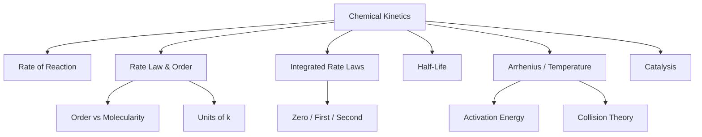

> Chemical kinetics formulas on one page: rate law and order, integrated rate equations, half-life, Arrhenius equation and activation energy. Class 12, JEE Main & Advanced.

Last-minute revision sheet for the entire Chemical Kinetics chapter: rate of reaction, rate law, order and molecularity, integrated rate equations, half-life, the Arrhenius equation, and catalysis. Every formula, relation, and shortcut below is pulled straight from the chapter pages.

## Chapter Map



## Rate of Reaction

For a general reaction $aA + bB \rightarrow cC + dD$, the **unique rate** (divide by stoichiometric coefficients):

$$\boxed{r = -\frac{1}{a}\frac{d[A]}{dt} = -\frac{1}{b}\frac{d[B]}{dt} = +\frac{1}{c}\frac{d[C]}{dt} = +\frac{1}{d}\frac{d[D]}{dt}}$$

| Quantity | Formula | Notes |
| --- | --- | --- |
| Average rate | $r_{avg} = -\dfrac{\Delta[R]}{\Delta t} = +\dfrac{\Delta[P]}{\Delta t}$ | Over finite interval (slope of chord) |
| Instantaneous rate | $r = -\dfrac{d[R]}{dt} = +\dfrac{d[P]}{dt}$ | At one instant (slope of tangent) |
| Units of rate | $\text{mol L}^{-1}\text{s}^{-1}$ or $\text{M s}^{-1}$ | Always positive when called “rate of reaction” |

> **★ Key point · Sign and Stoichiometry**
>
> Negative sign for reactants (concentration decreases), positive for products. Always divide by the stoichiometric coefficient so every species gives the same unique rate. Mnemonic: “Products Plus, Reactants Removed”.

## Rate Law and Rate Constant

For $aA + bB \rightarrow \text{Products}$:

$$\boxed{r = k[A]^m[B]^n}$$

- $k$ = rate constant (specific rate constant)
- $m$ = order w.r.t. A, $n$ = order w.r.t. B
- Overall order $= m + n$ (
  determined **experimentally**, not from stoichiometry)

### Units of Rate Constant

$$\boxed{\text{Units of } k = (\text{concentration})^{1-n} \times (\text{time})^{-1}}$$

| Order $n$ | Rate law | Units of $k$ |
| --- | --- | --- |
| 0 | $r = k$ | mol L⁻¹ s⁻¹ (M s⁻¹) |
| 1 | $r = k[A]$ | s⁻¹ |
| 2 | $r = k[A]^2$ or $k[A][B]$ | L mol⁻¹ s⁻¹ (M⁻¹ s⁻¹) |
| 3 | $r = k[A]^2[B]$ | L² mol⁻² s⁻¹ (M⁻² s⁻¹) |
| $n$ | — | L⁽ⁿ⁻¹⁾ mol⁽¹⁻ⁿ⁾ s⁻¹ |

### Initial Rate Method

Comparing two experiments where only one concentration changes:

$$\frac{r_2}{r_1} = \left(\frac{[A]_2}{[A]_1}\right)^{m} \implies 2^m = \frac{r_2}{r_1}\ \text{(if conc. doubled)}$$

## Order vs Molecularity

| Property | Order | Molecularity |
| --- | --- | --- |
| Definition | Sum of powers in rate law | No. of molecules colliding in elementary step |
| Determination | Experimental | From mechanism (theoretical) |
| Value | 0, fractional, integer, negative | Only positive integer (1, 2, 3) |
| Can be zero / fraction? | Yes | No |
| Max value | No limit | 3 (termolecular, rare) |
| Applies to | Overall or elementary | Elementary steps only |

> **★ Key point · High-Yield Facts**
>
> - For an **elementary** reaction: order = molecularity, and the rate law follows directly from stoichiometry.

> - For a **complex** reaction: the **rate-determining (slowest) step** sets the rate law, so order may differ from stoichiometry (e.g. $2N_2O_5 \rightarrow 4NO_2 + O_2$ is first order, $r = k[N_2O_5]$).

> - Fractional order examples: $CH_3CHO \rightarrow CH_4 + CO$ is order 1.5; $CHCl_3 + Cl_2$ is order 1.5.

### Pseudo-First-Order Reactions

When one reactant is in large excess its concentration stays nearly constant:

$$r = k[A][B] \approx k'[A], \quad \text{where } k' = k[B]$$

Example — acid hydrolysis of ester (water in excess):

$$CH_3COOC_2H_5 + H_2O \xrightarrow{H^+} CH_3COOH + C_2H_5OH$$

## Integrated Rate Equations

### Zero Order

$$-\frac{d[A]}{dt} = k \qquad \boxed{[A]_t = [A]_0 - kt}$$

### First Order

$$-\frac{d[A]}{dt} = k[A]$$

$$\boxed{\ln\frac{[A]_0}{[A]_t} = kt} \qquad k = \frac{2.303}{t}\log\frac{[A]_0}{[A]_t}$$

$$[A]_t = [A]_0\, e^{-kt}$$

### Second Order (Type I: $r = k[A]^2$)

$$-\frac{d[A]}{dt} = k[A]^2 \qquad \boxed{\frac{1}{[A]_t} = \frac{1}{[A]_0} + kt}$$

**Type II** ($r = k[A][B]$, with $[A]_0 \neq [B]_0$):

$$\frac{1}{[A]_0 - [B]_0}\ln\frac{[B]_0[A]_t}{[A]_0[B]_t} = kt$$

### Master Summary Table

| Order | Differential | Integrated | Linear plot | Slope | Half-life | $k$ units |
| --- | --- | --- | --- | --- | --- | --- |
| **0** | $-\frac{d[A]}{dt}=k$ | $[A]_t=[A]_0-kt$ | $[A]$ vs $t$ | $-k$ | $\frac{[A]_0}{2k}$ | M s⁻¹ |
| **1** | $-\frac{d[A]}{dt}=k[A]$ | $\ln[A]_t=\ln[A]_0-kt$ | $\ln[A]$ vs $t$ | $-k$ | $\frac{0.693}{k}$ | s⁻¹ |
| **2** | $-\frac{d[A]}{dt}=k[A]^2$ | $\frac{1}{[A]_t}=\frac{1}{[A]_0}+kt$ | $\frac{1}{[A]}$ vs $t$ | $+k$ | $\frac{1}{k[A]_0}$ | M⁻¹ s⁻¹ |

### First-Order Completion Shortcuts

$$t_{90\%} = \frac{2.303}{k}, \qquad t_{99\%} = \frac{2\times 2.303}{k} = 2\,t_{90\%}$$

So $t_{99\%} = 2\,t_{90\%}$ for any first-order reaction.

## Half-Life

$$\text{Half-life } t_{1/2}: \text{ time for } [A]_t = \frac{[A]_0}{2}$$

After $n$ half-lives:

$$\boxed{\frac{[A]_t}{[A]_0} = \left(\frac{1}{2}\right)^{n}}$$

| Order | $t_{1/2}$ | Dependence on $[A]_0$ | Successive half-lives |
| --- | --- | --- | --- |
| 0 | $\dfrac{[A]_0}{2k}$ | $\propto [A]_0$ | Decrease (1, ½, ¼, …) |
| 1 | $\dfrac{0.693}{k} = \dfrac{\ln 2}{k}$ | Independent | Constant (1, 1, 1, …) |
| 2 | $\dfrac{1}{k[A]_0}$ | $\propto \dfrac{1}{[A]_0}$ | Increase (1, 2, 4, …) |

### Mean (Average) Life — First Order

$$\boxed{\tau = \frac{1}{k} = 1.443\, t_{1/2}}, \qquad t_{1/2} = 0.693\,\tau$$

### Order from Half-Life

$$\frac{t_{1/2}^{(1)}}{t_{1/2}^{(2)}} = \left(\frac{[A]_0^{(1)}}{[A]_0^{(2)}}\right)^{1-n}$$

> **★ Key point · Only First Order Has Constant Half-Life**
>
> If $t_{1/2}$ is independent of initial concentration, the reaction is first order. This single fact cracks many JEE problems. Radioactive decay and most drug eliminations are first order.

## Arrhenius Equation and Activation Energy

$$\boxed{k = A\,e^{-E_a/RT}}$$

- $A$ = pre-exponential / frequency factor
- $E_a$ = activation energy, $R = 8.314\ \text{J mol}^{-1}\text{K}^{-1}$, $T$ in Kelvin

### Logarithmic Forms ($\ln k$ vs $1/T$ is a straight line)

$$\ln k = \ln A - \frac{E_a}{RT} \qquad \log k = \log A - \frac{E_a}{2.303RT}$$

Slope of $\ln k$ vs $1/T$ plot $= -\dfrac{E_a}{R}$, intercept $= \ln A$, so $E_a = -\text{slope}\times R$.

### Two-Temperature Form (most used in JEE)

$$\boxed{\ln\frac{k_2}{k_1} = \frac{E_a}{R}\left(\frac{1}{T_1} - \frac{1}{T_2}\right)}$$

$$\log\frac{k_2}{k_1} = \frac{E_a}{2.303R}\left(\frac{1}{T_1} - \frac{1}{T_2}\right)$$

### Energy Profile Relations

$$\boxed{\Delta H = E_{a,\text{forward}} - E_{a,\text{reverse}}}$$

- Exothermic ($\Delta H < 0$): $E_{a,f} < E_{a,r}$
- Endothermic ($\Delta H > 0$): $E_{a,f} > E_{a,r}$

### Temperature Coefficient

$$Q_{10} = \frac{k_{T+10}}{k_T} \approx 2\ \text{to}\ 3 \quad (\text{rate roughly doubles per } 10^\circ\text{C rise})$$

### Catalyst Rate Enhancement

$$\boxed{\frac{k_{cat}}{k_{uncat}} = e^{-(E_{a,cat} - E_{a,uncat})/RT}}$$


> **★ Key point · Arrhenius Pitfalls**
>
> - Always use **Kelvin**, never Celsius, in the exponential term.

> - Match units: if $E_a$ is in kJ/mol use $R = 8.314\times10^{-3}$ kJ mol⁻¹ K⁻¹.

> - Slope of $\ln k$ vs $1/T$ is **negative** ($-E_a/R$); $E_a$ itself is always positive.

> - $\Delta H \neq E_a$. They are different quantities.

## Collision Theory

$$r = Z \times f \times p, \qquad f = e^{-E_a/RT}$$

$$k = Z\,p\,e^{-E_a/RT} \implies A = Z \times p$$

- $Z$ = collision frequency
- $f$ = fraction of molecules with energy $\geq E_a$
- $p$ = steric (orientation) factor

A reaction occurs only when molecules **collide**, with **energy $\geq E_a$**, and **proper orientation**.

## Catalysis

A catalyst provides an alternative pathway with **lower $E_a$**, so $k_{cat} \gg k_{uncat}$.

> **★ Key point · What a Catalyst Does NOT Change**
>
> A catalyst does **not** change $\Delta H$, $\Delta G$, or the equilibrium constant $K$. It speeds up forward and reverse reactions equally, helping the system reach equilibrium faster. It is regenerated, not consumed.

| Type | Phase relation | Key examples |
| --- | --- | --- |
| Homogeneous | Catalyst same phase as reactants | $H^+$ in ester hydrolysis; NO in lead chamber process |
| Heterogeneous | Catalyst different phase (usually solid) | Fe in Haber; V₂O₅ in Contact; Ni in oil hydrogenation; Pt/Pd/Rh converters |
| Enzyme | Biological (active site) | Carbonic anhydrase, catalase, urease |
| Autocatalysis | Product catalyzes the reaction | $Mn^{2+}$ in $KMnO_4$–oxalic acid |

Heterogeneous mechanism (3 steps): **Adsorption → Surface reaction → Desorption**. Activity $\propto$ surface area.

### Enzyme Kinetics — Michaelis–Menten

$$\boxed{v = \frac{V_{max}[S]}{K_M + [S]}}$$

When $[S] = K_M$, $v = \tfrac{1}{2}V_{max}$.

## Key Equations at a Glance

| Topic | Headline formula |
| --- | --- |
| Unique rate | $r = -\frac{1}{a}\frac{d[A]}{dt} = +\frac{1}{c}\frac{d[C]}{dt}$ |
| Rate law | $r = k[A]^m[B]^n$ |
| Zero order | $[A]_t = [A]_0 - kt$, $\ t_{1/2}=\frac{[A]_0}{2k}$ |
| First order | $k=\frac{2.303}{t}\log\frac{[A]_0}{[A]_t}$, $\ t_{1/2}=\frac{0.693}{k}$ |
| Second order | $\frac{1}{[A]_t}=\frac{1}{[A]_0}+kt$, $\ t_{1/2}=\frac{1}{k[A]_0}$ |
| Mean life | $\tau = \frac{1}{k} = 1.443\,t_{1/2}$ |
| Arrhenius | $k = A e^{-E_a/RT}$ |
| Two-temperature | $\ln\frac{k_2}{k_1}=\frac{E_a}{R}\left(\frac{1}{T_1}-\frac{1}{T_2}\right)$ |
| Energy profile | $\Delta H = E_{a,f} - E_{a,r}$ |
| Catalyst boost | $\frac{k_{cat}}{k_{uncat}} = e^{-(E_{a,cat}-E_{a,uncat})/RT}$ |
| Michaelis–Menten | $v = \frac{V_{max}[S]}{K_M+[S]}$ |

## Further Reading

- [Rate of Reaction](../rate-of-reaction/index.md)
- [Rate Law and Rate Constant](../rate-law/index.md)
- [Order and Molecularity](../order-molecularity/index.md)
- [Integrated Rate Equations](../integrated-rate-equations/index.md)
- [Half-Life](../half-life/index.md)
- [Arrhenius Equation](../arrhenius-equation/index.md)
- [Catalysis](../catalysis/index.md)

From TestGuru · our mock-test platform

## You've read Chemical Kinetics Formula Sheet.You've read this topic. Find out what you actually got.

A free JEE Main mock with this chapter in it, and a report that shows which sub-topics cost you marks.

[Take a free JEE Main mock →](https://app.testguru.co/signup?tg_chapter=chemical-kinetics&tg_exam=jee-main&tg_page=%2Fchemistry%2Fchemical-kinetics%2Fformula-sheet%2F&tg_subject=chemistry&utm_campaign=notes-jee-main-free-test&utm_content=article-end&utm_medium=referral&utm_source=jeenotes)
Free, no card. Opens TestGuru in a new tab.

## Stay exam-ready

One email every Sunday: new notes, the week's hardest challenge question and a revision plan.One email every Sunday.

## Comments

Have a question or spotted a mistake? Join the discussion below.

Advertisement

Advertisement

---

## Extracted page code (interactive scripts & widgets)


### inline-script-14

```js
(function(){var t,e=document.getElementById("disqus-load");if(!e)return;t=!1,e.addEventListener("click",function(){if(t)return;t=!0,e.setAttribute("disabled","disabled"),e.textContent="Loading comments…",window.disqus_config=function(){this.page.url="https://jeenotes.in/chemistry/chemical-kinetics/formula-sheet/",this.page.identifier="/chemistry/chemical-kinetics/formula-sheet/"};var s=document,n=s.createElement("script");n.src="https://https-jeenotes-in.disqus.com/embed.js",n.setAttribute("data-timestamp",+new Date),n.onload=function(){e.style.display="none"},n.onerror=function(){t=!1,e.removeAttribute("disabled"),e.textContent="Could not load comments. Tap to retry"},(s.head||s.body).appendChild(n)})})()
```


### inline-script-15

```js
(function(){var t,e=document.currentScript.previousElementSibling;function n(){(window.adsbygoogle=window.adsbygoogle||[]).push({})}if(!window.ResizeObserver||e.clientWidth>0){n();return}t=new ResizeObserver(function(){e.clientWidth>0&&(t.disconnect(),n())}),t.observe(e)})()
```


---

_Source: [https://jeenotes.in/chemistry/chemical-kinetics/formula-sheet/](https://jeenotes.in/chemistry/chemical-kinetics/formula-sheet/) · raw HTML: `offline/chemistry/chemical-kinetics/formula-sheet/index.html`_
