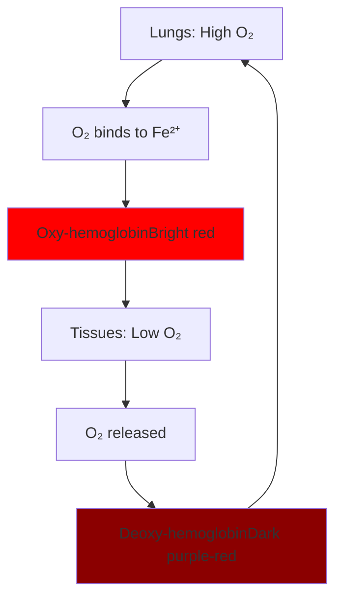
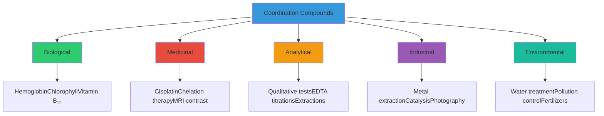

> Explore biological, industrial, analytical, and medicinal applications of coordination compounds with real-world examples for JEE.

## Introduction

Coordination chemistry isn’t just abstract theory - it’s the science behind life itself! From the oxygen you breathe to the photos you take, from life-saving cancer drugs to the green plants around you, coordination compounds are working behind the scenes everywhere.

> **★ Key point · You're Alive Because of Coordination Chemistry!**
>
> Right now, as you read this, billions of hemoglobin molecules in your blood are using coordination chemistry to transport oxygen. Each hemoglobin contains **four Fe²⁺ ions** coordinated in porphyrin rings. When you breathe in, O₂ binds to Fe²⁺ (weak field ligand). In your tissues, CO₂ replaces O₂. This reversible coordination happens **millions of times per second** in your body. Without coordination compounds, complex life as we know it simply couldn’t exist!

---

## 1. Biological Applications

### A. Hemoglobin - Oxygen Transport

**Structure:**

- Central atom: **Fe²⁺**
- Ligand system: **Porphyrin** (macrocyclic tetradentate)
- Additional ligands: Histidine (from protein) + O₂ (reversibly bound)
- Coordination number: **6** (octahedral)



**Key Features:**

- **Reversible binding:** O₂ must bind AND release easily
- **Spin state change:** Low O₂ → high spin (paramagnetic), High O₂ → low spin
- **Color change:** Explains why arterial blood (O₂-rich) is bright red, venous blood is darker

**Carbon Monoxide Poisoning:**

$$Hb-O_2 + CO \rightarrow Hb-CO + O_2$$

- CO binds **200 times** more strongly than O₂!
- CO is strong field ligand → doesn’t release easily
- Blocks oxygen transport → **fatal**
- Treatment: High concentration O₂ therapy

> **⚠ Trap · Why CO is Deadly**
>
> CO forms **[Fe(CO)]** complex with hemoglobin that is 200× more stable than the O₂ complex. Even small amounts of CO in air can saturate hemoglobin, preventing oxygen transport. This is why carbon monoxide detectors save lives!

---

### B. Chlorophyll - Photosynthesis

**Structure:**

- Central atom: **Mg²⁺**
- Ligand: **Porphyrin** ring (similar to heme, but with Mg instead of Fe)
- Function: Absorbs light for photosynthesis

$$6CO_2 + 6H_2O \xrightarrow{\text{Chlorophyll/Light}} C_6H_{12}O_6 + 6O_2$$

**Why green?**

- Chlorophyll absorbs **red** (~680 nm) and **blue** (~430 nm) light
- **Reflects green** light (~550 nm)
- The Mg-porphyrin coordination complex is responsible for this selective absorption

**Comparison: Hemoglobin vs Chlorophyll**

| Feature | Hemoglobin | Chlorophyll |
| --- | --- | --- |
| **Metal** | Fe²⁺ | Mg²⁺ |
| **Ligand** | Heme (porphyrin) | Chlorophyll (modified porphyrin) |
| **Color** | Red | Green |
| **Function** | O₂ transport | Light absorption for photosynthesis |
| **Found in** | Animals | Plants |

Both use the same basic porphyrin structure - nature’s favorite coordination ligand!

---

### C. Vitamin B₁₂ (Cyanocobalamin)

**Structure:**

- Central atom: **Co³⁺**
- Ligand: **Corrin ring** (similar to porphyrin)
- Axial ligands: CN⁻ and dimethylbenzimidazole
- **Most complex non-polymer molecule** synthesized by living organisms!

**Function:**

- Essential for DNA synthesis
- Red blood cell formation
- Nervous system function

**Deficiency:**

- Pernicious anemia
- Nerve damage

**Fun fact:** First coordination compound whose structure was determined using X-ray crystallography by Dorothy Hodgkin (Nobel Prize 1964)!

---

### D. Other Biological Examples

| Complex | Metal | Function |
| --- | --- | --- |
| **Hemocyanin** | Cu⁺ | O₂ transport in arthropods (blue blood!) |
| **Plastocyanin** | Cu²⁺ | Electron transfer in photosynthesis |
| **Carboxypeptidase** | Zn²⁺ | Enzyme for protein digestion |
| **Nitrogenase** | Fe, Mo | N₂ fixation by bacteria |
| **Cytochromes** | Fe | Electron transport chain |

---

## 2. Medicinal Applications

### A. Cisplatin - Anticancer Drug

**Structure:** cis-[Pt(NH₃)₂Cl₂]

**Discovery:**

- 1965: Barnett Rosenberg accidentally discovered it inhibits bacterial cell division
- 1978: FDA approved for testicular and ovarian cancer
- Now: One of the most widely used chemotherapy drugs

**Mechanism:**

1. Enters cancer cell
2. Cl⁻ ligands replaced by water → activated complex
3. Binds to **DNA** (coordinates with N atoms of adjacent guanine bases)
4. Forms cross-links between DNA strands
5. Prevents DNA replication → cell death

```mermaid
graph LR
    A[cis-Pt(NH₃)₂Cl₂] --> B[Inside cell]
    B --> C[Cl⁻ replaced by H₂O]
    C --> D[Binds to DNA]
    D --> E[Cross-links DNA]
    E --> F[Cell cannot divide]
    F --> G[Cancer cell dies]

    style A fill:#3498db
    style G fill:#e74c3c
```

**Why only CIS, not TRANS?**

- **cis isomer:** Two Cl⁻ on same side → can bind to **adjacent** guanines on DNA
- **trans isomer:** Cl⁻ on opposite sides → cannot form cross-link effectively
- This is a perfect example of how **stereochemistry matters in medicine**!

**Limitations:**

- Severe side effects (kidney damage, nausea)
- Some cancers develop resistance

**Next generation:**

- **Carboplatin:** Less toxic, same mechanism
- **Oxaliplatin:** Effective against different cancers

---

### B. Gold Complexes - Rheumatoid Arthritis

**Examples:**

- **Auranofin:** [Au(PEt₃)(thioglucose)]
- **Gold sodium thiomalate:** [Au(S-malate)₂]³⁻

**Function:**

- Reduces inflammation
- Slows disease progression
- Mechanism: Inhibits enzymes involved in inflammatory response

---

### C. Chelation Therapy

**For Heavy Metal Poisoning:**

| Poison | Chelating Agent | Complex Formed |
| --- | --- | --- |
| **Lead (Pb²⁺)** | EDTA | [Pb(EDTA)]²⁻ |
| **Mercury (Hg²⁺)** | DMSA | [Hg(DMSA)₂]²⁻ |
| **Iron overload** | Deferoxamine | [Fe(deferoxamine)]³⁺ |
| **Copper (Wilson’s disease)** | D-penicillamine | [Cu(penicillamine)₂] |

**How it works:**

1. Chelating agent forms **very stable** complex with toxic metal
2. Complex is **water-soluble**
3. Kidneys filter and excrete the complex
4. Toxic metal is removed from body

**Example: EDTA for Lead Poisoning**

EDTA (hexadentate) “wraps around” Pb²⁺:

$$Pb^{2+} + EDTA^{4-} \rightarrow [Pb(EDTA)]^{2-}$$

Stability constant: β ≈ **10¹⁸** (extraordinarily stable!)

---

### D. Imaging and Diagnosis

**Gadolinium Complexes in MRI:**

- **[Gd(DTPA)]²⁻** used as contrast agent
- Gd³⁺ is paramagnetic → enhances MRI signal
- DTPA chelation makes it safe (free Gd³⁺ is toxic)

**Radioactive Complexes:**

- **⁹⁹ᵐTc complexes** for diagnostic imaging
- **¹⁷⁷Lu complexes** for targeted radiotherapy

---

## 3. Analytical Chemistry

### A. Qualitative Analysis

**Detection of Metal Ions:**

| Metal Ion | Reagent | Complex Formed | Color |
| --- | --- | --- | --- |
| **Fe³⁺** | SCN⁻ | [Fe(SCN)]²⁺ | Blood red |
| **Cu²⁺** | NH₃ | [Cu(NH₃)₄]²⁺ | Deep blue |
| **Ni²⁺** | DMG | [Ni(DMG)₂] | Rose-red |
| **Co²⁺** | SCN⁻ | [Co(SCN)₄]²⁻ | Blue |
| **Fe²⁺** | K₄[Fe(CN)₆] | Fe₄[Fe(CN)₆]₃ | Prussian blue |

**Example: Nickel Detection**

Nickel + dimethylglyoxime (DMG) forms a **rose-red precipitate**:

$$Ni^{2+} + 2DMG \rightarrow [Ni(DMG)_2] \downarrow$$

This is a **specific test** for Ni²⁺!

---

### B. Complexometric Titrations

**EDTA Titrations for Water Hardness:**

Hard water contains Ca²⁺ and Mg²⁺. EDTA forms 1:1 complexes:

$$Ca^{2+} + EDTA^{4-} \rightarrow [Ca(EDTA)]^{2-}$$

$$Mg^{2+} + EDTA^{4-} \rightarrow [Mg(EDTA)]^{2-}$$

**Procedure:**

1. Add indicator (Eriochrome Black T)
2. Titrate with EDTA solution
3. EDTA “steals” metal from indicator
4. Color change indicates endpoint

**Advantages:**

- Very precise
- Works for many metal ions
- Simple procedure

---

### C. Extraction and Separation

**Solvent Extraction:**

Neutral complexes are **organic-soluble** and can be extracted:

**Example:** Uranium extraction using TBP (tributyl phosphate)

$$UO_2^{2+} + 2NO_3^- + 2TBP \rightarrow [UO_2(NO_3)_2(TBP)_2]$$

The neutral complex dissolves in organic solvent (kerosene), separating U from other metals.

---

## 4. Industrial Applications

### A. Metallurgy - Metal Extraction

#### Gold and Silver Extraction

**Cyanide Process:**

$$4Au + 8CN^- + O_2 + 2H_2O \rightarrow 4[Au(CN)_2]^- + 4OH^-$$

- Gold forms **very stable** cyano complex (β ≈ 10³⁸)
- Complex is water-soluble
- Gold can be separated from ore
- Later reduced to metallic gold with Zn

$$2[Au(CN)_2]^- + Zn \rightarrow [Zn(CN)_4]^{2-} + 2Au$$

**Similarly for silver:**

$$4Ag + 8CN^- + O_2 + 2H_2O \rightarrow 4[Ag(CN)_2]^- + 4OH^-$$

#### Nickel Purification - Mond Process

$$Ni(s) + 4CO(g) \xrightarrow{50-60°C} [Ni(CO)_4](/chemistry/coordination-compounds/)$$

- Ni reacts with CO to form volatile complex
- [Ni(CO)₄] is heated to 200°C
- Decomposes to pure Ni metal

$$[Ni(CO)_4](/chemistry/coordination-compounds/) \xrightarrow{200°C} Ni(s) + 4CO(g)$$

**Advantages:**

- Gives **very pure** nickel (99.99%)
- Separates Ni from impurities

---

### B. Catalysis

Many industrial catalysts are coordination compounds:

#### Wilkinson’s Catalyst

**[RhCl(PPh₃)₃]** - Hydrogenation of alkenes

$$R-CH=CH-R' + H_2 \xrightarrow{[RhCl(PPh_3)_3]} R-CH_2-CH_2-R'$$

#### Ziegler-Natta Catalyst

**TiCl₄ + Al(C₂H₅)₃** - Polymerization of ethylene and propylene

- Used to make high-density polyethylene (HDPE)
- Used to make polypropylene

#### Monsanto Process

**[Rh(CO)₂I₂]⁻** - Methanol → Acetic acid

$$CH_3OH + CO \xrightarrow{[Rh(CO)_2I_2]^-} CH_3COOH$$

---

### C. Photography

**Fixing Agent - Sodium Thiosulfate (“Hypo”)**

After exposure to light, film contains:

- Exposed areas: Metallic Ag (black)
- Unexposed areas: AgBr (sensitive to light)

To “fix” the image, unexposed AgBr must be removed:

$$AgBr(s) + 2S_2O_3^{2-} \rightarrow [Ag(S_2O_3)_2]^{3-} + Br^-$$

The **thiosulfato complex** is water-soluble and washes away, leaving permanent image.

**Why it works:**

- [Ag(S₂O₃)₂]³⁻ is very stable (large β)
- Removes AgBr without affecting metallic Ag

---

### D. Electroplating

**Silver Plating:**

Uses [Ag(CN)₂]⁻ instead of Ag⁺ because:

1. **Slow deposition** → smoother, uniform coating
2. **Better adhesion**
3. **Less wastage**

$$[Ag(CN)_2]^- + e^- \rightarrow Ag + 2CN^-$$

(at cathode)

**Gold Plating:**

Similarly uses [Au(CN)₂]⁻ complex.

### Interactive Demo: Visualize Electrochemical Cells

See how coordination compounds work in electrochemical cells and electroplating processes.

---

## 5. Environmental Applications

### A. Water Treatment

**EDTA for Heavy Metal Removal:**

Industrial wastewater often contains toxic metals:

$$Pb^{2+} + EDTA^{4-} \rightarrow [Pb(EDTA)]^{2-}$$

The complex can be:

- Removed by ion exchange
- Precipitated
- Filtered out

**Preventing Scale Formation:**

Hard water deposits CaCO₃ scales in pipes. Adding phosphates forms soluble complexes:

$$Ca^{2+} + P_2O_7^{4-} \rightarrow [Ca(P_2O_7)]^{2-}$$

---

### B. Pollution Control

**Mercury Removal:**

Chelating resins contain ligands that bind Hg²⁺:

- Water flows through resin bed
- Hg²⁺ forms stable complex with resin
- Clean water emerges

**Fertilizer Enhancement:**

Metal micronutrients (Fe, Zn, Cu, Mn) are often insoluble in soil. Using **chelated micronutrients**:

$$Fe^{3+} + EDTA^{4-} \rightarrow [Fe(EDTA)]^-$$

- Remains soluble in soil
- Plants can absorb it
- Better crop yields

---

## 6. Material Science

### A. Dyes and Pigments

Many commercial dyes are coordination compounds:

| Dye/Pigment | Complex | Color | Use |
| --- | --- | --- | --- |
| **Prussian Blue** | Fe₄[Fe(CN)₆]₃ | Blue | Inks, paints |
| **Chrome Yellow** | PbCrO₄ | Yellow | Paints |
| **Phthalocyanines** | Cu-phthalocyanine | Blue/Green | Dyes, pigments |
| **Azo dyes** | Metal-azo complexes | Various | Textiles |

---

### B. Magnetic Materials

**Magnetic Recording:**

- Uses coordination compounds of Fe and Co
- Different spin states = different magnetic properties
- Data storage in hard drives

---

## 7. Advanced Applications (JEE Advanced)

### A. Supramolecular Chemistry

**Host-Guest Chemistry:**

- Crown ethers (macrocyclic ligands) selectively bind metal ions
- Used in ion-selective sensors
- Basis for artificial enzymes

### B. Molecular Electronics

**Metal-Organic Frameworks (MOFs):**

- 3D networks of metal ions connected by organic ligands
- Applications: Gas storage, catalysis, drug delivery
- Can store H₂ for fuel cells

### C. Luminescent Materials

**LEDs and OLEDs:**

- Iridium and platinum complexes
- Emit light when electrons transition between energy levels
- Used in displays and lighting

**Example:** [Ir(ppy)₃] (green OLED emitter)

---

## Summary of Applications



---

## Memory Tricks

### “BMAIE” for Application Categories

**B**iological (Hemoglobin, Chlorophyll)
**M**edicinal (Cisplatin, Chelation)
**A**nalytical (Qualitative tests, Titrations)
**I**ndustrial (Metallurgy, Catalysis)
**E**nvironmental (Water treatment, Pollution)

### Metal-Color Association

**“Copper turns BLUE with ammonia”** → [Cu(NH₃)₄]²⁺ (deep blue)
**“Iron turns RED with thiocyanate”** → [Fe(SCN)]²⁺ (blood red)
**“Nickel gives ROSE-RED with DMG”** → [Ni(DMG)₂] (rose-red)

---

## Common Mistakes

> **⚠ Trap · Mistake 1: Confusing Hemoglobin and Chlorophyll**
>
> **Wrong:** Both contain Fe

> **Right:**
>
> - **Hemoglobin:** Fe²⁺ in heme (porphyrin)

> - **Chlorophyll:** Mg²⁺ in modified porphyrin
>
> Both use similar ring structure, but different metals!

> **⚠ Trap · Mistake 2: Thinking Trans-platin Works Like Cis-platin**
>
> **Wrong:** Both isomers of [Pt(NH₃)₂Cl₂] are anticancer drugs

> **Right:** Only **cis-platin** works! Trans-platin cannot form effective DNA cross-links.
>
> Geometry matters in medicine!

> **⚠ Trap · Mistake 3: Saying Free Gd³⁺ is Used in MRI**
>
> **Wrong:** Gadolinium metal is used in MRI

> **Right:** **[Gd(DTPA)]²⁻** complex is used (chelated form is safe; free Gd³⁺ is toxic!)

---

## Practice Problems

### Level 1: Basic Understanding

**Q1.** Explain why carbon monoxide is poisonous in terms of coordination chemistry.

**Q2.** What is the role of coordination compounds in:
a) Photography
b) Electroplating
c) Qualitative analysis of Fe³⁺

**Q3.** Why is chlorophyll green while hemoglobin is red, despite both having similar porphyrin structures?

### Level 2: Application

**Q4.** A patient is suffering from lead poisoning. Explain:
a) Why EDTA is used as treatment
b) Why the stability constant of [Pb(EDTA)]²⁻ must be very large
c) How the complex is removed from the body

**Q5.** In gold extraction:

$$4Au + 8CN^- + O_2 + 2H_2O \rightarrow 4[Au(CN)_2]^- + 4OH^-$$

Explain:
a) Why gold, a noble metal, dissolves in cyanide solution
b) Why this process requires oxygen
c) How gold is recovered from [Au(CN)₂]⁻

**Q6.** Why is cis-platin effective against cancer while trans-platin is not?

**Q7.** A solution containing Cu²⁺ is treated with excess NH₃. Describe:
a) Color change observed
b) Complex formed
c) How this is used in qualitative analysis

### Level 3: JEE Advanced

**Q8.** Compare and contrast hemoglobin and hemocyanin in terms of:
a) Metal center
b) Color of blood
c) Coordination number
d) Oxygen binding

**Q9.** The Mond process for nickel purification uses [Ni(CO)₄]. Explain:
a) Why this complex is volatile while most coordination compounds aren’t
b) Why heating to 200°C decomposes it back to Ni
c) Why this gives very pure nickel

**Q10.** In complexometric titration with EDTA:
a) Why is EDTA preferred over other ligands?
b) How does the chelate effect make titrations sharp?
c) Why can one EDTA solution be used for many different metal ions?

**Q11.** Cisplatin’s mechanism involves:

```fallback
cis-[Pt(NH₃)₂Cl₂] → cis-[Pt(NH₃)₂(H₂O)₂]²⁺ → DNA cross-linking
```

Explain:
a) Why Cl⁻ is replaced by H₂O inside cells
b) Why the aqua complex then binds to DNA
c) Why the cross-link prevents cell division

**Q12.** A student wants to electroplate an object with silver. Compare:
a) Using AgNO₃ solution
b) Using K[Ag(CN)₂] solution

Which gives better plating and why?

> **↗ Connection · Quick Check**
>
> Why do both hemoglobin (animals) and chlorophyll (plants) use essentially the same porphyrin ring structure? What does this tell us about evolution?

---

## Solutions to Selected Problems

**Q1.** CO binds to Fe²⁺ in hemoglobin 200× more strongly than O₂. It forms [Hb-CO] which doesn’t release, blocking oxygen transport.

**Q3.** Different metal centers (Fe²⁺ vs Mg²⁺) cause different d-d transitions, absorbing different wavelengths. The reflected/transmitted light gives the observed colors.

**Q5.**
a) Formation of very stable [Au(CN)₂]⁻ (β ≈ 10³⁸) provides driving force
b) O₂ oxidizes Au from 0 to +1 oxidation state
c) Add Zn, which reduces Au⁺ back to Au(0) while forming [Zn(CN)₄]²⁻

**Q6.** cis-platin’s two Cl⁻ are adjacent, allowing binding to two adjacent guanines on DNA, forming cross-link. trans-platin’s Cl⁻ are opposite, cannot form effective cross-link.

**Q9.**
a) [Ni(CO)₄] is neutral and has no permanent dipole → low intermolecular forces → volatile
b) Thermal decomposition (ΔH > 0) is favored at high temperature
c) All impurities remain as solids while only [Ni(CO)₄] vaporizes and is collected separately

**Q12.** K[Ag(CN)₂] is better because:

- Slow reduction → uniform deposition
- Better adhesion to surface
- Smooth, shiny finish

---

## Real-World Impact

### Nobel Prizes Related to Coordination Chemistry

1. **Alfred Werner (1913):** Structure of coordination compounds
2. **Dorothy Hodgkin (1964):** X-ray structure of Vitamin B₁₂
3. **Wilkinson & Fischer (1973):** Organometallic chemistry (catalysts)
4. **Jean-Marie Lehn (1987):** Supramolecular chemistry
5. **Yves Chauvin (2005):** Metathesis catalysis

### Economic Impact

- **Cisplatin alone:** Saves thousands of lives annually, billions in healthcare impact
- **Ziegler-Natta catalysts:** Entire plastics industry (polyethylene, polypropylene)
- **Gold/silver extraction:** Enables modern electronics (need pure metals)
- **EDTA:** Multibillion-dollar water treatment industry

---

## Looking Forward

### Emerging Applications

1. **Artificial photosynthesis:** Ru and Ir complexes to split water for H₂ fuel
2. **CO₂ capture:** MOFs for greenhouse gas reduction
3. **Targeted drug delivery:** Stimulus-responsive coordination polymers
4. **Quantum computing:** Single-molecule magnets
5. **Solar cells:** Ru-based dye-sensitized solar cells

> **◐ In simple terms · The Future is Coordination Chemistry**
>
> As we face challenges like climate change, cancer, and energy crisis, coordination chemistry offers solutions:
>
> - **Carbon capture:** Metal complexes that bind CO₂

> - **Artificial leaves:** Mimicking chlorophyll for solar energy

> - **Better drugs:** Targeted metal-based therapeutics

> - **Clean energy:** H₂ production and storage
>
> The principles you’re learning aren’t just for JEE - they’re the foundation of tomorrow’s technology!

---

## Related Topics

### Within Coordination Compounds

- [Werner’s Theory](../werners-theory/index.md) — Foundation of all these applications
- [Stability Constants](../stability-constants/index.md) — Why EDTA works for chelation
- [Crystal Field Theory](../crystal-field-theory/index.md) — Why complexes are colored
- [Isomerism](../isomerism/index.md) — Why cis-platin ≠ trans-platin

### Cross-Chapter Connections

- [d-Block Elements](../../d-f-block-elements/index.md) — Source of metals in complexes
- [Chemical Kinetics](../../chemical-kinetics/index.md) — Catalyst mechanisms
- [Electrochemistry](../../redox-electrochemistry/index.md) — Electroplating
- [Biomolecules](../../biomolecules/index.md) — Proteins and enzymes

---

**[← Stability Constants](../stability-constants/index.md) | [Coordination Compounds Index](../../index.md)**

From TestGuru · our mock-test platform

## You've read Applications of Coordination Compounds.You've read this topic. Find out what you actually got.

A free JEE Main mock with this chapter in it, and a report that shows which sub-topics cost you marks.

[Take a free JEE Main mock →](https://app.testguru.co/signup?tg_chapter=coordination-compounds&tg_exam=jee-main&tg_page=%2Fchemistry%2Fcoordination-compounds%2Fapplications%2F&tg_subject=chemistry&utm_campaign=notes-jee-main-free-test&utm_content=article-end&utm_medium=referral&utm_source=jeenotes)
Free, no card. Opens TestGuru in a new tab.

## Stay exam-ready

One email every Sunday: new notes, the week's hardest challenge question and a revision plan.One email every Sunday.

## Comments

Have a question or spotted a mistake? Join the discussion below.

Advertisement

Advertisement

---

## Extracted page code (interactive scripts & widgets)


### inline-script-16

```js
if(!document.getElementById("animation-fullscreen-overlay")){const e=document.createElement("div");e.id="animation-fullscreen-overlay",e.className="animation-fullscreen-overlay",e.innerHTML=`
      <div class="fullscreen-modal">
        <div class="fullscreen-header">
          <span class="fullscreen-title">Interactive Demo</span>
          <button class="fullscreen-close-btn" onclick="JEEAnimations.closeFullscreen()" title="Close (Esc)" aria-label="Close fullscreen">
            <svg width="24" height="24" viewBox="0 0 24 24" fill="none" stroke="currentColor" stroke-width="2" stroke-linecap="round" stroke-linejoin="round">
              <line x1="18" y1="6" x2="6" y2="18"></line>
              <line x1="6" y1="6" x2="18" y2="18"></line>
            </svg>
          </button>
        </div>
        <div class="fullscreen-content"></div>
      </div>
    `,document.body.appendChild(e),document.addEventListener("keydown",function(e){e.key==="Escape"&&document.body.classList.contains("animation-fullscreen-active")&&JEEAnimations.closeFullscreen()}),e.addEventListener("click",function(t){t.target===e&&JEEAnimations.closeFullscreen()})}
```


### inline-script-17

```js
(function(){var t,e=document.getElementById("disqus-load");if(!e)return;t=!1,e.addEventListener("click",function(){if(t)return;t=!0,e.setAttribute("disabled","disabled"),e.textContent="Loading comments…",window.disqus_config=function(){this.page.url="https://jeenotes.in/chemistry/coordination-compounds/applications/",this.page.identifier="/chemistry/coordination-compounds/applications/"};var s=document,n=s.createElement("script");n.src="https://https-jeenotes-in.disqus.com/embed.js",n.setAttribute("data-timestamp",+new Date),n.onload=function(){e.style.display="none"},n.onerror=function(){t=!1,e.removeAttribute("disabled"),e.textContent="Could not load comments. Tap to retry"},(s.head||s.body).appendChild(n)})})()
```


### inline-script-18

```js
(function(){var t,e=document.currentScript.previousElementSibling;function n(){(window.adsbygoogle=window.adsbygoogle||[]).push({})}if(!window.ResizeObserver||e.clientWidth>0){n();return}t=new ResizeObserver(function(){e.clientWidth>0&&(t.disconnect(),n())}),t.observe(e)})()
```


### interactive-widget-1

```html
<div class="animation-wrapper" data-animation="electrochemicalCell" id="anim-electrochemicalCell-1795396419478483279"><div class="animation-header"><button aria-label="Toggle fullscreen" class="anim-fullscreen-btn" onclick='JEEAnimations.toggleFullscreen("anim-electrochemicalCell-1795396419478483279")' title="Fullscreen (F)">
<svg class="fullscreen-icon-expand" fill="none" height="18" stroke="currentColor" stroke-linecap="round" stroke-linejoin="round" stroke-width="2" viewbox="0 0 24 24" width="18"><polyline points="15 3 21 3 21 9"></polyline><polyline points="9 21 3 21 3 15"></polyline><line x1="21" x2="14" y1="3" y2="10"></line><line x1="3" x2="10" y1="21" y2="14"></line></svg>
<svg class="fullscreen-icon-collapse" fill="none" height="18" stroke="currentColor" stroke-linecap="round" stroke-linejoin="round" stroke-width="2" viewbox="0 0 24 24" width="18"><polyline points="4 14 10 14 10 20"></polyline><polyline points="20 10 14 10 14 4"></polyline><line x1="14" x2="21" y1="10" y2="3"></line><line x1="3" x2="10" y1="21" y2="14"></line></svg>
<span class="fullscreen-text">Fullscreen</span></button></div><div class="animation-content"><noscript><div class="callout callout-warning"><div class="callout-title">JavaScript Required</div><p>This interactive animation requires JavaScript to be enabled.</p></div></noscript></div></div>
```


---

_Source: [https://jeenotes.in/chemistry/coordination-compounds/applications/](https://jeenotes.in/chemistry/coordination-compounds/applications/) · raw HTML: `offline/chemistry/coordination-compounds/applications/index.html`_
