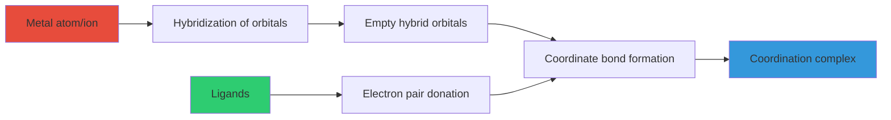

> Master Valence Bond Theory (VBT), hybridization, inner and outer orbital complexes for coordination compounds.

## Introduction

How do ligands actually bond to metal atoms? Why do some complexes have specific geometries? Why are some magnetic while others aren’t? These questions puzzled chemists for decades after Werner proposed his theory. The answer came from **Valence Bond Theory (VBT)**, proposed by Linus Pauling in the 1930s.

> **★ Key point · Hemoglobin's Magnetic Switch**
>
> Here’s something incredible: hemoglobin in your blood changes its magnetic properties when it binds oxygen! Deoxygenated hemoglobin (Fe²⁺) is **paramagnetic** with unpaired electrons. When O₂ binds, it becomes **diamagnetic** - all electrons pair up! This happens because oxygen is a strong-field ligand that forces electron pairing. VBT explains this molecular magic happening in your body right now!

---

## Valence Bond Theory: The Basic Idea

### Core Concepts

1. **Ligands donate electron pairs** to **empty orbitals** of the metal
2. The metal-ligand bond is a **coordinate covalent bond** (both electrons from ligand)
3. Metal orbitals **hybridize** to accommodate ligand electron pairs
4. The **type of hybridization** determines the **geometry**
5. **Magnetic properties** depend on the number of **unpaired electrons**

### The Process



---

## Hybridization and Geometry

### Common Hybridization Schemes

| Coordination Number | Hybridization | Geometry | Bond Angle | Example |
| --- | --- | --- | --- | --- |
| 2 | sp | Linear | 180° | [Ag(NH₃)₂]⁺ |
| 4 | sp³ | Tetrahedral | 109.5° | [NiCl₄]²⁻ |
| 4 | dsp² | Square planar | 90° | [Ni(CN)₄]²⁻ |
| 5 | sp³d | Trigonal bipyramidal | 90°, 120° | [Fe(CO)₅] |
| 6 | sp³d² | Octahedral | 90° | [CoF₆]³⁻ |
| 6 | d²sp³ | Octahedral | 90° | [Co(NH₃)₆]³⁺ |

> **★ Key point · Key Distinction**
>
> **Inner Orbital Complex (d²sp³):** Uses (n-1)d orbitals

> **Outer Orbital Complex (sp³d²):** Uses nd orbitals
>
> Both give octahedral geometry but differ in magnetic properties!

---

## Understanding Through Examples

### Example 1: [Ni(CN)₄]²⁻ (Square Planar, Diamagnetic)

**Step 1: Electronic Configuration**

- Ni = [Ar] 3d⁸ 4s²
- Ni²⁺ = [Ar] 3d⁸

**Step 2: Distribution in d orbitals**

```fallback
3d: ↑↓ ↑↓ ↑↓ ↑ ↑
```

**Step 3: Effect of CN⁻ (strong field ligand)**
CN⁻ causes pairing of electrons:

```fallback
3d: ↑↓ ↑↓ ↑↓ ↑↓ __
```

**Step 4: Hybridization**
One empty 3d + one 4s + two 4p = **dsp²**

```fallback
dsp²: [__] [__] [__] [__] ← 4 empty hybrid orbitals
      ↑↓  ↑↓  ↑↓  ↑↓  (4 CN⁻ ligands donate electron pairs)
```

**Result:**

- **Geometry:** Square planar
- **Magnetic nature:** Diamagnetic (all paired)
- **Inner orbital complex**

---

### Example 2: [NiCl₄]²⁻ (Tetrahedral, Paramagnetic)

**Step 1: Electronic Configuration**

- Ni²⁺ = [Ar] 3d⁸

**Step 2: Distribution**

```fallback
3d: ↑↓ ↑↓ ↑↓ ↑ ↑
```

**Step 3: Effect of Cl⁻ (weak field ligand)**
Cl⁻ does NOT cause pairing - electrons remain unpaired

**Step 4: Hybridization**
One 4s + three 4p = **sp³**

```fallback
sp³: [__] [__] [__] [__] ← 4 empty hybrid orbitals
     ↑↓  ↑↓  ↑↓  ↑↓  (4 Cl⁻ ligands donate)
```

**Result:**

- **Geometry:** Tetrahedral
- **Magnetic nature:** Paramagnetic (2 unpaired electrons)
- **Outer orbital complex**

> **◐ In simple terms · The Ni²⁺ Paradox**
>
> Same metal ion (Ni²⁺), same coordination number (4), but:
>
> - [Ni(CN)₄]²⁻ = square planar, diamagnetic

> - [NiCl₄]²⁻ = tetrahedral, paramagnetic
>
> The ligand makes ALL the difference!

---

### Example 3: [Co(NH₃)₆]³⁺ (Octahedral, Diamagnetic)

**Step 1: Electronic Configuration**

- Co = [Ar] 3d⁷ 4s²
- Co³⁺ = [Ar] 3d⁶

**Step 2: Distribution**

```fallback
3d: ↑↓ ↑ ↑ ↑ ↑
```

**Step 3: Effect of NH₃ (moderate field ligand)**
NH₃ causes pairing:

```fallback
3d: ↑↓ ↑↓ ↑↓ __ __
```

**Step 4: Hybridization**
Two empty 3d + one 4s + three 4p = **d²sp³**

```fallback
d²sp³: [__] [__] [__] [__] [__] [__] ← 6 empty hybrid orbitals
       ↑↓  ↑↓  ↑↓  ↑↓  ↑↓  ↑↓  (6 NH₃ donate)
```

**Result:**

- **Geometry:** Octahedral
- **Magnetic nature:** Diamagnetic
- **Inner orbital complex** (uses 3d)

---

### Example 4: [CoF₆]³⁻ (Octahedral, Paramagnetic)

**Step 1: Electronic Configuration**

- Co³⁺ = [Ar] 3d⁶

**Step 2: Distribution**

```fallback
3d: ↑↓ ↑ ↑ ↑ ↑
```

**Step 3: Effect of F⁻ (weak field ligand)**
F⁻ does NOT cause pairing

**Step 4: Hybridization**
One 4s + three 4p + two 4d = **sp³d²**

```fallback
3d: ↑↓ ↑ ↑ ↑ ↑ (remain unpaired)

sp³d²: [__] [__] [__] [__] [__] [__] ← 6 empty hybrid orbitals
       ↑↓  ↑↓  ↑↓  ↑↓  ↑↓  ↑↓  (6 F⁻ donate)
```

**Result:**

- **Geometry:** Octahedral
- **Magnetic nature:** Paramagnetic (4 unpaired)
- **Outer orbital complex** (uses 4d)

### Interactive Demo: Visualize d Orbital Shapes

Explore the 3D shapes of d orbitals and how they orient in space during hybridization.

---

## Inner vs Outer Orbital Complexes

### Comparison Table

| Property | Inner Orbital (d²sp³) | Outer Orbital (sp³d²) |
| --- | --- | --- |
| **d orbitals used** | (n-1)d | nd |
| **Ligand field** | Strong field | Weak field |
| **Electron pairing** | Forced | Not forced |
| **Magnetic nature** | Usually diamagnetic | Usually paramagnetic |
| **Bond strength** | Stronger | Weaker |
| **Example** | [Co(NH₃)₆]³⁺ | [CoF₆]³⁻ |

### Why Does This Matter?

1. **Magnetic properties:** Inner complexes often diamagnetic, outer often paramagnetic
2. **Stability:** Inner orbital complexes are generally more stable
3. **Color:** Different electronic arrangements = different colors
4. **Reactivity:** Affects how the complex reacts

---

## The Spectrochemical Series

Ligands arranged by their ability to cause electron pairing:

$$\boxed{I^- < Br^- < SCN^- < Cl^- < S^{2-} < F^- < OH^- < C_2O_4^{2-} < H_2O < NCS^- < EDTA < NH_3 < en < CN^- < CO}$$

**Weak field ligands** ←→ **Strong field ligands**

### Predictions from the Series

| Ligand Type | Effect | Complex Type | Usual Magnetic Nature |
| --- | --- | --- | --- |
| **Weak field** (F⁻, Cl⁻) | No pairing | Outer orbital (sp³d²) | Paramagnetic |
| **Strong field** (CN⁻, CO) | Force pairing | Inner orbital (d²sp³) | Diamagnetic |

> **★ Key point · Memory Trick - WACOS**
>
> **W**eak field ligands: **F**, Cl, Br, I (halogens) - “**WA**veforms”

> **S**trong field ligands: **C**N, C**O** - “**COS**mic force”
>
> From **WACOS** = Weak → Strong

---

## Magnetic Moment Calculation

### Formula

$$\mu = \sqrt{n(n+2)} \text{ BM}$$

where n = number of unpaired electrons, BM = Bohr Magneton

### Quick Reference Table

| Unpaired Electrons | Magnetic Moment (BM) | Example |
| --- | --- | --- |
| 0 | 0 | [Co(NH₃)₆]³⁺ |
| 1 | 1.73 | [Ti(H₂O)₆]³⁺ |
| 2 | 2.83 | [V(H₂O)₆]³⁺ |
| 3 | 3.87 | [Cr(H₂O)₆]³⁺ |
| 4 | 4.90 | [Mn(H₂O)₆]²⁺ |
| 5 | 5.92 | [Fe(H₂O)₆]³⁺ |

---

## Special Cases

### 1. Tetrahedral Complexes

**Always sp³ hybridization** (no d orbitals involved)
**Always high spin** (weak field)
**Usually paramagnetic**

**Examples:**

- [FeCl₄]⁻
- [CoCl₄]²⁻
- [NiCl₄]²⁻

> **★ Key point · Why No dsp²?**
>
> Tetrahedral complexes don’t use dsp² because:
>
> 1. Ligands approach along corners of tetrahedron

> 2. This doesn’t allow effective d orbital overlap

> 3. sp³ is the natural geometry for 4 ligands without d involvement

### 2. Square Planar Complexes

**Always dsp² hybridization**
**Always low spin** (strong field causes pairing)
**Usually diamagnetic**

**Common with:**

- Ni²⁺ (d⁸)
- Pd²⁺ (d⁸)
- Pt²⁺ (d⁸)
- Au³⁺ (d⁸)

### 3. d⁸ Configuration Special Case

For d⁸ ions (Ni²⁺, Pd²⁺, Pt²⁺):

- **Weak field ligand** → tetrahedral (sp³), paramagnetic
- **Strong field ligand** → square planar (dsp²), diamagnetic

This is why the same Ni²⁺ behaves so differently!

---

## Limitations of VBT

### What VBT Explains Well:

✓ Geometry of complexes
✓ Magnetic properties
✓ Inner vs outer orbital distinction

### What VBT Cannot Explain:

✗ **Color** of complexes (why are they colored?)
✗ **Quantitative** prediction of magnetic moments
✗ **Spectral properties** (UV-Vis absorption)
✗ Why certain ligands are strong field vs weak field
✗ **Thermodynamic stability** quantitatively

These limitations led to the development of **Crystal Field Theory** (next topic)!

---

## Memory Tricks

### Hybridization Patterns

**“2 Linear SP”** → CN 2 = sp = linear
**“4 Square Dancers Prefer Squash”** → CN 4 = dsp² OR sp³
**“6 Octahedrons Double-Spaced Perfectly”** → CN 6 = d²sp³ OR sp³d²

### Strong Field = Pairing

**“Strong ligands FORCE electrons together”**
CN⁻, CO → Strong → Pairing → d²sp³ → Diamagnetic

**“Weak ligands LET electrons spread”**
F⁻, Cl⁻ → Weak → No pairing → sp³d² → Paramagnetic

---

## Common Mistakes

> **⚠ Trap · Mistake 1: Confusing d²sp³ and sp³d²**
>
> **Wrong:** “Both use d orbitals, so they’re the same”

> **Right:**
>
> - **d²sp³** uses (n-1)d orbitals (inner orbital, strong field)

> - **sp³d²** uses nd orbitals (outer orbital, weak field)
>
> Different d orbitals = different properties!

> **⚠ Trap · Mistake 2: Assuming All Octahedral = d²sp³**
>
> **Wrong:** “[FeF₆]³⁻ uses d²sp³”

> **Right:** “[FeF₆]³⁻ uses sp³d²” (F⁻ is weak field, no pairing)
>
> Check the ligand strength first!

> **⚠ Trap · Mistake 3: Wrong Electron Configuration for Ions**
>
> **Wrong:** Fe³⁺ = [Ar] 3d⁵ 4s²

> **Right:** Fe³⁺ = [Ar] 3d⁵ (remove electrons from 4s first!)
>
> Always remove s electrons before d electrons when forming ions!

> **⚠ Trap · Mistake 4: Forgetting Ligand Field Strength**
>
> **Wrong:** “All complexes with same metal ion have same magnetic property”

> **Right:** [Co(NH₃)₆]³⁺ (diamagnetic) vs [CoF₆]³⁻ (paramagnetic)
>
> Same metal, different ligands = different properties!

---

## Practice Problems

### Level 1: Basic Understanding

**Q1.** Draw the orbital diagram and predict the geometry and magnetic nature:
a) [Fe(CN)₆]⁴⁻ (Fe²⁺: d⁶)
b) [FeF₆]⁴⁻ (Fe²⁺: d⁶)

**Q2.** Why is [Ni(NH₃)₆]²⁺ paramagnetic while [Ni(CN)₄]²⁻ is diamagnetic?

**Q3.** Calculate the magnetic moment of:
a) [Mn(H₂O)₆]²⁺ (high spin d⁵)
b) [Co(NH₃)₆]³⁺ (low spin d⁶)

### Level 2: Application

**Q4.** [CoF₆]³⁻ is paramagnetic with 4 unpaired electrons, while [Co(C₂O₄)₃]³⁻ is diamagnetic.
a) Write electronic configurations for both
b) Identify hybridization for each
c) Explain the difference

**Q5.** Arrange the following in increasing order of unpaired electrons:
[Fe(CN)₆]⁴⁻, [Fe(CN)₆]³⁻, [Fe(H₂O)₆]²⁺, [Fe(H₂O)₆]³⁺

**Q6.** A complex of Ni²⁺ has 2 unpaired electrons and tetrahedral geometry. Identify possible ligands.

**Q7.** Why do all tetrahedral complexes have sp³ hybridization and not dsp²?

### Level 3: JEE Advanced

**Q8.** The magnetic moment of [Mn(CN)₆]³⁻ is 2.8 BM, while [MnCl₆]³⁻ is 4.9 BM.
a) Calculate number of unpaired electrons in each
b) Explain the difference using VBT
c) Identify hybridization in each case

**Q9.** A complex of Co³⁺ (d⁶) with ammonia is diamagnetic and has octahedral geometry. However, when excess HCl is added, NH₃ ligands are replaced by Cl⁻ and the resulting complex is paramagnetic with 4 unpaired electrons.
a) Write formulas for both complexes
b) Explain the magnetic behavior change
c) Identify hybridization change

**Q10.** [Cr(NH₃)₆]³⁺ and [Cr(H₂O)₆]³⁺ both have the same number of unpaired electrons despite different ligands. Explain.

**Q11.** A square planar complex of Pt²⁺ with formula [PtCl₂(NH₃)₂] exists. Predict:
a) Hybridization
b) Magnetic nature
c) Number of geometrical isomers

**Q12.** Explain why:
a) Low spin octahedral complexes are more common for 2nd and 3rd row transition metals
b) Square planar geometry is rare for first-row transition metals (except Ni²⁺)

> **↗ Connection · Quick Check**
>
> If a complex has magnetic moment of 0 BM, can you definitively say it’s an inner orbital complex? Why or why not?

---

## Solutions to Selected Problems

**Q1.**
a) [Fe(CN)₆]⁴⁻: d²sp³, octahedral, **diamagnetic** (CN⁻ strong field → pairing)
b) [FeF₆]⁴⁻: sp³d², octahedral, **paramagnetic** (4 unpaired) (F⁻ weak field)

**Q2.**

- [Ni(NH₃)₆]²⁺: NH₃ not strong enough to cause complete pairing in 3d⁸ → paramagnetic
- [Ni(CN)₄]²⁻: CN⁻ very strong → forces pairing → square planar, diamagnetic

**Q3.**
a) μ = √[5(5+2)] = √35 = 5.92 BM
b) μ = √[0(0+2)] = 0 BM

**Q6.** Weak field ligands like Cl⁻, Br⁻, I⁻ (don’t cause pairing)

**Q8.**
a) [Mn(CN)₆]³⁻: 2 unpaired (2.8 ≈ √8)
[MnCl₆]³⁻: 4 unpaired (4.9 ≈ √24)
b) CN⁻ strong field → some pairing; Cl⁻ weak field → no pairing
c) [Mn(CN)₆]³⁻: d²sp³ (inner); [MnCl₆]³⁻: sp³d² (outer)

---

## Summary Table: Common Complexes

| Complex | Metal d-electrons | Hybridization | Geometry | Unpaired e⁻ | Magnetic |
| --- | --- | --- | --- | --- | --- |
| [Fe(CN)₆]⁴⁻ | d⁶ | d²sp³ | Octahedral | 0 | Diamagnetic |
| [FeF₆]⁴⁻ | d⁶ | sp³d² | Octahedral | 4 | Paramagnetic |
| [Co(NH₃)₆]³⁺ | d⁶ | d²sp³ | Octahedral | 0 | Diamagnetic |
| [CoF₆]³⁻ | d⁶ | sp³d² | Octahedral | 4 | Paramagnetic |
| [Ni(CN)₄]²⁻ | d⁸ | dsp² | Square planar | 0 | Diamagnetic |
| [NiCl₄]²⁻ | d⁸ | sp³ | Tetrahedral | 2 | Paramagnetic |
| [Cu(NH₃)₄]²⁺ | d⁹ | sp³ | Tetrahedral/Square | 1 | Paramagnetic |
| [Ag(NH₃)₂]⁺ | d¹⁰ | sp | Linear | 0 | Diamagnetic |

---

## Related Topics

### Within Coordination Compounds

- [Werner’s Theory](../werners-theory/index.md) — Why coordination compounds form
- [Isomerism](../isomerism/index.md) — Geometry affects isomerism
- [Crystal Field Theory](../crystal-field-theory/index.md) — Better explanation of color and magnetism
- [Stability Constants](../stability-constants/index.md) — Thermodynamic stability

### Cross-Chapter Connections

- [Chemical Bonding](../../chemical-bonding/index.md) — Hybridization theory basics
- [Atomic Structure](../../atomic-structure/index.md) — Electronic configurations
- [d-Block Elements](../../d-f-block-elements/index.md) — Properties of transition metals
- [Magnetism](../../../physics/magnetism/index.md) — Diamagnetism and paramagnetism

---

From TestGuru · our mock-test platform

## You've read Bonding Theories in Coordination Compounds.You've read this topic. Find out what you actually got.

A free JEE Main mock with this chapter in it, and a report that shows which sub-topics cost you marks.

[Take a free JEE Main mock →](https://app.testguru.co/signup?tg_chapter=coordination-compounds&tg_exam=jee-main&tg_page=%2Fchemistry%2Fcoordination-compounds%2Fbonding-theories%2F&tg_subject=chemistry&utm_campaign=notes-jee-main-free-test&utm_content=article-end&utm_medium=referral&utm_source=jeenotes)
Free, no card. Opens TestGuru in a new tab.

## Stay exam-ready

One email every Sunday: new notes, the week's hardest challenge question and a revision plan.One email every Sunday.

## Comments

Have a question or spotted a mistake? Join the discussion below.

Advertisement

Advertisement

---

## Extracted page code (interactive scripts & widgets)


### inline-script-16

```js
if(!document.getElementById("animation-fullscreen-overlay")){const e=document.createElement("div");e.id="animation-fullscreen-overlay",e.className="animation-fullscreen-overlay",e.innerHTML=`
      <div class="fullscreen-modal">
        <div class="fullscreen-header">
          <span class="fullscreen-title">Interactive Demo</span>
          <button class="fullscreen-close-btn" onclick="JEEAnimations.closeFullscreen()" title="Close (Esc)" aria-label="Close fullscreen">
            <svg width="24" height="24" viewBox="0 0 24 24" fill="none" stroke="currentColor" stroke-width="2" stroke-linecap="round" stroke-linejoin="round">
              <line x1="18" y1="6" x2="6" y2="18"></line>
              <line x1="6" y1="6" x2="18" y2="18"></line>
            </svg>
          </button>
        </div>
        <div class="fullscreen-content"></div>
      </div>
    `,document.body.appendChild(e),document.addEventListener("keydown",function(e){e.key==="Escape"&&document.body.classList.contains("animation-fullscreen-active")&&JEEAnimations.closeFullscreen()}),e.addEventListener("click",function(t){t.target===e&&JEEAnimations.closeFullscreen()})}
```


### inline-script-17

```js
(function(){var t,e=document.getElementById("disqus-load");if(!e)return;t=!1,e.addEventListener("click",function(){if(t)return;t=!0,e.setAttribute("disabled","disabled"),e.textContent="Loading comments…",window.disqus_config=function(){this.page.url="https://jeenotes.in/chemistry/coordination-compounds/bonding-theories/",this.page.identifier="/chemistry/coordination-compounds/bonding-theories/"};var s=document,n=s.createElement("script");n.src="https://https-jeenotes-in.disqus.com/embed.js",n.setAttribute("data-timestamp",+new Date),n.onload=function(){e.style.display="none"},n.onerror=function(){t=!1,e.removeAttribute("disabled"),e.textContent="Could not load comments. Tap to retry"},(s.head||s.body).appendChild(n)})})()
```


### inline-script-18

```js
(function(){var t,e=document.currentScript.previousElementSibling;function n(){(window.adsbygoogle=window.adsbygoogle||[]).push({})}if(!window.ResizeObserver||e.clientWidth>0){n();return}t=new ResizeObserver(function(){e.clientWidth>0&&(t.disconnect(),n())}),t.observe(e)})()
```


### interactive-widget-1

```html
<div class="animation-wrapper" data-animation="orbitalShapes" id="anim-orbitalShapes-1795396419493706055"><div class="animation-header"><button aria-label="Toggle fullscreen" class="anim-fullscreen-btn" onclick='JEEAnimations.toggleFullscreen("anim-orbitalShapes-1795396419493706055")' title="Fullscreen (F)">
<svg class="fullscreen-icon-expand" fill="none" height="18" stroke="currentColor" stroke-linecap="round" stroke-linejoin="round" stroke-width="2" viewbox="0 0 24 24" width="18"><polyline points="15 3 21 3 21 9"></polyline><polyline points="9 21 3 21 3 15"></polyline><line x1="21" x2="14" y1="3" y2="10"></line><line x1="3" x2="10" y1="21" y2="14"></line></svg>
<svg class="fullscreen-icon-collapse" fill="none" height="18" stroke="currentColor" stroke-linecap="round" stroke-linejoin="round" stroke-width="2" viewbox="0 0 24 24" width="18"><polyline points="4 14 10 14 10 20"></polyline><polyline points="20 10 14 10 14 4"></polyline><line x1="14" x2="21" y1="10" y2="3"></line><line x1="3" x2="10" y1="21" y2="14"></line></svg>
<span class="fullscreen-text">Fullscreen</span></button></div><div class="animation-content"><noscript><div class="callout callout-warning"><div class="callout-title">JavaScript Required</div><p>This interactive animation requires JavaScript to be enabled.</p></div></noscript></div></div>
```


---

_Source: [https://jeenotes.in/chemistry/coordination-compounds/bonding-theories/](https://jeenotes.in/chemistry/coordination-compounds/bonding-theories/) · raw HTML: `offline/chemistry/coordination-compounds/bonding-theories/index.html`_
