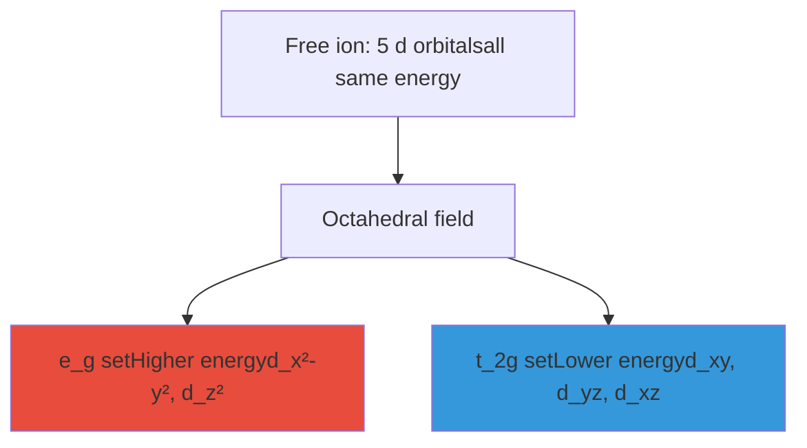
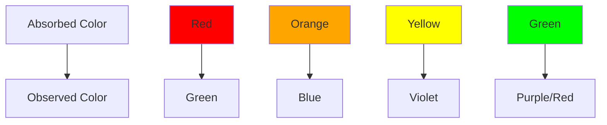

> Master crystal field splitting, octahedral and tetrahedral complexes, CFSE, and color in coordination compounds for JEE.

## Introduction

Why are coordination compounds colored? Why is [Ti(H₂O)₆]³⁺ purple while [Cu(H₂O)₆]²⁺ is blue? Why can VBT predict geometry but not color? The answer lies in **Crystal Field Theory (CFT)**, developed by Hans Bethe and John Hasbroek van Vleck in the 1930s.

> **★ Key point · Chameleons and Transition Metals**
>
> Chameleons change color using cells containing crystals of guanine. By adjusting the spacing between crystals, they change which wavelengths are reflected. Similarly, transition metal complexes appear colored because their d-electrons absorb specific wavelengths of light! [Cu(H₂O)₆]²⁺ absorbs red-orange light (600-700 nm) and reflects blue - that’s why it looks blue. CFT explains this perfectly!

---

## The Fundamental Idea

### VBT vs CFT: Key Difference

| Theory | Treats Ligands As | Focus |
| --- | --- | --- |
| **VBT** | Electron pair donors (covalent bonding) | Geometry, magnetism |
| **CFT** | Point charges or dipoles (electrostatic) | Color, magnetic properties quantitatively |

### Core Concept of CFT

1. Ligands are **negative point charges** (or dipoles)
2. They create an **electrostatic field** around the metal
3. This field **splits the d orbitals** into different energy levels
4. The **splitting pattern** depends on geometry
5. **d-d electron transitions** between split levels cause **color**

---

## d Orbitals in Free Ion vs Ligand Field

### Free Metal Ion (Spherical Field)

All five d orbitals have the **same energy** (degenerate):

```fallback
d_xy  d_yz  d_xz  d_x²-y²  d_z²
 ↑     ↑     ↑      ↑       ↑     ← All same energy
```

### In Ligand Field (Octahedral)

The d orbitals split into **two sets**:



**Why this splitting?**

- **t₂g orbitals** (d_xy, d_yz, d_xz): Point **between** the axes → **less repulsion** with ligands
- **e_g orbitals** (d_x²-y², d_z²): Point **along** the axes → **more repulsion** with ligands

---

## Crystal Field Splitting in Octahedral Complexes

### Energy Level Diagram

```fallback
e_g ────┬──── (d_x²-y², d_z²)
                            │
                            │ Δ₀
           Barycenter ───────┼─────  (average energy)
                            │
                    t₂g ────┴──── (d_xy, d_yz, d_xz)

    Free ion        Spherical     Octahedral
                    field         field
```

### Key Parameters

**Δ₀** (or **10 Dq**) = **Crystal Field Splitting Energy** (octahedral)

- Energy difference between e_g and t₂g levels
- Determines whether complex is high spin or low spin
- Depends on metal and ligand

**Energy changes:**

- e_g orbitals: increased by **+0.6Δ₀** (or +6 Dq)
- t₂g orbitals: decreased by **-0.4Δ₀** (or -4 Dq)

> **◐ In simple terms · Barycenter Rule**
>
> The **average energy** must remain constant (conservation of energy):

> 2 × (+0.6Δ₀) + 3 × (-0.4Δ₀) = 1.2Δ₀ - 1.2Δ₀ = 0 ✓

---

## Factors Affecting Δ₀

### 1. Nature of Ligand (Most Important!)

**Spectrochemical Series:**

$$\boxed{I^- < Br^- < SCN^- < Cl^- < F^- < OH^- < H_2O < NCS^- < NH_3 < en < NO_2^- < CN^- < CO}$$

**Weak field** ←─────────────────────────→ **Strong field**
**(Small Δ₀)** ←─────────────────────────→ **(Large Δ₀)**

**Examples:**

- Δ₀[CoF₆]³⁻ ≈ 13,000 cm⁻¹ (weak field)
- Δ₀[Co(NH₃)₆]³⁺ ≈ 23,000 cm⁻¹ (moderate)
- Δ₀[Co(CN)₆]³⁻ ≈ 33,000 cm⁻¹ (strong field)

### 2. Oxidation State of Metal

**Higher oxidation state → Larger Δ₀**

Example:

- Δ₀[Fe(H₂O)₆]²⁺ < Δ₀[Fe(H₂O)₆]³⁺

Why? Higher charge → stronger electrostatic interaction

### 3. Principal Quantum Number of d Orbitals

**Same group, lower period → Larger Δ₀**

Example:

- Δ₀(3d) < Δ₀(4d) < Δ₀(5d)
- Δ₀[Co(NH₃)₆]³⁺ < Δ₀[Rh(NH₃)₆]³⁺ < Δ₀[Ir(NH₃)₆]³⁺

Why? Larger orbitals → better overlap with ligands

---

## High Spin vs Low Spin Complexes

### The Critical Question

When electrons fill the split d orbitals, do they:

- **Spread out** to minimize pairing energy?
- **Pair up** to occupy lower energy t₂g orbitals?

**Answer depends on:** Is **Δ₀** greater or less than **pairing energy (P)**?

### Case 1: Weak Field (Δ₀ < P)

Electrons prefer to **remain unpaired** → **HIGH SPIN**

**Example: [Fe(H₂O)₆]²⁺** (Fe²⁺ = d⁶)

```fallback
e_g:  ↑   ↑

t₂g:  ↑   ↑   ↑   ↑
```

- **4 unpaired electrons**
- **Paramagnetic**
- μ = √[4(4+2)] = 4.90 BM

### Case 2: Strong Field (Δ₀ > P)

Energy saved by occupying lower t₂g > pairing energy → **LOW SPIN**

**Example: [Fe(CN)₆]⁴⁻** (Fe²⁺ = d⁶)

```fallback
e_g:  __  __

t₂g:  ↑↓  ↑↓  ↑↓
```

- **0 unpaired electrons**
- **Diamagnetic**
- μ = 0 BM

> **★ Key point · When Does High/Low Spin Occur?**
>
> **High spin vs low spin only matters for:**
>
> - **d⁴, d⁵, d⁶, d⁷** configurations in octahedral complexes
>
> For other configurations (d¹, d², d³, d⁸, d⁹, d¹⁰), there’s only one possible arrangement!

---

## Electron Distribution Examples

### d⁴ Configuration: [Mn(H₂O)₆]³⁺ vs [Mn(CN)₆]³⁻

**High Spin (weak field):**

```fallback
e_g:  ↑   __

t₂g:  ↑   ↑   ↑
```

4 unpaired electrons

**Low Spin (strong field):**

```fallback
e_g:  __  __

t₂g:  ↑↓  ↑   ↑
```

2 unpaired electrons

### d⁵ Configuration: [Fe(H₂O)₆]³⁺ vs [Fe(CN)₆]³⁻

**High Spin:**

```fallback
e_g:  ↑   ↑

t₂g:  ↑   ↑   ↑
```

5 unpaired electrons, μ = 5.92 BM

**Low Spin:**

```fallback
e_g:  __  __

t₂g:  ↑↓  ↑   ↑
```

1 unpaired electron, μ = 1.73 BM

### d⁷ Configuration: [Co(H₂O)₆]²⁺ vs [Co(CN)₆]⁴⁻

**High Spin:**

```fallback
e_g:  ↑   ↑

t₂g:  ↑↓  ↑↓  ↑
```

3 unpaired electrons

**Low Spin:**

```fallback
e_g:  ↑   __

t₂g:  ↑↓  ↑↓  ↑↓
```

1 unpaired electron

---

## Crystal Field Stabilization Energy (CFSE)

### Definition

**CFSE** = Energy gained by distributing electrons in split d orbitals compared to a spherical field

### Calculation Formula

$$\text{CFSE} = [(-0.4) \times n_{t_{2g}} + (+0.6) \times n_{e_g}] \times \Delta_0$$

If pairing occurs, subtract pairing energy (P)

### Examples

**1. [Ti(H₂O)₆]³⁺** (d¹)

```fallback
e_g:  __  __

t₂g:  ↑   __  __
```

CFSE = (-0.4)(1) × Δ₀ = **-0.4Δ₀**

**2. [Fe(CN)₆]⁴⁻** (d⁶, low spin)

```fallback
e_g:  __  __

t₂g:  ↑↓  ↑↓  ↑↓
```

CFSE = (-0.4)(6) × Δ₀ = -2.4Δ₀
But 2 pairings occurred: **CFSE = -2.4Δ₀ + 2P**

**3. [Fe(H₂O)₆]²⁺** (d⁶, high spin)

```fallback
e_g:  ↑   ↑

t₂g:  ↑   ↑   ↑   ↑
```

CFSE = (-0.4)(4) + (0.6)(2) × Δ₀ = **-0.4Δ₀**

### CFSE Table for Octahedral Complexes

| d electrons | High Spin CFSE | Low Spin CFSE |
| --- | --- | --- |
| d⁰ | 0 | 0 |
| d¹ | -0.4Δ₀ | -0.4Δ₀ |
| d² | -0.8Δ₀ | -0.8Δ₀ |
| d³ | -1.2Δ₀ | -1.2Δ₀ |
| d⁴ | -0.6Δ₀ | -1.6Δ₀ + P |
| d⁵ | 0 | -2.0Δ₀ + 2P |
| d⁶ | -0.4Δ₀ | -2.4Δ₀ + 2P |
| d⁷ | -0.8Δ₀ | -1.8Δ₀ + P |
| d⁸ | -1.2Δ₀ | -1.2Δ₀ |
| d⁹ | -0.6Δ₀ | -0.6Δ₀ |
| d¹⁰ | 0 | 0 |

---

## Tetrahedral Complexes

### d Orbital Splitting in Tetrahedral Field

In tetrahedral geometry, ligands approach **between** the axes, so the splitting is **reversed**!

```fallback
t₂ ────┬──── (d_xy, d_yz, d_xz)
                           │
                           │ Δ_t
          Barycenter ──────┼─────
                           │
                    e ─────┴──── (d_x²-y², d_z²)

                 Tetrahedral field
```

**Key differences from octahedral:**

- **e orbitals** are now **lower** in energy
- **t₂ orbitals** are now **higher** in energy
- **Δₜ ≈ (4/9)Δ₀** (tetrahedral splitting is smaller!)

### Why Tetrahedral Complexes Are Always High Spin

1. Δₜ is already small (4/9 of Δ₀)
2. Only 4 ligands vs 6 in octahedral
3. **Δₜ is ALWAYS less than pairing energy**
4. Therefore: **All tetrahedral complexes are high spin!**

### CFSE in Tetrahedral Complexes

$$\text{CFSE}_{tetrahedral} = [(-0.6) \times n_e + (+0.4) \times n_{t_2}] \times \Delta_t$$

**Example: [CoCl₄]²⁻** (Co²⁺ = d⁷)

```fallback
t₂:  ↑   ↑   ↑

e:   ↑↓  ↑↓
```

CFSE = (-0.6)(4) + (0.4)(3) × Δₜ = **-1.2Δₜ**

---

## Square Planar Complexes

### d Orbital Splitting

```fallback
d_x²-y² ─────── (highest)

                    d_xy ──────────

                    d_z² ──────────

                    d_xz, d_yz ──── (lowest, degenerate)

              Square planar field
```

**Common for:**

- d⁸ configuration (Ni²⁺, Pd²⁺, Pt²⁺, Au³⁺)
- Strong field ligands

**Example: [Ni(CN)₄]²⁻**
All 8 electrons pair up in lower orbitals → **Diamagnetic**

---

## Color in Coordination Compounds

### Why Are Complexes Colored?

**Reason:** **d-d electron transitions** absorb specific wavelengths of visible light.

### The Process

1. White light hits the complex
2. Energy matching Δ₀ is absorbed
3. Electron jumps from t₂g → e_g
4. **Complementary color** is observed

### Example: [Ti(H₂O)₆]³⁺ (d¹)

```fallback
Before absorption:     After absorption:
e_g:  __  __          e_g:  ↑   __

t₂g:  ↑   __  __      t₂g:  __  __  __
```

- Absorbs light at **λ ≈ 500 nm** (green-yellow)
- Appears **purple** (complementary color)

### Energy-Wavelength Relationship

$$\Delta_0 = h\nu = \frac{hc}{\lambda}$$

For [Ti(H₂O)₆]³⁺:

- Δ₀ = 20,300 cm⁻¹
- λ = 493 nm (blue-green/cyan; band maximum)
- Observed color = **Purple**

The band is broad and asymmetric (Jahn–Teller splitting of the excited e_g state spreads it over ~430–580 nm), so green **and** yellow are absorbed; the transmitted red + blue mix to give the purple/violet colour. (A single 493 nm line, taken alone, has red/orange-red as its exact complement.)

### Color Wheel



---

## Why Some Complexes Are Colorless

### d⁰ and d¹⁰ Configurations

**Examples:**

- [Sc(H₂O)₆]³⁺ (d⁰) → Colorless
- [Zn(H₂O)₆]²⁺ (d¹⁰) → Colorless

**Reason:**

- **d⁰:** No electrons to excite
- **d¹⁰:** All d orbitals full, no empty orbitals for transition

No d-d transition possible → **No visible light absorbed** → **Colorless**

> **★ Key point · Exception**
>
> KMnO₄ is intensely purple despite Mn being in +7 state (d⁰)!

> This is due to **charge transfer** (ligand-to-metal electron transfer), NOT d-d transition.

---

## Comparison: Octahedral vs Tetrahedral

| Property | Octahedral | Tetrahedral |
| --- | --- | --- |
| **Splitting** | Δ₀ | Δₜ ≈ (4/9)Δ₀ |
| **Lower energy orbitals** | t₂g (3 orbitals) | e (2 orbitals) |
| **Higher energy orbitals** | e_g (2 orbitals) | t₂ (3 orbitals) |
| **High/Low spin** | Both possible (d⁴-d⁷) | Always high spin |
| **Color intensity** | More intense | Less intense |
| **CFSE** | Generally larger | Smaller |

---

## Memory Tricks

### Spectrochemical Series

**“I Broke Several Chairs, Felt Obliged; Had Witnessed Ninjas Entering, Noting Crazy Combat”**

I⁻ < Br⁻ < SCN⁻ < Cl⁻ < F⁻ < OH⁻ < H₂O < NH₃ < en < NO₂⁻ < CN⁻ < CO

### Strong Field = Low Spin

**“STRONG ligands FORCE pairing → LOW spin → FEW unpaired”**

### Splitting Pattern

**“Oct-t₂g-Below”** → Octahedral has t₂g below
**“Tet-t₂-Top”** → Tetrahedral has t₂ on top

---

## Common Mistakes

> **⚠ Trap · Mistake 1: Wrong Energy Levels**
>
> **Wrong:** In octahedral, e_g is lower energy

> **Right:** In octahedral, **t₂g is lower** energy (points between ligands)
>
> In tetrahedral, this reverses!

> **⚠ Trap · Mistake 2: Assuming All Complexes Show High/Low Spin**
>
> **Wrong:** d³ configuration can be high or low spin

> **Right:** Only d⁴, d⁵, d⁶, d⁷ show this variation
>
> d¹, d², d³, d⁸, d⁹ have only ONE arrangement!

> **⚠ Trap · Mistake 3: Color = Absorbed Color**
>
> **Wrong:** [Ti(H₂O)₆]³⁺ absorbs purple, so it’s purple

> **Right:** It absorbs green-yellow, so appears **purple** (complementary!)
>
> Observed color = Complementary to absorbed color

> **⚠ Trap · Mistake 4: Forgetting Pairing Energy in CFSE**
>
> **Wrong:** CFSE for [Fe(CN)₆]⁴⁻ = -2.4Δ₀

> **Right:** CFSE = -2.4Δ₀ + 2P (must add pairing energy!)

---

## Practice Problems

### Level 1: Basic Concepts

**Q1.** Arrange the following in increasing order of Δ₀:
[CrCl₆]³⁻, [Cr(H₂O)₆]³⁺, [Cr(NH₃)₆]³⁺, [Cr(CN)₆]³⁻

**Q2.** Which of the following will be colored?
a) [Sc(H₂O)₆]³⁺ (d⁰)
b) [Ti(H₂O)₆]³⁺ (d¹)
c) [Zn(NH₃)₄]²⁺ (d¹⁰)
d) [Cu(H₂O)₆]²⁺ (d⁹)

**Q3.** Calculate CFSE for d³ configuration in octahedral field.

### Level 2: Application

**Q4.** [Fe(H₂O)₆]²⁺ is pale green while [Fe(CN)₆]⁴⁻ is pale yellow. Explain:
a) The difference in magnetic moments
b) The difference in colors

**Q5.** Why are tetrahedral complexes generally less intensely colored than octahedral complexes?

**Q6.** A complex of Co³⁺ (d⁶) absorbs light at 600 nm. Calculate Δ₀ in:
a) cm⁻¹
b) kJ/mol
(Given: h = 6.626 × 10⁻³⁴ J·s, c = 3 × 10⁸ m/s, N_A = 6.022 × 10²³)

**Q7.** Predict which will have larger Δ₀:
a) [Fe(H₂O)₆]²⁺ or [Fe(H₂O)₆]³⁺
b) [Co(NH₃)₆]³⁺ or [Rh(NH₃)₆]³⁺
c) [CoF₆]³⁻ or [Co(CN)₆]³⁻

### Level 3: JEE Advanced

**Q8.** The magnetic moment of [Mn(H₂O)₆]²⁺ is 5.92 BM. When treated with excess CN⁻, the moment drops to 1.73 BM. Explain using:
a) Electron distribution diagrams
b) CFSE calculations for both complexes

**Q9.** [Ti(H₂O)₆]³⁺ absorbs light at 20,300 cm⁻¹ (purple color observed).
a) Calculate the wavelength of absorbed light
b) Explain using CFT why this complex is colored
c) Predict the color if Ti³⁺ is replaced by Sc³⁺

**Q10.** Explain the following observations:
a) [Ni(CN)₄]²⁻ is square planar and diamagnetic
b) [NiCl₄]²⁻ is tetrahedral and paramagnetic
c) Both have same metal and coordination number

**Q11.** Calculate the CFSE for:
a) [Co(H₂O)₆]³⁺ (high spin d⁶)
b) [Co(NH₃)₆]³⁺ (low spin d⁶)
c) Which is more stable based on CFSE alone?

**Q12.** A student observes:

- [Fe(H₂O)₆]²⁺ is pale green
- [Fe(H₂O)₆]³⁺ is pale violet
- [Fe(CN)₆]⁴⁻ is pale yellow
- [Fe(CN)₆]³⁻ is red

Explain the trend in colors using CFT.

> **↗ Connection · Quick Check**
>
> If a d⁵ complex is diamagnetic, what can you conclude about:

> a) The ligand strength?

> b) The value of Δ₀ relative to pairing energy?

> c) The hybridization (from VBT perspective)?

---

## Solutions to Selected Problems

**Q1.** [CrCl₆]³⁻ < [Cr(H₂O)₆]³⁺ < [Cr(NH₃)₆]³⁺ < [Cr(CN)₆]³⁻
(Based on spectrochemical series)

**Q2.** b) and d) will be colored (d¹ and d⁹ allow d-d transitions)

**Q3.** CFSE = (-0.4)(3) Δ₀ = **-1.2Δ₀**

**Q7.**
a) [Fe(H₂O)₆]³⁺ (higher oxidation state)
b) [Rh(NH₃)₆]³⁺ (4d orbitals, larger splitting)
c) [Co(CN)₆]³⁻ (CN⁻ stronger field than F⁻)

**Q9.**
a) λ = 1/ν̃ = 1/20,300 = 493 nm
b) d¹ configuration: electron transitions from t₂g to e_g
c) Sc³⁺ is d⁰ → colorless (no d electrons for transition)

**Q11.**
a) CFSE = (-0.4)(4) + (0.6)(2) Δ₀ = -0.4Δ₀
b) CFSE = (-0.4)(6) Δ₀ + 2P = -2.4Δ₀ + 2P
c) Low spin is more stable if -2.4Δ₀ + 2P < -0.4Δ₀, i.e., if Δ₀ > P

---

## Advanced Topic: Jahn-Teller Effect

### The Problem

For d⁹ Cu²⁺ octahedral complexes, CFT predicts perfect octahedral geometry. But experiments show **distortion**!

### Jahn-Teller Theorem

**“Any non-linear molecular system in a degenerate electronic state will undergo geometric distortion to remove the degeneracy.”**

### Example: [Cu(H₂O)₆]²⁺

Cu²⁺ = d⁹:

```fallback
e_g:  ↑↓  ↑   ← Asymmetric filling causes instability

t₂g:  ↑↓  ↑↓  ↑↓
```

**Result:** Complex distorts - usually **elongation** along z-axis

- 4 short Cu-O bonds (in xy plane)
- 2 long Cu-O bonds (along z)

This is beyond JEE syllabus but explains why Cu²⁺ complexes often appear square planar!

---

## Related Topics

### Within Coordination Compounds

- [Bonding Theories](../bonding-theories/index.md) — VBT vs CFT comparison
- [Isomerism](../isomerism/index.md) — Geometry affects isomerism
- [Stability Constants](../stability-constants/index.md) — CFSE affects stability
- [Applications](../applications/index.md) — Color in biological systems

### Cross-Chapter Connections

- [Atomic Structure](../../atomic-structure/index.md) — d orbitals and electron configurations
- [d-Block Elements](../../d-f-block-elements/index.md) — Colored compounds
- [Chemical Bonding](../../chemical-bonding/index.md) — Molecular orbital theory
- [Light and Electromagnetic Radiation](../../atomic-structure/electromagnetic-radiation/index.md) — Absorption and color

### Interactive Demo: Crystal Field Theory Visualizer

Explore how d orbitals split in different crystal field environments. Change the metal ion, geometry, and ligand to see real-time changes in electron configuration, CFSE, and predicted color!

---

From TestGuru · our mock-test platform

## You've read Crystal Field Theory (CFT).You've read this topic. Find out what you actually got.

A free JEE Main mock with this chapter in it, and a report that shows which sub-topics cost you marks.

[Take a free JEE Main mock →](https://app.testguru.co/signup?tg_chapter=coordination-compounds&tg_exam=jee-main&tg_page=%2Fchemistry%2Fcoordination-compounds%2Fcrystal-field-theory%2F&tg_subject=chemistry&utm_campaign=notes-jee-main-free-test&utm_content=article-end&utm_medium=referral&utm_source=jeenotes)
Free, no card. Opens TestGuru in a new tab.

## Stay exam-ready

One email every Sunday: new notes, the week's hardest challenge question and a revision plan.One email every Sunday.

## Comments

Have a question or spotted a mistake? Join the discussion below.

Advertisement

Advertisement

---

## Extracted page code (interactive scripts & widgets)


### inline-script-16

```js
if(!document.getElementById("animation-fullscreen-overlay")){const e=document.createElement("div");e.id="animation-fullscreen-overlay",e.className="animation-fullscreen-overlay",e.innerHTML=`
      <div class="fullscreen-modal">
        <div class="fullscreen-header">
          <span class="fullscreen-title">Interactive Demo</span>
          <button class="fullscreen-close-btn" onclick="JEEAnimations.closeFullscreen()" title="Close (Esc)" aria-label="Close fullscreen">
            <svg width="24" height="24" viewBox="0 0 24 24" fill="none" stroke="currentColor" stroke-width="2" stroke-linecap="round" stroke-linejoin="round">
              <line x1="18" y1="6" x2="6" y2="18"></line>
              <line x1="6" y1="6" x2="18" y2="18"></line>
            </svg>
          </button>
        </div>
        <div class="fullscreen-content"></div>
      </div>
    `,document.body.appendChild(e),document.addEventListener("keydown",function(e){e.key==="Escape"&&document.body.classList.contains("animation-fullscreen-active")&&JEEAnimations.closeFullscreen()}),e.addEventListener("click",function(t){t.target===e&&JEEAnimations.closeFullscreen()})}
```


### inline-script-17

```js
(function(){var t,e=document.getElementById("disqus-load");if(!e)return;t=!1,e.addEventListener("click",function(){if(t)return;t=!0,e.setAttribute("disabled","disabled"),e.textContent="Loading comments…",window.disqus_config=function(){this.page.url="https://jeenotes.in/chemistry/coordination-compounds/crystal-field-theory/",this.page.identifier="/chemistry/coordination-compounds/crystal-field-theory/"};var s=document,n=s.createElement("script");n.src="https://https-jeenotes-in.disqus.com/embed.js",n.setAttribute("data-timestamp",+new Date),n.onload=function(){e.style.display="none"},n.onerror=function(){t=!1,e.removeAttribute("disabled"),e.textContent="Could not load comments. Tap to retry"},(s.head||s.body).appendChild(n)})})()
```


### inline-script-18

```js
(function(){var t,e=document.currentScript.previousElementSibling;function n(){(window.adsbygoogle=window.adsbygoogle||[]).push({})}if(!window.ResizeObserver||e.clientWidth>0){n();return}t=new ResizeObserver(function(){e.clientWidth>0&&(t.disconnect(),n())}),t.observe(e)})()
```


### interactive-widget-1

```html
<div class="animation-wrapper" data-animation="crystalFieldTheory" id="anim-crystalFieldTheory-1795396419503019002"><div class="animation-header"><button aria-label="Toggle fullscreen" class="anim-fullscreen-btn" onclick='JEEAnimations.toggleFullscreen("anim-crystalFieldTheory-1795396419503019002")' title="Fullscreen (F)">
<svg class="fullscreen-icon-expand" fill="none" height="18" stroke="currentColor" stroke-linecap="round" stroke-linejoin="round" stroke-width="2" viewbox="0 0 24 24" width="18"><polyline points="15 3 21 3 21 9"></polyline><polyline points="9 21 3 21 3 15"></polyline><line x1="21" x2="14" y1="3" y2="10"></line><line x1="3" x2="10" y1="21" y2="14"></line></svg>
<svg class="fullscreen-icon-collapse" fill="none" height="18" stroke="currentColor" stroke-linecap="round" stroke-linejoin="round" stroke-width="2" viewbox="0 0 24 24" width="18"><polyline points="4 14 10 14 10 20"></polyline><polyline points="20 10 14 10 14 4"></polyline><line x1="14" x2="21" y1="10" y2="3"></line><line x1="3" x2="10" y1="21" y2="14"></line></svg>
<span class="fullscreen-text">Fullscreen</span></button></div><div class="animation-content"><noscript><div class="callout callout-warning"><div class="callout-title">JavaScript Required</div><p>This interactive animation requires JavaScript to be enabled.</p></div></noscript></div></div>
```


---

_Source: [https://jeenotes.in/chemistry/coordination-compounds/crystal-field-theory/](https://jeenotes.in/chemistry/coordination-compounds/crystal-field-theory/) · raw HTML: `offline/chemistry/coordination-compounds/crystal-field-theory/index.html`_
