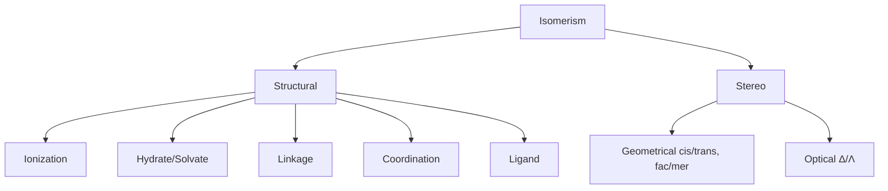

> All key Coordination Compounds formulas, relations, and high-yield facts: CFSE, magnetic moment, stability constants, spectrochemical series for JEE quick revision.

Last-minute revision sheet for Coordination Compounds. Every formula, key relation, and high-yield fact below is pulled straight from the chapter topics — scan it the night before the exam.

## Core Formulas

| Quantity | Formula | Notes |
| --- | --- | --- |
| Magnetic moment | $\mu = \sqrt{n(n+2)}\ \text{BM}$ | $n$ = number of unpaired electrons |
| Overall stability constant | $\beta_n = K_1 \times K_2 \times K_3 \times \dots \times K_n$ | Product of stepwise constants |
| Dissociation (instability) constant | $K_d = \dfrac{1}{\beta_n}$ | $K_d \times \beta_n = 1$ |
| Octahedral CFSE | $\text{CFSE} = [(-0.4)\,n_{t_{2g}} + (+0.6)\,n_{e_g}]\,\Delta_0$ | Add $+P$ per forced pairing |
| Tetrahedral CFSE | $\text{CFSE} = [(-0.6)\,n_{e} + (+0.4)\,n_{t_2}]\,\Delta_t$ |  |
| Tetrahedral vs octahedral splitting | $\Delta_t \approx \dfrac{4}{9}\,\Delta_0$ | $\Delta_t$ always small |
| Splitting energy ↔ wavelength | $\Delta_0 = h\nu = \dfrac{hc}{\lambda}$ | Basis of colour (d–d transitions) |

$$\boxed{\mu = \sqrt{n(n+2)}\ \text{BM}}$$

$$\boxed{\beta_n = K_1 K_2 K_3 \dots K_n \qquad K_d = \frac{1}{\beta_n}}$$

> **★ Key point · Magnetic moment shortcut**
>
> Memorise the $\mu$ ladder: $n = 1,2,3,4,5 \Rightarrow \mu = 1.73,\ 2.83,\ 3.87,\ 4.90,\ 5.92$ BM. If $\mu = 0$, the complex is diamagnetic (all paired).

## Werner’s Theory & Counting Ions

| Concept | Key relation |
| --- | --- |
| Primary valency | = Oxidation state of metal (ionizable, non-directional, satisfied by anions) |
| Secondary valency | = Coordination number (non-ionizable, directional, fixed geometry) |
| Ions from $[M(\text{ligands})_x]Y_n$ | $= n + 1$ (1 cation + $n$ anions) |
| AgCl precipitated | = number of ionizable $\text{Cl}^-$ outside the coordination sphere |

**Conductivity / ion count for CoCl₃·xNH₃ series:**

| Compound | Werner formula | Ions | AgCl ppt |
| --- | --- | --- | --- |
| CoCl₃·6NH₃ | $[\text{Co(NH}_3)_6]\text{Cl}_3$ | 4 | 3 mol |
| CoCl₃·5NH₃ | $[\text{Co(NH}_3)_5\text{Cl}]\text{Cl}_2$ | 3 | 2 mol |
| CoCl₃·4NH₃ | $[\text{Co(NH}_3)_4\text{Cl}_2]\text{Cl}$ | 2 | 1 mol |
| CoCl₃·3NH₃ | $[\text{Co(NH}_3)_3\text{Cl}_3]$ | 0 | 0 |

| Coordination number | Geometry (Werner) |
| --- | --- |
| 2 | Linear |
| 4 | Tetrahedral or Square planar |
| 6 | Octahedral |

## Nomenclature Quick Rules

- **Order:** cation before anion; within sphere → ligands (alphabetical, ignore di/tri prefixes) then metal + oxidation state in Roman numerals.
- **Anionic complex:** metal gets **-ate** suffix (often Latin: iron → ferrate, copper → cuprate, silver → argentate, gold → aurate, tin → stannate, lead → plumbate).
- **Prefixes:** simple ligands → di, tri, tetra, penta, hexa; complex ligands (en, etc.) → bis, tris, tetrakis.
- **Bridging ligand:** μ (mu). **Ambidentate binding atom:** κ (kappa).

| Ligand | Name | Ligand | Name |
| --- | --- | --- | --- |
| H₂O | aqua | NH₃ | ammine |
| CO | carbonyl | NO | nitrosyl |
| Cl⁻ | chlorido | Br⁻ | bromido |
| CN⁻ | cyanido | OH⁻ | hydroxido |
| O²⁻ | oxido | SO₄²⁻ | sulfato |
| NO₂⁻ (κN) | nitrito-κN | ONO⁻ (κO) | nitrito-κO |
| SCN⁻ (κS) | thiocyanato-κS | NCS⁻ (κN) | thiocyanato-κN |

> **★ Key point · Don't mix these up**
>
> **ammine** (NH₃ ligand, double m) vs **amine** (organic R–NH₂); **nitrito** (NO₂⁻ ligand) vs **nitro** (organic). Counter ions stay **outside** the square brackets.

## Isomerism



| Type | Same | Different | Example |
| --- | --- | --- | --- |
| Ionization | Formula | Ions formed | $[\text{Co(NH}_3)_5\text{Br}]\text{SO}_4$ vs $[\text{Co(NH}_3)_5\text{SO}_4]\text{Br}$ |
| Hydrate | Formula | H₂O in/out of sphere | $[\text{Cr(H}_2\text{O})_6]\text{Cl}_3$ vs $[\text{Cr(H}_2\text{O})_5\text{Cl}]\text{Cl}_2\cdot\text{H}_2\text{O}$ |
| Linkage | Formula | Binding atom | $[\text{Co(NH}_3)_5\text{NO}_2]^{2+}$ vs $[\text{Co(NH}_3)_5\text{ONO}]^{2+}$ |
| Coordination | Formula | Ligand distribution | $[\text{Co(NH}_3)_6][\text{Cr(CN)}_6]$ vs $[\text{Cr(NH}_3)_6][\text{Co(CN)}_6]$ |
| Geometrical | Bonding | Spatial arrangement | cis vs trans |
| Optical | Bonding | Mirror images | Δ vs Λ |

**Number of geometrical isomers (count fast):**

| Square planar | # | Octahedral | # |
| --- | --- | --- | --- |
| MA₂B₂ | 2 (cis, trans) | MA₄B₂ | 2 (cis, trans) |
| MA₂BC | 3 | MA₃B₃ | 2 (fac, mer) |
| MABCD | 3 | MA₂B₂C₂ | up to 5 |

> **★ Key point · Optical activity rule**
>
> **trans** isomers are **never** optically active (they have a plane of symmetry). **cis** isomers **may** be optically active. $[\text{Co(en)}_3]^{3+}$ has 2 optical isomers (Δ and Λ); cis-$[\text{Co(en)}_2\text{Cl}_2]^+$ gives 3 stereoisomers total (1 trans + 2 cis Δ/Λ).

## Bonding — Valence Bond Theory (VBT)

| CN | Hybridization | Geometry | Bond angle | Example |
| --- | --- | --- | --- | --- |
| 2 | sp | Linear | 180° | $[\text{Ag(NH}_3)_2]^+$ |
| 4 | sp³ | Tetrahedral | 109.5° | $[\text{NiCl}_4]^{2-}$ |
| 4 | dsp² | Square planar | 90° | $[\text{Ni(CN)}_4]^{2-}$ |
| 5 | sp³d | Trigonal bipyramidal | 90°, 120° | $[\text{Fe(CO)}_5]$ |
| 6 | sp³d² | Octahedral (outer) | 90° | $[\text{CoF}_6]^{3-}$ |
| 6 | d²sp³ | Octahedral (inner) | 90° | $[\text{Co(NH}_3)_6]^{3+}$ |

- **Inner orbital (d²sp³):** uses (n−1)d orbitals; strong field; pairing forced; usually diamagnetic; stronger bonds.
- **Outer orbital (sp³d²):** uses nd orbitals; weak field; no pairing; usually paramagnetic.
- Always remove **s electrons before d** when forming ions (e.g. Fe³⁺ = [Ar]3d⁵, not 3d⁵4s²).

**Reference complexes (memorise the row outcomes):**

| Complex | d-electrons | Hybridization | Geometry | Unpaired e⁻ | Magnetic |
| --- | --- | --- | --- | --- | --- |
| $[\text{Fe(CN)}_6]^{4-}$ | d⁶ | d²sp³ | Octahedral | 0 | Diamagnetic |
| $[\text{FeF}_6]^{4-}$ | d⁶ | sp³d² | Octahedral | 4 | Paramagnetic |
| $[\text{Co(NH}_3)_6]^{3+}$ | d⁶ | d²sp³ | Octahedral | 0 | Diamagnetic |
| $[\text{CoF}_6]^{3-}$ | d⁶ | sp³d² | Octahedral | 4 | Paramagnetic |
| $[\text{Ni(CN)}_4]^{2-}$ | d⁸ | dsp² | Square planar | 0 | Diamagnetic |
| $[\text{NiCl}_4]^{2-}$ | d⁸ | sp³ | Tetrahedral | 2 | Paramagnetic |
| $[\text{Cu(NH}_3)_4]^{2+}$ | d⁹ | sp³ | Tetrahedral/Square | 1 | Paramagnetic |
| $[\text{Ag(NH}_3)_2]^+$ | d¹⁰ | sp | Linear | 0 | Diamagnetic |

## Spectrochemical Series

$$\boxed{I^- < Br^- < SCN^- < Cl^- < S^{2-} < F^- < OH^- < C_2O_4^{2-} < H_2O < NCS^- < EDTA < NH_3 < en < NO_2^- < CN^- < CO}$$

**Weak field (small Δ₀, high spin)** ←————→ **Strong field (large Δ₀, low spin)**

> **★ Key point · Reading the series**
>
> Halides (I⁻, Br⁻, Cl⁻, F⁻) are weak field → no pairing → outer orbital → paramagnetic. CN⁻, CO are strong field → force pairing → inner orbital → diamagnetic.

## Crystal Field Theory (CFT)

**Octahedral splitting:** d orbitals split into lower **t₂g** (d_xy, d_yz, d_xz) and higher **e_g** (d_x²–y², d_z²).

- e_g raised by **+0.6Δ₀**; t₂g lowered by **−0.4Δ₀**.
- Barycenter check: $2(+0.6\Delta_0) + 3(-0.4\Delta_0) = 0$.
- **Tetrahedral:** order reverses (e lower, t₂ higher) and $\Delta_t \approx \tfrac{4}{9}\Delta_0$ → **always high spin**.

**High vs low spin:** decided by Δ₀ vs pairing energy P.

| Condition | Result |
| --- | --- |
| $\Delta_0 < P$ (weak field) | High spin (unpaired electrons maximised) |
| $\Delta_0 > P$ (strong field) | Low spin (t₂g filled first, pairing) |

High/low spin distinction only matters for **d⁴, d⁵, d⁶, d⁷** in octahedral fields.

**Factors increasing Δ₀:** stronger field ligand (up spectrochemical series); higher metal oxidation state ($\text{Fe}^{3+} > \text{Fe}^{2+}$); larger d orbitals ($3d < 4d < 5d$).

### CFSE Table — Octahedral

| dⁿ | High spin CFSE | Low spin CFSE |
| --- | --- | --- |
| d⁰ | 0 | 0 |
| d¹ | −0.4Δ₀ | −0.4Δ₀ |
| d² | −0.8Δ₀ | −0.8Δ₀ |
| d³ | −1.2Δ₀ | −1.2Δ₀ |
| d⁴ | −0.6Δ₀ | −1.6Δ₀ + P |
| d⁵ | 0 | −2.0Δ₀ + 2P |
| d⁶ | −0.4Δ₀ | −2.4Δ₀ + 2P |
| d⁷ | −0.8Δ₀ | −1.8Δ₀ + P |
| d⁸ | −1.2Δ₀ | −1.2Δ₀ |
| d⁹ | −0.6Δ₀ | −0.6Δ₀ |
| d¹⁰ | 0 | 0 |

### Colour

- Cause: **d–d transitions** (t₂g → e_g) absorb visible light; observed colour is the **complementary** of the absorbed colour.
- **Colourless** when d⁰ (no electron to excite, e.g. $[\text{Sc(H}_2\text{O})_6]^{3+}$) or d¹⁰ (no empty d orbital, e.g. $[\text{Zn(H}_2\text{O})_6]^{2+}$).
- Worked value: $[\text{Ti(H}_2\text{O})_6]^{3+}$, Δ₀ = 20,300 cm⁻¹ → band maximum λ ≈ 493 nm. The band is broad (Jahn–Teller split, ~430–580 nm), so green **and** yellow are absorbed and the transmitted red + blue give the purple colour. (A single 493 nm line alone is blue-green, whose exact complement is red/orange-red, not purple.)

> **★ Key point · Colour exceptions**
>
> KMnO₄ (Mn = +7, d⁰) is intensely purple due to **charge transfer (LMCT)**, not a d–d transition. Jahn–Teller distortion (e.g. d⁹ $[\text{Cu(H}_2\text{O})_6]^{2+}$) elongates the octahedron to remove degeneracy.

## Stability of Complexes

| Factor | Effect on stability | Example |
| --- | --- | --- |
| Higher charge / smaller size (charge density) | ↑ | $\text{Al}^{3+} > \text{Mg}^{2+} > \text{Na}^+$ |
| Better Lewis base (ligand basicity) | ↑ | $\text{CN}^- > \text{NH}_3 > \text{H}_2\text{O}$ |
| Hard–hard or soft–soft (HSAB) match | ↑ | Fe³⁺–F⁻; Ag⁺–CN⁻ |
| Chelate effect | ↑↑ | en > 2 NH₃ |
| Macrocyclic effect | ↑↑↑ | porphyrin |
| Higher CFSE | ↑ | d³, low-spin d⁶ |

**Irving–Williams series** (first-row M²⁺, same ligand):

$$\boxed{Mn^{2+} < Fe^{2+} < Co^{2+} < Ni^{2+} < Cu^{2+} > Zn^{2+}}$$

- **Chelate effect** is mainly **entropic**: e.g. $[\text{Ni(H}_2\text{O})_6]^{2+} + 6\,\text{NH}_3$ has ΔS ≈ 0 ($\log\beta_6 = 8.61$), but $+3\,\text{en}$ releases more particles → ΔS > 0 ($\log\beta_3 = 18.28$), ~5 billion times more stable.
- **Thermodynamic stability (β)** ≠ **kinetic stability (labile/inert)**. Labile: d⁰, d¹⁰, high-spin d⁴–d⁷, large ions. Inert: low-spin d³ and d⁶ (Cr³⁺, Co³⁺), high charge density.
- $\Delta G^\circ = -RT \ln \beta$.
- Stability scale: large β (>10⁸) = very stable; 10⁴–10⁸ = moderate; <10⁴ = weak.

> **★ Key point · Worked relation worth remembering**
>
> Ligand-displacement equilibrium constant = ratio of overall stability constants. For $[\text{Cu(NH}_3)_4]^{2+} + 4\text{CN}^- \rightleftharpoons [\text{Cu(CN)}_4]^{2-} + 4\text{NH}_3$: $K_{eq} = \dfrac{\beta_{[\text{Cu(CN)}_4]^{2-}}}{\beta_{[\text{Cu(NH}_3)_4]^{2+}}} = \dfrac{10^{28}}{10^{13}} = 10^{15}$.

## High-Yield Application Facts

**Biological metal centres:**

| Complex | Metal | Ligand / function |
| --- | --- | --- |
| Hemoglobin | Fe²⁺ | porphyrin (CN = 6, octahedral); reversible O₂ binding |
| Chlorophyll | Mg²⁺ | modified porphyrin; light absorption |
| Vitamin B₁₂ | Co³⁺ | corrin ring |
| Hemocyanin | Cu⁺ | O₂ transport (blue blood) |
| Carboxypeptidase | Zn²⁺ | protein-digesting enzyme |

- **CO poisoning:** CO binds Fe²⁺ ~200× more strongly than O₂ (strong field, won’t release) → blocks O₂ transport.
- **Cisplatin** = cis-$[\text{Pt(NH}_3)_2\text{Cl}_2]$ (anticancer); trans isomer inactive — only cis cross-links adjacent guanines on DNA.
- **Chelation therapy / MRI:** EDTA chelates Pb²⁺ (β ≈ 10¹⁸); $[\text{Gd(DTPA)}]^{2-}$ is the safe MRI contrast agent (free Gd³⁺ toxic).

**Qualitative analysis colours:**

| Ion | Reagent | Complex | Colour |
| --- | --- | --- | --- |
| Fe³⁺ | SCN⁻ | $[\text{Fe(SCN)}]^{2+}$ | blood red |
| Cu²⁺ | NH₃ | $[\text{Cu(NH}_3)_4]^{2+}$ | deep blue |
| Ni²⁺ | DMG | $[\text{Ni(DMG)}_2]$ | rose-red |
| Co²⁺ | SCN⁻ | $[\text{Co(SCN)}_4]^{2-}$ | blue |
| Fe²⁺ | K₄[Fe(CN)₆] | $\text{Fe}_4[\text{Fe(CN)}_6]_3$ | Prussian blue |

**Key industrial/metallurgy reactions:**

$$4\text{Au} + 8\text{CN}^- + \text{O}_2 + 2\text{H}_2\text{O} \rightarrow 4[\text{Au(CN)}_2]^- + 4\text{OH}^-$$

$$2[\text{Au(CN)}_2]^- + \text{Zn} \rightarrow [\text{Zn(CN)}_4]^{2-} + 2\text{Au}$$

$$\text{Ni}(s) + 4\text{CO}(g) \xrightarrow{50\text{–}60\,^\circ\text{C}} [\text{Ni(CO)}_4](/chemistry/coordination-compounds/) \xrightarrow{200\,^\circ\text{C}} \text{Ni}(s) + 4\text{CO}(g) \quad (\text{Mond process})$$

$$\text{AgBr}(s) + 2\text{S}_2\text{O}_3^{2-} \rightarrow [\text{Ag(S}_2\text{O}_3)_2]^{3-} + \text{Br}^- \quad (\text{photographic fixing})$$

**Catalysts:** Wilkinson’s $[\text{RhCl(PPh}_3)_3]$ (alkene hydrogenation); Ziegler–Natta TiCl₄ + Al(C₂H₅)₃ (polymerisation); Monsanto $[\text{Rh(CO)}_2\text{I}_2]^-$ (CH₃OH → CH₃COOH).

## Quick-Recall Mnemonics

- **Counting ions:** $[M(\text{L})_x]Y_n$ → total ions = $n + 1$.
- **Structural isomer types:** Ionization, Hydrate, Linkage, Ligand, Coordination (+ stereo: Geometrical, Optical).
- **trans = PLANE of symmetry → never optically active.**
- **Irving–Williams:** Mn < Fe < Co < Ni < Cu > Zn.
- **Stability ladder:** Macrocyclic > Chelate > Monodentate.
- **Labile vs inert:** d⁰ and d¹⁰ are labile; low-spin d³ and d⁶ are inert.

## Related Topics

- [Werner’s Theory](../werners-theory/index.md)
- [IUPAC Nomenclature](../nomenclature/index.md)
- [Isomerism](../isomerism/index.md)
- [Bonding Theories](../bonding-theories/index.md)
- [Crystal Field Theory](../crystal-field-theory/index.md)
- [Stability of Coordination Compounds](../stability-constants/index.md)
- [Applications](../applications/index.md)

From TestGuru · our mock-test platform

## You've read Coordination Compounds Formula Sheet.You've read this topic. Find out what you actually got.

A free JEE Main mock with this chapter in it, and a report that shows which sub-topics cost you marks.

[Take a free JEE Main mock →](https://app.testguru.co/signup?tg_chapter=coordination-compounds&tg_exam=jee-main&tg_page=%2Fchemistry%2Fcoordination-compounds%2Fformula-sheet%2F&tg_subject=chemistry&utm_campaign=notes-jee-main-free-test&utm_content=article-end&utm_medium=referral&utm_source=jeenotes)
Free, no card. Opens TestGuru in a new tab.

## Stay exam-ready

One email every Sunday: new notes, the week's hardest challenge question and a revision plan.One email every Sunday.

## Comments

Have a question or spotted a mistake? Join the discussion below.

Advertisement

Advertisement

---

## Extracted page code (interactive scripts & widgets)


### inline-script-14

```js
(function(){var t,e=document.getElementById("disqus-load");if(!e)return;t=!1,e.addEventListener("click",function(){if(t)return;t=!0,e.setAttribute("disabled","disabled"),e.textContent="Loading comments…",window.disqus_config=function(){this.page.url="https://jeenotes.in/chemistry/coordination-compounds/formula-sheet/",this.page.identifier="/chemistry/coordination-compounds/formula-sheet/"};var s=document,n=s.createElement("script");n.src="https://https-jeenotes-in.disqus.com/embed.js",n.setAttribute("data-timestamp",+new Date),n.onload=function(){e.style.display="none"},n.onerror=function(){t=!1,e.removeAttribute("disabled"),e.textContent="Could not load comments. Tap to retry"},(s.head||s.body).appendChild(n)})})()
```


### inline-script-15

```js
(function(){var t,e=document.currentScript.previousElementSibling;function n(){(window.adsbygoogle=window.adsbygoogle||[]).push({})}if(!window.ResizeObserver||e.clientWidth>0){n();return}t=new ResizeObserver(function(){e.clientWidth>0&&(t.disconnect(),n())}),t.observe(e)})()
```


---

_Source: [https://jeenotes.in/chemistry/coordination-compounds/formula-sheet/](https://jeenotes.in/chemistry/coordination-compounds/formula-sheet/) · raw HTML: `offline/chemistry/coordination-compounds/formula-sheet/index.html`_
