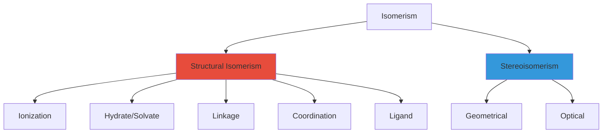
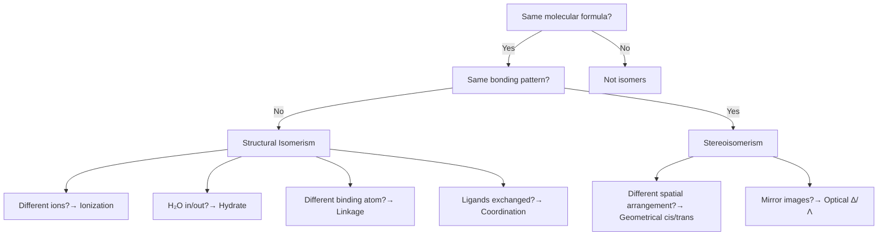

> Master geometrical, optical, and linkage isomerism in coordination compounds with visual aids and JEE practice problems.

## Introduction

Isomers are compounds with the **same molecular formula** but **different arrangements** of atoms. In coordination compounds, this phenomenon becomes fascinating - two complexes can have identical formulas but completely different properties, colors, and even biological activities!

> **★ Key point · The Cisplatin vs Transplatin Story**
>
> In 1965, Barnett Rosenberg accidentally discovered that **cis-[Pt(NH₃)₂Cl₂]** (cisplatin) could kill cancer cells. Its geometric isomer, **trans-[Pt(NH₃)₂Cl₂]** (transplatin), with the EXACT same atoms but different arrangement, is completely inactive against cancer! Today, cisplatin saves thousands of lives annually. This dramatic difference shows why studying isomerism isn’t just academic - it’s literally life and death!

---

## Types of Isomerism in Coordination Compounds



---

## Part 1: Structural Isomerism

Isomers with **different bonding patterns** - atoms are connected differently.

### 1. Ionization Isomerism

Different ions are produced when dissolved in water.

**Occurs when:** An anionic ligand can exchange with a counter ion outside the coordination sphere.

#### Classic Example

| Isomer A | Isomer B |
| --- | --- |
| [Co(NH₃)₅Br]SO₄ | [Co(NH₃)₅SO₄]Br |
| Violet | Red |
| Gives BaSO₄ with Ba²⁺ | Gives AgBr with Ag⁺ |

**What’s happening:**

- **Isomer A:** SO₄²⁻ is outside → precipitates with Ba²⁺
- **Isomer B:** Br⁻ is outside → precipitates with Ag⁺

#### More Examples

1. [Pt(NH₃)₄Cl₂]Br₂ and [Pt(NH₃)₄Br₂]Cl₂
2. [Co(NH₃)₅NO₃]SO₄ and [Co(NH₃)₅SO₄]NO₃
3. [Cr(H₂O)₆]Cl₃ and [Cr(H₂O)₅Cl]Cl₂·H₂O (also hydrate isomer)

> **★ Key point · Detection Method**
>
> Add reagents that specifically react with ions:
>
> - AgNO₃ → precipitates Cl⁻, Br⁻

> - BaCl₂ → precipitates SO₄²⁻

> - Count moles of precipitate to identify structure!

---

### 2. Hydrate (Solvate) Isomerism

Water molecules are inside or outside the coordination sphere.

#### The Famous Chromium Chloride Isomers

| Formula | Color | Free Cl⁻ ions | Water lost on heating |
| --- | --- | --- | --- |
| [Cr(H₂O)₆]Cl₃ | Violet | 3 | 0 |
| [Cr(H₂O)₅Cl]Cl₂·H₂O | Blue-green | 2 | 1 (easily) |
| [Cr(H₂O)₄Cl₂]Cl·2H₂O | Dark green | 1 | 2 (easily) |

**What’s happening:**

- Water inside = strongly bound, won’t evaporate easily
- Water outside = weakly held, evaporates readily

#### Another Example

[Co(H₂O)₆]Br₃ vs [Co(H₂O)₅Br]Br₂·H₂O vs [Co(H₂O)₄Br₂]Br·2H₂O

---

### 3. Linkage Isomerism

Occurs with **ambidentate ligands** - ligands that can coordinate through different atoms.

#### Common Ambidentate Ligands

| Ligand | Can bind through | Names |
| --- | --- | --- |
| NO₂⁻ | N or O | nitrito-κN or nitrito-κO |
| SCN⁻ | S or N | thiocyanato-κS or thiocyanato-κN |
| CN⁻ | C or N | cyanido-κC or cyanido-κN (rare) |

#### Classic Example: Nitro vs Nitrito

**Nitro Isomer (bonded through N):**

```fallback
[Co(NH₃)₅-NO₂]²⁺
```

- Yellow
- M-N bond
- More stable

**Nitrito Isomer (bonded through O):**

```fallback
[Co(NH₃)₅-ONO]²⁺
```

- Red
- M-O bond
- Less stable, slowly converts to nitro form

#### Thiocyanate Example

| Isomer | Bond | Color |
| --- | --- | --- |
| [Co(NH₃)₅-NCS]²⁺ | M-N | One color |
| [Co(NH₃)₅-SCN]²⁺ | M-S | Different color |

> **⚠ Trap · Common Mistake**
>
> **Wrong:** “NO₂ and ONO are positional isomers”

> **Right:** They are linkage isomers - the binding atom changes, not just position!

---

### 4. Coordination Isomerism

Occurs in compounds with **both cationic and anionic complexes** - ligands exchange between the two metal centers.

#### Examples

**Isomer Pair 1:**

- [Co(NH₃)₆][Cr(CN)₆]
- [Cr(NH₃)₆][Co(CN)₆]

**Isomer Pair 2:**

- [Cu(NH₃)₄][PtCl₄]
- [Pt(NH₃)₄][CuCl₄]

**Isomer Pair 3:**

- [Co(NH₃)₆][Cr(C₂O₄)₃]
- [Cr(NH₃)₆][Co(C₂O₄)₃]

---

### 5. Ligand Isomerism

Same molecular formula but different ligands.

**Example:**

- [Co(NH₂CH₂CH₂NH₂)₃]³⁺ (three ethylenediamine)
- [Co(NH₂CH₂CH₂CH₂NH₂)₂NH₃)₂]³⁺ (two propylenediamine + two ammonia)

This is less common and less important for JEE.

---

## Part 2: Stereoisomerism

Same bonding pattern but different **spatial arrangements**.

### Geometrical Isomerism (Cis-Trans)

#### In Square Planar Complexes [MA₂B₂]

**Example: [Pt(NH₃)₂Cl₂]**

```fallback
Cis Isomer                  Trans Isomer

     Cl—Pt—NH₃                   Cl—Pt—Cl
        |                            |
     Cl  NH₃                      NH₃ NH₃

     (cisplatin)                 (transplatin)
     Anticancer                  Inactive
```

**Characteristics:**

| Property | Cis | Trans |
| --- | --- | --- |
| Dipole moment | Non-zero (polar) | Zero (non-polar) |
| Symmetry | Lower | Higher |
| Similar ligands | Adjacent | Opposite |

> **◐ In simple terms · Why Cisplatin Works**
>
> Cisplatin’s cis geometry allows it to bind TWO adjacent spots on DNA’s double helix simultaneously, forming a rigid bridge that prevents DNA replication. Transplatin can’t do this because its chlorides are too far apart!

#### In Square Planar [MA₂BC]

**Example: [Pt(NH₃)(NH₂OH)(Cl)(Py)]**

Three different geometrical isomers are possible!

#### In Square Planar [MABCD]

All four ligands different → **Three isomers possible**

---

### Geometrical Isomerism in Octahedral Complexes

#### Type 1: [MA₄B₂]

**Example: [Co(NH₃)₄Cl₂]⁺**

```fallback
Cis Isomer               Trans Isomer

        NH₃                          NH₃
         |                            |
    Cl—Co—NH₃                    Cl—Co—Cl
         |                            |
        Cl                           NH₃

    (B's adjacent)               (B's opposite)
```

**Properties:**

| Isomer | B ligands | Dipole | Optical activity |
| --- | --- | --- | --- |
| Cis | 90° apart | Yes | Possible |
| Trans | 180° apart | No | Never |

#### Type 2: [MA₃B₃]

**Example: [Co(NH₃)₃Cl₃]**

Two isomers:

- **Facial (fac):** Three same ligands on one triangular face
- **Meridional (mer):** Three same ligands in a plane through metal

```fallback
Fac Isomer                 Mer Isomer

        All 3 Cl                   3 Cl form a plane
        on one face                through the center
```

#### Type 3: [MA₂B₂C₂]

**Maximum 5 geometrical isomers possible!**

---

### Optical Isomerism

Isomers that are **non-superimposable mirror images** (enantiomers).

**Required conditions:**

1. No plane of symmetry
2. No center of symmetry
3. Molecule is **chiral**

#### Recognition Test

A complex is optically active if:

- It cannot be superimposed on its mirror image
- It lacks a plane of symmetry

> **★ Key point · Key Rule**
>
> **Trans isomers** are NEVER optically active (they have a plane of symmetry)

> **Cis isomers** MAY be optically active (depends on other ligands)

#### Octahedral Complexes with Bidentate Ligands

**Example: [Co(en)₃]³⁺**

```fallback
Δ-isomer                    Λ-isomer
       (right-handed)              (left-handed)

    Non-superimposable mirror images!
    Both optically active
```

These are called **Δ (delta)** and **Λ (lambda)** forms.

**Properties:**

- Rotate plane-polarized light in opposite directions
- Same chemical formula, same physical properties (except optical rotation)
- Equal stability

#### Another Example: cis-[Co(en)₂Cl₂]⁺

- **cis form:** Optically active (two enantiomers exist)
- **trans form:** NOT optically active (has plane of symmetry)

---

## Quick Summary Table

| Type | Same? | Different? | Example |
| --- | --- | --- | --- |
| **Ionization** | Formula | Ions formed | [Co(NH₃)₅Br]SO₄ vs [Co(NH₃)₅SO₄]Br |
| **Hydrate** | Formula | H₂O position | [Cr(H₂O)₆]Cl₃ vs [Cr(H₂O)₅Cl]Cl₂·H₂O |
| **Linkage** | Formula | Binding atom | [Co(NH₃)₅NO₂]²⁺ vs [Co(NH₃)₅ONO]²⁺ |
| **Coordination** | Formula | Ligand distribution | [Co(NH₃)₆][Cr(CN)₆] vs [Cr(NH₃)₆][Co(CN)₆] |
| **Geometrical** | Bonding | Spatial arrangement | cis vs trans |
| **Optical** | Bonding | Mirror images | Δ vs Λ forms |

---

## Memory Tricks

### “IHLLCO” for Structural Isomers

- **I**onization
- **H**ydrate
- **L**inkage
- **L**igand
- **C**oordination
- **(skip to)** **O**ptical and geometrical (stereoisomers)

### Geometrical Isomer Quick Check

**Square Planar:**

- MA₂B₂ → 2 isomers (cis, trans)
- MA₂BC → 3 isomers
- MABCD → 3 isomers

**Octahedral:**

- MA₄B₂ → 2 isomers (cis, trans)
- MA₃B₃ → 2 isomers (fac, mer)
- MA₂B₂C₂ → up to 5 isomers

### Optical Activity Memory

**“T-PLANE” Rule:**

- **T**rans isomers have a **PLANE** of symmetry
- Therefore: **NEVER optically active!**

---

## Common Mistakes

> **⚠ Trap · Mistake 1: Confusing Structural and Stereoisomerism**
>
> **Wrong:** “cis and trans are ionization isomers”

> **Right:** “cis and trans are geometrical isomers (a type of stereoisomerism)”
>
> Structural = different bonds

> Stereoisomerism = same bonds, different arrangement in space

> **⚠ Trap · Mistake 2: Thinking Trans is Always Optically Inactive**
>
> This is CORRECT for octahedral and square planar!

> But students forget WHY: trans has a plane of symmetry.

> **⚠ Trap · Mistake 3: Counting Optical Isomers Wrong**
>
> **Wrong:** “[Co(en)₃]³⁺ has 3 optical isomers”

> **Right:** “It has 2 optical isomers (Δ and Λ)”
>
> Optical isomers come in PAIRS (enantiomers)!

> **⚠ Trap · Mistake 4: Confusing Linkage and Ionization**
>
> **Linkage:** Same ion, different binding atom (NO₂ vs ONO)

> **Ionization:** Different ions inside/outside sphere (Br inside vs SO₄ inside)

---

## Practice Problems

### Level 1: Identification

**Q1.** Identify the type of isomerism:
a) [Co(NH₃)₅Br]SO₄ and [Co(NH₃)₅SO₄]Br
b) [Pt(NH₃)₂Cl₂] (cis and trans)
c) [Co(NH₃)₅NO₂]Cl₂ and [Co(NH₃)₅ONO]Cl₂
d) [Cr(H₂O)₆]Cl₃ and [Cr(H₂O)₅Cl]Cl₂·H₂O

**Q2.** Which of these can show geometrical isomerism?
a) [Pt(NH₃)₂Cl₂]
b) [Ni(NH₃)₆]²⁺
c) [Co(NH₃)₄Cl₂]⁺
d) [NiCl₄]²⁻

**Q3.** Which can show optical isomerism?
a) trans-[Co(en)₂Cl₂]⁺
b) cis-[Co(en)₂Cl₂]⁺
c) [Co(NH₃)₆]³⁺
d) [Co(en)₃]³⁺

### Level 2: Application

**Q4.** How many geometrical isomers are possible for [Co(NH₃)₃(NO₂)₃]?

**Q5.** A complex [Co(NH₃)₅X]Y₂ exists in two forms:

- Form A gives white precipitate with AgNO₃
- Form B gives white precipitate with BaCl₂

Identify X and Y, and name the type of isomerism.

**Q6.** Draw all possible geometrical isomers of [Pt(NH₃)(Br)(Cl)(py)] (square planar).

**Q7.** Which octahedral complex will show BOTH geometrical and optical isomerism?
a) [Co(NH₃)₆]³⁺
b) [Co(en)₃]³⁺
c) [Co(en)₂Cl₂]⁺
d) [Co(NH₃)₄Cl₂]⁺

### Level 3: JEE Advanced

**Q8.** How many stereoisomers (including optical) are possible for [Co(en)₂Cl₂]⁺?

**Q9.** A coordination compound with molecular formula CrCl₃·6H₂O can exist in three isomeric forms:

- Isomer A: Loses no water on heating, gives 3 moles AgCl
- Isomer B: Loses 1 mole water easily, gives 2 moles AgCl
- Isomer C: Loses 2 moles water easily, gives 1 mole AgCl

Write structural formulas for all three isomers.

**Q10.** Explain why:
a) [Pt(NH₃)₂Cl₂] shows geometrical isomerism but [Pt(NH₃)₃Cl]⁺ doesn’t
b) cis-[Pt(NH₃)₂Cl₂] is polar but trans-[Pt(NH₃)₂Cl₂] is non-polar
c) [Co(en)₃]³⁺ is optically active but [Co(NH₃)₆]³⁺ is not

**Q11.** How many total isomers (structural + stereoisomers) are possible for [Co(en)₂(NO₂)Cl]⁺?

**Q12.** A student claims that [MA₂B₂C₂] (octahedral) can have 15 different isomers (including all types). Is this claim correct? Explain.

> **↗ Connection · Quick Check**
>
> Can a tetrahedral complex show optical isomerism? Think about [Zn(ABCD)] where A, B, C, D are all different ligands.

> (Answer: Yes! Tetrahedral ABCD is chiral!)

---

## Solutions to Selected Problems

**Q1.**
a) Ionization
b) Geometrical
c) Linkage
d) Hydrate

**Q2.**
a) Yes (square planar)
c) Yes (octahedral)
b) No (all same ligands)
d) No (tetrahedral, all Cl)

**Q3.**
b) Yes (cis, no plane of symmetry with bidentate ligands)
d) Yes (chiral with three bidentate ligands)
a) No (trans has plane of symmetry)
c) No (all same ligands, highly symmetrical)

**Q4.** 2 isomers (fac and mer)

**Q5.**
Form A: X = Cl, Y = SO₄ → [Co(NH₃)₅Cl]SO₄
Form B: X = SO₄, Y = Cl → [Co(NH₃)₅SO₄]Cl₂
Type: Ionization isomerism

**Q7.** c) [Co(en)₂Cl₂]⁺

- Has cis/trans (geometrical)
- cis form is optically active (2 enantiomers)

**Q8.** 3 stereoisomers total:

- 1 trans (not optically active)
- 2 cis (Δ and Λ, optically active pair)

**Q9.**

- Isomer A: [Cr(H₂O)₆]Cl₃
- Isomer B: [Cr(H₂O)₅Cl]Cl₂·H₂O
- Isomer C: [Cr(H₂O)₄Cl₂]Cl·2H₂O

---

## Real-World Applications

### 1. Drug Design

- **Cisplatin vs Transplatin:** Geometric isomers with vastly different activities
- **Carboplatin:** Modified cisplatin with better properties
- Understanding isomerism = designing better drugs!

### 2. Catalysis

- Different isomers have different catalytic activities
- **Wilkinson’s catalyst:** Specific geometry required for hydrogenation

### 3. Biological Systems

- **Hemoglobin:** Oxygen binding changes geometry
- **Vitamin B₁₂:** Complex has specific optical configuration
- **Chlorophyll:** Magnesium complex with specific geometry

### 4. Materials Science

- **Magnetic properties** depend on geometry (cis vs trans)
- **Color** depends on isomeric form
- **Crystal packing** different for different isomers

> **◐ In simple terms · The Thalidomide Tragedy**
>
> In the 1950s-60s, the drug thalidomide was prescribed to pregnant women. One optical isomer treated morning sickness effectively. Its mirror image caused severe birth defects. The tragedy: the drug was sold as a mixture of both! This disaster led to strict regulations on optical isomers in pharmaceuticals. Coordination chemistry’s lessons apply to ALL stereochemistry!

---

## Visual Summary

### Isomerism Decision Tree



---

## Related Topics

### Within Coordination Compounds

- [Werner’s Theory](../werners-theory/index.md) — Why coordination compounds exist
- [Nomenclature](../nomenclature/index.md) — Naming cis, trans, and optical isomers
- [Bonding Theories](../bonding-theories/index.md) — Why certain geometries form
- [Crystal Field Theory](../crystal-field-theory/index.md) — Effect of geometry on properties

### Cross-Chapter Connections

- [Chemical Bonding](../../chemical-bonding/index.md) — VSEPR and molecular geometry
- [d-Block Elements](../../d-f-block-elements/index.md) — Metals that form coordination compounds
- [Organic Chemistry - Isomerism](../../hydrocarbons/index.md) — Similar concepts in organic compounds

### Interactive Demo: Visualize Coordination Isomers

See different isomeric forms of coordination compounds in 3D (cis-trans, optical isomers).

---

From TestGuru · our mock-test platform

## You've read Isomerism in Coordination Compounds.You've read this topic. Find out what you actually got.

A free JEE Main mock with this chapter in it, and a report that shows which sub-topics cost you marks.

[Take a free JEE Main mock →](https://app.testguru.co/signup?tg_chapter=coordination-compounds&tg_exam=jee-main&tg_page=%2Fchemistry%2Fcoordination-compounds%2Fisomerism%2F&tg_subject=chemistry&utm_campaign=notes-jee-main-free-test&utm_content=article-end&utm_medium=referral&utm_source=jeenotes)
Free, no card. Opens TestGuru in a new tab.

## Stay exam-ready

One email every Sunday: new notes, the week's hardest challenge question and a revision plan.One email every Sunday.

## Comments

Have a question or spotted a mistake? Join the discussion below.

Advertisement

Advertisement

---

## Extracted page code (interactive scripts & widgets)


### inline-script-16

```js
if(!document.getElementById("animation-fullscreen-overlay")){const e=document.createElement("div");e.id="animation-fullscreen-overlay",e.className="animation-fullscreen-overlay",e.innerHTML=`
      <div class="fullscreen-modal">
        <div class="fullscreen-header">
          <span class="fullscreen-title">Interactive Demo</span>
          <button class="fullscreen-close-btn" onclick="JEEAnimations.closeFullscreen()" title="Close (Esc)" aria-label="Close fullscreen">
            <svg width="24" height="24" viewBox="0 0 24 24" fill="none" stroke="currentColor" stroke-width="2" stroke-linecap="round" stroke-linejoin="round">
              <line x1="18" y1="6" x2="6" y2="18"></line>
              <line x1="6" y1="6" x2="18" y2="18"></line>
            </svg>
          </button>
        </div>
        <div class="fullscreen-content"></div>
      </div>
    `,document.body.appendChild(e),document.addEventListener("keydown",function(e){e.key==="Escape"&&document.body.classList.contains("animation-fullscreen-active")&&JEEAnimations.closeFullscreen()}),e.addEventListener("click",function(t){t.target===e&&JEEAnimations.closeFullscreen()})}
```


### inline-script-17

```js
(function(){var t,e=document.getElementById("disqus-load");if(!e)return;t=!1,e.addEventListener("click",function(){if(t)return;t=!0,e.setAttribute("disabled","disabled"),e.textContent="Loading comments…",window.disqus_config=function(){this.page.url="https://jeenotes.in/chemistry/coordination-compounds/isomerism/",this.page.identifier="/chemistry/coordination-compounds/isomerism/"};var s=document,n=s.createElement("script");n.src="https://https-jeenotes-in.disqus.com/embed.js",n.setAttribute("data-timestamp",+new Date),n.onload=function(){e.style.display="none"},n.onerror=function(){t=!1,e.removeAttribute("disabled"),e.textContent="Could not load comments. Tap to retry"},(s.head||s.body).appendChild(n)})})()
```


### inline-script-18

```js
(function(){var t,e=document.currentScript.previousElementSibling;function n(){(window.adsbygoogle=window.adsbygoogle||[]).push({})}if(!window.ResizeObserver||e.clientWidth>0){n();return}t=new ResizeObserver(function(){e.clientWidth>0&&(t.disconnect(),n())}),t.observe(e)})()
```


### interactive-widget-1

```html
<div class="animation-wrapper" data-animation="molecularStructure" id="anim-molecularStructure-1795396419488853141"><div class="animation-header"><button aria-label="Toggle fullscreen" class="anim-fullscreen-btn" onclick='JEEAnimations.toggleFullscreen("anim-molecularStructure-1795396419488853141")' title="Fullscreen (F)">
<svg class="fullscreen-icon-expand" fill="none" height="18" stroke="currentColor" stroke-linecap="round" stroke-linejoin="round" stroke-width="2" viewbox="0 0 24 24" width="18"><polyline points="15 3 21 3 21 9"></polyline><polyline points="9 21 3 21 3 15"></polyline><line x1="21" x2="14" y1="3" y2="10"></line><line x1="3" x2="10" y1="21" y2="14"></line></svg>
<svg class="fullscreen-icon-collapse" fill="none" height="18" stroke="currentColor" stroke-linecap="round" stroke-linejoin="round" stroke-width="2" viewbox="0 0 24 24" width="18"><polyline points="4 14 10 14 10 20"></polyline><polyline points="20 10 14 10 14 4"></polyline><line x1="14" x2="21" y1="10" y2="3"></line><line x1="3" x2="10" y1="21" y2="14"></line></svg>
<span class="fullscreen-text">Fullscreen</span></button></div><div class="animation-content"><noscript><div class="callout callout-warning"><div class="callout-title">JavaScript Required</div><p>This interactive animation requires JavaScript to be enabled.</p></div></noscript></div></div>
```


---

_Source: [https://jeenotes.in/chemistry/coordination-compounds/isomerism/](https://jeenotes.in/chemistry/coordination-compounds/isomerism/) · raw HTML: `offline/chemistry/coordination-compounds/isomerism/index.html`_
