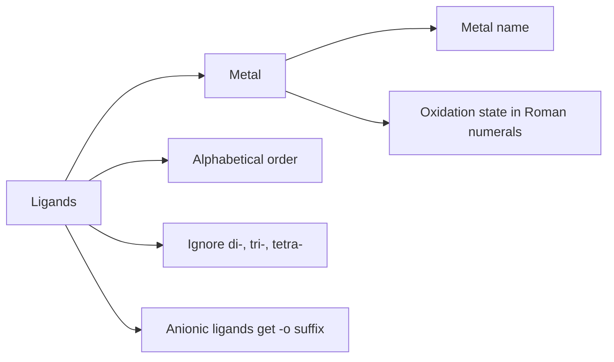

> Master the systematic naming of coordination compounds with step-by-step rules, tricks, and JEE-focused examples.

## Introduction

Naming coordination compounds can feel like learning a new language - and in many ways, it is! The International Union of Pure and Applied Chemistry (IUPAC) created systematic rules so that every chemist worldwide can understand the exact structure of a complex just from its name.

> **★ Key point · Drug Names and Coordination Chemistry**
>
> Ever wondered why cancer drug **cisplatin** is called “cis-platin”? It’s because of coordination chemistry nomenclature! The “cis” tells us that two chloride ligands are on the SAME side of the platinum atom. Its geometric isomer, “transplatin,” has them on opposite sides - and is completely inactive against cancer! One small naming detail = life-saving vs. useless. That’s why IUPAC nomenclature matters!

---

## The Golden Rules of Nomenclature

### Rule 1: Order of Writing

**Always write CATION before ANION** (just like NaCl, not ClNa)

Examples:

- [Co(NH₃)₆]Cl₃ → Hexaamminecobalt(III) **chloride**
- K₄[Fe(CN)₆] → Potassium **hexacyanidoferrate(II)**

### Rule 2: Inside the Coordination Sphere

**Ligands first, then metal**

Within ligands: **Alphabetical order** (ignore prefixes like di-, tri-)



### Rule 3: Ligand Naming

#### Neutral Ligands

Most keep their molecular names, except:

- H₂O → **aqua**
- NH₃ → **ammine** (note: double ’m')
- CO → **carbonyl**
- NO → **nitrosyl**

#### Anionic Ligands

Add **-o** suffix:

- Cl⁻ → chlorido
- CN⁻ → cyanido
- OH⁻ → hydroxido
- SO₄²⁻ → sulfato
- NO₂⁻ → nitrito

> **⚠ Trap · Don't Confuse!**
>
> **Ammine** (NH₃ ligand) vs. **Amine** (organic compound R-NH₂)

> **Nitrito** (NO₂⁻ ligand) vs. **Nitro** (NO₂ group in organic chemistry)

### Rule 4: Numerical Prefixes

| Number | Simple ligands | Complex ligands |
| --- | --- | --- |
| 2 | di- | bis- |
| 3 | tri- | tris- |
| 4 | tetra- | tetrakis- |
| 5 | penta- | pentakis- |
| 6 | hexa- | hexakis- |

**Use bis-, tris-, tetrakis- for:**

- Ligands with numbers already in them (ethylenediamine)
- Ligands in parentheses (CH₃)₂NH

### Rule 5: Metal Naming

**In cationic or neutral complexes:**
Use the element name + oxidation state in Roman numerals

**In anionic complexes:**
Add **-ate** suffix to the metal:

- Iron → ferrate
- Copper → cuprate
- Chromium → chromate
- Aluminum → aluminate

For some metals, use Latin names:

- Iron → ferrate (not ironate)
- Copper → cuprate (not copperate)
- Silver → argentate
- Gold → aurate
- Tin → stannate
- Lead → plumbate

---

## Common Ligands Quick Reference

### Neutral Ligands

| Ligand | Name | Example |
| --- | --- | --- |
| NH₃ | ammine | [Co(NH₃)₆]³⁺ = hexaamminecobalt(III) |
| H₂O | aqua | [Cr(H₂O)₆]³⁺ = hexaaquachromium(III) |
| CO | carbonyl | [Ni(CO)₄] = tetracarbonylnickel(0) |
| NO | nitrosyl | [Fe(H₂O)₅(NO)]²⁺ |
| py (pyridine) | pyridine | [Pt(py)₄]²⁺ |
| en (ethylenediamine) | ethylenediamine | [Co(en)₃]³⁺ |

### Anionic Ligands

| Ligand | Name | Example |
| --- | --- | --- |
| Cl⁻ | chlorido | [PtCl₆]²⁻ = hexachloridoplatinate(IV) |
| Br⁻ | bromido | [CoBr₄]²⁻ = tetrabromi docobaltate(II) |
| CN⁻ | cyanido | [Fe(CN)₆]⁴⁻ = hexacyanidoferrate(II) |
| OH⁻ | hydroxido | [Al(OH)₄]⁻ = tetrahydroxidoaluminate(III) |
| O²⁻ | oxido | [MnO₄]⁻ = tetraoxidomanganate(VII) |
| NO₂⁻ | nitrito-κN | [Co(NH₃)₅(NO₂)]²⁺ |
| ONO⁻ | nitrito-κO | [Co(NH₃)₅(ONO)]²⁺ |
| SCN⁻ | thiocyanato-κS | [Fe(NCS)₆]³⁻ |
| NCS⁻ | thiocyanato-κN | [Co(NH₃)₅(NCS)]²⁺ |

> **★ Key point · Ambidentate Ligands**
>
> For ligands that can bind through different atoms (ambidentate):
>
> - Use **κ** (kappa) to specify binding atom

> - **κN** = bonded through nitrogen

> - **κO** = bonded through oxygen

> - **κS** = bonded through sulfur

### Classification by Denticity

Denticity is the number of donor atoms through which a ligand binds the central metal. It decides the numerical prefix used in naming (bis/tris for chelating ligands).

| Denticity | Type | Examples |
| --- | --- | --- |
| 1 | Monodentate | Cl⁻, NH₃, H₂O, CN⁻, CO |
| 2 | Bidentate | en (ethylenediamine), ox²⁻ (oxalate), bpy (bipyridyl) |
| 3 | Tridentate | dien, terpyridine |
| 4 | Tetradentate | porphyrin |
| 6 | Hexadentate | EDTA⁴⁻ |

Polydentate ligands that form ring structures with the metal are called **chelates**.

---

## Step-by-Step Naming Process

### For Cationic/Neutral Complexes

**Step 1:** Write prefixes + ligand names (alphabetically)
**Step 2:** Write metal name
**Step 3:** Write oxidation state in Roman numerals in parentheses
**Step 4:** Add counter ion name (if any)

**Example:** [Cr(NH₃)₄Cl₂]Cl

1. Ligands: 4 NH₃ (tetraammine) + 2 Cl⁻ (dichloro)
2. Alphabetical: “a” before “c” → **tetraamminedichloro**
3. Metal: chromium
4. Oxidation state: +3
5. Counter ion: chloride

**Answer:** Tetraamminedichloridochromium(III) chloride

### For Anionic Complexes

Same as above, but metal name gets **-ate** suffix

**Example:** K₃[Fe(CN)₆]

1. Ligands: 6 CN⁻ (hexacyanido)
2. Metal: iron → **ferrate**
3. Oxidation state: +3
4. Cation: potassium

**Answer:** Potassium hexacyanidoferrate(III)

---

## Worked Examples

### Example 1: Simple Cationic Complex

**Formula:** [Co(NH₃)₆]Cl₃

**Step-by-step:**

- Ligands: 6 NH₃ → hexaammine
- Metal: cobalt
- Oxidation state: Let x be OS of Co
  - x + 6(0) = +3 (from 3 Cl⁻)
  - x = +3
- Counter ion: chloride

**Name:** Hexaamminecobalt(III) chloride

### Example 2: Mixed Ligands

**Formula:** [Pt(NH₃)₂Cl₂]

**Step-by-step:**

- Ligands: 2 NH₃ (diammine) + 2 Cl⁻ (dichloro)
- Alphabetical order: ammine before chloro
- Metal: platinum
- Oxidation state: 0 + 2(0) + 2(-1) = -2
  - For neutral complex: OS = +2
- No counter ion

**Name:** Diamminedichloridoplatinum(II)

### Example 3: Anionic Complex

**Formula:** K₄[Fe(CN)₆]

**Step-by-step:**

- Ligands: 6 CN⁻ → hexacyanido
- Metal: iron → ferrate (anionic complex)
- Oxidation state: 4(-1) + x + 6(-1) = 0
  - x = +2
- Cation: potassium

**Name:** Potassium hexacyanidoferrate(II)

### Example 4: Complex with Bidentate Ligand

**Formula:** [Co(en)₃]Cl₃

**Step-by-step:**

- Ligands: 3 en (ethylenediamine)
- Use “tris” for complex ligands: tris(ethylenediamine)
- Metal: cobalt
- Oxidation state: +3

**Name:** Tris(ethylenediamine)cobalt(III) chloride

### Example 5: Coordination Entity Only

**Formula:** [Ni(CO)₄]

**Step-by-step:**

- Ligands: 4 CO → tetracarbonyl
- Metal: nickel
- Oxidation state: 0 (neutral ligands, no counter ion)

**Name:** Tetracarbonylnickel(0)

### Example 6: Multiple Different Ligands

**Formula:** [Cr(H₂O)₄Cl₂]Cl

**Step-by-step:**

- Ligands: 4 H₂O (tetraaqua) + 2 Cl⁻ (dichloro)
- Alphabetical: aqua before chloro
- Metal: chromium
- Oxidation state: +3

**Name:** Tetraaquadichloridochromium(III) chloride

---

## Reverse Process: Writing Formulas from Names

### Example 1

**Name:** Hexaamminenickel(II) chloride

**Step-by-step:**

1. “Hexaammine” → 6 NH₃
2. “Nickel(II)” → Ni²⁺ central metal
3. “chloride” → Cl⁻ counter ion (outside coordination sphere)
4. Balance charge: [Ni(NH₃)₆]²⁺ needs 2 Cl⁻

**Formula:** [Ni(NH₃)₆]Cl₂

### Example 2

**Name:** Potassium hexacyanidoferrate(II)

**Step-by-step:**

1. “Potassium” → K⁺ counter ion
2. “Hexacyanido” → 6 CN⁻
3. “Ferrate(II)” → Fe²⁺ in anionic complex
4. Complex charge: Fe²⁺ + 6(-1) = -4
5. Need 4 K⁺

**Formula:** K₄[Fe(CN)₆]

---

## Memory Tricks

### The “ALAN” Rule

**A**nionic ligands get **-ido/-o**
**L**igands are listed **alphabetically**
**A**te suffix for **anionic** complexes
**N**umerical prefixes **ignored** in alphabetization

### Common Confusions Chart

| Write | DON’T Write | Why |
| --- | --- | --- |
| ammine | amine | NH₃ ligand needs double ’m' |
| chlorido | chloro | Modern IUPAC uses -ido |
| aqua | water | Specific name for H₂O ligand |
| hexaaqua | hexawater | Use proper ligand name |
| ferrate | ironate | Use Latin name |
| bis(en) | dien | “bis” for complex ligands |

### Oxidation State Trick

For neutral complex [M(ligands)]:

1. Sum charges of all ligands
2. OS of metal = -(sum)

For charged complex:

1. Let OS = x
2. x + (sum of ligand charges) = overall charge

---

## Common Mistakes

> **⚠ Trap · Mistake 1: Wrong Alphabetical Order**
>
> **Wrong:** Hexaamminedichloridocobalt(III) chloride

> **Right:** Hexaamminedichloridocobalt(III) chloride
>
> Wait - both look the same! That’s because it’s already correct. The mistake would be:

> **Wrong:** Dichlorohexaamminecobalt(III) chloride

> **Right:** Hexaamminedichloridocobalt(III) chloride
>
> Alphabetize by ligand name (ammine, chlorido), NOT by prefix (di-, hexa-)!

> **⚠ Trap · Mistake 2: Forgetting -ate for Anionic Complexes**
>
> **Wrong:** Potassium hexacyanidoiron(II)

> **Right:** Potassium hexacyanidoferrate(II)
>
> Anionic complexes MUST use -ate suffix (and often Latin names)!

> **⚠ Trap · Mistake 3: Including Cation in Complex Name**
>
> **Wrong:** [Sodium hexachloridoplatinate(IV)]

> **Right:** Sodium hexachloridoplatinate(IV)
>
> The cation name is separate, NOT part of the complex name!

> **⚠ Trap · Mistake 4: Wrong Counter Ion Placement**
>
> **Wrong:** [Co(NH₃)₆Cl₃]

> **Right:** [Co(NH₃)₆]Cl₃
>
> Counter ions stay OUTSIDE the square brackets!

---

## Practice Problems

### Level 1: Basic Naming

**Q1.** Name the following coordination compounds:
a) [Cu(NH₃)₄]SO₄
b) [Ag(NH₃)₂]Cl
c) K₃[Al(C₂O₄)₃]
d) [Co(NH₃)₅Cl]Cl₂
e) [Pt(NH₃)₂Cl(NO₂)]

**Q2.** Write formulas for:
a) Hexaammineplatinum(IV) chloride
b) Potassium trioxalatoaluminate(III)
c) Pentaamminechloridocobalt(III) chloride

### Level 2: Complex Scenarios

**Q3.** Name the following:
a) [Cr(H₂O)₅Cl]Cl₂·H₂O
b) [Co(en)₂(NO₂)₂]Cl
c) [Pt(py)₄][PtCl₄]
d) K₂[PtCl₆]
e) [Fe(H₂O)₅(NCS)]SO₄

**Q4.** Write formulas for:
a) Pentaamminenitrito-κN-cobalt(III) sulfate
b) Tris(ethylenediamine)chromium(III) chloride
c) Sodium tetrahydroxidozincate(II)

**Q5.** For [Cr(NH₃)₄Cl₂]NO₃:
a) Name the compound
b) What is the oxidation state of Cr?
c) What is the coordination number?
d) Identify the counter ion

### Level 3: JEE Advanced

**Q6.** A coordination compound has molecular formula CoCl₃·4NH₃. Two isomers exist:

- Isomer A gives 1 mole AgCl with AgNO₃
- Isomer B gives 2 moles AgCl with AgNO₃

Write structural formulas and IUPAC names for both isomers.

**Q7.** Identify the incorrect IUPAC name:
a) [Co(NH₃)₅(ONO)]Cl₂ - Pentaamminenitrito-κO-cobalt(III) chloride
b) K₃[Fe(CN)₆] - Potassium hexacyanidoiron(III)
c) [Pt(NH₃)₃Cl₃]Cl - Triamminetrichloridoplatinum(IV) chloride
d) [Cr(en)₃]Cl₃ - Tris(ethylenediamine)chromium(III) chloride

**Q8.** Write IUPAC names for:
a) [Co(NH₃)₅(H₂O)][NO₃]₃
b) [Pt(NH₃)₄Cl₂][PtCl₄]
c) Na₃[Co(NO₂)₆]

**Q9.** A complex compound has the formula PtCl₂·2NH₃. It can exist in two isomeric forms. One is used as an anticancer drug. Write:
a) Both possible structural formulas
b) IUPAC names for both
c) Which one is the anticancer drug and why?

> **↗ Connection · Quick Check**
>
> What is wrong with this name: “Diammoniumdichloroplatinum(II)”?

> (Hint: Three mistakes!)

---

## Solutions to Selected Problems

**Q1.**
a) Tetraamminecopper(II) sulfate
b) Diammine silver(I) chloride
c) Potassium trioxalatoaluminate(III)
d) Pentaamminechloridocobalt(III) chloride
e) Diamminechloridonitr oplatinum(II)

**Q2.**
a) [Pt(NH₃)₆]Cl₄
b) K₃[Al(C₂O₄)₃]
c) [Co(NH₃)₅Cl]Cl₂

**Q5.**
a) Tetraamminedichloridochromium(III) nitrate
b) +3
c) 6
d) NO₃⁻

**Q6.**

- Isomer A: [Co(NH₃)₄Cl₂]Cl - Tetraamminedichloridocobalt(III) chloride
- Isomer B: [Co(NH₃)₄Cl]Cl₂ - (This formula doesn’t give CN=6; question might have error)

**Q7.** b) is incorrect. Should be “Potassium hexacyanidoferrate(III)” (use -ate for anionic complex)

**Q9.**
a) cis-[Pt(NH₃)₂Cl₂] and trans-[Pt(NH₃)₂Cl₂]
b) cis-Diamminedichloridoplatinum(II) and trans-Diamminedichloridoplatinum(II)
c) cis-isomer (cisplatin) is the anticancer drug because the geometry allows it to bind DNA effectively

---

## Special Cases and Advanced Topics

### Bridging Ligands

When a ligand bridges two metal centers, use **μ** (mu):

**Example:** [(NH₃)₅Cr-OH-Cr(NH₃)₅]Cl₅
**Name:** μ-Hydroxidobis[pentaamminechromium(III)] chloride

### Polynuclear Complexes

Use bis, tris, etc., for the entire complex units:

**Example:** [{Co(NH₃)₅}₂(μ-OH)]Cl₅
**Name:** μ-Hydroxidobis[pentaamminecobalt(III)] chloride

---

## Why Nomenclature Matters

1. **Unambiguous communication:** Scientists worldwide understand exact structure
2. **Drug development:** Cisplatin vs transplatin - only one works!
3. **Safety:** Some isomers are toxic, others safe
4. **Research:** Precise naming enables reproducible science
5. **JEE exams:** 3-5 marks guaranteed in every paper!

> **◐ In simple terms · Real-World Application**
>
> In 2007, a pharmaceutical company nearly lost $50 million because two research teams were working on the SAME compound but using different non-systematic names. They didn’t realize it until months later. IUPAC nomenclature prevents such disasters!

---

## Related Topics

### Within Coordination Compounds

- [Werner’s Theory](../werners-theory/index.md) — Foundation of coordination chemistry
- [Isomerism](../isomerism/index.md) — Why cis- and trans- prefixes matter
- [Bonding Theories](../bonding-theories/index.md) — Understanding coordination numbers

### Cross-Chapter Connections

- [Chemical Bonding](../../chemical-bonding/index.md) — Coordinate covalent bonds
- [Organic Chemistry](../../organic-principles/index.md) — Similar naming conventions
- [d-Block Elements](../../d-f-block-elements/index.md) — Common metals in complexes

### Interactive Demo: Visualize Coordination Complex Structures

See 3D structures of coordination compounds and understand ligand arrangements.

---

From TestGuru · our mock-test platform

## You've read IUPAC Nomenclature of Coordination Compounds.You've read this topic. Find out what you actually got.

A free JEE Main mock with this chapter in it, and a report that shows which sub-topics cost you marks.

[Take a free JEE Main mock →](https://app.testguru.co/signup?tg_chapter=coordination-compounds&tg_exam=jee-main&tg_page=%2Fchemistry%2Fcoordination-compounds%2Fnomenclature%2F&tg_subject=chemistry&utm_campaign=notes-jee-main-free-test&utm_content=article-end&utm_medium=referral&utm_source=jeenotes)
Free, no card. Opens TestGuru in a new tab.

## Stay exam-ready

One email every Sunday: new notes, the week's hardest challenge question and a revision plan.One email every Sunday.

## Comments

Have a question or spotted a mistake? Join the discussion below.

Advertisement

Advertisement

---

## Extracted page code (interactive scripts & widgets)


### inline-script-16

```js
if(!document.getElementById("animation-fullscreen-overlay")){const e=document.createElement("div");e.id="animation-fullscreen-overlay",e.className="animation-fullscreen-overlay",e.innerHTML=`
      <div class="fullscreen-modal">
        <div class="fullscreen-header">
          <span class="fullscreen-title">Interactive Demo</span>
          <button class="fullscreen-close-btn" onclick="JEEAnimations.closeFullscreen()" title="Close (Esc)" aria-label="Close fullscreen">
            <svg width="24" height="24" viewBox="0 0 24 24" fill="none" stroke="currentColor" stroke-width="2" stroke-linecap="round" stroke-linejoin="round">
              <line x1="18" y1="6" x2="6" y2="18"></line>
              <line x1="6" y1="6" x2="18" y2="18"></line>
            </svg>
          </button>
        </div>
        <div class="fullscreen-content"></div>
      </div>
    `,document.body.appendChild(e),document.addEventListener("keydown",function(e){e.key==="Escape"&&document.body.classList.contains("animation-fullscreen-active")&&JEEAnimations.closeFullscreen()}),e.addEventListener("click",function(t){t.target===e&&JEEAnimations.closeFullscreen()})}
```


### inline-script-17

```js
(function(){var t,e=document.getElementById("disqus-load");if(!e)return;t=!1,e.addEventListener("click",function(){if(t)return;t=!0,e.setAttribute("disabled","disabled"),e.textContent="Loading comments…",window.disqus_config=function(){this.page.url="https://jeenotes.in/chemistry/coordination-compounds/nomenclature/",this.page.identifier="/chemistry/coordination-compounds/nomenclature/"};var s=document,n=s.createElement("script");n.src="https://https-jeenotes-in.disqus.com/embed.js",n.setAttribute("data-timestamp",+new Date),n.onload=function(){e.style.display="none"},n.onerror=function(){t=!1,e.removeAttribute("disabled"),e.textContent="Could not load comments. Tap to retry"},(s.head||s.body).appendChild(n)})})()
```


### inline-script-18

```js
(function(){var t,e=document.currentScript.previousElementSibling;function n(){(window.adsbygoogle=window.adsbygoogle||[]).push({})}if(!window.ResizeObserver||e.clientWidth>0){n();return}t=new ResizeObserver(function(){e.clientWidth>0&&(t.disconnect(),n())}),t.observe(e)})()
```


### interactive-widget-1

```html
<div class="animation-wrapper" data-animation="molecularStructure" id="anim-molecularStructure-1795396419482466223"><div class="animation-header"><button aria-label="Toggle fullscreen" class="anim-fullscreen-btn" onclick='JEEAnimations.toggleFullscreen("anim-molecularStructure-1795396419482466223")' title="Fullscreen (F)">
<svg class="fullscreen-icon-expand" fill="none" height="18" stroke="currentColor" stroke-linecap="round" stroke-linejoin="round" stroke-width="2" viewbox="0 0 24 24" width="18"><polyline points="15 3 21 3 21 9"></polyline><polyline points="9 21 3 21 3 15"></polyline><line x1="21" x2="14" y1="3" y2="10"></line><line x1="3" x2="10" y1="21" y2="14"></line></svg>
<svg class="fullscreen-icon-collapse" fill="none" height="18" stroke="currentColor" stroke-linecap="round" stroke-linejoin="round" stroke-width="2" viewbox="0 0 24 24" width="18"><polyline points="4 14 10 14 10 20"></polyline><polyline points="20 10 14 10 14 4"></polyline><line x1="14" x2="21" y1="10" y2="3"></line><line x1="3" x2="10" y1="21" y2="14"></line></svg>
<span class="fullscreen-text">Fullscreen</span></button></div><div class="animation-content"><noscript><div class="callout callout-warning"><div class="callout-title">JavaScript Required</div><p>This interactive animation requires JavaScript to be enabled.</p></div></noscript></div></div>
```


---

_Source: [https://jeenotes.in/chemistry/coordination-compounds/nomenclature/](https://jeenotes.in/chemistry/coordination-compounds/nomenclature/) · raw HTML: `offline/chemistry/coordination-compounds/nomenclature/index.html`_
