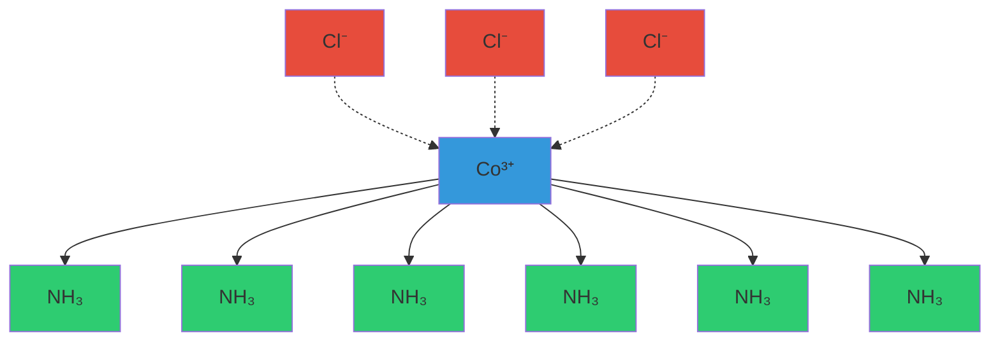

> Master Werner's groundbreaking theory, primary and secondary valencies, and the foundation of coordination chemistry for JEE.

## Introduction

In 1893, **Alfred Werner** revolutionized chemistry by proposing a theory that explained the mysterious “complex compounds” that had puzzled chemists for decades. His work was so groundbreaking that he became the first inorganic chemist to win the Nobel Prize in Chemistry (1913).

> **★ Key point · The Blue Blood Mystery**
>
> Ever heard that horseshoe crabs have blue blood? That’s coordination chemistry in action! While our blood is red due to iron-based hemoglobin (Fe²⁺ coordinated with nitrogen atoms), horseshoe crab blood uses copper-based hemocyanin (Cu⁺ coordinated with oxygen). Werner’s theory explains how metals bind to specific atoms in biological molecules - the same principles apply whether it’s crab blood, human blood, or the chlorophyll that makes plants green!

---

## The Mystery Before Werner

Before 1893, chemists were puzzled by compounds like:

- CoCl₃·6NH₃ (yellow crystals)
- CoCl₃·5NH₃ (purple crystals)
- CoCl₃·4NH₃ (green/purple crystals)

**Questions that needed answers:**

1. Why do these compounds exist?
2. Why do they have different colors despite similar formulas?
3. How are NH₃ molecules attached to CoCl₃?
4. Why do they show different conductivities?

---

## Werner’s Brilliant Insight

Werner realized that metal atoms have **TWO types of valencies**:

### Primary Valency (Ionizable)

- Satisfied by **negative ions** (anions)
- Corresponds to the **oxidation state** of the metal
- Shows **ionic** character
- **Non-directional** in nature
- Represented by **dotted lines** in diagrams

### Secondary Valency (Non-ionizable)

- Satisfied by **ligands** (neutral molecules or anions)
- Equals the **coordination number**
- Shows **covalent** character
- **Directional** in nature - leads to specific geometry
- Represented by **solid lines** in diagrams

> **★ Key point · Key Difference**
>
> **Primary valency** = Oxidation state (charge balance)

> **Secondary valency** = Coordination number (actual bonds formed)

---

## Werner’s Postulates

### Postulate 1: Dual Valencies

Metals exhibit two types of linkages in coordination compounds - primary and secondary valencies.

### Postulate 2: Primary Valency

- **Ionizable** valency
- Satisfied by negative ions
- Depends on the **oxidation state** of metal
- Non-directional

### Postulate 3: Secondary Valency

- **Non-ionizable** valency
- Satisfied by neutral molecules or negative ions
- Equals the **coordination number**
- **Directional** - gives definite geometry
- Fixed for a particular metal

### Postulate 4: Spatial Arrangement

The ligands attached through secondary valencies are arranged in **specific geometrical patterns** around the central metal:

| Coordination Number | Geometry |
| --- | --- |
| 2 | Linear |
| 4 | Tetrahedral or Square planar |
| 6 | Octahedral |

---

## Understanding Through Examples

### Example 1: CoCl₃·6NH₃ (Yellow)

**Werner’s Interpretation:**

```fallback
[Co(NH₃)₆]Cl₃
```

**Analysis:**

- **Primary valency** of Co³⁺ = **3** (satisfied by 3 Cl⁻ ions)
  - These 3 Cl⁻ are **outside** the coordination sphere
  - They ionize in solution
- **Secondary valency** of Co³⁺ = **6** (satisfied by 6 NH₃)
  - These 6 NH₃ are **inside** the coordination sphere
  - They form coordinate bonds
- **Geometry:** Octahedral
- **Conductivity:** High (produces 4 ions: 1 cation + 3 anions)

### Interactive Demo: Visualize Werner’s Complex Structures

See how ligands arrange around the central metal atom in 3D coordination complexes.



### Example 2: CoCl₃·5NH₃ (Purple)

**Werner’s Interpretation:**

```fallback
[Co(NH₃)₅Cl]Cl₂
```

**Analysis:**

- **Primary valency** = 3 (but only 2 Cl⁻ outside)
  - 1 Cl⁻ is inside the coordination sphere
- **Secondary valency** = 6 (5 NH₃ + 1 Cl⁻)
- **Geometry:** Octahedral
- **Conductivity:** Moderate (produces 3 ions: 1 cation + 2 anions)

### Example 3: CoCl₃·4NH₃ (Green/Purple)

**Werner’s Interpretation:**

```fallback
[Co(NH₃)₄Cl₂]Cl
```

**Analysis:**

- **Primary valency** = 3 (only 1 Cl⁻ outside)
- **Secondary valency** = 6 (4 NH₃ + 2 Cl⁻)
- **Geometry:** Octahedral
- **Conductivity:** Low (produces 2 ions: 1 cation + 1 anion)
- **Shows isomerism** (cis and trans forms)

---

## Experimental Evidence Supporting Werner

### 1. Conductivity Measurements

Werner measured the molar conductivity of these compounds:

| Compound | Formula | Ions Produced | Conductivity |
| --- | --- | --- | --- |
| CoCl₃·6NH₃ | [Co(NH₃)₆]Cl₃ | 4 ions | Highest |
| CoCl₃·5NH₃ | [Co(NH₃)₅Cl]Cl₂ | 3 ions | High |
| CoCl₃·4NH₃ | [Co(NH₃)₄Cl₂]Cl | 2 ions | Moderate |
| CoCl₃·3NH₃ | [Co(NH₃)₃Cl₃] | 0 ions | Non-conducting |

> **◐ In simple terms · The Conductivity Test**
>
> This was Werner’s smoking gun! The conductivity perfectly matched the number of ions predicted by his theory. If traditional theories were right, all these compounds should conduct equally - but they didn’t!

### 2. Precipitation with AgNO₃

When treated with AgNO₃ solution, only the Cl⁻ ions **outside** the coordination sphere precipitate as AgCl:

| Compound | AgCl Precipitated |
| --- | --- |
| [Co(NH₃)₆]Cl₃ | 3 moles |
| [Co(NH₃)₅Cl]Cl₂ | 2 moles |
| [Co(NH₃)₄Cl₂]Cl | 1 mole |
| [Co(NH₃)₃Cl₃] | 0 moles |

### 3. Isomerism Studies

Werner predicted and synthesized **geometric isomers** of [Co(NH₃)₄Cl₂]Cl:

- **cis** isomer (green)
- **trans** isomer (purple)

This proved the **octahedral geometry** and directional nature of secondary valency!

---

## Modern Understanding

Today, we understand Werner’s theory in modern terms:

| Werner’s Term | Modern Term |
| --- | --- |
| Primary valency | Oxidation state/Ionic bonds |
| Secondary valency | Coordination number/Coordinate bonds |
| Coordination sphere | Complex ion |
| Central atom | Metal center |

---

## Memory Tricks

### The “PSIN” Rule

**P**rimary = **S**tate of oxidation = **I**onizable = **N**on-directional

**S**econdary = **S**patial arrangement = **S**table bonds = **S**pecific geometry

### Counting Ions Trick

For [M(ligands)ₓ]Yₙ:

- **Cation ions** = 1
- **Anion ions** = n
- **Total ions** = n + 1

Example: [Co(NH₃)₆]Cl₃ → 1 + 3 = **4 ions**

---

## Common Mistakes

> **⚠ Trap · Mistake 1: Confusing Valencies**
>
> **Wrong:** “CoCl₃·6NH₃ has coordination number 9”

> **Right:** Coordination number = 6 (only counts ligands in coordination sphere)

> Primary valency = 3 (oxidation state of Co)

> **⚠ Trap · Mistake 2: Counting all Cl atoms**
>
> **Wrong:** “In [Co(NH₃)₅Cl]Cl₂, all 3 Cl⁻ will precipitate with AgNO₃”

> **Right:** Only 2 Cl⁻ precipitate (outside coordination sphere). The Cl⁻ inside is tightly bound and won’t react.

> **⚠ Trap · Mistake 3: Assuming all ligands are neutral**
>
> **Wrong:** “Ligands are always neutral molecules”

> **Right:** Ligands can be neutral (NH₃, H₂O) OR anions (Cl⁻, CN⁻). Both satisfy secondary valency!

---

## Practice Problems

### Level 1: Basic Understanding

**Q1.** Identify the primary and secondary valencies in:
a) [Cr(NH₃)₆]Cl₃
b) K₄[Fe(CN)₆]
c) [Pt(NH₃)₂Cl₂]

**Q2.** How many ions are produced when [Co(NH₃)₅Br]SO₄ dissolves in water?

**Q3.** How many moles of AgCl will precipitate when excess AgNO₃ is added to 1 mole of [Co(NH₃)₄Cl₂]Cl?

### Level 2: Application

**Q4.** A coordination compound of chromium has the formula CrCl₃·5H₂O. Upon treatment with excess AgNO₃, 2 moles of AgCl precipitate per mole of compound. Write:
a) The correct structural formula
b) The IUPAC name

**Q5.** Two compounds have the formula PtCl₄·2NH₃. One is yellow and non-conducting, while the other is pale yellow and conducts electricity. Explain using Werner’s theory and write their structural formulas.

**Q6.** A complex of cobalt(III) with formula CoCl₃·4NH₃ exists in two isomeric forms (violet and green). One form produces 1 mole of AgCl with AgNO₃ while the other produces 2 moles. Explain with structures.

### Level 3: JEE Advanced

**Q7.** A coordination compound with molecular formula CrCl₃·6H₂O gives:

- No precipitate with AgNO₃
- Produces 2 ions in solution (molar conductivity similar to CaCl₂)

Write the structural formula and explain the bonding.

**Q8.** How would you experimentally distinguish between:

- [Co(NH₃)₆][Cr(CN)₆]
- [Cr(NH₃)₆][Co(CN)₆]

**Q9.** A platinum(IV) compound has the molecular formula PtCl₄·2NH₃·2KCl. Werner proposed three possible structures. Using conductivity and precipitation experiments, how would you determine the actual structure?

> **↗ Connection · Quick Check**
>
> Why can’t we write [Co(NH₃)₆]³⁺ as Co(NH₃)₆Cl₃? What critical information would be lost?

---

## Solutions to Selected Problems

**Q1.**
a) Primary = 3, Secondary = 6
b) Primary = 2, Secondary = 6
c) Primary = 2, Secondary = 4

**Q2.** 2 ions ([Co(NH₃)₅Br]²⁺ and SO₄²⁻)

**Q3.** 1 mole of AgCl

**Q4.**
a) [Cr(H₂O)₅Cl]Cl₂·H₂O
b) Pentaaquachloridochromium(III) chloride monohydrate

---

## Historical Impact

Werner’s theory:

- Explained the structure of thousands of “complex” compounds
- Predicted and confirmed geometric isomerism
- Laid foundation for understanding biological molecules
- Led to the development of coordination chemistry as a field
- Earned Werner the **Nobel Prize in Chemistry (1913)**

> **◐ In simple terms · Fun Fact**
>
> Werner was so confident in his octahedral structure that he predicted optical isomers would exist for certain cobalt complexes. It took him 10 years to finally synthesize and resolve these isomers, proving his theory beyond doubt!

---

## Related Topics

### Within Coordination Compounds

- [Nomenclature](../nomenclature/index.md) — How to name coordination compounds systematically
- [Isomerism](../isomerism/index.md) — Geometric and optical isomers Werner predicted
- [Bonding Theories](../bonding-theories/index.md) — Modern explanation using VBT

### Cross-Chapter Connections

- [d-Block Elements](../../d-f-block-elements/index.md) — Properties of transition metals
- [Chemical Bonding](../../chemical-bonding/index.md) — Coordinate covalent bonds
- [Ionic Equilibrium](../../equilibrium/index.md) — Conductivity and ion formation

---

**[Coordination Compounds](../../index.md) | [Nomenclature →](../nomenclature/index.md)**

From TestGuru · our mock-test platform

## You've read Werner's Theory of Coordination Compounds.You've read this topic. Find out what you actually got.

A free JEE Main mock with this chapter in it, and a report that shows which sub-topics cost you marks.

[Take a free JEE Main mock →](https://app.testguru.co/signup?tg_chapter=coordination-compounds&tg_exam=jee-main&tg_page=%2Fchemistry%2Fcoordination-compounds%2Fwerners-theory%2F&tg_subject=chemistry&utm_campaign=notes-jee-main-free-test&utm_content=article-end&utm_medium=referral&utm_source=jeenotes)
Free, no card. Opens TestGuru in a new tab.

## Stay exam-ready

One email every Sunday: new notes, the week's hardest challenge question and a revision plan.One email every Sunday.

## Comments

Have a question or spotted a mistake? Join the discussion below.

Advertisement

Advertisement

---

## Extracted page code (interactive scripts & widgets)


### inline-script-16

```js
if(!document.getElementById("animation-fullscreen-overlay")){const e=document.createElement("div");e.id="animation-fullscreen-overlay",e.className="animation-fullscreen-overlay",e.innerHTML=`
      <div class="fullscreen-modal">
        <div class="fullscreen-header">
          <span class="fullscreen-title">Interactive Demo</span>
          <button class="fullscreen-close-btn" onclick="JEEAnimations.closeFullscreen()" title="Close (Esc)" aria-label="Close fullscreen">
            <svg width="24" height="24" viewBox="0 0 24 24" fill="none" stroke="currentColor" stroke-width="2" stroke-linecap="round" stroke-linejoin="round">
              <line x1="18" y1="6" x2="6" y2="18"></line>
              <line x1="6" y1="6" x2="18" y2="18"></line>
            </svg>
          </button>
        </div>
        <div class="fullscreen-content"></div>
      </div>
    `,document.body.appendChild(e),document.addEventListener("keydown",function(e){e.key==="Escape"&&document.body.classList.contains("animation-fullscreen-active")&&JEEAnimations.closeFullscreen()}),e.addEventListener("click",function(t){t.target===e&&JEEAnimations.closeFullscreen()})}
```


### inline-script-17

```js
(function(){var t,e=document.getElementById("disqus-load");if(!e)return;t=!1,e.addEventListener("click",function(){if(t)return;t=!0,e.setAttribute("disabled","disabled"),e.textContent="Loading comments…",window.disqus_config=function(){this.page.url="https://jeenotes.in/chemistry/coordination-compounds/werners-theory/",this.page.identifier="/chemistry/coordination-compounds/werners-theory/"};var s=document,n=s.createElement("script");n.src="https://https-jeenotes-in.disqus.com/embed.js",n.setAttribute("data-timestamp",+new Date),n.onload=function(){e.style.display="none"},n.onerror=function(){t=!1,e.removeAttribute("disabled"),e.textContent="Could not load comments. Tap to retry"},(s.head||s.body).appendChild(n)})})()
```


### inline-script-18

```js
(function(){var t,e=document.currentScript.previousElementSibling;function n(){(window.adsbygoogle=window.adsbygoogle||[]).push({})}if(!window.ResizeObserver||e.clientWidth>0){n();return}t=new ResizeObserver(function(){e.clientWidth>0&&(t.disconnect(),n())}),t.observe(e)})()
```


### interactive-widget-1

```html
<div class="animation-wrapper" data-animation="molecularStructure" id="anim-molecularStructure-1795396419477553514"><div class="animation-header"><button aria-label="Toggle fullscreen" class="anim-fullscreen-btn" onclick='JEEAnimations.toggleFullscreen("anim-molecularStructure-1795396419477553514")' title="Fullscreen (F)">
<svg class="fullscreen-icon-expand" fill="none" height="18" stroke="currentColor" stroke-linecap="round" stroke-linejoin="round" stroke-width="2" viewbox="0 0 24 24" width="18"><polyline points="15 3 21 3 21 9"></polyline><polyline points="9 21 3 21 3 15"></polyline><line x1="21" x2="14" y1="3" y2="10"></line><line x1="3" x2="10" y1="21" y2="14"></line></svg>
<svg class="fullscreen-icon-collapse" fill="none" height="18" stroke="currentColor" stroke-linecap="round" stroke-linejoin="round" stroke-width="2" viewbox="0 0 24 24" width="18"><polyline points="4 14 10 14 10 20"></polyline><polyline points="20 10 14 10 14 4"></polyline><line x1="14" x2="21" y1="10" y2="3"></line><line x1="3" x2="10" y1="21" y2="14"></line></svg>
<span class="fullscreen-text">Fullscreen</span></button></div><div class="animation-content"><noscript><div class="callout callout-warning"><div class="callout-title">JavaScript Required</div><p>This interactive animation requires JavaScript to be enabled.</p></div></noscript></div></div>
```


---

_Source: [https://jeenotes.in/chemistry/coordination-compounds/werners-theory/](https://jeenotes.in/chemistry/coordination-compounds/werners-theory/) · raw HTML: `offline/chemistry/coordination-compounds/werners-theory/index.html`_
