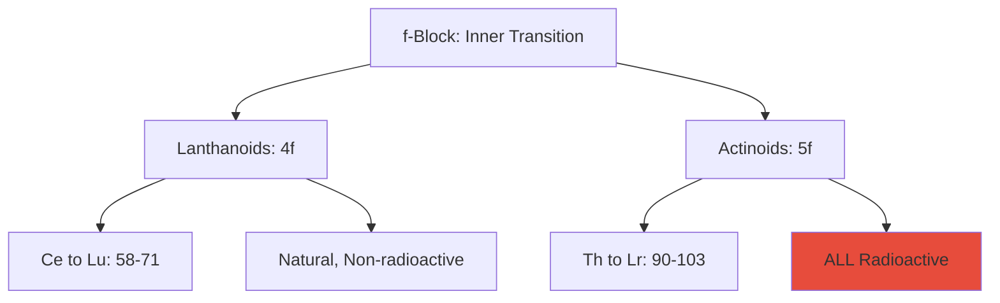
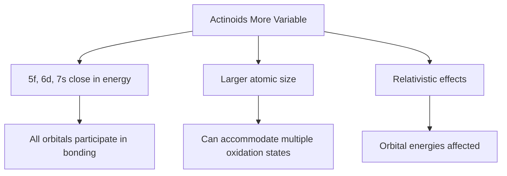

> Master actinoid properties, radioactivity, oxidation states, actinoid contraction, and comparison with lanthanoids for JEE Chemistry.

## Introduction

**Actinoids** (also called actinides) are the 14 radioactive elements in the **5f series** - from Thorium (Th) to Lawrencium (Lr). These are the heaviest naturally occurring elements, and most are synthetic! They’re crucial for nuclear energy and weapons.

> **★ Key point · Oppenheimer's Atomic Legacy**
>
> *Oppenheimer* (2023) dramatizes the Manhattan Project’s race to harness actinoid elements! The film shows how uranium-235 and plutonium-239 (actinoids) were enriched and purified to create atomic weapons. The chemistry you learn here - separation techniques, oxidation states, radioactive decay - was literally used to change world history. Understanding actinoids means understanding the atomic age!

---

## Position in Periodic Table

**Actinoid Series:**

- **Elements:** Th (90) to Lr (103) - **14 elements**
- **Also includes:** Actinium (Ac, 89) - often grouped with them
- **Period:** 7th period
- **Block:** f-block (5f orbitals being filled)



**In Periodic Table:**

- Placed **below** lanthanoids
- Interrupt the 6d series
- Ac → 5f fills → Lr → 6d continues

### Interactive Demo: Visualize Actinoid Elements in Periodic Table

Explore the position of actinoids and their electronic configurations.

---

## Electronic Configuration

### General Configuration

$$\boxed{[Rn] \, 5f^{0-14} \, 6d^{0-2} \, 7s^2}$$

**Complete Electronic Configurations:**

| Element | Z | Symbol | Electronic Configuration | f-electrons | Half-life |
| --- | --- | --- | --- | --- | --- |
| Actinium | 89 | Ac | [Rn]6d¹7s² | 0 | 21.8 years |
| **Thorium** | 90 | Th | [Rn]6d²7s² | 0 | 1.4×10¹⁰ y |
| Protactinium | 91 | Pa | [Rn]5f²6d¹7s² | 2 | 3.3×10⁴ y |
| **Uranium** | 92 | U | [Rn]5f³6d¹7s² | 3 | 4.5×10⁹ y |
| Neptunium | 93 | Np | [Rn]5f⁴6d¹7s² | 4 | 2.1×10⁶ y |
| **Plutonium** | 94 | Pu | [Rn]5f⁶7s² | 6 | 2.4×10⁴ y |
| Americium | 95 | Am | [Rn]5f⁷7s² | 7 | 7370 y |
| **Curium** | 96 | Cm | [Rn]5f⁷6d¹7s² | 7 | 1.6×10⁷ y |
| Berkelium | 97 | Bk | [Rn]5f⁹7s² | 9 | 1380 y |
| Californium | 98 | Cf | [Rn]5f¹⁰7s² | 10 | 898 y |
| Einsteinium | 99 | Es | [Rn]5f¹¹7s² | 11 | 472 days |
| Fermium | 100 | Fm | [Rn]5f¹²7s² | 12 | 100 days |
| Mendelevium | 101 | Md | [Rn]5f¹³7s² | 13 | 52 days |
| Nobelium | 102 | No | [Rn]5f¹⁴7s² | 14 | 58 min |
| **Lawrencium** | 103 | Lr | [Rn]5f¹⁴6d¹7s² | 14 | 27 sec |

**Irregularities:**

The filling of 5f and 6d orbitals is **VERY irregular** because:

1. 5f, 6d, and 7s orbitals have **very similar energies**
2. Relativistic effects become significant
3. Nuclear instability affects electronic structure

> **★ Key point · JEE Key Point**
>
> **ALL actinoids are radioactive!**
>
> Even the “stable” ones like Th and U are radioactive, just with very long half-lives. This is the fundamental difference from lanthanoids.
>
> - **Natural actinoids:** Th, Pa, U (primordial)

> - **Synthetic actinoids:** Np onwards (made in reactors/accelerators)

---

## General Characteristics

### 1. Radioactivity

**ALL actinoid elements are radioactive** - the defining characteristic!

**Types of Decay:**

- **α-decay:** Emission of He²⁺ nucleus (most common)
- **β-decay:** Electron emission
- **Spontaneous fission:** Heavy nuclei split

**Examples:**

$$^{238}U \rightarrow ^{234}Th + ^4He \quad \text{(α-decay)}$$

$$^{239}Pu \rightarrow ^{235}U + ^4He \quad \text{(α-decay)}$$

**Natural vs Synthetic:**

| Natural | Synthetic |
| --- | --- |
| Th-232 | Np-237 onwards |
| Pa-231 | Transuranic elements |
| U-235, U-238 | Made in nuclear reactors |

**Half-lives:**

- **Th-232:** 1.4 × 10¹⁰ years (longer than Earth’s age!)
- **U-238:** 4.5 × 10⁹ years
- **Pu-239:** 24,000 years
- **Nobelium:** 58 minutes
- **Lawrencium:** 27 seconds

### 2. Oxidation States

**Actinoids show MUCH MORE variable oxidation states** than lanthanoids!

**Range:** +3 to +7 (much broader than lanthanoids)

**Oxidation State Chart:**

| Element | Common OS | Range | Most Stable |
| --- | --- | --- | --- |
| **Ac** | +3 | +3 | +3 |
| **Th** | **+4** | +3, +4 | +4 |
| **Pa** | +5 | +3, +4, +5 | +5 |
| **U** | +4, **+6** | +3, +4, +5, +6 | +6 (in UO₂²⁺) |
| **Np** | +5 | +3, +4, +5, +6, +7 | +5 |
| **Pu** | +4 | +3, +4, +5, +6, +7 | +4 |
| **Am** | +3 | +3, +4, +5, +6 | +3 |
| **Cm** | +3 | +3, +4 | +3 |
| **Later** | +3 | +3 | +3 |

**Trends:**

1. **Early actinoids (Th-Pu):** Show +4, +5, +6, +7 states
2. **Later actinoids (Am onwards):** Predominantly +3 (like lanthanoids)
3. **+3 state becomes more stable** across the series

**Why more variable than lanthanoids?**

1. 5f, 6d, 7s orbitals have **similar energies**
2. All three can participate in bonding
3. Larger atomic size allows multiple states
4. Less shielding → electrons more available

> **★ Key point · Memory Trick**
>
> **“Thu-4, U-6, Am-3”** for common oxidation states:
>
> - **Thorium:** +4

> - **Uranium:** +6 (as UO₂²⁺)

> - **Americium onwards:** +3 (like lanthanoids)
>
> Early actinoids are variable, later ones stick to +3!

### 3. Actinoid Contraction

Similar to lanthanoid contraction, but **more irregular**.

$$\boxed{\text{Ionic size: } Th^{4+} > Pa^{4+} > U^{4+} > ... > Lr^{3+}}$$

**Cause:**

- Poor shielding by 5f electrons
- Increasing effective nuclear charge
- Pulls outer electrons closer

**Difference from Lanthanoid Contraction:**

- More **irregular** due to variable oxidation states
- Less pronounced per element
- Complicated by nuclear instability

### 4. Magnetic Properties

**Most actinoids are paramagnetic** due to unpaired 5f electrons.

**Examples:**

- U³⁺ (5f³): 3 unpaired e⁻, paramagnetic
- U⁴⁺ (5f²): 2 unpaired e⁻, paramagnetic
- Pu⁴⁺ (5f⁴): 4 unpaired e⁻, paramagnetic

**Complexity:**

- Magnetic moments don’t follow simple formulas
- Orbital contributions are significant
- Spin-orbit coupling is strong

### 5. Color

**Actinoid ions are deeply colored** (more intense than lanthanoids).

**Colors in Aqueous Solution:**

| Ion | Color | Ion | Color |
| --- | --- | --- | --- |
| U³⁺ | Red | Pu³⁺ | Blue-violet |
| U⁴⁺ | Green | Pu⁴⁺ | Yellow-brown |
| UO₂²⁺ | Yellow | PuO₂²⁺ | Pink |
| Np³⁺ | Purple | Am³⁺ | Pink |
| Np⁴⁺ | Yellow-green | Cm³⁺ | Colorless |

**Why deeper colors than lanthanoids?**

- 5f-5f transitions
- 5f-6d transitions (possible due to energy similarity)
- Charge-transfer transitions
- More intense absorption

### 6. Complex Formation

**Actinoids form complexes MORE readily** than lanthanoids.

**Reasons:**

1. Higher oxidation states (+4, +5, +6)
2. Larger charge → stronger electrostatic attraction
3. 5f, 6d orbitals can participate in bonding
4. Greater covalent character

**Important Complexes:**

| Complex | Name | Use |
| --- | --- | --- |
| UO₂(NO₃)₂ | Uranyl nitrate | Fuel processing |
| [UF₆] | Uranium hexafluoride | U-235 enrichment |
| [PuF₆] | Plutonium hexafluoride | Pu separation |
| ThF₄ | Thorium fluoride | Nuclear reactors |

**Coordination Numbers:**

- Usually high: 6, 8, 10, 12
- Due to large ionic size
- Depends on oxidation state

### 7. Chemical Reactivity

**Actinoids are quite reactive** (similar to lanthanoids).

**Reactions:**

**With air/oxygen:**

$$4Ac + 3O_2 \rightarrow 2Ac_2O_3$$

**With water:**

$$2Ac + 6H_2O \rightarrow 2Ac(OH)_3 + 3H_2$$

**With acids:**

$$2Ac + 6HCl \rightarrow 2AcCl_3 + 3H_2$$

**With halogens:**

$$Th + 2F_2 \rightarrow ThF_4$$

**Reactivity decreases** across the series (like lanthanoids).

---

## Important Actinoid Elements

### 1. Thorium (Th, Z=90)

**Properties:**

- Most abundant actinoid
- Silvery-white metal
- Oxidation state: +4
- Less radioactive (very long half-life)

**Occurrence:**

- Monazite sand (ThO₂)
- More abundant than uranium

**Uses:**

- **Nuclear fuel** (Th-232 → U-233 breeding)
- **Gas mantles** (thoriated tungsten)
- **Alloys** (Mg-Th alloys)

**Compounds:**

- ThO₂: Refractory material (m.p. 3300°C)
- ThF₄: Nuclear applications

### 2. Uranium (U, Z=92)

**Properties:**

- Silvery-white, dense, radioactive metal
- Common oxidation states: +4, +6
- Three natural isotopes: U-234, U-235, U-238

**Isotopes:**

- **U-238** (99.3%): Not fissile, fertile (→ Pu-239)
- **U-235** (0.7%): Fissile, used in reactors and weapons
- **U-234** (trace): Decay product

**Uranium Enrichment:**

Natural uranium must be enriched to increase U-235 content.

**Method:** Gaseous diffusion of UF₆

- Lighter ²³⁵UF₆ diffuses slightly faster than ²³⁸UF₆
- Repeated many times to enrich U-235

**Compounds:**

**Uranyl ion (UO₂²⁺):**

- Most stable form in solution
- Linear structure: O=U=O
- Yellow color

**UF₆ (Uranium hexafluoride):**

- Colorless solid
- Sublimes at 56°C
- Used for enrichment

**U₃O₈:**

- “Yellowcake” uranium ore
- Starting material for processing

**Uses:**

- **Nuclear fuel** (reactors and weapons)
- **Dating** (U-238 → Pb-206 dating)
- **Depleted uranium** (armor-piercing shells)

### 3. Plutonium (Pu, Z=94)

**Properties:**

- Silvery metal (tarnishes to yellow)
- Highly radioactive and toxic
- Common oxidation states: +3, +4, +5, +6
- **Synthetic** (not naturally occurring)

**Production:**

Pu-239 produced in nuclear reactors:

$$^{238}U + n \rightarrow ^{239}U \xrightarrow{\beta^-} ^{239}Np \xrightarrow{\beta^-} ^{239}Pu$$

**Isotopes:**

- **Pu-239:** Fissile, used in weapons and reactors
- Half-life: 24,100 years

**Uses:**

- **Nuclear weapons** (critical mass ~10 kg)
- **Nuclear reactors** (MOX fuel)
- **RTGs** (Radioisotope thermoelectric generators in spacecraft)
- **Pacemakers** (older models)

**Danger:**

- Extremely toxic (α-emitter)
- Long half-life (environmental hazard)
- Can reach critical mass

> **⚠ Trap · Safety Alert**
>
> **Plutonium-239 is one of the most dangerous substances:**
>
> - Extremely radiotoxic (α-emitter)

> - Inhaled Pu particles cause lung cancer

> - 1 kg can kill millions if dispersed

> - Critical mass ~10 kg (can cause nuclear explosion)
>
> This is why nuclear security is so critical!

### 4. Americium (Am, Z=95)

**Properties:**

- Silvery-white metal
- Oxidation state: +3 (most stable)
- Synthetic element

**Isotope:**

- **Am-241:** Half-life 432 years
- α-emitter

**Uses:**

- **Smoke detectors!** (Am-241 source)
- Industrial gauges
- Medical diagnosis

**Everyday Application:**

Your **smoke detector** contains ~0.3 μg of Am-241!

- α-particles ionize air
- Smoke interrupts current → alarm sounds

### 5. Curium (Cm, Z=96)

**Named after:** Marie and Pierre Curie

**Properties:**

- Synthetic
- Glows in the dark (self-heating from radioactivity)
- Oxidation state: +3

**Isotope:**

- **Cm-244:** Used in RTGs

**Uses:**

- Alpha-particle X-ray spectrometers (Mars rovers!)
- RTGs for space missions

---

## Lanthanoids vs Actinoids: Detailed Comparison

| Property | Lanthanoids (4f) | Actinoids (5f) |
| --- | --- | --- |
| **General Formula** | [Xe]4f¹⁻¹⁴5d⁰⁻¹6s² | [Rn]5f⁰⁻¹⁴6d⁰⁻²7s² |
| **Radioactivity** | Only Pm (all isotopes) | **ALL elements** |
| **Oxidation States** | Predominantly +3 | +3 to +7 (variable) |
| **Common OS** | +3 | +3, +4, +5, +6 |
| **Color Intensity** | Pale colors | **Deep, intense colors** |
| **Magnetic Moment** | Calculated (complex) | More complex |
| **Complex Formation** | Less tendency | **Greater tendency** |
| **Ionic Radii (M³⁺)** | Larger | Smaller |
| **Contraction** | Regular | More irregular |
| **Occurrence** | Natural (except Pm) | Th, Pa, U natural; rest synthetic |
| **f-orbital Bonding** | Minimal | **Significant** (5f, 6d similar energy) |
| **Industrial Use** | Magnets, LEDs, catalysts | **Nuclear energy, weapons** |

**Why Actinoids More Variable?**



> **★ Key point · JEE Comparison Table**
>
> **Key Differences (Most Asked):**
>
> 1. **Radioactivity:** ALL actinoids vs only Pm in lanthanoids

> 2. **Oxidation states:** +3 to +7 (actinoids) vs mostly +3 (lanthanoids)

> 3. **Complex formation:** Greater in actinoids (5f bonding)

> 4. **Color intensity:** Deeper in actinoids

> 5. **Occurrence:** Mostly synthetic (actinoids) vs natural (lanthanoids)
>
> Memorize these 5 differences - they appear in EVERY JEE exam!

---

## Applications and Nuclear Chemistry

### Nuclear Fission

**Fission of U-235:**

$$^{235}U + n \rightarrow ^{236}U^* \rightarrow \text{Fission products} + 2-3 \, n + \text{Energy}$$

**Example:**

$$^{235}U + n \rightarrow ^{141}Ba + ^{92}Kr + 3n + 200 \text{ MeV}$$

**Chain Reaction:**

- Each fission releases 2-3 neutrons
- These cause more fissions
- Exponential growth → explosion OR controlled power

### Nuclear Reactors

**Fuel:** U-235 (enriched) or Pu-239

**Components:**

1. **Fuel rods:** UO₂ pellets
2. **Moderator:** Slows neutrons (H₂O, D₂O, graphite)
3. **Control rods:** Absorb neutrons (Cd, B)
4. **Coolant:** Removes heat

**Breeder Reactors:**

Convert fertile material to fissile:

$$^{238}U + n \rightarrow ^{239}Pu \quad \text{(fertile → fissile)}$$

$$^{232}Th + n \rightarrow {}^{233}Th \xrightarrow{\beta^-} {}^{233}Pa \xrightarrow{\beta^-} {}^{233}U \quad \text{(fertile → fissile)}$$

### Nuclear Weapons

**Fission Bombs:**

- Use U-235 or Pu-239
- Critical mass brought together rapidly
- Uncontrolled chain reaction

**Critical Mass:**

- U-235: ~50 kg
- Pu-239: ~10 kg (lower, more dangerous)

**Fusion Bombs (Thermonuclear):**

- Fission bomb triggers fusion
- Fusion of deuterium/tritium
- Much more powerful

---

## Common JEE Mistakes

1. **Assuming actinoids = lanthanoids**

   - They’re different! Actinoids show MUCH more variable oxidation states
   - ALL actinoids are radioactive (only Pm in lanthanoids)
2. **Forgetting transuranic elements**

   - Elements after U (Z=92) are ALL synthetic
   - Made in nuclear reactors or particle accelerators
3. **U-235 vs U-238 confusion**

   - U-235: Fissile (0.7%)
   - U-238: Fertile, more abundant (99.3%)
4. **Oxidation state trends**

   - Early actinoids (Th-Pu): Variable (+3 to +7)
   - Later actinoids (Am onwards): Predominantly +3
5. **Americium application**

   - It’s in smoke detectors! (Am-241)
   - Common MCQ answer
6. **Complex formation**

   - Actinoids form complexes MORE readily than lanthanoids
   - Due to higher oxidation states and 5f orbital participation

---

## Practice Problems

### Level 1: Basic Concepts

1. **What is the key difference between lanthanoids and actinoids?**
2. **Why are all actinoids radioactive?**
3. **Write electronic configuration of:**

   - Th (Z=90)
   - U (Z=92)
   - Pu (Z=94)
4. **Name three naturally occurring actinoids.**

### Level 2: Application

5. **Explain why:**

   - Actinoids show more oxidation states than lanthanoids
   - U-235 is used in nuclear reactors, not U-238
   - Pu-239 is more dangerous than U-235 for weapons
6. **Compare:**

   - Complex formation tendency of lanthanoids and actinoids
   - Color intensity of Ln³⁺ and An³⁺ ions
   - Oxidation state variability
7. **How is Pu-239 produced from U-238?**

### Level 3: JEE Advanced

8. **The most common oxidation state shown by actinoid elements is:**

   - (a) +2
   - (b) +3
   - (c) +4
   - (d) +6
9. **Which statement is INCORRECT?**

   - (a) All actinoids are radioactive
   - (b) Actinoids show oxidation states from +3 to +7
   - (c) Actinoid contraction is similar to lanthanoid contraction
   - (d) All actinoids are naturally occurring
10. **Arrange in order of increasing stability of +3 oxidation state:**
    Th, U, Pu, Am
11. **Assertion (A):** Actinoids form complexes more readily than lanthanoids.
    **Reason (R):** 5f orbitals participate in bonding in actinoids.

    - (a) Both A and R true, R explains A
    - (b) Both true, R doesn’t explain A
    - (c) A true, R false
    - (d) Both false
12. **Uranyl ion (UO₂²⁺) is:**

    - (a) Linear
    - (b) Bent
    - (c) Tetrahedral
    - (d) Octahedral

> **↗ Connection · Quick Check**
>
> **Can you explain:** Why does Americium-241 in your smoke detector not pose a health risk, even though plutonium-239 is deadly? (Hint: Think about the amount and containment!)

---

## Memory Tricks

### “TRAP” for Actinoid Properties

**Actinoids are:**

- **T**ransuranic (most are synthetic)
- **R**adioactive (ALL of them)
- **A**ll show variable oxidation states (+3 to +7)
- **P**aramagnetic (mostly)

### Important Elements

**“ThUPAC”** for key actinoids:

- **Th**orium - +4, nuclear fuel
- **U**ranium - +6 (UO₂²⁺), fission
- **P**lutonium - weapons, MOX fuel
- **A**mericium - smoke detectors
- **C**urium - RTGs, named after Curies

### Oxidation States

**“Early Variable, Later Three”**

- Th to Pu: Variable (+3 to +7)
- Am onwards: Predominantly +3

### vs Lanthanoids

**“ARCO” - Actinoids vs Lanthanoids:**

- **A**LL radioactive (lanthanoids: only Pm)
- **R**ich in oxidation states (lanthanoids: mainly +3)
- **C**omplexes more readily (lanthanoids: less)
- **O**rbitals (5f) participate in bonding (lanthanoids: 4f don’t)

---

## Related Topics

### Within d-f Block Elements

- [Transition Elements](../transition-elements/index.md) - d-block comparison
- [Properties of d-Block](../properties-d-block/index.md) - Oxidation states
- [Lanthanoids](../lanthanoids/index.md) - Direct comparison with 4f series
- [Important Compounds](../important-compounds/index.md) - Oxidizing agents

### Other Chemistry Topics

- [Atomic Structure](../../atomic-structure/index.md) - Electronic configuration
- [Radioactivity](../../../physics/atoms-nuclei/index.md) - Decay processes
- [Chemical Bonding](../../chemical-bonding/index.md) - Complex formation

### Cross-Subject Connections

- [Nuclear Physics](../../../physics/atoms-nuclei/index.md) - Fission, fusion
- [Modern Physics](../../../physics/dual-nature/index.md) - Radioactive decay

---

From TestGuru · our mock-test platform

## You've read Actinoids: The 5f Series.You've read this topic. Find out what you actually got.

A free JEE Main mock with this chapter in it, and a report that shows which sub-topics cost you marks.

[Take a free JEE Main mock →](https://app.testguru.co/signup?tg_chapter=d-f-block-elements&tg_exam=jee-main&tg_page=%2Fchemistry%2Fd-f-block-elements%2Factinoids%2F&tg_subject=chemistry&utm_campaign=notes-jee-main-free-test&utm_content=article-end&utm_medium=referral&utm_source=jeenotes)
Free, no card. Opens TestGuru in a new tab.

## Stay exam-ready

One email every Sunday: new notes, the week's hardest challenge question and a revision plan.One email every Sunday.

## Comments

Have a question or spotted a mistake? Join the discussion below.

Advertisement

Advertisement

---

## Extracted page code (interactive scripts & widgets)


### inline-script-16

```js
if(!document.getElementById("animation-fullscreen-overlay")){const e=document.createElement("div");e.id="animation-fullscreen-overlay",e.className="animation-fullscreen-overlay",e.innerHTML=`
      <div class="fullscreen-modal">
        <div class="fullscreen-header">
          <span class="fullscreen-title">Interactive Demo</span>
          <button class="fullscreen-close-btn" onclick="JEEAnimations.closeFullscreen()" title="Close (Esc)" aria-label="Close fullscreen">
            <svg width="24" height="24" viewBox="0 0 24 24" fill="none" stroke="currentColor" stroke-width="2" stroke-linecap="round" stroke-linejoin="round">
              <line x1="18" y1="6" x2="6" y2="18"></line>
              <line x1="6" y1="6" x2="18" y2="18"></line>
            </svg>
          </button>
        </div>
        <div class="fullscreen-content"></div>
      </div>
    `,document.body.appendChild(e),document.addEventListener("keydown",function(e){e.key==="Escape"&&document.body.classList.contains("animation-fullscreen-active")&&JEEAnimations.closeFullscreen()}),e.addEventListener("click",function(t){t.target===e&&JEEAnimations.closeFullscreen()})}
```


### inline-script-17

```js
(function(){var t,e=document.getElementById("disqus-load");if(!e)return;t=!1,e.addEventListener("click",function(){if(t)return;t=!0,e.setAttribute("disabled","disabled"),e.textContent="Loading comments…",window.disqus_config=function(){this.page.url="https://jeenotes.in/chemistry/d-f-block-elements/actinoids/",this.page.identifier="/chemistry/d-f-block-elements/actinoids/"};var s=document,n=s.createElement("script");n.src="https://https-jeenotes-in.disqus.com/embed.js",n.setAttribute("data-timestamp",+new Date),n.onload=function(){e.style.display="none"},n.onerror=function(){t=!1,e.removeAttribute("disabled"),e.textContent="Could not load comments. Tap to retry"},(s.head||s.body).appendChild(n)})})()
```


### inline-script-18

```js
(function(){var t,e=document.currentScript.previousElementSibling;function n(){(window.adsbygoogle=window.adsbygoogle||[]).push({})}if(!window.ResizeObserver||e.clientWidth>0){n();return}t=new ResizeObserver(function(){e.clientWidth>0&&(t.disconnect(),n())}),t.observe(e)})()
```


### interactive-widget-1

```html
<div class="animation-wrapper" data-animation="periodicTable" id="anim-periodicTable-1795396419546908002"><div class="animation-header"><button aria-label="Toggle fullscreen" class="anim-fullscreen-btn" onclick='JEEAnimations.toggleFullscreen("anim-periodicTable-1795396419546908002")' title="Fullscreen (F)">
<svg class="fullscreen-icon-expand" fill="none" height="18" stroke="currentColor" stroke-linecap="round" stroke-linejoin="round" stroke-width="2" viewbox="0 0 24 24" width="18"><polyline points="15 3 21 3 21 9"></polyline><polyline points="9 21 3 21 3 15"></polyline><line x1="21" x2="14" y1="3" y2="10"></line><line x1="3" x2="10" y1="21" y2="14"></line></svg>
<svg class="fullscreen-icon-collapse" fill="none" height="18" stroke="currentColor" stroke-linecap="round" stroke-linejoin="round" stroke-width="2" viewbox="0 0 24 24" width="18"><polyline points="4 14 10 14 10 20"></polyline><polyline points="20 10 14 10 14 4"></polyline><line x1="14" x2="21" y1="10" y2="3"></line><line x1="3" x2="10" y1="21" y2="14"></line></svg>
<span class="fullscreen-text">Fullscreen</span></button></div><div class="animation-content"><noscript><div class="callout callout-warning"><div class="callout-title">JavaScript Required</div><p>This interactive animation requires JavaScript to be enabled.</p></div></noscript></div></div>
```


---

_Source: [https://jeenotes.in/chemistry/d-f-block-elements/actinoids/](https://jeenotes.in/chemistry/d-f-block-elements/actinoids/) · raw HTML: `offline/chemistry/d-f-block-elements/actinoids/index.html`_
