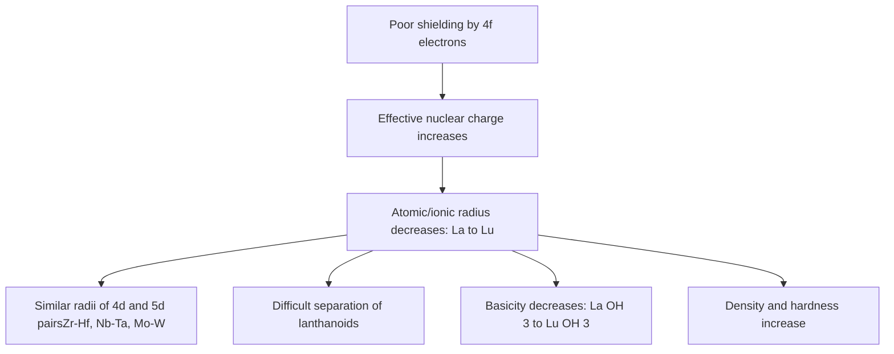

> All key d- and f-block formulas, reactions, oxidation states, colors, and trends for JEE Main & Advanced quick revision in one scannable sheet.

One-page revision of every must-know relation, reaction, and trend for the d- and f-block chapter. This is a largely descriptive chapter, so alongside the few quantitative formulas you will find high-yield reactions, oxidation-state charts, and periodic trends.

## Core Formulas

The handful of genuinely quantitative relations in this chapter.

| Quantity | Formula | Notes |
| --- | --- | --- |
| Spin-only magnetic moment | $\mu_s = \sqrt{n(n+2)}$ BM | $n$ = number of unpaired electrons; BM = Bohr Magneton |
| Lanthanoid effective moment | $\mu_{eff} = g\sqrt{J(J+1)}$ BM | Includes orbital contribution; $J$ = total angular momentum |
| Octahedral crystal field split | $\Delta_o = E_{e_g} - E_{t_{2g}}$ | Energy gap that determines color and spin state |

$$\boxed{\mu_s = \sqrt{n(n+2)} \text{ BM}}$$

> **★ Key point · Magnetic moment ready-reckoner**
>
> Memorize these five values straight off — they cover almost every JEE numerical:
>
> | Unpaired $e^-$ (n) | $\mu$ (BM) |

> | --- | --- |

> | 1 | $\sqrt{3}=1.73$ |

> | 2 | $\sqrt{8}=2.83$ |

> | 3 | $\sqrt{15}=3.87$ |

> | 4 | $\sqrt{24}=4.90$ |

> | 5 | $\sqrt{35}=5.92$ |
>
> Always find the configuration of the **ion** first (e.g. Fe²⁺ is 3d⁶, not 3d⁶4s²).

---

## Electronic Configurations

### General

$$\boxed{\text{Transition elements: } (n-1)d^{1-10}\, ns^{0-2}}$$

A transition element has **partially filled $(n-1)d^{1-9}$ orbitals** in its ground state OR in a common oxidation state.

$$\boxed{\text{Lanthanoids: } [Xe]\,4f^{1-14}\,5d^{0-1}\,6s^2}$$

$$\boxed{\text{Actinoids: } [Rn]\,5f^{0-14}\,6d^{0-2}\,7s^2}$$

### 3d series anomalies

| Element | Expected | Actual | Reason |
| --- | --- | --- | --- |
| Cr (24) | [Ar]3d⁴4s² | **[Ar]3d⁵4s¹** | Half-filled d⁵ stability |
| Cu (29) | [Ar]3d⁹4s² | **[Ar]3d¹⁰4s¹** | Fully-filled d¹⁰ stability |

### f-block anomalies

| Element | Expected | Actual | Reason |
| --- | --- | --- | --- |
| Ce (58) | [Xe]4f²6s² | [Xe]4f¹5d¹6s² | 4f, 5d similar energy |
| Gd (64) | [Xe]4f⁸6s² | [Xe]4f⁷5d¹6s² | Half-filled 4f stability |
| Lu (71) | [Xe]4f¹⁴6s² | [Xe]4f¹⁴5d¹6s² | Fully-filled 4f stability |

> **★ Key point · Not all d-block = transition**
>
> **Zn, Cd, Hg are NOT transition elements** — both atom and common ion (e.g. Zn²⁺ = 3d¹⁰) have fully filled d-orbitals. **Cu, Ag, Au ARE transition elements** because their common oxidation states (e.g. Cu²⁺ = 3d⁹) have partially filled d-orbitals.

---

## Oxidation States (3d Series)

| Element | Config | Common OS | Max OS |
| --- | --- | --- | --- |
| Sc | 3d¹4s² | +3 | +3 |
| Ti | 3d²4s² | +4 | +4 |
| V | 3d³4s² | +4, +5 | +5 |
| Cr | 3d⁵4s¹ | +3, +6 | +6 |
| Mn | 3d⁵4s² | +2, +4, +7 | **+7** |
| Fe | 3d⁶4s² | +2, +3 | +6 |
| Co | 3d⁷4s² | +2, +3 | +4 |
| Ni | 3d⁸4s² | +2 | +4 |
| Cu | 3d¹⁰4s¹ | +1, +2 | +3 |
| Zn | 3d¹⁰4s² | +2 | +2 |

**Key rules:** Maximum OS = group number up to Mn; after Mn it decreases. Higher oxidation states are more oxidizing. Mn shows the **maximum number** of states (+2 to +7).

### Disproportionation reactions

$$2Mn^{3+} \rightarrow Mn^{2+} + Mn^{4+}$$

$$2Cu^+ \rightarrow Cu^{2+} + Cu \quad \text{(Cu⁺ unstable in water)}$$

$$3MnO_4^{2-} + 4H^+ \rightarrow 2MnO_4^- + MnO_2 + 2H_2O$$

> **⚠ Trap · Cu⁺ vs Cu²⁺ — context matters**
>
> In **aqueous solution** Cu²⁺ is more stable (Cu⁺ disproportionates). In **solid CuI**, Cu⁺ is stable due to lattice energy. Don’t assume Cu²⁺ always wins.

---

## Color and Magnetism

### Color rule

Color arises from **d-d transitions**. Compounds with **d⁰ or d¹⁰** configuration are **colorless** (no d-d transition possible). Exceptions like KMnO₄ (Mn⁷⁺, d⁰) and K₂Cr₂O₇ (Cr⁶⁺, d⁰) are colored due to **charge transfer**, not d-d transitions.

| Ion | d-electrons | Color |
| --- | --- | --- |
| Sc³⁺ | d⁰ | Colorless |
| Ti⁴⁺ | d⁰ | Colorless |
| Ti³⁺ | d¹ | Purple |
| V³⁺ | d² | Green |
| Cr³⁺ | d³ | Green |
| Mn²⁺ | d⁵ | Pale pink |
| Fe³⁺ | d⁵ | Yellow |
| Fe²⁺ | d⁶ | Pale green |
| Co²⁺ | d⁷ | Pink |
| Ni²⁺ | d⁸ | Green |
| Cu²⁺ | d⁹ | Blue |
| Zn²⁺ | d¹⁰ | Colorless |

### Spin state and ligand field

$$\Delta_o = E_{e_g} - E_{t_{2g}}$$

| Field | Ligands | Spin | $\Delta$ |
| --- | --- | --- | --- |
| Weak | I⁻, Br⁻, Cl⁻, F⁻, OH⁻ | High spin (max unpaired) | Small |
| Strong | CN⁻, CO, NO₂⁻ | Low spin (min unpaired) | Large |

> **★ Key point · Same metal, different magnetism**
>
> - $[Fe(H_2O)_6]^{2+}$: 4 unpaired $e^-$, $\mu = 4.90$ BM (paramagnetic, high spin)

> - $[Fe(CN)_6]^{4-}$: 0 unpaired $e^-$, $\mu = 0$ BM (diamagnetic, low spin)
>
> The ligand decides the spin state, hence the magnetic moment.

### Ferromagnetism (Curie temperatures)

Fe, Co, Ni are ferromagnetic. Above the Curie temperature they become paramagnetic: Fe = 1043 K, Co = 1394 K, Ni = 631 K.

---

## Catalysts (Memorize the Process → Catalyst Pairs)

| Reaction | Catalyst | Process |
| --- | --- | --- |
| $N_2 + 3H_2 \rightarrow 2NH_3$ | **Fe** | Haber process |
| $2SO_2 + O_2 \rightarrow 2SO_3$ | **V₂O₅** | Contact process |
| $4NH_3 + 5O_2 \rightarrow 4NO + 6H_2O$ | **Pt** | Ostwald process |
| Vegetable oil + H₂ → fat | **Ni** | Hydrogenation |
| $2H_2O_2 \rightarrow 2H_2O + O_2$ | **MnO₂** | Decomposition |
| CO + hydrocarbons | **Pt/Pd/Rh** | Catalytic converter |

**Contact process mechanism (homogeneous):**

$$V_2O_5 \rightarrow V_2O_4 + \tfrac{1}{2}O_2$$

$$V_2O_4 + SO_2 \rightarrow V_2O_5 + SO_3$$

**Wilkinson’s catalyst (hydrogenation):**

$$RCH{=}CH_2 + H_2 \xrightarrow{[RhCl(PPh_3)_3]} RCH_2CH_3$$

---

## Potassium Dichromate — K₂Cr₂O₇

Cr in **+6**; orange color from **charge transfer** ($O^{2-} \rightarrow Cr^{6+}$). Cr⁶⁺ is [Ar]3d⁰.

### Preparation (chromite ore route)

$$4FeCr_2O_4 + 8Na_2CO_3 + 7O_2 \xrightarrow{\Delta} 8Na_2CrO_4 + 2Fe_2O_3 + 8CO_2$$

$$2Na_2CrO_4 + H_2SO_4 \rightarrow Na_2Cr_2O_7 + Na_2SO_4 + H_2O$$

$$Na_2Cr_2O_7 + 2KCl \rightarrow K_2Cr_2O_7 + 2NaCl$$

### Chromate–dichromate equilibrium

$$\boxed{2CrO_4^{2-} + 2H^+ \rightleftharpoons Cr_2O_7^{2-} + H_2O}$$

Basic → yellow chromate (CrO₄²⁻); acidic → orange dichromate (Cr₂O₇²⁻).

### Oxidizing half-reaction (acidic, n-factor = 6)

$$\boxed{Cr_2O_7^{2-} + 14H^+ + 6e^- \rightarrow 2Cr^{3+} + 7H_2O}$$

Color change: **orange → green (Cr³⁺)**.

### Key oxidations

$$Cr_2O_7^{2-} + 14H^+ + 6Fe^{2+} \rightarrow 2Cr^{3+} + 6Fe^{3+} + 7H_2O$$

$$Cr_2O_7^{2-} + 14H^+ + 6I^- \rightarrow 2Cr^{3+} + 3I_2 + 7H_2O$$

$$Cr_2O_7^{2-} + 8H^+ + 3H_2S \rightarrow 2Cr^{3+} + 3S + 7H_2O$$

$$Cr_2O_7^{2-} + 8H^+ + 3SO_3^{2-} \rightarrow 2Cr^{3+} + 3SO_4^{2-} + 4H_2O$$

### Action of heat

$$\boxed{4K_2Cr_2O_7 \xrightarrow{\Delta} 4K_2CrO_4 + 2Cr_2O_3 + 3O_2}$$

### Chromyl chloride test (chlorides only)

$$K_2Cr_2O_7 + 4NaCl + 6H_2SO_4 \rightarrow 2CrO_2Cl_2 + 2KHSO_4 + 4NaHSO_4 + 3H_2O$$

$$CrO_2Cl_2 + 4NaOH \rightarrow Na_2CrO_4 + 2NaCl + 2H_2O$$

> **⚠ Trap · Chromyl chloride test**
>
> Positive for **chlorides only**. Negative for fluorides (volatile HF), bromides and iodides (they get oxidized instead).

---

## Potassium Permanganate — KMnO₄

Mn in **+7**; purple from **charge transfer** ($O^{2-} \rightarrow Mn^{7+}$). Mn⁷⁺ is [Ar]3d⁰.

### Preparation (Baeyer’s process)

$$2MnO_2 + 4KOH + O_2 \xrightarrow{\Delta} 2K_2MnO_4 + 2H_2O$$

Then oxidize green manganate to purple permanganate (electrolytic, or acidic disproportionation):

$$MnO_4^{2-} - e^- \rightarrow MnO_4^-$$

$$3MnO_4^{2-} + 4H^+ \rightarrow 2MnO_4^- + MnO_2 + 2H_2O$$

### Reduction depends on pH

$$\boxed{MnO_4^- + 8H^+ + 5e^- \rightarrow Mn^{2+} + 4H_2O} \quad \text{(acidic, n=5)}$$

$$\boxed{MnO_4^- + 2H_2O + 3e^- \rightarrow MnO_2 + 4OH^-} \quad \text{(neutral, n=3)}$$

$$\boxed{MnO_4^- + e^- \rightarrow MnO_4^{2-}} \quad \text{(strongly basic, n=1)}$$

> **★ Key point · AMP — KMnO₄ reduction**
>
> - **A**cidic → Mn²⁺ (colorless, n = 5, strongest)

> - **M**ild/neutral → MnO₂ (brown ppt, n = 3)

> - **P**owerfully basic → MnO₄²⁻ (green, n = 1, weakest)
>
> Acidity ↑ → oxidizing power ↑ → n-factor ↑. Remember “5-3-1 down the line”.

### Key oxidations (acidic medium)

$$2MnO_4^- + 5C_2O_4^{2-} + 16H^+ \rightarrow 2Mn^{2+} + 10CO_2 + 8H_2O$$

$$MnO_4^- + 5Fe^{2+} + 8H^+ \rightarrow Mn^{2+} + 5Fe^{3+} + 4H_2O$$

$$2MnO_4^- + 10I^- + 16H^+ \rightarrow 2Mn^{2+} + 5I_2 + 8H_2O$$

$$2MnO_4^- + 5H_2S + 6H^+ \rightarrow 2Mn^{2+} + 5S + 8H_2O$$

$$2MnO_4^- + 5SO_3^{2-} + 6H^+ \rightarrow 2Mn^{2+} + 5SO_4^{2-} + 3H_2O$$

$$2MnO_4^- + 5NO_2^- + 6H^+ \rightarrow 2Mn^{2+} + 5NO_3^- + 3H_2O$$

### Neutral medium

$$2MnO_4^- + I^- + H_2O \rightarrow 2MnO_2 + IO_3^- + 2OH^-$$

$$8MnO_4^- + 3S_2O_3^{2-} + H_2O \rightarrow 8MnO_2 + 6SO_4^{2-} + 2OH^-$$

### Action of heat and acids

$$\boxed{2KMnO_4 \xrightarrow{\Delta} K_2MnO_4 + MnO_2 + O_2}$$

$$2KMnO_4 + 16HCl \rightarrow 2KCl + 2MnCl_2 + 5Cl_2 + 8H_2O$$

$$4KMnO_4 + 6H_2SO_4 \rightarrow 2K_2SO_4 + 4MnSO_4 + 6H_2O + 5O_2$$

> **★ Key point · Why dilute H₂SO₄ in KMnO₄ titrations?**
>
> Not **HCl** (oxidized to Cl₂, interferes); not **HNO₃** (itself an oxidizer); use **dilute H₂SO₄** — it supplies H⁺ without being oxidized. K₂Cr₂O₇ is a primary standard; KMnO₄ is not (needs standardization, but is self-indicating: purple → colorless).

---

## K₂Cr₂O₇ vs KMnO₄ — Quick Compare

| Property | K₂Cr₂O₇ | KMnO₄ |
| --- | --- | --- |
| Color | Orange-red | Dark purple |
| Oxidation state | Cr⁶⁺ | Mn⁷⁺ |
| Oxidizing power | Moderate | Very strong |
| n-factor (acidic) | 6 (Cr⁶⁺→Cr³⁺) | 5 (Mn⁷⁺→Mn²⁺) |
| Self-indicator | No (orange→green) | Yes (purple→colorless) |
| Primary standard | Yes | No |
| Medium | Best in acidic | Works in all pH |

---

## Other Important Compounds and Tests

| Compound | Key fact | Test / reaction |
| --- | --- | --- |
| K₄[Fe(CN)₆] | Fe²⁺, diamagnetic (low spin d⁶), yellow | Detects Fe³⁺ → Prussian blue |
| K₃[Fe(CN)₆] | Fe³⁺, paramagnetic (1 unpaired), red | Detects Fe²⁺ → Turnbull’s blue |
| CuSO₄·5H₂O | Cu²⁺ (d⁹), blue, paramagnetic | Anhydrous CuSO₄ white → blue (water test) |
| ZnSO₄·7H₂O | Zn²⁺ (d¹⁰), colorless, diamagnetic | — |

$$Fe^{3+} + [Fe(CN)_6]^{4-} \rightarrow Fe_4[Fe(CN)_6]_3 \quad \text{(Prussian blue)}$$

$$Fe^{2+} + [Fe(CN)_6]^{3-} \rightarrow Fe_3[Fe(CN)_6]_2 \quad \text{(Turnbull's blue)}$$

**Baeyer’s test (unsaturation):** cold dilute neutral KMnO₄ turns purple → brown MnO₂ with C=C or C≡C.

$$3CH_2{=}CH_2 + 2MnO_4^- + 4H_2O \rightarrow 3CH_2OH{-}CH_2OH + 2MnO_2 + 2OH^-$$

---

## Lanthanoid Contraction

**Steady decrease in atomic/ionic radii from La to Lu**, caused by **poor shielding of 4f electrons** → effective nuclear charge rises → outer electrons pulled in.

$$\boxed{\text{Ionic size: } La^{3+} > Ce^{3+} > \dots > Yb^{3+} > Lu^{3+}}$$

Total decrease La³⁺ (106 pm) → Lu³⁺ (85 pm) = **21 pm** (≈ 1.5 pm per element across 14 steps).

### Consequences



**4d / 5d radii made nearly identical:** Zr ≈ Hf (160 ≈ 159 pm), Nb = Ta (146 = 146 pm), Mo = W (139 = 139 pm).

$$\boxed{\text{Basic strength: } La(OH)_3 > Ce(OH)_3 > \dots > Lu(OH)_3}$$

> **⚠ Trap · Why Zr ≈ Hf?**
>
> Not “same group” — it is **lanthanoid contraction**. The 4f series fills between Zr and Hf, so Hf’s radius contracts to match Zr. This is one of the most-asked conceptual questions.

---

## Lanthanoids (4f Series) — Key Facts

Elements **Ce (58) to Lu (71)**, 14 elements. Predominant oxidation state is **+3**.

$$\boxed{\text{Stable state: } Ln^{3+}, \text{ config } [Xe]4f^{0-14}}$$

### Notable non-+3 states (CEEBY)

| Element | Extra OS | Reason |
| --- | --- | --- |
| Ce | +4 | Ce⁴⁺ = [Xe] noble gas config (good oxidizer) |
| Eu | +2 | Eu²⁺ = f⁷ half-filled (good reducer) |
| Yb | +2 | Yb²⁺ = f¹⁴ fully filled |

### Magnetism and color

- Magnetic moment uses $\mu_{eff} = g\sqrt{J(J+1)}$ (orbital contribution matters).
- **Gd³⁺ (f⁷)** has the highest moment (7 unpaired electrons).
- Diamagnetic ions: La³⁺ (f⁰), Lu³⁺ (f¹⁴). Color from weak **f-f transitions** → pale colors; colorless: La³⁺, Gd³⁺ (f⁷), Lu³⁺.
- Less tendency to form complexes (large size, no vacant d-orbitals); high coordination numbers (8, 9, 12).

### Typical reactions

$$4M + 3O_2 \rightarrow 2M_2O_3$$

$$2M + 6H_2O \rightarrow 2M(OH)_3 + 3H_2$$

$$2M + 3X_2 \rightarrow 2MX_3$$

$$2M + 6HCl \rightarrow 2MCl_3 + 3H_2$$

---

## Actinoids (5f Series) — Key Facts

Elements **Th (90) to Lr (103)**, 14 elements. **ALL are radioactive** — the defining difference from lanthanoids.

- Oxidation states **+3 to +7** (much more variable than lanthanoids) because 5f, 6d, 7s are close in energy and all can bond.
- Early actinoids (Th–Pu) are variable; from Am onward **+3** dominates. Common: Th = +4, U = +6 (as UO₂²⁺), Am onward = +3.
- **Actinoid contraction** parallels lanthanoid contraction but is more irregular.
- Deep, intense colors (5f-5f, 5f-6d, charge-transfer); form complexes more readily than lanthanoids.

### Nuclear / breeding reactions

$$^{238}U \rightarrow {}^{234}Th + {}^4He \quad (\alpha\text{-decay})$$

$$^{238}U + n \rightarrow {}^{239}U \xrightarrow{\beta^-} {}^{239}Np \xrightarrow{\beta^-} {}^{239}Pu$$

$$^{235}U + n \rightarrow {}^{141}Ba + {}^{92}Kr + 3n + 200 \text{ MeV}$$

$$^{232}Th + n \rightarrow {}^{233}Th \xrightarrow{\beta^-} {}^{233}Pa \xrightarrow{\beta^-} {}^{233}U \quad \text{(fertile → fissile)}$$

**Isotope facts:** U-238 (99.3%, fertile), U-235 (0.7%, fissile). UO₂²⁺ is **linear** (O=U=O). Am-241 is used in smoke detectors.

---

## Lanthanoids vs Actinoids — Top 5 JEE Differences

| Property | Lanthanoids (4f) | Actinoids (5f) |
| --- | --- | --- |
| Radioactivity | Only Pm | **ALL elements** |
| Oxidation states | Mostly +3 | +3 to +7 (variable) |
| Complex formation | Less | **Greater** (5f bonding) |
| Color intensity | Pale (f-f) | **Deep, intense** |
| Occurrence | Natural (except Pm) | Th, Pa, U natural; rest synthetic |

> **★ Key point · Last-minute mnemonics**
>
> - **Cr & Cu**: half-filled (d⁵) and fully-filled (d¹⁰) drag a 4s electron in.

> - **Zinc Never Transitions** (d¹⁰ in atom and Zn²⁺).

> - **AMP** for KMnO₄; **“Orange to Green, Purple to Clean”** for color changes.

> - **CEEBY** (Ce⁴⁺, Eu²⁺, Yb²⁺) for lanthanoid non-+3 states.

> - **TRAP** — actinoids are Transuranic, Radioactive, All variable OS, Paramagnetic.

---

## Related Topics

- [Transition Elements](../transition-elements/index.md) — general characteristics
- [Properties of d-Block](../properties-d-block/index.md) — oxidation states, color, magnetism
- [Important Compounds](../important-compounds/index.md) — K₂Cr₂O₇, KMnO₄ chemistry
- [Lanthanoids](../lanthanoids/index.md) — 4f series in detail
- [Actinoids](../actinoids/index.md) — 5f series and radioactivity

From TestGuru · our mock-test platform

## You've read d- and f-Block Elements Formula Sheet.You've read this topic. Find out what you actually got.

A free JEE Main mock with this chapter in it, and a report that shows which sub-topics cost you marks.

[Take a free JEE Main mock →](https://app.testguru.co/signup?tg_chapter=d-f-block-elements&tg_exam=jee-main&tg_page=%2Fchemistry%2Fd-f-block-elements%2Fformula-sheet%2F&tg_subject=chemistry&utm_campaign=notes-jee-main-free-test&utm_content=article-end&utm_medium=referral&utm_source=jeenotes)
Free, no card. Opens TestGuru in a new tab.

## Stay exam-ready

One email every Sunday: new notes, the week's hardest challenge question and a revision plan.One email every Sunday.

## Comments

Have a question or spotted a mistake? Join the discussion below.

Advertisement

Advertisement

---

## Extracted page code (interactive scripts & widgets)


### inline-script-14

```js
(function(){var t,e=document.getElementById("disqus-load");if(!e)return;t=!1,e.addEventListener("click",function(){if(t)return;t=!0,e.setAttribute("disabled","disabled"),e.textContent="Loading comments…",window.disqus_config=function(){this.page.url="https://jeenotes.in/chemistry/d-f-block-elements/formula-sheet/",this.page.identifier="/chemistry/d-f-block-elements/formula-sheet/"};var s=document,n=s.createElement("script");n.src="https://https-jeenotes-in.disqus.com/embed.js",n.setAttribute("data-timestamp",+new Date),n.onload=function(){e.style.display="none"},n.onerror=function(){t=!1,e.removeAttribute("disabled"),e.textContent="Could not load comments. Tap to retry"},(s.head||s.body).appendChild(n)})})()
```


### inline-script-15

```js
(function(){var t,e=document.currentScript.previousElementSibling;function n(){(window.adsbygoogle=window.adsbygoogle||[]).push({})}if(!window.ResizeObserver||e.clientWidth>0){n();return}t=new ResizeObserver(function(){e.clientWidth>0&&(t.disconnect(),n())}),t.observe(e)})()
```


---

_Source: [https://jeenotes.in/chemistry/d-f-block-elements/formula-sheet/](https://jeenotes.in/chemistry/d-f-block-elements/formula-sheet/) · raw HTML: `offline/chemistry/d-f-block-elements/formula-sheet/index.html`_
