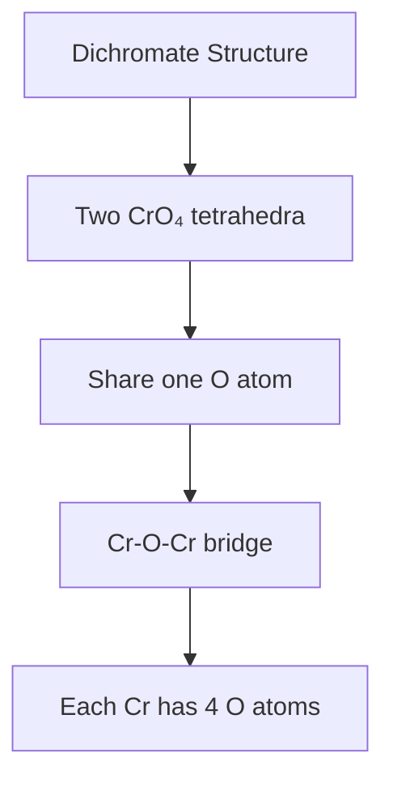
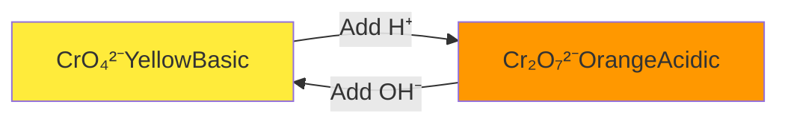

> Master K₂Cr₂O₇ and KMnO₄ preparations, properties, reactions, and oxidizing behavior for JEE Chemistry.

## Introduction

**Potassium dichromate (K₂Cr₂O₇)** and **potassium permanganate (KMnO₄)** are the rockstars of transition metal chemistry! These powerful oxidizing agents appear in countless JEE questions and have vital industrial applications.

> **★ Key point · Breaking Bad Chemistry**
>
> In *Breaking Bad* (and *Better Call Saul* 2024), the DEA uses potassium permanganate tests to detect drug labs! KMnO₄ reacts with organic compounds used in illegal synthesis, producing the telltale purple color. The chemistry you learn here is literally used by law enforcement. That’s the power of transition metal oxidizing agents!

---

## Potassium Dichromate (K₂Cr₂O₇)

### Structure and Properties

**Physical Properties:**

- **Color:** Bright orange-red crystalline solid
- **Melting point:** 398°C
- **Solubility:** Soluble in water (forms orange solution)

**Molecular Structure:**

$$K_2Cr_2O_7 \text{ contains } Cr_2O_7^{2-} \text{ ion}$$



**Key Features:**

- Chromium oxidation state: **+6**
- Electronic configuration of Cr⁶⁺: **[Ar]3d⁰** (colorless in theory)
- Orange color due to **charge transfer** (O²⁻ → Cr⁶⁺), NOT d-d transition

### Preparation

**Laboratory Method:**

**Step 1:** Preparation of sodium chromate from chromite ore

$$4FeCr_2O_4 + 8Na_2CO_3 + 7O_2 \xrightarrow{\Delta} 8Na_2CrO_4 + 2Fe_2O_3 + 8CO_2$$

**Step 2:** Conversion to sodium dichromate

$$2Na_2CrO_4 + H_2SO_4 \rightarrow Na_2Cr_2O_7 + Na_2SO_4 + H_2O$$

**Step 3:** Conversion to potassium dichromate

$$Na_2Cr_2O_7 + 2KCl \rightarrow K_2Cr_2O_7 + 2NaCl$$

(K₂Cr₂O₇ is less soluble and crystallizes out)

**Industrial Preparation:**

- Large-scale roasting of chromite ore with Na₂CO₃
- Followed by acidification and salt metathesis

### Chromate-Dichromate Equilibrium

**pH-dependent interconversion:**

$$\boxed{2CrO_4^{2-} + 2H^+ \rightleftharpoons Cr_2O_7^{2-} + H_2O}$$



**Key Points:**

- **Basic medium:** Chromate (CrO₄²⁻) is yellow
- **Acidic medium:** Dichromate (Cr₂O₇²⁻) is orange
- Equilibrium shifts with pH change

> **★ Key point · JEE Alert**
>
> **Color change is reversible:**
>
> - Add acid to yellow chromate → turns orange (dichromate)

> - Add base to orange dichromate → turns yellow (chromate)
>
> This is frequently asked in JEE practicals and theory!

### Chemical Properties

#### 1. Oxidizing Agent Behavior

**K₂Cr₂O₇ is a strong oxidizing agent in ACIDIC medium.**

**Half-reaction in acidic medium:**

$$\boxed{Cr_2O_7^{2-} + 14H^+ + 6e^- \rightarrow 2Cr^{3+} + 7H_2O}$$

Color change: **Orange (Cr₂O₇²⁻) → Green (Cr³⁺)**

### Interactive Demo: Visualize Electrochemical Redox Reactions

Watch how dichromate acts as an oxidizing agent in electrochemical cells with electron transfer.

**Important Oxidation Reactions:**

**a) Oxidation of Ferrous to Ferric:**

$$Cr_2O_7^{2-} + 14H^+ + 6Fe^{2+} \rightarrow 2Cr^{3+} + 6Fe^{3+} + 7H_2O$$

**b) Oxidation of Iodide to Iodine:**

$$Cr_2O_7^{2-} + 14H^+ + 6I^- \rightarrow 2Cr^{3+} + 3I_2 + 7H_2O$$

**c) Oxidation of H₂S:**

$$Cr_2O_7^{2-} + 8H^+ + 3H_2S \rightarrow 2Cr^{3+} + 3S + 7H_2O$$

**d) Oxidation of Sulfite:**

$$Cr_2O_7^{2-} + 8H^+ + 3SO_3^{2-} \rightarrow 2Cr^{3+} + 3SO_4^{2-} + 4H_2O$$

**e) Oxidation of Alcohols:**

*Primary alcohol → Aldehyde → Carboxylic acid:*

$$3CH_3CH_2OH + Cr_2O_7^{2-} + 8H^+ \rightarrow 3CH_3CHO + 2Cr^{3+} + 7H_2O$$

$$3CH_3CHO + Cr_2O_7^{2-} + 8H^+ \rightarrow 3CH_3COOH + 2Cr^{3+} + 4H_2O$$

*Secondary alcohol → Ketone:*

$$3(CH_3)_2CHOH + Cr_2O_7^{2-} + 8H^+ \rightarrow 3(CH_3)_2CO + 2Cr^{3+} + 7H_2O$$

#### 2. Action of Heat

**Thermal decomposition:**

$$\boxed{4K_2Cr_2O_7 \xrightarrow{\Delta} 4K_2CrO_4 + 2Cr_2O_3 + 3O_2}$$

- Decomposition starts at 500°C
- Oxygen gas evolved

#### 3. Reaction with Alkali

**Fusion with KOH:**

$$Cr_2O_7^{2-} + 2OH^- \rightarrow 2CrO_4^{2-} + H_2O$$

Forms yellow potassium chromate.

#### 4. Chromyl Chloride Test

**Used to detect chloride ions:**

**Step 1:** Heating with conc. H₂SO₄

$$K_2Cr_2O_7 + 4NaCl + 6H_2SO_4 \rightarrow 2CrO_2Cl_2 + 2KHSO_4 + 4NaHSO_4 + 3H_2O$$

Red vapors of **chromyl chloride (CrO₂Cl₂)** evolve.

**Step 2:** Chromyl chloride dissolves in NaOH

$$CrO_2Cl_2 + 4NaOH \rightarrow Na_2CrO_4 + 2NaCl + 2H_2O$$

Yellow solution confirms Cl⁻ presence.

> **⚠ Trap · Common JEE Mistake**
>
> **Chromyl chloride test is NEGATIVE for:**
>
> - Fluorides (volatile HF forms)

> - Bromides and Iodides (get oxidized)
>
> Only **CHLORIDES** give positive chromyl chloride test!

### Uses of K₂Cr₂O₇

1. **Oxidizing agent** in laboratories
2. **Analytical chemistry** - volumetric analysis
3. **Leather tanning** industry
4. **Dyeing and printing** textiles
5. **Production of chrome alum**
6. **Wood preservation**
7. **Photography** - for hardening gelatin

---

## Potassium Permanganate (KMnO₄)

### Structure and Properties

**Physical Properties:**

- **Color:** Dark purple (almost black) crystalline solid
- **Melting point:** 240°C (decomposes)
- **Solubility:** Soluble in water (intense purple solution)

**Molecular Structure:**

$$KMnO_4 \text{ contains } MnO_4^- \text{ ion}$$

**Tetrahedral structure:**

- Mn at center
- Four O atoms at corners
- **Mn oxidation state:** +7
- **Mn⁷⁺ configuration:** [Ar]3d⁰ (no d-d transitions)
- Purple color due to **charge transfer** (O²⁻ → Mn⁷⁺)

### Preparation

**Laboratory Method (Baeyer’s Process):**

**Step 1:** Fusion of pyrolusite (MnO₂) with KOH in presence of air/oxygen

$$2MnO_2 + 4KOH + O_2 \xrightarrow{\Delta} 2K_2MnO_4 + 2H_2O$$

Green **potassium manganate (K₂MnO₄)** forms.

**Step 2:** Electrolytic oxidation OR disproportionation

**Electrolytic oxidation (at anode):**

$$MnO_4^{2-} - e^- \rightarrow MnO_4^-$$

**Disproportionation in acidic medium:**

$$3MnO_4^{2-} + 4H^+ \rightarrow 2MnO_4^- + MnO_2 + 2H_2O$$

Green solution → Purple solution

**Industrial Preparation:**

- MnO₂ fused with KOH and oxidized
- Followed by electrolytic oxidation

### Chemical Properties

#### 1. Oxidizing Agent Behavior

**KMnO₄ is the STRONGEST common oxidizing agent.**

Oxidizing power **depends on pH**:

**a) In ACIDIC medium (H₂SO₄):**

$$\boxed{MnO_4^- + 8H^+ + 5e^- \rightarrow Mn^{2+} + 4H_2O}$$

Color change: **Purple (MnO₄⁻) → Colorless/Pale pink (Mn²⁺)**

**n-factor = 5** (most powerful)

**b) In NEUTRAL/MILD ALKALINE medium:**

$$\boxed{MnO_4^- + 2H_2O + 3e^- \rightarrow MnO_2 + 4OH^-}$$

Color change: **Purple → Brown precipitate (MnO₂)**

**n-factor = 3**

**c) In STRONGLY ALKALINE medium:**

$$\boxed{MnO_4^- + e^- \rightarrow MnO_4^{2-}}$$

Color change: **Purple (MnO₄⁻) → Green (MnO₄²⁻)**

**n-factor = 1** (weakest)

> **★ Key point · Memory Trick**
>
> **“AMP” for KMnO₄ Reduction:**
>
> - **A**cidic → Mn²⁺ (colorless, n=5)

> - **M**ild/Neutral → MnO₂ (brown ppt, n=3)

> - **P**owerfully basic → MnO₄²⁻ (green, n=1)
>
> **Acidity ↑, Oxidizing Power ↑, n-factor ↑**

#### 2. Important Oxidation Reactions

**In Acidic Medium:**

**a) Oxidation of Oxalic acid (H₂C₂O₄):**

$$2MnO_4^- + 5C_2O_4^{2-} + 16H^+ \rightarrow 2Mn^{2+} + 10CO_2 + 8H_2O$$

Self-indicator titration! (Purple → Colorless at endpoint)

**b) Oxidation of Ferrous to Ferric:**

$$MnO_4^- + 5Fe^{2+} + 8H^+ \rightarrow Mn^{2+} + 5Fe^{3+} + 4H_2O$$

**c) Oxidation of Iodide to Iodine:**

$$2MnO_4^- + 10I^- + 16H^+ \rightarrow 2Mn^{2+} + 5I_2 + 8H_2O$$

**d) Oxidation of H₂S to Sulfur:**

$$2MnO_4^- + 5H_2S + 6H^+ \rightarrow 2Mn^{2+} + 5S + 8H_2O$$

**e) Oxidation of Sulfite to Sulfate:**

$$2MnO_4^- + 5SO_3^{2-} + 6H^+ \rightarrow 2Mn^{2+} + 5SO_4^{2-} + 3H_2O$$

**f) Oxidation of Nitrite to Nitrate:**

$$2MnO_4^- + 5NO_2^- + 6H^+ \rightarrow 2Mn^{2+} + 5NO_3^- + 3H_2O$$

**g) Oxidation of Alcohols:**

*Primary alcohol → Aldehyde → Carboxylic acid*

*Secondary alcohol → Ketone*

*Tertiary alcohol → No oxidation*

**h) Oxidation of Alkenes (Baeyer’s Test):**

$$3CH_2=CH_2 + 2MnO_4^- + 4H_2O \rightarrow 3CH_2OH-CH_2OH + 2MnO_2 + 2OH^-$$

Purple → Brown (positive test for unsaturation)

**In Neutral Medium:**

**i) Oxidation of Iodide:**

$$2MnO_4^- + I^- + H_2O \rightarrow 2MnO_2 + IO_3^- + 2OH^-$$

**j) Oxidation of Thiosulfate:**

$$8MnO_4^- + 3S_2O_3^{2-} + H_2O \rightarrow 8MnO_2 + 6SO_4^{2-} + 2OH^-$$

#### 3. Action of Heat

**Thermal decomposition:**

$$\boxed{2KMnO_4 \xrightarrow{\Delta} K_2MnO_4 + MnO_2 + O_2}$$

- Starts at 240°C
- Oxygen gas evolved (lab preparation of O₂!)
- Purple → Green + Brown

#### 4. Action of Conc. Acids

**With conc. HCl:**

$$2KMnO_4 + 16HCl \rightarrow 2KCl + 2MnCl_2 + 5Cl_2 + 8H_2O$$

Chlorine gas evolved (greenish-yellow)

**With conc. H₂SO₄ (hot):**

$$4KMnO_4 + 6H_2SO_4 \rightarrow 2K_2SO_4 + 4MnSO_4 + 6H_2O + 5O_2$$

Oxygen gas evolved

> **★ Key point · JEE Alert**
>
> **Why use dilute H₂SO₄ in KMnO₄ titrations?**
>
> 1. **Not HCl:** Gets oxidized to Cl₂ (interferes with titration)

> 2. **Not HNO₃:** Itself an oxidizing agent (interferes)

> 3. **H₂SO₄:** Provides H⁺ ions without being oxidized

> 4. **Must be dilute:** Conc. H₂SO₄ reacts differently
>
> This is THE most common practical chemistry question!

### Uses of KMnO₄

1. **Analytical chemistry** - volumetric titrations
2. **Water purification** - kills bacteria
3. **Disinfectant** - antiseptic properties
4. **Bleaching agent** - wool, silk, cotton
5. **Laboratory reagent** - qualitative analysis
6. **Medicine** - treatment of skin infections
7. **Baeyer’s test** - detecting unsaturation in organic compounds

---

## Comparison: K₂Cr₂O₇ vs KMnO₄

| Property | K₂Cr₂O₇ | KMnO₄ |
| --- | --- | --- |
| **Color** | Orange-red | Dark purple |
| **Oxidation State** | Cr⁶⁺ | Mn⁷⁺ |
| **Oxidizing Power** | Moderate | Very strong |
| **Stability** | Very stable | Less stable |
| **Storage** | No special care | Store in dark bottles |
| **Self-indicator** | No (orange→green) | Yes (purple→colorless) |
| **Medium** | Best in acidic | Works in all pH |
| **n-factor (acidic)** | 6 (Cr⁶⁺→Cr³⁺) | 5 (Mn⁷⁺→Mn²⁺) |
| **Thermal stability** | More stable | Decomposes at 240°C |
| **Primary standard** | Yes | No (needs standardization) |

**For Volumetric Analysis:**

**K₂Cr₂O₇ Advantages:**

- Primary standard (accurate concentration)
- More stable in solution
- Can be weighed accurately

**KMnO₄ Advantages:**

- Self-indicator (no external indicator needed)
- Stronger oxidizing agent
- More versatile (works in different pH)

---

## Other Important Compounds

### 1. Potassium Ferrocyanide - K₄[Fe(CN)₆]

**Properties:**

- Yellow crystalline solid
- Fe in +2 oxidation state
- Diamagnetic (low spin, d⁶)

**Test for Fe³⁺:**

$$Fe^{3+} + [Fe(CN)_6]^{4-} \rightarrow Fe_4[Fe(CN)_6]_3$$

Prussian blue precipitate

### 2. Potassium Ferricyanide - K₃[Fe(CN)₆]

**Properties:**

- Red crystalline solid
- Fe in +3 oxidation state
- Paramagnetic (1 unpaired electron)

**Test for Fe²⁺:**

$$Fe^{2+} + [Fe(CN)_6]^{3-} \rightarrow Fe_3[Fe(CN)_6]_2$$

Turnbull’s blue precipitate

### 3. Copper Sulfate - CuSO₄·5H₂O

**Properties:**

- Blue crystalline solid
- Cu²⁺ (3d⁹, 1 unpaired e⁻)
- Paramagnetic

**Test for water:**

- Anhydrous CuSO₄ is white
- Turns blue on adding water (hydration test)

### 4. Zinc Sulfate - ZnSO₄·7H₂O

**Properties:**

- Colorless/white crystalline solid
- Zn²⁺ (3d¹⁰, 0 unpaired e⁻)
- Diamagnetic

---

## Analytical Tests

### 1. Detection of Oxidizing Agents

**Test with KI and starch:**

- Add KI solution + starch
- Oxidizing agents liberate I₂
- Blue color with starch confirms

**Reactions:**

$$Cr_2O_7^{2-} + 14H^+ + 6I^- \rightarrow 2Cr^{3+} + 3I_2 + 7H_2O$$

$$2MnO_4^- + 10I^- + 16H^+ \rightarrow 2Mn^{2+} + 5I_2 + 8H_2O$$

### 2. Detection of Reducing Agents

**Test with KMnO₄:**

- Add dilute KMnO₄
- Purple color disappears if reducing agent present
- Confirms presence of reductant

### 3. Baeyer’s Test (Unsaturation)

**Cold, dilute, neutral KMnO₄:**

$$R-CH=CH-R' + [O] \rightarrow R-CH(OH)-CH(OH)-R'$$

Purple → Brown MnO₂ precipitate

Positive test for C=C or C≡C

---

## Common JEE Mistakes

1. **Using wrong acid in KMnO₄ titrations**

   - Never use HCl (gets oxidized)
   - Never use HNO₃ (itself oxidizing)
   - Always use **dilute H₂SO₄**
2. **n-factor confusion**

   - K₂Cr₂O₇ in acidic: n = 6 (Cr⁶⁺ → Cr³⁺, 2 Cr atoms)
   - KMnO₄ in acidic: n = 5 (Mn⁷⁺ → Mn²⁺)
   - KMnO₄ in neutral: n = 3 (Mn⁷⁺ → Mn⁴⁺)
   - KMnO₄ in basic: n = 1 (Mn⁷⁺ → Mn⁶⁺)
3. **Color change confusion**

   - K₂Cr₂O₇: Orange → Green (Cr³⁺)
   - KMnO₄ (acidic): Purple → Colorless (Mn²⁺)
   - KMnO₄ (neutral): Purple → Brown ppt (MnO₂)
4. **Primary standard confusion**

   - K₂Cr₂O₇ is primary standard (stable, pure)
   - KMnO₄ is NOT (needs standardization)
5. **Chromyl chloride test**

   - Works ONLY for chlorides
   - Doesn’t work for fluorides, bromides, iodides

---

## Practice Problems

### Level 1: Basic Concepts

1. **Write balanced equations for:**

   - K₂Cr₂O₇ oxidizing FeSO₄ in acidic medium
   - KMnO₄ oxidizing H₂C₂O₄ in acidic medium
2. **Why is K₂Cr₂O₇ orange but Cr³⁺ compounds are green?**
3. **Complete and balance:**

   $$MnO_4^- + I^- + H^+ \rightarrow$$

### Level 2: Application

4. **Calculate the equivalent weight of:**

   - K₂Cr₂O₇ in acidic medium
   - KMnO₄ in acidic medium
   - KMnO₄ in neutral medium
5. **Explain why:**

   - KMnO₄ solution is stored in dark bottles
   - We use H₂SO₄ (not HCl) in KMnO₄ titrations
   - K₂Cr₂O₇ is preferred over KMnO₄ as primary standard
6. **A compound decolorizes KMnO₄ in cold, neutral solution. What does this indicate?**

### Level 3: JEE Advanced

7. **10 mL of K₂Cr₂O₇ solution oxidizes 50 mL of 0.1 M Fe²⁺ in acidic medium. Calculate the molarity of K₂Cr₂O₇.**
8. **100 mL of 0.02 M KMnO₄ oxidizes 100 mL of H₂C₂O₄ in acidic medium. Find the molarity of oxalic acid.**
9. **A mixture of K₂Cr₂O₇ and KMnO₄ (1:1 molar ratio) oxidizes FeSO₄ in acidic medium. Calculate the effective n-factor of the mixture.**
10. **Assertion (A):** Purple color of KMnO₄ is due to charge transfer.
    **Reason (R):** Mn⁷⁺ has d⁰ configuration, so no d-d transition is possible.

    - (a) Both A and R true, R explains A
    - (b) Both true, R doesn’t explain A
    - (c) A true, R false
    - (d) Both false

> **↗ Connection · Quick Check**
>
> **Can you explain:** Why does adding OH⁻ to orange dichromate solution turn it yellow? Write the equilibrium equation!

---

## Memory Tricks

### “DIANA” for K₂Cr₂O₇ vs KMnO₄

**K₂Cr₂O₇:**

- **D**ichromate
- **I**s
- **A**lways
- **N**ice for
- **A**ccurate work (primary standard)

**KMnO₄:**

- **P**ermanganate
- **I**s
- **M**ore
- **P**owerful (oxidizer)

### n-factor Quick Reference

**“5-3-1 Down the Line”** (KMnO₄)

- Acidic: 5
- Neutral: 3
- Basic: 1

**“Chromium Gives 6”** (K₂Cr₂O₇)

- In acidic: always 6

### Color Changes

**“Orange to Green, Purple to Clean”**

- K₂Cr₂O₇ (orange) → Cr³⁺ (green)
- KMnO₄ (purple) → Mn²⁺ (colorless/clean)

---

## Related Topics

### Within d-f Block Elements

- [Transition Elements](../transition-elements/index.md) - General characteristics
- [Properties of d-Block](../properties-d-block/index.md) - Oxidation states, color
- [Lanthanoids](../lanthanoids/index.md) - f-block elements
- [Actinoids](../actinoids/index.md) - Radioactive elements

### Other Chemistry Topics

- [Redox Reactions](../../redox-electrochemistry/index.md) - Oxidation-reduction
- [Chemical Equilibrium](../../equilibrium/index.md) - Chromate-dichromate
- [Coordination Compounds](../../coordination-compounds/index.md) - Ferrocyanide complexes

### Practical Chemistry

- [Volumetric Analysis](../../practical-chemistry/index.md) - Titrations
- [Qualitative Analysis](../../practical-chemistry/index.md) - Detection tests

---

From TestGuru · our mock-test platform

## You've read Important Compounds of d-Block Elements.You've read this topic. Find out what you actually got.

A free JEE Main mock with this chapter in it, and a report that shows which sub-topics cost you marks.

[Take a free JEE Main mock →](https://app.testguru.co/signup?tg_chapter=d-f-block-elements&tg_exam=jee-main&tg_page=%2Fchemistry%2Fd-f-block-elements%2Fimportant-compounds%2F&tg_subject=chemistry&utm_campaign=notes-jee-main-free-test&utm_content=article-end&utm_medium=referral&utm_source=jeenotes)
Free, no card. Opens TestGuru in a new tab.

## Stay exam-ready

One email every Sunday: new notes, the week's hardest challenge question and a revision plan.One email every Sunday.

## Comments

Have a question or spotted a mistake? Join the discussion below.

Advertisement

Advertisement

---

## Extracted page code (interactive scripts & widgets)


### inline-script-16

```js
if(!document.getElementById("animation-fullscreen-overlay")){const e=document.createElement("div");e.id="animation-fullscreen-overlay",e.className="animation-fullscreen-overlay",e.innerHTML=`
      <div class="fullscreen-modal">
        <div class="fullscreen-header">
          <span class="fullscreen-title">Interactive Demo</span>
          <button class="fullscreen-close-btn" onclick="JEEAnimations.closeFullscreen()" title="Close (Esc)" aria-label="Close fullscreen">
            <svg width="24" height="24" viewBox="0 0 24 24" fill="none" stroke="currentColor" stroke-width="2" stroke-linecap="round" stroke-linejoin="round">
              <line x1="18" y1="6" x2="6" y2="18"></line>
              <line x1="6" y1="6" x2="18" y2="18"></line>
            </svg>
          </button>
        </div>
        <div class="fullscreen-content"></div>
      </div>
    `,document.body.appendChild(e),document.addEventListener("keydown",function(e){e.key==="Escape"&&document.body.classList.contains("animation-fullscreen-active")&&JEEAnimations.closeFullscreen()}),e.addEventListener("click",function(t){t.target===e&&JEEAnimations.closeFullscreen()})}
```


### inline-script-17

```js
(function(){var t,e=document.getElementById("disqus-load");if(!e)return;t=!1,e.addEventListener("click",function(){if(t)return;t=!0,e.setAttribute("disabled","disabled"),e.textContent="Loading comments…",window.disqus_config=function(){this.page.url="https://jeenotes.in/chemistry/d-f-block-elements/important-compounds/",this.page.identifier="/chemistry/d-f-block-elements/important-compounds/"};var s=document,n=s.createElement("script");n.src="https://https-jeenotes-in.disqus.com/embed.js",n.setAttribute("data-timestamp",+new Date),n.onload=function(){e.style.display="none"},n.onerror=function(){t=!1,e.removeAttribute("disabled"),e.textContent="Could not load comments. Tap to retry"},(s.head||s.body).appendChild(n)})})()
```


### inline-script-18

```js
(function(){var t,e=document.currentScript.previousElementSibling;function n(){(window.adsbygoogle=window.adsbygoogle||[]).push({})}if(!window.ResizeObserver||e.clientWidth>0){n();return}t=new ResizeObserver(function(){e.clientWidth>0&&(t.disconnect(),n())}),t.observe(e)})()
```


### interactive-widget-1

```html
<div class="animation-wrapper" data-animation="electrochemicalCell" id="anim-electrochemicalCell-1795396419556096047"><div class="animation-header"><button aria-label="Toggle fullscreen" class="anim-fullscreen-btn" onclick='JEEAnimations.toggleFullscreen("anim-electrochemicalCell-1795396419556096047")' title="Fullscreen (F)">
<svg class="fullscreen-icon-expand" fill="none" height="18" stroke="currentColor" stroke-linecap="round" stroke-linejoin="round" stroke-width="2" viewbox="0 0 24 24" width="18"><polyline points="15 3 21 3 21 9"></polyline><polyline points="9 21 3 21 3 15"></polyline><line x1="21" x2="14" y1="3" y2="10"></line><line x1="3" x2="10" y1="21" y2="14"></line></svg>
<svg class="fullscreen-icon-collapse" fill="none" height="18" stroke="currentColor" stroke-linecap="round" stroke-linejoin="round" stroke-width="2" viewbox="0 0 24 24" width="18"><polyline points="4 14 10 14 10 20"></polyline><polyline points="20 10 14 10 14 4"></polyline><line x1="14" x2="21" y1="10" y2="3"></line><line x1="3" x2="10" y1="21" y2="14"></line></svg>
<span class="fullscreen-text">Fullscreen</span></button></div><div class="animation-content"><noscript><div class="callout callout-warning"><div class="callout-title">JavaScript Required</div><p>This interactive animation requires JavaScript to be enabled.</p></div></noscript></div></div>
```


---

_Source: [https://jeenotes.in/chemistry/d-f-block-elements/important-compounds/](https://jeenotes.in/chemistry/d-f-block-elements/important-compounds/) · raw HTML: `offline/chemistry/d-f-block-elements/important-compounds/index.html`_
