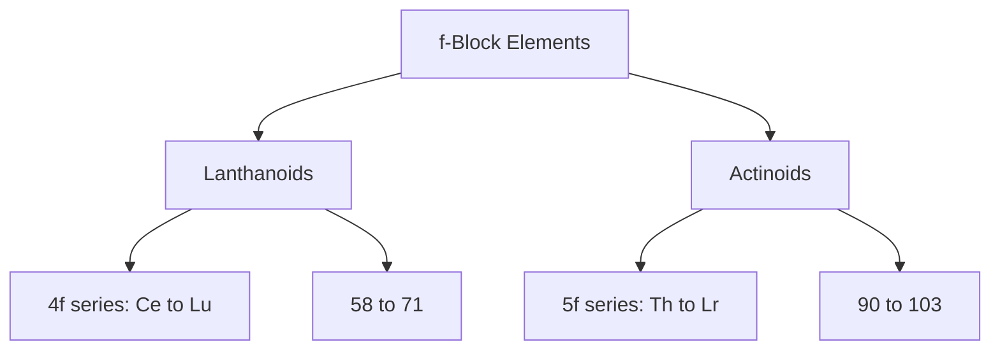
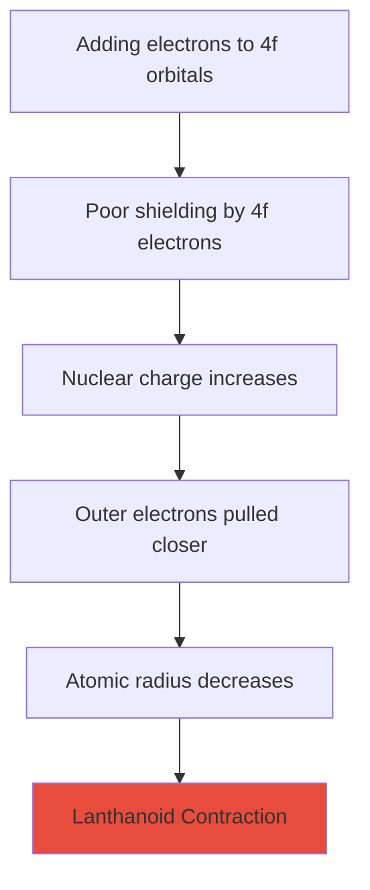

> Master lanthanoid contraction, electronic configuration, properties, oxidation states, and trends of lanthanoid elements for JEE Chemistry.

## Introduction

**Lanthanoids** (also called lanthanides or rare earth elements) are the 14 elements in the **4f series** - from Cerium (Ce) to Lutetium (Lu). Despite their name, they’re not actually rare; they’re called “rare” because they’re difficult to separate from each other!

> **★ Key point · Rare Earths in Your Phone**
>
> In *The Billion Dollar Code* (2024), tech companies fight over rare earth element patents. Your smartphone contains up to 16 different lanthanoid elements! From the vibrant OLED display (using europium and terbium) to the powerful magnets in speakers (neodymium), lanthanoids are everywhere in modern technology. China controls 90% of global production - that’s why they’re geopolitically crucial!

---

## Position in Periodic Table

**Lanthanoid Series:**

- **Elements:** Ce (58) to Lu (71) - **14 elements**
- **Also includes:** Lanthanum (La, 57) - often grouped with them
- **Collective name:** Lanthanoids or Rare Earth Elements
- **Period:** 6th period
- **Block:** f-block (4f orbitals being filled)



**In Periodic Table:**

- Placed **below** the main table
- Interrupt the 5d series
- La → 4f fills → Lu → 5d continues (Hf)

### Interactive Demo: Visualize Lanthanoid Position

Explore the position of lanthanoids in the periodic table and understand the 4f series placement.

---

## Electronic Configuration

### General Configuration

$$\boxed{[Xe] \, 4f^{1-14} \, 5d^{0-1} \, 6s^2}$$

**Complete Electronic Configurations:**

| Element | Z | Symbol | Electronic Configuration | f-electrons |
| --- | --- | --- | --- | --- |
| Lanthanum | 57 | La | [Xe]5d¹6s² | 0 |
| **Cerium** | 58 | Ce | [Xe]4f¹5d¹6s² | 1 |
| Praseodymium | 59 | Pr | [Xe]4f³6s² | 3 |
| Neodymium | 60 | Nd | [Xe]4f⁴6s² | 4 |
| Promethium | 61 | Pm | [Xe]4f⁵6s² | 5 |
| Samarium | 62 | Sm | [Xe]4f⁶6s² | 6 |
| **Europium** | 63 | Eu | [Xe]4f⁷6s² | 7 |
| **Gadolinium** | 64 | Gd | [Xe]4f⁷5d¹6s² | 7 |
| Terbium | 65 | Tb | [Xe]4f⁹6s² | 9 |
| Dysprosium | 66 | Dy | [Xe]4f¹⁰6s² | 10 |
| Holmium | 67 | Ho | [Xe]4f¹¹6s² | 11 |
| Erbium | 68 | Er | [Xe]4f¹²6s² | 12 |
| Thulium | 69 | Tm | [Xe]4f¹³6s² | 13 |
| Ytterbium | 70 | Yb | [Xe]4f¹⁴6s² | 14 |
| **Lutetium** | 71 | Lu | [Xe]4f¹⁴5d¹6s² | 14 |

**Anomalous Configurations:**

| Element | Expected | Actual | Reason |
| --- | --- | --- | --- |
| **Ce** | [Xe]4f²6s² | [Xe]4f¹5d¹6s² | 4f and 5d similar energy |
| **Gd** | [Xe]4f⁸6s² | [Xe]4f⁷5d¹6s² | Half-filled 4f stability |
| **Lu** | [Xe]4f¹⁴6s² | [Xe]4f¹⁴5d¹6s² | Fully-filled 4f stability |

> **★ Key point · JEE Alert**
>
> **Lanthanoids have POOR shielding** because:
>
> 1. 4f orbitals are **deeply buried** inside the atom

> 2. 4f electrons are **closer to nucleus** than 5s, 5p electrons

> 3. **Diffused shape** of f-orbitals provides ineffective shielding
>
> This poor shielding causes **lanthanoid contraction**!

---

## Lanthanoid Contraction

The **most important concept** in lanthanoid chemistry!

### Definition

**Lanthanoid contraction** is the **steady decrease in atomic and ionic radii** of lanthanoid elements from La to Lu.

$$\boxed{\text{Atomic/Ionic size: } La > Ce > Pr > Nd > ... > Yb > Lu}$$

### Radii Data

**Ln³⁺ Ionic Radii (in pm):**

| Ion | Radius (pm) | Ion | Radius (pm) |
| --- | --- | --- | --- |
| La³⁺ | 106 | Gd³⁺ | 94 |
| Ce³⁺ | 103 | Tb³⁺ | 92 |
| Pr³⁺ | 101 | Dy³⁺ | 91 |
| Nd³⁺ | 99 | Ho³⁺ | 89 |
| Pm³⁺ | 98 | Er³⁺ | 88 |
| Sm³⁺ | 96 | Tm³⁺ | 87 |
| Eu³⁺ | 95 | Yb³⁺ | 86 |
|  |  | Lu³⁺ | 85 |

**Total decrease:** La³⁺ (106 pm) to Lu³⁺ (85 pm) = **21 pm**

### Cause of Lanthanoid Contraction



**Detailed Explanation:**

1. **Across the series:** Each element has one more proton (nuclear charge +1)
2. **Extra electron goes into:** 4f orbital
3. **4f electrons provide:** Very poor shielding (diffused orbitals)
4. **Result:** Effective nuclear charge increases
5. **Consequence:** Outer electrons pulled closer → radius decreases

**Why poor shielding?**

- 4f orbitals have complex shape
- 4f electrons are buried deep inside
- Less effective at screening nuclear charge

### Consequences of Lanthanoid Contraction

**1. Similar Chemical Properties**

All lanthanoids behave very similarly:

- Same oxidation state (+3 predominant)
- Similar ionic radii
- Difficult to separate from each other

**2. Difficult Separation**

Lanthanoids are hard to separate because:

- Very similar ionic radii
- Similar chemical behavior
- Require ion-exchange chromatography or fractional crystallization

**3. Effect on Post-Lanthanoid Elements**

**Most Important Consequence:**

The **4d and 5d series** elements have **similar atomic radii**!

| Element | Series | Atomic Radius |
| --- | --- | --- |
| **Zr** | 4d | 160 pm |
| **Hf** | 5d | 159 pm |
| **Nb** | 4d | 146 pm |
| **Ta** | 5d | 146 pm |
| **Mo** | 4d | 139 pm |
| **W** | 5d | 139 pm |

**Why?**

- Hf comes after lanthanoids
- Lanthanoid contraction compensates for expected size increase
- Hf and Zr have almost identical radii despite being in different periods!

**Result:**

- Zr and Hf are very similar chemically
- Nb and Ta are almost identical twins
- Very difficult to separate (e.g., Zr from Hf)

**4. Variation in Basic Strength of Hydroxides**

$$\boxed{\text{Basic strength: } La(OH)_3 > Ce(OH)_3 > ... > Lu(OH)_3}$$

**Reason:**

- Smaller cation → higher charge density
- Stronger M-O bond → less ionization
- Less OH⁻ released → weaker base

**5. Trends in Properties**

Due to lanthanoid contraction:

- **Density increases:** La to Lu
- **Melting point increases:** Generally (irregular)
- **Hardness increases:** La to Lu
- **Ionic character decreases:** Of M-X bonds

> **⚠ Trap · Common JEE Mistake**
>
> **Question:** Why do Zr and Hf have similar radii?
>
> **Wrong answer:** Because they’re in the same group.
>
> **Correct answer:** Due to **lanthanoid contraction**! The 4f series fills between Zr and Hf, causing Hf’s radius to contract to match Zr’s size.
>
> This is one of the MOST asked conceptual questions in JEE!

---

## General Characteristics

### 1. Physical Properties

**Appearance:**

- Silvery-white metals
- Soft (can be cut with knife)
- High luster when freshly cut
- Tarnish rapidly in air

**Metallic Properties:**

- Good electrical conductivity
- Moderate thermal conductivity
- High melting points (except Eu, Yb)
- High density

### 2. Chemical Properties

**Reactivity:**

- Quite reactive (similar to Ca)
- Readily form oxides in air: 4M + 3O₂ → 2M₂O₃
- React with water (slowly): 2M + 6H₂O → 2M(OH)₃ + 3H₂
- React with halogens: 2M + 3X₂ → 2MX₃
- React with acids: 2M + 6HCl → 2MCl₃ + 3H₂

**Reducing Nature:**

- Good reducing agents (especially Eu, Yb)
- Standard reduction potential: E° ≈ -2.3 V

### 3. Oxidation States

**Most Common: +3**

The **+3 oxidation state** is most stable for all lanthanoids.

$$\boxed{\text{Stable state: } Ln^{3+} \text{ (configuration: [Xe]4f}^{0-14}\text{)}}$$

**Other Oxidation States (Less Common):**

| Element | Common OS | Other OS | Reason for Other OS |
| --- | --- | --- | --- |
| **Ce** | +3, **+4** |  | Ce⁴⁺ is [Xe] = stable noble gas |
| **Pr** | +3 | +4 | Can achieve f⁰ |
| **Nd** | +3 | +2, +4 |  |
| **Sm** | +3 | +2 | Sm²⁺ is f⁶ |
| **Eu** | **+2**, +3 |  | Eu²⁺ is f⁷ (half-filled) |
| **Gd** | +3 |  | Gd³⁺ is f⁷ (most stable) |
| **Tb** | +3 | +4 | Tb⁴⁺ is f⁷ |
| **Dy** | +3 | +2, +4 |  |
| **Tm** | +3 | +2 | Tm²⁺ is f¹³ |
| **Yb** | **+2**, +3 |  | Yb²⁺ is f¹⁴ (fully-filled) |

**Stability of +2 and +4:**

1. **+4 state (Ce⁴⁺):**

   - Ce⁴⁺ = [Xe] (noble gas configuration)
   - Very stable, used as oxidizing agent
2. **+2 states (Eu²⁺, Yb²⁺):**

   - Eu²⁺ = [Xe]4f⁷ (half-filled)
   - Yb²⁺ = [Xe]4f¹⁴ (fully-filled)
   - Both stable

> **★ Key point · Memory Trick**
>
> **“CEEBY” for variable oxidation states:**
>
> - **Ce** - +4 (noble gas)

> - **Eu** - +2 (half-filled f⁷)

> - **Yb** - +2 (fully-filled f¹⁴)
>
> All others predominantly show +3!

### 4. Magnetic Properties

**All lanthanoid ions (except La³⁺ and Lu³⁺) are paramagnetic** due to unpaired f-electrons.

**Magnetic Moment:**

Not strictly spin-only! Must consider orbital contribution:

$$\mu_{eff} = g\sqrt{J(J+1)} \text{ BM}$$

where J = total angular momentum quantum number

**Paramagnetism:**

| Ion | 4f electrons | Unpaired e⁻ | Magnetic? |
| --- | --- | --- | --- |
| La³⁺ | f⁰ | 0 | Diamagnetic |
| Ce³⁺ | f¹ | 1 | Paramagnetic |
| Gd³⁺ | f⁷ | 7 | **Most paramagnetic** |
| Yb³⁺ | f¹³ | 1 | Paramagnetic |
| Lu³⁺ | f¹⁴ | 0 | Diamagnetic |

**Gd³⁺ (f⁷)** has the **highest magnetic moment** due to 7 unpaired electrons.

### 5. Color of Lanthanoid Ions

Many Ln³⁺ ions are **colored** due to **f-f transitions** (weak, forbidden transitions).

**Colors in Aqueous Solution:**

| Ion | Color | Ion | Color |
| --- | --- | --- | --- |
| La³⁺ | Colorless | Gd³⁺ | Colorless |
| Ce³⁺ | Colorless | Tb³⁺ | Pale pink |
| Ce⁴⁺ | Red-orange | Dy³⁺ | Yellow |
| Pr³⁺ | Green | Ho³⁺ | Yellow |
| Nd³⁺ | Violet | Er³⁺ | Pink |
| Pm³⁺ | Pink | Tm³⁺ | Pale green |
| Sm³⁺ | Yellow | Yb³⁺ | Colorless |
| Eu³⁺ | Pale pink | Lu³⁺ | Colorless |

**Colorless ions:** La³⁺ (f⁰), Gd³⁺ (f⁷, half-filled), Lu³⁺ (f¹⁴)

**Why colored?**

- f-f transitions in visible region
- Forbidden transitions (weak absorption)
- Colors are pale compared to d-block elements

### 6. Complex Formation

Lanthanoids have **less tendency** to form complexes compared to d-block elements.

**Reasons:**

1. Large ionic size (low charge density)
2. No vacant d-orbitals for bonding
3. +3 charge is moderate

**Some complexes:**

- [Ce(NO₃)₆]²⁻
- Lanthanoid chelates with EDTA
- Organometallic compounds

**Coordination Numbers:**

- Usually high: 8, 9, or even 12
- Due to large size

---

## Comparison with Actinoids

| Property | Lanthanoids | Actinoids |
| --- | --- | --- |
| **Series** | 4f (58-71) | 5f (90-103) |
| **Common OS** | +3 | +3, +4, +5, +6, +7 |
| **Oxidation States** | Limited (+2, +3, +4) | Variable (+3 to +7) |
| **Radioactivity** | NOT radioactive* | ALL radioactive |
| **Complex Formation** | Less tendency | Greater tendency |
| **Contraction** | Lanthanoid contraction | Actinoid contraction |
| **Ionic Radii** | Larger | Smaller (at same OS) |
| **Magnetic** | Paramagnetic (mostly) | Paramagnetic |
| **Color** | Pale colors (f-f) | Deep colors |
| **Occurrence** | Natural | Mostly synthetic |

*Except Pm-61 (all isotopes radioactive)

---

## Applications of Lanthanoids

### Industrial Uses

**1. Permanent Magnets:**

- **Nd-Fe-B magnets** (Neodymium): Strongest permanent magnets
- Used in hard drives, speakers, electric motors

**2. Catalysts:**

- **Ce compounds**: Catalytic converters in automobiles
- **La**: Petroleum cracking catalysts

**3. Phosphors and LEDs:**

- **Eu, Tb**: Red and green phosphors in LEDs, TVs
- **Ce**: Scintillation counters

**4. Glass and Ceramics:**

- **Ce oxide**: Glass polishing powder
- **Pr, Nd**: Colored glass and welder’s goggles

**5. Lasers:**

- **Nd:YAG laser** (Neodymium-doped yttrium aluminum garnet)

**6. Hydrogen Storage:**

- **LaNi₅**: Rechargeable battery electrodes

**7. Medical Applications:**

- **Gd compounds**: MRI contrast agents

**8. Metallurgy:**

- **Mischmetal** (Ce-rich mixture): Added to steels and alloys

> **★ Key point · Real-World Impact**
>
> **Electric vehicles use 1 kg of neodymium** in their motors! That’s why lanthanoid mining is crucial for the green energy transition. Wind turbines also use massive Nd-magnets - some up to 600 kg per turbine!

---

## Separation of Lanthanoids

Extremely difficult due to:

1. Very similar chemical properties
2. Nearly identical ionic radii
3. All show +3 oxidation state

### Methods

**1. Ion Exchange Chromatography:**

- Most effective modern method
- Uses ion-exchange resins
- Smaller ions (Lu³⁺) bind more strongly
- Eluted in order: La → Ce → &mldr; → Lu

**2. Solvent Extraction:**

- Uses organic solvents
- Exploits slight differences in partition coefficients

**3. Fractional Crystallization:**

- Traditional method
- Repeated crystallization of salts
- Very tedious (hundreds of cycles needed!)

---

## Common JEE Mistakes

1. **Lanthanum is NOT a lanthanoid**

   - Lanthanoids: Ce (58) to Lu (71)
   - Lanthanum (57) is often grouped with them but technically separate
   - La has no f-electrons: [Xe]5d¹6s²
2. **Lanthanoid contraction causes**

   - Wrong: Filled f-orbitals cause contraction
   - Correct: POOR SHIELDING by f-electrons causes contraction
3. **Similar radii of 4d and 5d**

   - Wrong: They’re in same group
   - Correct: Lanthanoid contraction compensates for expected increase
4. **Color origin**

   - d-block: d-d transitions (strong, bright colors)
   - f-block: f-f transitions (weak, pale colors)
5. **Oxidation states**

   - ALL lanthanoids show +3 as primary state
   - Only Ce (+4), Eu (+2), Yb (+2) are notable exceptions
6. **Promethium exception**

   - Pm-61 is radioactive (no stable isotopes)
   - All other lanthanoids are NOT radioactive

---

## Practice Problems

### Level 1: Basic Concepts

1. **What is lanthanoid contraction? Write its causes.**
2. **Why are lanthanoids difficult to separate from each other?**
3. **Write electronic configuration of:**

   - Ce (Z=58)
   - Gd (Z=64)
   - Lu (Z=71)
4. **Which lanthanoid ions are diamagnetic?**

### Level 2: Application

5. **Explain the following:**

   - Ce⁴⁺ is a good oxidizing agent
   - Eu²⁺ is a good reducing agent
   - Gd³⁺ is colorless despite having 7 f-electrons
6. **Compare:**

   - Ionic radii of La³⁺ and Lu³⁺
   - Atomic radii of Zr and Hf
   - Basic strength of La(OH)₃ and Lu(OH)₃
7. **Why do lanthanoids show limited oxidation states compared to actinoids?**

### Level 3: JEE Advanced

8. **Arrange in order of decreasing ionic radii:**
   Ce³⁺, Eu³⁺, Gd³⁺, Lu³⁺
9. **The most common oxidation state of lanthanoids is:**

   - (a) +2
   - (b) +3
   - (c) +4
   - (d) +5
10. **Which property is NOT a consequence of lanthanoid contraction?**

    - (a) Similar radii of Zr and Hf
    - (b) Difficulty in separation of lanthanoids
    - (c) Decrease in basic character from La(OH)₃ to Lu(OH)₃
    - (d) Radioactivity of lanthanoids
11. **Assertion (A):** Lanthanoid contraction is caused by poor shielding of 4f electrons.
    **Reason (R):** The size of Hf is similar to Zr due to lanthanoid contraction.

    - (a) Both A and R true, R explains A
    - (b) Both true, R doesn’t explain A
    - (c) A true, R false
    - (d) Both false
12. **Calculate the total decrease in ionic radius from La³⁺ (106 pm) to Lu³⁺ (85 pm). What is the average decrease per element?**

> **↗ Connection · Quick Check**
>
> **Can you explain:** Why does Hf have similar atomic radius to Zr, even though Hf is in the 6th period and Zr is in the 5th? (Hint: What happens between Zr and Hf in the periodic table?)

---

## Memory Tricks

### “LCPN” for Lanthanoid Series

**Starts with:**

- **L**anthanum (though not technically a lanthanoid)
- **C**erium (first true lanthanoid)
- **P**raseodymium
- **N**eodymium
- &mldr;and so on

### Lanthanoid Contraction

**“Poor Shielding = Smaller Size”**

- 4f electrons shield poorly
- Nuclear charge increases
- Size decreases across series

### Variable Oxidation States

**“CE uses 4, EU and YB use 2”**

- **Ce**: +4 (noble gas config)
- **Eu**: +2 (half-filled f⁷)
- **Yb**: +2 (fully-filled f¹⁴)

### Consequences of Contraction

**“SZBD” (Size Decreases, But Difficult)**

- **S**eparation is difficult
- **Z**r and Hf similar (also Nb-Ta, Mo-W)
- **B**asicity decreases (La(OH)₃ > Lu(OH)₃)
- **D**ensity increases

---

## Related Topics

### Within d-f Block Elements

- [Transition Elements](../transition-elements/index.md) - d-block properties
- [Properties of d-Block](../properties-d-block/index.md) - Comparison with f-block
- [Actinoids](../actinoids/index.md) - 5f series comparison
- [Important Compounds](../important-compounds/index.md) - Ce⁴⁺ as oxidizer

### Other Chemistry Topics

- [Atomic Structure](../../atomic-structure/index.md) - f-orbital shapes
- [Periodic Classification](../../periodic-classification/index.md) - Periodic trends
- [Chemical Bonding](../../chemical-bonding/index.md) - Complex formation

### Cross-Subject Connections

- [Magnetism](../../../physics/magnetism/index.md) - Paramagnetic materials
- [Nuclear Chemistry](../../../physics/atoms-nuclei/index.md) - Promethium radioactivity

---

From TestGuru · our mock-test platform

## You've read Lanthanoids: The 4f Series.You've read this topic. Find out what you actually got.

A free JEE Main mock with this chapter in it, and a report that shows which sub-topics cost you marks.

[Take a free JEE Main mock →](https://app.testguru.co/signup?tg_chapter=d-f-block-elements&tg_exam=jee-main&tg_page=%2Fchemistry%2Fd-f-block-elements%2Flanthanoids%2F&tg_subject=chemistry&utm_campaign=notes-jee-main-free-test&utm_content=article-end&utm_medium=referral&utm_source=jeenotes)
Free, no card. Opens TestGuru in a new tab.

## Stay exam-ready

One email every Sunday: new notes, the week's hardest challenge question and a revision plan.One email every Sunday.

## Comments

Have a question or spotted a mistake? Join the discussion below.

Advertisement

Advertisement

---

## Extracted page code (interactive scripts & widgets)


### inline-script-16

```js
if(!document.getElementById("animation-fullscreen-overlay")){const e=document.createElement("div");e.id="animation-fullscreen-overlay",e.className="animation-fullscreen-overlay",e.innerHTML=`
      <div class="fullscreen-modal">
        <div class="fullscreen-header">
          <span class="fullscreen-title">Interactive Demo</span>
          <button class="fullscreen-close-btn" onclick="JEEAnimations.closeFullscreen()" title="Close (Esc)" aria-label="Close fullscreen">
            <svg width="24" height="24" viewBox="0 0 24 24" fill="none" stroke="currentColor" stroke-width="2" stroke-linecap="round" stroke-linejoin="round">
              <line x1="18" y1="6" x2="6" y2="18"></line>
              <line x1="6" y1="6" x2="18" y2="18"></line>
            </svg>
          </button>
        </div>
        <div class="fullscreen-content"></div>
      </div>
    `,document.body.appendChild(e),document.addEventListener("keydown",function(e){e.key==="Escape"&&document.body.classList.contains("animation-fullscreen-active")&&JEEAnimations.closeFullscreen()}),e.addEventListener("click",function(t){t.target===e&&JEEAnimations.closeFullscreen()})}
```


### inline-script-17

```js
(function(){var t,e=document.getElementById("disqus-load");if(!e)return;t=!1,e.addEventListener("click",function(){if(t)return;t=!0,e.setAttribute("disabled","disabled"),e.textContent="Loading comments…",window.disqus_config=function(){this.page.url="https://jeenotes.in/chemistry/d-f-block-elements/lanthanoids/",this.page.identifier="/chemistry/d-f-block-elements/lanthanoids/"};var s=document,n=s.createElement("script");n.src="https://https-jeenotes-in.disqus.com/embed.js",n.setAttribute("data-timestamp",+new Date),n.onload=function(){e.style.display="none"},n.onerror=function(){t=!1,e.removeAttribute("disabled"),e.textContent="Could not load comments. Tap to retry"},(s.head||s.body).appendChild(n)})})()
```


### inline-script-18

```js
(function(){var t,e=document.currentScript.previousElementSibling;function n(){(window.adsbygoogle=window.adsbygoogle||[]).push({})}if(!window.ResizeObserver||e.clientWidth>0){n();return}t=new ResizeObserver(function(){e.clientWidth>0&&(t.disconnect(),n())}),t.observe(e)})()
```


### interactive-widget-1

```html
<div class="animation-wrapper" data-animation="periodicTable" id="anim-periodicTable-1795396419561131337"><div class="animation-header"><button aria-label="Toggle fullscreen" class="anim-fullscreen-btn" onclick='JEEAnimations.toggleFullscreen("anim-periodicTable-1795396419561131337")' title="Fullscreen (F)">
<svg class="fullscreen-icon-expand" fill="none" height="18" stroke="currentColor" stroke-linecap="round" stroke-linejoin="round" stroke-width="2" viewbox="0 0 24 24" width="18"><polyline points="15 3 21 3 21 9"></polyline><polyline points="9 21 3 21 3 15"></polyline><line x1="21" x2="14" y1="3" y2="10"></line><line x1="3" x2="10" y1="21" y2="14"></line></svg>
<svg class="fullscreen-icon-collapse" fill="none" height="18" stroke="currentColor" stroke-linecap="round" stroke-linejoin="round" stroke-width="2" viewbox="0 0 24 24" width="18"><polyline points="4 14 10 14 10 20"></polyline><polyline points="20 10 14 10 14 4"></polyline><line x1="14" x2="21" y1="10" y2="3"></line><line x1="3" x2="10" y1="21" y2="14"></line></svg>
<span class="fullscreen-text">Fullscreen</span></button></div><div class="animation-content"><noscript><div class="callout callout-warning"><div class="callout-title">JavaScript Required</div><p>This interactive animation requires JavaScript to be enabled.</p></div></noscript></div></div>
```


---

_Source: [https://jeenotes.in/chemistry/d-f-block-elements/lanthanoids/](https://jeenotes.in/chemistry/d-f-block-elements/lanthanoids/) · raw HTML: `offline/chemistry/d-f-block-elements/lanthanoids/index.html`_
