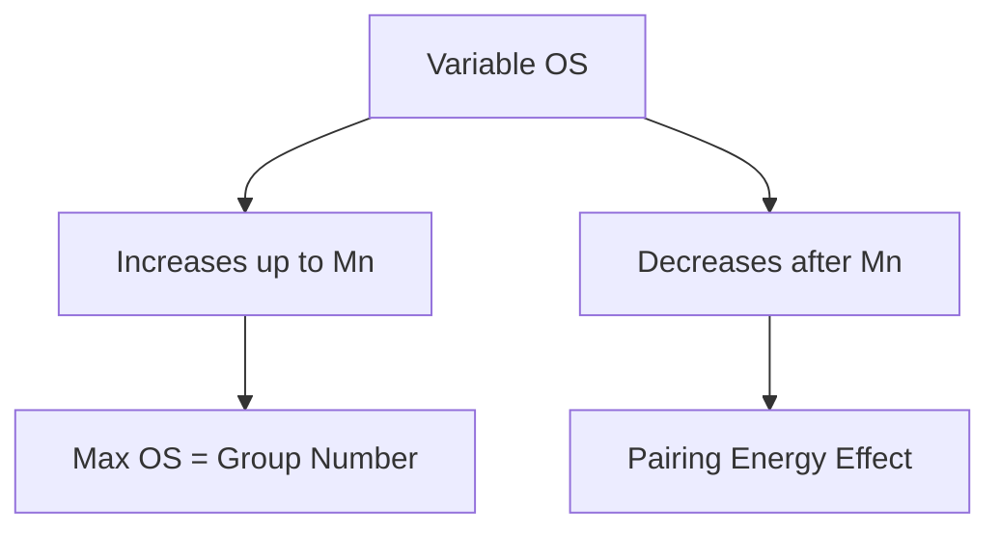
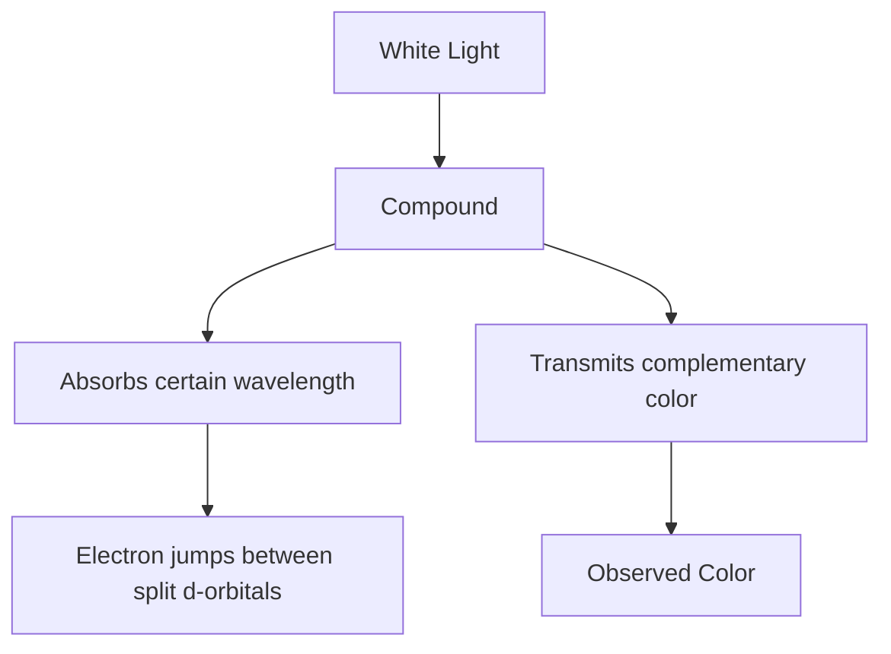
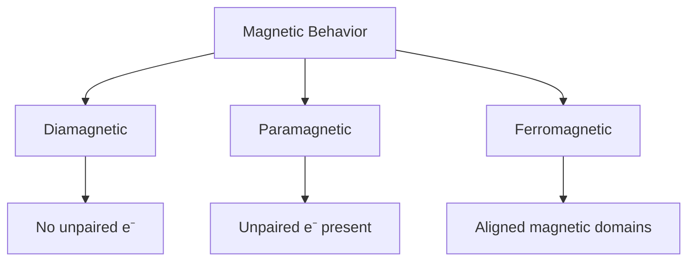
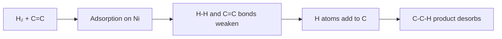

> Master variable oxidation states, color formation, magnetic properties, and catalytic behavior of transition metals for JEE Chemistry.

## Introduction

The **unique properties** of d-block elements make them indispensable in industry, biology, and technology. From the colors in gemstones to the catalysts in your car, transition metals are everywhere!

> **★ Key point · Avatar's Unobtainium**
>
> In *Avatar: The Way of Water* (2024), the precious mineral “unobtainium” exhibits properties similar to real transition metals - variable oxidation states, magnetic levitation, and energy storage. Real-world transition metals like platinum and rhodium are already incredibly valuable for similar reasons: they’re rare, have unique electronic properties, and are irreplaceable in technology!

---

## Variable Oxidation States

The **most characteristic property** of transition elements!

### Why Variable Oxidation States?

**Reasons:**

1. **Similar energy** of (n-1)d and ns orbitals
2. **Small energy difference** between successive oxidation states
3. Both ns and (n-1)d electrons can participate in bonding

### Oxidation State Trends



**Complete Oxidation State Chart (3d series):**

| Element | Config | Common OS | All Possible OS | Max OS |
| --- | --- | --- | --- | --- |
| **Sc** | 3d¹4s² | +3 | +3 | +3 |
| **Ti** | 3d²4s² | +4 | +2, +3, +4 | +4 |
| **V** | 3d³4s² | +4, +5 | +2, +3, +4, +5 | +5 |
| **Cr** | 3d⁵4s¹ | +3, +6 | +2, +3, +4, +5, +6 | +6 |
| **Mn** | 3d⁵4s² | +2, +4, +7 | +2, +3, +4, +5, +6, +7 | **+7** |
| **Fe** | 3d⁶4s² | +2, +3 | +2, +3, +4, +5, +6 | +6 |
| **Co** | 3d⁷4s² | +2, +3 | +2, +3, +4 | +4 |
| **Ni** | 3d⁸4s² | +2 | +2, +3, +4 | +4 |
| **Cu** | 3d¹⁰4s¹ | +1, +2 | +1, +2, +3 | +3 |
| **Zn** | 3d¹⁰4s² | +2 | +2 | +2 |

> **★ Key point · JEE Pattern**
>
> **Manganese** shows the **maximum number of oxidation states** (7 different states from +2 to +7) because:
>
> - Electronic configuration: 3d⁵4s²

> - Can lose up to 7 electrons (5 from d + 2 from s)

> - All oxidation states are accessible

### Stability of Oxidation States

**General Rules:**

1. **Lower OS (≤+3):** Generally stable in solution
2. **Higher OS (≥+4):** Strong oxidizing agents
3. **Intermediate OS:** May disproportionate

**Stability Patterns:**

| Element | Most Stable OS | Reason |
| --- | --- | --- |
| Ti | +4 | d⁰ configuration |
| V | +5 (acidic), +4 (neutral) | d⁰ in +5 |
| Cr | +3 | d³ (half-filled t₂g) |
| Mn | +2, +7 | +2 is d⁵, +7 is strong oxidizer |
| Fe | +3 | d⁵ configuration |
| Co | +2 | Common aqueous state |
| Ni | +2 | Common aqueous state |
| Cu | +2 | Jahn-Teller distortion |

### Disproportionation Reactions

Some oxidation states are **unstable** and undergo disproportionation:

**Examples:**

1. **Mn³⁺ disproportionation:**

   $$2Mn^{3+} \rightarrow Mn^{2+} + Mn^{4+}$$

   (Mn³⁺ is unstable in solution)
2. **Cu⁺ disproportionation:**

   $$2Cu^+ \rightarrow Cu^{2+} + Cu$$

   (Cu⁺ is unstable in aqueous solution)
3. **Mn⁶⁺ disproportionation:**

   $$3MnO_4^{2-} + 4H^+ \rightarrow 2MnO_4^- + MnO_2 + 2H_2O$$

> **⚠ Trap · Common JEE Mistake**
>
> **Cu⁺ vs Cu²⁺:**
>
> - In **aqueous solution**: Cu²⁺ is more stable (disproportionation)

> - In **solid CuI**: Cu⁺ is stable (lattice energy)
>
> Don’t assume Cu²⁺ is always more stable - context matters!

---

## Color in Transition Metal Compounds

### Origin of Color

**d-d Transitions** in the visible region!



### Crystal Field Theory Basics

When ligands approach, d-orbitals split into different energy levels:

**Octahedral Splitting:**

$$\Delta_o = E_{e_g} - E_{t_{2g}}$$

- **Lower energy:** t₂g (dxy, dyz, dzx)
- **Higher energy:** eg (dz², dx²-y²)

**Color depends on:**

1. Number of d-electrons
2. Magnitude of splitting (Δ)
3. Type of ligands
4. Geometry

### Absorption and Color Wheel

| Absorbed Color | Wavelength (nm) | Observed Color |
| --- | --- | --- |
| Violet | 400-450 | Yellow-green |
| Blue | 450-495 | Yellow |
| Green | 495-570 | Red-purple |
| Yellow | 570-590 | Violet |
| Orange | 590-620 | Blue |
| Red | 620-750 | Green |

### d-electron Count and Color

**Rule:** Compounds with **d⁰ or d¹⁰** configuration are **colorless** (no d-d transitions possible)

| Ion | d-electrons | Color | Compound Example |
| --- | --- | --- | --- |
| **Sc³⁺** | d⁰ | Colorless | Sc₂O₃ (white) |
| **Ti⁴⁺** | d⁰ | Colorless | TiO₂ (white) |
| **Ti³⁺** | d¹ | Purple | Ti₂(SO₄)₃ |
| **V⁵⁺** | d⁰ | Colorless | V₂O₅ (yellow-orange)* |
| **V⁴⁺** | d¹ | Blue | VOSO₄ |
| **V³⁺** | d² | Green | VCl₃ |
| **V²⁺** | d³ | Violet | VCl₂ |
| **Cr⁶⁺** | d⁰ | Orange | K₂Cr₂O₇ |
| **Cr³⁺** | d³ | Green | Cr₂O₃ |
| **Mn⁷⁺** | d⁰ | Purple | KMnO₄ |
| **Mn²⁺** | d⁵ | Pale pink | MnSO₄ |
| **Fe³⁺** | d⁵ | Yellow | FeCl₃ |
| **Fe²⁺** | d⁶ | Pale green | FeSO₄ |
| **Co²⁺** | d⁷ | Pink | CoCl₂ |
| **Ni²⁺** | d⁸ | Green | NiSO₄ |
| **Cu²⁺** | d⁹ | Blue | CuSO₄ |
| **Cu⁺** | d¹⁰ | Colorless | Cu₂O (red)* |
| **Zn²⁺** | d¹⁰ | Colorless | ZnSO₄ (white) |

*Color due to charge transfer, not d-d transitions

> **★ Key point · Memory Trick**
>
> **“0 to 10, No Color Within!”**
>
> Remember: d⁰ (like Ti⁴⁺, Sc³⁺) and d¹⁰ (like Zn²⁺, Cu⁺) compounds are generally colorless because there are no d-d transitions possible!

### Interactive Demo: Visualize d-Block Transition Metal Properties

Explore oxidation states, color transitions, and periodic trends across the d-block.

### Charge Transfer Complexes

Some colored compounds have d⁰ or d¹⁰ but still show color due to **charge transfer**:

**Examples:**

1. **KMnO₄** (purple): Mn⁷⁺ is d⁰

   - Charge transfer: O²⁻ → Mn⁷⁺
2. **K₂Cr₂O₇** (orange): Cr⁶⁺ is d⁰

   - Charge transfer: O²⁻ → Cr⁶⁺
3. **Cu₂O** (red): Cu⁺ is d¹⁰

   - Charge transfer: Cu⁺ → Cu²⁺

---

## Magnetic Properties

### Types of Magnetism



### Paramagnetism in Transition Metals

**Most transition metal compounds are paramagnetic** due to unpaired d-electrons.

**Magnetic Moment Formula (Spin-only):**

$$\boxed{\mu_s = \sqrt{n(n+2)} \text{ BM}}$$

where:

- n = number of unpaired electrons
- BM = Bohr Magneton

### Calculating Magnetic Moment

**Step-by-step:**

1. Determine ion’s electronic configuration
2. Count unpaired electrons
3. Apply formula: μ = √n(n+2)

**Examples:**

| Ion | Config | Unpaired e⁻ (n) | μ (BM) | Magnetic Nature |
| --- | --- | --- | --- | --- |
| **Sc³⁺** | [Ar]3d⁰ | 0 | 0 | Diamagnetic |
| **Ti³⁺** | [Ar]3d¹ | 1 | √3 = 1.73 | Paramagnetic |
| **V³⁺** | [Ar]3d² | 2 | √8 = 2.83 | Paramagnetic |
| **Cr³⁺** | [Ar]3d³ | 3 | √15 = 3.87 | Paramagnetic |
| **Mn²⁺** | [Ar]3d⁵ | 5 | √35 = 5.92 | Paramagnetic |
| **Fe³⁺** | [Ar]3d⁵ | 5 | √35 = 5.92 | Paramagnetic |
| **Fe²⁺** | [Ar]3d⁶ | 4 | √24 = 4.90 | Paramagnetic |
| **Co²⁺** | [Ar]3d⁷ | 3 | √15 = 3.87 | Paramagnetic |
| **Ni²⁺** | [Ar]3d⁸ | 2 | √8 = 2.83 | Paramagnetic |
| **Cu²⁺** | [Ar]3d⁹ | 1 | √3 = 1.73 | Paramagnetic |
| **Zn²⁺** | [Ar]3d¹⁰ | 0 | 0 | Diamagnetic |

### High Spin vs Low Spin Complexes

Magnetic moment depends on ligand field strength:

**Weak Field Ligands** (I⁻, Br⁻, Cl⁻, F⁻, OH⁻):

- Small Δ
- **High spin** (maximum unpaired electrons)
- Example: [Fe(H₂O)₆]²⁺ has 4 unpaired e⁻

**Strong Field Ligands** (CN⁻, CO, NO₂⁻):

- Large Δ
- **Low spin** (minimum unpaired electrons)
- Example: [Fe(CN)₆]⁴⁻ has 0 unpaired e⁻

> **★ Key point · JEE Alert**
>
> **Same metal, different magnetism:**
>
> - [Fe(H₂O)₆]²⁺: 4 unpaired e⁻, μ = 4.90 BM (paramagnetic)

> - [Fe(CN)₆]⁴⁻: 0 unpaired e⁻, μ = 0 BM (diamagnetic)
>
> The ligand makes ALL the difference!

### Ferromagnetism

**Permanent magnetism** shown by Fe, Co, Ni due to:

- Aligned magnetic domains
- Persists even after removing external field

**Curie Temperature:**
Temperature above which ferromagnetic → paramagnetic

- Fe: 1043 K
- Co: 1394 K
- Ni: 631 K

---

## Catalytic Properties

Transition metals are **excellent catalysts** in industrial and biological processes.

### Why Good Catalysts?

**Reasons:**

1. **Variable oxidation states**

   - Can donate/accept electrons easily
   - Form reaction intermediates
2. **Form complexes**

   - Bring reactants together
   - Lower activation energy
3. **Large surface area**

   - Provide adsorption sites (heterogeneous catalysis)
4. **Partially filled d-orbitals**

   - Facilitate bonding with reactants

### Homogeneous Catalysis

Catalyst in the **same phase** as reactants.

**Examples:**

1. **Contact Process (SO₂ → SO₃):**

   $$2SO_2 + O_2 \xrightarrow{V_2O_5} 2SO_3$$

   Mechanism:

   $$V_2O_5 \rightarrow V_2O_4 + \frac{1}{2}O_2$$

$$V_2O_4 + SO_2 \rightarrow V_2O_5 + SO_3$$
2. **Oxidation of CO:**

   $$2CO + O_2 \xrightarrow{[Co(OAc)_2]} 2CO_2$$
3. **Wilkinson’s Catalyst:**

   $$RCH=CH_2 + H_2 \xrightarrow{[RhCl(PPh_3)_3]} RCH_2CH_3$$

### Heterogeneous Catalysis

Catalyst in **different phase** from reactants.

**Industrial Examples:**

| Reaction | Catalyst | Process |
| --- | --- | --- |
| N₂ + 3H₂ → 2NH₃ | **Fe** | Haber process |
| 2SO₂ + O₂ → 2SO₃ | **V₂O₅** | Contact process |
| 4NH₃ + 5O₂ → 4NO + 6H₂O | **Pt** | Ostwald process |
| Vegetable oil + H₂ → Saturated fat | **Ni** | Hydrogenation |
| 2H₂O₂ → 2H₂O + O₂ | **MnO₂** | Decomposition |
| CO + hydrocarbons | **Pt/Pd/Rh** | Catalytic converter |

**Mechanism (Hydrogenation):**

1. **Adsorption:** Reactants bind to metal surface
2. **Activation:** Bonds weaken
3. **Reaction:** Products form on surface
4. **Desorption:** Products leave surface



### Biological Catalysis

**Metalloenzymes** containing transition metals:

| Metal | Enzyme | Function |
| --- | --- | --- |
| **Fe** | Hemoglobin | O₂ transport |
| **Fe** | Cytochromes | Electron transfer |
| **Cu** | Cytochrome oxidase | Respiration |
| **Zn** | Carbonic anhydrase | CO₂ hydration |
| **Mo** | Nitrogenase | N₂ fixation |
| **Co** | Vitamin B₁₂ | Metabolism |

> **★ Key point · Real-Life Application**
>
> **Catalytic Converters** in cars use Pt, Pd, and Rh to convert:
>
> - CO → CO₂

> - NOₓ → N₂

> - Unburnt hydrocarbons → CO₂ + H₂O
>
> This reduces air pollution by over 90%!

---

## Formation of Interstitial Compounds

**Interstitial compounds** form when small atoms (H, B, C, N) occupy **interstitial spaces** in the metal lattice.

### Characteristics

**Properties:**

1. **Very hard** and rigid
2. **High melting points**
3. **Chemically inert**
4. **Retain metallic conductivity**
5. **Non-stoichiometric** (variable composition)

**Examples:**

- TiC, TiH₁.₇, VH₀.₅₆, Fe₃H, Mn₄N, Fe₃C (cementite)

### Steel Formation

**Steel = Iron + Carbon (interstitial compound)**

| Type | C% | Properties |
| --- | --- | --- |
| Mild Steel | 0.1-0.3 | Ductile, malleable |
| Medium Steel | 0.3-0.6 | Tough, hard |
| High Carbon Steel | 0.6-1.5 | Very hard, brittle |

The carbon atoms fit into interstitial spaces, making steel harder than pure iron!

---

## Alloy Formation

Transition metals readily form **alloys** due to:

- Similar atomic radii
- Similar crystal structures
- Similar metallic bonding

**Types:**

1. **Substitutional Alloys:** Metal atoms replace each other

   - Brass (Cu + Zn)
   - Bronze (Cu + Sn)
2. **Interstitial Alloys:** Small atoms in gaps

   - Steel (Fe + C)

**Common Alloys:**

| Alloy | Composition | Uses |
| --- | --- | --- |
| **Brass** | Cu (70%) + Zn (30%) | Decorative, musical instruments |
| **Bronze** | Cu (90%) + Sn (10%) | Statues, coins |
| **Stainless Steel** | Fe + Cr + Ni + C | Utensils, construction |
| **Nichrome** | Ni (80%) + Cr (20%) | Heating elements |
| **Alnico** | Al + Ni + Co | Permanent magnets |

---

## Complex Formation

Transition metals form **coordination complexes** readily.

### Why?

1. **Small size + high charge** → high charge density
2. **Vacant d-orbitals** → can accept electron pairs
3. **Variable oxidation states** → flexible bonding

### Examples

**Common Complexes:**

| Formula | Name | Geometry |
| --- | --- | --- |
| [Fe(CN)₆]⁴⁻ | Ferrocyanide | Octahedral |
| [Fe(CN)₆]³⁻ | Ferricyanide | Octahedral |
| [Cu(NH₃)₄]²⁺ | Tetraammine copper(II) | Square planar |
| [Ni(CO)₄] | Nickel carbonyl | Tetrahedral |
| [Co(NH₃)₆]³⁺ | Hexaammine cobalt(III) | Octahedral |

**Stability:** Related to:

- Charge on metal ion (higher charge = more stable)
- Size of metal ion (smaller = more stable)
- Nature of ligand (chelating > monodentate)

---

## Common JEE Mistakes

1. **Assuming d⁰ compounds are always colorless**

   - Wrong: KMnO₄ (Mn⁷⁺, d⁰) is purple due to charge transfer
2. **Forgetting to consider ligand field in magnetic moment**

   - [Fe(CN)₆]⁴⁻ is diamagnetic (low spin)
   - [Fe(H₂O)₆]²⁺ is paramagnetic (high spin)
3. **Maximum oxidation state confusion**

   - Mn shows +7 (uses all 7 electrons)
   - Fe maximum is +6 (not +8)
4. **Cu⁺ stability**

   - Unstable in aqueous solution (disproportionates)
   - Stable in solid compounds like CuI
5. **Magnetic moment calculation errors**

   - Always find the ION’s configuration first
   - Fe²⁺ is 3d⁶ (not 3d⁶4s²)

---

## Practice Problems

### Level 1: Basic Understanding

1. **Why are most transition metal compounds colored?**
2. **Calculate magnetic moment of:**

   - Fe²⁺
   - Co³⁺
   - Cu⁺
3. **Why is Zn²⁺ diamagnetic while Cu²⁺ is paramagnetic?**

### Level 2: Application

4. **Compare:**

   - Color of Ti⁴⁺ and Ti³⁺ compounds
   - Stability of Mn²⁺ and Mn³⁺
   - Magnetic nature of [Fe(CN)₆]⁴⁻ and [Fe(H₂O)₆]²⁺
5. **Explain why:**

   - KMnO₄ is purple though Mn⁷⁺ is d⁰
   - Fe is used in Haber process as catalyst
   - Interstitial compounds are very hard
6. **A complex of Co³⁺ has magnetic moment 4.90 BM. Is it high spin or low spin? Give structure.**

### Level 3: JEE Advanced

7. **The magnetic moment of [Mn(CN)₆]⁴⁻ is 2.8 BM. The geometry and number of unpaired electrons are:**

   - (a) Octahedral, 2
   - (b) Tetrahedral, 3
   - (c) Square planar, 2
   - (d) Octahedral, 4
8. **Which is most stable in aqueous solution?**

   - (a) Cu⁺
   - (b) Fe³⁺
   - (c) Mn³⁺
   - (d) Cr²⁺
9. **A transition metal ion M²⁺ has configuration 3d⁵ in free state. Its magnetic moment in [M(CN)₆]⁴⁻ is 1.73 BM. Identify the metal.**
10. **Assertion (A):** CrO₄²⁻ is yellow while Cr₂O₇²⁻ is orange.
    **Reason (R):** CrO₄²⁻ and Cr₂O₇²⁻ have different geometries.

    - (a) Both A and R true, R explains A
    - (b) Both true, R doesn’t explain A
    - (c) A true, R false
    - (d) Both false

> **↗ Connection · Quick Check**
>
> **Test yourself:** Can you explain why [Fe(CN)₆]⁴⁻ is diamagnetic while [Fe(H₂O)₆]²⁺ is paramagnetic, even though both have Fe²⁺?

---

## Memory Tricks

### “CCOOM” for Properties

**Key Properties:**

- **C**olor formation
- **C**atalytic activity
- **O**xidation state variability
- **O**ctahedral complexes (common)
- **M**agnetic behavior

### Magnetic Moment Quick Values

| Unpaired e⁻ | μ (BM) | Remember as |
| --- | --- | --- |
| 1 | 1.73 | √3 |
| 2 | 2.83 | √8 |
| 3 | 3.87 | √15 |
| 4 | 4.90 | √24 |
| 5 | 5.92 | √35 |

### Color Memory

**“Silly Tigers Very Carefully Make Friends Carefully, Not Carelessly, Zipping!”**

- **S**c³⁺ = Colorless
- **T**i³⁺ = Purple
- **V**³⁺ = Green
- **C**r³⁺ = Green
- **M**n²⁺ = Pink
- **F**e²⁺ = Green
- **F**e³⁺ = Yellow (Careful!)
- **C**o²⁺ = Pink
- **N**i²⁺ = Green
- **C**u²⁺ = Blue
- **Z**n²⁺ = Colorless

---

## Related Topics

### Within d-f Block Elements

- [Transition Elements](../transition-elements/index.md) - General characteristics
- [Important Compounds](../important-compounds/index.md) - K₂Cr₂O₇, KMnO₄
- [Lanthanoids](../lanthanoids/index.md) - f-block properties
- [Actinoids](../actinoids/index.md) - Radioactive elements

### Other Chemistry Topics

- [Coordination Compounds](../../coordination-compounds/index.md) - CFT, VBT
- [Chemical Bonding](../../chemical-bonding/index.md) - Molecular orbital theory
- [Atomic Structure](../../atomic-structure/index.md) - Electronic configuration

### Cross-Subject Connections

- [Magnetism](../../../physics/magnetism/index.md) - Ferro-, para-, diamagnetism
- [Electrochemistry](../../redox-electrochemistry/index.md) - Oxidation states

---

From TestGuru · our mock-test platform

## You've read Properties of d-Block Elements.You've read this topic. Find out what you actually got.

A free JEE Main mock with this chapter in it, and a report that shows which sub-topics cost you marks.

[Take a free JEE Main mock →](https://app.testguru.co/signup?tg_chapter=d-f-block-elements&tg_exam=jee-main&tg_page=%2Fchemistry%2Fd-f-block-elements%2Fproperties-d-block%2F&tg_subject=chemistry&utm_campaign=notes-jee-main-free-test&utm_content=article-end&utm_medium=referral&utm_source=jeenotes)
Free, no card. Opens TestGuru in a new tab.

## Stay exam-ready

One email every Sunday: new notes, the week's hardest challenge question and a revision plan.One email every Sunday.

## Comments

Have a question or spotted a mistake? Join the discussion below.

Advertisement

Advertisement

---

## Extracted page code (interactive scripts & widgets)


### inline-script-16

```js
if(!document.getElementById("animation-fullscreen-overlay")){const e=document.createElement("div");e.id="animation-fullscreen-overlay",e.className="animation-fullscreen-overlay",e.innerHTML=`
      <div class="fullscreen-modal">
        <div class="fullscreen-header">
          <span class="fullscreen-title">Interactive Demo</span>
          <button class="fullscreen-close-btn" onclick="JEEAnimations.closeFullscreen()" title="Close (Esc)" aria-label="Close fullscreen">
            <svg width="24" height="24" viewBox="0 0 24 24" fill="none" stroke="currentColor" stroke-width="2" stroke-linecap="round" stroke-linejoin="round">
              <line x1="18" y1="6" x2="6" y2="18"></line>
              <line x1="6" y1="6" x2="18" y2="18"></line>
            </svg>
          </button>
        </div>
        <div class="fullscreen-content"></div>
      </div>
    `,document.body.appendChild(e),document.addEventListener("keydown",function(e){e.key==="Escape"&&document.body.classList.contains("animation-fullscreen-active")&&JEEAnimations.closeFullscreen()}),e.addEventListener("click",function(t){t.target===e&&JEEAnimations.closeFullscreen()})}
```


### inline-script-17

```js
(function(){var t,e=document.getElementById("disqus-load");if(!e)return;t=!1,e.addEventListener("click",function(){if(t)return;t=!0,e.setAttribute("disabled","disabled"),e.textContent="Loading comments…",window.disqus_config=function(){this.page.url="https://jeenotes.in/chemistry/d-f-block-elements/properties-d-block/",this.page.identifier="/chemistry/d-f-block-elements/properties-d-block/"};var s=document,n=s.createElement("script");n.src="https://https-jeenotes-in.disqus.com/embed.js",n.setAttribute("data-timestamp",+new Date),n.onload=function(){e.style.display="none"},n.onerror=function(){t=!1,e.removeAttribute("disabled"),e.textContent="Could not load comments. Tap to retry"},(s.head||s.body).appendChild(n)})})()
```


### inline-script-18

```js
(function(){var t,e=document.currentScript.previousElementSibling;function n(){(window.adsbygoogle=window.adsbygoogle||[]).push({})}if(!window.ResizeObserver||e.clientWidth>0){n();return}t=new ResizeObserver(function(){e.clientWidth>0&&(t.disconnect(),n())}),t.observe(e)})()
```


### interactive-widget-1

```html
<div class="animation-wrapper" data-animation="periodicTable" id="anim-periodicTable-1795396419551740627"><div class="animation-header"><button aria-label="Toggle fullscreen" class="anim-fullscreen-btn" onclick='JEEAnimations.toggleFullscreen("anim-periodicTable-1795396419551740627")' title="Fullscreen (F)">
<svg class="fullscreen-icon-expand" fill="none" height="18" stroke="currentColor" stroke-linecap="round" stroke-linejoin="round" stroke-width="2" viewbox="0 0 24 24" width="18"><polyline points="15 3 21 3 21 9"></polyline><polyline points="9 21 3 21 3 15"></polyline><line x1="21" x2="14" y1="3" y2="10"></line><line x1="3" x2="10" y1="21" y2="14"></line></svg>
<svg class="fullscreen-icon-collapse" fill="none" height="18" stroke="currentColor" stroke-linecap="round" stroke-linejoin="round" stroke-width="2" viewbox="0 0 24 24" width="18"><polyline points="4 14 10 14 10 20"></polyline><polyline points="20 10 14 10 14 4"></polyline><line x1="14" x2="21" y1="10" y2="3"></line><line x1="3" x2="10" y1="21" y2="14"></line></svg>
<span class="fullscreen-text">Fullscreen</span></button></div><div class="animation-content"><noscript><div class="callout callout-warning"><div class="callout-title">JavaScript Required</div><p>This interactive animation requires JavaScript to be enabled.</p></div></noscript></div></div>
```


---

_Source: [https://jeenotes.in/chemistry/d-f-block-elements/properties-d-block/](https://jeenotes.in/chemistry/d-f-block-elements/properties-d-block/) · raw HTML: `offline/chemistry/d-f-block-elements/properties-d-block/index.html`_
