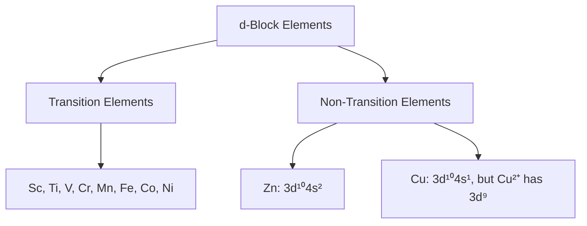

> Master the electronic configuration, definition, and general properties of d-block transition elements for JEE Chemistry.

## Introduction

**Transition elements** are the heart of inorganic chemistry - they’re everywhere from the hemoglobin in your blood (iron) to catalytic converters in cars (platinum). Understanding their unique properties is crucial for JEE success!

> **★ Key point · Iron Man's Arc Reactor**
>
> In *Iron Man* (2024 reboot), Tony Stark’s arc reactor uses palladium - a transition metal! These elements are special because they can store and release energy efficiently through multiple oxidation states. That’s why transition metals power everything from your phone battery to fictional arc reactors. Their partially filled d-orbitals make them chemistry’s Swiss Army knife!

---

## Definition of Transition Elements

### IUPAC Definition

**Transition elements** are elements that have **partially filled d-orbitals** in their ground state OR in any of their commonly occurring oxidation states.

$$\boxed{\text{Transition Element: partially filled } (n-1)d^{1-9} \text{ orbitals}}$$

### d-Block vs Transition Elements

**Not all d-block elements are transition elements!**



**Exceptions:**

- **Zn, Cd, Hg**: d¹⁰ configuration (fully filled d-orbitals) - NOT transition elements
- **Cu, Ag, Au**: Although ground state is d¹⁰s¹, their common oxidation states have partially filled d-orbitals - STILL transition elements

> **⚠ Trap · Common JEE Mistake**
>
> **Zinc is NOT a transition element!** While it’s in the d-block, both Zn (3d¹⁰4s²) and Zn²⁺ (3d¹⁰) have fully filled d-orbitals. This is asked repeatedly in JEE!

---

## Position in Periodic Table

### The Four Series

| Series | Elements | Orbitals | Range |
| --- | --- | --- | --- |
| **3d** | Sc to Zn | 3d¹⁻¹⁰4s¹⁻² | 21-30 |
| **4d** | Y to Cd | 4d¹⁻¹⁰5s¹⁻² | 39-48 |
| **5d** | La, Hf-Hg | 5d¹⁻¹⁰6s² | 57, 72-80 |
| **6d** | Ac, Rf-Cn | 6d¹⁻¹⁰7s² | 89, 104-112 |

**Note:** Lanthanoids (58-71) and Actinoids (90-103) interrupt the 5d and 6d series respectively.

---

## Electronic Configuration

### General Configuration

$$\boxed{(n-1)d^{1-10} \, ns^{0-2}}$$

### First Transition Series (3d)

| Element | Z | Expected Config | Actual Config | Reason |
| --- | --- | --- | --- | --- |
| Sc | 21 | [Ar]3d¹4s² | [Ar]3d¹4s² | Regular |
| Ti | 22 | [Ar]3d²4s² | [Ar]3d²4s² | Regular |
| V | 23 | [Ar]3d³4s² | [Ar]3d³4s² | Regular |
| **Cr** | 24 | [Ar]3d⁴4s² | **[Ar]3d⁵4s¹** | Half-filled stability |
| Mn | 25 | [Ar]3d⁵4s² | [Ar]3d⁵4s² | Regular |
| Fe | 26 | [Ar]3d⁶4s² | [Ar]3d⁶4s² | Regular |
| Co | 27 | [Ar]3d⁷4s² | [Ar]3d⁷4s² | Regular |
| Ni | 28 | [Ar]3d⁸4s² | [Ar]3d⁸4s² | Regular |
| **Cu** | 29 | [Ar]3d⁹4s² | **[Ar]3d¹⁰4s¹** | Fully-filled stability |
| Zn | 30 | [Ar]3d¹⁰4s² | [Ar]3d¹⁰4s² | Regular |

> **★ Key point · Memory Trick: Cr and Cu**
>
> **“Chromium and Copper are HALF CRAZY and FULLY CRAZY!”**
>
> - **Cr**: Wants HALF-filled d⁵ (gives up one 4s electron)

> - **Cu**: Wants FULLY-filled d¹⁰ (gives up one 4s electron)
>
> Remember: d⁵ and d¹⁰ are extra stable due to symmetry and exchange energy!

### Interactive Demo: Visualize Transition Elements in Periodic Table

Explore the d-block elements, their positions, and electronic configurations.

### Why d⁵ and d¹⁰ are Stable?

1. **Exchange Energy**: Maximum number of electron exchanges
2. **Symmetrical Distribution**: All d-orbitals equally occupied (d⁵) or fully occupied (d¹⁰)
3. **Pairing Energy Minimization**: Half-filled avoids pairing

**Exchange stabilization:**

- d⁵: 10 exchanges (↑ ↑ ↑ ↑ ↑)
- d¹⁰: 45 exchanges (↑↓ ↑↓ ↑↓ ↑↓ ↑↓)

---

## General Characteristics

### 1. Metallic Character

**All transition elements are metals** with typical metallic properties:

- High density
- High melting and boiling points
- Metallic luster
- Good conductors of heat and electricity
- Malleable and ductile

**Trends:**

- Melting point generally increases across period (max at Cr/W)
- Exception: Mn and Tc have lower m.p. due to d⁵ configuration

### 2. Atomic and Ionic Radii

**Across a Period:**

- Generally **decreases** from left to right
- Decrease is **small** compared to s and p-block elements
- Reason: Poor shielding by d-electrons

**Down a Group:**

- Usually **increases** from 3d to 4d
- 4d and 5d series have **similar radii** (lanthanoid contraction effect)


### 3. Ionization Energy

**Trends:**

- Generally **increases** across the period (irregular)
- **Higher than s-block**, **lower than p-block**
- Small variation across series

**Why irregular?**

- d⁵ and d¹⁰ configurations have extra stability
- Cr (d⁵s¹) and Cu (d¹⁰s¹) have higher IE than expected

### 4. Oxidation States

**Most characteristic property!**

- Show **variable oxidation states** differing by 1
- Range: +2 to +7 (Mn shows all from +2 to +7)
- Common stable states: +2, +3

**Rules:**

1. **Maximum oxidation state** = Group number (up to Mn)
2. After Mn, maximum OS decreases (pairing energy consideration)
3. **+2 state is common** (loss of 2 electrons from ns orbital)
4. **Higher oxidation states** are more oxidizing

| Element | Common OS | Maximum OS |
| --- | --- | --- |
| Sc | +3 | +3 |
| Ti | +3, +4 | +4 |
| V | +4, +5 | +5 |
| Cr | +3, +6 | +6 |
| Mn | +2, +4, +7 | +7 |
| Fe | +2, +3 | +6 |
| Co | +2, +3 | +4 |
| Ni | +2 | +4 |
| Cu | +1, +2 | +3 |

> **★ Key point · JEE Alert**
>
> **Manganese** shows the maximum number of oxidation states (+2 to +7) because it can use all 7 electrons (5 from 3d + 2 from 4s).

### 5. Magnetic Properties

Most transition metal compounds are **paramagnetic** due to unpaired electrons.

**Magnetic moment (μ):**

$$\boxed{\mu = \sqrt{n(n+2)} \text{ BM}}$$

where n = number of unpaired electrons, BM = Bohr Magneton

**Examples:**

- Ti³⁺ (3d¹): n=1, μ = √3 = 1.73 BM
- Fe²⁺ (3d⁶): n=4, μ = √24 = 4.90 BM
- Cu²⁺ (3d⁹): n=1, μ = √3 = 1.73 BM
- Zn²⁺ (3d¹⁰): n=0, μ = 0 (diamagnetic)

### 6. Catalytic Properties

Transition metals and their compounds are **excellent catalysts**.

**Reasons:**

1. Variable oxidation states (can donate/accept electrons)
2. Form reaction intermediates
3. Provide large surface area (heterogeneous catalysis)

**Examples:**

- **Fe**: Haber process (N₂ + H₂ → NH₃)
- **V₂O₅**: Contact process (SO₂ → SO₃)
- **Ni**: Hydrogenation of oils
- **Pt**: Catalytic converters
- **MnO₂**: Decomposition of H₂O₂

### 7. Formation of Colored Compounds

Most transition metal compounds are **colored** due to **d-d transitions**.

**Mechanism:**

1. In presence of ligands, d-orbitals split into different energy levels
2. Electrons absorb visible light to jump between these levels
3. Complementary color is observed

**Colorless exceptions (d⁰ or d¹⁰):**

- Sc³⁺ (d⁰), Ti⁴⁺ (d⁰): Colorless
- Zn²⁺ (d¹⁰), Cu⁺ (d¹⁰): Colorless

| Ion | d-electrons | Color |
| --- | --- | --- |
| Sc³⁺ | d⁰ | Colorless |
| Ti³⁺ | d¹ | Purple |
| V³⁺ | d² | Green |
| Cr³⁺ | d³ | Green |
| Mn²⁺ | d⁵ | Pale pink |
| Fe²⁺ | d⁶ | Pale green |
| Fe³⁺ | d⁵ | Yellow |
| Co²⁺ | d⁷ | Pink |
| Ni²⁺ | d⁸ | Green |
| Cu²⁺ | d⁹ | Blue |
| Zn²⁺ | d¹⁰ | Colorless |

### 8. Complex Formation

Transition metals readily form **coordination complexes** due to:

1. Small size and high charge
2. Availability of vacant d-orbitals
3. Ability to accept electron pairs from ligands

**Examples:**

- [Fe(CN)₆]⁴⁻, [Cu(NH₃)₄]²⁺, [Ni(CO)₄]

### 9. Alloy Formation

Transition metals form **interstitial and substitutional alloys** easily.

**Reasons:**

- Similar atomic radii
- Similar crystal structures
- Similar electronic configurations

**Examples:**

- Steel (Fe + C)
- Brass (Cu + Zn)
- Bronze (Cu + Sn)

### 10. Interstitial Compounds

Form compounds with small atoms (H, B, C, N) that occupy **interstitial spaces** in metal lattice.

**Properties:**

- Very hard
- High melting points
- Chemically inert
- Retain metallic conductivity

**Examples:**

- TiC, TiH₂, VH₀.₅₆

---

## Comparison: 3d vs 4d vs 5d Series

| Property | 3d | 4d | 5d |
| --- | --- | --- | --- |
| **Atomic Size** | Small | Large | Large (similar to 4d) |
| **Density** | Low | Moderate | High |
| **Melting Point** | Moderate | High | Very High |
| **Oxidation States** | Limited | More variable | Most variable |
| **Complex Formation** | Moderate | Good | Excellent |

**Lanthanoid Contraction Effect:**
The 4d and 5d series have similar radii due to the lanthanoid contraction (poor shielding by 4f electrons).

---

## Common JEE Mistakes

1. **Assuming all d-block elements are transition elements**

   - Wrong: Zn, Cd, Hg are NOT transition elements
2. **Forgetting anomalous configurations**

   - Cr: 3d⁵4s¹ (NOT 3d⁴4s²)
   - Cu: 3d¹⁰4s¹ (NOT 3d⁹4s²)
3. **Maximum oxidation state confusion**

   - Mn shows +7 (not Fe or Co)
   - After Mn, max OS decreases
4. **Color and configuration**

   - d⁰ and d¹⁰ compounds are colorless (no d-d transitions possible)
5. **Magnetic moment calculation**

   - Use spin-only formula: μ = √n(n+2)
   - Don’t forget to consider the actual configuration of the ion!

> **⚠ Trap · Exam Alert**
>
> When asked about transition elements, ALWAYS check if the question refers to:
>
> - Ground state configuration OR

> - Common oxidation state configuration
>
> Example: Cu is a transition element because Cu²⁺ (3d⁹) has unpaired d-electrons, even though Cu⁰ has 3d¹⁰.

---

## Practice Problems

### Level 1: Basic Concepts

1. **Why is Zn not considered a transition element?**
2. **Write the electronic configuration of:**

   - Cr (Z=24)
   - Cu²⁺ (Z=29)
   - Fe³⁺ (Z=26)
3. **Which transition metal shows the maximum number of oxidation states? Why?**

### Level 2: Application

4. **Calculate the magnetic moment of:**

   - Ti³⁺
   - V⁴⁺
   - Mn²⁺
   - Cu²⁺
5. **Explain why:**

   - Transition elements form colored compounds
   - Transition metals are good catalysts
   - Sc³⁺ is colorless but Ti³⁺ is colored
6. **Compare the atomic radii:**

   - Fe vs Co vs Ni
   - Zr vs Hf
   - Explain the trends

### Level 3: JEE Advanced

7. **The electronic configuration of Cr²⁺ ion is:**

   - (a) [Ar]3d⁵4s¹
   - (b) [Ar]3d⁴
   - (c) [Ar]3d⁴4s²
   - (d) [Ar]3d²4s²
8. **Which of the following pairs of compounds show different colors?**

   - (a) TiO₂ and VO₂
   - (b) CuSO₄ and ZnSO₄
   - (c) FeSO₄ and FeCl₂
   - (d) MnO and MnO₂
9. **A transition metal ion has magnetic moment of 3.87 BM. If it belongs to 3d series, identify the possible ions.**
10. **Assertion (A):** Transition elements form a large number of complexes.
    **Reason (R):** Transition elements have small size and high nuclear charge.

    - (a) Both A and R are true, R explains A
    - (b) Both A and R are true, R doesn’t explain A
    - (c) A is true, R is false
    - (d) Both are false

> **↗ Connection · Quick Check**
>
> **Memory Test:** Can you list all the general characteristics of transition elements? (Hint: There are 10!)

---

## Memory Tricks

### “CCFM VCM” Mnemonic

**Characteristics of Transition Elements:**

- **C**atalytic activity
- **C**omplex formation
- **F**orm alloys
- **M**agnetic properties
- **V**ariable oxidation states
- **C**olored compounds
- **M**etallic properties

### “Chromium & Copper - Half & Full!”

For anomalous configurations:

- **Chromium** → **Half**-filled d⁵
- **Copper** → **Full**-filled d¹⁰

### “Zinc Never Transitions!”

To remember Zn is NOT a transition element:

- **Z**inc
- **N**ever
- **T**ransitions
  (Because it has fully filled d-orbitals)

---

## Related Topics

### Within d-f Block Elements

- [Properties of d-Block Elements](../properties-d-block/index.md) - Color, magnetism, oxidation states
- [Important Compounds](../important-compounds/index.md) - K₂Cr₂O₇, KMnO₄ chemistry
- [Lanthanoids](../lanthanoids/index.md) - 4f series properties
- [Actinoids](../actinoids/index.md) - 5f series and radioactivity

### Cross-Subject: Physics Connections

- [Electromagnetic Radiation](../../atomic-structure/electromagnetic-radiation/index.md) - Color origin in compounds
- [Magnetism](../../../physics/magnetism/index.md) - Paramagnetism and diamagnetism

### Other Chemistry Topics

- [Coordination Compounds](../../coordination-compounds/index.md) - Complex formation
- [Chemical Bonding](../../chemical-bonding/index.md) - Hybridization in complexes
- [Periodic Classification](../../periodic-classification/index.md) - Trends across periods

---

**[Properties of d-Block Elements →](../properties-d-block/index.md)**

From TestGuru · our mock-test platform

## You've read Transition Elements: General Characteristics.You've read this topic. Find out what you actually got.

A free JEE Main mock with this chapter in it, and a report that shows which sub-topics cost you marks.

[Take a free JEE Main mock →](https://app.testguru.co/signup?tg_chapter=d-f-block-elements&tg_exam=jee-main&tg_page=%2Fchemistry%2Fd-f-block-elements%2Ftransition-elements%2F&tg_subject=chemistry&utm_campaign=notes-jee-main-free-test&utm_content=article-end&utm_medium=referral&utm_source=jeenotes)
Free, no card. Opens TestGuru in a new tab.

## Stay exam-ready

One email every Sunday: new notes, the week's hardest challenge question and a revision plan.One email every Sunday.

## Comments

Have a question or spotted a mistake? Join the discussion below.

Advertisement

Advertisement

---

## Extracted page code (interactive scripts & widgets)


### inline-script-16

```js
if(!document.getElementById("animation-fullscreen-overlay")){const e=document.createElement("div");e.id="animation-fullscreen-overlay",e.className="animation-fullscreen-overlay",e.innerHTML=`
      <div class="fullscreen-modal">
        <div class="fullscreen-header">
          <span class="fullscreen-title">Interactive Demo</span>
          <button class="fullscreen-close-btn" onclick="JEEAnimations.closeFullscreen()" title="Close (Esc)" aria-label="Close fullscreen">
            <svg width="24" height="24" viewBox="0 0 24 24" fill="none" stroke="currentColor" stroke-width="2" stroke-linecap="round" stroke-linejoin="round">
              <line x1="18" y1="6" x2="6" y2="18"></line>
              <line x1="6" y1="6" x2="18" y2="18"></line>
            </svg>
          </button>
        </div>
        <div class="fullscreen-content"></div>
      </div>
    `,document.body.appendChild(e),document.addEventListener("keydown",function(e){e.key==="Escape"&&document.body.classList.contains("animation-fullscreen-active")&&JEEAnimations.closeFullscreen()}),e.addEventListener("click",function(t){t.target===e&&JEEAnimations.closeFullscreen()})}
```


### inline-script-17

```js
(function(){var t,e=document.getElementById("disqus-load");if(!e)return;t=!1,e.addEventListener("click",function(){if(t)return;t=!0,e.setAttribute("disabled","disabled"),e.textContent="Loading comments…",window.disqus_config=function(){this.page.url="https://jeenotes.in/chemistry/d-f-block-elements/transition-elements/",this.page.identifier="/chemistry/d-f-block-elements/transition-elements/"};var s=document,n=s.createElement("script");n.src="https://https-jeenotes-in.disqus.com/embed.js",n.setAttribute("data-timestamp",+new Date),n.onload=function(){e.style.display="none"},n.onerror=function(){t=!1,e.removeAttribute("disabled"),e.textContent="Could not load comments. Tap to retry"},(s.head||s.body).appendChild(n)})})()
```


### inline-script-18

```js
(function(){var t,e=document.currentScript.previousElementSibling;function n(){(window.adsbygoogle=window.adsbygoogle||[]).push({})}if(!window.ResizeObserver||e.clientWidth>0){n();return}t=new ResizeObserver(function(){e.clientWidth>0&&(t.disconnect(),n())}),t.observe(e)})()
```


### interactive-widget-1

```html
<div class="animation-wrapper" data-animation="periodicTable" id="anim-periodicTable-1795396419546279378"><div class="animation-header"><button aria-label="Toggle fullscreen" class="anim-fullscreen-btn" onclick='JEEAnimations.toggleFullscreen("anim-periodicTable-1795396419546279378")' title="Fullscreen (F)">
<svg class="fullscreen-icon-expand" fill="none" height="18" stroke="currentColor" stroke-linecap="round" stroke-linejoin="round" stroke-width="2" viewbox="0 0 24 24" width="18"><polyline points="15 3 21 3 21 9"></polyline><polyline points="9 21 3 21 3 15"></polyline><line x1="21" x2="14" y1="3" y2="10"></line><line x1="3" x2="10" y1="21" y2="14"></line></svg>
<svg class="fullscreen-icon-collapse" fill="none" height="18" stroke="currentColor" stroke-linecap="round" stroke-linejoin="round" stroke-width="2" viewbox="0 0 24 24" width="18"><polyline points="4 14 10 14 10 20"></polyline><polyline points="20 10 14 10 14 4"></polyline><line x1="14" x2="21" y1="10" y2="3"></line><line x1="3" x2="10" y1="21" y2="14"></line></svg>
<span class="fullscreen-text">Fullscreen</span></button></div><div class="animation-content"><noscript><div class="callout callout-warning"><div class="callout-title">JavaScript Required</div><p>This interactive animation requires JavaScript to be enabled.</p></div></noscript></div></div>
```


---

_Source: [https://jeenotes.in/chemistry/d-f-block-elements/transition-elements/](https://jeenotes.in/chemistry/d-f-block-elements/transition-elements/) · raw HTML: `offline/chemistry/d-f-block-elements/transition-elements/index.html`_
