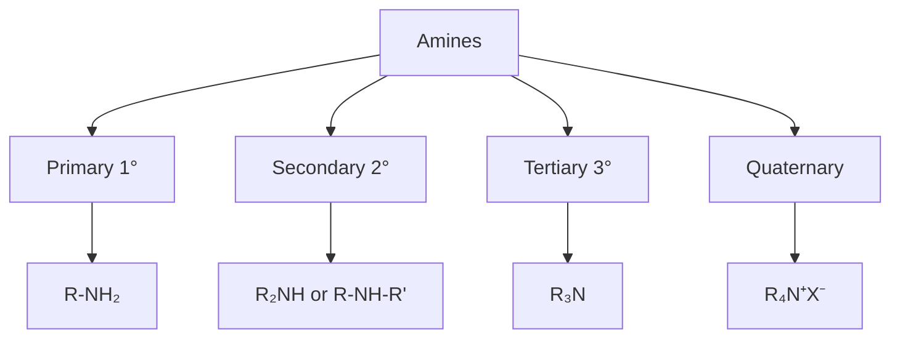

> Complete guide to amine classification, IUPAC nomenclature, structural features, and naming conventions for JEE Main and Advanced

## The Hook: From Rotten Fish to Life-Saving Drugs

> **★ Key point · Connect: Real Life → Chemistry**
>
> Ever noticed the pungent smell of decaying fish? That’s trimethylamine, a simple tertiary amine! But not all amines smell bad - many are life-saving medicines:
>
> - **Adrenaline** (epinephrine): Emergency hormone, contains 2° amine

> - **Dopamine**: Neurotransmitter, primary amine structure

> - **Antihistamines**: Allergy medicines, contain tertiary amines

> - **DNA/RNA**: Contain nitrogen bases (modified amines)

> - **Proteins**: Built from amino acids with NH₂ groups
>
> **Here’s the JEE question:** Why are amines basic in nature? And why does basicity change from primary to tertiary amines?

---

## The Core Concept

### What are Amines?

Amines are **derivatives of ammonia (NH₃)** where one or more hydrogen atoms are replaced by alkyl or aryl groups.

**Think of it this way:**

- Ammonia: NH₃
- Replace one H with R → Primary amine (R-NH₂)
- Replace two H with R → Secondary amine (R₂NH)
- Replace all three H with R → Tertiary amine (R₃N)

> **◐ In simple terms · JEE Weightage**
>
> Amines: 3-4 questions in JEE Main, 2-3 in JEE Advanced

> Focus areas: Classification, nomenclature, basicity comparison, Gabriel synthesis, carbylamine test

---

## Classification of Amines

### Based on Number of Alkyl/Aryl Groups



#### 1. Primary Amines (1°)

**General Formula:** R-NH₂ or Ar-NH₂

**Structure:** One alkyl/aryl group attached to nitrogen

**Examples:**

- CH₃-NH₂ (Methylamine)
- C₂H₅-NH₂ (Ethylamine)
- C₆H₅-NH₂ (Aniline)

#### 2. Secondary Amines (2°)

**General Formula:** R₂NH or R-NH-R'

**Structure:** Two alkyl/aryl groups attached to nitrogen

**Examples:**

- (CH₃)₂NH (Dimethylamine)
- CH₃-NH-C₂H₅ (N-Methylethylamine)
- (C₆H₅)₂NH (Diphenylamine)

#### 3. Tertiary Amines (3°)

**General Formula:** R₃N

**Structure:** Three alkyl/aryl groups attached to nitrogen

**Examples:**

- (CH₃)₃N (Trimethylamine) - fishy smell!
- (C₂H₅)₃N (Triethylamine)
- C₆H₅-N(CH₃)₂ (N,N-Dimethylaniline)

#### 4. Quaternary Ammonium Salts

**General Formula:** R₄N⁺X⁻

**Structure:** Four alkyl/aryl groups, positive charge on nitrogen

**Examples:**

- (CH₃)₄N⁺Cl⁻ (Tetramethylammonium chloride)
- [C₆H₅CH₂-N(CH₃)₃]⁺Br⁻ (Benzyltrimethylammonium bromide)

> **⚠ Trap · Critical Distinction for JEE**
>
> **Quaternary ammonium salts are NOT amines!**
>
> - No lone pair on nitrogen

> - Not basic

> - Ionic compounds

> - Good phase-transfer catalysts
>
> **JEE Trap:** “Classify (CH₃)₄N⁺Cl⁻”

> **Wrong answer:** Tertiary amine

> **Correct answer:** Quaternary ammonium salt (not an amine)

---

### Based on Alkyl vs Aryl Groups

#### Aliphatic Amines

Nitrogen attached to **alkyl groups only**

Examples:

- CH₃NH₂ (Methylamine)
- (C₂H₅)₂NH (Diethylamine)
- (CH₃)₃N (Trimethylamine)

#### Aromatic Amines

Nitrogen attached **directly to benzene ring**

Examples:

- C₆H₅-NH₂ (Aniline)
- C₆H₅-NH-CH₃ (N-Methylaniline)
- (C₆H₅)₂NH (Diphenylamine)

> **★ Key point · Key Difference**
>
> **C₆H₅-NH₂** (Aniline) → Aromatic amine (N directly on ring)
>
> **C₆H₅-CH₂-NH₂** (Benzylamine) → Aliphatic amine (N on CH₂, not ring)
>
> This difference affects:
>
> - Basicity (benzylamine > aniline)

> - Reactivity patterns

> - Electrophilic substitution positions
>
> Related: [Basicity of Amines](../basicity-amines/index.md)

### Interactive Demo: Visualize Amine Structures

Explore the different types of amine structures and their classifications.

---

### Based on Simple vs Mixed

#### Simple Amines

All alkyl/aryl groups are **identical**

Examples:

- (CH₃)₂NH - both groups are methyl
- (C₆H₅)₃N - all three groups are phenyl

#### Mixed Amines

**Different** alkyl/aryl groups attached

Examples:

- CH₃-NH-C₂H₅ (methyl and ethyl)
- C₆H₅-N(CH₃)₂ (one phenyl, two methyl)

---

## IUPAC Nomenclature of Amines

### Primary Amines (Aliphatic)

**Method 1: Alkanamine System** (Preferred)

**Rule:** Replace -e of alkane with -amine

| Structure | Alkane | IUPAC Name |
| --- | --- | --- |
| CH₃-NH₂ | Methane | **Methanamine** |
| C₂H₅-NH₂ | Ethane | **Ethanamine** |
| CH₃-CH₂-CH₂-NH₂ | Propane | **Propan-1-amine** |

**Method 2: Alkylamine System** (Common)

**Rule:** Name alkyl group + amine

- CH₃-NH₂ → Methylamine
- C₂H₅-NH₂ → Ethylamine
- (CH₃)₂CH-NH₂ → Isopropylamine

### Secondary and Tertiary Amines

**Two systems:**

#### System 1: N-substituted derivative

**Rule:** Largest group = parent, others prefixed with N-

**Examples:**

**Secondary:**

- CH₃-NH-C₂H₅ → **N-Methylethanamine**

  - Parent: Ethanamine (larger group)
  - Substituent: Methyl on nitrogen (N-methyl)
- C₆H₅-NH-CH₃ → **N-Methylaniline** or **N-Methylbenzenamine**

**Tertiary:**

- (CH₃)₂N-C₂H₅ → **N,N-Dimethylethanamine**

  - Parent: Ethanamine
  - Two methyl groups on nitrogen (N,N-dimethyl)
- C₆H₅-N(CH₃)₂ → **N,N-Dimethylaniline**

> **★ Key point · Memory Trick: When to Use 'N-'**
>
> **“N for Nitrogen-attached”**
>
> Use **N-** prefix when naming groups attached to **nitrogen** (not carbon)
>
> - N-Methylethanamine → Methyl on **N**itrogen

> - 2-Methylpropanamine → Methyl on **C**arbon (no N- prefix)
>
> **JEE Tip:** Count the N- prefixes to determine if it’s 2° or 3°:
>
> - One N- → Secondary amine

> - Two N- → Tertiary amine

### Complex Amines with Functional Groups

**Priority Order (Decreasing):**

$$-COOH > -SO₃H > -COOR > -COCl > -CONH₂ > -CHO > C=O > -OH > -NH₂$$

**When NH₂ is the principal group:**

$$\text{CH₃-CH(NH₂)-COOH}$$

**Wrong:** 2-Aminopropanoic acid
**Correct:** 2-Aminopropanoic acid ✓ (COOH has priority)

But if COOH is principal:
**IUPAC:** 2-Aminopropanoic acid (amino as prefix)
**Common:** Alanine (amino acid)

---

### Aromatic Amines

#### Aniline and Derivatives

**Parent compound:** C₆H₅-NH₂ = **Aniline** (Benzenamine)

**Substituted anilines:**

1. **Substituent on benzene ring:**

   - Use numbers (ortho = 2, meta = 3, para = 4)

   Examples:

   - **2-Methylaniline** or **o-Toluidine**
   - **4-Nitroaniline** or **p-Nitroaniline**
2. **Substituent on nitrogen:**

   - Use N- prefix

   Examples:

   - **N-Methylaniline**
   - **N,N-Diethylaniline**
3. **Both positions substituted:**

   - Number ring substituents, use N- for nitrogen substituents

   Example:

   ```fallback
   CH₃
        |
   C₆H₄—NH—CH₃
   (para position)
   ```

   **IUPAC:** N,4-Dimethylaniline or **N-Methyl-p-toluidine**

> **⚠ Trap · Common Naming Mistakes**
>
> **Mistake #1: Forgetting N- prefix**
>
> Wrong: Dimethylaniline

> Correct: **N,N-Dimethylaniline**
>
> The methyl groups are on nitrogen, not the ring!
>
> ---
>
> **Mistake #2: Confusing benzylamine with aniline**
>
> **C₆H₅-NH₂** = Aniline (aromatic)

> **C₆H₅-CH₂-NH₂** = Benzylamine (aliphatic)
>
> Structure matters for basicity and reactions!
>
> ---
>
> **Mistake #3: Wrong numbering in disubstituted anilines**
>
> For **4-chloro-2-methylaniline:**
>
> - NH₂ group is always position 1

> - Number to give substituents lowest locants

> - If substituents are on N and ring, ring gets numbers

---

## Structural Features of Amines

### Geometry and Hybridization

**Nitrogen in amines:**

- **Hybridization:** sp³
- **Geometry:** Pyramidal (not planar!)
- **Bond angle:** ~107° (slightly less than tetrahedral 109.5°)
- **Lone pair:** One pair on nitrogen

```fallback
R
        \
         N—R
        /
      :  (lone pair)
```

**Why pyramidal?**

- 4 electron pairs around N (3 bonds + 1 lone pair)
- VSEPR theory: Lone pair repulsion > bond repulsion
- Lone pair compresses bond angle from 109.5° to ~107°

> **↗ Connection · JEE Concept Check**
>
> **Q:** What is the hybridization of nitrogen in trimethylamine?
>
> **Solution:**
>
> - Three C-N bonds

> - One lone pair

> - Total: 4 electron pairs

> - **Hybridization: sp³**

> - **Geometry: Pyramidal**
>
> **JEE Trap:** Don’t confuse with sp² (planar) - amines are always sp³!

### Special Case: Aniline

**Aniline structure shows resonance:**

```fallback
NH₂             NH₂⁺            NH₂⁺            NH₂⁺
   |               ||              ||              ||
   ⟨⟩    ←→      ⟨⟩⁻    ←→      ⟨⟩⁻    ←→      ⟨⟩⁻
```

**Effects:**

1. **Partial double bond character** to C-N bond
2. **Electron density** decreases on nitrogen
3. **Basicity** decreases (lone pair less available)
4. **Benzene ring activation** for electrophilic substitution

Related: [Basicity comparison](../basicity-amines/index.md)

---

## Comparison Table: Ammonia vs Amines

| Property | NH₃ | 1° Amine | 2° Amine | 3° Amine |
| --- | --- | --- | --- | --- |
| **Formula** | NH₃ | RNH₂ | R₂NH | R₃N |
| **H on N** | 3 | 2 | 1 | 0 |
| **Lone pairs** | 1 | 1 | 1 | 1 |
| **Hybridization** | sp³ | sp³ | sp³ | sp³ |
| **H-bonding** | Strong | Strong | Moderate | Weak* |
| **Boiling point** | -33°C | Higher | Higher | Lower than 1°, 2° |
| **Basicity (gas)** | Reference | R₃N > R₂NH > RNH₂ > NH₃ |  |  |
| **Basicity (aq)** | Reference | R₂NH > RNH₂ > R₃N > NH₃ |  |  |

*Tertiary amines cannot form H-bonds with themselves (no N-H), but can accept H-bonds

---

## Quick Identification Tests

### Carbylamine Test (Isocyanide Test)

**For:** Primary amines only

$$\boxed{\text{R-NH}_2 + \text{CHCl}_3 + 3\text{KOH} \xrightarrow{\Delta} \text{R-N≡C} + 3\text{KCl} + 3\text{H}_2\text{O}}$$

**Product:** Isocyanide (R-N≡C) - **foul smell!**

**Result:**

- 1° amines → Offensive smell (positive test)
- 2° and 3° amines → No smell (negative test)

> **★ Key point · Memory Trick: Carbylamine Test**
>
> **“Primary Pupils Can Smell”**
>
> - **P**rimary amines only

> - **C**arbylamine test

> - **S**mell of isocyanide (foul!)
>
> **JEE Application:** Used to distinguish 1° amines from 2° and 3° amines
>
> Related: [Preparation of Amines](../amines-preparation/index.md)

### Hinsberg’s Test

**Reagent:** Benzenesulfonyl chloride (C₆H₅SO₂Cl)

**Distinguishes:** 1°, 2°, and 3° amines

| Amine Type | Reaction | Solubility in KOH |
| --- | --- | --- |
| **Primary** | Forms sulfonamide | **Soluble** (acidic H) |
| **Secondary** | Forms sulfonamide | **Insoluble** (no acidic H) |
| **Tertiary** | No reaction | Not applicable |

**Reactions:**

**1° Amine:**

$$\text{R-NH}_2 + \text{C}_6\text{H}_5\text{SO}_2\text{Cl} \rightarrow \text{C}_6\text{H}_5\text{SO}_2\text{-NH-R} + \text{HCl}$$

Product soluble in KOH (has acidic N-H)

**2° Amine:**

$$\text{R}_2\text{NH} + \text{C}_6\text{H}_5\text{SO}_2\text{Cl} \rightarrow \text{C}_6\text{H}_5\text{SO}_2\text{-NR}_2 + \text{HCl}$$

Product insoluble in KOH (no acidic H)

**3° Amine:**
No reaction (no N-H to react)

---

## Common Mistakes to Avoid

> **⚠ Trap · Mistake #1: Confusing Degree of Amine**
>
> **Wrong:** C₆H₅-NH-CH₃ is a primary amine (has one phenyl group)
>
> **Correct:** It’s a **secondary amine** (two groups on nitrogen)
>
> **Rule:** Count groups **attached to nitrogen**, not types of groups!
>
> **JEE Tip:**
>
> - Primary = **one** R group on N

> - Secondary = **two** R groups on N

> - Tertiary = **three** R groups on N

> **⚠ Trap · Mistake #2: Benzylamine vs Aniline Confusion**
>
> **These are DIFFERENT compounds:**
>
> **Aniline:** C₆H₅-NH₂
>
> - Aromatic amine

> - N directly on ring

> - Weakly basic

> - Resonance with ring
>
> **Benzylamine:** C₆H₅-CH₂-NH₂
>
> - Aliphatic amine

> - N on CH₂ (not ring)

> - Strongly basic

> - No resonance with ring
>
> **JEE Consequence:** Different basicity order, different reactions!

> **⚠ Trap · Mistake #3: Wrong IUPAC Name**
>
> **For CH₃-NH-C₂H₅:**
>
> Wrong names:
>
> - ❌ Methylethylamine (too ambiguous)

> - ❌ Ethylmethylamine (wrong order)
>
> **Correct IUPAC:** N-Methylethanamine
>
> - Parent: Ethanamine (larger group)

> - Substituent: N-Methyl
>
> **Rule:** Largest alkyl group = parent, others get N- prefix

---

## Practice Problems

### Level 1: Foundation (NCERT)

> **↗ Connection · Problem 1: Classification**
>
> **Q:** Classify the following amines as 1°, 2°, or 3°:

> (a) (CH₃)₂CHNH₂

> (b) C₆H₅NHCH₃

> (c) (C₂H₅)₃N

> (d) C₆H₅CH₂NH₂
>
> **Solution:**
>
> (a) (CH₃)₂CH-NH₂ → **Primary (1°)**
>
> - One alkyl group (isopropyl) on nitrogen
>
> (b) C₆H₅-NH-CH₃ → **Secondary (2°)**
>
> - Two groups on nitrogen (phenyl + methyl)
>
> (c) (C₂H₅)₃N → **Tertiary (3°)**
>
> - Three ethyl groups on nitrogen
>
> (d) C₆H₅-CH₂-NH₂ → **Primary (1°)**
>
> - One benzyl group on nitrogen

> - This is aliphatic, not aromatic!
>
> **Key Point:** Count groups on nitrogen, not carbons in the group!

> **↗ Connection · Problem 2: IUPAC Nomenclature**
>
> **Q:** Give IUPAC names for:

> (a) CH₃-CH₂-NH₂

> (b) (CH₃)₂NH

> (c) CH₃-NH-C₂H₅
>
> **Solution:**
>
> (a) **Ethanamine** or Ethylamine
>
> - Parent: Ethane

> - Replace -e with -amine
>
> (b) **N-Methylmethanamine** or Dimethylamine
>
> - Can use either methyl as parent

> - Other methyl gets N- prefix
>
> (c) **N-Methylethanamine**
>
> - Parent: Ethanamine (larger group)

> - Substituent: N-Methyl
>
> **Common mistake:** Don’t write “Methylethylamine” - ambiguous!

### Level 2: JEE Main

> **↗ Connection · Problem 3: Aromatic vs Aliphatic**
>
> **Q:** Which of the following is an aromatic amine?

> (A) C₆H₅CH₂NH₂

> (B) C₆H₅NHCH₃

> (C) CH₃NH₂

> (D) (C₆H₅CH₂)₂NH
>
> **Solution:** (B) C₆H₅NHCH₃
>
> **Explanation:**
>
> - Aromatic amine = N **directly attached** to benzene ring

> - (A) is benzylamine - N on CH₂ (aliphatic)

> - (B) is N-methylaniline - N on ring (aromatic) ✓

> - (C) is methylamine - no aromatic ring

> - (D) is dibenzylamine - N on CH₂ (aliphatic)
>
> **JEE Trick:** Look for N directly bonded to aromatic ring!

> **↗ Connection · Problem 4: Hinsberg Test**
>
> **Q:** An amine forms a product with benzenesulfonyl chloride which is soluble in KOH. The amine is:

> (A) Primary

> (B) Secondary

> (C) Tertiary

> (D) Quaternary salt
>
> **Solution:** (A) Primary
>
> **Reasoning:**
>
> - Product soluble in KOH → must have acidic H

> - Primary amine: R-NH-SO₂-C₆H₅ (has acidic N-H) ✓

> - Secondary amine: R₂N-SO₂-C₆H₅ (no acidic H, insoluble)

> - Tertiary amine: No reaction
>
> **Equation:**
>
> $$\text{RNH}_2 + \text{C}_6\text{H}_5\text{SO}_2\text{Cl} \rightarrow \text{RNH-SO}_2\text{-C}_6\text{H}_5$$
>
> The N-H hydrogen is acidic, reacts with KOH → soluble salt

### Level 3: JEE Advanced

> **↗ Connection · Problem 5: Complex Nomenclature**
>
> **Q:** Write the IUPAC name for the compound:
>
> ```fallback

> CH₃

>       |

>   NH₂-C-CH₂-CH₃

>       |

>      CH₃

> ```
>
> **Solution:**
>
> Structure: (CH₃)₂C(NH₂)-C₂H₅
>
> **IUPAC Name:** 2-Methylbutan-2-amine
>
> **Steps:**
>
> 1. Find longest carbon chain containing NH₂: 4 carbons (butane)

> 2. Number to give NH₂ lowest position: NH₂ on C-2

> 3. Identify substituents: Two methyl groups also on C-2

> 4. Combine: 2-Methyl (substituent) + butan-2-amine
>
> **Alternative approach:**

> Parent: Butan-2-amine

> Substituent: 2-Methyl

> Result: 2-Methylbutan-2-amine
>
> **Common name:** tert-Butylamine (but IUPAC is preferred for JEE)

> **↗ Connection · Problem 6: Structure Determination**
>
> **Q:** An organic compound with molecular formula C₄H₁₁N does not react with benzenesulfonyl chloride but reacts with methyl iodide to form a quaternary salt. Identify the compound.
>
> **Solution:**
>
> **Analysis:**
>
> - Does not react with C₆H₅SO₂Cl → **Tertiary amine**

> - Reacts with CH₃I to form quaternary salt → Confirms tertiary
>
> **Possible structures for C₄H₁₁N (tertiary):**
>
> 1. (CH₃)₃N-CH₃ - Wrong formula

> 2. **(CH₃)₂N-C₂H₅** → C₄H₁₁N ✓

> 3. **CH₃-N(C₂H₅)₂** → C₅H₁₃N - Wrong
>
> **Answer:** N,N-Dimethylethanamine or (CH₃)₂N-C₂H₅
>
> **Verification:**
>
> $$(\text{CH}_3)_2\text{N-C}_2\text{H}_5 + \text{CH}_3\text{I} \rightarrow [(\text{CH}_3)_3\text{N}^+-\text{C}_2\text{H}_5]\text{I}^-$$
>
> Quaternary ammonium salt formed ✓

---

## Quick Revision Box

| Topic | Key Points | JEE Formula/Rule |
| --- | --- | --- |
| **Primary (1°)** | One R on N | R-NH₂ |
| **Secondary (2°)** | Two R on N | R₂NH or R-NH-R' |
| **Tertiary (3°)** | Three R on N | R₃N |
| **Quaternary** | Four R on N⁺ | R₄N⁺X⁻ (not amine!) |
| **IUPAC Naming** | Largest group = parent | N- prefix for substituents on N |
| **Aromatic** | N directly on ring | Aniline (C₆H₅-NH₂) |
| **Aliphatic** | N not on ring | Benzylamine (C₆H₅-CH₂-NH₂) |
| **Carbylamine** | 1° amines only | Offensive smell |
| **Hinsberg** | Distinguishes 1°, 2°, 3° | 1° soluble in KOH |
| **Hybridization** | sp³, pyramidal | ~107° bond angle |

---

## When to Use What: Decision Tree

```fallback
Need to identify amine type?
│
├─ Count groups on nitrogen
│  ├─ One group → Primary (1°)
│  ├─ Two groups → Secondary (2°)
│  ├─ Three groups → Tertiary (3°)
│  └─ Four groups → Quaternary salt (not amine)
│
├─ For IUPAC naming
│  ├─ Primary → Alkanamine
│  ├─ Secondary/Tertiary → N-substituted derivative
│  └─ Multiple N-substituents → N,N-disubstituted
│
└─ To distinguish experimentally
   ├─ Carbylamine test → Only 1° gives smell
   └─ Hinsberg test → 1° soluble, 2° insoluble, 3° no reaction
```

---

## Connection to Other Topics

**Prerequisites:**

- [Basic Organic Chemistry](../../organic-principles/index.md) - IUPAC nomenclature
- [Hybridization](../../chemical-bonding/hybridization/index.md) - sp³ structure

**Related Topics:**

- [Preparation of Amines](../amines-preparation/index.md) - Gabriel synthesis, reduction methods
- [Properties of Amines](../amines-properties/index.md) - Physical properties, reactions
- [Basicity of Amines](../basicity-amines/index.md) - Why basicity varies

**Applications:**

- [Diazonium Salts](../diazonium-salts/index.md) - From aromatic amines
- [Biomolecules](../../biomolecules/index.md) - Amino acids, proteins

---

## Summary

> **★ Key point · Key Takeaways**
>
> **1. Classification System:**
>
> - Primary (1°): R-NH₂ (one group on N)

> - Secondary (2°): R₂NH (two groups on N)

> - Tertiary (3°): R₃N (three groups on N)

> - Quaternary: R₄N⁺X⁻ (NOT an amine - ionic)
>
> **2. Aromatic vs Aliphatic:**
>
> - Aniline (C₆H₅-NH₂): N on ring → aromatic

> - Benzylamine (C₆H₅-CH₂-NH₂): N on CH₂ → aliphatic

> - This affects basicity significantly!
>
> **3. IUPAC Nomenclature:**
>
> - Primary: Alkanamine (e.g., ethanamine)

> - Secondary/Tertiary: Largest = parent, others N-substituted

> - Use N- prefix for groups on nitrogen
>
> **4. Identification Tests:**
>
> - Carbylamine: Only 1° amines give foul smell

> - Hinsberg: 1° soluble in KOH, 2° insoluble, 3° no reaction
>
> **5. Structure:**
>
> - All amines: sp³ hybridization, pyramidal

> - One lone pair on nitrogen (basis of basicity)

> - Bond angle ~107° (less than tetrahedral)
>
> **“Amines are ammonia’s organic relatives - classification depends on how many hydrogens were replaced!”**
>
> Next, explore [preparation methods](../amines-preparation/index.md) to understand Gabriel synthesis and reduction reactions!

From TestGuru · our mock-test platform

## You've read Amines: Classification and Nomenclature.You've read this topic. Find out what you actually got.

A free JEE Main mock with this chapter in it, and a report that shows which sub-topics cost you marks.

[Take a free JEE Main mock →](https://app.testguru.co/signup?tg_chapter=nitrogen-compounds&tg_exam=jee-main&tg_page=%2Fchemistry%2Fnitrogen-compounds%2Famines-classification%2F&tg_subject=chemistry&utm_campaign=notes-jee-main-free-test&utm_content=article-end&utm_medium=referral&utm_source=jeenotes)
Free, no card. Opens TestGuru in a new tab.

## Stay exam-ready

One email every Sunday: new notes, the week's hardest challenge question and a revision plan.One email every Sunday.

## Comments

Have a question or spotted a mistake? Join the discussion below.

Advertisement

Advertisement

---

## Extracted page code (interactive scripts & widgets)


### inline-script-16

```js
if(!document.getElementById("animation-fullscreen-overlay")){const e=document.createElement("div");e.id="animation-fullscreen-overlay",e.className="animation-fullscreen-overlay",e.innerHTML=`
      <div class="fullscreen-modal">
        <div class="fullscreen-header">
          <span class="fullscreen-title">Interactive Demo</span>
          <button class="fullscreen-close-btn" onclick="JEEAnimations.closeFullscreen()" title="Close (Esc)" aria-label="Close fullscreen">
            <svg width="24" height="24" viewBox="0 0 24 24" fill="none" stroke="currentColor" stroke-width="2" stroke-linecap="round" stroke-linejoin="round">
              <line x1="18" y1="6" x2="6" y2="18"></line>
              <line x1="6" y1="6" x2="18" y2="18"></line>
            </svg>
          </button>
        </div>
        <div class="fullscreen-content"></div>
      </div>
    `,document.body.appendChild(e),document.addEventListener("keydown",function(e){e.key==="Escape"&&document.body.classList.contains("animation-fullscreen-active")&&JEEAnimations.closeFullscreen()}),e.addEventListener("click",function(t){t.target===e&&JEEAnimations.closeFullscreen()})}
```


### inline-script-17

```js
(function(){var t,e=document.getElementById("disqus-load");if(!e)return;t=!1,e.addEventListener("click",function(){if(t)return;t=!0,e.setAttribute("disabled","disabled"),e.textContent="Loading comments…",window.disqus_config=function(){this.page.url="https://jeenotes.in/chemistry/nitrogen-compounds/amines-classification/",this.page.identifier="/chemistry/nitrogen-compounds/amines-classification/"};var s=document,n=s.createElement("script");n.src="https://https-jeenotes-in.disqus.com/embed.js",n.setAttribute("data-timestamp",+new Date),n.onload=function(){e.style.display="none"},n.onerror=function(){t=!1,e.removeAttribute("disabled"),e.textContent="Could not load comments. Tap to retry"},(s.head||s.body).appendChild(n)})})()
```


### inline-script-18

```js
(function(){var t,e=document.currentScript.previousElementSibling;function n(){(window.adsbygoogle=window.adsbygoogle||[]).push({})}if(!window.ResizeObserver||e.clientWidth>0){n();return}t=new ResizeObserver(function(){e.clientWidth>0&&(t.disconnect(),n())}),t.observe(e)})()
```


### interactive-widget-1

```html
<div class="animation-wrapper" data-animation="molecularStructure" id="anim-molecularStructure-1795396419856115453"><div class="animation-header"><button aria-label="Toggle fullscreen" class="anim-fullscreen-btn" onclick='JEEAnimations.toggleFullscreen("anim-molecularStructure-1795396419856115453")' title="Fullscreen (F)">
<svg class="fullscreen-icon-expand" fill="none" height="18" stroke="currentColor" stroke-linecap="round" stroke-linejoin="round" stroke-width="2" viewbox="0 0 24 24" width="18"><polyline points="15 3 21 3 21 9"></polyline><polyline points="9 21 3 21 3 15"></polyline><line x1="21" x2="14" y1="3" y2="10"></line><line x1="3" x2="10" y1="21" y2="14"></line></svg>
<svg class="fullscreen-icon-collapse" fill="none" height="18" stroke="currentColor" stroke-linecap="round" stroke-linejoin="round" stroke-width="2" viewbox="0 0 24 24" width="18"><polyline points="4 14 10 14 10 20"></polyline><polyline points="20 10 14 10 14 4"></polyline><line x1="14" x2="21" y1="10" y2="3"></line><line x1="3" x2="10" y1="21" y2="14"></line></svg>
<span class="fullscreen-text">Fullscreen</span></button></div><div class="animation-content"><noscript><div class="callout callout-warning"><div class="callout-title">JavaScript Required</div><p>This interactive animation requires JavaScript to be enabled.</p></div></noscript></div></div>
```


---

_Source: [https://jeenotes.in/chemistry/nitrogen-compounds/amines-classification/](https://jeenotes.in/chemistry/nitrogen-compounds/amines-classification/) · raw HTML: `offline/chemistry/nitrogen-compounds/amines-classification/index.html`_
