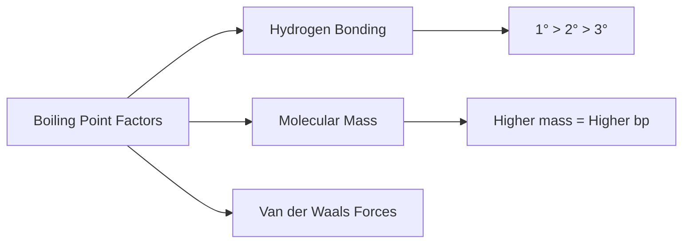
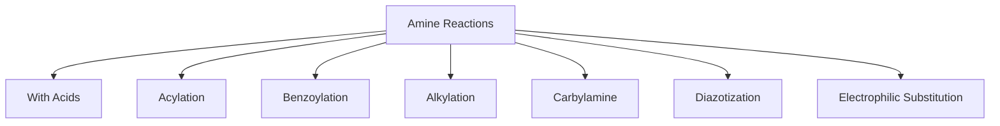

> Complete guide to amine properties - boiling point trends, solubility, basicity, acylation, diazotization, and carbylamine reactions for JEE

## The Hook: Why Fish Smell and Proteins Don’t

> **★ Key point · Connect: Real Life → Chemistry**
>
> **The Fishy Smell Mystery:**

> Fresh fish is odorless, but decomposing fish releases **trimethylamine** [(CH₃)₃N] - a volatile, basic amine. That’s why squeezing lemon (citric acid) on fish neutralizes the smell!
>
> **But here’s the paradox:**

> Proteins in our body contain thousands of amino groups (-NH₂), yet we don’t smell fishy. Why?
>
> **Answer:** The amino groups in proteins are:
>
> 1. Not free (part of peptide bonds)

> 2. Protonated at physiological pH (-NH₃⁺)

> 3. Not volatile (large molecules)
>
> **JEE Connection:** Understanding amine properties explains:
>
> - Why primary amines have higher boiling points than tertiary

> - Why methylamine is water-soluble but aniline isn’t

> - Why amines are bases but strength varies

---

## Physical Properties

### Boiling Points

#### General Trends



**For amines of similar mass:**

$$\boxed{\text{Primary} > \text{Secondary} > \text{Tertiary}}$$

**Reason:** Hydrogen bonding capability

| Amine Type | H-bonding ability | Boiling Point |
| --- | --- | --- |
| **Primary (RNH₂)** | 2 N-H bonds → **Strong** H-bonding | **Highest** |
| **Secondary (R₂NH)** | 1 N-H bond → **Moderate** H-bonding | Medium |
| **Tertiary (R₃N)** | 0 N-H bonds → **No** H-bonding | **Lowest** |

#### Examples with Data

| Compound | Type | Molecular Mass | Boiling Point (°C) |
| --- | --- | --- | --- |
| CH₃NH₂ | 1° | 31 | -6 |
| (CH₃)₂NH | 2° | 45 | 7 |
| (CH₃)₃N | 3° | 59 | 3 |
| C₂H₅NH₂ | 1° | 45 | 17 |
| C₃H₇NH₂ | 1° | 59 | 48 |

> **★ Key point · JEE Pattern Recognition**
>
> **Unexpected observation:** (CH₃)₃N has **higher mass** but **lower bp** than (CH₃)₂NH!
>
> **Reason:** Hydrogen bonding dominates over mass
>
> **JEE Formula:**
>
> $$\text{bp} \propto \text{H-bonding} > \text{Mass} > \text{Van der Waals}$$
>
> **Memory trick:** “Hydrogen bonding trumps mass!”

#### Comparison with Alcohols and Hydrocarbons

**For similar mass:**

$$\boxed{\text{Alcohols} > \text{Primary Amines} > \text{Hydrocarbons}}$$

**Example:**

- CH₃CH₂OH (Ethanol): 78°C
- CH₃CH₂NH₂ (Ethylamine): 17°C
- CH₃CH₂CH₃ (Propane): -42°C

**Why alcohols > amines?**

- O is more electronegative than N
- O-H···O bonding stronger than N-H···N
- Oxygen pulls H more strongly

> **★ Key point · Memory Trick: Boiling Points**
>
> **“Harry (H-bonding) Matters Most”**
>
> Boiling point order (similar mass):

> **Alcohols > 1° Amines > 2° Amines > 3° Amines > Hydrocarbons**
>
> **JEE Shortcut:**

> Count N-H bonds:
>
> - 2 N-H (primary) → Highest bp among amines

> - 1 N-H (secondary) → Medium bp

> - 0 N-H (tertiary) → Lowest bp
>
> Related: [Hydrogen bonding](../../chemical-bonding/index.md)

### Interactive Demo: Visualize Amine Reactions

See how amines react with various reagents and form different products.

---

### Solubility in Water

#### General Trends

**Lower aliphatic amines (C₁-C₄):** Water-soluble

**Higher aliphatic amines (>C₆):** Water-insoluble

**Aromatic amines:** Generally insoluble (except in acidic solution)

#### Explanation

**Why lower amines are soluble:**

- Form H-bonds with water: R-NH₂···H-O-H
- Small hydrophobic (R) part
- Can accept and donate H-bonds

**Why higher amines are insoluble:**

- Large hydrophobic alkyl chain
- H-bonding not enough to overcome hydrophobic effect

**Why aromatic amines (aniline) are insoluble:**

- Large hydrophobic benzene ring
- NH₂ group can’t compensate for phenyl group

#### Solubility Order

**In water (C₁-C₄):**

$$\text{Primary} \approx \text{Secondary} > \text{Tertiary}$$

**Reason:** Primary and secondary can both donate and accept H-bonds; tertiary can only accept

| Amine | Solubility in water | H-bonding |
| --- | --- | --- |
| CH₃NH₂ | Highly soluble | Can donate (2 H) & accept |
| (CH₃)₂NH | Highly soluble | Can donate (1 H) & accept |
| (CH₃)₃N | Soluble | Can only accept |
| C₆H₅NH₂ | Insoluble | Hydrophobic phenyl ring |

> **↗ Connection · JEE Concept: Acidified Water**
>
> **Q:** Aniline is insoluble in water but soluble in dilute HCl. Why?
>
> **Solution:**
>
> **In water:**
>
> $$\text{C}_6\text{H}_5\text{NH}_2 \text{ (insoluble - hydrophobic)}$$
>
> **In HCl:**
>
> $$\text{C}_6\text{H}_5\text{NH}_2 + \text{HCl} \rightarrow [\text{C}_6\text{H}_5\text{NH}_3^+]\text{Cl}^-$$
>
> **Anilinium chloride is ionic → water-soluble!**
>
> **Key concept:** Amines become water-soluble as their salts
>
> **JEE Application:** Separation of aniline from organic mixtures using acid extraction

---

### Odor and Physical State

**Smell characteristics:**

| Amines | Odor | Example |
| --- | --- | --- |
| Lower aliphatic (C₁-C₄) | Fishy, pungent | Methylamine, Trimethylamine |
| Higher aliphatic | Less pungent | Octylamine (weak odor) |
| Aromatic | Unpleasant | Aniline (oily, amine-like) |

**Physical state at room temperature:**

- **C₁ (Methylamine):** Gas (-6°C bp)
- **C₂-C₃:** Gases/volatile liquids
- **C₄-C₁₈:** Liquids
- **>C₁₈:** Solids

---

## Chemical Properties

### Basicity of Amines

**Fundamental concept:** Amines are **Lewis bases** (lone pair donors)

$$\text{R-NH}_2 + \text{H}^+ \rightleftarrows \text{R-NH}_3^+$$

**Base strength measured by:**

- **Kb** (base dissociation constant)
- **pKb** (lower pKb = stronger base)
- **pKa of conjugate acid** (higher pKa = stronger base)

**Detailed basicity comparison:** See [Basicity of Amines](../basicity-amines/index.md)

---

### Reactions of Amines



---

### 1. Reaction with Acids (Salt Formation)

**General Reaction:**

$$\boxed{\text{R-NH}_2 + \text{HCl} \rightarrow [\text{R-NH}_3^+]\text{Cl}^-}$$

**Examples:**

**Aliphatic amine:**

$$\text{CH}_3\text{NH}_2 + \text{HCl} \rightarrow [\text{CH}_3\text{NH}_3^+]\text{Cl}^-$$

(Methylammonium chloride)

**Aromatic amine:**

$$\text{C}_6\text{H}_5\text{NH}_2 + \text{HCl} \rightarrow [\text{C}_6\text{H}_5\text{NH}_3^+]\text{Cl}^-$$

(Anilinium chloride)

**Properties of amine salts:**

- Ionic, crystalline solids
- Water-soluble (even if amine wasn’t)
- Non-basic (no lone pair)
- Can regenerate amine with base:

$$[\text{R-NH}_3^+]\text{Cl}^- + \text{NaOH} \rightarrow \text{R-NH}_2 + \text{NaCl} + \text{H}_2\text{O}$$

> **★ Key point · JEE Application: Amine Separation**
>
> **Problem:** Separate aniline from an organic mixture
>
> **Solution:**
>
> **Step 1:** Add dilute HCl
>
> - Aniline → Anilinium chloride (water-soluble)

> - Other organics remain in organic layer
>
> **Step 2:** Separate aqueous layer (contains anilinium chloride)
>
> **Step 3:** Add NaOH
>
> - Regenerates free aniline

> - Extract with ether
>
> **Key concept:** Acid-base extraction using salt formation

---

### 2. Acylation (Reaction with Acid Chlorides/Anhydrides)

**Purpose:** Replace H on nitrogen with acyl group (R-CO-)

#### Acylation with Acetyl Chloride

**General Reaction:**

$$\boxed{\text{R-NH}_2 + \text{CH}_3\text{COCl} \rightarrow \text{R-NH-CO-CH}_3 + \text{HCl}}$$

**Examples:**

**Primary amine:**

$$\text{C}_6\text{H}_5\text{NH}_2 + \text{CH}_3\text{COCl} \rightarrow \text{C}_6\text{H}_5\text{-NH-CO-CH}_3 + \text{HCl}$$

(Aniline → Acetanilide)

**Secondary amine:**

$$(CH_3)_2\text{NH} + \text{CH}_3\text{COCl} \rightarrow (\text{CH}_3)_2\text{N-CO-CH}_3 + \text{HCl}$$

(Dimethylamine → N,N-Dimethylacetamide)

**Tertiary amine:**

$$(\text{CH}_3)_3\text{N} + \text{CH}_3\text{COCl} \rightarrow \text{No reaction (no N-H to replace)}$$

#### Acylation with Acetic Anhydride

$$\text{R-NH}_2 + (\text{CH}_3\text{CO})_2\text{O} \rightarrow \text{R-NH-CO-CH}_3 + \text{CH}_3\text{COOH}$$

**Example:**

$$\text{C}_6\text{H}_5\text{NH}_2 + (\text{CH}_3\text{CO})_2\text{O} \rightarrow \text{C}_6\text{H}_5\text{-NH-CO-CH}_3 + \text{CH}_3\text{COOH}$$

> **★ Key point · Why Acylation is Important**
>
> **1. Protection of amino group:**
>
> - Prevents oxidation

> - Protects during other reactions

> - Can be removed later by hydrolysis
>
> **2. Reduces basicity:**
>
> - Amide is non-basic (lone pair delocalized)

> - Useful for controlling reactivity
>
> **3. Controls electrophilic substitution:**
>
> **Aniline** (strongly activating):
>
> - Polysubstitution, oxidation issues
>
> **Acetanilide** (moderately activating):
>
> - Controlled monosubstitution

> - Ortho/para directing

> - No oxidation
>
> **JEE Strategy:**
>
> - Direct halogenation of aniline → polysubstitution

> - Acetylate first → controlled monosubstitution → deprotect

---

### 3. Benzoylation (Schotten-Baumann Reaction)

**Reagent:** Benzoyl chloride (C₆H₅COCl) + NaOH (aqueous)

**General Reaction:**

$$\boxed{\text{R-NH}_2 + \text{C}_6\text{H}_5\text{COCl} \xrightarrow{\text{NaOH}} \text{R-NH-CO-C}_6\text{H}_5 + \text{NaCl} + \text{H}_2\text{O}}$$

**Example:**

$$\text{C}_6\text{H}_5\text{NH}_2 + \text{C}_6\text{H}_5\text{COCl} \xrightarrow{\text{NaOH}} \text{C}_6\text{H}_5\text{-NH-CO-C}_6\text{H}_5$$

(Aniline → Benzanilide)

**Why use NaOH?**

- Neutralizes HCl formed
- Reaction proceeds in aqueous medium

**Distinguishing amines:**

| Amine Type | Product with C₆H₅COCl | Solubility in NaOH |
| --- | --- | --- |
| **1° amine** | R-NH-CO-C₆H₅ | Insoluble |
| **2° amine** | R₂N-CO-C₆H₅ | Insoluble |
| **3° amine** | No reaction | - |

> **↗ Connection · Hinsberg Test Revisited**
>
> **Alternative to Hinsberg:** Benzoylation can also distinguish amines
>
> **With C₆H₅COCl:**
>
> - 1° and 2° amines → Products (benzamides)

> - 3° amine → No reaction
>
> **But Hinsberg (C₆H₅SO₂Cl) is better because:**
>
> - 1° product soluble in base (acidic H)

> - 2° product insoluble in base

> - 3° no reaction
>
> **Distinguishes all three!**
>
> Related: [Classification of amines](../amines-classification/index.md)

---

### 4. Alkylation (Not Recommended)

**Problem:** Gives mixture of products

$$\text{R-NH}_2 + \text{R'-X} \rightarrow \text{R-NH-R'} + \text{R}_2\text{N-R'} + \text{R}_3\text{N} + \text{R}_4\text{N}^+\text{X}^-$$

**Why mixture?**

- Primary amine more nucleophilic than NH₃
- Keeps reacting with R-X
- Over-alkylation occurs

**Better method:** Gabriel synthesis for pure primary amines

Related: [Preparation of amines](../amines-preparation/index.md)

---

### 5. Carbylamine Reaction (Isocyanide Test)

**Test for:** Primary amines ONLY

**Reagent:** CHCl₃ + alcoholic KOH (heat)

**General Reaction:**

$$\boxed{\text{R-NH}_2 + \text{CHCl}_3 + 3\text{KOH} \xrightarrow{\Delta} \text{R-N≡C} + 3\text{KCl} + 3\text{H}_2\text{O}}$$

**Product:** Isocyanide (carbylamine) - **offensive smell!**

**Mechanism:**

**Step 1:** CHCl₃ → Dichlorocarbene

$$\text{CHCl}_3 + \text{KOH} \rightarrow :\text{CCl}_2 + \text{KCl} + \text{H}_2\text{O}$$

**Step 2:** Carbene insertion

$$\text{R-NH}_2 + :\text{CCl}_2 \rightarrow \text{R-NH-CCl}_2\text{H}$$

**Step 3:** Elimination to isocyanide

$$\text{R-NH-CCl}_2\text{H} \xrightarrow{-2\text{HCl}} \text{R-N≡C}$$

**Examples:**

**Positive test (1° amines):**

$$\text{CH}_3\text{NH}_2 \xrightarrow{\text{CHCl}_3/\text{KOH}} \text{CH}_3\text{-NC} + \text{foul smell}$$

$$\text{C}_6\text{H}_5\text{NH}_2 \xrightarrow{\text{CHCl}_3/\text{KOH}} \text{C}_6\text{H}_5\text{-NC} + \text{foul smell}$$

**Negative test (2° and 3° amines):**

$$(CH_3)_2\text{NH} \xrightarrow{\text{CHCl}_3/\text{KOH}} \text{No reaction, no smell}$$

> **⚠ Trap · JEE Trap: Carbylamine Test Scope**
>
> **Common mistake:** “Carbylamine test distinguishes aliphatic from aromatic amines”
>
> **Wrong!** It distinguishes 1° from 2° and 3° amines
>
> **Correct understanding:**
>
> - **Both** aliphatic and aromatic **primary** amines give positive test

> - C₂H₅NH₂ (aliphatic 1°) → Positive ✓

> - C₆H₅NH₂ (aromatic 1°) → Positive ✓

> - (CH₃)₂NH (aliphatic 2°) → Negative

> - C₆H₅NHCH₃ (aromatic 2°) → Negative
>
> **Test distinguishes:** 1° vs (2° and 3°), NOT aliphatic vs aromatic

---

### 6. Reaction with Nitrous Acid (HNO₂)

**Most important reaction for JEE!**

**Different products for 1°, 2°, and 3° amines**

#### Primary Aliphatic Amines

**Reaction:** Forms alcohol + N₂ gas (via diazonium intermediate)

$$\text{R-NH}_2 + \text{HNO}_2 \xrightarrow{0-5°\text{C}} [\text{R-N}_2^+]\text{Cl}^- \xrightarrow{\text{unstable}} \text{R-OH} + \text{N}_2↑$$

**Example:**

$$\text{CH}_3\text{CH}_2\text{NH}_2 \xrightarrow{\text{NaNO}_2/\text{HCl}} \text{CH}_3\text{CH}_2\text{OH} + \text{N}_2↑$$

**Observation:** Evolution of nitrogen gas (brisk effervescence)

**Mechanism:**

1. Nitrosation: R-NH₂ → R-NH-N=O
2. Tautomerization: R-NH-N=O → R-N=N-OH
3. Dehydration: R-N=N-OH → R-N₂⁺ (diazonium cation)
4. Loss of N₂: R-N₂⁺ → R⁺ + N₂ (carbocation)
5. Nucleophilic attack: R⁺ + H₂O → R-OH

**Note:** Aliphatic diazonium salts are unstable even at 0°C!

#### Primary Aromatic Amines

**Reaction:** Forms stable diazonium salt (0-5°C)

$$\text{C}_6\text{H}_5\text{NH}_2 + \text{NaNO}_2 + 2\text{HCl} \xrightarrow{0-5°\text{C}} [\text{C}_6\text{H}_5\text{-N}_2^+]\text{Cl}^- + \text{NaCl} + 2\text{H}_2\text{O}$$

**Product:** Benzenediazonium chloride (stable below 5°C)

**Key difference:** Aromatic diazonium salts are **stable** at low temperature!

**Importance:** Used for synthesis of many compounds!

Related: [Diazonium salts](../diazonium-salts/index.md)

#### Secondary Amines (Aliphatic and Aromatic)

**Reaction:** Forms N-nitrosoamine (yellow oil)

$$\text{R}_2\text{NH} + \text{HNO}_2 \rightarrow \text{R}_2\text{N-N=O} + \text{H}_2\text{O}$$

**Example:**

$$(\text{CH}_3)_2\text{NH} + \text{HNO}_2 \rightarrow (\text{CH}_3)_2\text{N-N=O}$$

(N-Nitrosodimethylamine - yellow oil)

**Observation:** Formation of yellow/orange oily layer

**Note:** N-Nitrosamines are **carcinogenic**!

#### Tertiary Aliphatic Amines

**Reaction:** Forms nitrite salt (ionic)

$$\text{R}_3\text{N} + \text{HNO}_2 \rightarrow [\text{R}_3\text{NH}^+]\text{NO}_2^-$$

**Example:**

$$(\text{CH}_3)_3\text{N} + \text{HNO}_2 \rightarrow [(\text{CH}_3)_3\text{NH}^+]\text{NO}_2^-$$

(Trimethylammonium nitrite)

**Observation:** Water-soluble salt formed

#### Tertiary Aromatic Amines

**Reaction:** Electrophilic substitution at para position

$$\text{C}_6\text{H}_5\text{-N(CH}_3)_2 + \text{HNO}_2 \rightarrow \text{p-}\text{NO-C}_6\text{H}_4\text{-N(CH}_3)_2$$

**Product:** p-Nitroso-N,N-dimethylaniline (green compound)

**Observation:** Green coloration

> **★ Key point · Memory Trick: Nitrous Acid Reactions**
>
> **“One-Two-Three, Different as can be!”**
>
> **1° Amine:**
>
> - Aliphatic → **Alcohol** + N₂ (gas evolution)

> - Aromatic → **Diazonium salt** (stable at 0-5°C)
>
> **2° Amine:**
>
> - Both → **Yellow oily** N-nitrosamine
>
> **3° Amine:**
>
> - Aliphatic → **Ionic salt** (colorless)

> - Aromatic → **Green** p-nitroso product
>
> **JEE Shortcut Table:**
>
> | Amine | Product | Observation |

> | --- | --- | --- |

> | 1° aliphatic | R-OH + N₂ | Gas bubbles |

> | 1° aromatic | Ar-N₂⁺Cl⁻ | Stable salt |

> | 2° (both) | R₂N-N=O | Yellow oil |

> | 3° aliphatic | R₃NH⁺NO₂⁻ | Salt |

> | 3° aromatic | p-NO-Ar-NR₂ | Green color |

---

### 7. Electrophilic Aromatic Substitution in Aniline

**Key concept:** -NH₂ group is **strongly activating** and **ortho-para directing**

**Why activating?**

- Lone pair on nitrogen delocalizes into benzene ring
- Increases electron density (especially at ortho/para)
- Resonance stabilization of intermediate

**Resonance structures:**

```fallback
NH₂              NH₂⁺             NH₂⁺             NH₂⁺
   |                ||               ||               ||
   ⟨⟩     ←→       ⟨⟩⁻     ←→      ⟨⟩⁻     ←→      ⟨⟩⁻
(ortho⁻)         (meta)          (para⁻)
```

Electron density: ortho ≈ para > meta

#### Halogenation of Aniline

**Problem:** Aniline is TOO reactive!

**Without protection:**

$$\text{C}_6\text{H}_5\text{NH}_2 + 3\text{Br}_2(\text{aq}) \rightarrow 2,4,6-\text{tribromoaniline} + 3\text{HBr}$$

**Product:** 2,4,6-Tribromoaniline (white precipitate)

**All three positions substituted!** (Cannot control)

**Solution: Acetylation → Bromination → Deacetylation**

**Step 1: Protect -NH₂ (acetylation)**

$$\text{C}_6\text{H}_5\text{NH}_2 + (\text{CH}_3\text{CO})_2\text{O} \rightarrow \text{C}_6\text{H}_5\text{-NH-CO-CH}_3$$

(Aniline → Acetanilide)

**Step 2: Controlled bromination**

$$\text{C}_6\text{H}_5\text{-NH-CO-CH}_3 + \text{Br}_2 \rightarrow \text{p-Br-C}_6\text{H}_4\text{-NH-CO-CH}_3$$

(Mainly para product)

**Step 3: Deprotection (hydrolysis)**

$$\text{p-Br-C}_6\text{H}_4\text{-NH-CO-CH}_3 \xrightarrow{\text{H}_3\text{O}^+} \text{p-Br-C}_6\text{H}_4\text{-NH}_2 + \text{CH}_3\text{COOH}$$

**Result:** p-Bromoaniline (controlled monosubstitution!)

> **★ Key point · JEE Strategy: Protection-Deprotection**
>
> **Why protect amino group?**
>
> **Free -NH₂:**
>
> - Too strongly activating

> - Polysubstitution

> - Oxidation occurs

> - Loss of control
>
> **Acetylated -NH-CO-CH₃:**
>
> - Moderately activating (resonance with C=O)

> - Monosubstitution (controlled)

> - No oxidation

> - Still ortho/para directing
>
> **General strategy:**
>
> ```fallback

> Aniline → Acetanilide → Substituted acetanilide → Substituted aniline

> (too reactive) (moderate) (controlled product) (desired product)

> ```
>
> **JEE loves this concept:** Protection-deprotection is high-yield!

#### Nitration of Aniline

**Problem:** Direct nitration oxidizes aniline (HNO₃ is oxidizing)

**Solution:** Protect as acetanilide

**Step 1: Acetylation**

$$\text{C}_6\text{H}_5\text{NH}_2 + (\text{CH}_3\text{CO})_2\text{O} \rightarrow \text{C}_6\text{H}_5\text{-NH-CO-CH}_3$$

**Step 2: Nitration**

$$\text{C}_6\text{H}_5\text{-NH-CO-CH}_3 \xrightarrow{\text{HNO}_3/\text{H}_2\text{SO}_4} \text{p-NO}_2\text{-C}_6\text{H}_4\text{-NH-CO-CH}_3$$

**Step 3: Hydrolysis**

$$\text{p-NO}_2\text{-C}_6\text{H}_4\text{-NH-CO-CH}_3 \xrightarrow{\text{H}_2\text{O}/\text{H}^+} \text{p-NO}_2\text{-C}_6\text{H}_4\text{-NH}_2$$

**Product:** p-Nitroaniline

#### Sulphonation of Aniline

**Special case:** React as anilinium salt (prevents oxidation)

**Step 1:** Form anilinium sulfate

$$\text{C}_6\text{H}_5\text{NH}_2 + \text{H}_2\text{SO}_4 \rightarrow [\text{C}_6\text{H}_5\text{NH}_3^+]\text{HSO}_4^-$$

**Step 2:** Heat (sulphonation)

$$[\text{C}_6\text{H}_5\text{NH}_3^+]\text{HSO}_4^- \xrightarrow{180-200°\text{C}} \text{H}_2\text{N-C}_6\text{H}_4\text{-SO}_3\text{H}$$

**Product:** Sulfanilic acid (p-aminobenzenesulfonic acid)

**Why meta directing as salt?**

- As salt (-NH₃⁺), the group is **meta directing**
- Positive charge deactivates ortho/para
- But high temperature overcomes this → para product

---

## Oxidation of Amines

**Amines are easily oxidized** (lone pair is susceptible)

### Oxidation of Aliphatic Amines

**With K₂Cr₂O₇/H₂SO₄:**

**Primary:**

$$\text{R-CH}_2\text{-NH}_2 \xrightarrow{[\text{O}]} \text{R-CHO or R-COOH}$$

**Secondary:**

$$\text{R}_2\text{CH-NH}_2 \xrightarrow{[\text{O}]} \text{R}_2\text{C=O}$$

**Tertiary:**
Complex mixture (C-N bond cleavage)

### Oxidation of Aromatic Amines

**Aniline is easily oxidized** (even by air!)

**With K₂Cr₂O₇:**

$$\text{C}_6\text{H}_5\text{NH}_2 \xrightarrow{[\text{O}]} \text{Black tar (complex mixture)}$$

**With mild oxidizing agents (e.g., chromyl chloride):**

$$\text{C}_6\text{H}_5\text{NH}_2 \rightarrow \text{Azobenzene, nitrosobenzene, etc.}$$

> **⚠ Trap · JEE Note: Aniline Oxidation**
>
> **Important:** Aniline cannot be oxidized to nitrobenzene!
>
> **Common mistake:** C₆H₅NH₂ → C₆H₅NO₂ (oxidation)
>
> **Reality:** Oxidation gives complex mixtures, not nitrobenzene
>
> **To get nitrobenzene from aniline:**

> Must use indirect methods (diazotization, etc.)
>
> **Fresh aniline:** Colorless

> **Old aniline (exposed to air):** Brown/black (oxidation products)

---

## Common Mistakes to Avoid

> **⚠ Trap · Mistake #1: Boiling Point Trend**
>
> **Wrong:** “Tertiary amines have highest bp (largest mass)”
>
> **Correct:** Primary > Secondary > Tertiary (H-bonding trumps mass)
>
> **Example:**
>
> - (CH₃)₂NH (45 amu, bp = 7°C) > (CH₃)₃N (59 amu, bp = 3°C)
>
> **Reason:** Dimethylamine has one N-H for H-bonding; trimethylamine has none!

> **⚠ Trap · Mistake #2: Direct Halogenation of Aniline**
>
> **Wrong:** C₆H₅NH₂ + Br₂ → p-Bromoaniline
>
> **Correct:** C₆H₅NH₂ + 3Br₂ → 2,4,6-Tribromoaniline
>
> **For monosubstitution:** Must protect as acetanilide first!
>
> **JEE pattern:** Questions often ask for “monobromo product” - always acetylate first!

> **⚠ Trap · Mistake #3: Carbylamine Test Scope**
>
> **Wrong:** “Carbylamine test distinguishes aliphatic from aromatic amines”
>
> **Correct:** “Carbylamine test distinguishes 1° from 2° and 3° amines”
>
> **Both aliphatic AND aromatic primary amines give positive test!**
>
> - CH₃CH₂NH₂ → Positive (1° aliphatic)

> - C₆H₅NH₂ → Positive (1° aromatic)

> - (CH₃)₂NH → Negative (2°)

---

## Practice Problems

### Level 1: Foundation (NCERT)

> **↗ Connection · Problem 1: Boiling Points**
>
> **Q:** Arrange in increasing order of boiling points:

> C₂H₅OH, (CH₃)₂NH, C₂H₅NH₂
>
> **Solution:**
>
> **Molecular masses:**
>
> - C₂H₅OH: 46

> - (CH₃)₂NH: 45

> - C₂H₅NH₂: 45
>
> Similar masses → Compare H-bonding
>
> **H-bonding strength:**
>
> - C₂H₅OH: O-H···O (strongest, O most electronegative)

> - C₂H₅NH₂: N-H···N (2 N-H bonds, moderate)

> - (CH₃)₂NH: N-H···N (1 N-H bond, weaker)
>
> **Order:** (CH₃)₂NH < C₂H₅NH₂ < C₂H₅OH
>
> **Answer:** Dimethylamine (7°C) < Ethylamine (17°C) < Ethanol (78°C)

> **↗ Connection · Problem 2: Solubility**
>
> **Q:** Why is aniline insoluble in water but soluble in dilute HCl?
>
> **Solution:**
>
> **In water:**
>
> - Aniline (C₆H₅NH₂) has large hydrophobic phenyl group

> - Small -NH₂ cannot overcome hydrophobic effect

> - **Insoluble**
>
> **In dilute HCl:**
>
> $$\text{C}_6\text{H}_5\text{NH}_2 + \text{HCl} \rightarrow [\text{C}_6\text{H}_5\text{NH}_3^+]\text{Cl}^-$$
>
> - Forms anilinium chloride (ionic compound)

> - Ionic compounds are water-soluble

> - **Soluble**
>
> **Key concept:** Amines form water-soluble salts with acids

### Level 2: JEE Main

> **↗ Connection · Problem 3: Distinction Between Amines**
>
> **Q:** How will you distinguish between the following pairs using a chemical test?

> (a) Aniline and N-methylaniline

> (b) Aniline and benzylamine
>
> **Solution:**
>
> **(a) Aniline vs N-methylaniline:**
>
> **Test:** Carbylamine reaction (CHCl₃ + KOH, heat)
>
> **Aniline (1° amine):**
>
> $$\text{C}_6\text{H}_5\text{NH}_2 \xrightarrow{\text{CHCl}_3/\text{KOH}} \text{Foul smell} \text{ (positive)}$$
>
> **N-methylaniline (2° amine):**
>
> $$\text{C}_6\text{H}_5\text{-NH-CH}_3 \xrightarrow{\text{CHCl}_3/\text{KOH}} \text{No smell} \text{ (negative)}$$
>
> **(b) Aniline vs Benzylamine:**
>
> **Test:** Azo dye test (diazotization + coupling)
>
> **Aniline (aromatic 1°):**
>
> $$\text{C}_6\text{H}_5\text{NH}_2 \xrightarrow{\text{NaNO}_2/\text{HCl}, 0-5°\text{C}} \text{Diazonium salt (stable)}$$
>
> Then couple with phenol → Orange-red dye
>
> **Benzylamine (aliphatic 1°):**
>
> $$\text{C}_6\text{H}_5\text{CH}_2\text{NH}_2 \xrightarrow{\text{NaNO}_2/\text{HCl}} \text{Alcohol + N}_2 \text{ (no stable diazonium)}$$
>
> No dye formation
>
> Related: [Diazonium salts](../diazonium-salts/index.md)

> **↗ Connection · Problem 4: Reaction Prediction**
>
> **Q:** Predict the products:
>
> (a) (CH₃)₂NH + HNO₂ →
>
> (b) C₆H₅N(CH₃)₂ + HNO₂ →
>
> **Solution:**
>
> **(a) Secondary aliphatic amine + HNO₂:**
>
> $$(\text{CH}_3)_2\text{NH} + \text{HNO}_2 \rightarrow (\text{CH}_3)_2\text{N-N=O} + \text{H}_2\text{O}$$
>
> **Product:** N-Nitrosodimethylamine (yellow oily liquid)
>
> **(b) Tertiary aromatic amine + HNO₂:**
>
> $$\text{C}_6\text{H}_5\text{N(CH}_3)_2 + \text{HNO}_2 \rightarrow \text{p-NO-C}_6\text{H}_4\text{-N(CH}_3)_2$$
>
> **Product:** p-Nitroso-N,N-dimethylaniline (green compound)
>
> **Observation:** Green coloration appears

### Level 3: JEE Advanced

> **↗ Connection · Problem 5: Multi-step Synthesis**
>
> **Q:** How will you prepare p-bromoaniline from aniline?
>
> **Solution:**
>
> **Cannot do:** Direct bromination (gives 2,4,6-tribromoaniline)
>
> **Strategy:** Acetylation → Bromination → Deacetylation
>
> **Step 1: Protect amino group**
>
> $$\text{C}_6\text{H}_5\text{NH}_2 + (\text{CH}_3\text{CO})_2\text{O} \rightarrow \text{C}_6\text{H}_5\text{-NH-CO-CH}_3 + \text{CH}_3\text{COOH}$$
>
> (Acetanilide - moderately activating)
>
> **Step 2: Controlled bromination**
>
> $$\text{C}_6\text{H}_5\text{-NH-CO-CH}_3 + \text{Br}_2 \rightarrow \text{p-Br-C}_6\text{H}_4\text{-NH-CO-CH}_3 + \text{HBr}$$
>
> (p-Bromoacetanilide - major product)
>
> **Step 3: Deprotect (hydrolyze)**
>
> $$\text{p-Br-C}_6\text{H}_4\text{-NH-CO-CH}_3 \xrightarrow{\text{H}_3\text{O}^+ \text{ or NaOH}} \text{p-Br-C}_6\text{H}_4\text{-NH}_2 + \text{CH}_3\text{COOH}$$
>
> **Final product:** p-Bromoaniline
>
> **Why this works:**
>
> - Acetyl group reduces reactivity (prevents polysubstitution)

> - Still ortho/para directing (mainly para due to steric factors)

> - Acetyl group easily removed

> **↗ Connection · Problem 6: Mechanism-Based**
>
> **Q:** An organic compound (A) with molecular formula C₇H₉N gives positive carbylamine test. When A reacts with HNO₂, stable diazonium salt (B) is formed. Identify A and B.
>
> **Solution:**
>
> **Analysis:**
>
> **Clue 1:** Positive carbylamine test → Primary amine
>
> **Clue 2:** Stable diazonium salt → **Aromatic** primary amine

> (Aliphatic diazonium salts decompose immediately)
>
> **Molecular formula:** C₇H₉N
>
> **Possible aromatic 1° amines with C₇H₉N:**
>
> - C₆H₅-NH-CH₃ (N-methylaniline) - But this is 2° amine ✗

> - CH₃-C₆H₄-NH₂ (Toluidine) - 1° amine ✓
>
> **Compound A:** CH₃-C₆H₄-NH₂ (Toluidine - ortho, meta, or para)
>
> **Most common:** p-Toluidine (4-methylaniline)
>
> **Reaction with HNO₂:**
>
> $$\text{CH}_3\text{-C}_6\text{H}_4\text{-NH}_2 \xrightarrow{\text{NaNO}_2/\text{HCl}, 0-5°\text{C}} [\text{CH}_3\text{-C}_6\text{H}_4\text{-N}_2^+]\text{Cl}^-$$
>
> **Compound B:** 4-Methylbenzenediazonium chloride
>
> **Verification:**
>
> - C₇H₉N ✓

> - Carbylamine positive (1° amine) ✓

> - Stable diazonium (aromatic) ✓

---

## Quick Revision Box

| Property/Reaction | Key Points | JEE Formula/Observation |
| --- | --- | --- |
| **Boiling Point** | H-bonding dominant | 1° > 2° > 3° (similar mass) |
| **Solubility** | Lower amines soluble | C₁-C₄ water-soluble |
| **Salt Formation** | With acids | R-NH₂ + HCl → R-NH₃⁺Cl⁻ |
| **Acylation** | Protection/deactivation | 1°, 2° react; 3° no reaction |
| **Benzoylation** | Schotten-Baumann | With C₆H₅COCl/NaOH |
| **Carbylamine** | 1° amines only | Foul smell (isocyanide) |
| **With HNO₂** | Different for each type | 1° aromatic → stable diazonium |
| **Halogenation** | Aniline too reactive | Acetylate first for mono-substitution |
| **Oxidation** | Aniline → black tar | Easily oxidized (store carefully) |

---

## Decision Tree: Identifying Amines

```fallback
Given amine, determine type?
│
├─ Add HNO₂ (NaNO₂/HCl)
│  ├─ Stable diazonium salt → 1° aromatic
│  ├─ N₂ gas evolution → 1° aliphatic
│  ├─ Yellow oily product → 2° amine
│  ├─ Ionic salt (colorless) → 3° aliphatic
│  └─ Green color → 3° aromatic
│
├─ Carbylamine test (CHCl₃/KOH)
│  ├─ Foul smell → 1° amine
│  └─ No smell → 2° or 3° amine
│
└─ Hinsberg test (C₆H₅SO₂Cl)
   ├─ Product soluble in KOH → 1° amine
   ├─ Product insoluble in KOH → 2° amine
   └─ No reaction → 3° amine
```

---

## Connection to Other Topics

**Prerequisites:**

- [Classification of Amines](../amines-classification/index.md) - Structure, nomenclature
- [Preparation of Amines](../amines-preparation/index.md) - Synthesis methods
- [Chemical Bonding](../../chemical-bonding/index.md) - H-bonding, hybridization

**Related Topics:**

- [Basicity of Amines](../basicity-amines/index.md) - Detailed basicity comparison
- [Diazonium Salts](../diazonium-salts/index.md) - From aromatic amines
- [Coupling Reactions](../coupling-reactions/index.md) - Azo dye formation

**Applications:**

- [Haloalkanes](../../halogens-compounds/index.md) - Substitution reactions
- [Aromatic Compounds](../../hydrocarbons/index.md) - Electrophilic substitution

---

## Summary

> **★ Key point · Key Takeaways**
>
> **1. Physical Properties:**
>
> **Boiling Points:**
>
> - 1° > 2° > 3° (H-bonding effect)

> - Alcohols > Amines > Hydrocarbons

> - H-bonding dominates over molecular mass
>
> **Solubility:**
>
> - Lower amines (C₁-C₄) water-soluble

> - All amines soluble as salts
>
> **2. Chemical Properties:**
>
> **Salt Formation:**
>
> - R-NH₂ + HCl → R-NH₃⁺Cl⁻ (water-soluble)
>
> **Acylation/Benzoylation:**
>
> - Protects amino group

> - Reduces reactivity

> - 1° and 2° react; 3° doesn’t
>
> **3. Identification Tests:**
>
> **Carbylamine (CHCl₃/KOH):**
>
> - **Only 1° amines** → Foul smell
>
> **Nitrous Acid (HNO₂):**
>
> - 1° aliphatic → Alcohol + N₂

> - 1° aromatic → **Stable diazonium salt**

> - 2° → Yellow N-nitrosamine

> - 3° aliphatic → Salt

> - 3° aromatic → Green p-nitroso
>
> **Hinsberg (C₆H₅SO₂Cl):**
>
> - 1° → Soluble in KOH

> - 2° → Insoluble

> - 3° → No reaction
>
> **4. Aromatic Substitution:**
>
> **Direct halogenation:** Polysubstitution (2,4,6-tribromo)
>
> **For monosubstitution:**
>
> 1. Acetylate (protect)

> 2. Halogenate (controlled)

> 3. Deacetylate (regenerate)
>
> **5. JEE Strategy:**
>
> | To distinguish | Use test |

> | --- | --- |

> | 1° from 2°, 3° | Carbylamine (foul smell) |

> | 1° aliphatic from 1° aromatic | HNO₂ (N₂ vs stable salt) |

> | All three types | Hinsberg or HNO₂ |
>
> **“Amines show unique behavior based on degree - from boiling points to chemical tests, the number of hydrogens on nitrogen matters!”**
>
> Next, dive deep into [basicity of amines](../basicity-amines/index.md) to understand why different amines have different base strengths!

From TestGuru · our mock-test platform

## You've read Physical and Chemical Properties of Amines.You've read this topic. Find out what you actually got.

A free JEE Main mock with this chapter in it, and a report that shows which sub-topics cost you marks.

[Take a free JEE Main mock →](https://app.testguru.co/signup?tg_chapter=nitrogen-compounds&tg_exam=jee-main&tg_page=%2Fchemistry%2Fnitrogen-compounds%2Famines-properties%2F&tg_subject=chemistry&utm_campaign=notes-jee-main-free-test&utm_content=article-end&utm_medium=referral&utm_source=jeenotes)
Free, no card. Opens TestGuru in a new tab.

## Stay exam-ready

One email every Sunday: new notes, the week's hardest challenge question and a revision plan.One email every Sunday.

## Comments

Have a question or spotted a mistake? Join the discussion below.

Advertisement

Advertisement

---

## Extracted page code (interactive scripts & widgets)


### inline-script-16

```js
if(!document.getElementById("animation-fullscreen-overlay")){const e=document.createElement("div");e.id="animation-fullscreen-overlay",e.className="animation-fullscreen-overlay",e.innerHTML=`
      <div class="fullscreen-modal">
        <div class="fullscreen-header">
          <span class="fullscreen-title">Interactive Demo</span>
          <button class="fullscreen-close-btn" onclick="JEEAnimations.closeFullscreen()" title="Close (Esc)" aria-label="Close fullscreen">
            <svg width="24" height="24" viewBox="0 0 24 24" fill="none" stroke="currentColor" stroke-width="2" stroke-linecap="round" stroke-linejoin="round">
              <line x1="18" y1="6" x2="6" y2="18"></line>
              <line x1="6" y1="6" x2="18" y2="18"></line>
            </svg>
          </button>
        </div>
        <div class="fullscreen-content"></div>
      </div>
    `,document.body.appendChild(e),document.addEventListener("keydown",function(e){e.key==="Escape"&&document.body.classList.contains("animation-fullscreen-active")&&JEEAnimations.closeFullscreen()}),e.addEventListener("click",function(t){t.target===e&&JEEAnimations.closeFullscreen()})}
```


### inline-script-17

```js
(function(){var t,e=document.getElementById("disqus-load");if(!e)return;t=!1,e.addEventListener("click",function(){if(t)return;t=!0,e.setAttribute("disabled","disabled"),e.textContent="Loading comments…",window.disqus_config=function(){this.page.url="https://jeenotes.in/chemistry/nitrogen-compounds/amines-properties/",this.page.identifier="/chemistry/nitrogen-compounds/amines-properties/"};var s=document,n=s.createElement("script");n.src="https://https-jeenotes-in.disqus.com/embed.js",n.setAttribute("data-timestamp",+new Date),n.onload=function(){e.style.display="none"},n.onerror=function(){t=!1,e.removeAttribute("disabled"),e.textContent="Could not load comments. Tap to retry"},(s.head||s.body).appendChild(n)})})()
```


### inline-script-18

```js
(function(){var t,e=document.currentScript.previousElementSibling;function n(){(window.adsbygoogle=window.adsbygoogle||[]).push({})}if(!window.ResizeObserver||e.clientWidth>0){n();return}t=new ResizeObserver(function(){e.clientWidth>0&&(t.disconnect(),n())}),t.observe(e)})()
```


### interactive-widget-1

```html
<div class="animation-wrapper" data-animation="reactionMechanism" id="anim-reactionMechanism-1795396419872086234"><div class="animation-header"><button aria-label="Toggle fullscreen" class="anim-fullscreen-btn" onclick='JEEAnimations.toggleFullscreen("anim-reactionMechanism-1795396419872086234")' title="Fullscreen (F)">
<svg class="fullscreen-icon-expand" fill="none" height="18" stroke="currentColor" stroke-linecap="round" stroke-linejoin="round" stroke-width="2" viewbox="0 0 24 24" width="18"><polyline points="15 3 21 3 21 9"></polyline><polyline points="9 21 3 21 3 15"></polyline><line x1="21" x2="14" y1="3" y2="10"></line><line x1="3" x2="10" y1="21" y2="14"></line></svg>
<svg class="fullscreen-icon-collapse" fill="none" height="18" stroke="currentColor" stroke-linecap="round" stroke-linejoin="round" stroke-width="2" viewbox="0 0 24 24" width="18"><polyline points="4 14 10 14 10 20"></polyline><polyline points="20 10 14 10 14 4"></polyline><line x1="14" x2="21" y1="10" y2="3"></line><line x1="3" x2="10" y1="21" y2="14"></line></svg>
<span class="fullscreen-text">Fullscreen</span></button></div><div class="animation-content"><noscript><div class="callout callout-warning"><div class="callout-title">JavaScript Required</div><p>This interactive animation requires JavaScript to be enabled.</p></div></noscript></div></div>
```


---

_Source: [https://jeenotes.in/chemistry/nitrogen-compounds/amines-properties/](https://jeenotes.in/chemistry/nitrogen-compounds/amines-properties/) · raw HTML: `offline/chemistry/nitrogen-compounds/amines-properties/index.html`_
