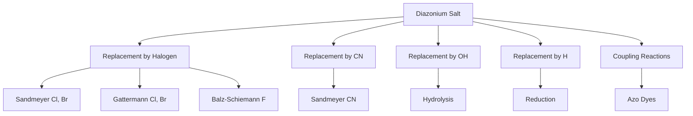

> Complete guide to diazonium salts - diazotization, Sandmeyer reactions, Gattermann reactions, and synthetic applications for JEE

## The Hook: The Gateway to Azo Dyes and Medicines

> **★ Key point · Connect: Real Life → Chemistry**
>
> **Azo dyes** - the most widely used synthetic dyes in textiles, food, and cosmetics - are all prepared through **diazonium salts**!
>
> **Real-world applications:**
>
> - **Sunset Yellow** (food coloring): Made via diazonium chemistry

> - **Methyl Orange** (pH indicator): Diazonium coupling product

> - **Prontosil** (first antibiotic drug, 1932): Azo compound from diazonium salt

> - **Congo Red** (biological stain): Used in medical diagnostics
>
> **The synthetic power:**

> Diazonium salts are like **molecular transformers** - they allow us to replace the -NH₂ group in aniline with almost any functional group:
>
> $$\text{C}_6\text{H}_5\text{-NH}_2 \xrightarrow{\text{via diazonium}} \text{C}_6\text{H}_5\text{-X}$$
>
> Where X = -F, -Cl, -Br, -I, -CN, -OH, -H, etc.
>
> **JEE Question:** Why are aliphatic diazonium salts unstable but aromatic ones stable?

---

## The Core Concept

### What are Diazonium Salts?

Diazonium salts contain the **-N₂⁺** (diazonium) group attached to an aryl or alkyl group.

**General formula:** R-N₂⁺X⁻ or Ar-N₂⁺X⁻

**Structure:**

$$\text{R-N≡N}^+ \text{X}^-$$

**Key features:**

- Nitrogen-nitrogen triple bond
- Positive charge on terminal nitrogen
- Counter ion (usually Cl⁻, HSO₄⁻, BF₄⁻)

> **◐ In simple terms · JEE Weightage**
>
> Diazonium Salts: 4-5 questions in JEE Main, 2-3 in JEE Advanced

> High-yield topics: Diazotization, Sandmeyer reaction, conversion to different functional groups, azo coupling

---

## Preparation: Diazotization

### The Diazotization Reaction

**Best for:** Aromatic primary amines ONLY

**General Reaction:**

$$\boxed{\text{Ar-NH}_2 + \text{NaNO}_2 + 2\text{HCl} \xrightarrow{0-5°\text{C}} [\text{Ar-N}_2^+]\text{Cl}^- + \text{NaCl} + 2\text{H}_2\text{O}}$$

**Conditions:**

1. **Temperature:** 0-5°C (ice-cold)
2. **Acid:** HCl or H₂SO₄
3. **Reagent:** Sodium nitrite (NaNO₂)

### Mechanism of Diazotization

**Step 1: Generation of nitrous acid**

$$\text{NaNO}_2 + \text{HCl} \rightarrow \text{HNO}_2 + \text{NaCl}$$

**Step 2: Formation of nitrosonium ion (electrophile)**

$$\text{HNO}_2 + \text{H}^+ \rightarrow \text{H}_2\text{O-N=O}^+ \rightarrow \text{H}_2\text{O} + \text{N≡O}^+$$

(Nitrosonium ion: NO⁺)

**Step 3: Electrophilic attack on amine**

$$\text{C}_6\text{H}_5\text{-NH}_2 + \text{NO}^+ \rightarrow \text{C}_6\text{H}_5\text{-NH-N=O}^+ \text{(N-nitrosoanilinium ion)}$$

**Step 4: Deprotonation**

$$\text{C}_6\text{H}_5\text{-NH-N=O}^+ \xrightarrow{-\text{H}^+} \text{C}_6\text{H}_5\text{-N=N-OH}$$

**Step 5: Tautomerization**

$$\text{C}_6\text{H}_5\text{-N=N-OH} \rightarrow \text{C}_6\text{H}_5\text{-NH-N=O}$$

**Step 6: Protonation and dehydration**

$$\text{C}_6\text{H}_5\text{-N=N-OH} \xrightarrow{+\text{H}^+, -\text{H}_2\text{O}} [\text{C}_6\text{H}_5\text{-N≡N}^+]\text{Cl}^-$$

**Final product:** Benzenediazonium chloride

> **★ Key point · Why Temperature Control is Critical**
>
> **Temperature must be 0-5°C**
>
> **If temperature > 10°C:**
>
> - Diazonium salt decomposes

> - Forms phenol + nitrogen gas

>   $$[\text{C}_6\text{H}_5\text{-N}_2^+]\text{Cl}^- \rightarrow \text{C}_6\text{H}_5\text{-OH} + \text{N}_2↑ + \text{HCl}$$
>
> **Why stable at low temperature?**
>
> - At 0-5°C, decomposition is slow (kinetic stability)

> - Can be used immediately for further reactions

> - Storage: Use immediately or keep cold
>
> **JEE Note:** Diazonium salts are **never isolated** - used in situ (in the same reaction mixture)

### Examples of Diazotization

**Example 1: Benzenediazonium chloride**

$$\text{C}_6\text{H}_5\text{-NH}_2 + \text{NaNO}_2 + 2\text{HCl} \xrightarrow{0-5°\text{C}} [\text{C}_6\text{H}_5\text{-N}_2^+]\text{Cl}^- + \text{NaCl} + 2\text{H}_2\text{O}$$

**Example 2: p-Toluenediazonium chloride**

$$\text{p-CH}_3\text{-C}_6\text{H}_4\text{-NH}_2 \xrightarrow{\text{NaNO}_2/\text{HCl}, 0-5°\text{C}} [\text{p-CH}_3\text{-C}_6\text{H}_4\text{-N}_2^+]\text{Cl}^-$$

**Example 3: With H₂SO₄**

$$\text{C}_6\text{H}_5\text{-NH}_2 + \text{NaNO}_2 + \text{H}_2\text{SO}_4 \xrightarrow{0-5°\text{C}} [\text{C}_6\text{H}_5\text{-N}_2^+]\text{HSO}_4^-$$

---

## Stability of Diazonium Salts

### Aromatic Diazonium Salts

**Stable at 0-5°C** (can be used for further reactions)

**Why stable?**

1. **Resonance stabilization** with benzene ring
2. **Electron-withdrawing** effect of N₂⁺ delocalized

**Resonance:**

```fallback
N≡N⁺              N=N⁺               N=N⁺
   |                 ||                 ||
   ⟨⟩      ←→       ⟨⟩⁺      ←→       ⟨⟩⁺
```

Positive charge partially delocalized → more stable

### Interactive Demo: Visualize Diazonium Chemistry

See the formation and reactions of diazonium salts step-by-step.

### Aliphatic Diazonium Salts

**Unstable even at 0°C** (decompose immediately)

**Why unstable?**

1. **No resonance stabilization** (no aromatic ring)
2. Positive charge localized on nitrogen
3. Extremely unstable

**Decomposition:**

$$\text{R-N}_2^+\text{Cl}^- \rightarrow \text{R}^+ + \text{N}_2 + \text{Cl}^-$$

(Carbocation, very reactive)

**Further reaction:**

$$\text{R}^+ + \text{H}_2\text{O} \rightarrow \text{R-OH} + \text{H}^+$$

> **⚠ Trap · JEE Trap: Aliphatic vs Aromatic**
>
> **Question type:** “What happens when ethylamine reacts with NaNO₂/HCl?”
>
> **Wrong answer:** “Forms ethyldiazonium chloride (stable)”
>
> **Correct answer:**
>
> 1. Forms ethyldiazonium chloride (momentarily)

> 2. Immediately decomposes to ethanol + N₂
>
> $$\text{C}_2\text{H}_5\text{NH}_2 \xrightarrow{\text{NaNO}_2/\text{HCl}} [\text{C}_2\text{H}_5\text{-N}_2^+] \rightarrow \text{C}_2\text{H}_5\text{OH} + \text{N}_2↑$$
>
> **Key:** Only **aromatic** diazonium salts are stable enough for synthetic use!
>
> Related: [Properties of amines](../amines-properties/index.md)

---

## Reactions of Diazonium Salts



---

## Type 1: Sandmeyer Reactions

**Named after:** Swiss chemist Traugott Sandmeyer (1884)

**Catalyst:** Cu₂X₂ (cuprous salts) or CuX

**General Reaction:**

$$\boxed{[\text{Ar-N}_2^+]\text{X}^- \xrightarrow{\text{Cu}_2\text{X}_2 \text{ or CuX}} \text{Ar-X} + \text{N}_2↑}$$

### Sandmeyer Reaction: Chlorination

**Reagent:** CuCl or Cu₂Cl₂

$$[\text{C}_6\text{H}_5\text{-N}_2^+]\text{Cl}^- \xrightarrow{\text{CuCl}} \text{C}_6\text{H}_5\text{-Cl} + \text{N}_2↑$$

**Product:** Chlorobenzene

**Example:**

$$[\text{p-CH}_3\text{-C}_6\text{H}_4\text{-N}_2^+]\text{Cl}^- \xrightarrow{\text{CuCl}} \text{p-CH}_3\text{-C}_6\text{H}_4\text{-Cl}$$

(p-Chlorotoluene)

### Sandmeyer Reaction: Bromination

**Reagent:** CuBr or Cu₂Br₂

$$[\text{C}_6\text{H}_5\text{-N}_2^+]\text{Cl}^- \xrightarrow{\text{CuBr}} \text{C}_6\text{H}_5\text{-Br} + \text{N}_2↑$$

**Product:** Bromobenzene

### Sandmeyer Reaction: Cyanation

**Reagent:** CuCN (cuprous cyanide)

$$[\text{C}_6\text{H}_5\text{-N}_2^+]\text{Cl}^- \xrightarrow{\text{CuCN}} \text{C}_6\text{H}_5\text{-CN} + \text{N}_2↑$$

**Product:** Benzonitrile

**Importance:** -CN can be converted to -COOH or -CH₂NH₂

**Further reactions:**

$$\text{C}_6\text{H}_5\text{-CN} \xrightarrow{\text{H}_3\text{O}^+} \text{C}_6\text{H}_5\text{-COOH}$$

(Benzoic acid)

$$\text{C}_6\text{H}_5\text{-CN} \xrightarrow{\text{LiAlH}_4} \text{C}_6\text{H}_5\text{-CH}_2\text{-NH}_2$$

(Benzylamine)

> **★ Key point · Memory Trick: Sandmeyer Reactions**
>
> **“Sandmeyer Substitutes with Copper Catalysts”**
>
> **Sandmeyer reactions:**
>
> - Ar-N₂⁺ → Ar-Cl (CuCl)

> - Ar-N₂⁺ → Ar-Br (CuBr)

> - Ar-N₂⁺ → Ar-CN (CuCN)
>
> **All require cuprous (Cu⁺) salts!**
>
> **JEE Pattern:** Questions often ask “How to convert aniline to chlorobenzene?”

> **Answer:** Aniline → Diazonium salt → Sandmeyer (CuCl) → Chlorobenzene

---

## Type 2: Gattermann Reactions

**Named after:** German chemist Ludwig Gattermann (1890)

**Difference from Sandmeyer:** Uses Cu powder + HX instead of CuX

**General Reaction:**

$$\boxed{[\text{Ar-N}_2^+]\text{X}^- \xrightarrow{\text{Cu + HX}} \text{Ar-X} + \text{N}_2↑}$$

### Gattermann Reaction: Chlorination

**Reagent:** Cu + HCl

$$[\text{C}_6\text{H}_5\text{-N}_2^+]\text{Cl}^- \xrightarrow{\text{Cu + HCl}} \text{C}_6\text{H}_5\text{-Cl} + \text{N}_2↑$$

**Product:** Chlorobenzene

### Gattermann Reaction: Bromination

**Reagent:** Cu + HBr

$$[\text{C}_6\text{H}_5\text{-N}_2^+]\text{Cl}^- \xrightarrow{\text{Cu + HBr}} \text{C}_6\text{H}_5\text{-Br} + \text{N}_2↑$$

**Product:** Bromobenzene

> **↗ Connection · Sandmeyer vs Gattermann**
>
> **Comparison:**
>
> | Feature | Sandmeyer | Gattermann |

> | --- | --- | --- |

> | **Reagent** | CuCl, CuBr, CuCN | Cu + HCl, Cu + HBr |

> | **Products** | Ar-Cl, Ar-Br, Ar-CN | Ar-Cl, Ar-Br (no CN) |

> | **Condition** | Cuprous salt | Copper powder + acid |

> | **Scope** | Wider (includes CN) | Limited (Cl, Br only) |
>
> **JEE Note:** For -CN, only Sandmeyer works (CuCN)!
>
> **Both give same products for Cl/Br, just different catalysts**

---

## Type 3: Balz-Schiemann Reaction (Fluorination)

**For:** Introducing fluorine (F) into aromatic ring

**Reagent:** Fluoroboric acid (HBF₄)

**Steps:**

**Step 1: Form diazonium fluoroborate**

$$[\text{C}_6\text{H}_5\text{-N}_2^+]\text{Cl}^- + \text{HBF}_4 \rightarrow [\text{C}_6\text{H}_5\text{-N}_2^+]\text{BF}_4^- + \text{HCl}$$

**Step 2: Dry and heat**

$$[\text{C}_6\text{H}_5\text{-N}_2^+]\text{BF}_4^- \xrightarrow{\Delta} \text{C}_6\text{H}_5\text{-F} + \text{N}_2↑ + \text{BF}_3$$

**Product:** Fluorobenzene

**Special features:**

- Diazonium fluoroborate is **solid** (can be isolated)
- More stable than diazonium chloride
- Heating causes decomposition to fluorobenzene

> **★ Key point · Why Different Method for Fluorine?**
>
> **Q:** Why can’t we use CuF for fluorination (like Sandmeyer)?
>
> **Answer:**
>
> - CuF is **unstable** and difficult to prepare

> - Sandmeyer/Gattermann don’t work for F

> - Balz-Schiemann is **only practical method** for Ar-F
>
> **JEE Memory:**
>
> - For Cl, Br: Sandmeyer or Gattermann

> - For CN: Only Sandmeyer (CuCN)

> - For F: Only Balz-Schiemann (HBF₄)
>
> **“Fluorine is Fancy - needs Balz-Schiemann!”**

---

## Type 4: Replacement by Iodine

**Reagent:** Potassium iodide (KI)

**No catalyst needed!**

$$\boxed{[\text{C}_6\text{H}_5\text{-N}_2^+]\text{Cl}^- + \text{KI} \rightarrow \text{C}_6\text{H}_5\text{-I} + \text{N}_2↑ + \text{KCl}}$$

**Product:** Iodobenzene

**Why no catalyst?**

- I⁻ is a good nucleophile
- Direct substitution occurs
- No need for copper catalysts

**Comparison:**

| Halogen | Reagent | Method |
| --- | --- | --- |
| **F** | HBF₄, heat | Balz-Schiemann |
| **Cl** | CuCl or Cu/HCl | Sandmeyer/Gattermann |
| **Br** | CuBr or Cu/HBr | Sandmeyer/Gattermann |
| **I** | KI (no catalyst) | Direct substitution |

---

## Type 5: Replacement by Hydroxyl Group (Hydrolysis)

**Reagent:** Water (warm) or dilute acid

$$\boxed{[\text{C}_6\text{H}_5\text{-N}_2^+]\text{Cl}^- \xrightarrow{\text{H}_2\text{O, warm}} \text{C}_6\text{H}_5\text{-OH} + \text{N}_2↑ + \text{HCl}}$$

**Product:** Phenol

**Conditions:**

- Warm the diazonium salt solution
- Or add dilute H₂SO₄ and heat

**Example:**

$$[\text{p-CH}_3\text{-C}_6\text{H}_4\text{-N}_2^+]\text{Cl}^- \xrightarrow{\text{H}_2\text{O, warm}} \text{p-CH}_3\text{-C}_6\text{H}_4\text{-OH}$$

(p-Cresol)

**Importance:** One of the best methods to prepare phenols!

**Alternate pathway:**

$$\text{Aniline} \rightarrow \text{Diazonium salt} \rightarrow \text{Phenol}$$

> **★ Key point · JEE Application: Phenol Synthesis**
>
> **Q:** How to convert benzene to phenol?
>
> **Method 1 (via diazonium):**
>
> 1. Benzene → Nitrobenzene (HNO₃/H₂SO₄)

> 2. Nitrobenzene → Aniline (Sn/HCl)

> 3. Aniline → Diazonium salt (NaNO₂/HCl, 0-5°C)

> 4. Diazonium salt → Phenol (H₂O, warm)
>
> **Method 2 (industrial):**
>
> - Benzene → Cumene → Phenol + Acetone (Cumene process)
>
> **JEE prefers:** Diazonium route (shows reaction sequence)
>
> Related: [Oxygen compounds](../../oxygen-compounds/index.md)

---

## Type 6: Replacement by Hydrogen (Reduction)

**Reagent:** Hypophosphorous acid (H₃PO₂) or C₂H₅OH/Zn dust

$$\boxed{[\text{C}_6\text{H}_5\text{-N}_2^+]\text{Cl}^- \xrightarrow{\text{H}_3\text{PO}_2} \text{C}_6\text{H}_6 + \text{N}_2↑}$$

**Product:** Benzene

**Also works:**

$$[\text{C}_6\text{H}_5\text{-N}_2^+]\text{Cl}^- \xrightarrow{\text{C}_2\text{H}_5\text{OH/Zn}} \text{C}_6\text{H}_6 + \text{N}_2↑$$

**Application: Deamination**

This reaction **removes the amino group**!

**Example:**

$$\text{Aniline} \rightarrow \text{Diazonium salt} \rightarrow \text{Benzene}$$

**Uses:**

1. Remove unwanted -NH₂ after directing a substitution
2. Prepare hydrocarbons from amines

> **↗ Connection · JEE Strategy: Using NH₂ as Directing Group**
>
> **Problem:** Prepare 1,3-dibromobenzene from benzene
>
> **Cannot do directly:** Br is ortho/para directing, gives 1,2- and 1,4-dibromobenzene
>
> **Strategy: Use -NH₂ as meta-directing group (as -NH₃⁺)**
>
> **Step 1:** Benzene → Nitrobenzene → Aniline
>
> **Step 2:** Aniline + Br₂ → 2,4,6-Tribromoaniline (ortho/para directing)
>
> Wait, that’s not what we want!
>
> **Better strategy:**
>
> **Use -NH₂ after protonation as -NH₃⁺ (meta-directing):**
>
> Actually, this is complex. Better approach:
>
> **Step 1:** Introduce -NO₂ (meta-directing)

> **Step 2:** Brominate → m-bromonitrobenzene

> **Step 3:** Reduce NO₂ → m-bromoaniline

> **Step 4:** Diazotize and brominate → 3,5-dibromoaniline

> **Step 5:** Diazotize and reduce → 1,3-dibromobenzene
>
> **Key:** Diazonium salt helps remove -NH₂ after using it for directing!
>
> Related: [Electrophilic aromatic substitution](../../hydrocarbons/index.md)

---

## Type 7: Coupling Reactions (Azo Compounds)

**Most important for dyes!**

**General Reaction:**

$$\boxed{[\text{Ar-N}_2^+]\text{Cl}^- + \text{Ar'-OH or Ar'-NR}_2 \xrightarrow{\text{pH 8-10}} \text{Ar-N=N-Ar'}}$$

**Product:** Azo compound (bright colored dyes)

**Reaction partners:**

1. **Phenols** (in alkaline medium)
2. **Aromatic amines** (in weakly acidic medium)

**Details in:** [Coupling Reactions](../coupling-reactions/index.md)

---

## Summary of Replacements

| Group | Reagent | Product | Method |
| --- | --- | --- | --- |
| **-F** | HBF₄, heat | Ar-F | Balz-Schiemann |
| **-Cl** | CuCl or Cu/HCl | Ar-Cl | Sandmeyer/Gattermann |
| **-Br** | CuBr or Cu/HBr | Ar-Br | Sandmeyer/Gattermann |
| **-I** | KI | Ar-I | Direct substitution |
| **-CN** | CuCN | Ar-CN | Sandmeyer only |
| **-OH** | H₂O, warm | Ar-OH | Hydrolysis |
| **-H** | H₃PO₂ or C₂H₅OH/Zn | Ar-H | Reduction |
| **-N=N-Ar’** | Ar’-OH or Ar’-NR₂ | Azo dye | Coupling |

> **★ Key point · Memory Trick: All Diazonium Reactions**
>
> **“Fancy Colored Brainy Iodine Chemistry Helps Create Beautiful Dyes”**
>
> - **F**ancy → F (Balz-Schiemann)

> - **C**olored → Cl (Sandmeyer/Gattermann)

> - **B**rainy → Br (Sandmeyer/Gattermann)

> - **I**odine → I (KI)

> - **C**hemistry → CN (Sandmeyer)

> - **H**elps → H (H₃PO₂ reduction)

> - **C**reate → Coupling

> - **B**eautiful → (also for Br)

> - **D**yes → -OH (hydrolysis to phenol)
>
> **JEE Strategy:** Know all 8 transformations by heart!

---

## Synthetic Importance of Diazonium Salts

### Why Diazonium Salts are Important

**1. Convert -NH₂ to various groups:**

- Cannot directly substitute -NH₂ in aniline
- Must go via diazonium salt
- Allows access to many derivatives

**2. Introduce groups that can’t be added directly:**

**Example: Preparing fluorobenzene**

- Cannot do: C₆H₆ + F₂ (too reactive, violent)
- Must use: C₆H₆ → C₆H₅NH₂ → C₆H₅N₂⁺ → C₆H₅F

**3. Prepare phenols easily:**

- Direct hydroxylation of benzene is difficult
- Via diazonium: C₆H₆ → C₆H₅NH₂ → C₆H₅N₂⁺ → C₆H₅OH

**4. Form azo dyes:**

- Coupling reactions give colored compounds
- Textile dyes, food colors, indicators

### Common Synthetic Transformations

**Benzene → Chlorobenzene:**

$$\text{C}_6\text{H}_6 \xrightarrow{\text{HNO}_3/\text{H}_2\text{SO}_4} \text{C}_6\text{H}_5\text{NO}_2 \xrightarrow{\text{Sn/HCl}} \text{C}_6\text{H}_5\text{NH}_2$$

$$\xrightarrow{\text{NaNO}_2/\text{HCl}, 0-5°\text{C}} [\text{C}_6\text{H}_5\text{N}_2^+]\text{Cl}^- \xrightarrow{\text{CuCl}} \text{C}_6\text{H}_5\text{Cl}$$

**Benzene → Phenol:**

$$\text{C}_6\text{H}_6 \rightarrow \text{C}_6\text{H}_5\text{NO}_2 \rightarrow \text{C}_6\text{H}_5\text{NH}_2 \rightarrow [\text{C}_6\text{H}_5\text{N}_2^+]\text{Cl}^- \xrightarrow{\text{H}_2\text{O, warm}} \text{C}_6\text{H}_5\text{OH}$$

**Aniline → Benzonitrile → Benzoic acid:**

$$\text{C}_6\text{H}_5\text{NH}_2 \rightarrow [\text{C}_6\text{H}_5\text{N}_2^+]\text{Cl}^- \xrightarrow{\text{CuCN}} \text{C}_6\text{H}_5\text{CN} \xrightarrow{\text{H}_3\text{O}^+} \text{C}_6\text{H}_5\text{COOH}$$

---

## Common Mistakes to Avoid

> **⚠ Trap · Mistake #1: Temperature Control**
>
> **Wrong:** “Diazonium salts are stable at room temperature”
>
> **Correct:** “Aromatic diazonium salts are stable only at 0-5°C”
>
> **If temp > 10°C:**
>
> $$[\text{Ar-N}_2^+]\text{Cl}^- \rightarrow \text{Ar-OH} + \text{N}_2↑$$
>
> **JEE Trap:** Questions may not mention temperature - always assume 0-5°C for diazotization!

> **⚠ Trap · Mistake #2: Aliphatic Diazonium Salts**
>
> **Wrong:** “All diazonium salts are stable at 0-5°C”
>
> **Correct:** “Only AROMATIC diazonium salts are stable”
>
> **Aliphatic diazonium salts:**
>
> - Decompose immediately even at 0°C

> - Cannot be used for further reactions

> - Give alcohol + N₂
>
> **JEE Note:** Diazotization is synthetically useful only for aromatic amines!

> **⚠ Trap · Mistake #3: Wrong Reagent Choice**
>
> **Wrong:** “Use CuCN for chlorination”
>
> **Correct:** “Use CuCl for Cl, CuBr for Br, CuCN for CN”
>
> **Also wrong:** “Use Sandmeyer for fluorination”
>
> **Correct:** “Fluorination requires Balz-Schiemann (HBF₄)”
>
> **Summary:**
>
> - Cl, Br, CN → Sandmeyer (CuX)

> - F → Balz-Schiemann (HBF₄)

> - I → KI (no catalyst)

---

## Practice Problems

### Level 1: Foundation (NCERT)

> **↗ Connection · Problem 1: Basic Conversion**
>
> **Q:** How will you convert aniline to chlorobenzene?
>
> **Solution:**
>
> **Step 1: Diazotization**
>
> $$\text{C}_6\text{H}_5\text{NH}_2 + \text{NaNO}_2 + 2\text{HCl} \xrightarrow{0-5°\text{C}} [\text{C}_6\text{H}_5\text{N}_2^+]\text{Cl}^- + \text{NaCl} + 2\text{H}_2\text{O}$$
>
> **Step 2: Sandmeyer reaction**
>
> $$[\text{C}_6\text{H}_5\text{N}_2^+]\text{Cl}^- \xrightarrow{\text{CuCl}} \text{C}_6\text{H}_5\text{Cl} + \text{N}_2↑$$
>
> **Final product:** Chlorobenzene
>
> **Alternative for step 2:** Gattermann reaction (Cu + HCl)

> **↗ Connection · Problem 2: Phenol Preparation**
>
> **Q:** Write the reaction for conversion of benzenediazonium chloride to phenol.
>
> **Solution:**
>
> $$[\text{C}_6\text{H}_5\text{N}_2^+]\text{Cl}^- \xrightarrow{\text{H}_2\text{O, warm}} \text{C}_6\text{H}_5\text{OH} + \text{N}_2↑ + \text{HCl}$$
>
> **Conditions:**
>
> - Warm water (or dilute H₂SO₄)

> - Temperature > 10°C
>
> **Product:** Phenol
>
> **Observation:** Nitrogen gas evolution (effervescence)
>
> **JEE Note:** This is hydrolysis of diazonium salt

### Level 2: JEE Main

> **↗ Connection · Problem 3: Reagent Identification**
>
> **Q:** What reagent is used to convert benzenediazonium chloride to:

> (a) Fluorobenzene

> (b) Benzonitrile

> (c) Iodobenzene
>
> **Solution:**
>
> **(a) Fluorobenzene:**
>
> - **Reagent:** HBF₄, then heat

> - **Method:** Balz-Schiemann reaction

>   $$[\text{C}_6\text{H}_5\text{N}_2^+]\text{Cl}^- \xrightarrow{\text{HBF}_4} [\text{C}_6\text{H}_5\text{N}_2^+]\text{BF}_4^- \xrightarrow{\Delta} \text{C}_6\text{H}_5\text{F}$$
>
> **(b) Benzonitrile:**
>
> - **Reagent:** CuCN

> - **Method:** Sandmeyer reaction

>   $$[\text{C}_6\text{H}_5\text{N}_2^+]\text{Cl}^- \xrightarrow{\text{CuCN}} \text{C}_6\text{H}_5\text{CN} + \text{N}_2↑$$
>
> **(c) Iodobenzene:**
>
> - **Reagent:** KI (potassium iodide)

> - **Method:** Direct substitution (no catalyst)

>   $$[\text{C}_6\text{H}_5\text{N}_2^+]\text{Cl}^- \xrightarrow{\text{KI}} \text{C}_6\text{H}_5\text{I} + \text{N}_2↑$$
>
> **JEE Memory:** F needs fancy method (Balz-Schiemann), I is independent (no catalyst)

> **↗ Connection · Problem 4: Multi-step Synthesis**
>
> **Q:** How will you prepare benzoic acid from aniline?
>
> **Solution:**
>
> **Retrosynthetic analysis:**

> C₆H₅COOH ← C₆H₅CN ← C₆H₅N₂⁺Cl⁻ ← C₆H₅NH₂
>
> **Forward synthesis:**
>
> **Step 1: Diazotization**
>
> $$\text{C}_6\text{H}_5\text{NH}_2 \xrightarrow{\text{NaNO}_2/\text{HCl}, 0-5°\text{C}} [\text{C}_6\text{H}_5\text{N}_2^+]\text{Cl}^-$$
>
> **Step 2: Sandmeyer cyanation**
>
> $$[\text{C}_6\text{H}_5\text{N}_2^+]\text{Cl}^- \xrightarrow{\text{CuCN}} \text{C}_6\text{H}_5\text{CN} + \text{N}_2↑$$
>
> **Step 3: Hydrolysis of nitrile**
>
> $$\text{C}_6\text{H}_5\text{CN} \xrightarrow{\text{H}_3\text{O}^+, \Delta} \text{C}_6\text{H}_5\text{COOH}$$
>
> **Final product:** Benzoic acid
>
> **Key:** Diazonium → CN → COOH (useful chain extension)

### Level 3: JEE Advanced

> **↗ Connection · Problem 5: Complete Synthesis**
>
> **Q:** Starting from benzene, how will you prepare:

> (a) m-Dibromobenzene

> (b) p-Bromoaniline
>
> **Solution:**
>
> **(a) m-Dibromobenzene:**
>
> **Strategy:** Use -NO₂ as meta-directing group
>
> **Step 1:** Nitration
>
> $$\text{C}_6\text{H}_6 \xrightarrow{\text{HNO}_3/\text{H}_2\text{SO}_4} \text{C}_6\text{H}_5\text{NO}_2$$
>
> **Step 2:** Bromination (meta-directed)
>
> $$\text{C}_6\text{H}_5\text{NO}_2 \xrightarrow{\text{Br}_2/\text{Fe}} \text{m-BrC}_6\text{H}_4\text{NO}_2$$
>
> **Step 3:** Reduce to amine
>
> $$\text{m-BrC}_6\text{H}_4\text{NO}_2 \xrightarrow{\text{Sn/HCl}} \text{m-BrC}_6\text{H}_4\text{NH}_2$$
>
> **Step 4:** Diazotize and brominate
>
> $$\text{m-BrC}_6\text{H}_4\text{NH}_2 \xrightarrow{\text{NaNO}_2/\text{HCl}} [\text{m-BrC}_6\text{H}_4\text{N}_2^+]\text{Cl}^-$$

$$\xrightarrow{\text{CuBr}} \text{1,3-dibromobenzene}$$
>
> **(b) p-Bromoaniline:**
>
> **Strategy:** Protect NH₂, brominate, deprotect
>
> **Step 1:** Benzene → Aniline (via nitrobenzene)
>
> **Step 2:** Acetylation (protect)
>
> $$\text{C}_6\text{H}_5\text{NH}_2 \xrightarrow{(\text{CH}_3\text{CO})_2\text{O}} \text{C}_6\text{H}_5\text{NHCOCH}_3$$
>
> **Step 3:** Bromination (para-directed)
>
> $$\text{C}_6\text{H}_5\text{NHCOCH}_3 \xrightarrow{\text{Br}_2} \text{p-BrC}_6\text{H}_4\text{NHCOCH}_3$$
>
> **Step 4:** Deprotection (hydrolysis)
>
> $$\text{p-BrC}_6\text{H}_4\text{NHCOCH}_3 \xrightarrow{\text{H}_3\text{O}^+} \text{p-BrC}_6\text{H}_4\text{NH}_2$$
>
> **Product:** p-Bromoaniline
>
> **JEE Insight:** Different strategies for meta vs para substitution!
>
> Related: [Aromatic substitution](../../hydrocarbons/index.md)

> **↗ Connection · Problem 6: Mechanism and Stability**
>
> **Q:** Explain why aromatic diazonium salts are more stable than aliphatic diazonium salts.
>
> **Solution:**
>
> **Aromatic diazonium salts (e.g., C₆H₅N₂⁺Cl⁻):**
>
> **Stability factors:**
>
> **1. Resonance stabilization:**
>
> ```fallback

> N≡N⁺              N=N⁺               N=N⁺

>    |                 ||                 ||

>    ⟨⟩      ←→       ⟨⟩⁺      ←→       ⟨⟩⁺

> ```
>
> Positive charge delocalized into benzene ring → stabilized
>
> **2. Electron-withdrawing effect:**
>
> - N₂⁺ group withdraws electrons from ring

> - Ring stabilizes positive charge through resonance
>
> **Aliphatic diazonium salts (e.g., CH₃N₂⁺Cl⁻):**
>
> **Instability factors:**
>
> **1. No resonance:**
>
> - No aromatic ring to delocalize charge

> - Positive charge localized on terminal N
>
> **2. Rapid decomposition:**
>
> $$\text{R-N}_2^+ \rightarrow \text{R}^+ + \text{N}_2$$
>
> Carbocation forms → very unstable
>
> **3. Strong driving force:**
>
> - Formation of N₂ gas (very stable, triple bond)

> - Large entropy increase (gas evolution)

> - Thermodynamically favorable
>
> **Conclusion:**
>
> | Feature | Aromatic | Aliphatic |

> | --- | --- | --- |

> | Resonance | Yes (stabilizing) | No |

> | Stability at 0-5°C | Stable | Unstable |

> | Synthetic use | Yes | No |

> | Decomposition | Slow (at low temp) | Instantaneous |
>
> **JEE Key:** Only aromatic diazonium salts are synthetically useful!

---

## Quick Revision Box

| Transformation | Reagent | Method | Product |
| --- | --- | --- | --- |
| **Ar-NH₂ → Ar-N₂⁺** | NaNO₂/HCl, 0-5°C | Diazotization | Diazonium salt |
| **Ar-N₂⁺ → Ar-F** | HBF₄, heat | Balz-Schiemann | Aryl fluoride |
| **Ar-N₂⁺ → Ar-Cl** | CuCl or Cu/HCl | Sandmeyer/Gattermann | Aryl chloride |
| **Ar-N₂⁺ → Ar-Br** | CuBr or Cu/HBr | Sandmeyer/Gattermann | Aryl bromide |
| **Ar-N₂⁺ → Ar-I** | KI | Direct substitution | Aryl iodide |
| **Ar-N₂⁺ → Ar-CN** | CuCN | Sandmeyer | Aryl cyanide |
| **Ar-N₂⁺ → Ar-OH** | H₂O, warm | Hydrolysis | Phenol |
| **Ar-N₂⁺ → Ar-H** | H₃PO₂ | Reduction | Arene |

---

## Connection to Other Topics

**Prerequisites:**

- [Preparation of Amines](../amines-preparation/index.md) - Getting aniline
- [Properties of Amines](../amines-properties/index.md) - Reaction with HNO₂
- [Haloalkanes](../../halogens-compounds/index.md) - Substitution reactions

**Related Topics:**

- [Coupling Reactions](../coupling-reactions/index.md) - Azo dye formation
- [Phenols](../../oxygen-compounds/index.md) - Preparation via diazonium
- [Aromatic Chemistry](../../hydrocarbons/index.md) - Directing effects

**Applications:**

- Dye synthesis
- Pharmaceutical intermediates
- Aromatic substitution control

---

## Summary

> **★ Key point · Key Takeaways**
>
> **1. Preparation (Diazotization):**
>
> **Reaction:**
>
> $$\text{Ar-NH}_2 + \text{NaNO}_2 + 2\text{HCl} \xrightarrow{0-5°\text{C}} [\text{Ar-N}_2^+]\text{Cl}^- + \text{NaCl} + 2\text{H}_2\text{O}$$
>
> **Critical conditions:**
>
> - Temperature: 0-5°C (ice-cold)

> - Only for aromatic primary amines

> - Never isolate - use immediately
>
> **2. Stability:**
>
> **Aromatic:** Stable at 0-5°C (resonance stabilization)

> **Aliphatic:** Unstable even at 0°C (no resonance)
>
> **3. Replacement Reactions:**
>
> | Product | Reagent | Method |

> | --- | --- | --- |

> | Ar-F | HBF₄, Δ | Balz-Schiemann |

> | Ar-Cl | CuCl | Sandmeyer |

> | Ar-Br | CuBr | Sandmeyer |

> | Ar-I | KI | Direct |

> | Ar-CN | CuCN | Sandmeyer |

> | Ar-OH | H₂O, warm | Hydrolysis |

> | Ar-H | H₃PO₂ | Reduction |
>
> **4. Sandmeyer vs Gattermann:**
>
> **Sandmeyer:** CuCl, CuBr, CuCN (wider scope)

> **Gattermann:** Cu/HCl, Cu/HBr (Cl, Br only)
>
> **5. Synthetic Importance:**
>
> - Convert -NH₂ to any group

> - Prepare phenols easily

> - Introduce halogens (especially F)

> - Form azo dyes (coupling)
>
> **6. JEE Strategy:**
>
> ✓ Always mention **0-5°C** for diazotization

> ✓ For F: Use **Balz-Schiemann** (only method)

> ✓ For CN: Use **Sandmeyer with CuCN** (not Gattermann)

> ✓ For I: **KI** works directly (no catalyst)

> ✓ Remember: **Aromatic only** for stable salts
>
> **“Diazonium salts are the Swiss Army knife of organic synthesis - one intermediate, countless products!”**
>
> Next, explore [coupling reactions](../coupling-reactions/index.md) to understand how diazonium salts create the vibrant world of azo dyes!

From TestGuru · our mock-test platform

## You've read Diazonium Salts: Preparation and Reactions.You've read this topic. Find out what you actually got.

A free JEE Main mock with this chapter in it, and a report that shows which sub-topics cost you marks.

[Take a free JEE Main mock →](https://app.testguru.co/signup?tg_chapter=nitrogen-compounds&tg_exam=jee-main&tg_page=%2Fchemistry%2Fnitrogen-compounds%2Fdiazonium-salts%2F&tg_subject=chemistry&utm_campaign=notes-jee-main-free-test&utm_content=article-end&utm_medium=referral&utm_source=jeenotes)
Free, no card. Opens TestGuru in a new tab.

## Stay exam-ready

One email every Sunday: new notes, the week's hardest challenge question and a revision plan.One email every Sunday.

## Comments

Have a question or spotted a mistake? Join the discussion below.

Advertisement

Advertisement

---

## Extracted page code (interactive scripts & widgets)


### inline-script-16

```js
if(!document.getElementById("animation-fullscreen-overlay")){const e=document.createElement("div");e.id="animation-fullscreen-overlay",e.className="animation-fullscreen-overlay",e.innerHTML=`
      <div class="fullscreen-modal">
        <div class="fullscreen-header">
          <span class="fullscreen-title">Interactive Demo</span>
          <button class="fullscreen-close-btn" onclick="JEEAnimations.closeFullscreen()" title="Close (Esc)" aria-label="Close fullscreen">
            <svg width="24" height="24" viewBox="0 0 24 24" fill="none" stroke="currentColor" stroke-width="2" stroke-linecap="round" stroke-linejoin="round">
              <line x1="18" y1="6" x2="6" y2="18"></line>
              <line x1="6" y1="6" x2="18" y2="18"></line>
            </svg>
          </button>
        </div>
        <div class="fullscreen-content"></div>
      </div>
    `,document.body.appendChild(e),document.addEventListener("keydown",function(e){e.key==="Escape"&&document.body.classList.contains("animation-fullscreen-active")&&JEEAnimations.closeFullscreen()}),e.addEventListener("click",function(t){t.target===e&&JEEAnimations.closeFullscreen()})}
```


### inline-script-17

```js
(function(){var t,e=document.getElementById("disqus-load");if(!e)return;t=!1,e.addEventListener("click",function(){if(t)return;t=!0,e.setAttribute("disabled","disabled"),e.textContent="Loading comments…",window.disqus_config=function(){this.page.url="https://jeenotes.in/chemistry/nitrogen-compounds/diazonium-salts/",this.page.identifier="/chemistry/nitrogen-compounds/diazonium-salts/"};var s=document,n=s.createElement("script");n.src="https://https-jeenotes-in.disqus.com/embed.js",n.setAttribute("data-timestamp",+new Date),n.onload=function(){e.style.display="none"},n.onerror=function(){t=!1,e.removeAttribute("disabled"),e.textContent="Could not load comments. Tap to retry"},(s.head||s.body).appendChild(n)})})()
```


### inline-script-18

```js
(function(){var t,e=document.currentScript.previousElementSibling;function n(){(window.adsbygoogle=window.adsbygoogle||[]).push({})}if(!window.ResizeObserver||e.clientWidth>0){n();return}t=new ResizeObserver(function(){e.clientWidth>0&&(t.disconnect(),n())}),t.observe(e)})()
```


### interactive-widget-1

```html
<div class="animation-wrapper" data-animation="reactionMechanism" id="anim-reactionMechanism-1795396419889659088"><div class="animation-header"><button aria-label="Toggle fullscreen" class="anim-fullscreen-btn" onclick='JEEAnimations.toggleFullscreen("anim-reactionMechanism-1795396419889659088")' title="Fullscreen (F)">
<svg class="fullscreen-icon-expand" fill="none" height="18" stroke="currentColor" stroke-linecap="round" stroke-linejoin="round" stroke-width="2" viewbox="0 0 24 24" width="18"><polyline points="15 3 21 3 21 9"></polyline><polyline points="9 21 3 21 3 15"></polyline><line x1="21" x2="14" y1="3" y2="10"></line><line x1="3" x2="10" y1="21" y2="14"></line></svg>
<svg class="fullscreen-icon-collapse" fill="none" height="18" stroke="currentColor" stroke-linecap="round" stroke-linejoin="round" stroke-width="2" viewbox="0 0 24 24" width="18"><polyline points="4 14 10 14 10 20"></polyline><polyline points="20 10 14 10 14 4"></polyline><line x1="14" x2="21" y1="10" y2="3"></line><line x1="3" x2="10" y1="21" y2="14"></line></svg>
<span class="fullscreen-text">Fullscreen</span></button></div><div class="animation-content"><noscript><div class="callout callout-warning"><div class="callout-title">JavaScript Required</div><p>This interactive animation requires JavaScript to be enabled.</p></div></noscript></div></div>
```


---

_Source: [https://jeenotes.in/chemistry/nitrogen-compounds/diazonium-salts/](https://jeenotes.in/chemistry/nitrogen-compounds/diazonium-salts/) · raw HTML: `offline/chemistry/nitrogen-compounds/diazonium-salts/index.html`_
