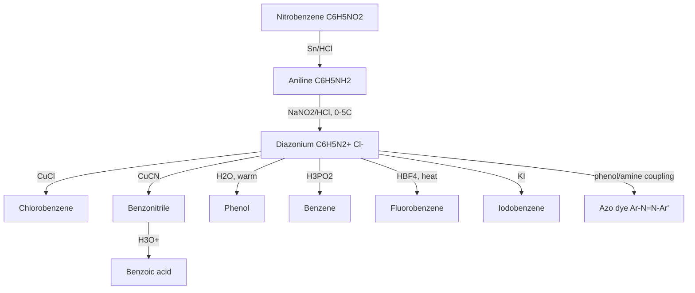

> All key Chemistry reactions, basicity orders, and named reactions for amines and diazonium salts - JEE Main & Advanced quick revision in one place.

This is a mostly descriptive organic chapter, so the sheet is built around named reactions, reagent-product maps, and basicity orders rather than numeric formulas. Every reaction and order below is taken directly from the chapter pages.

> **★ Key point · How to use this sheet**
>
> The high-value JEE items here are the **aqueous basicity order**, the **HNO₂ test products**, and the **diazonium reagent-to-product map**. Lock those three down first.

## Classification at a Glance

| Type | General formula | Note |
| --- | --- | --- |
| Primary (1°) | $\text{R-NH}_2$ | One group on N |
| Secondary (2°) | $\text{R}_2\text{NH}$ | Two groups on N |
| Tertiary (3°) | $\text{R}_3\text{N}$ | Three groups on N |
| Quaternary salt | $\text{R}_4\text{N}^+\text{X}^-$ | NOT an amine (no lone pair, not basic) |

- Aromatic amine: N **directly** on ring, e.g. aniline $\text{C}_6\text{H}_5\text{-NH}_2$.
- Aliphatic (even with a ring): N on CH₂, e.g. benzylamine $\text{C}_6\text{H}_5\text{-CH}_2\text{-NH}_2$.
- Structure of N in amines: **sp³**, pyramidal, bond angle **~107°**, one lone pair.

## Basicity (High-Yield)

### Defining relations

$$\text{R-NH}_2 + \text{H}_2\text{O} \rightleftharpoons \text{R-NH}_3^+ + \text{OH}^-$$

$$K_b = \frac{[\text{R-NH}_3^+][\text{OH}^-]}{[\text{R-NH}_2]}, \qquad \text{p}K_b = -\log K_b$$

$$\boxed{K_a \times K_b = K_w = 10^{-14}}$$

$$\boxed{\text{p}K_a + \text{p}K_b = 14}$$

- Lower $\text{p}K_b$ → stronger base; higher $\text{p}K_a$ of conjugate acid → stronger base.

### Order of basicity

$$\boxed{\text{Aqueous: } 2° > 1° > 3° > \text{NH}_3}$$

$$\boxed{\text{Gas phase: } 3° > 2° > 1° > \text{NH}_3}$$

- Aqueous winner is set by a balance of **+I effect** (3° > 2° > 1°) and **solvation of conjugate acid** (1° > 2° > 3°).
- Gas phase is controlled by +I effect alone.

$$\boxed{\text{Overall: Aliphatic} \gg \text{NH}_3 \gg \text{Aromatic}}$$

The chapter’s “ultimate JEE order”:

$$(\text{CH}_3)_2\text{NH} > \text{CH}_3\text{NH}_2 > \text{C}_6\text{H}_5\text{CH}_2\text{NH}_2 > \text{NH}_3 > \text{C}_6\text{H}_5\text{NH}_2$$

### Substituent effect on aniline

$$\text{p-CH}_3\text{O-C}_6\text{H}_4\text{-NH}_2 > \text{p-CH}_3\text{-C}_6\text{H}_4\text{-NH}_2 > \text{C}_6\text{H}_5\text{-NH}_2 > \text{p-Cl-C}_6\text{H}_4\text{-NH}_2 > \text{p-NO}_2\text{-C}_6\text{H}_4\text{-NH}_2$$

- EDG (−OCH₃, −CH₃, −NH₂) **increase** basicity; EWG (−NO₂, −CN, −X, −CHO) **decrease** it.
- Nitroaniline isomers: **meta > para > ortho** (meta has no direct resonance with NH₂, so only −I acts).

### pKb values to remember

| Amine | pKb |
| --- | --- |
| $(\text{CH}_3)_2\text{NH}$ | 3.27 (strongest aliphatic) |
| $\text{CH}_3\text{NH}_2$ | 3.38 |
| $\text{C}_2\text{H}_5\text{NH}_2$ | 3.35 |
| $(\text{CH}_3)_3\text{N}$ | 4.22 |
| $\text{NH}_3$ | 4.75 (reference) |
| $\text{C}_6\text{H}_5\text{CH}_2\text{NH}_2$ | 4.70 |
| $\text{C}_6\text{H}_5\text{NH}_2$ (aniline) | 9.42 |
| m-nitroaniline | 11.5 |
| p-nitroaniline | 13.0 |
| o-nitroaniline | 14.3 |

### Special cases

| Species | Behaviour | Reason |
| --- | --- | --- |
| Guanidine | Extremely strong base, pKb ≈ 0.4 | Conjugate acid: +ve charge over 3 equivalent N (resonance) |
| Pyrrole | Essentially non-basic, pKb > 14 | N lone pair is part of aromatic sextet |
| Aniline > diphenylamine > triphenylamine | Decreasing basicity | More phenyls → more lone-pair delocalization |

## Preparation of Amines

| Starting material | Reagent | Product | Carbon change |
| --- | --- | --- | --- |
| $\text{R-NO}_2$ | Sn/HCl, Fe/HCl, LiAlH₄, or H₂/Ni | 1° amine | none |
| $\text{R-CN}$ | LiAlH₄, H₂/Ni, or Na/C₂H₅OH | 1° amine | **+1** |
| $\text{R-CO-NH}_2$ | LiAlH₄ | 1° amine | none |
| $\text{R-CO-NH}_2$ | Br₂ + 4 NaOH (Hoffmann) | 1° amine | **−1** |
| Phthalimide | (1) KOH (2) R-X (3) H₃O⁺ (Gabriel) | **pure 1° aliphatic** | none |
| $\text{NH}_3$ | R-X | mixture of 1°,2°,3°,quaternary | none |
| $\text{R-CHO} + \text{R'-NH}_2$ | then [H] (reductive amination) | 2° amine | varies |

Key headline equations:

$$\boxed{\text{R-NO}_2 + 6[\text{H}] \rightarrow \text{R-NH}_2 + 2\text{H}_2\text{O}}$$

$$\boxed{\text{R-CN} + 4[\text{H}] \rightarrow \text{R-CH}_2\text{-NH}_2}$$

$$\boxed{\text{R-CO-NH}_2 \xrightarrow{\text{LiAlH}_4} \text{R-CH}_2\text{-NH}_2}$$

$$\boxed{\text{R-CO-NH}_2 + \text{Br}_2 + 4\text{NaOH} \rightarrow \text{R-NH}_2 + \text{Na}_2\text{CO}_3 + 2\text{NaBr} + 2\text{H}_2\text{O}}$$

> **★ Key point · LiAlH₄ vs Hoffmann on an amide**
>
> Same amide, two different amines:

> $\text{C}_6\text{H}_5\text{CONH}_2 \xrightarrow{\text{LiAlH}_4} \text{C}_6\text{H}_5\text{CH}_2\text{NH}_2$ (benzylamine, all C kept) vs

> $\text{C}_6\text{H}_5\text{CONH}_2 \xrightarrow{\text{Br}_2/\text{NaOH}} \text{C}_6\text{H}_5\text{NH}_2$ (aniline, one C lost). “LiAlH₄ is Loyal, Hoffmann is Harsh.”

- Amide reduction preserves degree: 1° amide → 1° amine, 2° amide → 2° amine, 3° amide → 3° amine.
- Gabriel **fails for aromatic amines** (aryl halides don’t do SN2). For aniline, reduce nitrobenzene instead.
- Selective reduction of one −NO₂ in m-dinitrobenzene: use **(NH₄)₂S**.

## Physical Properties

$$\boxed{\text{Boiling point (similar mass): } 1° > 2° > 3°}$$

$$\boxed{\text{Alcohols} > \text{1° Amines} > \text{Hydrocarbons (similar mass)}}$$

- Driver: H-bonding capacity (count of N-H bonds). H-bonding outweighs molecular mass — e.g. $(\text{CH}_3)_2\text{NH}$ (bp 7°C) > $(\text{CH}_3)_3\text{N}$ (bp 3°C) despite higher mass of the 3° amine.
- Solubility in water: lower amines C₁-C₄ soluble; aromatic amines insoluble (but soluble in dilute acid as the salt). Order $1° \approx 2° > 3°$.

## Chemical Reactions of Amines

### Salt formation, acylation, benzoylation

$$\text{R-NH}_2 + \text{HCl} \rightarrow [\text{R-NH}_3^+]\text{Cl}^-$$

$$\text{R-NH}_2 + \text{CH}_3\text{COCl} \rightarrow \text{R-NH-CO-CH}_3 + \text{HCl}$$

$$\text{R-NH}_2 + \text{C}_6\text{H}_5\text{COCl} \xrightarrow{\text{NaOH}} \text{R-NH-CO-C}_6\text{H}_5 \quad (\text{Schotten-Baumann})$$

- Acylation/benzoylation: 1° and 2° react; 3° does not (no N-H).

### Identification tests

| Test | Reagent | 1° | 2° | 3° |
| --- | --- | --- | --- | --- |
| Carbylamine | CHCl₃ + 3KOH, Δ | foul-smelling isocyanide (positive) | no reaction | no reaction |
| Hinsberg | C₆H₅SO₂Cl | sulfonamide, **soluble** in KOH | sulfonamide, **insoluble** | no reaction |

$$\boxed{\text{R-NH}_2 + \text{CHCl}_3 + 3\text{KOH} \xrightarrow{\Delta} \text{R-N}{\equiv}\text{C} + 3\text{KCl} + 3\text{H}_2\text{O}}$$

> **★ Key point · Carbylamine scope**
>
> Carbylamine distinguishes **1° from 2°/3°**, NOT aliphatic from aromatic. Both aliphatic and aromatic primary amines give the foul smell.

### Reaction with nitrous acid (HNO₂)

| Amine | Product | Observation |
| --- | --- | --- |
| 1° aliphatic | R-OH + N₂ | brisk effervescence (N₂ gas) |
| 1° aromatic | $[\text{Ar-N}_2^+]\text{Cl}^-$ | stable diazonium salt at 0-5°C |
| 2° (aliphatic or aromatic) | $\text{R}_2\text{N-N=O}$ | yellow oily N-nitrosamine (carcinogenic) |
| 3° aliphatic | $[\text{R}_3\text{NH}^+]\text{NO}_2^-$ | water-soluble nitrite salt |
| 3° aromatic | p-nitroso-N,N-dialkylaniline | green colour |

### Electrophilic substitution in aniline

- −NH₂ is **strongly activating, ortho/para directing**; electron density ortho ≈ para > meta.
- Direct bromination gives 2,4,6-tribromoaniline (white ppt) — uncontrolled.
- For mono-substitution: **acetylate → react → hydrolyse** (acetanilide is moderately activating).

$$\text{C}_6\text{H}_5\text{NH}_2 + 3\text{Br}_2(\text{aq}) \rightarrow 2,4,6\text{-tribromoaniline} + 3\text{HBr}$$

- Sulphonation of aniline (via anilinium salt, 180-200°C) gives **sulfanilic acid** (p-aminobenzenesulfonic acid).
- Oxidation: aniline → black tar (cannot be cleanly oxidised to nitrobenzene).

## Diazonium Salts

### Diazotization

$$\boxed{\text{Ar-NH}_2 + \text{NaNO}_2 + 2\text{HCl} \xrightarrow{0\text{-}5°\text{C}} [\text{Ar-N}_2^+]\text{Cl}^- + \text{NaCl} + 2\text{H}_2\text{O}}$$

- Aromatic 1° amines only; **0-5°C** essential; never isolate, use in situ.
- Above ~10°C decomposes: $[\text{C}_6\text{H}_5\text{N}_2^+]\text{Cl}^- \rightarrow \text{C}_6\text{H}_5\text{OH} + \text{N}_2 + \text{HCl}$.
- Aromatic salts are stable (resonance with ring); aliphatic salts decompose instantly even at 0°C.

### Replacement reactions (memorize this map)

| Target group | Reagent | Named method | Product |
| --- | --- | --- | --- |
| −F | HBF₄, then heat | Balz-Schiemann | Ar-F |
| −Cl | CuCl, or Cu/HCl | Sandmeyer / Gattermann | Ar-Cl |
| −Br | CuBr, or Cu/HBr | Sandmeyer / Gattermann | Ar-Br |
| −I | KI (no catalyst) | direct substitution | Ar-I |
| −CN | CuCN | Sandmeyer only | Ar-CN |
| −OH | H₂O, warm | hydrolysis | phenol |
| −H | H₃PO₂ or C₂H₅OH/Zn | reduction (deamination) | arene |
| −N=N-Ar′ | Ar′-OH or Ar′-NR₂ | coupling | azo dye |

$$[\text{Ar-N}_2^+]\text{X}^- \xrightarrow{\text{Cu}_2\text{X}_2 \text{ or CuX}} \text{Ar-X} + \text{N}_2 \quad (\text{Sandmeyer})$$

$$[\text{Ar-N}_2^+]\text{X}^- \xrightarrow{\text{Cu/HX}} \text{Ar-X} + \text{N}_2 \quad (\text{Gattermann})$$

- For −CN only Sandmeyer (CuCN) works; for −F only Balz-Schiemann; for −I plain KI suffices.
- Synthetic chains: aniline → ArN₂⁺ → CuCN → Ar-CN → (H₃O⁺) → Ar-COOH; aniline → ArN₂⁺ → (H₂O, warm) → phenol.

## Azo Coupling and Dyes

$$\boxed{[\text{Ar-N}_2^+]\text{X}^- + \text{Ar'-H} \rightarrow \text{Ar-N=N-Ar'} + \text{HX}}$$

| Coupling partner | pH / medium | Reason |
| --- | --- | --- |
| Phenols, naphthols | pH 8-10 (alkaline) | forms phenoxide (C₆H₅O⁻), more activated |
| Aromatic amines | pH 4-5 (weakly acidic) | keeps −NH₂ free and N₂⁺ stable |

- Coupling needs a **strongly activated** ring (−OH, −OR, −NH₂, −NHR, −NR₂). Benzene, toluene, chlorobenzene, nitrobenzene do **not** couple.
- Regioselectivity: predominantly **para** (less steric hindrance). Temperature 0-5°C throughout.
- Colour source: extended conjugation; chromophore = −N=N−; auxochromes = −OH, −NH₂, −SO₃H. EDG → bathochromic (red) shift; EWG → hypsochromic (blue) shift.
- Methyl orange = sulfanilic acid (diazotized) + N,N-dimethylaniline; **red in acid (pH < 3.1), yellow in base (pH > 4.4)**.
- Orange II = sulfanilic acid (diazotized) + β-naphthol (alkaline coupling).

> **★ Key point · Classic identification test**
>
> An unknown gives a diazonium salt with NaNO₂/HCl at 0-5°C and then a brilliant orange dye with alkaline β-naphthol → the unknown is an **aromatic primary amine** (e.g. aniline).

## Reaction Map



## See Also

- [Classification and Nomenclature](../amines-classification/index.md)
- [Preparation of Amines](../amines-preparation/index.md)
- [Properties of Amines](../amines-properties/index.md)
- [Basicity of Amines](../basicity-amines/index.md)
- [Diazonium Salts](../diazonium-salts/index.md)
- [Azo Coupling Reactions](../coupling-reactions/index.md)

From TestGuru · our mock-test platform

## You've read Nitrogen Compounds Formula Sheet.You've read this topic. Find out what you actually got.

A free JEE Main mock with this chapter in it, and a report that shows which sub-topics cost you marks.

[Take a free JEE Main mock →](https://app.testguru.co/signup?tg_chapter=nitrogen-compounds&tg_exam=jee-main&tg_page=%2Fchemistry%2Fnitrogen-compounds%2Fformula-sheet%2F&tg_subject=chemistry&utm_campaign=notes-jee-main-free-test&utm_content=article-end&utm_medium=referral&utm_source=jeenotes)
Free, no card. Opens TestGuru in a new tab.

## Stay exam-ready

One email every Sunday: new notes, the week's hardest challenge question and a revision plan.One email every Sunday.

## Comments

Have a question or spotted a mistake? Join the discussion below.

Advertisement

Advertisement

---

## Extracted page code (interactive scripts & widgets)


### inline-script-14

```js
(function(){var t,e=document.getElementById("disqus-load");if(!e)return;t=!1,e.addEventListener("click",function(){if(t)return;t=!0,e.setAttribute("disabled","disabled"),e.textContent="Loading comments…",window.disqus_config=function(){this.page.url="https://jeenotes.in/chemistry/nitrogen-compounds/formula-sheet/",this.page.identifier="/chemistry/nitrogen-compounds/formula-sheet/"};var s=document,n=s.createElement("script");n.src="https://https-jeenotes-in.disqus.com/embed.js",n.setAttribute("data-timestamp",+new Date),n.onload=function(){e.style.display="none"},n.onerror=function(){t=!1,e.removeAttribute("disabled"),e.textContent="Could not load comments. Tap to retry"},(s.head||s.body).appendChild(n)})})()
```


### inline-script-15

```js
(function(){var t,e=document.currentScript.previousElementSibling;function n(){(window.adsbygoogle=window.adsbygoogle||[]).push({})}if(!window.ResizeObserver||e.clientWidth>0){n();return}t=new ResizeObserver(function(){e.clientWidth>0&&(t.disconnect(),n())}),t.observe(e)})()
```


---

_Source: [https://jeenotes.in/chemistry/nitrogen-compounds/formula-sheet/](https://jeenotes.in/chemistry/nitrogen-compounds/formula-sheet/) · raw HTML: `offline/chemistry/nitrogen-compounds/formula-sheet/index.html`_
