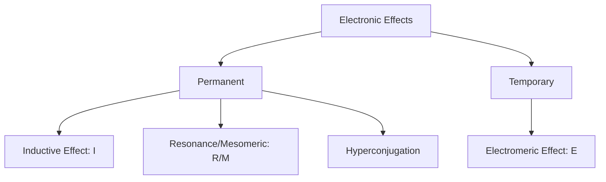

> Master inductive effect, resonance, hyperconjugation, electromeric effect and their applications in JEE Chemistry.

## Introduction

**Electronic effects** explain WHY reactions happen! They govern acidity, basicity, reactivity, and stability of organic molecules. Master these, and you can predict reaction outcomes without memorization.

> **★ Key point · Aspirin's Clever Chemistry**
>
> Aspirin works because of electronic effects! The acetyl group (through inductive and resonance effects) makes it less acidic than salicylic acid, allowing it to pass through your stomach without irritation. Once in your bloodstream, enzymes remove the acetyl group, releasing the active compound. Modern drug design (featured in *Painkiller* 2024) relies entirely on manipulating these electronic effects!

---

## Classification of Electronic Effects



**Permanent Effects:**

- Present in ground state
- Independent of reagents
- Inductive, Resonance, Hyperconjugation

**Temporary Effects:**

- Appear only when reagent approaches
- Disappear when reagent removed
- Electromeric effect

---

## Inductive Effect (I-Effect)

### Definition

**Permanent displacement** of **σ-electrons** along a chain due to electronegativity difference.

$$\boxed{\text{Electronegativity difference} \rightarrow \text{Polarization of σ-bond} \rightarrow \text{Inductive effect}}$$

### Mechanism

**Example: Chloroethane**

```fallback
δ⁺    δ⁺   δ⁺    δ⁻
H₃C - CH₂ - Cl

Cl is most electronegative
← Electron density flows toward Cl
```

**Characteristics:**

1. Transmitted through **σ-bonds**
2. Effect **decreases** rapidly with distance (dies after 3-4 bonds)
3. **Permanent** effect
4. Magnitude: σ > π > 0

### Types

#### -I Effect (Electron-Withdrawing)

**Groups more electronegative than H** withdraw electron density.

**Strength Order:**

$$\boxed{-NO_2 > -CN > -COOH > -F > -Cl > -Br > -I > -OCH_3 > -C_6H_5 > -H}$$

**Examples:**

- **-NO₂:** Strongest -I (highly electronegative O atoms)
- **-CN:** Triple bond, electronegative N
- **-COOH:** Carbonyl + OH
- **Halogens:** F > Cl > Br > I (electronegativity order)
- **-OR:** Oxygen withdraws through σ-bond

#### +I Effect (Electron-Donating)

**Alkyl groups less electronegative than H** donate electron density.

**Strength Order:**

$$\boxed{-(CH_3)_3C > -(CH_3)_2CH > -CH_2CH_3 > -CH_3 > -H}$$

**Why alkyl groups donate?**

- C-H bonds slightly polarized (H is slightly +ve)
- Methyl groups “push” electrons

**Order:** More alkyl groups → More +I effect

### Applications

#### 1. Acidity of Carboxylic Acids

**Acidity increases with -I groups**

$$\boxed{\text{Strength: } Cl_3CCOOH > Cl_2CHCOOH > ClCH_2COOH > CH_3COOH}$$

**Reason:**

- -I groups withdraw electrons from O-H
- O-H becomes more polar
- H⁺ leaves easily
- Conjugate base stabilized (electron withdrawal disperses negative charge)

**Example: Substituted acetic acids**

```fallback
CCl₃COOH    pKa ≈ 0.7  (strongest)
CHCl₂COOH   pKa ≈ 1.3
CH₂ClCOOH   pKa ≈ 2.9
CH₃COOH     pKa ≈ 4.8  (weakest)
```

**Effect of distance:**

```fallback
CH₃CH₂CH₂COOH  >  CH₃CHClCH₂COOH  >  CH₃CH₂CHClCOOH
(weakest acid)    (further from COOH)  (closest, strongest)
```

#### 2. Basicity of Amines

**Basicity decreases with -I groups**

$$\boxed{\text{Basicity: } (CH_3)_3N > (CH_3)_2NH > CH_3NH_2 > NH_3}$$

**In gas phase!**

**Reason:**

- +I groups donate electrons to N
- N becomes more electron-rich
- Better able to accept H⁺

**In aqueous solution - order changes!** (Solvation effects dominate)

#### 3. Stability of Carbocations

**Carbocations stabilized by +I groups**

$$\boxed{(CH_3)_3C^+ > (CH_3)_2CH^+ > CH_3CH_2^+ > CH_3^+}$$

**Reason:**

- Alkyl groups donate electrons
- Disperses positive charge
- Stabilizes carbocation

> **⚠ Trap · Common JEE Mistake**
>
> **Mistake:** Thinking -OCH₃ is always electron-donating.
>
> **Reality:**
>
> - Through **σ-bonds (inductive):** -I effect (O is electronegative)

> - Through **π-system (resonance):** +R effect (O donates lone pair)
>
> **Net effect depends on situation:**
>
> - Saturated systems: -I dominates

> - Aromatic systems: +R dominates
>
> This is THE most common trap question!

---

## Resonance/Mesomeric Effect (R/M-Effect)

### Definition

**Permanent delocalization** of **π-electrons or lone pairs** through conjugated system.

$$\boxed{\text{Conjugation (p-π or π-π)} \rightarrow \text{Electron delocalization} \rightarrow \text{Resonance}}$$

### Requirements

1. **Conjugated system:** Alternating single-double bonds OR lone pair adjacent to π-bond
2. **p-orbitals overlap:** All atoms in same plane (sp² or sp)
3. **π-electrons mobile:** Can move through system

### Resonance Structures

**Rules:**

1. Only **electrons move**, atoms stay fixed
2. Number of **unpaired electrons** doesn’t change
3. **Octet rule** should be satisfied (if possible)
4. More **covalent bonds** → More stable structure

**Resonance Hybrid:**

- Real structure is average of all resonance forms
- More stable contributing structure → Greater contribution

### Types

#### +R Effect (Electron-Donating)

**Groups with lone pairs** donate into conjugated π-system.

**Strength Order:**

$$\boxed{-NH_2 > -NHR > -OH > -OR > -NHCOR > -OCOR > -F > -Cl > -Br > -I}$$

**Example: Aniline**

```fallback
Resonance structures:

     NH₂              NH₂⁺             NH₂⁺             NH₂⁺
      |                |                |                |
      ⟨⟩         ↔    ⟨⟩          ↔    ⟨⟩          ↔    ⟨⟩
                     (-)              (-)              (-)

Lone pair on N delocalizes into benzene ring
Electron density increases at ortho and para positions
```

**Effect:**

- Activates benzene for electrophilic substitution
- Directs incoming electrophile to ortho/para

#### -R Effect (Electron-Withdrawing)

**Groups with multiple bonds** withdraw electrons from conjugated system.

**Strength Order:**

$$\boxed{-NO_2 > -CN > -CHO > -COR > -COOH > -COOR > -CONH_2}$$

**Example: Nitrobenzene**

```fallback
Resonance structures:

      NO₂              NO₂⁺             NO₂⁺             NO₂⁺
       |                |                |                |
      ⟨⟩          ↔    ⟨⟩           ↔   ⟨⟩           ↔   ⟨⟩
                      (+)              (+)              (+)

π-electrons from benzene move toward NO₂
Electron density decreases at ortho and para
```

**Effect:**

- Deactivates benzene
- Directs to meta position (least deactivated)

### Applications

#### 1. Stability of Molecules

**Benzene stability:**

- 6 resonance structures
- Complete delocalization of π-electrons
- **Resonance energy:** 150 kJ/mol
- More stable than expected for cyclohexatriene

**Carboxylate ion:**

```fallback
O⁻         O
     ‖    ↔    ‖
R - C         R - C
     |          |
     O          O⁻

Both C-O bonds equal length (intermediate)
Negative charge delocalized → Very stable
Makes carboxylic acids acidic!
```

#### 2. Acidity

**Phenol (pKa ~ 10) vs Ethanol (pKa ~ 16)**

```fallback
Phenoxide ion:          Ethoxide ion:
     O⁻                      CH₃-CH₂-O⁻
      |
     ⟨⟩                  No resonance!
Resonance-stabilized    Charge localized

Phenol is 10⁶ times more acidic!
```

#### 3. Directing Effects in Aromatic Substitution

**Ortho-Para Directors (activating):**

- -NH₂, -NHR, -OH, -OR (+R > -I)
- -CH₃, alkyl groups (+I)

**Meta Directors (deactivating):**

- -NO₂, -CN, -CHO, -COOH (-R effect)

**Ortho-Para Directors (deactivating):**

- -F, -Cl, -Br, -I (+R < -I overall, but +R directs)

> **★ Key point · JEE Alert**
>
> **Halogens are SPECIAL:**
>
> - Show **-I effect** (deactivating)

> - Show **+R effect** (ortho-para directing)
>
> **Net:** Deactivate ring but direct to ortho-para
>
> **Why?**
>
> - Size: Halogens large, poor π-overlap

> - -I stronger than +R in halogens

> - But +R still directs (charges at ortho-para)
>
> This paradox is heavily tested!

### Interactive Demo: Visualize Electronic Effects in Reactions

See how inductive and resonance effects influence reaction mechanisms.

#### 4. Reactivity Comparison

**Basicity of aromatic amines:**

$$\boxed{Aliphatic \, amine > Aromatic \, amine}$$

```fallback
CH₃NH₂: pKb ~ 3.4
C₆H₅NH₂: pKb ~ 9.4

Aniline is weaker base!
Lone pair delocalized into ring
Less available for protonation
```

---

## Hyperconjugation

### Definition

**Delocalization** involving **σ-bond electrons** with adjacent π-system or empty p-orbital.

$$\boxed{C-H \, \sigma\text{-bond} \rightarrow \text{Overlap with } p\text{-orbital} \rightarrow \text{Stabilization}}$$

**Also called:** No-bond resonance, Baker-Nathan effect

### Mechanism

**Requirements:**

1. α-Hydrogen atoms (on C adjacent to π-bond or carbocation)
2. π-bond OR empty p-orbital

**Example: Propene**

```fallback
H                    H⁺
    |                    |
H₃C-C = CH₂    ↔    H₂C-C - CH₂⁻

C-H σ-bond overlaps with π* orbital
Partial π-character develops
Stabilizes the molecule
```

**Number of hyperconjugative structures = Number of α-H atoms**

### Applications

#### 1. Stability of Alkenes

**More substituted alkene → More stable**

$$\boxed{R_2C=CR_2 > R_2C=CHR > RCH=CHR > RCH=CH_2 > CH_2=CH_2}$$

**Reason:** More α-H atoms → More hyperconjugation

**Example: Heats of hydrogenation**

```fallback
CH₂=CH₂         ΔH = -137 kJ/mol (least stable)
CH₃CH=CH₂       ΔH = -126 kJ/mol
(CH₃)₂C=CH₂     ΔH = -119 kJ/mol (most stable)
```

#### 2. Stability of Carbocations

**Tertiary > Secondary > Primary > Methyl**

$$\boxed{(CH_3)_3C^+ > (CH_3)_2CH^+ > CH_3CH_2^+ > CH_3^+}$$

**Reasons:**

1. **+I effect:** Alkyl groups donate
2. **Hyperconjugation:** α-H atoms delocalize

**Hyperconjugative structures:**

```fallback
Methyl cation (CH₃⁺): 0 α-H → 0 structures
Ethyl cation (CH₃CH₂⁺): 3 α-H → 3 structures
Isopropyl cation ((CH₃)₂CH⁺): 6 α-H → 6 structures
tert-Butyl cation ((CH₃)₃C⁺): 9 α-H → 9 structures

More α-H → More stabilization → More stable cation
```

#### 3. Stability of Free Radicals

**Same order as carbocations:**

$$\boxed{(CH_3)_3C \cdot > (CH_3)_2CH \cdot > CH_3CH_2 \cdot > CH_3 \cdot}$$

**Reason:** Hyperconjugation with unpaired electron in p-orbital

#### 4. Bond Lengths in Alkenes

**C-C single bond length decreases with hyperconjugation**

```fallback
CH₃-CH₃:        1.54 Å (no hyperconjugation)
CH₃-CH=CH₂:     1.50 Å (hyperconjugation!)
CH₃-C₆H₅:       1.51 Å (hyperconjugation with benzene)
```

**Reason:** C-H σ → π* overlap gives partial double bond character

> **★ Key point · Memory Trick**
>
> **“Hyper = More Alpha”**
>
> Hyperconjugation requires:
>
> - **H**ydrogens on

> - **Y**our alpha carbon

> - **P**artially overlap with

> - **E**mpty p or

> - **R**esonating π
>
> **More α-H → More hyperconjugation → More stable**
>
> Count α-hydrogens to predict stability!

---

## Electromeric Effect (E-Effect)

### Definition

**Temporary** and **complete transfer** of π-electrons to one atom in presence of attacking reagent.

$$\boxed{\text{Reagent approaches} \rightarrow \text{π-electrons shift} \rightarrow \text{Reaction occurs}}$$

**Temporary:** Disappears when reagent removed

### Types

#### +E Effect

**π-electrons shift TOWARD attacking reagent** (electrophile).

**Example: Alkene + HBr**

```fallback
H⁺
     ↓
C = C    →    C⁺ - C⁻

π-electrons move toward H⁺ (electrophile)
Creates carbocation for Br⁻ attack
```

#### -E Effect

**π-electrons shift AWAY from attacking reagent** (nucleophile).

**Example: Carbonyl + CN⁻**

```fallback
CN⁻
       ↓
  C = O    →    C⁻ - O⁻

π-electrons move toward O (away from nucleophile)
Creates positive center for CN⁻ attack
```

### Comparison: Electromeric vs Inductive vs Resonance

| Property | Inductive | Resonance | Electromeric |
| --- | --- | --- | --- |
| **Type** | Permanent | Permanent | Temporary |
| **Electrons** | σ-electrons | π-electrons | π-electrons |
| **Transmission** | Through bonds | Through conjugation | Complete shift |
| **Magnitude** | Decreases rapidly | Delocalized | Complete transfer |
| **Presence** | Always | Always | Only when reagent present |

---

## Combined Effects

### Halogens: The Special Case

**Halogens show BOTH -I and +R**

| Effect | Halogen | Result |
| --- | --- | --- |
| **Inductive** | -I (electronegative) | Deactivating |
| **Resonance** | +R (lone pair) | Ortho-para directing |

**Net result:**

- **Reactivity:** Deactivated (benzene < halobenzene for EAS)
- **Orientation:** Ortho-para (despite deactivation!)

**Order of reactivity:**

$$\boxed{C_6H_6 > C_6H_5F > C_6H_5Cl > C_6H_5Br > C_6H_5I}$$

**Reason:** F has strongest -I (most deactivating)

### -OH, -OR Groups

**Both show -I and +R**

| Effect | Magnitude | Result |
| --- | --- | --- |
| **-I** | Weaker | Electron-withdrawing through σ |
| **+R** | Stronger | Electron-donating through π |

**Net:** +R dominates → **Activating, ortho-para directing**

### -NH₂, -NHR Groups

**Strongest activators!**

| Effect | Magnitude |
| --- | --- |
| **-I** | Weak |
| **+R** | Very strong (less electronegative N) |

**Order:** -NH₂ > -NHR > -NR₂ (lone pair availability)

---

## Applications in JEE

### Predicting Acidity/Basicity

**Acidity increases with:**

1. **-I groups** near acidic H
2. **-R groups** stabilizing conjugate base
3. **Resonance** in conjugate base

**Basicity increases with:**

1. **+I groups** near basic site
2. **+R groups** (if not reducing lone pair availability)

**Example: Compare acidity**

```fallback
CH₃COOH  <  ClCH₂COOH  <  Cl₂CHCOOH  <  Cl₃CCOOH
(weakest)                               (strongest)

More -I groups → More acidic
```

### Predicting Reactivity

**Nucleophilicity:**

- Increases with +I, +R (electron-rich)

**Electrophilicity:**

- Increases with -I, -R (electron-poor)

---

## Common JEE Mistakes

1. **Confusing -I and +R for -OR groups**

   - In saturated: -I dominates
   - In aromatic: +R dominates
2. **Ignoring distance in inductive effect**

   - Effect dies after 3-4 bonds
   - Closer substituent has more effect
3. **Thinking resonance = tautomerism**

   - Resonance: Only electrons move
   - Tautomerism: Atoms rearrange
4. **Hyperconjugation only with H**

   - Can’t occur with C-C, C-N, etc.
   - Must be C-H bond!
5. **Counting resonance structures wrong**

   - More structures ≠ more stable
   - **Stability of structures** matters more

---

## Practice Problems

### Level 1: Basic Concepts

1. **Arrange in order of increasing acidity:**
   CH₃COOH, ClCH₂COOH, Cl₂CHCOOH, Cl₃CCOOH
2. **Which shows +R effect?**
   -NO₂, -CHO, -NH₂, -CN
3. **Number of hyperconjugative structures in (CH₃)₂CH⁺**

### Level 2: Application

4. **Explain why:**

   - Phenol is more acidic than ethanol
   - tert-Butyl cation is more stable than methyl cation
   - Aniline is less basic than methylamine
5. **Arrange in decreasing basic strength:**
   NH₃, CH₃NH₂, (CH₃)₂NH, (CH₃)₃N (gas phase)
6. **Which is most reactive toward electrophilic substitution?**
   Benzene, Nitrobenzene, Toluene, Chlorobenzene

### Level 3: JEE Advanced

7. **The -I effect of substituents follows order:**

   - (a) -F > -Cl > -Br > -I
   - (b) -I > -Br > -Cl > -F
   - (c) -Cl > -F > -Br > -I
   - (d) -NO₂ > -CN > -F > -Cl
8. **Chlorobenzene is less reactive than benzene toward electrophilic substitution because:**

   - (a) +R effect of Cl
   - (b) -I effect of Cl
   - (c) Resonance in chlorobenzene
   - (d) Hyperconjugation
9. **Assertion (A):** Formic acid is more acidic than acetic acid.
   **Reason (R):** Methyl group shows +I effect.

   - (a) Both true, R explains A
   - (b) Both true, R doesn’t explain A
   - (c) A true, R false
   - (d) Both false
10. **In which case is the first compound MORE acidic than second?**

    - (a) CH₃COOH, HCOOH
    - (b) CH₃CH₂COOH, ClCH₂COOH
    - (c) Phenol, Ethanol
    - (d) Carbonic acid, Phenol

> **↗ Connection · Quick Check**
>
> **Can you explain:** Why is chloroacetic acid more acidic than acetic acid, but chlorobenzene is LESS reactive than benzene toward electrophiles?

---

## Memory Tricks

### “DIRE” for Electronic Effects

- **D**onating: +I, +R (alkyl, -OH, -NH₂)
- **I**nductive: σ-electrons
- **R**esonance: π-electrons
- **E**lectromeric: Temporary

### Effect Strengths

**“Nitro Cries, Amine Helps”**

- **Nitro** (-NO₂): Strongest -I, -R (withdrawing)
- **Amine** (-NH₂): Strongest +R (donating)

### Hyperconjugation

**“Count the H’s on Alpha!”**

- More α-H atoms = More hyperconjugation
- 9 (t-Bu⁺) > 6 (i-Pr⁺) > 3 (Et⁺) > 0 (Me⁺)

---

## Related Topics

### Within Organic Principles

- [Hybridization](../../chemical-bonding/hybridization/index.md) - Effect on electronegativity
- [Isomerism Types](../isomerism-types/index.md) - Stability differences
- [Reaction Intermediates](../reaction-intermediates/index.md) - Carbocation stability
- [Reaction Types](../reaction-types/index.md) - Mechanistic effects

### Other Chemistry Topics

- [Hydrocarbons](../../hydrocarbons/index.md) - Alkene stability
- [Aromatic Compounds - Benzene](../../hydrocarbons/benzene/index.md) - EAS directing effects
- [Directive Effects in EAS](../../hydrocarbons/directive-effects/index.md) - Ortho-para and meta directors
- [Halogen Compounds](../../halogens-compounds/index.md) - SN1/SN2 reactivity
- [Alcohols and Phenols](../../oxygen-compounds/alcohols/index.md) - Acidity comparisons
- [Carboxylic Acids](../../oxygen-compounds/carboxylic-acids/index.md) - Acidity order
- [Amines](../../nitrogen-compounds/amines-properties/index.md) - Basicity comparisons
- [Chemical Equilibrium](../../equilibrium/chemical-equilibrium/index.md) - Stability and equilibrium

### Foundation Topics

- [Covalent Bonding](../../chemical-bonding/covalent-bonding/index.md) - Electronegativity and polarity
- [Periodic Trends](../../periodic-classification/periodic-trends/index.md) - Electronegativity trends

---

From TestGuru · our mock-test platform

## You've read Electronic Effects in Organic Chemistry.You've read this topic. Find out what you actually got.

A free JEE Main mock with this chapter in it, and a report that shows which sub-topics cost you marks.

[Take a free JEE Main mock →](https://app.testguru.co/signup?tg_chapter=organic-principles&tg_exam=jee-main&tg_page=%2Fchemistry%2Forganic-principles%2Felectronic-effects%2F&tg_subject=chemistry&utm_campaign=notes-jee-main-free-test&utm_content=article-end&utm_medium=referral&utm_source=jeenotes)
Free, no card. Opens TestGuru in a new tab.

## Stay exam-ready

One email every Sunday: new notes, the week's hardest challenge question and a revision plan.One email every Sunday.

## Comments

Have a question or spotted a mistake? Join the discussion below.

Advertisement

Advertisement

---

## Extracted page code (interactive scripts & widgets)


### inline-script-16

```js
if(!document.getElementById("animation-fullscreen-overlay")){const e=document.createElement("div");e.id="animation-fullscreen-overlay",e.className="animation-fullscreen-overlay",e.innerHTML=`
      <div class="fullscreen-modal">
        <div class="fullscreen-header">
          <span class="fullscreen-title">Interactive Demo</span>
          <button class="fullscreen-close-btn" onclick="JEEAnimations.closeFullscreen()" title="Close (Esc)" aria-label="Close fullscreen">
            <svg width="24" height="24" viewBox="0 0 24 24" fill="none" stroke="currentColor" stroke-width="2" stroke-linecap="round" stroke-linejoin="round">
              <line x1="18" y1="6" x2="6" y2="18"></line>
              <line x1="6" y1="6" x2="18" y2="18"></line>
            </svg>
          </button>
        </div>
        <div class="fullscreen-content"></div>
      </div>
    `,document.body.appendChild(e),document.addEventListener("keydown",function(e){e.key==="Escape"&&document.body.classList.contains("animation-fullscreen-active")&&JEEAnimations.closeFullscreen()}),e.addEventListener("click",function(t){t.target===e&&JEEAnimations.closeFullscreen()})}
```


### inline-script-17

```js
(function(){var t,e=document.getElementById("disqus-load");if(!e)return;t=!1,e.addEventListener("click",function(){if(t)return;t=!0,e.setAttribute("disabled","disabled"),e.textContent="Loading comments…",window.disqus_config=function(){this.page.url="https://jeenotes.in/chemistry/organic-principles/electronic-effects/",this.page.identifier="/chemistry/organic-principles/electronic-effects/"};var s=document,n=s.createElement("script");n.src="https://https-jeenotes-in.disqus.com/embed.js",n.setAttribute("data-timestamp",+new Date),n.onload=function(){e.style.display="none"},n.onerror=function(){t=!1,e.removeAttribute("disabled"),e.textContent="Could not load comments. Tap to retry"},(s.head||s.body).appendChild(n)})})()
```


### inline-script-18

```js
(function(){var t,e=document.currentScript.previousElementSibling;function n(){(window.adsbygoogle=window.adsbygoogle||[]).push({})}if(!window.ResizeObserver||e.clientWidth>0){n();return}t=new ResizeObserver(function(){e.clientWidth>0&&(t.disconnect(),n())}),t.observe(e)})()
```


### interactive-widget-1

```html
<div class="animation-wrapper" data-animation="reactionMechanism" id="anim-reactionMechanism-1795396419977248710"><div class="animation-header"><button aria-label="Toggle fullscreen" class="anim-fullscreen-btn" onclick='JEEAnimations.toggleFullscreen("anim-reactionMechanism-1795396419977248710")' title="Fullscreen (F)">
<svg class="fullscreen-icon-expand" fill="none" height="18" stroke="currentColor" stroke-linecap="round" stroke-linejoin="round" stroke-width="2" viewbox="0 0 24 24" width="18"><polyline points="15 3 21 3 21 9"></polyline><polyline points="9 21 3 21 3 15"></polyline><line x1="21" x2="14" y1="3" y2="10"></line><line x1="3" x2="10" y1="21" y2="14"></line></svg>
<svg class="fullscreen-icon-collapse" fill="none" height="18" stroke="currentColor" stroke-linecap="round" stroke-linejoin="round" stroke-width="2" viewbox="0 0 24 24" width="18"><polyline points="4 14 10 14 10 20"></polyline><polyline points="20 10 14 10 14 4"></polyline><line x1="14" x2="21" y1="10" y2="3"></line><line x1="3" x2="10" y1="21" y2="14"></line></svg>
<span class="fullscreen-text">Fullscreen</span></button></div><div class="animation-content"><noscript><div class="callout callout-warning"><div class="callout-title">JavaScript Required</div><p>This interactive animation requires JavaScript to be enabled.</p></div></noscript></div></div>
```


---

_Source: [https://jeenotes.in/chemistry/organic-principles/electronic-effects/](https://jeenotes.in/chemistry/organic-principles/electronic-effects/) · raw HTML: `offline/chemistry/organic-principles/electronic-effects/index.html`_
