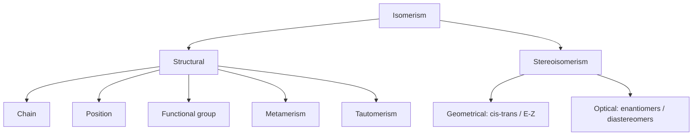

> All key formulas, priority orders, stability trends and reaction rules for Basic Principles of Organic Chemistry - JEE Main & Advanced quick revision.

Last-minute revision for the Basic Principles of Organic Chemistry. This chapter is largely concept- and trend-driven, so this sheet compiles the must-know stability orders, priority sequences, mechanistic rules and the few genuine formulas - all pulled directly from the chapter pages.

## Hybridization at a Glance

| Hybridization | Orbitals mixed | Hybrid orbitals | Unhybridized p | Geometry | Bond angle | s-character |
| --- | --- | --- | --- | --- | --- | --- |
| $sp^3$ | $1s + 3p$ | 4 | 0 | Tetrahedral | $109.5°$ | 25% |
| $sp^2$ | $1s + 2p$ | 3 | 1 | Trigonal planar | $120°$ | 33.3% |
| $sp$ | $1s + 1p$ | 2 | 2 | Linear | $180°$ | 50% |

**Determining hybridization (steric number method):**

$$\boxed{\text{Steric number} = (\sigma\text{-bonds}) + (\text{lone pairs})}$$

| Steric number | Hybridization | Geometry |
| --- | --- | --- |
| 2 | $sp$ | Linear |
| 3 | $sp^2$ | Trigonal planar |
| 4 | $sp^3$ | Tetrahedral |

> **★ Key point · Count sigma, ignore pi**
>
> Hybridization depends only on $\sigma$-bonds + lone pairs. 4 regions $\to sp^3$, 3 regions $\to sp^2$, 2 regions $\to sp$. Different carbons in the same molecule can have different hybridizations (e.g. propene: $sp^2,\ sp^2,\ sp^3$).

### Bond Types by Hybridization

| Bonding pattern | Hybridization | Bonds |
| --- | --- | --- |
| 4 single bonds | $sp^3$ | $4\sigma$ |
| 1 double + 2 single | $sp^2$ | $3\sigma + 1\pi$ |
| 1 triple + 1 single | $sp$ | $2\sigma + 2\pi$ |
| 2 double bonds | $sp$ | $2\sigma + 2\pi$ |

Double bond $= 1\sigma + 1\pi$; Triple bond $= 1\sigma + 2\pi$.

### Lone-Pair Bond-Angle Trend

$$\boxed{CH_4\ (109.5°) > NH_3\ (107°) > H_2O\ (104.5°)}$$

More lone pairs $\to$ smaller bond angle.

### Effect of s-character

$$\boxed{\text{Bond length: } sp < sp^2 < sp^3}$$

$$\boxed{\text{Bond strength: } sp > sp^2 > sp^3}$$

$$\boxed{\text{Acidity of C-H: } HC\equiv CH > H_2C=CH_2 > H_3C-CH_3}$$

$$\boxed{\text{C electronegativity: } sp > sp^2 > sp^3}$$

**Acidity pKa values:** $HC\equiv CH$ (25) $>$ $H_2C=CH_2$ (44) $>$ $CH_3CH_3$ (50). More s-character $\to$ shorter, stronger bonds and more acidic H.

**Benzene C-C bond length:** $1.39\ \text{Å}$ (between single and double bond, all equal due to resonance).

---

## IUPAC Nomenclature

**Naming order:** Prefix + Root word + Primary suffix + Secondary suffix.

### Functional Group Priority (decreasing)

$$\boxed{-COOH > -SO_3H > -COOR > -COCl > -CONH_2 > -CHO > C{=}O > -OH > -NH_2 > C{=}C > C\equiv C}$$

### Root Words

| Carbons | Root | Carbons | Root |
| --- | --- | --- | --- |
| 1 | Meth- | 6 | Hex- |
| 2 | Eth- | 7 | Hept- |
| 3 | Prop- | 8 | Oct- |
| 4 | But- | 9 | Non- |
| 5 | Pent- | 10 | Dec- |

> **★ Key point · Alphabetize substituents**
>
> List substituents alphabetically. Numerical prefixes (di, tri, tetra) are NOT counted in alphabetization.

---

## Electronic Effects

### Inductive Effect (I) - displacement of $\sigma$-electrons

Transmitted through $\sigma$-bonds, permanent, dies out after 3-4 bonds.

**-I (electron-withdrawing):**

$$\boxed{-NO_2 > -CN > -COOH > -F > -Cl > -Br > -I > -OCH_3 > -C_6H_5 > -H}$$

**+I (electron-donating):**

$$\boxed{-(CH_3)_3C > -(CH_3)_2CH > -CH_2CH_3 > -CH_3 > -H}$$

### Resonance / Mesomeric Effect (R/M) - delocalization of $\pi$-electrons / lone pairs

**+R (electron-donating):**

$$\boxed{-NH_2 > -NHR > -OH > -OR > -NHCOR > -OCOR > -F > -Cl > -Br > -I}$$

**-R (electron-withdrawing):**

$$\boxed{-NO_2 > -CN > -CHO > -COR > -COOH > -COOR > -CONH_2}$$

### Comparison of Effects

| Property | Inductive | Resonance | Electromeric |
| --- | --- | --- | --- |
| Type | Permanent | Permanent | Temporary |
| Electrons | $\sigma$ | $\pi$ / lone pair | $\pi$ |
| Transmission | Through bonds | Through conjugation | Complete shift |
| Presence | Always | Always | Only with reagent |

**Electromeric:** $+E$ = $\pi$-electrons shift toward attacking reagent (electrophile); $-E$ = shift away (nucleophile).

> **★ Key point · Halogens are the trap**
>
> Halogens show -I (deactivating) AND +R (ortho-para directing). The -I dominates, so halobenzenes are deactivated but still ortho-para directing. EAS reactivity: $C_6H_6 > C_6H_5F > C_6H_5Cl > C_6H_5Br > C_6H_5I$ (F most deactivating).

### Hyperconjugation

Delocalization of $\sigma$ (C-H bond) electrons into an adjacent $\pi$-system or empty/partially filled p-orbital (no-bond resonance / Baker-Nathan effect). Requires $\alpha$-H atoms.

$$\boxed{\text{No. of hyperconjugative structures} = \text{No. of } \alpha\text{-H atoms}}$$

| Cation | $\alpha$-H | Structures |
| --- | --- | --- |
| $CH_3^+$ | 0 | 0 |
| $CH_3CH_2^+$ | 3 | 3 |
| $(CH_3)_2CH^+$ | 6 | 6 |
| $(CH_3)_3C^+$ | 9 | 9 |

**Alkene stability (more substituted = more $\alpha$-H = more stable):**

$$\boxed{R_2C{=}CR_2 > R_2C{=}CHR > RCH{=}CHR > RCH{=}CH_2 > CH_2{=}CH_2}$$

**C-C single bond shortens with hyperconjugation:** $CH_3{-}CH_3$ (1.54 Å) $>$ $CH_3{-}C_6H_5$ (1.51 Å) $>$ $CH_3{-}CH{=}CH_2$ (1.50 Å).

### Applications - Acidity & Basicity

**Acidity of carboxylic acids (-I increases acidity):**

$$\boxed{Cl_3CCOOH > Cl_2CHCOOH > ClCH_2COOH > CH_3COOH}$$

pKa: $CCl_3COOH$ (~0.7) $<$ $CHCl_2COOH$ (~1.3) $<$ $CH_2ClCOOH$ (~2.9) $<$ $CH_3COOH$ (~4.8). Closer the -I group to -COOH, stronger the acid.

**Basicity of amines (gas phase, +I increases basicity):**

$$\boxed{(CH_3)_3N > (CH_3)_2NH > CH_3NH_2 > NH_3}$$

(Order changes in aqueous solution due to solvation.)

**Resonance acidity:** Phenol (pKa ~10) is ~$10^6\times$ more acidic than ethanol (pKa ~16) because the phenoxide ion is resonance-stabilized.

**Aromatic vs aliphatic amine basicity:** $CH_3NH_2$ (pKb ~3.4) $>$ $C_6H_5NH_2$ (pKb ~9.4) - aniline’s lone pair is delocalized into the ring.

> **⚠ Trap · -OCH3 / -OR double behaviour**
>
> $-OR$ shows -I through $\sigma$-bonds but +R through the $\pi$-system. In saturated systems -I dominates; in aromatic systems +R dominates. Most common trap question in the chapter.

---

## Reactive Intermediates

| Intermediate | Symbol | Hybridization | Geometry | Electrons | Charge |
| --- | --- | --- | --- | --- | --- |
| Carbocation | $R_3C^+$ | $sp^2$ | Planar | 6 | +1 |
| Carbanion | $R_3C^-$ | $sp^3$ | Pyramidal | 8 | -1 |
| Free radical | $R_3C\cdot$ | $sp^2$ | Planar | 7 | 0 |
| Carbene (singlet) | $R_2C{:}$ | $sp^2$ | Angular | 6 | 0 |
| Carbene (triplet) | $R_2C{:}$ | $sp$ | Linear | 6 | 0 |
| Nitrene | $R{-}N{:}$ | - | - | - | 0 |

### Stability Orders

**Carbocation:**

$$\boxed{(CH_3)_3C^+ > (CH_3)_2CH^+ > CH_3CH_2^+ > CH_3^+ > CH_2{=}CH^+ > C_6H_5^+}$$

With resonance: $\text{Allyl/Benzyl} > 3° > 2° > 1°$.

**Free radical (same trend as carbocation):**

$$\boxed{(CH_3)_3C\cdot > (CH_3)_2CH\cdot > CH_3CH_2\cdot > CH_3\cdot}$$

With resonance: $\text{Allyl/Benzyl}\cdot > 3° > 2° > 1°$.

**Carbanion (reverse of carbocation):**

$$\boxed{CH_3^- > CH_3CH_2^- > (CH_3)_2CH^- > (CH_3)_3C^-}$$

By hybridization (more s-character = more stable): $HC\equiv C^- > CH_2{=}CH^- > CH_3CH_2^-$ i.e. $sp > sp^2 > sp^3$. Also $\text{Phenyl} > \text{Vinyl} > sp^3$ carbanions. -I groups stabilize: $Cl_3C{-}CH_2^- > Cl_2CH{-}CH_2^- > ClCH_2{-}CH_2^- > CH_3{-}CH_2^-$.

> **★ Key point · Effect direction flips for carbanions**
>
> +I and hyperconjugation STABILIZE carbocations and radicals but DESTABILIZE carbanions. For carbanions, -I groups and more s-character stabilize.

### Carbocation Rearrangements

1,2-Hydride shift and 1,2-methyl (alkyl) shift - always migrate to form the **more stable** carbocation (e.g. $2° \to 3°$). Possible in SN1/E1 (carbocation) but not in SN2/E2.

---

## Types of Organic Reactions

### Substitution: SN1 vs SN2

| Factor | SN1 | SN2 |
| --- | --- | --- |
| Rate law | $k[RX]$ (1st order) | $k[RX][Nu^-]$ (2nd order) |
| Mechanism | Two-step (carbocation) | One-step (concerted) |
| Carbocation | Yes (can rearrange) | No |
| Stereochemistry | Racemization | 100% inversion (Walden) |
| Best substrate | $3° > 2° \gg 1°$ (never $1°$) | $CH_3X > 1° > 2° \gg 3°$ (never $3°$) |
| Nucleophile | Weak OK | Strong needed |
| Solvent | Polar protic ($H_2O$, ROH) | Polar aprotic (DMSO, DMF, acetone) |

$$\boxed{R{-}X + Nu^- \rightarrow R{-}Nu + X^-}$$

### Elimination: E1 vs E2

| Factor | E1 | E2 |
| --- | --- | --- |
| Rate law | $k[RX]$ (1st order) | $k[RX][\text{Base}]$ (2nd order) |
| Mechanism | Two-step (carbocation) | One-step (concerted) |
| Substrate | $3° > 2° \gg 1°$ | $3° > 2° > 1°$ |
| Base | Weak OK | Strong needed |
| Stereochemistry | - | Anti-periplanar required |
| Product | Mixture | Zaitsev (or Hofmann with bulky base) |

$$\boxed{X{-}C{-}C{-}Y \rightarrow C{=}C + X{-}Y}$$

**Zaitsev’s rule** (major = more substituted alkene):

$$\boxed{\text{Tetra-} > \text{Tri-} > \text{Di-} > \text{Mono-substituted}}$$

**Hofmann rule:** bulky bases (e.g. $(CH_3)_3CO^-$) give the less substituted alkene.

> **★ Key point · SN vs E decision shortcuts**
>
> 1° substrate: SN2 (good Nu, no heat) or E2 (strong base, heat). 3° substrate: SN1 (weak Nu) or E1/E2 (heat). Heat + strong base $\to$ elimination; good nucleophile + no heat $\to$ substitution. Bulky base $\to$ E2 (Hofmann).

### Electrophilic Aromatic Substitution (EAS)

| Reaction | Electrophile | Reagent | Product |
| --- | --- | --- | --- |
| Halogenation | $X^+$ | $X_2/FeX_3$ | $C_6H_5X$ |
| Nitration | $NO_2^+$ | $HNO_3/H_2SO_4$ | $C_6H_5NO_2$ |
| Sulfonation | $SO_3H^+$ | fuming $H_2SO_4$ | $C_6H_5SO_3H$ |
| Friedel-Crafts alkylation | $R^+$ | $RCl/AlCl_3$ | $C_6H_5R$ |
| Friedel-Crafts acylation | $RCO^+$ | $RCOCl/AlCl_3$ | $C_6H_5COR$ |

### Addition Reactions (alkenes/alkynes)

$$\boxed{C{=}C + X{-}Y \rightarrow X{-}C{-}C{-}Y}$$

**Markovnikov’s rule:** H adds to the carbon with more H atoms; X adds to the more substituted carbon (forms the more stable carbocation).

| Reaction | Reagent | Product | Type |
| --- | --- | --- | --- |
| Hydrogenation | $H_2$/Ni, Pt, Pd | Alkane | Syn addition |
| Halogenation | $X_2$ | Dihaloalkane | Anti addition |
| Hydrogen halide | HX | Haloalkane | Markovnikov |
| HBr + peroxide | HBr/ROOR | Haloalkane | Anti-Markovnikov |
| Hydration | $H_2O/H^+$ | Alcohol | Markovnikov |
| Oxymercuration | $Hg(OAc)_2/NaBH_4$ | Alcohol | Markovnikov, no rearrangement |
| Hydroboration | $BH_3/H_2O_2/OH^-$ | Alcohol | Anti-Markovnikov |

> **★ Key point · Peroxide effect is HBr-only**
>
> Anti-Markovnikov (peroxide) addition works ONLY with HBr - not HCl (H-Cl bond too strong) or HI (H-I bond too weak / reverses).

### Free Radical Halogenation of Alkanes

Chain mechanism: Initiation $\to$ Propagation $\to$ Termination (e.g. $CH_4 + Cl_2 \xrightarrow{h\nu} CH_3Cl + HCl$).

$$\boxed{\text{Reactivity: } F_2 > Cl_2 > Br_2 > I_2}$$

$$\boxed{\text{Selectivity: } I_2 > Br_2 > Cl_2 > F_2}$$

$$\boxed{\text{Radical formation ease: } 3° > 2° > 1°}$$

### Named Rearrangements

| Rearrangement | Conversion |
| --- | --- |
| Wagner-Meerwein / Pinacol-Pinacolone | Carbocation (hydride/alkyl shift); diol $\to$ ketone |
| Beckmann | Oxime $\to$ amide (nylon) |
| Benzilic acid | $\alpha$-Diketone $\to$ $\alpha$-hydroxy acid |

---

## Isomerism



### Structural Isomerism

| Type | Basis | Example |
| --- | --- | --- |
| Chain | Different carbon skeleton | $n$-pentane / isopentane / neopentane |
| Position | Different position of group | 1-propanol / 2-propanol |
| Functional group | Different functional group | $C_2H_5OH$ / $CH_3OCH_3$ |
| Metamerism | Different alkyl groups around a functional group | diethyl ether / methyl propyl ether |
| Tautomerism | Rapid keto-enol interconversion | acetone keto $\rightleftharpoons$ enol |

**Keto-enol tautomerism:** keto form usually dominates ($10^4$-$10^6\times$ more stable); exception is phenol, where the enol form dominates due to aromaticity.

> **⚠ Trap · Tautomerism is NOT resonance**
>
> Tautomerism: atoms (H) move, two separable compounds in equilibrium. Resonance: only electrons move, one compound. The acetate ion shows resonance, not tautomerism.

### Stereoisomerism

**Geometrical (cis-trans):** needs restricted rotation (C=C or ring) + different groups on each carbon. Use **E-Z (CIP priority)** when cis-trans is ambiguous: Z = high-priority groups same side; E = opposite sides.

**Optical isomerism conditions:** chiral center (C bonded to 4 different groups), no plane of symmetry, no center of symmetry.

**Maximum number of stereoisomers:**

$$\boxed{\text{Stereoisomers} = 2^n \quad (n = \text{number of chiral centers})}$$

**Specific rotation:**

$$\boxed{[\alpha]_D^{20} = \dfrac{\alpha}{l \times c}}$$

where $\alpha$ = observed rotation, $l$ = path length (dm), $c$ = concentration (g/mL).

### Key Stereochemistry Definitions

| Term | Meaning |
| --- | --- |
| Enantiomers | Non-superimposable mirror images; identical physical/chemical properties, opposite optical rotation |
| Diastereomers | Stereoisomers that are NOT mirror images; different physical/chemical properties |
| Meso compound | Has chiral centers but a plane of symmetry $\to$ optically inactive (internal compensation) |
| Racemic mixture | 1:1 mix of (+) and (-); optically inactive, written (±) or (dl) |

**R/S (CIP):** assign priorities (higher atomic number = higher), point lowest priority away, trace 1$\to$2$\to$3: clockwise = R, anticlockwise = S.

> **⚠ Trap · R/S is independent of (+)/(-)**
>
> R/S is the spatial configuration; (+)/(-) is the experimentally measured rotation. R can be (+) or (-) and vice versa - the sign must be measured.

---

## Notes

This chapter is concept-, trend- and mechanism-driven rather than equation-heavy. The only genuine numerical/algebraic formulas in the source pages are the steric number, the $2^n$ stereoisomer count, and the specific-rotation expression $[\alpha]_D^{20}=\alpha/(l\times c)$. The rest of this sheet captures the high-yield priority orders (inductive, resonance, functional-group), stability sequences (carbocation/carbanion/radical, alkene), and mechanistic rules (SN1/SN2, E1/E2, Markovnikov, Zaitsev, peroxide effect) that the chapter actually emphasizes. Every entry is sourced strictly from the existing chapter pages; nothing was added from outside the chapter.

From TestGuru · our mock-test platform

## You've read Organic Chemistry Basics Formula Sheet.You've read this topic. Find out what you actually got.

A free JEE Main mock with this chapter in it, and a report that shows which sub-topics cost you marks.

[Take a free JEE Main mock →](https://app.testguru.co/signup?tg_chapter=organic-principles&tg_exam=jee-main&tg_page=%2Fchemistry%2Forganic-principles%2Fformula-sheet%2F&tg_subject=chemistry&utm_campaign=notes-jee-main-free-test&utm_content=article-end&utm_medium=referral&utm_source=jeenotes)
Free, no card. Opens TestGuru in a new tab.

## Stay exam-ready

One email every Sunday: new notes, the week's hardest challenge question and a revision plan.One email every Sunday.

## Comments

Have a question or spotted a mistake? Join the discussion below.

Advertisement

Advertisement

---

## Extracted page code (interactive scripts & widgets)


### inline-script-14

```js
(function(){var t,e=document.getElementById("disqus-load");if(!e)return;t=!1,e.addEventListener("click",function(){if(t)return;t=!0,e.setAttribute("disabled","disabled"),e.textContent="Loading comments…",window.disqus_config=function(){this.page.url="https://jeenotes.in/chemistry/organic-principles/formula-sheet/",this.page.identifier="/chemistry/organic-principles/formula-sheet/"};var s=document,n=s.createElement("script");n.src="https://https-jeenotes-in.disqus.com/embed.js",n.setAttribute("data-timestamp",+new Date),n.onload=function(){e.style.display="none"},n.onerror=function(){t=!1,e.removeAttribute("disabled"),e.textContent="Could not load comments. Tap to retry"},(s.head||s.body).appendChild(n)})})()
```


### inline-script-15

```js
(function(){var t,e=document.currentScript.previousElementSibling;function n(){(window.adsbygoogle=window.adsbygoogle||[]).push({})}if(!window.ResizeObserver||e.clientWidth>0){n();return}t=new ResizeObserver(function(){e.clientWidth>0&&(t.disconnect(),n())}),t.observe(e)})()
```


---

_Source: [https://jeenotes.in/chemistry/organic-principles/formula-sheet/](https://jeenotes.in/chemistry/organic-principles/formula-sheet/) · raw HTML: `offline/chemistry/organic-principles/formula-sheet/index.html`_
