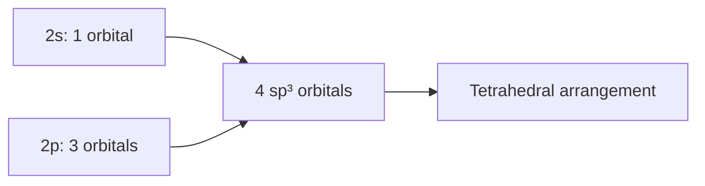
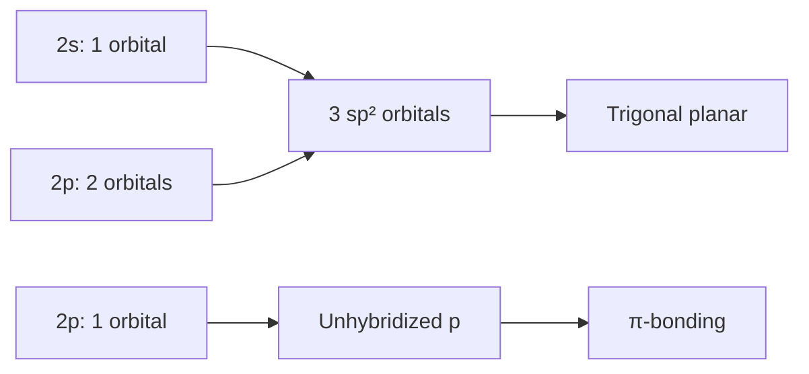
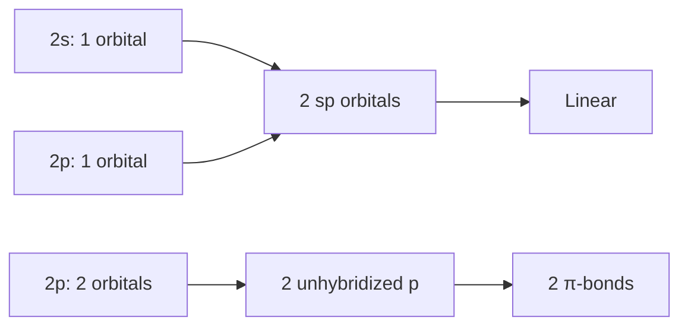

> Master sp, sp2, and sp3 hybridization, bond angles, geometry, and their role in organic molecules for JEE Chemistry.

## Introduction

**Hybridization** is the key to understanding the 3D shapes of organic molecules! It explains why methane is tetrahedral, ethene is planar, and ethyne is linear. Master this concept, and organic chemistry becomes 10x easier!

> **★ Key point · Drug Design in Real Life**
>
> In pharmaceutical companies (depicted in *Painkiller* 2024), chemists design drug molecules with EXACT 3D shapes! Whether a drug fits into a receptor depends on sp³ vs sp² hybridization. The difference between a life-saving medicine and an inactive compound can be just one hybridization change - tetrahedral vs planar changes everything about how molecules interact!

---

## What is Hybridization?

### Definition

**Hybridization** is the concept of mixing atomic orbitals to form new **hybrid orbitals** of equal energy, which are better suited for bonding.

$$\boxed{\text{Atomic orbitals} \xrightarrow{\text{Mix}} \text{Hybrid orbitals} \xrightarrow{\text{Overlap}} \text{Bonds}}$$

### Why Hybridization?

**Problem:** Ground state carbon has 2 unpaired electrons, should form only 2 bonds!

**Carbon ground state:** 1s² 2s² 2p²

```fallback
2s: [↑↓]
2p: [↑] [↑] [ ]
```

But carbon forms **4 bonds** in CH₄!

**Solution: Hybridization**

1. **Excitation:** One 2s electron promoted to 2p

   ```fallback
   2s: [↑]
   2p: [↑] [↑] [↑]
   ```
2. **Hybridization:** 2s and 2p orbitals mix to form hybrid orbitals
3. **Result:** 4 equivalent hybrid orbitals for bonding!

---

## Types of Hybridization

### Summary Table

| Hybridization | Orbitals Mixed | Hybrid Orbitals | Geometry | Bond Angle | Examples |
| --- | --- | --- | --- | --- | --- |
| **sp³** | 1s + 3p | 4 sp³ | Tetrahedral | 109.5° | CH₄, C₂H₆, Diamond |
| **sp²** | 1s + 2p | 3 sp² + 1p | Trigonal planar | 120° | C₂H₄, C₆H₆, Graphite |
| **sp** | 1s + 1p | 2 sp + 2p | Linear | 180° | C₂H₂, CO₂, HCN |

---

## sp³ Hybridization

### Formation

**Mixing:** 1 s orbital + 3 p orbitals → **4 sp³ hybrid orbitals**



**Energy diagram:**

```fallback
Before:           After hybridization:
2p: [↑] [↑] [↑]   sp³: [↑] [↑] [↑] [↑]
2s: [↑]               (equal energy)
```

### Characteristics

**Geometry:** Tetrahedral

**Bond Angle:** 109.5° (109° 28')

**% s-character:** 25% (1/4)

**% p-character:** 75% (3/4)

**Shape of sp³ orbital:**

- Large lobe pointing in one direction
- Small lobe in opposite direction
- Better overlap → stronger bonds

### Examples

#### 1. Methane (CH₄)

**Structure:**

- C is sp³ hybridized
- 4 sp³ orbitals overlap with H 1s orbitals
- All C-H bonds equivalent
- **Perfect tetrahedral:** All angles = 109.5°

$$\boxed{\text{sp}^3\text{ C} + 4 \text{ H(1s)} \rightarrow 4 \text{ C-H } \sigma\text{-bonds}}$$

#### 2. Ethane (C₂H₆)

**Structure:**

- Both carbons sp³ hybridized
- C-C bond: sp³-sp³ overlap (σ-bond)
- C-H bonds: sp³-1s overlap (σ-bonds)
- **Free rotation** around C-C single bond

#### 3. Ammonia (NH₃)

**Structure:**

- N is sp³ hybridized
- 3 sp³ orbitals form N-H bonds
- 1 sp³ orbital contains lone pair
- **Pyramidal shape** (not tetrahedral!)
- **Bond angle:** 107° (less than 109.5° due to lone pair repulsion)

#### 4. Water (H₂O)

**Structure:**

- O is sp³ hybridized
- 2 sp³ orbitals form O-H bonds
- 2 sp³ orbitals contain lone pairs
- **Bent shape**
- **Bond angle:** 104.5° (lone pair-lone pair > lone pair-bond pair repulsion)

> **★ Key point · JEE Alert**
>
> **Bond angle trend due to lone pairs:**
>
> $$\boxed{CH_4 (109.5°) > NH_3 (107°) > H_2O (104.5°)}$$
>
> **Rule:** More lone pairs → smaller bond angle (lone pairs repel more strongly)

#### 5. Diamond

**Structure:**

- Each C is sp³ hybridized
- 3D network of C-C single bonds
- Tetrahedral geometry throughout
- Extremely hard (strong C-C σ-bonds in 3D)

---

## sp² Hybridization

### Formation

**Mixing:** 1 s orbital + 2 p orbitals → **3 sp² hybrid orbitals + 1 unhybridized p orbital**



**Energy diagram:**

```fallback
Before:           After hybridization:
2p: [↑] [↑] [↑]   sp²: [↑] [↑] [↑]  (in plane)
2s: [↑]           p:   [↑]          (perpendicular)
```

### Characteristics

**Geometry:** Trigonal planar (all atoms in one plane)

**Bond Angle:** 120°

**% s-character:** 33.3% (1/3)

**% p-character:** 66.7% (2/3)

**Unhybridized p orbital:** Perpendicular to the plane, used for π-bonding

### Examples

#### 1. Ethene (C₂H₄)

**Structure:**

- Both C atoms sp² hybridized
- **σ-bonds:**
  - C-C: sp²-sp² overlap
  - C-H: sp²-1s overlap (4 bonds)
- **π-bond:**
  - Sideways overlap of unhybridized p orbitals
  - Above and below the plane

**Double bond = 1 σ + 1 π**

**Important features:**

- All 6 atoms in **same plane**
- **No free rotation** around C=C (π-bond restricts rotation)
- Bond angle: ~120° (slightly less due to π-electron repulsion)

$$\boxed{C{=}C: \text{ sp}^2\text{-sp}^2 \text{ overlap } (\sigma) + \text{ p-p overlap } (\pi)}$$

#### 2. Benzene (C₆H₆)

**Structure:**

- All 6 C atoms sp² hybridized
- **σ-bonds:**
  - C-C: sp²-sp² overlap (6 bonds forming hexagon)
  - C-H: sp²-1s overlap (6 bonds)
- **π-bonds:**
  - 6 unhybridized p orbitals (one per C)
  - Delocalized over the entire ring
  - Forms π-electron cloud above and below the ring

**Features:**

- Perfectly **planar** molecule
- All C-C bonds **equal length** (1.39 Å)
- All bond angles = 120°
- **Aromatic stability** due to delocalized π-electrons

#### 3. Graphite

**Structure:**

- All C atoms sp² hybridized
- Forms **hexagonal layers**
- Within layer: Strong C-C σ-bonds (sp²-sp²)
- Between layers: Weak van der Waals forces
- **Delocalized π-electrons** move freely (electrical conductivity!)

**Properties from sp²:**

- Soft (layers slide easily)
- Good conductor (delocalized electrons)
- Black color (π-electron transitions)

#### 4. Carbonyl Group (C=O)

**Structure:**

- C is sp² hybridized
- O is sp² hybridized (+ 2 lone pairs in sp²)
- **σ-bond:** sp²(C) - sp²(O)
- **π-bond:** p(C) - p(O)
- **Planar geometry** around C=O

> **★ Key point · Memory Trick**
>
> **“sp² = 2 Doubly bonded”**
>
> - sp² hybridization is present when there’s a **DOUBLE bond**

> - Geometry is **PLANAR** (all in 2D plane)

> - Bond angle is **120°** (three bonds spread out)
>
> Examples: C=C, C=O, C=N, benzene

---

## sp Hybridization

### Formation

**Mixing:** 1 s orbital + 1 p orbital → **2 sp hybrid orbitals + 2 unhybridized p orbitals**



**Energy diagram:**

```fallback
Before:           After hybridization:
2p: [↑] [↑] [↑]   sp: [↑] [↑]       (linear)
2s: [↑]           p:  [↑] [↑]       (perpendicular)
```

### Characteristics

**Geometry:** Linear (180° apart)

**Bond Angle:** 180°

**% s-character:** 50% (1/2)

**% p-character:** 50% (1/2)

**Unhybridized p orbitals:** 2 perpendicular p orbitals for π-bonding

### Examples

#### 1. Ethyne/Acetylene (C₂H₂)

**Structure:**

- Both C atoms sp hybridized
- **σ-bonds:**
  - C-C: sp-sp overlap
  - C-H: sp-1s overlap (2 bonds)
- **π-bonds:**
  - Two p-p overlaps (perpendicular to each other)
  - Form cylindrical π-electron cloud around C-C axis

**Triple bond = 1 σ + 2 π**

**Important features:**

- **Linear molecule** (H-C-C-H all in one line)
- Bond angle: 180°
- **No free rotation** (two π-bonds lock the molecule)
- Very strong C≡C bond

$$\boxed{C \equiv C: \text{ sp-sp (σ)} + 2 \times \text{ p-p (π)}}$$

#### 2. Carbon Dioxide (CO₂)

**Structure:**

- C is sp hybridized
- Each O is sp² hybridized
- **σ-bonds:** sp(C) - sp²(O) on each side
- **π-bonds:** 2 π-bonds (one with each O)
- **Linear molecule:** O=C=O (180°)

#### 3. Hydrogen Cyanide (HCN)

**Structure:**

- C is sp hybridized
- **σ-bonds:**
  - C-H: sp-1s
  - C-N: sp-sp
- **π-bonds:** 2 π-bonds (C≡N triple bond)
- **Linear:** H-C≡N (180°)

#### 4. Alkynes (General)

**R-C≡C-R’**

- Both triple-bonded carbons: sp
- Linear geometry at triple bond
- Bond angle: 180°

> **★ Key point · JEE Pattern**
>
> **Bond length and strength trend:**
>
> $$\boxed{C \equiv C < C=C < C-C \text{ (length)}}$$

$$\boxed{C \equiv C > C=C > C-C \text{ (strength)}}$$
>
> **Reason:**
>
> - sp has 50% s-character (most s → shortest, strongest)

> - sp² has 33% s-character (intermediate)

> - sp³ has 25% s-character (least s → longest, weakest)
>
> **More s-character → Shorter, stronger bonds**

### Interactive Demo: Visualize Orbital Shapes

Explore sp, sp², and sp³ hybrid orbitals in 3D space.

---

## Comparison of Hybridizations

### Properties Comparison

| Property | sp³ | sp² | sp |
| --- | --- | --- | --- |
| **Orbitals mixed** | 1s + 3p | 1s + 2p | 1s + 1p |
| **Hybrid orbitals** | 4 | 3 | 2 |
| **Unhybridized p** | 0 | 1 | 2 |
| **Geometry** | Tetrahedral | Trigonal planar | Linear |
| **Bond angle** | 109.5° | 120° | 180° |
| **s-character** | 25% | 33.3% | 50% |
| **p-character** | 75% | 66.7% | 50% |
| **Bond type** | Only σ | σ + π | σ + 2π |
| **Rotation** | Free | Restricted | No rotation |
| **Example** | C₂H₆ | C₂H₄ | C₂H₂ |

### Bond Properties

**s-character effects:**

1. **Bond length:** More s → shorter bond

   $$sp < sp² < sp³$$
2. **Bond strength:** More s → stronger bond

   $$sp > sp² > sp³$$
3. **Acidity:** More s → more acidic H

   $$HC \equiv CH > H_2C=CH_2 > H_3C-CH_3$$

   (pKa: 25 > 44 > 50)
4. **Electronegativity:** More s → more electronegative C

   $$sp > sp² > sp³$$

> **⚠ Trap · Common JEE Mistake**
>
> **Mistake:** Assuming all carbon atoms have the same hybridization in a molecule.
>
> **Correct:** Different carbons can have different hybridizations!
>
> **Example: CH₂=CH-CH₃ (propene)**
>
> - C1 (in =CH₂): sp²

> - C2 (in CH=): sp²

> - C3 (in -CH₃): sp³
>
> Always identify each carbon’s bonding separately!

---

## Determining Hybridization

### Method 1: Counting Regions of Electron Density

**Steric Number = σ-bonds + Lone pairs**

| Steric Number | Hybridization | Geometry |
| --- | --- | --- |
| 2 | sp | Linear |
| 3 | sp² | Trigonal planar |
| 4 | sp³ | Tetrahedral |

**Examples:**

1. **CH₄:** C has 4 σ-bonds, 0 lone pairs → Steric # = 4 → sp³
2. **NH₃:** N has 3 σ-bonds, 1 lone pair → Steric # = 4 → sp³
3. **C₂H₄:** Each C has 3 σ-bonds (2 C-H, 1 C-C), 0 lone pairs → sp²
4. **CO₂:** C has 2 σ-bonds (2 C-O), 0 lone pairs → sp

### Method 2: Counting Bonds

| Bond Type | Hybridization |
| --- | --- |
| 4 single bonds (4σ) | sp³ |
| 1 double + 2 single (3σ + 1π) | sp² |
| 1 triple + 1 single (2σ + 2π) | sp |
| 2 double bonds (2σ + 2π) | sp |

**Key:** Count **σ-bonds only** for hybridization!

---

## Resonance and Hybridization

### Resonance Structures

When resonance is present, hybridization is determined by the **resonance hybrid**, not individual structures.

**Example: Carboxylate ion (CH₃COO⁻)**

Both oxygens are **equivalent** due to resonance:

```fallback
O⁻        O
    ‖    ↔    ‖
R—C         R—C
    |         |
    O         O⁻
```

**Hybridization:**

- C (carbonyl): sp²
- Both O atoms: sp² (not one sp² and one sp³!)
- Resonance averages the bonding

### Benzene Revisited

**All 6 carbons are sp²** due to resonance:

- Delocalized π-system
- All C-C bonds equivalent (1.39 Å)
- Cannot assign double/single bonds

---

## Applications and Examples

### Example 1: Allene (H₂C=C=CH₂)

**Structure:**

- **C1 and C3:** sp² (in double bonds, planar)
- **C2:** sp (forms two double bonds, linear)

**Geometry:**

- C2 is linear
- C1 and C3 planes are **perpendicular** to each other!

### Example 2: Vitamin C (Ascorbic Acid)

**Multiple hybridizations:**

- Ring carbons: Mostly sp³
- Carbonyl C: sp²
- Enol C: sp²

### Example 3: Formaldehyde (H₂C=O)

**Structure:**

- C: sp² (3 σ-bonds: 2 C-H, 1 C-O)
- O: sp² (1 σ-bond + 2 lone pairs in sp²)
- **Planar molecule**
- H-C-H angle ≈ 120°

---

## Practice Problems

### Level 1: Basic Identification

1. **Identify the hybridization of each carbon:**

   - a) CH₃-CH₃
   - b) CH₂=CH₂
   - c) HC≡CH
   - d) CH₃-CH=CH₂
2. **What is the bond angle in:**

   - a) Methane (CH₄)
   - b) Ethene (C₂H₄)
   - c) Acetylene (C₂H₂)
3. **How many σ and π bonds in:**

   - a) C₂H₆
   - b) C₂H₄
   - c) C₂H₂

### Level 2: Application

4. **Explain why:**

   - C-H bond in acetylene is more acidic than in ethane
   - Benzene is planar
   - There’s no free rotation around C=C double bond
5. **Determine hybridization of each atom:**

   - a) Formaldehyde (H₂CO)
   - b) Acetone (CH₃COCH₃)
   - c) Carbon dioxide (CO₂)
6. **Arrange in order of increasing C-C bond length:**
   CH₃-CH₃, CH₂=CH₂, HC≡CH
7. **Which molecule is linear?**

   - a) H₂O
   - b) NH₃
   - c) CO₂
   - d) CH₄

### Level 3: JEE Advanced

8. **In the molecule CH₃-C≡C-CHO, how many carbon atoms are sp hybridized?**

   - (a) 1
   - (b) 2
   - (c) 3
   - (d) 4
9. **The H-C-H bond angle in ethene is closest to:**

   - (a) 109.5°
   - (b) 120°
   - (c) 117°
   - (d) 180°
10. **Which statement is INCORRECT about sp² hybridization?**

    - (a) Bond angle is 120°
    - (b) Geometry is trigonal planar
    - (c) One p orbital remains unhybridized
    - (d) All four orbitals are used in σ-bonding
11. **Assertion (A):** sp hybridized carbon forms stronger C-H bonds than sp³.
    **Reason (R):** sp has 50% s-character while sp³ has 25% s-character.

    - (a) Both A and R true, R explains A
    - (b) Both true, R doesn’t explain A
    - (c) A true, R false
    - (d) Both false
12. **In benzene, each C-C bond length is 1.39 Å. This is:**

    - (a) Equal to C-C single bond
    - (b) Equal to C=C double bond
    - (c) Between single and double bond
    - (d) Equal to C≡C triple bond

> **↗ Connection · Quick Check**
>
> **Test yourself:** Draw the Lewis structure of CH₃-CH=CH-C≡N and identify the hybridization of each carbon. Can you predict all bond angles?

---

## Memory Tricks

### “SLIP” for Hybridization

- **S**ingle bonds only → sp³
- **L**inear geometry → sp
- **I**n-plane (planar) → sp²
- **P**i bonds: 0(sp³), 1(sp²), 2(sp)

### Bond Angles Quick Memory

**“109, 120, 180 - All in Line!”**

- sp³: **109**.5° (tetrahedral)
- sp²: **120**° (planar)
- sp: **180**° (linear)

### s-character Rule

**“More s, More Short, More Strong!”**

- More s-character → Shorter bonds
- More s-character → Stronger bonds
- More s-character → More acidic H
- sp (50%) > sp² (33%) > sp³ (25%)

### Counting Method

**“Count sigma, ignore pi!”**

- 4 σ-bonds → sp³
- 3 σ-bonds → sp²
- 2 σ-bonds → sp

---

## Related Topics

### Within Organic Principles

- [Electronic Effects](../electronic-effects/index.md) - How hybridization affects electron distribution
- [Isomerism Types](../isomerism-types/index.md) - Geometric isomerism in sp²
- [Reaction Intermediates](../reaction-intermediates/index.md) - Hybridization of carbocations (sp²)
- [Reaction Types](../reaction-types/index.md) - Mechanistic role of hybridization

### Chemical Bonding Foundation

- [Hybridization in Bonding](../../chemical-bonding/hybridization/index.md) - VBT perspective on hybridization
- [VSEPR Theory](../../chemical-bonding/vsepr-theory/index.md) - Predicting molecular geometry
- [Covalent Bonding](../../chemical-bonding/covalent-bonding/index.md) - Sigma and pi bonds
- [Molecular Orbital Theory](../../chemical-bonding/molecular-orbital-theory/index.md) - MO diagrams

### Atomic Structure

- [Orbital Shapes](../../atomic-structure/orbital-shapes/index.md) - s, p, d orbital shapes
- [Electronic Configuration](../../atomic-structure/electronic-configuration/index.md) - Ground state configurations

### Hydrocarbon Applications

- [Alkanes](../../hydrocarbons/alkanes/index.md) - sp³ hybridization examples
- [Alkenes](../../hydrocarbons/alkenes/index.md) - sp² hybridization and addition
- [Alkynes](../../hydrocarbons/alkynes/index.md) - sp hybridization, triple bonds
- [Benzene](../../hydrocarbons/benzene/index.md) - sp² and aromaticity

### Functional Group Applications

- [Aldehydes and Ketones](../../oxygen-compounds/aldehydes-ketones/index.md) - sp² carbonyl carbon
- [Carboxylic Acids](../../oxygen-compounds/carboxylic-acids/index.md) - sp² in -COOH

### Cross-Subject Connections

- [Vector Algebra](../../../mathematics/vector-algebra/index.md) - 3D spatial understanding
- [Trigonometry](../../../mathematics/trigonometry/index.md) - Bond angles

---

**[Isomerism Types →](../isomerism-types/index.md)**

From TestGuru · our mock-test platform

## You've read Hybridization in Organic Chemistry.You've read this topic. Find out what you actually got.

A free JEE Main mock with this chapter in it, and a report that shows which sub-topics cost you marks.

[Take a free JEE Main mock →](https://app.testguru.co/signup?tg_chapter=organic-principles&tg_exam=jee-main&tg_page=%2Fchemistry%2Forganic-principles%2Fhybridization%2F&tg_subject=chemistry&utm_campaign=notes-jee-main-free-test&utm_content=article-end&utm_medium=referral&utm_source=jeenotes)
Free, no card. Opens TestGuru in a new tab.

## Stay exam-ready

One email every Sunday: new notes, the week's hardest challenge question and a revision plan.One email every Sunday.

## Comments

Have a question or spotted a mistake? Join the discussion below.

Advertisement

Advertisement

---

## Extracted page code (interactive scripts & widgets)


### inline-script-16

```js
if(!document.getElementById("animation-fullscreen-overlay")){const e=document.createElement("div");e.id="animation-fullscreen-overlay",e.className="animation-fullscreen-overlay",e.innerHTML=`
      <div class="fullscreen-modal">
        <div class="fullscreen-header">
          <span class="fullscreen-title">Interactive Demo</span>
          <button class="fullscreen-close-btn" onclick="JEEAnimations.closeFullscreen()" title="Close (Esc)" aria-label="Close fullscreen">
            <svg width="24" height="24" viewBox="0 0 24 24" fill="none" stroke="currentColor" stroke-width="2" stroke-linecap="round" stroke-linejoin="round">
              <line x1="18" y1="6" x2="6" y2="18"></line>
              <line x1="6" y1="6" x2="18" y2="18"></line>
            </svg>
          </button>
        </div>
        <div class="fullscreen-content"></div>
      </div>
    `,document.body.appendChild(e),document.addEventListener("keydown",function(e){e.key==="Escape"&&document.body.classList.contains("animation-fullscreen-active")&&JEEAnimations.closeFullscreen()}),e.addEventListener("click",function(t){t.target===e&&JEEAnimations.closeFullscreen()})}
```


### inline-script-17

```js
(function(){var t,e=document.getElementById("disqus-load");if(!e)return;t=!1,e.addEventListener("click",function(){if(t)return;t=!0,e.setAttribute("disabled","disabled"),e.textContent="Loading comments…",window.disqus_config=function(){this.page.url="https://jeenotes.in/chemistry/organic-principles/hybridization/",this.page.identifier="/chemistry/organic-principles/hybridization/"};var s=document,n=s.createElement("script");n.src="https://https-jeenotes-in.disqus.com/embed.js",n.setAttribute("data-timestamp",+new Date),n.onload=function(){e.style.display="none"},n.onerror=function(){t=!1,e.removeAttribute("disabled"),e.textContent="Could not load comments. Tap to retry"},(s.head||s.body).appendChild(n)})})()
```


### inline-script-18

```js
(function(){var t,e=document.currentScript.previousElementSibling;function n(){(window.adsbygoogle=window.adsbygoogle||[]).push({})}if(!window.ResizeObserver||e.clientWidth>0){n();return}t=new ResizeObserver(function(){e.clientWidth>0&&(t.disconnect(),n())}),t.observe(e)})()
```


### interactive-widget-1

```html
<div class="animation-wrapper" data-animation="orbitalShapes" id="anim-orbitalShapes-1795396419976309633"><div class="animation-header"><button aria-label="Toggle fullscreen" class="anim-fullscreen-btn" onclick='JEEAnimations.toggleFullscreen("anim-orbitalShapes-1795396419976309633")' title="Fullscreen (F)">
<svg class="fullscreen-icon-expand" fill="none" height="18" stroke="currentColor" stroke-linecap="round" stroke-linejoin="round" stroke-width="2" viewbox="0 0 24 24" width="18"><polyline points="15 3 21 3 21 9"></polyline><polyline points="9 21 3 21 3 15"></polyline><line x1="21" x2="14" y1="3" y2="10"></line><line x1="3" x2="10" y1="21" y2="14"></line></svg>
<svg class="fullscreen-icon-collapse" fill="none" height="18" stroke="currentColor" stroke-linecap="round" stroke-linejoin="round" stroke-width="2" viewbox="0 0 24 24" width="18"><polyline points="4 14 10 14 10 20"></polyline><polyline points="20 10 14 10 14 4"></polyline><line x1="14" x2="21" y1="10" y2="3"></line><line x1="3" x2="10" y1="21" y2="14"></line></svg>
<span class="fullscreen-text">Fullscreen</span></button></div><div class="animation-content"><noscript><div class="callout callout-warning"><div class="callout-title">JavaScript Required</div><p>This interactive animation requires JavaScript to be enabled.</p></div></noscript></div></div>
```


---

_Source: [https://jeenotes.in/chemistry/organic-principles/hybridization/](https://jeenotes.in/chemistry/organic-principles/hybridization/) · raw HTML: `offline/chemistry/organic-principles/hybridization/index.html`_
