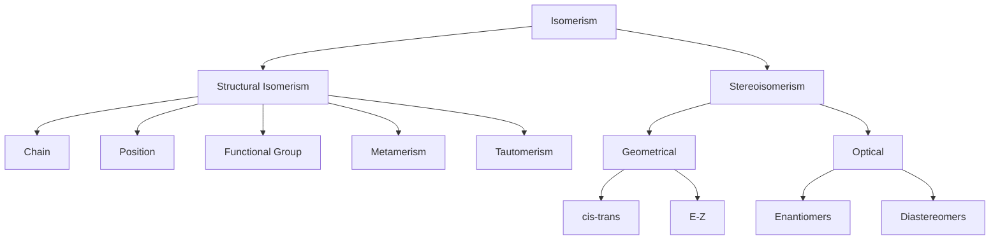

> Master structural and stereoisomerism, cis-trans, E-Z, optical isomerism, chirality, and enantiomers for JEE Chemistry.

## Introduction

**Isomers** are compounds with the same molecular formula but different arrangements of atoms. This seemingly simple concept explains why there are millions of organic compounds! Understanding isomerism is crucial for JEE - it connects structure to properties.

> **★ Key point · Thalidomide Tragedy**
>
> In the 1960s, the drug thalidomide caused birth defects because one **optical isomer** was therapeutic while its mirror image was toxic! Modern drug approval (shown in *Dopesick* 2024) requires testing EVERY isomer separately. The difference between cure and catastrophe can be just a mirror image - that’s the power of stereochemistry!

---

## IUPAC Nomenclature Essentials

You cannot classify isomers you cannot name. Here is the naming toolkit used throughout this page.

### Steps for Naming

1. **Select parent chain** (longest continuous carbon chain containing the highest-priority functional group)
2. **Number the chain** (lowest locant to the principal functional group)
3. **Identify substituents**
4. **Name**: Prefix + Root word + Primary suffix + Secondary suffix

### Root Words

| Carbons | Root | Carbons | Root |
| --- | --- | --- | --- |
| 1 | Meth- | 6 | Hex- |
| 2 | Eth- | 7 | Hept- |
| 3 | Prop- | 8 | Oct- |
| 4 | But- | 9 | Non- |
| 5 | Pent- | 10 | Dec- |

### Functional Group Priority (Decreasing)

$$-COOH > -SO_3H > -COOR > -COCl > -CONH_2 > -CHO > C=O > -OH > -NH_2 > C=C > C≡C$$

### Common Substituent Names

| Group | Prefix |
| --- | --- |
| -CH₃ | Methyl |
| -C₂H₅ | Ethyl |
| -F, -Cl, -Br, -I | Fluoro, Chloro, Bromo, Iodo |
| -NO₂ | Nitro |
| -NH₂ | Amino |
| -OH | Hydroxy |

> **★ Key point · JEE Tip**
>
> When multiple substituents are present, list them alphabetically. Numerical prefixes (di, tri) are not considered in alphabetization.

**Try it:** Give the IUPAC name of $CH_3-CH(OH)-CH_2-CHO$. The aldehyde outranks the alcohol, so number from the CHO end: **3-hydroxybutanal**.

---

## Types of Isomerism



---

## Structural Isomerism

**Definition:** Isomers with different **connectivity** of atoms.

### 1. Chain Isomerism

**Different carbon skeleton** (branching pattern).

**Example: C₅H₁₂ (Pentane isomers)**

```fallback
1. n-Pentane (straight chain):
   CH₃-CH₂-CH₂-CH₂-CH₃

2. Isopentane (one branch):
       CH₃
        |
   CH₃-CH-CH₂-CH₃

3. Neopentane (two branches):
       CH₃
        |
   CH₃-C-CH₃
        |
       CH₃
```

**Properties differ:**

- n-Pentane: b.p. 36°C
- Isopentane: b.p. 28°C
- Neopentane: b.p. 9.5°C

**Trend:** More branching → Lower boiling point (less surface area)

### 2. Position Isomerism

**Same carbon skeleton, different position** of functional group or substituent.

**Example: C₃H₈O (Propanol isomers)**

```fallback
1. 1-Propanol:
   CH₃-CH₂-CH₂-OH

2. 2-Propanol (isopropanol):
   CH₃-CH(OH)-CH₃
```

**Example: C₃H₆Cl₂ (Dichloropropane)**

```fallback
1. 1,1-Dichloropropane:
   CH₃-CH₂-CHCl₂

2. 1,2-Dichloropropane:
   CH₃-CHCl-CH₂Cl

3. 1,3-Dichloropropane:
   ClCH₂-CH₂-CH₂Cl

4. 2,2-Dichloropropane:
   CH₃-CCl₂-CH₃
```

### 3. Functional Group Isomerism

**Different functional groups**, same molecular formula.

| Molecular Formula | Functional Group 1 | Functional Group 2 |
| --- | --- | --- |
| **C₃H₆O** | Propanal (aldehyde): CH₃CH₂CHO | Acetone (ketone): CH₃COCH₃ |
| **C₂H₆O** | Ethanol (alcohol): C₂H₅OH | Dimethyl ether: CH₃OCH₃ |
| **C₃H₆O₂** | Propanoic acid: CH₃CH₂COOH | Methyl acetate: CH₃COOCH₃ |
| **C₄H₈** | 1-Butene (alkene): CH₂=CH-CH₂-CH₃ | Cyclobutane (cycloalkane) |

**Properties completely different:**

- Ethanol: Polar, H-bonding, b.p. 78°C
- Dimethyl ether: Less polar, no H-bonding, b.p. -24°C

### 4. Metamerism

**Different alkyl groups** on either side of a functional group (ethers, ketones, secondary amines).

**Example: C₄H₁₀O (Ether isomers)**

```fallback
1. Diethyl ether:
   C₂H₅-O-C₂H₅

2. Methyl propyl ether:
   CH₃-O-C₃H₇
```

**Example: C₅H₁₀O (Ketones)**

```fallback
1. Pentan-2-one:
   CH₃-CO-CH₂-CH₂-CH₃

2. Pentan-3-one:
   CH₃-CH₂-CO-CH₂-CH₃
```

### 5. Tautomerism

**Dynamic equilibrium** between two structural isomers that **interconvert** rapidly.

**Most Common: Keto-Enol Tautomerism**

$$\boxed{\text{Keto form} \rightleftharpoons \text{Enol form}}$$

**Example: Acetone**

```fallback
Keto form (99.99%):        Enol form (0.01%):
    O                          OH
    ‖                          |
H₃C-C-CH₃        ⇌        H₂C=C-CH₃
```

**Mechanism:**

1. H shifts from α-carbon to O
2. π-bond forms between C=C
3. Equilibrium strongly favors keto form (more stable)

**Why keto is more stable:**

- C=O bond stronger than C=C + O-H
- No steric hindrance
- Generally 10⁴ to 10⁶ times more stable

**Example: Phenol (exception!)**

```fallback
Keto form:                 Enol form (99.99%):
    O                          OH
    ‖                          |

Cyclohexadienone            Phenol (aromatic)
```

**Enol dominates** because of **aromaticity**!

> **★ Key point · JEE Alert**
>
> **Tautomerism vs Resonance:**
>
> **Tautomerism:**
>
> - Atoms rearrange (H moves)

> - Two different compounds in equilibrium

> - Can be separated (theoretically)
>
> **Resonance:**
>
> - Only electrons move

> - Single compound, multiple representations

> - Cannot be separated
>
> **Example:** Acetate ion shows RESONANCE, not tautomerism!

---

## Stereoisomerism

**Definition:** Same connectivity, different **3D spatial arrangement**.

### Geometrical (cis-trans) Isomerism

**Requirements:**

1. Restricted rotation (C=C double bond OR ring)
2. Different groups on each carbon

#### cis-trans Notation

**Simple alkenes** (C=C with H on both carbons):

**Example: 2-Butene**

```fallback
cis-2-butene:              trans-2-butene:
    CH₃   CH₃                  CH₃    H
     \   /                      \    /
      C=C                        C=C
     /   \                      /    \
    H     H                   H      CH₃

(same side)                 (opposite sides)
```

**Properties:**

- cis: b.p. 3.7°C, dipole moment ≠ 0
- trans: b.p. 0.9°C, dipole moment = 0 (more symmetrical)

**General trends:**

- trans isomer usually more stable (less steric hindrance)
- cis has higher boiling point (higher dipole moment)
- trans has higher melting point (better packing)

#### E-Z Notation (IUPAC)

**For complex alkenes** where cis-trans is ambiguous.

**Rules: Cahn-Ingold-Prelog (CIP) Priority**

1. Higher atomic number → Higher priority
2. If tied, look at next atoms
3. Multiple bonds: count atom multiple times

**Nomenclature:**

- **Z (Zusammen):** High priority groups on **same side**
- **E (Entgegen):** High priority groups on **opposite sides**

**Example: 1-Bromo-1-chloropropene**

```fallback
Br    Cl                  Br     CH₂CH₃
     \   /                     \    /
      C=C                       C=C
     /   \                     /    \
    H   CH₂CH₃                H      Cl

  (Z)-isomer                 (E)-isomer
(Br, Cl same side)       (Br, CH₂CH₃ opposite)
```

**Priority:**

- Left C: Br (35) > Cl (17)
- Right C: Cl (17) > CH₂CH₃

**Example: 2-Bromo-2-butene**

Priority: Br > CH₃ (left C), CH₂CH₃ > CH₃ (right C)

```fallback
Br    CH₃                 Br    CH₂CH₃
     \   /                     \   /
      C=C                       C=C
     /   \                     /   \
   CH₃  CH₂CH₃              CH₃    CH₃

  (Z)-isomer                (E)-isomer
```

#### Geometrical Isomerism in Cyclic Compounds

**Requirements:**

- Ring structure (restricted rotation)
- Different substituents

**Example: 1,2-Dimethylcyclopropane**

```fallback
cis-isomer:                trans-isomer:
    CH₃                        CH₃
    |                          |
  /   \                      /   \
 |     |                    |     |
  \   /                      \   /
    |                          |
   CH₃                        CH₃
(both up/down)            (one up, one down)
```

### Optical Isomerism

**Definition:** Non-superimposable **mirror images** (like left and right hands).

**Requirements:**

1. **Chiral center** (asymmetric carbon)
2. **No plane of symmetry**
3. **No center of symmetry**

#### Chirality and Chiral Center

**Chiral carbon:** Carbon bonded to **4 different groups**

**Example: 2-Butanol**

```fallback
OH
         |
    CH₃-C*-CH₂CH₃
         |
         H

C* is chiral: bonded to -CH₃, -OH, -H, -CH₂CH₃
```

**Notation:**

- C*: Chiral center
- Asymmetric carbon

#### Enantiomers

**Definition:** Non-superimposable mirror images.

**Properties:**

- **Identical** physical properties (m.p., b.p., density)
- **Identical** chemical properties (same reactions)
- **Different** optical activity (rotate plane-polarized light)
- **Different** biological activity (enzymes are chiral!)

**Example: Lactic acid**

```fallback
COOH                    COOH
         |                       |
    H-C*-OH         ⟷       HO-C*-H
         |                       |
        CH₃                     CH₃

   (+)-Lactic acid          (-)-Lactic acid
   (dextrorotatory)        (levorotatory)
   (muscle lactate)        (found in sour milk)
```

#### Optical Activity

**Plane-polarized light:** Light waves vibrating in one plane.

**Optical activity:** Ability to rotate plane-polarized light.

**Types:**

- **Dextrorotatory (+):** Rotates light **clockwise** (to the right)
- **Levorotatory (-):** Rotates light **counterclockwise** (to the left)

**Specific rotation:**

$$\boxed{[\alpha]_D^{20} = \frac{\alpha}{l \times c}}$$

where:

- α = observed rotation
- l = path length (dm)
- c = concentration (g/mL)

#### R-S Configuration (Absolute Configuration)

**Cahn-Ingold-Prelog Rules:**

1. **Assign priorities** to 4 groups (1 = highest, 4 = lowest)

   - Higher atomic number → Higher priority
2. **Orient molecule** with lowest priority (4) pointing away
3. **Trace path** from 1 → 2 → 3:

   - **Clockwise → R (Rectus)**
   - **Counterclockwise → S (Sinister)**

**Example: 2-Bromobutanoic acid**

```fallback
COOH (1)
         |
    H-C*-Br (2)
         |
       C₂H₅ (3)

Priorities: COOH > Br > C₂H₅ > H

If 1→2→3 goes clockwise: R
If counterclockwise: S
```

> **⚠ Trap · Common JEE Mistake**
>
> **R/S ≠ (+)/(-)**
>
> - **R/S:** Configuration (spatial arrangement)

> - **(+)/(-):** Optical rotation (experimental)
>
> **They’re independent!**
>
> - R can be (+) or (-)

> - S can be (+) or (-)
>
> Must measure rotation experimentally!

#### Number of Stereoisomers

**Formula for n chiral centers:**

$$\boxed{\text{Maximum stereoisomers} = 2^n}$$

**Example: 2,3-Dibromobutane**

```fallback
2 chiral centers (C2 and C3)
Maximum = 2² = 4 stereoisomers
```

**The 4 stereoisomers:**

1. (2R, 3R)
2. (2S, 3S) - enantiomer of 1
3. (2R, 3S) - **meso compound**
4. (2S, 3R) - enantiomer of 3, but **same as 3** (plane of symmetry!)

**Actually only 3:** Two pairs of enantiomers + 1 meso

#### Meso Compounds

**Definition:** Has chiral centers BUT has **plane of symmetry** → **optically inactive**

**Example: meso-Tartaric acid**

```fallback
COOH
      |
    H-C-OH
      |
   HO-C-H      ← Plane of symmetry
      |
     COOH

Two chiral centers, but mirror halves cancel → Inactive!
```

**Conditions:**

1. Has chiral centers
2. Has plane of symmetry
3. Internal compensation
4. Optically inactive

#### Racemic Mixture

**Definition:** 1:1 mixture of (+) and (-) enantiomers.

**Properties:**

- Optically **inactive** (equal and opposite rotations cancel)
- Designated as **(±)** or **(dl)**
- Different m.p. from pure enantiomers

**Resolution:** Separating enantiomers

- React with chiral reagent
- Forms diastereomers (can be separated!)
- Regenerate pure enantiomers

#### Diastereomers

**Definition:** Stereoisomers that are **NOT mirror images**.

**Examples:**

1. cis-trans isomers
2. (2R,3R) and (2R,3S) - different at one center
3. Meso and (+) enantiomer

**Properties:**

- **Different** physical properties
- **Different** chemical properties
- Can be separated by physical methods

> **★ Key point · Memory Trick**
>
> **“MERD” for optical isomers:**
>
> - **M**irror images → Enantiomers

> - **E**qual rotation, opposite signs → (+) and (-)

> - **R**acemic mixture → Optically inactive (±)

> - **D**iastereomers → NOT mirror images
>
> **Enantiomers vs Diastereomers:**
>
> - Enantiomers: Mirror images, same properties

> - Diastereomers: Not mirrors, different properties

### Interactive Demo: Visualize Molecular Structure and Chirality

Explore 3D molecular structures and see how chirality creates mirror-image isomers.

---

## Comparison Summary

| Type | Connectivity | 3D Arrangement | Can Separate? | Examples |
| --- | --- | --- | --- | --- |
| **Chain** | Different | - | Yes (physical) | Pentane isomers |
| **Position** | Different | - | Yes (physical) | 1-propanol vs 2-propanol |
| **Functional** | Different | - | Yes (chemical diff) | Alcohol vs ether |
| **Geometrical** | Same | Different | Yes (physical) | cis vs trans |
| **Enantiomers** | Same | Mirror images | Very hard | D vs L amino acids |
| **Diastereomers** | Same | Not mirrors | Yes (physical) | cis-trans, meso |

---

## Practice Problems

### Level 1: Basic Identification

1. **Identify the type of isomerism:**

   - a) n-Butane and isobutane
   - b) cis-2-butene and trans-2-butene
   - c) Ethanol and dimethyl ether
   - d) 1-propanol and 2-propanol
2. **Draw all isomers of C₄H₁₀.**
3. **Which of the following can show geometrical isomerism?**

   - a) CH₃CH=CHCH₃
   - b) CH₂=CH₂
   - c) CH₂=CHCH₃
   - d) CHCl=CHCl

### Level 2: Application

4. **How many stereoisomers are possible for:**

   - a) 2,3-Dichlorobutane
   - b) 2-Chlorobutane
   - c) 3-Methylpent-2-ene
5. **Identify chiral centers and assign R/S:**

   ```fallback
   CH₃-CHBr-CH₂-CHCl-CH₃
   ```
6. **Explain why:**

   - trans-2-butene has zero dipole moment but cis doesn’t
   - Meso-tartaric acid is optically inactive despite having chiral centers
   - Enantiomers have identical boiling points

### Level 3: JEE Advanced

7. **The total number of isomers (including stereoisomers) of C₄H₈ is:**

   - (a) 3
   - (b) 4
   - (c) 5
   - (d) 6
8. **Which is NOT a pair of enantiomers?**

   - (a) D-glucose and L-glucose
   - (b) (+)-Lactic acid and (-)-lactic acid
   - (c) cis-2-butene and trans-2-butene
   - (d) (R)-2-butanol and (S)-2-butanol
9. **Compound CH₃CH=C(CH₃)₂ does NOT show geometrical isomerism because:**

   - (a) No double bond
   - (b) No restricted rotation
   - (c) Same groups on one carbon
   - (d) Linear molecule
10. **A compound with molecular formula C₄H₁₀O can exhibit:**

    - (a) Metamerism only
    - (b) Position isomerism only
    - (c) Functional isomerism only
    - (d) All of the above
11. **Assertion (A):** 2,3-Dimethylbutane does not show optical isomerism.
    **Reason (R):** It has no chiral carbon.

    - (a) Both true, R explains A
    - (b) Both true, R doesn’t explain A
    - (c) A true, R false
    - (d) Both false
12. **Maximum number of stereoisomers for CH₃-CHCl-CHCl-COOH is:**

    - (a) 2
    - (b) 3
    - (c) 4
    - (d) 5

> **↗ Connection · Quick Check**
>
> **Test yourself:** Draw all stereoisomers of 2,3-dibromobutane. Which one is the meso compound? Why?

---

## Memory Tricks

### “CPFMT” for Structural Isomerism

- **C**hain isomerism
- **P**osition isomerism
- **F**unctional group isomerism
- **M**etamerism
- **T**automerism

### “GEO” for Geometrical Isomerism

**Requirements:**

- **G**roup (different on each C)
- **E**quals (C=C or ring)
- **O**pposite/same (cis vs trans)

### “CHIRAL = CHEER”

**C**arbon with
**H**eterogeneous (4 different groups)
**E**nantiomers form
**E**qual but opposite rotation
**R**esolution possible

### E-Z Quick Rule

- **E** = “Enemies apart” (opposite)
- **Z** = “Zusammen = same side”

---

## Related Topics

### Within Organic Principles

- [Hybridization](../../chemical-bonding/hybridization/index.md) - sp² for geometrical isomerism
- [Electronic Effects](../electronic-effects/index.md) - Stability of isomers
- [Reaction Intermediates](../reaction-intermediates/index.md) - Chirality in carbocations
- [Reaction Types](../reaction-types/index.md) - Stereochemistry of reactions

### Other Chemistry Topics

- [Hydrocarbons](../../hydrocarbons/index.md) - Alkene isomerism
- [Biomolecules](../../biomolecules/index.md) - Optical activity in amino acids
- [Halogen Compounds](../../halogens-compounds/index.md) - Chiral haloalkanes

---

From TestGuru · our mock-test platform

## You've read Isomerism in Organic Chemistry.You've read this topic. Find out what you actually got.

A free JEE Main mock with this chapter in it, and a report that shows which sub-topics cost you marks.

[Take a free JEE Main mock →](https://app.testguru.co/signup?tg_chapter=organic-principles&tg_exam=jee-main&tg_page=%2Fchemistry%2Forganic-principles%2Fisomerism-types%2F&tg_subject=chemistry&utm_campaign=notes-jee-main-free-test&utm_content=article-end&utm_medium=referral&utm_source=jeenotes)
Free, no card. Opens TestGuru in a new tab.

## Stay exam-ready

One email every Sunday: new notes, the week's hardest challenge question and a revision plan.One email every Sunday.

## Comments

Have a question or spotted a mistake? Join the discussion below.

Advertisement

Advertisement

---

## Extracted page code (interactive scripts & widgets)


### inline-script-16

```js
if(!document.getElementById("animation-fullscreen-overlay")){const e=document.createElement("div");e.id="animation-fullscreen-overlay",e.className="animation-fullscreen-overlay",e.innerHTML=`
      <div class="fullscreen-modal">
        <div class="fullscreen-header">
          <span class="fullscreen-title">Interactive Demo</span>
          <button class="fullscreen-close-btn" onclick="JEEAnimations.closeFullscreen()" title="Close (Esc)" aria-label="Close fullscreen">
            <svg width="24" height="24" viewBox="0 0 24 24" fill="none" stroke="currentColor" stroke-width="2" stroke-linecap="round" stroke-linejoin="round">
              <line x1="18" y1="6" x2="6" y2="18"></line>
              <line x1="6" y1="6" x2="18" y2="18"></line>
            </svg>
          </button>
        </div>
        <div class="fullscreen-content"></div>
      </div>
    `,document.body.appendChild(e),document.addEventListener("keydown",function(e){e.key==="Escape"&&document.body.classList.contains("animation-fullscreen-active")&&JEEAnimations.closeFullscreen()}),e.addEventListener("click",function(t){t.target===e&&JEEAnimations.closeFullscreen()})}
```


### inline-script-17

```js
(function(){var t,e=document.getElementById("disqus-load");if(!e)return;t=!1,e.addEventListener("click",function(){if(t)return;t=!0,e.setAttribute("disabled","disabled"),e.textContent="Loading comments…",window.disqus_config=function(){this.page.url="https://jeenotes.in/chemistry/organic-principles/isomerism-types/",this.page.identifier="/chemistry/organic-principles/isomerism-types/"};var s=document,n=s.createElement("script");n.src="https://https-jeenotes-in.disqus.com/embed.js",n.setAttribute("data-timestamp",+new Date),n.onload=function(){e.style.display="none"},n.onerror=function(){t=!1,e.removeAttribute("disabled"),e.textContent="Could not load comments. Tap to retry"},(s.head||s.body).appendChild(n)})})()
```


### inline-script-18

```js
(function(){var t,e=document.currentScript.previousElementSibling;function n(){(window.adsbygoogle=window.adsbygoogle||[]).push({})}if(!window.ResizeObserver||e.clientWidth>0){n();return}t=new ResizeObserver(function(){e.clientWidth>0&&(t.disconnect(),n())}),t.observe(e)})()
```


### interactive-widget-1

```html
<div class="animation-wrapper" data-animation="molecularStructure" id="anim-molecularStructure-1795396419990326648"><div class="animation-header"><button aria-label="Toggle fullscreen" class="anim-fullscreen-btn" onclick='JEEAnimations.toggleFullscreen("anim-molecularStructure-1795396419990326648")' title="Fullscreen (F)">
<svg class="fullscreen-icon-expand" fill="none" height="18" stroke="currentColor" stroke-linecap="round" stroke-linejoin="round" stroke-width="2" viewbox="0 0 24 24" width="18"><polyline points="15 3 21 3 21 9"></polyline><polyline points="9 21 3 21 3 15"></polyline><line x1="21" x2="14" y1="3" y2="10"></line><line x1="3" x2="10" y1="21" y2="14"></line></svg>
<svg class="fullscreen-icon-collapse" fill="none" height="18" stroke="currentColor" stroke-linecap="round" stroke-linejoin="round" stroke-width="2" viewbox="0 0 24 24" width="18"><polyline points="4 14 10 14 10 20"></polyline><polyline points="20 10 14 10 14 4"></polyline><line x1="14" x2="21" y1="10" y2="3"></line><line x1="3" x2="10" y1="21" y2="14"></line></svg>
<span class="fullscreen-text">Fullscreen</span></button></div><div class="animation-content"><noscript><div class="callout callout-warning"><div class="callout-title">JavaScript Required</div><p>This interactive animation requires JavaScript to be enabled.</p></div></noscript></div></div>
```


---

_Source: [https://jeenotes.in/chemistry/organic-principles/isomerism-types/](https://jeenotes.in/chemistry/organic-principles/isomerism-types/) · raw HTML: `offline/chemistry/organic-principles/isomerism-types/index.html`_
