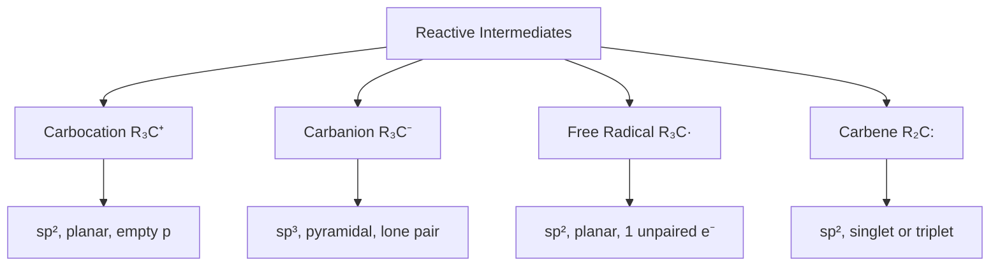

> Master carbocations, carbanions, free radicals, carbenes - their structure, stability, and role in reaction mechanisms for JEE.

## Introduction

**Reactive intermediates** are the fleeting species that form during reactions - they exist for nanoseconds but determine the entire outcome! Understanding them is the KEY to mastering organic reaction mechanisms.

> **★ Key point · Sunscreen Chemistry**
>
> When UV light hits your skin, it creates **free radicals** that damage DNA and cause cancer! Sunscreen works by absorbing UV and safely dissipating energy WITHOUT forming free radicals. The chemistry you learn here - about radical stability and reactions - is literally protecting your skin every summer. Modern sunscreens (featured in dermatology research 2024) are designed using these exact principles!

---

## Bond Fission: How Intermediates Form

Reactive intermediates are born when a covalent bond breaks. There are only two ways a bond can split:

### Homolytic Fission

$$A:B \rightarrow A\cdot + B\cdot$$

Each atom keeps one electron, producing **free radicals** (species with odd electrons). Favored by UV light, peroxides, and high temperature.

### Heterolytic Fission

$$A:B \rightarrow A^+ + B^-$$

One atom keeps both electrons, producing **ions** — a carbocation and a carbanion (or another ion pair). Favored by polar solvents and polar bonds.

---

## Classification of Reactive Intermediates



---

## Carbocations (Carbonium Ions)

### Structure

**Definition:** Carbon with **positive charge** and only **6 electrons** in valence shell.

$$\boxed{R_3C^+ \text{ (electron-deficient)}}$$

**Electronic Configuration:**

- **Hybridization:** sp²
- **Geometry:** Trigonal planar
- **Bond angle:** 120°
- **Empty p-orbital:** Perpendicular to plane

```fallback
R
        |
    R - C⁺     ← Planar
        |         Empty p-orbital ⊥
        R
```

**Characteristics:**

- **Electrophilic** (electron-loving)
- **Lewis acid** (accepts electron pair)
- Extremely **reactive** (short-lived)
- Forms in **polar solvents**

### Stability Order

$$\boxed{3° > 2° > 1° > CH_3^+ > \text{vinyl} > \text{phenyl}}$$

**Detailed:**

$$\boxed{(CH_3)_3C^+ > (CH_3)_2CH^+ > CH_3CH_2^+ > CH_3^+ > CH_2=CH^+ > C_6H_5^+}$$

**Factors Affecting Stability:**

#### 1. Inductive Effect (+I)

Alkyl groups donate electrons, stabilizing positive charge.

```fallback
(CH₃)₃C⁺: 3 methyl groups donating
(CH₃)₂CH⁺: 2 methyl groups
CH₃CH₂⁺: 1 methyl group
CH₃⁺: 0 methyl groups (least stable)
```

#### 2. Hyperconjugation

α-Hydrogens delocalize into empty p-orbital.

**Number of α-H:**

- **tert-Butyl:** 9 α-H → 9 hyperconjugative structures
- **Isopropyl:** 6 α-H → 6 structures
- **Ethyl:** 3 α-H → 3 structures
- **Methyl:** 0 α-H → 0 structures

**More α-H → More stable**

#### 3. Resonance

Delocalization through π-system enormously stabilizes.

**Example: Allyl cation (CH₂=CH-CH₂⁺)**

```fallback
CH₂=CH-CH₂⁺  ↔  ⁺CH₂-CH=CH₂

Positive charge delocalized over 2 carbons
Much more stable than propyl cation!
```

**Example: Benzyl cation (C₆H₅-CH₂⁺)**

```fallback
Resonance with benzene ring
Positive charge delocalized into ring
Very stable!
```

**Stability with resonance:**

$$\boxed{\text{Allyl/Benzyl} > 3° > 2° > 1°}$$

### Special Cases

#### Vinyl and Phenyl Cations

**Extremely unstable!**

**Vinyl cation (CH₂=CH⁺):**

- Positive charge on sp² carbon
- High s-character (50%) holds electrons tightly
- No hyperconjugation possible
- Very unstable

**Phenyl cation (C₆H₅⁺):**

- Disrupts aromaticity
- Extremely unstable

#### Bridgehead Cations

**Also very unstable** - violate Bredt’s rule.

Cannot form planar sp² geometry at bridgehead.

### Carbocation Rearrangements

**Carbocations rearrange** to form more stable species!

#### 1. Hydride Shift (1,2-H shift)

**H with electron pair migrates** to adjacent carbon.

**Example:**

```fallback
CH₃                    CH₃
    |                      |
CH₃-CH-CH₂⁺  →  CH₃-C⁺-CH₃

2° carbocation    →    3° carbocation
(less stable)          (more stable)
```

**Driving force:** Forms more stable carbocation

#### 2. Methyl Shift (1,2-CH₃ shift)

**Alkyl group migrates** with electron pair.

**Example:**

```fallback
CH₃   CH₃             CH₃   CH₃
    |     |               |     |
CH₃-C---CH⁺  →  CH₃-C⁺--CH₂
    |                    |
   CH₃                  CH₃

2° carbocation    →    3° carbocation
```

**General rule:** Always shifts to form **more stable** carbocation

> **⚠ Trap · Common JEE Mistake**
>
> **Mistake:** Forgetting about carbocation rearrangements in mechanisms.
>
> **Reality:** Carbocations ALWAYS rearrange if it gives more stability!
>
> **Example: Hydration of 3-methyl-1-butene**
>
> Expected: 3-methylbutan-2-ol

> Actual: 2-methylbutan-2-ol (after rearrangement!)
>
> ```fallback

> CH₃-CH(CH₃)-CH=CH₂ + H₂O

>          ↓ H⁺

> CH₃-CH(CH₃)-CH₂-CH₂⁺  (2°)

>          ↓ rearrangement

> CH₃-CH(CH₃)-CH(OH)-CH₃  WRONG!
>
> Correct: H⁺ adds to form 3° cation after rearrangement!

> ```
>
> This is THE most common mechanism trap!

---

## Carbanions

### Structure

**Definition:** Carbon with **negative charge** and **8 electrons** (lone pair).

$$\boxed{R_3C^- \text{ (electron-rich)}}$$

**Electronic Configuration:**

- **Hybridization:** sp³
- **Geometry:** Pyramidal (like NH₃)
- **Bond angle:** ~109°
- **Lone pair** in sp³ orbital

```fallback
R
        |
    R - C⁻     ← Pyramidal
        |         Lone pair in sp³
        R
```

**Characteristics:**

- **Nucleophilic** (nucleus-loving)
- **Lewis base** (donates electron pair)
- **Very reactive**
- Forms in **aprotic solvents** (no acidic H)

### Stability Order

**OPPOSITE of carbocations!**

$$\boxed{CH_3^- > 1° > 2° > 3°}$$

**Detailed:**

$$\boxed{CH_3^- > CH_3CH_2^- > (CH_3)_2CH^- > (CH_3)_3C^-}$$

**Also:**

$$\boxed{\text{Phenyl} > \text{Vinyl} > \text{sp}^3 \text{ carbanions}}$$

**Factors Affecting Stability:**

#### 1. Inductive Effect (-I)

**Electron-withdrawing groups stabilize** negative charge.

```fallback
CF₃CH₂⁻ > CH₃CH₂⁻

-CF₃ withdraws electrons, stabilizes negative charge
```

**Order with -I groups:**

$$\boxed{Cl_3C-CH_2^- > Cl_2CH-CH_2^- > ClCH_2-CH_2^- > CH_3-CH_2^-}$$

#### 2. Hyperconjugation

**Destabilizes carbanions!** (opposite of carbocations)

More α-H → Less stable carbanion

**Why?** H atoms are electron-donating, increase electron density on already negative center.

#### 3. Resonance

**Enormously stabilizes** by delocalizing negative charge.

**Example: Cyanide ion (CN⁻)**

```fallback
:C≡N:⁻  ↔  ⁻:C=N:

Negative charge delocalized
Very stable!
```

**Example: Acetate ion (CH₃COO⁻)**

```fallback
O⁻         O
     ‖    ↔    ‖
CH₃-C         CH₃-C
     |          |
     O          O⁻

Resonance makes acetic acid acidic!
```

#### 4. Hybridization Effect

**More s-character → More stable** (holds electrons closer)

$$\boxed{sp (50\%) > sp^2 (33\%) > sp^3 (25\%)}$$

**Example:**

```fallback
HC≡C⁻ > CH₂=CH⁻ > CH₃CH₂⁻

Acetylide (sp) most stable
Ethyl (sp³) least stable
```

**Acidity order matches:**

$$\boxed{HC \equiv CH \text{ (pKa 25)} > CH_2=CH_2 \text{ (44)} > CH_3CH_3 \text{ (50)}}$$

### Carbanion Reactions

**Strong bases and nucleophiles**

**Common reactions:**

1. **Nucleophilic substitution**
2. **Addition to carbonyls**
3. **Elimination reactions**
4. **Deprotonation**

---

## Free Radicals

### Structure

**Definition:** Species with **unpaired electron**.

$$\boxed{R_3C \cdot \text{ (one unpaired electron)}}$$

**Electronic Configuration:**

- **Hybridization:** sp²
- **Geometry:** Planar (or nearly planar)
- **Bond angle:** ~120°
- **Unpaired electron** in p-orbital

```fallback
R
        |
    R - C·     ← Planar
        |         Unpaired e⁻ in p
        R
```

**Characteristics:**

- **Highly reactive**
- **Neutral** (no charge)
- **Paramagnetic** (unpaired electron)
- React with almost anything!

### Stability Order

**Same as carbocations!**

$$\boxed{3° > 2° > 1° > CH_3 \cdot}$$

**Detailed:**

$$\boxed{(CH_3)_3C \cdot > (CH_3)_2CH \cdot > CH_3CH_2 \cdot > CH_3 \cdot}$$

**Special cases:**

$$\boxed{\text{Allyl/Benzyl} \cdot > 3° > 2° > 1°}$$

**Factors:**

#### 1. Hyperconjugation

More α-H → More stable

**Same as carbocations!**

#### 2. Resonance

**Example: Allyl radical**

```fallback
CH₂=CH-CH₂·  ↔  ·CH₂-CH=CH₂

Unpaired electron delocalized
Very stable!
```

**Example: Benzyl radical**

```fallback
Resonance with benzene ring
Very stable - used in polymerization!
```

### Free Radical Reactions

#### 1. Halogenation

**Example: CH₄ + Cl₂ → CH₃Cl + HCl**

**Mechanism:**

```fallback
Initiation:
Cl₂ --hν--> 2Cl·

Propagation:
CH₄ + Cl· → CH₃· + HCl
CH₃· + Cl₂ → CH₃Cl + Cl·

Termination:
CH₃· + Cl· → CH₃Cl
CH₃· + CH₃· → C₂H₆
Cl· + Cl· → Cl₂
```

#### 2. Anti-Markovnikov Addition (Peroxide Effect)

**Example: CH₃CH=CH₂ + HBr –peroxide–> CH₃CH₂CH₂Br**

**Normal (without peroxide):** Markovnikov (CH₃CHBrCH₃)
**With peroxide:** Anti-Markovnikov (CH₃CH₂CH₂Br)

**Mechanism:**

```fallback
Initiation:
ROOR → 2RO·
RO· + HBr → ROH + Br·

Propagation:
Br· + CH₃CH=CH₂ → CH₃CHBrCH₂· (2° radical, more stable)
CH₃CHBrCH₂· + HBr → CH₃CHBrCH₃ + Br·

Wait - this gives Markovnikov!

Actually:
Br· + CH₃CH=CH₂ → CH₃CH·-CH₂Br (less stable, but forms)
                OR
              → ·CH₂-CHBr-CH₃ (2°, preferred!)
```

**Correct mechanism:** Br· adds to give more stable radical intermediate!

> **★ Key point · JEE Alert**
>
> **Peroxide effect (Anti-Markovnikov) works ONLY with HBr!**
>
> **NOT with HCl or HI**
>
> **Why?**
>
> - **HCl:** C-Cl bond too strong, propagation too slow

> - **HI:** H-I bond too weak, reverses too easily

> - **HBr:** Just right! (Goldilocks)
>
> This specificity is heavily tested!

### Interactive Demo: Visualize Carbocation Rearrangements

Watch how carbocations rearrange to achieve greater stability.

---

## Carbenes

### Structure

**Definition:** Neutral carbon with **only 6 valence electrons** and **no charge**.

$$\boxed{R_2C: \text{ (divalent carbon)}}$$

**Two types:**

#### Singlet Carbene

- **Paired electrons** in same orbital
- **sp² hybridized**
- **Angular geometry**
- **Diamagnetic**

```fallback
R
    |
    C:    ← Bent, sp²
    |       Lone pair in sp²
    R       Empty p
```

#### Triplet Carbene

- **Two unpaired electrons**
- **sp hybridized**
- **Linear geometry**
- **Paramagnetic**

```fallback
R-C-R   ← Linear
  : :     Two unpaired in p orbitals
```

### Generation

**1. From Haloforms:**

```fallback
CHCl₃ + KOH → :CCl₂ + KCl + H₂O

Dichlorocarbene
```

**2. From Diazomethane:**

```fallback
CH₂N₂ --hν--> :CH₂ + N₂

Methylene (carbene)
```

### Reactions

**Highly reactive - inserts into bonds!**

**1. Addition to alkenes (cyclopropane formation):**

```fallback
:CH₂ + CH₂=CH₂ → Cyclopropane
```

**2. Insertion into C-H bonds**

---

## Nitrenes

**Similar to carbenes but with nitrogen**

$$\boxed{R-N: \text{ (monovalent nitrogen)}}$$

**Generation from azides:**

```fallback
R-N₃ --Δ--> R-N: + N₂
```

---

## Comparison Summary

| Intermediate | Structure | Hybridization | Geometry | Stability Order |
| --- | --- | --- | --- | --- |
| **Carbocation** | R₃C⁺ | sp² | Planar | 3° > 2° > 1° |
| **Carbanion** | R₃C⁻ | sp³ | Pyramidal | 1° > 2° > 3° |
| **Free Radical** | R₃C· | sp² | Planar | 3° > 2° > 1° |
| **Carbene** | R₂C: | sp² (singlet) | Angular | - |

**Key Differences:**

| Property | Carbocation | Carbanion | Free Radical |
| --- | --- | --- | --- |
| **Charge** | +1 | -1 | 0 |
| **Electrons** | 6 | 8 | 7 |
| **Nature** | Electrophile | Nucleophile | Both |
| **+I effect** | Stabilizes | Destabilizes | Stabilizes |
| **Stability** | 3° > 1° | 1° > 3° | 3° > 1° |

---

## Practice Problems

### Level 1: Basic Concepts

1. **Identify the intermediate formed:**

   - a) CH₃CH₂Cl + AlCl₃
   - b) CH₃CH₂Br + Mg
   - c) (CH₃)₃C-Cl –hν–>
2. **Arrange in order of stability:**

   - a) CH₃⁺, CH₃CH₂⁺, (CH₃)₂CH⁺, (CH₃)₃C⁺
   - b) CH₃⁻, CH₃CH₂⁻, (CH₃)₂CH⁻, (CH₃)₃C⁻
3. **Which is most stable?**

   - a) CH₂=CH-CH₂⁺
   - b) CH₃-CH₂-CH₂⁺
   - c) (CH₃)₂CH⁺
   - d) CH₃⁺

### Level 2: Application

4. **Explain why:**

   - Allyl cation is more stable than propyl cation
   - Acetylene is more acidic than ethane
   - tert-Butyl radical is more stable than methyl radical
5. **Predict the major product:**

   ```fallback
   CH₃-CH(CH₃)-CH=CH₂ + HCl →

   (Consider carbocation rearrangement!)
   ```
6. **Why does peroxide effect work only with HBr?**

### Level 3: JEE Advanced

7. **The most stable carbocation is:**

   - (a) (CH₃)₃C⁺
   - (b) CH₂=CH-CH₂⁺
   - (c) C₆H₅-CH₂⁺
   - (d) CH₃-CH₂⁺
8. **Which rearrangement is NOT possible?**

   - (a) Hydride shift
   - (b) Methyl shift
   - (c) Phenyl shift
   - (d) Alkyl shift
9. **Arrange in increasing order of acidity:**
   HC≡CH, CH₂=CH₂, CH₃-CH₃
10. **Assertion (A):** Benzyl cation is more stable than ethyl cation.
    **Reason (R):** Benzyl cation shows resonance stabilization.

    - (a) Both true, R explains A
    - (b) Both true, R doesn’t explain A
    - (c) A true, R false
    - (d) Both false
11. **In the reaction CH₃CH=CH₂ + HBr (with peroxide), the intermediate formed is:**

    - (a) CH₃CH⁺CH₂Br
    - (b) CH₃CHCH₂Br· (radical)
    - (c) CH₃CH⁻CH₂Br
    - (d) CH₃CH(Br)CH₂·
12. **The stability order of following carbanions is:**
    CH₃⁻, CF₃CH₂⁻, CH₃CH₂⁻, (CH₃)₃C⁻

> **↗ Connection · Quick Check**
>
> **Can you explain:** Why does (CH₃)₂CH-CH₂⁺ rearrange to (CH₃)₂C⁺-CH₃? Draw the mechanism and explain the driving force!

---

## Memory Tricks

### “CPR-F” for Intermediates

- **C**arbocation: Positive, planar, sp²
- **C**arbanion: Negative, pyramidal, sp³ (like NH₃)
- **R**adical: Neutral, planar, unpaired electron
- **F**ree radical stability = Carbocation stability

### Stability Orders

**“3-2-1 for Cations & Radicals”**

- 3° > 2° > 1° (carbocations and radicals)

**“1-2-3 for Anions” (reverse!)**

- 1° > 2° > 3° (carbanions)

### Hyperconjugation

**“Count Alpha H - More is Better (except anions!)”**

- Carbocations: More α-H → More stable
- Radicals: More α-H → More stable
- Carbanions: More α-H → LESS stable (reverse!)

### Peroxide Effect

**“Only Bromine Reverses”**

- Peroxide effect: Only with HBr
- Anti-Markovnikov addition
- NOT with HCl or HI

---

## Related Topics

### Within Organic Principles

- [Hybridization](../../chemical-bonding/hybridization/index.md) - sp², sp³ in intermediates
- [Electronic Effects](../electronic-effects/index.md) - +I, resonance effects
- [Reaction Types](../reaction-types/index.md) - Mechanisms involving intermediates
- [Isomerism Types](../isomerism-types/index.md) - Chirality in carbocations

### Other Chemistry Topics

- [Hydrocarbons - Alkenes](../../hydrocarbons/alkenes/index.md) - Carbocation rearrangements in addition
- [Hydrocarbons - Alkynes](../../hydrocarbons/alkynes/index.md) - Vinyl cation stability
- [Halogen Compounds - SN1/SN2](../../halogens-compounds/sn1-sn2-reactions/index.md) - Carbocation formation in SN1
- [Elimination Reactions](../../halogens-compounds/elimination-reactions/index.md) - E1 mechanism intermediates
- [Alcohols](../../oxygen-compounds/alcohols/index.md) - Carbocation formation in dehydration
- [Benzene](../../hydrocarbons/benzene/index.md) - Arenium ion intermediate in EAS

### Foundation Topics

- [Covalent Bonding](../../chemical-bonding/covalent-bonding/index.md) - Formal charge and stability
- [VSEPR Theory](../../chemical-bonding/vsepr-theory/index.md) - Geometry of intermediates
- [Molecular Orbital Theory](../../chemical-bonding/molecular-orbital-theory/index.md) - Electron distribution

---

From TestGuru · our mock-test platform

## You've read Reactive Intermediates in Organic Chemistry.You've read this topic. Find out what you actually got.

A free JEE Main mock with this chapter in it, and a report that shows which sub-topics cost you marks.

[Take a free JEE Main mock →](https://app.testguru.co/signup?tg_chapter=organic-principles&tg_exam=jee-main&tg_page=%2Fchemistry%2Forganic-principles%2Freaction-intermediates%2F&tg_subject=chemistry&utm_campaign=notes-jee-main-free-test&utm_content=article-end&utm_medium=referral&utm_source=jeenotes)
Free, no card. Opens TestGuru in a new tab.

## Stay exam-ready

One email every Sunday: new notes, the week's hardest challenge question and a revision plan.One email every Sunday.

## Comments

Have a question or spotted a mistake? Join the discussion below.

Advertisement

Advertisement

---

## Extracted page code (interactive scripts & widgets)


### inline-script-16

```js
if(!document.getElementById("animation-fullscreen-overlay")){const e=document.createElement("div");e.id="animation-fullscreen-overlay",e.className="animation-fullscreen-overlay",e.innerHTML=`
      <div class="fullscreen-modal">
        <div class="fullscreen-header">
          <span class="fullscreen-title">Interactive Demo</span>
          <button class="fullscreen-close-btn" onclick="JEEAnimations.closeFullscreen()" title="Close (Esc)" aria-label="Close fullscreen">
            <svg width="24" height="24" viewBox="0 0 24 24" fill="none" stroke="currentColor" stroke-width="2" stroke-linecap="round" stroke-linejoin="round">
              <line x1="18" y1="6" x2="6" y2="18"></line>
              <line x1="6" y1="6" x2="18" y2="18"></line>
            </svg>
          </button>
        </div>
        <div class="fullscreen-content"></div>
      </div>
    `,document.body.appendChild(e),document.addEventListener("keydown",function(e){e.key==="Escape"&&document.body.classList.contains("animation-fullscreen-active")&&JEEAnimations.closeFullscreen()}),e.addEventListener("click",function(t){t.target===e&&JEEAnimations.closeFullscreen()})}
```


### inline-script-17

```js
(function(){var t,e=document.getElementById("disqus-load");if(!e)return;t=!1,e.addEventListener("click",function(){if(t)return;t=!0,e.setAttribute("disabled","disabled"),e.textContent="Loading comments…",window.disqus_config=function(){this.page.url="https://jeenotes.in/chemistry/organic-principles/reaction-intermediates/",this.page.identifier="/chemistry/organic-principles/reaction-intermediates/"};var s=document,n=s.createElement("script");n.src="https://https-jeenotes-in.disqus.com/embed.js",n.setAttribute("data-timestamp",+new Date),n.onload=function(){e.style.display="none"},n.onerror=function(){t=!1,e.removeAttribute("disabled"),e.textContent="Could not load comments. Tap to retry"},(s.head||s.body).appendChild(n)})})()
```


### inline-script-18

```js
(function(){var t,e=document.currentScript.previousElementSibling;function n(){(window.adsbygoogle=window.adsbygoogle||[]).push({})}if(!window.ResizeObserver||e.clientWidth>0){n();return}t=new ResizeObserver(function(){e.clientWidth>0&&(t.disconnect(),n())}),t.observe(e)})()
```


### interactive-widget-1

```html
<div class="animation-wrapper" data-animation="reactionMechanism" id="anim-reactionMechanism-1795396420022988322"><div class="animation-header"><button aria-label="Toggle fullscreen" class="anim-fullscreen-btn" onclick='JEEAnimations.toggleFullscreen("anim-reactionMechanism-1795396420022988322")' title="Fullscreen (F)">
<svg class="fullscreen-icon-expand" fill="none" height="18" stroke="currentColor" stroke-linecap="round" stroke-linejoin="round" stroke-width="2" viewbox="0 0 24 24" width="18"><polyline points="15 3 21 3 21 9"></polyline><polyline points="9 21 3 21 3 15"></polyline><line x1="21" x2="14" y1="3" y2="10"></line><line x1="3" x2="10" y1="21" y2="14"></line></svg>
<svg class="fullscreen-icon-collapse" fill="none" height="18" stroke="currentColor" stroke-linecap="round" stroke-linejoin="round" stroke-width="2" viewbox="0 0 24 24" width="18"><polyline points="4 14 10 14 10 20"></polyline><polyline points="20 10 14 10 14 4"></polyline><line x1="14" x2="21" y1="10" y2="3"></line><line x1="3" x2="10" y1="21" y2="14"></line></svg>
<span class="fullscreen-text">Fullscreen</span></button></div><div class="animation-content"><noscript><div class="callout callout-warning"><div class="callout-title">JavaScript Required</div><p>This interactive animation requires JavaScript to be enabled.</p></div></noscript></div></div>
```


---

_Source: [https://jeenotes.in/chemistry/organic-principles/reaction-intermediates/](https://jeenotes.in/chemistry/organic-principles/reaction-intermediates/) · raw HTML: `offline/chemistry/organic-principles/reaction-intermediates/index.html`_
