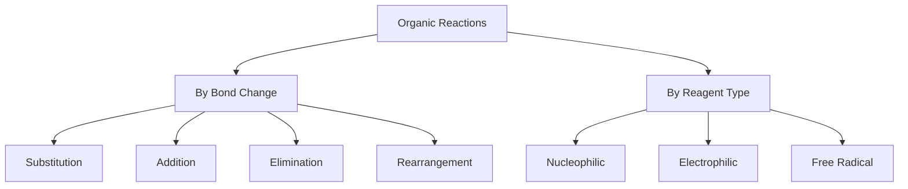

> Master substitution (SN1, SN2), addition, elimination (E1, E2), and rearrangement reactions with mechanisms for JEE Chemistry.

## Introduction

**Understanding reaction mechanisms** is the ultimate skill in organic chemistry! Instead of memorizing thousands of reactions, you learn the patterns - how and why reactions happen. This is what separates JEE toppers from average students.

> **★ Key point · Teflon's Accidental Discovery**
>
> In 1938, Roy Plunkett accidentally discovered Teflon through a **free radical polymerization** reaction (addition reaction)! He was trying to make refrigerant but left a cylinder of tetrafluoroethylene overnight. The next morning, he found a white waxy solid - Teflon. This non-stick coating on your pans exists because of the reaction mechanisms you’re learning right now. Understanding reaction types can lead to billion-dollar discoveries!

---

## Classification of Organic Reactions



**By mechanism:**

1. **Substitution:** One group replaces another
2. **Addition:** Two groups add across multiple bond
3. **Elimination:** Two groups leave, forming multiple bond
4. **Rearrangement:** Atoms rearrange within molecule

**By reagent:**

1. **Nucleophilic:** Nucleophile attacks
2. **Electrophilic:** Electrophile attacks
3. **Free Radical:** Radical chain reaction

---

## Substitution Reactions

**General:** One atom/group replaced by another

$$\boxed{R-X + Nu^- \rightarrow R-Nu + X^-}$$

### Nucleophilic Substitution

**Nucleophile (Nu⁻):** Electron-rich species, attacks electron-poor carbon.

**Two mechanisms:** SN1 and SN2

#### SN1: Unimolecular Nucleophilic Substitution

**“SN1” = Substitution, Nucleophilic, 1st order**

**Mechanism:**

**Step 1:** Ionization (slow, rate-determining)

$$R-X \xrightarrow{slow} R^+ + X^-$$

**Step 2:** Nucleophilic attack (fast)

$$R^+ + Nu^- \xrightarrow{fast} R-Nu$$

**Example: tert-Butyl bromide + OH⁻**

```fallback
Step 1 (slow):
(CH₃)₃C-Br → (CH₃)₃C⁺ + Br⁻
(Carbocation formation)

Step 2 (fast):
(CH₃)₃C⁺ + OH⁻ → (CH₃)₃C-OH
```

**Characteristics:**

| Property | SN1 |
| --- | --- |
| **Rate** | Rate = k[RX] (1st order) |
| **Mechanism** | Two-step (carbocation) |
| **Carbocation** | Formed (yes) |
| **Stereochemistry** | Racemization (loss of chirality) |
| **Substrate** | 3° > 2° » 1° (never) |
| **Nucleophile** | Weak nucleophiles OK |
| **Solvent** | Polar protic (stabilizes ions) |
| **Rearrangement** | Possible (carbocation can rearrange) |

**Why racemization?**

- Carbocation is planar (sp²)
- Nucleophile attacks from both sides equally
- 50% inversion + 50% retention = racemic mixture

**Substrate reactivity:**

$$\boxed{3° > 2° >> 1° \text{ (never)}}$$

**Reason:** Stability of carbocation intermediate

**Solvent:** Polar protic (H₂O, ROH)

- Stabilizes carbocation and leaving group
- Doesn’t need to stabilize nucleophile

#### SN2: Bimolecular Nucleophilic Substitution

**“SN2” = Substitution, Nucleophilic, 2nd order**

**Mechanism:**

**One-step:** Nucleophile attacks as leaving group departs (concerted)

$$Nu^- + R-X \rightarrow [Nu \cdots R \cdots X]^{\ddagger} \rightarrow Nu-R + X^-$$

**Example: CH₃Br + OH⁻**

```fallback
HO⁻ + CH₃-Br → [HO···CH₃···Br]⁻ → HO-CH₃ + Br⁻

Backside attack
Transition state (not intermediate!)
Inversion of configuration
```

**Characteristics:**

| Property | SN2 |
| --- | --- |
| **Rate** | Rate = k[RX][Nu⁻] (2nd order) |
| **Mechanism** | One-step (concerted) |
| **Carbocation** | No intermediate |
| **Stereochemistry** | 100% inversion (Walden inversion) |
| **Substrate** | 1° > 2° » 3° (never) |
| **Nucleophile** | Strong nucleophiles needed |
| **Solvent** | Polar aprotic (doesn’t solvate Nu⁻) |
| **Rearrangement** | No (no carbocation) |

**Why inversion?**

- **Backside attack** (SN2 mechanism)
- Nucleophile approaches from side opposite to leaving group
- Like umbrella flipping in wind

**Substrate reactivity:**

$$\boxed{CH_3X > 1° > 2° >> 3° \text{ (never)}}$$

**Reason:** Steric hindrance - nucleophile needs access to carbon

**Solvent:** Polar aprotic (DMSO, DMF, acetone)

- Doesn’t solvate nucleophile
- Keeps Nu⁻ “naked” and reactive

> **★ Key point · JEE Comparison**
>
> **SN1 vs SN2 - The Ultimate Comparison:**
>
> | Factor | SN1 | SN2 |

> | --- | --- | --- |

> | **Best substrate** | 3° (most stable carbocation) | 1° (least hindered) |

> | **Worst substrate** | 1° (unstable carbocation) | 3° (too hindered) |

> | **Stereochemistry** | Racemization | Inversion |

> | **Rate depends on** | [RX] only | [RX][Nu⁻] |

> | **Carbocation?** | Yes (can rearrange) | No |

> | **Solvent** | Polar protic (H₂O, EtOH) | Polar aprotic (DMSO, DMF) |
>
> **Trick:** “1 is slow, 2 is low (hindrance)”
>
> - SN1 needs slow ionization, stable carbocation (3°)

> - SN2 needs low hindrance, easy access (1°)
>
> This table is GOLD for JEE!

### Electrophilic Substitution

**Electrophile (E⁺):** Electron-poor species, attacks electron-rich site.

**Most important:** Electrophilic Aromatic Substitution (EAS)

#### Mechanism of EAS (General)

**Step 1:** Generation of electrophile
**Step 2:** Electrophile attacks benzene
**Step 3:** Deprotonation restores aromaticity

**Example: Nitration**

```fallback
Step 1: Electrophile generation
HNO₃ + H₂SO₄ → NO₂⁺ + HSO₄⁻ + H₂O
(Nitronium ion)

Step 2: Attack on benzene
C₆H₆ + NO₂⁺ → C₆H₆NO₂⁺ (carbocation, arenium ion)

Step 3: Deprotonation
C₆H₆NO₂⁺ → C₆H₅NO₂ + H⁺
(Nitrobenzene)
```

**Common EAS Reactions:**

| Reaction | Electrophile | Reagent | Product |
| --- | --- | --- | --- |
| **Halogenation** | X⁺ | X₂/FeX₃ | C₆H₅X |
| **Nitration** | NO₂⁺ | HNO₃/H₂SO₄ | C₆H₅NO₂ |
| **Sulfonation** | SO₃H⁺ | H₂SO₄ (fuming) | C₆H₅SO₃H |
| **Friedel-Crafts Alkylation** | R⁺ | RCl/AlCl₃ | C₆H₅R |
| **Friedel-Crafts Acylation** | RCO⁺ | RCOCl/AlCl₃ | C₆H₅COR |

---

## Addition Reactions

**General:** Two groups add across multiple bond (C=C or C≡C)

$$\boxed{C=C + X-Y \rightarrow X-C-C-Y}$$

### Electrophilic Addition

**Most common for alkenes and alkynes**

#### Mechanism

**Step 1:** Electrophile attacks π-bond, forms carbocation
**Step 2:** Nucleophile attacks carbocation

**Example: CH₂=CH₂ + HBr**

```fallback
Step 1:
CH₂=CH₂ + H⁺ → CH₃-CH₂⁺
(More stable carbocation)

Step 2:
CH₃-CH₂⁺ + Br⁻ → CH₃-CH₂-Br
```

#### Markovnikov’s Rule

**“Rich get richer”** - H adds to carbon with MORE hydrogens.

$$\boxed{\text{H to more H, X to less H}}$$

**Example: Propene + HCl**

```fallback
CH₃-CH=CH₂ + HCl

Could form:
CH₃-CHCl-CH₃  (2° carbocation, Markovnikov)  ← Major
CH₃-CH₂-CH₂Cl (1° carbocation)               ← Minor

Markovnikov product: CH₃-CHCl-CH₃
```

**Reason:** Electrophile adds to form more stable carbocation (2° > 1°)

#### Anti-Markovnikov Addition

**With peroxides (free radical mechanism)** - ONLY for HBr!

**Example: Propene + HBr (peroxide)**

```fallback
CH₃-CH=CH₂ + HBr --ROOR--> CH₃-CH₂-CH₂-Br

Anti-Markovnikov product!
```

**Mechanism:**

```fallback
Initiation:
ROOR → 2RO·
RO· + HBr → ROH + Br·

Propagation:
Br· + CH₃-CH=CH₂ → CH₃-CH·-CH₂-Br (2° radical, stable!)
CH₃-CH·-CH₂-Br + HBr → CH₃-CH₂-CH₂-Br + Br·
```

**Why only HBr?**

- HCl: H-Cl too strong, won’t abstract
- HI: H-I too weak, reaction reverses

### Addition Reactions Summary

| Reaction | Reagent | Product | Type |
| --- | --- | --- | --- |
| **Hydrogenation** | H₂/Ni, Pt, Pd | Alkane | Syn addition |
| **Halogenation** | X₂ | Dihaloalkane | Anti addition |
| **Hydrogen halide** | HX | Haloalkane | Markovnikov |
| **HBr + peroxide** | HBr/ROOR | Haloalkane | Anti-Markovnikov |
| **Hydration** | H₂O/H⁺ | Alcohol | Markovnikov |
| **Oxymercuration** | Hg(OAc)₂/NaBH₄ | Alcohol | Markovnikov, no rearrangement |
| **Hydroboration** | BH₃/H₂O₂/OH⁻ | Alcohol | Anti-Markovnikov |

---

## Elimination Reactions

**General:** Two groups leave, forming multiple bond (opposite of addition)

$$\boxed{X-C-C-Y \rightarrow C=C + X-Y}$$

**Most common:** Dehydrohalogenation (removing HX)

### E1: Unimolecular Elimination

**Similar to SN1 - goes through carbocation**

**Mechanism:**

**Step 1:** Ionization (slow)

$$R-X \xrightarrow{slow} R^+ + X^-$$

**Step 2:** Deprotonation (fast)

$$R^+ + Base \xrightarrow{fast} Alkene + H^+$$

**Example: tert-Butyl bromide + OH⁻ (heat)**

```fallback
Step 1:
(CH₃)₃C-Br → (CH₃)₃C⁺ + Br⁻

Step 2:
(CH₃)₃C⁺ → (CH₃)₂C=CH₂ + H⁺
```

**Characteristics:**

| Property | E1 |
| --- | --- |
| **Rate** | Rate = k[RX] (1st order) |
| **Mechanism** | Two-step (carbocation) |
| **Substrate** | 3° > 2° » 1° |
| **Base** | Weak base OK |
| **Carbocation** | Yes (can rearrange) |
| **Product** | Mixture (Zaitsev + Hofmann) |

### E2: Bimolecular Elimination

**Similar to SN2 - concerted, one-step**

**Mechanism:**

**One-step:** Base removes H as leaving group departs (anti-periplanar)

$$Base + H-C-C-X \rightarrow Base-H + C=C + X^-$$

**Example: Ethyl bromide + KOH (alcohol, heat)**

```fallback
H
          |
KOH + CH₃-CH-Br → CH₂=CH₂ + H₂O + KBr
       (Anti-periplanar geometry required)
```

**Characteristics:**

| Property | E2 |
| --- | --- |
| **Rate** | Rate = k[RX][Base] (2nd order) |
| **Mechanism** | One-step (concerted) |
| **Substrate** | 3° > 2° > 1° |
| **Base** | Strong base needed |
| **Carbocation** | No intermediate |
| **Stereochemistry** | Anti-periplanar required |
| **Product** | Zaitsev (more substituted) |

#### Zaitsev’s Rule

**“More substituted alkene is more stable”** → Major product

$$\boxed{\text{Tetrasubstituted} > \text{Trisubstituted} > \text{Disubstituted} > \text{Monosubstituted}}$$

**Example: 2-Bromobutane + KOH**

```fallback
CH₃
     |
CH₃-CH-CH₂-CH₃ + KOH
     |
     Br

Could form:
CH₃-CH=CH-CH₃   (Trisubstituted) ← Zaitsev (Major, 80%)
CH₂=CH-CH₂-CH₃  (Disubstituted)  ← Hofmann (Minor, 20%)
```

**Zaitsev product:** More substituted, more stable (hyperconjugation!)

#### Hofmann Rule

**With bulky bases** (like (CH₃)₃CO⁻) → **Less substituted alkene**

**Reason:** Steric hindrance - base attacks less hindered H

> **⚠ Trap · Common JEE Mistake**
>
> **SN vs E Competition:**
>
> **When do you get substitution vs elimination?**
>
> | Conditions | Favors | Product |

> | --- | --- | --- |

> | **Strong nucleophile, 1°/2°** | SN2 | Substitution |

> | **Weak nucleophile, 3°** | SN1 | Substitution |

> | **Strong base, heat, 3°** | E2 | Elimination |

> | **Weak base, heat, 3°** | E1 | Elimination |

> | **Bulky base** | E2 | Elimination (Hofmann) |
>
> **Summary:**
>
> - **1° substrate:** SN2 (never E1 or SN1)

> - **3° substrate:** E2 or E1 (never SN2)

> - **Heat + strong base:** Elimination

> - **Good nucleophile, no heat:** Substitution
>
> This is the MOST important decision tree for mechanisms!

---

## Rearrangement Reactions

**Atoms/groups move within molecule** to form more stable structure.

### Types

#### 1. Wagner-Meerwein Rearrangement

**Carbocation rearrangement** - hydride or alkyl shift

**Example: Pinacol-Pinacolone Rearrangement**

```fallback
CH₃   CH₃              CH₃   CH₃
   |     |                |     |
  C  -  C      H⁺        C  =  O
  |     |      →         |
 OH    OH               CH₃

Pinacol             Pinacolone
```

**Mechanism:**

1. Protonation of OH
2. Loss of H₂O → carbocation
3. Methyl shift → more stable carbocation
4. Deprotonation → ketone

#### 2. Beckmann Rearrangement

**Oxime → Amide** (used in nylon production!)

```fallback
R-C=N-OH  → R-NH-CO-R'
   |
   R'
```

#### 3. Benzilic Acid Rearrangement

**α-Diketone → α-Hydroxy acid**

---

## Free Radical Reactions

**Chain mechanism:** Initiation → Propagation → Termination

### Halogenation of Alkanes

**Example: CH₄ + Cl₂ –hν–> CH₃Cl + HCl**

**Mechanism:**

**Initiation:**

$$Cl_2 \xrightarrow{hν} 2Cl \cdot$$

**Propagation:**

$$CH_4 + Cl \cdot \rightarrow CH_3 \cdot + HCl$$

$$CH_3 \cdot + Cl_2 \rightarrow CH_3Cl + Cl \cdot$$

**Termination:**

$$Cl \cdot + Cl \cdot \rightarrow Cl_2$$

$$CH_3 \cdot + Cl \cdot \rightarrow CH_3Cl$$

$$CH_3 \cdot + CH_3 \cdot \rightarrow C_2H_6$$

**Reactivity:** F₂ > Cl₂ > Br₂ > I₂

**Selectivity:** I₂ > Br₂ > Cl₂ > F₂ (opposite!)

**Why?**

- F₂ too reactive → no selectivity
- I₂ too slow → very selective

**Selectivity in alkanes:**

$$\boxed{3° > 2° > 1° \text{ (for radical formation)}}$$

---

## Summary Table

| Reaction | Substrate | Mechanism | Product | Key Feature |
| --- | --- | --- | --- | --- |
| **SN1** | 3° | Two-step, carbocation | R-Nu | Racemization |
| **SN2** | 1° | One-step, backside | R-Nu | Inversion |
| **E1** | 3° | Two-step, carbocation | Alkene | Zaitsev |
| **E2** | 3°, 2°, 1° | One-step, anti | Alkene | Zaitsev/Hofmann |
| **Addition** | Alkene | Via carbocation | X-C-C-Y | Markovnikov |
| **Free radical** | Alkane | Chain mechanism | Various | 3° > 2° > 1° |

---

## Practice Problems

### Level 1: Identification

1. **Identify the mechanism (SN1, SN2, E1, E2):**

   - a) (CH₃)₃C-Br + OH⁻ (aqueous, room temp)
   - b) CH₃-Br + OH⁻ (acetone)
   - c) (CH₃)₃C-Br + (CH₃)₃CO⁻ (heat)
2. **Predict major product:**

   - a) CH₃CH=CH₂ + HBr
   - b) CH₃CH=CH₂ + HBr (peroxide)
3. **Which gives faster SN2?**
   CH₃Br, CH₃CH₂Br, (CH₃)₂CHBr, (CH₃)₃CBr

### Level 2: Application

4. **Explain why:**

   - SN2 doesn’t work with 3° substrates
   - E2 requires anti-periplanar geometry
   - Carbocation rearrangements occur in SN1 but not SN2
5. **Draw mechanism:**

   - a) 2-Bromo-2-methylpropane + H₂O → tert-Butanol
   - b) Bromomethane + OH⁻ → Methanol
6. **Predict product with stereochemistry:**
   (R)-2-Bromobutane + OH⁻ (SN2) → ?

### Level 3: JEE Advanced

7. **Which reaction is fastest?**

   - (a) (CH₃)₃C-Br + H₂O (SN1)
   - (b) CH₃-Br + OH⁻ (SN2)
   - (c) (CH₃)₂CH-Br + OH⁻ (SN2)
   - (d) Cannot compare (different mechanisms)
8. **What happens when (S)-2-bromobutane undergoes SN2 with CN⁻?**

   - (a) (S)-2-cyanobutane
   - (b) (R)-2-cyanobutane
   - (c) Racemic mixture
   - (d) Achiral product
9. **Assertion (A):** E2 elimination requires anti-periplanar geometry.
   **Reason (R):** This allows maximum orbital overlap during elimination.

   - (a) Both true, R explains A
   - (b) Both true, R doesn’t explain A
   - (c) A true, R false
   - (d) Both false
10. **In the reaction CH₃-CH(Br)-CH₂-CH₃ + KOH (alc., heat), major product is:**

    - (a) CH₂=CH-CH₂-CH₃
    - (b) CH₃-CH=CH-CH₃
    - (c) CH₃-CH₂-CH=CH₂
    - (d) CH₃-CH₂-CH₂-CH₂-OH

> **↗ Connection · Quick Check**
>
> **Can you draw mechanisms for:**
>
> 1. SN1 of tert-butyl bromide + water

> 2. SN2 of methyl bromide + OH⁻

> 3. E2 of 2-bromopropane + KOH
>
> Include all intermediates, transition states, and curved arrows!

---

## Memory Tricks

### “1 vs 2” - The Ultimate Rule

**“1” reactions:**

- **One** molecule in rate equation
- **One** step is slow (first step)
- Best with **3°** (most stable carbocation)
- **Racemization** (SN1) or **Zaitsev** (E1)

**“2” reactions:**

- **Two** molecules in rate
- **Two** species in transition state
- Best with **1°** (least hindered)
- **Inversion** (SN2) or **anti** geometry (E2)

### SN vs E Decision Tree

```fallback
Is substrate 1°?
├─ Yes → SN2 (good Nu⁻, no heat) or E2 (strong base, heat)
└─ No (3°) → SN1 (weak Nu⁻) or E1/E2 (heat, base)

Heat + Strong Base = Elimination
Good Nu⁻, No heat = Substitution
```

### Interactive Demo: Visualize Reaction Mechanisms

Watch SN1, SN2, E1, and E2 mechanisms unfold with animated electron movement.

### Markovnikov

**“Rich Get Richer”**

- H adds to carbon with MORE H atoms
- Forms more stable carbocation

---

## Related Topics

### Within Organic Principles

- [Hybridization](../../chemical-bonding/hybridization/index.md) - sp² in carbocations
- [Electronic Effects](../electronic-effects/index.md) - Inductive and resonance effects on reactivity
- [Reaction Intermediates](../reaction-intermediates/index.md) - Carbocations in SN1, E1
- [Isomerism Types](../isomerism-types/index.md) - Stereochemistry in SN2

### Halogen Compounds (Key Applications)

- [SN1 and SN2 Reactions](../../halogens-compounds/sn1-sn2-reactions/index.md) - Detailed mechanisms
- [Elimination Reactions](../../halogens-compounds/elimination-reactions/index.md) - E1 and E2 details
- [Alkyl Halides](../../halogens-compounds/alkyl-halides/index.md) - Substrate reactivity
- [Haloarenes](../../halogens-compounds/haloarenes/index.md) - Aromatic substitution

### Hydrocarbon Reactions

- [Alkenes](../../hydrocarbons/alkenes/index.md) - Addition reactions, Markovnikov
- [Alkynes](../../hydrocarbons/alkynes/index.md) - Addition across triple bonds
- [Benzene](../../hydrocarbons/benzene/index.md) - Electrophilic aromatic substitution
- [Directive Effects](../../hydrocarbons/directive-effects/index.md) - Ortho-para and meta directors

### Oxygen Compounds

- [Alcohols](../../oxygen-compounds/alcohols/index.md) - Dehydration (E1), substitution
- [Ethers](../../oxygen-compounds/ethers/index.md) - Williamson synthesis (SN2)
- [Aldehydes and Ketones](../../oxygen-compounds/aldehydes-ketones/index.md) - Nucleophilic addition

### Nitrogen Compounds

- [Amines](../../nitrogen-compounds/amines-properties/index.md) - Nucleophilic reactions
- [Diazonium Salts](../../nitrogen-compounds/diazonium-salts/index.md) - Substitution reactions

### Foundation Topics

- [Chemical Equilibrium](../../equilibrium/chemical-equilibrium/index.md) - Reaction reversibility
- [Chemical Kinetics](../../chemical-kinetics/rate-law/index.md) - Rate equations for SN1, SN2

---

From TestGuru · our mock-test platform

## You've read Types of Organic Reactions.You've read this topic. Find out what you actually got.

A free JEE Main mock with this chapter in it, and a report that shows which sub-topics cost you marks.

[Take a free JEE Main mock →](https://app.testguru.co/signup?tg_chapter=organic-principles&tg_exam=jee-main&tg_page=%2Fchemistry%2Forganic-principles%2Freaction-types%2F&tg_subject=chemistry&utm_campaign=notes-jee-main-free-test&utm_content=article-end&utm_medium=referral&utm_source=jeenotes)
Free, no card. Opens TestGuru in a new tab.

## Stay exam-ready

One email every Sunday: new notes, the week's hardest challenge question and a revision plan.One email every Sunday.

## Comments

Have a question or spotted a mistake? Join the discussion below.

Advertisement

Advertisement

---

## Extracted page code (interactive scripts & widgets)


### inline-script-16

```js
if(!document.getElementById("animation-fullscreen-overlay")){const e=document.createElement("div");e.id="animation-fullscreen-overlay",e.className="animation-fullscreen-overlay",e.innerHTML=`
      <div class="fullscreen-modal">
        <div class="fullscreen-header">
          <span class="fullscreen-title">Interactive Demo</span>
          <button class="fullscreen-close-btn" onclick="JEEAnimations.closeFullscreen()" title="Close (Esc)" aria-label="Close fullscreen">
            <svg width="24" height="24" viewBox="0 0 24 24" fill="none" stroke="currentColor" stroke-width="2" stroke-linecap="round" stroke-linejoin="round">
              <line x1="18" y1="6" x2="6" y2="18"></line>
              <line x1="6" y1="6" x2="18" y2="18"></line>
            </svg>
          </button>
        </div>
        <div class="fullscreen-content"></div>
      </div>
    `,document.body.appendChild(e),document.addEventListener("keydown",function(e){e.key==="Escape"&&document.body.classList.contains("animation-fullscreen-active")&&JEEAnimations.closeFullscreen()}),e.addEventListener("click",function(t){t.target===e&&JEEAnimations.closeFullscreen()})}
```


### inline-script-17

```js
(function(){var t,e=document.getElementById("disqus-load");if(!e)return;t=!1,e.addEventListener("click",function(){if(t)return;t=!0,e.setAttribute("disabled","disabled"),e.textContent="Loading comments…",window.disqus_config=function(){this.page.url="https://jeenotes.in/chemistry/organic-principles/reaction-types/",this.page.identifier="/chemistry/organic-principles/reaction-types/"};var s=document,n=s.createElement("script");n.src="https://https-jeenotes-in.disqus.com/embed.js",n.setAttribute("data-timestamp",+new Date),n.onload=function(){e.style.display="none"},n.onerror=function(){t=!1,e.removeAttribute("disabled"),e.textContent="Could not load comments. Tap to retry"},(s.head||s.body).appendChild(n)})})()
```


### inline-script-18

```js
(function(){var t,e=document.currentScript.previousElementSibling;function n(){(window.adsbygoogle=window.adsbygoogle||[]).push({})}if(!window.ResizeObserver||e.clientWidth>0){n();return}t=new ResizeObserver(function(){e.clientWidth>0&&(t.disconnect(),n())}),t.observe(e)})()
```


### interactive-widget-1

```html
<div class="animation-wrapper" data-animation="reactionMechanism" id="anim-reactionMechanism-1795396420036851007"><div class="animation-header"><button aria-label="Toggle fullscreen" class="anim-fullscreen-btn" onclick='JEEAnimations.toggleFullscreen("anim-reactionMechanism-1795396420036851007")' title="Fullscreen (F)">
<svg class="fullscreen-icon-expand" fill="none" height="18" stroke="currentColor" stroke-linecap="round" stroke-linejoin="round" stroke-width="2" viewbox="0 0 24 24" width="18"><polyline points="15 3 21 3 21 9"></polyline><polyline points="9 21 3 21 3 15"></polyline><line x1="21" x2="14" y1="3" y2="10"></line><line x1="3" x2="10" y1="21" y2="14"></line></svg>
<svg class="fullscreen-icon-collapse" fill="none" height="18" stroke="currentColor" stroke-linecap="round" stroke-linejoin="round" stroke-width="2" viewbox="0 0 24 24" width="18"><polyline points="4 14 10 14 10 20"></polyline><polyline points="20 10 14 10 14 4"></polyline><line x1="14" x2="21" y1="10" y2="3"></line><line x1="3" x2="10" y1="21" y2="14"></line></svg>
<span class="fullscreen-text">Fullscreen</span></button></div><div class="animation-content"><noscript><div class="callout callout-warning"><div class="callout-title">JavaScript Required</div><p>This interactive animation requires JavaScript to be enabled.</p></div></noscript></div></div>
```


---

_Source: [https://jeenotes.in/chemistry/organic-principles/reaction-types/](https://jeenotes.in/chemistry/organic-principles/reaction-types/) · raw HTML: `offline/chemistry/organic-principles/reaction-types/index.html`_
