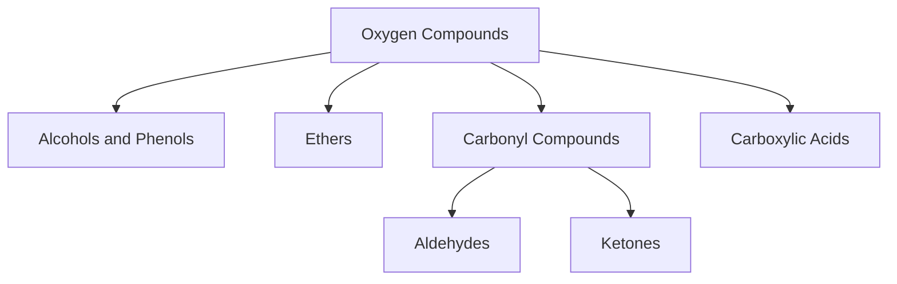

> Quick-revision sheet of every key reaction, reagent, name reaction, acidity trend, and qualitative test for alcohols, phenols, ethers, aldehydes, ketones, and carboxylic acids — JEE Main & Advanced.

This chapter is reaction-driven, not formula-driven. The sheet below is a scannable round-up of the key relations, reagents, name reactions, acidity orders, and qualitative tests pulled straight from the alcohols, phenols, ethers, aldehydes & ketones, and carboxylic acids topics. Use it for last-minute revision.

> **★ Key point · How to use this sheet**
>
> Most “formulas” here are reactivity orders, reagent-product pairs, and qualitative tests. Memorise the boxed orders and the test tables — that is where JEE marks come from in this chapter.

## Functional Groups at a Glance

| Class | General formula | Key feature |
| --- | --- | --- |
| Alcohol | $\text{R-OH}$ | -OH on sp³ carbon |
| Phenol | $\text{C}_6\text{H}_5\text{-OH}$ | -OH on sp² (aromatic) carbon |
| Ether | $\text{R-O-R}'$ | O bridging two carbons, no H on O |
| Aldehyde | $\text{R-CHO}$ | C=O terminal, ≥1 H on carbonyl C |
| Ketone | $\text{R-CO-R}'$ | C=O internal, no H on carbonyl C |
| Carboxylic acid | $\text{R-COOH}$ | carbonyl + hydroxyl = carboxyl |



---

## Alcohols

### Classification and reactivity

| Class | Structure | Carbons on C-OH |
| --- | --- | --- |
| Primary (1°) | $\text{R-CH}_2\text{-OH}$ | 1 |
| Secondary (2°) | $\text{R}_2\text{CH-OH}$ | 2 |
| Tertiary (3°) | $\text{R}_3\text{C-OH}$ | 3 |

$$\boxed{\text{SN1 / E1 reactivity: } 3° > 2° > 1° \quad (\text{carbocation stability})}$$

$$\boxed{\text{SN2 reactivity: } 1° > 2° > 3° \quad (\text{steric hindrance})}$$

$$\boxed{\text{Acidity: } \text{H}_2\text{O} > 1° > 2° > 3° \quad (+\text{I effect destabilises RO}^-)}$$

### Preparation

| Method | Reagent | Product |
| --- | --- | --- |
| Markovnikov hydration | $\text{H}_2\text{SO}_4/\text{H}_2\text{O}$ | more-substituted alcohol (2°/3°) |
| Anti-Markovnikov | $\text{BH}_3/\text{THF}$, then $\text{H}_2\text{O}_2/\text{OH}^-$ | less-substituted (1°) alcohol |
| Aldehyde reduction | $\text{LiAlH}_4$ or $\text{NaBH}_4$ | 1° alcohol |
| Ketone reduction | $\text{LiAlH}_4$ or $\text{NaBH}_4$ | 2° alcohol |
| Ester / acid reduction | $\text{LiAlH}_4$ (not $\text{NaBH}_4$) | 1° alcohol |
| Hydrolysis of R-X | aq. NaOH/KOH | alcohol |

**Grignard pattern (carbonyl + RMgX, then H₃O⁺):**

| Carbonyl | Product |
| --- | --- |
| Formaldehyde (HCHO) | 1° alcohol |
| Other aldehyde (R′CHO) | 2° alcohol |
| Ketone (R′COR″) | 3° alcohol |
| Ester (2 RMgX) | 3° alcohol (two identical R) |

### Key reactions

$$\boxed{\text{Reactivity with HX: } \text{HI} > \text{HBr} > \text{HCl}; \quad 3° > 2° > 1°}$$

- **Dehydration (conc. H₂SO₄):** $140°\text{C} \rightarrow$ ether; $170°\text{C} \rightarrow$ alkene (Saytzeff: more-substituted alkene major).
- **With Na:** $2\,\text{R-OH} + 2\,\text{Na} \rightarrow 2\,\text{R-O}^-\text{Na}^+ + \text{H}_2\uparrow$ (effervescence = -OH test).
- **Esterification (Fischer, reversible):** $\text{R-OH} + \text{R}'\text{COOH} \underset{\text{conc. H}_2\text{SO}_4}{\rightleftharpoons} \text{R}'\text{COO-R} + \text{H}_2\text{O}$.

**Oxidation outcomes:**

| Alcohol | PCC (mild) | $\text{K}_2\text{Cr}_2\text{O}_7/\text{H}^+$ (strong) |
| --- | --- | --- |
| 1° | aldehyde | carboxylic acid |
| 2° | ketone | ketone (stops) |
| 3° | no reaction | no reaction |

> **★ Key point · Carbocation rearrangement**
>
> For 2°/3° alcohols going through SN1/E1, watch for hydride or methyl shifts that convert a 2° carbocation into a more stable 3° one before the nucleophile attacks.

### Lucas test (HCl + ZnCl₂)

| Alcohol | Turbidity |
| --- | --- |
| 3° | immediate |
| 2° | ~5 minutes |
| 1° | none at room temp |

---

## Phenols

### Acidity

$$\boxed{\text{R-COOH} \gg \text{PhOH} > \text{H}_2\text{O} > \text{R-OH}}$$

$$\boxed{\text{p}K_a: \text{RCOOH }(4\text{-}5) \ll \text{PhOH }(10) < \text{H}_2\text{O }(15.7) < \text{ROH }(16)}$$

Phenol is acidic because the phenoxide ion is resonance-stabilised (charge delocalised into the ring).

**Substituent effect on acidity:**

$$\boxed{p\text{-NO}_2\text{-C}_6\text{H}_4\text{OH} > m\text{-NO}_2\text{-C}_6\text{H}_4\text{OH} > \text{C}_6\text{H}_5\text{OH} > p\text{-CH}_3\text{-C}_6\text{H}_4\text{OH}}$$

- EWG (-NO₂, -CN, -CHO, -X) increase acidity; ortho/para > meta (direct resonance).
- EDG (-CH₃, -OCH₃, -NH₂) decrease acidity.

### Preparation

| Method | Conditions |
| --- | --- |
| Dow process (from $\text{C}_6\text{H}_5\text{Cl}$) | NaOH(aq), 623 K, 350 atm, then H⁺ |
| Alkali fusion (from $\text{C}_6\text{H}_5\text{SO}_3\text{H}$) | fused NaOH, 623 K, then H⁺ |
| Diazonium hydrolysis | $\text{C}_6\text{H}_5\text{N}_2^+\text{Cl}^- + \text{H}_2\text{O} \xrightarrow{\text{warm}} \text{C}_6\text{H}_5\text{OH} + \text{N}_2 + \text{HCl}$ |
| Cumene process | $\text{O}_2$ then $\text{H}^+$ → phenol + acetone |

Diazonium salt is stable only at 0–5 °C; aniline → diazonium uses NaNO₂ + HCl at 0–5 °C.

### Electrophilic substitution (ortho/para, often no catalyst)

| Reagent | Product | Note |
| --- | --- | --- |
| dil. $\text{HNO}_3$ | o-/p-nitrophenol | no catalyst needed |
| conc. $\text{HNO}_3/\text{H}_2\text{SO}_4$ | picric acid (2,4,6-trinitrophenol) | explosive |
| $\text{Br}_2/\text{H}_2\text{O}$ | 2,4,6-tribromophenol | white ppt — test for phenol |
| $\text{Br}_2/\text{CS}_2$ | mono-bromophenol | non-polar solvent |
| conc. $\text{H}_2\text{SO}_4$ | phenolsulfonic acid | 100 °C → ortho, higher T → para |

### Name reactions

- **Kolbe (Kolbe–Schmitt):** sodium phenoxide $+\,\text{CO}_2$ (400 K, 4–7 atm), then H⁺ → **salicylic acid** (ortho-COOH).
- **Reimer–Tiemann:** phenol $+\,\text{CHCl}_3/\text{NaOH}$ → **salicylaldehyde** (ortho-CHO); proceeds via dichlorocarbene :CCl₂.
- **Azo coupling:** phenol $+\,\text{C}_6\text{H}_5\text{N}_2^+\text{Cl}^-$ (NaOH, 273 K) → p-hydroxyazobenzene (orange dye).

### Tests and contrasts

| Test | Phenol | Alcohol | RCOOH |
| --- | --- | --- | --- |
| Neutral $\text{FeCl}_3$ | violet/blue ✓ | no colour | — |
| NaOH | dissolves ✓ | no reaction | dissolves |
| $\text{NaHCO}_3$ | no reaction | no reaction | $\text{CO}_2\uparrow$ ✓ |

$$3\,\text{C}_6\text{H}_5\text{OH} + \text{FeCl}_3 \rightarrow [\text{Fe(OC}_6\text{H}_5)_3] + 3\,\text{HCl}$$

> **★ Key point · High-yield distinction**
>
> Benzyl alcohol ($\text{C}_6\text{H}_5\text{-CH}_2\text{-OH}$) is an alcohol, NOT a phenol — no FeCl₃ colour, no Br₂/H₂O ppt. Phenol esterification needs an acid chloride or anhydride (not Fischer with RCOOH), because the C-O bond has partial double-bond character.

---

## Ethers

### Physical properties

$$\boxed{\text{Boiling point (similar MW): Alcohol} > \text{Ether} > \text{Alkane}}$$

Ethers: no O-H, so no H-bond donation (only dipole-dipole); they can accept H-bonds → small ethers slightly water-soluble.

### Preparation

| Method | Reaction | Note |
| --- | --- | --- |
| Williamson synthesis | $\text{R-O}^-\text{Na}^+ + \text{R}'\text{-X} \rightarrow \text{R-O-R}' + \text{NaX}$ | SN2; use 1° alkyl halide |
| Dehydration (symmetrical only) | $2\,\text{R-OH} \xrightarrow{\text{conc. H}_2\text{SO}_4,\,140°\text{C}} \text{R-O-R} + \text{H}_2\text{O}$ | intermolecular |

For aryl-alkyl ethers (e.g. anisole): aryl group **must** be the alkoxide ($\text{C}_6\text{H}_5\text{O}^- + \text{R-X}$); reverse fails (aryl halides inert to SN2).

### Cleavage by HX

$$\boxed{\text{Reactivity: } \text{HI} > \text{HBr} \gg \text{HCl}}$$

| Ether type | Excess HI/HBr products |
| --- | --- |
| Symmetrical (R-O-R) | 2 R-X |
| Unsymmetrical alkyl-alkyl | two alkyl halides |
| Aryl-alkyl (e.g. $\text{C}_6\text{H}_5\text{-O-CH}_3$) | phenol + alkyl halide (aryl C-O does NOT break) |

Anisole (-OCH₃ activating, ortho/para directing) undergoes nitration, halogenation, and Friedel–Crafts acylation on the ring.

> **★ Key point · Epoxides are the exception**
>
> Three-membered cyclic ethers (oxiranes) are highly reactive due to ring strain and open easily under acid or base; made from alkenes with mCPBA/RCO₃H. Normal ethers, by contrast, are inert and make great solvents.

---

## Aldehydes and Ketones

### Reactivity

$$\boxed{\text{Nucleophilic addition: } \text{HCHO} > \text{R-CHO} > \text{Ar-CHO} > \text{R-CO-R}'}$$

Aldehydes > ketones because they are less sterically hindered and less electron-rich (fewer +I alkyl groups on the δ⁺ carbonyl carbon).

### Preparation

| Method | Reagent | Product |
| --- | --- | --- |
| 1° alcohol oxidation | PCC | aldehyde (stops) |
| 1° alcohol oxidation | $\text{K}_2\text{Cr}_2\text{O}_7/\text{H}^+$ | carboxylic acid |
| 2° alcohol oxidation | PCC or $\text{K}_2\text{Cr}_2\text{O}_7/\text{H}^+$ | ketone |
| Ozonolysis of alkene | (1) $\text{O}_3$ (2) $\text{Zn}/\text{H}_2\text{O}$ | aldehydes/ketones (cleaves C=C) |
| Alkyne hydration | $\text{H}_2\text{O},\,\text{H}_2\text{SO}_4,\,\text{HgSO}_4$ | methyl ketone (via enol, keto-enol tautomerism) |
| Friedel–Crafts acylation | $\text{RCOCl}/\text{AlCl}_3$ | aromatic ketone |
| Rosenmund reduction | $\text{H}_2/\text{Pd-BaSO}_4$ | aldehyde from acyl chloride |

### Nucleophilic addition products

| Nucleophile | Product |
| --- | --- |
| HCN | cyanohydrin (α-hydroxy nitrile) |
| $\text{NaHSO}_3$ | bisulfite adduct (white solid; aldehydes & methyl ketones) |
| RMgX (then H₃O⁺) | alcohol (1°/2°/3° by Grignard pattern) |
| $\text{NH}_2\text{OH}$ | oxime |
| $\text{NH}_2\text{-NH}_2$ | hydrazone |
| $\text{NH}_2\text{-NH-C}_6\text{H}_5$ | phenylhydrazone |
| $\text{NH}_2\text{-NH-CONH}_2$ | semicarbazone |

### Condensation reactions

- **Aldol (needs α-H, dilute base):** $2\,\text{CH}_3\text{CHO} \xrightarrow{\text{dil. NaOH}}$ 3-hydroxybutanal $\xrightarrow{-\text{H}_2\text{O}}$ but-2-enal (crotonaldehyde, α,β-unsaturated).
- **Cannizzaro (no α-H, conc. NaOH):** $2\,\text{HCHO} \xrightarrow{\text{conc. NaOH}} \text{CH}_3\text{OH} + \text{HCOONa}$ (disproportionation).

| Feature | Aldol | Cannizzaro |
| --- | --- | --- |
| α-H | required | forbidden |
| Base | dilute | concentrated |
| Products | β-hydroxy carbonyl | alcohol + carboxylate |

### Reduction

| Reagent | Result |
| --- | --- |
| $\text{LiAlH}_4$, $\text{NaBH}_4$, $\text{H}_2/\text{Ni}$ | C=O → alcohol |
| Clemmensen ($\text{Zn-Hg}/\text{HCl}$) | C=O → CH₂ |
| Wolff–Kishner ($\text{NH}_2\text{NH}_2$, KOH, heat) | C=O → CH₂ |

### Qualitative tests

| Test | Reagent | Positive for | Observation |
| --- | --- | --- | --- |
| Tollens' | $[\text{Ag(NH}_3)_2]^+/\text{OH}^-$ | aldehydes | silver mirror |
| Fehling’s | Fehling’s A + B | aliphatic aldehydes | red $\text{Cu}_2\text{O}$ ppt |
| 2,4-DNP | 2,4-dinitrophenylhydrazine | aldehydes & ketones | orange/red ppt |
| Iodoform | $\text{I}_2/\text{NaOH}$ | methyl ketones, CH₃CHO, CH₃CH(OH)- | yellow $\text{CHI}_3$ ppt |

> **★ Key point · Iodoform structural rule**
>
> Positive iodoform needs a $\text{CH}_3\text{-CO-}$ or $\text{CH}_3\text{-CH(OH)-}$ group (the latter oxidises to a methyl ketone first). Acetaldehyde is the only aldehyde that gives it.

### Haloform reaction

$$\text{R-CO-CH}_3 + 3\,\text{I}_2 + 4\,\text{NaOH} \rightarrow \text{R-COO}^-\text{Na}^+ + \text{CHI}_3\downarrow + 3\,\text{NaI} + 3\,\text{H}_2\text{O}$$

---

## Carboxylic Acids

### Acidity

$$\boxed{\text{Strong acids (HCl)} \gg \text{RCOOH} \gg \text{PhOH} > \text{H}_2\text{O} > \text{ROH}}$$

$$\boxed{\text{p}K_a: \text{RCOOH }(\sim4\text{-}5) \ll \text{PhOH }(\sim10) < \text{H}_2\text{O }(\sim15.7) < \text{ROH }(\sim16)}$$

Carboxylate ion has two **equivalent** resonance structures → most stable conjugate base among these classes.

**Substituent / inductive effects:**

$$\boxed{\text{CCl}_3\text{COOH} > \text{CHCl}_2\text{COOH} > \text{CH}_2\text{ClCOOH} > \text{CH}_3\text{COOH}}$$

- EWG (-F, -Cl, -Br, -NO₂, -CN) increase acidity; halogen strength F > Cl > Br > I.
- EDG (-CH₃, -OCH₃, -NH₂) decrease acidity.
- Inductive effect falls with distance: α > β > γ.

### Physical property

Carboxylic acids form **dimers** (two H-bonds) in vapour/non-polar media → higher BP and apparent doubled molecular mass. Example: acetic acid (118 °C) > ethanol (78 °C).

### Preparation

| Method | Reagent | Note |
| --- | --- | --- |
| Oxidation of 1° alcohol / aldehyde | $\text{K}_2\text{Cr}_2\text{O}_7/\text{H}^+$, $\text{KMnO}_4/\text{H}^+$, air | aldehydes oxidise even in air |
| Oxidation of alkylbenzene | $\text{KMnO}_4/\text{H}^+$, heat | any R → -COOH (needs benzylic H) |
| Nitrile hydrolysis | $\text{H}_3\text{O}^+$ or $\text{OH}^-/\text{H}_2\text{O}$ | chain extension (+1 C) |
| Grignard + CO₂ | (1) $\text{CO}_2$ (2) $\text{H}_3\text{O}^+$ | chain extension (+1 C) |
| Ester hydrolysis (saponification) | NaOH/H₂O, then H⁺ | gives acid + alcohol |

### Derivative formation

| Derivative | Reagent |
| --- | --- |
| Acid chloride | $\text{SOCl}_2$ (gaseous byproducts), $\text{PCl}_3$, $\text{PCl}_5$ |
| Ester | $\text{R}'\text{OH} + $ conc. $\text{H}_2\text{SO}_4$ (Fischer, reversible) |
| Amide | via acid chloride + NH₃ (or heat ammonium salt) |
| Anhydride | $\text{P}_2\text{O}_5$, heat |

$$\boxed{\text{Derivative reactivity (nucleophilic acyl substitution): RCOCl} > (\text{RCO})_2\text{O} > \text{RCOOR}' > \text{RCONH}_2}$$

Order follows leaving-group ability: $\text{Cl}^- > \text{RCOO}^- > \text{RO}^- > \text{NH}_2^-$.

### Other key reactions

- **Reduction:** $\text{R-COOH} \xrightarrow{\text{LiAlH}_4,\,\text{then H}_3\text{O}^+} \text{R-CH}_2\text{OH}$ ($\text{NaBH}_4$ too weak).
- **Decarboxylation (sodalime, NaOH + CaO, heat):** $\text{R-COOH} \rightarrow \text{R-H} + \text{Na}_2\text{CO}_3$ (−1 C).
- **Kolbe electrolysis:** $2\,\text{R-COO}^-\text{Na}^+ \xrightarrow{\text{electrolysis}} \text{R-R} + 2\,\text{CO}_2$.
- **Hell–Volhard–Zelinsky:** $\text{R-CH}_2\text{-COOH} \xrightarrow{\text{X}_2/\text{P}} \text{R-CHX-COOH}$ (α-halogenation).
- **NaHCO₃ test:** $\text{R-COOH} + \text{NaHCO}_3 \rightarrow \text{R-COO}^-\text{Na}^+ + \text{H}_2\text{O} + \text{CO}_2\uparrow$ (distinguishes from phenol).

### Special acids

- **Formic acid (HCOOH):** has an aldehyde-like H on the carbonyl carbon → only carboxylic acid that reduces Tollens’ and Fehling’s.
- **Oxalic acid ((COOH)₂):** reduces $\text{KMnO}_4$, used to standardise it in titrations:
  $$5\,(\text{COOH})_2 + 2\,\text{KMnO}_4 + 3\,\text{H}_2\text{SO}_4 \rightarrow 10\,\text{CO}_2 + 2\,\text{MnSO}_4 + \text{K}_2\text{SO}_4 + 8\,\text{H}_2\text{O}$$

> **★ Key point · Acidity hierarchy and the NaHCO₃ litmus**
>
> The single most-tested fact: RCOOH > H₂CO₃ > phenol, so only carboxylic acids fizz with NaHCO₃. Phenol reacts with NaOH but not NaHCO₃; alcohols react with neither.

---

## Cross-Chapter Quick Reference

| Distinguish | Test | Result |
| --- | --- | --- |
| Phenol vs alcohol | $\text{FeCl}_3$ | phenol violet; alcohol none |
| Phenol vs RCOOH | $\text{NaHCO}_3$ | RCOOH fizzes; phenol none |
| Aldehyde vs ketone | Tollens’ / Fehling’s | aldehyde positive |
| Methyl ketone | iodoform | yellow $\text{CHI}_3$ |
| Any C=O | 2,4-DNP | orange ppt |
| 1°/2°/3° alcohol | Lucas | 3° instant, 2° ~5 min, 1° none |

### Reagent cheat-sheet

| Want | Reagent |
| --- | --- |
| Stop 1° alcohol at aldehyde | PCC (anhydrous, CH₂Cl₂) |
| 1° alcohol → carboxylic acid | $\text{K}_2\text{Cr}_2\text{O}_7/\text{H}_2\text{SO}_4$ |
| Reduce ester/acid → 1° alcohol | $\text{LiAlH}_4$ (not $\text{NaBH}_4$) |
| Alcohol → alkene | conc. $\text{H}_2\text{SO}_4$, 170 °C |
| Alcohol → symmetrical ether | conc. $\text{H}_2\text{SO}_4$, 140 °C |
| Make acid chloride | $\text{SOCl}_2$ |
| C=O → CH₂ | Clemmensen or Wolff–Kishner |

---

## Connection to Other Topics

- [Alcohols](../alcohols/index.md)
- [Phenols](../phenols/index.md)
- [Ethers](../ethers/index.md)
- [Aldehydes & Ketones](../aldehydes-ketones/index.md)
- [Carboxylic Acids](../carboxylic-acids/index.md)

From TestGuru · our mock-test platform

## You've read Oxygen-Containing Organic Compounds Formula Sheet.You've read this topic. Find out what you actually got.

A free JEE Main mock with this chapter in it, and a report that shows which sub-topics cost you marks.

[Take a free JEE Main mock →](https://app.testguru.co/signup?tg_chapter=oxygen-compounds&tg_exam=jee-main&tg_page=%2Fchemistry%2Foxygen-compounds%2Fformula-sheet%2F&tg_subject=chemistry&utm_campaign=notes-jee-main-free-test&utm_content=article-end&utm_medium=referral&utm_source=jeenotes)
Free, no card. Opens TestGuru in a new tab.

## Stay exam-ready

One email every Sunday: new notes, the week's hardest challenge question and a revision plan.One email every Sunday.

## Comments

Have a question or spotted a mistake? Join the discussion below.

Advertisement

Advertisement

---

## Extracted page code (interactive scripts & widgets)


### inline-script-14

```js
(function(){var t,e=document.getElementById("disqus-load");if(!e)return;t=!1,e.addEventListener("click",function(){if(t)return;t=!0,e.setAttribute("disabled","disabled"),e.textContent="Loading comments…",window.disqus_config=function(){this.page.url="https://jeenotes.in/chemistry/oxygen-compounds/formula-sheet/",this.page.identifier="/chemistry/oxygen-compounds/formula-sheet/"};var s=document,n=s.createElement("script");n.src="https://https-jeenotes-in.disqus.com/embed.js",n.setAttribute("data-timestamp",+new Date),n.onload=function(){e.style.display="none"},n.onerror=function(){t=!1,e.removeAttribute("disabled"),e.textContent="Could not load comments. Tap to retry"},(s.head||s.body).appendChild(n)})})()
```


### inline-script-15

```js
(function(){var t,e=document.currentScript.previousElementSibling;function n(){(window.adsbygoogle=window.adsbygoogle||[]).push({})}if(!window.ResizeObserver||e.clientWidth>0){n();return}t=new ResizeObserver(function(){e.clientWidth>0&&(t.disconnect(),n())}),t.observe(e)})()
```


---

_Source: [https://jeenotes.in/chemistry/oxygen-compounds/formula-sheet/](https://jeenotes.in/chemistry/oxygen-compounds/formula-sheet/) · raw HTML: `offline/chemistry/oxygen-compounds/formula-sheet/index.html`_
