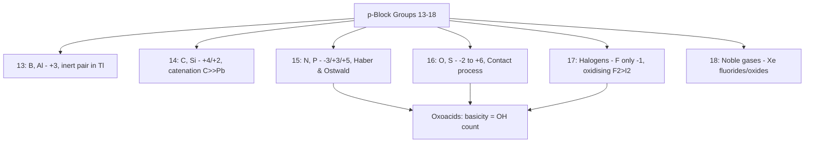

> All key reactions, periodic trends, structures and oxidation-state facts for p-Block Groups 13-18 and oxoacids - JEE Main & Advanced quick revision.

Last-minute revision sheet for the entire p-Block chapter (Groups 13-18 plus oxoacids). This is a **descriptive chapter**, so the emphasis is on key reactions, structures, periodic trends and oxidation-state facts rather than numerical formulas. Everything here is distilled from the chapter topic pages.

> **★ Key point · How to use this sheet**
>
> Scan the trend tables first, then the boxed headline reactions per group, then the structure/shape tables. The “Common Traps” callouts are the highest-yield exam savers.

## General Periodic Trends (All p-Block)

Valence configuration: $ns^2 np^{1-6}$. Across and down the block, the recurring trends are:

| Property | Down a group | Reason |
| --- | --- | --- |
| Atomic / ionic radius | Increases | Additional shells added |
| Ionization energy | Decreases | Increased shielding (exceptions: Ga > Al) |
| Electronegativity | Decreases | Nuclear attraction weakens |
| Metallic character | Increases | Non-metal $\rightarrow$ metalloid $\rightarrow$ metal |
| Stability of lower oxidation state | Increases | Inert pair effect |

> **★ Key point · Inert pair effect**
>
> Stability of the **lower** oxidation state increases down a group: Tl(+1) > Tl(+3); Pb(+2) > Pb(+4); Bi(+3) stable. The $ns^2$ pair becomes reluctant to participate in bonding.

## Group 13 - Boron Family (B, Al, Ga, In, Tl)

Configuration $ns^2 np^1$; common oxidation state **+3**, **+1** for Tl (inert pair).

| Trend | Direction | Note |
| --- | --- | --- |
| Ionization energy | Decreases down, but **Ga > Al** | d-block contraction / poor d-shielding in Ga |
| Metallic character | B is non-metal; Al, Ga, In, Tl metals |  |

### Borax and Boric Acid

$$\boxed{Na_2B_4O_7 + 7H_2O \rightarrow 2NaOH + 4H_3BO_3}$$

| Reaction | Equation |
| --- | --- |
| Borax hydrolysis (alkaline) | $Na_2B_4O_7 + 7H_2O \rightarrow 2NaOH + 4H_3BO_3$ |
| Borax bead (heating) | $Na_2B_4O_7 \xrightarrow{\Delta} 2NaBO_2 + B_2O_3$ |
| Bead colour | $B_2O_3 + CoO \rightarrow Co(BO_2)_2$ (blue bead) |
| Boric acid from borax | $Na_2B_4O_7 + 2HCl + 5H_2O \rightarrow 2NaCl + 4H_3BO_3$ |
| Boric acid as Lewis acid | $B(OH)_3 + 2H_2O \rightarrow [B(OH)_4]^- + H_3O^+$ |
| Heating boric acid | $H_3BO_3 \xrightarrow{373K} HBO_2 \xrightarrow{red\ heat} B_2O_3$ |
| Green-flame test | $H_3BO_3 + 3C_2H_5OH \rightarrow B(OC_2H_5)_3 + 3H_2O$ |

> **⚠ Trap · Common trap - boric acid**
>
> $H_3BO_3$ is a **monobasic Lewis acid** that accepts $OH^-$, NOT a Bronsted acid donating $H^+$ from its three OH groups.

### Diborane and Borazine

$$\boxed{B_2H_6 + 6H_2O \rightarrow 2B(OH)_3 + 6H_2}$$

| Reaction | Equation |
| --- | --- |
| Diborane preparation | $3NaBH_4 + 4BF_3 \rightarrow 2B_2H_6 + 3NaBF_4$ |
| Alternative prep | $2BF_3 + 6LiH \xrightarrow{450K} B_2H_6 + 6LiF$ |
| Hydrolysis | $B_2H_6 + 6H_2O \rightarrow 2B(OH)_3 + 6H_2$ |
| Combustion (rocket fuel) | $B_2H_6 + 3O_2 \rightarrow B_2O_3 + 3H_2O$ |
| Borazine (inorganic benzene) | $3B_2H_6 + 6NH_3 \rightarrow 2B_3N_3H_6 + 12H_2$ |

**Diborane structure:** 2 bridging H (3-centre-2-electron “banana” bonds) + 4 terminal H (normal 2c-2e bonds).

### Aluminium

| Reaction | Equation |
| --- | --- |
| Baeyer’s purification | $Al_2O_3{\cdot}2H_2O + 2NaOH \rightarrow 2NaAlO_2 + 3H_2O$ |
| With acid (amphoteric) | $2Al + 6HCl \rightarrow 2AlCl_3 + 3H_2$ |
| With base (amphoteric) | $2Al + 2NaOH + 2H_2O \rightarrow 2NaAlO_2 + 3H_2$ |
| Thermite | $Fe_2O_3 + 2Al \rightarrow 2Fe + Al_2O_3$ |

- **Ores:** Bauxite ($Al_2O_3{\cdot}2H_2O$), Corundum ($Al_2O_3$), Cryolite ($Na_3AlF_6$).
- **Extraction:** Hall-Heroult electrolysis. Cathode: $Al^{3+} + 3e^- \rightarrow Al$.
- **Passivation:** Al becomes passive in conc. $HNO_3$ (protective oxide layer).
- **AlCl₃** exists as the dimer $Al_2Cl_6$ (coordinate bonds); a Lewis acid (Friedel-Crafts catalyst).
- **Alum** general formula: $M_2SO_4{\cdot}M'_2(SO_4)_3{\cdot}24H_2O$ (e.g. potash alum $K_2SO_4{\cdot}Al_2(SO_4)_3{\cdot}24H_2O$).

**Diagonal relationship:** B resembles Si (both metalloids; acidic oxides $B_2O_3$, $SiO_2$; chlorides hydrolyse).

## Group 14 - Carbon Family (C, Si, Ge, Sn, Pb)

Configuration $ns^2 np^2$; oxidation states **+4, +2** (+2 more stable down the group).

$$\boxed{\text{Catenation: } C \gg Si > Ge > Sn > Pb}$$

| Property | Trend | Note |
| --- | --- | --- |
| Metallic character | C, Si non-metals; Ge metalloid; Sn, Pb metals |  |
| M-M bond strength | Decreases | C-C (348) > Si-Si (226) kJ/mol |
| Stable oxidation state | +4 for C; +2 for Pb | Inert pair effect |

### Allotropes of Carbon

| Allotrope | Hybridisation | Structure | Conductivity | C-C length |
| --- | --- | --- | --- | --- |
| Diamond | $sp^3$ | 3D network | Insulator | 154 pm |
| Graphite | $sp^2$ | 2D layers | Conductor | 141.5 pm (in plane), 335 pm layer gap |
| Fullerene ($C_{60}$) | $sp^2$ | Soccer ball (12 pentagons + 20 hexagons) | Poor |  |
| Graphene | $sp^2$ | Single graphite sheet | Excellent |  |

### Oxides of Carbon

| Reaction | Equation |
| --- | --- |
| CO lab prep | $HCOOH \xrightarrow{conc.\ H_2SO_4} CO + H_2O$ |
| Metal carbonyl | $Ni + 4CO \rightarrow Ni(CO)_4$ |
| $CO_2$ lab prep | $CaCO_3 + 2HCl \rightarrow CaCl_2 + H_2O + CO_2$ |
| Lime-water test | $CO_2 + Ca(OH)_2 \rightarrow CaCO_3 + H_2O$ |
| Excess $CO_2$ (clears) | $CaCO_3 + H_2O + CO_2 \rightarrow Ca(HCO_3)_2$ |
| Burns Mg | $CO_2 + 2Mg \rightarrow 2MgO + C$ |

- **CO is neutral** (toxic; binds Hb 300x stronger than $O_2$); **$CO_2$ is acidic** (linear, sp).

### Silicon Compounds

$$\boxed{SiCl_4 + 2H_2O \rightarrow SiO_2 + 4HCl} \qquad (CCl_4 \text{ does NOT hydrolyse})$$

| Reaction | Equation |
| --- | --- |
| Ultrapure Si | $SiCl_4 + 2H_2 \rightarrow Si + 4HCl$ (1000°C, then zone refining) |
| $SiO_2$ + base | $SiO_2 + 2NaOH \rightarrow Na_2SiO_3 + H_2O$ |
| HF attacks silica | $SiO_2 + 4HF \rightarrow SiF_4 + 2H_2O$ |
| $SiO_2$ + carbon | $SiO_2 + 2C \rightarrow Si + 2CO$ |
| Silicone monomer | $2CH_3Cl + Si \xrightarrow{Cu,\ 570K} (CH_3)_2SiCl_2$ |

- **Silicones (polysiloxanes):** Si-O backbone with R groups; water-repellent, heat-resistant; general $R_2SiO$.
- **Silicates:** basic unit $SiO_4^{4-}$ tetrahedron. Sharing of 0/1/2/2/3/4 corners gives ortho / pyro / cyclic / chain / sheet / 3D-network silicates.
- **Zeolites:** 3D aluminosilicates ($SiO_4$ + $AlO_4$); molecular sieves, ion-exchange water softeners.
- **Why $SiCl_4$ hydrolyses, $CCl_4$ doesn’t:** Si has vacant d-orbitals (can expand octet); C has none.

### Tin and Lead

| Reaction | Equation |
| --- | --- |
| $PbI_2$ yellow ppt test | $Pb(NO_3)_2 + 2KI \rightarrow PbI_2 + 2KNO_3$ |
| $PbO_2$ oxidation | $PbO_2 + 4HCl \rightarrow PbCl_2 + Cl_2 + 2H_2O$ |

- **Tin pest:** $\beta$-Sn $\rightarrow$ $\alpha$-Sn below 13.2°C.
- Lead oxides: PbO (litharge, amphoteric), $Pb_3O_4$ (red lead), $PbO_2$ (strong oxidiser).

## Group 15 - Nitrogen Family (N, P, As, Sb, Bi)

Configuration $ns^2 np^3$; oxidation states **-3, +3, +5**. Hydride basicity: $NH_3 > PH_3 > AsH_3 > SbH_3 > BiH_3$.

### Dinitrogen and Ammonia

$$\boxed{N \equiv N \text{ bond energy} = 946\ \text{kJ/mol (very unreactive)}}$$

$$\boxed{N_2 + 3H_2 \underset{Fe}{\overset{450°C,\ 200\ atm}{\rightleftharpoons}} 2NH_3 \qquad \Delta H = -92\ \text{kJ/mol}}$$

| Reaction | Equation |
| --- | --- |
| $N_2$ lab prep | $NH_4Cl + NaNO_2 \rightarrow N_2 + 2H_2O + NaCl$ |
| Haber process | $N_2 + 3H_2 \rightleftharpoons 2NH_3$ (Fe + $K_2O$, $Al_2O_3$ promoters) |
| $NH_3$ lab prep | $2NH_4Cl + Ca(OH)_2 \rightarrow CaCl_2 + 2H_2O + 2NH_3$ |
| $NH_3$ + HCl (white fumes) | $NH_3 + HCl \rightarrow NH_4Cl$ |
| Reducing | $2NH_3 + 3CuO \rightarrow 3Cu + N_2 + 3H_2O$ |
| Complex (deep blue) | $CuSO_4 + 4NH_3 \rightarrow [Cu(NH_3)_4]SO_4$ |

- **$NH_3$ structure:** pyramidal, $sp^3$, bond angle **107°**, $\mu = 1.46$ D, $K_b = 1.8\times10^{-5}$.

### Oxides of Nitrogen

| Oxide | N state | Colour | Nature |
| --- | --- | --- | --- |
| $N_2O$ | +1 | Colourless | Neutral |
| NO | +2 | Colourless | Neutral (paramagnetic) |
| $N_2O_3$ | +3 | Blue | Acidic |
| $NO_2$ | +4 | Brown | Acidic (paramagnetic) |
| $N_2O_4$ | +4 | Colourless | Acidic |
| $N_2O_5$ | +5 | White solid | Acidic |

- $2NO + O_2 \rightarrow 2NO_2$; $\;2NO_2 \rightleftharpoons N_2O_4$ (dimerisation on cooling).

### Nitric Acid (Ostwald Process)

$$\boxed{4NH_3 + 5O_2 \xrightarrow{Pt-Rh,\ 800°C} 4NO + 6H_2O}$$

| Step | Equation |
| --- | --- |
| Ostwald 1 | $4NH_3 + 5O_2 \rightarrow 4NO + 6H_2O$ |
| Ostwald 2 | $2NO + O_2 \rightarrow 2NO_2$ |
| Ostwald 3 | $4NO_2 + O_2 + 2H_2O \rightarrow 4HNO_3$ |
| Cu + dil. $HNO_3$ | $3Cu + 8HNO_3 \rightarrow 3Cu(NO_3)_2 + 2NO + 4H_2O$ |
| Cu + conc. $HNO_3$ | $Cu + 4HNO_3 \rightarrow Cu(NO_3)_2 + 2NO_2 + 2H_2O$ |
| Aqua regia (3:1 HCl:$HNO_3$) | $Au + 4HCl + HNO_3 \rightarrow HAuCl_4 + NO + 2H_2O$ |
| Ring test | $NO + [Fe(H_2O)_6]^{2+} \rightarrow [Fe(H_2O)_5(NO)]^{2+} + H_2O$ (brown ring) |

> **⚠ Trap · Common traps - HNO₃**
>
> Dilute $HNO_3$ $\rightarrow$ **NO**; concentrated $\rightarrow$ **$NO_2$**; very dilute with Zn $\rightarrow$ $N_2O$ / $NH_4NO_3$.
>
> Passivation by conc. $HNO_3$: only **Fe, Al, Cr** (NOT Mg, Mn).
>
> Aqua regia ratio is **3 HCl : 1 $HNO_3$**.

### Phosphorus

$$\boxed{2Ca_3(PO_4)_2 + 6SiO_2 + 10C \xrightarrow{1775K} P_4 + 6CaSiO_3 + 10CO}$$

| Property | White $P_4$ | Red P |
| --- | --- | --- |
| Structure | Tetrahedral $P_4$ (angle 60°) | Polymeric chain |
| Reactivity | Very reactive, pyrophoric | Less reactive |
| Ignition | 35°C | 260°C |
| Toxicity | Poisonous | Non-poisonous |
| Storage | Under water | Open air |

- White $\rightarrow$ Red: $P_4(white) \xrightarrow{573K} P(red)$ (inert atmosphere). Black P is most stable, a conductor.

### Phosphine and Phosphorus Oxides

| Reaction | Equation |
| --- | --- |
| $PH_3$ lab prep | $P_4 + 3NaOH + 3H_2O \rightarrow PH_3 + 3NaH_2PO_2$ |
| Pure $PH_3$ | $Ca_3P_2 + 6H_2O \rightarrow 3Ca(OH)_2 + 2PH_3$ |
| $P_4O_6$ | $P_4 + 3O_2 \rightarrow P_4O_6$ |
| $P_4O_{10}$ | $P_4 + 5O_2 \rightarrow P_4O_{10}$ |
| $P_4O_{10}$ dehydration | $4HNO_3 + P_4O_{10} \rightarrow 2N_2O_5 + 4HPO_3$ |

- **$PH_3$ structure:** pyramidal, bond angle **93.5°** (less than $NH_3$); less basic than $NH_3$. $P_4O_{10}$ is an excellent dehydrating agent.

## Group 16 - Oxygen Family / Chalcogens (O, S, Se, Te, Po)

Configuration $ns^2 np^4$; oxidation states **-2, +2, +4, +6**. Hydride acidity: $H_2O < H_2S < H_2Se < H_2Te$.

> **★ Key point · Two key exceptions**
>
> Electron gain enthalpy of **S is more negative than O** (small O, e⁻-e⁻ repulsion). $O_2$ is **paramagnetic** (2 unpaired e⁻ in $\pi^*$); $O_3$ is diamagnetic.

### Dioxygen and Oxides

| Reaction | Equation |
| --- | --- |
| $O_2$ lab prep | $2KClO_3 \xrightarrow{MnO_2} 2KCl + 3O_2$ |
| Peroxide + water | $Na_2O_2 + 2H_2O \rightarrow 2NaOH + H_2O_2$ |
| Superoxide + water | $2KO_2 + 2H_2O \rightarrow 2KOH + H_2O_2 + O_2$ |

| Oxide type | O state | Example |
| --- | --- | --- |
| Normal oxide | -2 | $Na_2O$ |
| Peroxide | -1 | $Na_2O_2$ |
| Superoxide | -1/2 | $KO_2$ |

### Ozone

$$\boxed{3O_2 \xrightarrow{\text{silent electric discharge}} 2O_3 \qquad \Delta H = +142\ \text{kJ/mol}}$$

- **Structure:** bent, $sp^2$, bond angle **117°**, bond length 128 pm, resonance hybrid.
- Detection: $3Hg + O_3 \rightarrow 3HgO$. Ozonolysis cleaves C=C.
- **O₃ bleaches permanently (oxidation); SO₂ bleaches temporarily (reduction).**

### Sulfur and H₂S

- Allotropes: Rhombic ($\alpha$-S) $\rightleftharpoons$ Monoclinic ($\beta$-S) at transition **369 K**; both are $S_8$ puckered rings.

| Reaction | Equation |
| --- | --- |
| $H_2S$ lab prep | $FeS + 2HCl \rightarrow FeCl_2 + H_2S$ |
| $H_2S$ reducing | $H_2S + Cl_2 \rightarrow 2HCl + S$ |
| With $SO_2$ | $2H_2S + SO_2 \rightarrow 3S + 2H_2O$ |
| Black ppt (QA) | $H_2S + CuSO_4 \rightarrow CuS\downarrow + H_2SO_4$ |

- **$H_2S$ structure:** bent, angle 92°; **more acidic than $H_2O$** ($K_{a1}\approx 10^{-7}$ vs $K_w = 10^{-14}$).

### Oxides of Sulfur and Contact Process

$$\boxed{2SO_2 + O_2 \underset{V_2O_5}{\overset{450°C,\ 2\ atm}{\rightleftharpoons}} 2SO_3}$$

| Step | Equation |
| --- | --- |
| Burn S | $S + O_2 \rightarrow SO_2$ (or $4FeS_2 + 11O_2 \rightarrow 2Fe_2O_3 + 8SO_2$) |
| Oxidation (key) | $2SO_2 + O_2 \rightleftharpoons 2SO_3$ |
| Absorption (NOT direct water) | $SO_3 + H_2SO_4 \rightarrow H_2S_2O_7$ |
| Dilution | $H_2S_2O_7 + H_2O \rightarrow 2H_2SO_4$ |
| $SO_2$ lab prep | $Na_2SO_3 + H_2SO_4 \rightarrow Na_2SO_4 + H_2O + SO_2$ |

- $SO_2$: bent, angle 119°, $sp^2$; $SO_3$: planar triangular, angle 120°, $sp^2$.

### Sulfuric Acid

| Behaviour | Equation |
| --- | --- |
| Dehydration | $C_{12}H_{22}O_{11} \xrightarrow{conc.\ H_2SO_4} 12C + 11H_2O$ |
| Oxidation | $Cu + 2H_2SO_4(conc) \rightarrow CuSO_4 + SO_2 + 2H_2O$ |
| Oxidises HBr | $2HBr + H_2SO_4(conc) \rightarrow Br_2 + SO_2 + 2H_2O$ |

> **⚠ Trap · Common trap - H₂SO₄**
>
> Conc. $H_2SO_4$ **cannot** prepare HBr / HI (it oxidises them to $Br_2$ / $I_2$); use non-oxidising $H_3PO_4$. Cold conc. $H_2SO_4$ passivates Fe and Al.

## Group 17 - Halogens (F, Cl, Br, I, At)

Configuration $ns^2 np^5$; oxidation states **-1, +1, +3, +5, +7** (F only **-1**).

| Trend | Order |
| --- | --- |
| Oxidising power / reactivity | $F_2 > Cl_2 > Br_2 > I_2$ |
| Bond dissociation energy | $Cl{-}Cl > Br{-}Br > F{-}F > I{-}I$ |
| Electron gain enthalpy | $Cl > F$ (F anomaly) |
| Electronegativity | F (4.0) > Cl (3.0) > Br (2.8) > I (2.5) |

$$\boxed{\text{Displacement: more reactive halogen displaces less reactive: } Cl_2 + 2Br^- \rightarrow 2Cl^- + Br_2}$$

### Chlorine and Bleaching Powder

| Reaction | Equation |
| --- | --- |
| $Cl_2$ lab prep | $4HCl + MnO_2 \xrightarrow{\Delta} MnCl_2 + 2H_2O + Cl_2$ |
| $Cl_2$ industrial (brine) | $2NaCl + 2H_2O \xrightarrow{electrolysis} 2NaOH + Cl_2 + H_2$ |
| With water (disproportionation) | $Cl_2 + H_2O \rightleftharpoons HCl + HOCl$ |
| Cold dil. NaOH (+1) | $Cl_2 + 2NaOH \rightarrow NaCl + NaOCl + H_2O$ |
| Hot conc. NaOH (+5) | $3Cl_2 + 6NaOH \rightarrow 5NaCl + NaClO_3 + 3H_2O$ |
| Bleaching powder | $Ca(OH)_2 + Cl_2 \rightarrow CaOCl_2 + H_2O$ |

- Bleaching powder $\approx CaOCl_2$ (chlorinated lime); $CaOCl_2 + 2HCl \rightarrow CaCl_2 + H_2O + Cl_2$.

### HF and Hydrogen Halides

| Property | HF | HCl | HBr | HI |
| --- | --- | --- | --- | --- |
| Boiling point | 293 K | 189 K | 206 K | 238 K |
| Bond strength (kJ/mol) | 574 | 431 | 366 | 299 |
| Acidic strength | Weakest | $\rightarrow$ | $\rightarrow$ | Strongest |
| Reducing power | None | Weak | Moderate | Strong |

$$\boxed{\text{Acidic strength: } HF < HCl < HBr < HI}$$

| Prep | Equation |
| --- | --- |
| HF / HCl | $NaX + H_2SO_4(conc) \rightarrow NaHSO_4 + HX$ |
| HBr / HI (use $H_3PO_4$) | $NaBr + H_3PO_4 \rightarrow NaH_2PO_4 + HBr$ |
| F₂ (only electrolysis) | $2KHF_2 \xrightarrow{electrolysis} 2KF + H_2 + F_2$ |
| HF + glass | $SiO_2 + 4HF \rightarrow SiF_4 + 2H_2O$ |

> **⚠ Trap · HF paradox**
>
> HF is the **weakest** acid among HX (extensive H-bonding makes ionisation difficult) despite F being most electronegative. HF is stored in wax/plastic, never glass.

### Iodine and Interhalogens

| Reaction | Equation |
| --- | --- |
| Iodometry | $I_2 + 2Na_2S_2O_3 \rightarrow 2NaI + Na_2S_4O_6$ |
| Starch test | $Starch + I_2 \rightarrow$ blue-black complex |
| Triiodide | $I_2 + I^- \rightarrow I_3^-$ |

**Interhalogens** $XX'_n$ ($n = 1,3,5,7$); X is the larger, less electronegative central atom.

| Compound | Hybridisation | Shape |
| --- | --- | --- |
| $ClF_3$ | $sp^3d$ | T-shaped |
| $IF_5$ | $sp^3d^2$ | Square pyramidal |
| $IF_7$ | $sp^3d^3$ | Pentagonal bipyramidal |

## Group 18 - Noble Gases (He, Ne, Ar, Kr, Xe, Rn)

Configuration $ns^2 np^6$ (He: $1s^2$); **positive electron gain enthalpy** (all). Reactivity: $Xe > Kr$ only.

- IE order: He (2372) > Ne (2081) > Ar (1521) > Kr (1351) > Xe (1170) kJ/mol.
- Bartlett (1962): first noble gas compound $Xe^+[PtF_6]^-$ (since IE of Xe $\approx$ IE of $O_2$, 1170 $\approx$ 1175).

### Xenon Fluorides

$$\boxed{Xe + nF_2 \rightarrow XeF_{2n}} \quad (XeF_2: 673K,\ 1{:}1;\ XeF_4: 673K, 6\ atm, 1{:}2;\ XeF_6: 573K, 60\ atm, 1{:}5)$$

| Compound | Hybridisation | Shape | Lone pairs |
| --- | --- | --- | --- |
| $XeF_2$ | $sp^3d$ | Linear | 3 |
| $XeF_4$ | $sp^3d^2$ | Square planar | 2 |
| $XeF_6$ | $sp^3d^3$ | Distorted octahedral | 1 |
| $XeO_3$ | $sp^3$ | Trigonal pyramidal | 1 |
| $XeOF_4$ | $sp^3d^2$ | Square pyramidal | 1 |
| $XeO_4$ | $sp^3$ | Tetrahedral | 0 |

| Hydrolysis | Equation |
| --- | --- |
| $XeF_2$ | $2XeF_2 + 2H_2O \rightarrow 2Xe + 4HF + O_2$ |
| $XeF_4$ | $6XeF_4 + 12H_2O \rightarrow 4Xe + 2XeO_3 + 24HF + 3O_2$ |
| $XeF_6$ (complete) | $XeF_6 + 3H_2O \rightarrow XeO_3 + 6HF$ |
| $XeF_6$ (partial) | $XeF_6 + H_2O \rightarrow XeOF_4 + 2HF$ |

- Only **F** forms stable Xe compounds (most electronegative). $XeO_3$ and $XeO_4$ are explosive.

## Oxoacids - Acidity and Basicity Rules

> **★ Key point · The three master rules**
>
> **More O atoms / higher oxidation state $\rightarrow$ stronger acid** (same central atom).
>
> **Smaller / more electronegative central atom $\rightarrow$ stronger acid** (same number of O).
>
> **Basicity = number of OH groups only** - a P-H bond does NOT ionise.

### Halogen Oxoacids (Cl example)

| Acid | Cl state | $pK_a$ | Strength |
| --- | --- | --- | --- |
| HOCl | +1 | 7.5 | Weakest |
| $HClO_2$ | +3 | 2 | Weak |
| $HClO_3$ | +5 | -1 | Strong |
| $HClO_4$ | +7 | -10 | Strongest |

$$\boxed{\text{Acidity: } HOCl < HClO_2 < HClO_3 < HClO_4 \qquad \text{Oxidising power: reverse}}$$

- $HClO_4$ is the strongest common acid. Periodic acid exists as $HIO_4$ (meta) and $H_5IO_6$ (para, pentabasic, cleaves 1,2-diols).

### Nitrogen Oxoacids

| Acid | N state | $pK_a$ | Note |
| --- | --- | --- | --- |
| $H_2N_2O_2$ | +1 | - | Hyponitrous, unstable |
| $HNO_2$ | +3 | 3.3 | Both oxidising & reducing; $3HNO_2 \rightarrow HNO_3 + 2NO + H_2O$ |
| $HNO_3$ | +5 | -1.4 | Strong acid, only oxidising |

### Sulfur Oxoacids

| Acid | Formula | S state | Basicity |
| --- | --- | --- | --- |
| Sulfurous | $H_2SO_3$ | +4 | Dibasic (unstable) |
| Sulfuric | $H_2SO_4$ | +6 | Dibasic (strong) |
| Thiosulfuric | $H_2S_2O_3$ | +2 (avg) | Dibasic |
| Peroxodisulfuric | $H_2S_2O_8$ | +6 | Dibasic (peroxy -O-O-) |
| Pyrosulfuric (oleum) | $H_2S_2O_7$ | +6 | Dibasic |

- Sodium thiosulfate “hypo” $Na_2S_2O_3{\cdot}5H_2O$: $Na_2SO_3 + S \rightarrow Na_2S_2O_3$; photo fixer $AgBr + 2Na_2S_2O_3 \rightarrow Na_3[Ag(S_2O_3)_2] + NaBr$.

### Phosphorus Oxoacids

$$\boxed{\text{Basicity counts OH groups: } H_3PO_2 \text{ (mono)},\ H_3PO_3 \text{ (di)},\ H_3PO_4 \text{ (tri)}}$$

| Acid | Formula | P state | P-H bonds | Basicity | Reducing |
| --- | --- | --- | --- | --- | --- |
| Hypophosphorous | $H_3PO_2$ | +1 | 2 | Monobasic | Strong |
| Phosphorous | $H_3PO_3$ | +3 | 1 | Dibasic | Moderate |
| Orthophosphoric | $H_3PO_4$ | +5 | 0 | Tribasic | None |
| Pyrophosphoric | $H_4P_2O_7$ | +5 | 0 | Tetrabasic | None |
| Metaphosphoric | $HPO_3$ | +5 | 0 | Monobasic (per unit) | None |

- Disproportionation on heating: $4H_3PO_3 \rightarrow 3H_3PO_4 + PH_3$ and $3H_3PO_2 \rightarrow 2H_3PO_3 + PH_3$.

## High-Yield Memory Map



## One-Glance Trap List

> **↗ Connection · Last-minute trap sweep**
>
> $H_3BO_3$ = Lewis acid (accepts $OH^-$), monobasic.
>
> $AlCl_3$ = $Al_2Cl_6$ dimer.
>
> $SiCl_4$ hydrolyses, $CCl_4$ does not (d-orbitals).
>
> CO neutral, $CO_2$ acidic; graphite is $sp^2$ (conductor).
>
> Dilute $HNO_3 \rightarrow$ NO; conc. $\rightarrow NO_2$; passivates only Fe/Al/Cr; aqua regia 3:1.
>
> $H_3PO_3$ dibasic (not tribasic); $O_2$ paramagnetic; $H_2S$ more acidic than $H_2O$.
>
> HF weakest HX acid (H-bonding); F shows only -1; bond energy $Cl_2 > F_2$.
>
> $XeF_2$ linear, $XeF_4$ square planar; noble gases have positive $\Delta_{eg}H$.
>
> Oxoacid acidity: $HClO_4 > HOCl$, but oxidising power: $HOCl > HClO_4$.

---

*Related: [Group 13](../group-13/index.md) | [Group 14](../group-14/index.md) | [Group 15](../group-15/index.md) | [Group 16](../group-16/index.md) | [Group 17](../group-17/index.md) | [Group 18](../group-18/index.md) | [Oxoacids](../oxoacids/index.md)*

From TestGuru · our mock-test platform

## You've read p-Block Elements Formula Sheet.You've read this topic. Find out what you actually got.

A free JEE Main mock with this chapter in it, and a report that shows which sub-topics cost you marks.

[Take a free JEE Main mock →](https://app.testguru.co/signup?tg_chapter=p-block-elements&tg_exam=jee-main&tg_page=%2Fchemistry%2Fp-block-elements%2Fformula-sheet%2F&tg_subject=chemistry&utm_campaign=notes-jee-main-free-test&utm_content=article-end&utm_medium=referral&utm_source=jeenotes)
Free, no card. Opens TestGuru in a new tab.

## Stay exam-ready

One email every Sunday: new notes, the week's hardest challenge question and a revision plan.One email every Sunday.

## Comments

Have a question or spotted a mistake? Join the discussion below.

Advertisement

Advertisement

---

## Extracted page code (interactive scripts & widgets)


### inline-script-14

```js
(function(){var t,e=document.getElementById("disqus-load");if(!e)return;t=!1,e.addEventListener("click",function(){if(t)return;t=!0,e.setAttribute("disabled","disabled"),e.textContent="Loading comments…",window.disqus_config=function(){this.page.url="https://jeenotes.in/chemistry/p-block-elements/formula-sheet/",this.page.identifier="/chemistry/p-block-elements/formula-sheet/"};var s=document,n=s.createElement("script");n.src="https://https-jeenotes-in.disqus.com/embed.js",n.setAttribute("data-timestamp",+new Date),n.onload=function(){e.style.display="none"},n.onerror=function(){t=!1,e.removeAttribute("disabled"),e.textContent="Could not load comments. Tap to retry"},(s.head||s.body).appendChild(n)})})()
```


### inline-script-15

```js
(function(){var t,e=document.currentScript.previousElementSibling;function n(){(window.adsbygoogle=window.adsbygoogle||[]).push({})}if(!window.ResizeObserver||e.clientWidth>0){n();return}t=new ResizeObserver(function(){e.clientWidth>0&&(t.disconnect(),n())}),t.observe(e)})()
```


---

_Source: [https://jeenotes.in/chemistry/p-block-elements/formula-sheet/](https://jeenotes.in/chemistry/p-block-elements/formula-sheet/) · raw HTML: `offline/chemistry/p-block-elements/formula-sheet/index.html`_
