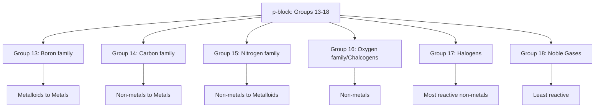

> Master the overview of p-block elements, groups 13-18, their properties, trends, and importance for JEE Chemistry.

## The Hook: Why is Life Possible?

> **★ Key point · Connect: The Avengers of Chemistry**
>
> In *Avengers: Endgame*, the team needed diverse heroes - each with unique powers. Iron Man’s tech, Thor’s lightning, Hulk’s strength - together they saved the universe.
>
> Similarly, p-block elements are the **most diverse group** in the periodic table! They include:
>
> - **Metals** (Al, Ga, Sn, Pb)

> - **Non-metals** (C, N, O, F, Cl)

> - **Metalloids** (B, Si, Ge, As)

> - **Noble gases** (He, Ne, Ar, Kr, Xe)

> - **Halogens** (F, Cl, Br, I)
>
> These elements make life possible! Carbon (basis of life), Nitrogen (in proteins), Oxygen (we breathe), Chlorine (disinfects water). Understanding p-block = understanding chemistry itself!

---

## The Core Concept: What is p-block?

### Definition

**p-block elements** are those in which the **last electron enters a p orbital**.

$$\boxed{\text{Valence configuration: } ns^2 np^{1-6}}$$

### Interactive Demo: Explore p-Block Elements

See the diversity and properties of p-block elements on the periodic table.

### Position in Periodic Table

**Groups 13 to 18** (6 groups, 36 elements in main periodic table + more in extended)



**In simple terms:** p-block is like a chemistry buffet - it has everything! From unreactive noble gases to super-reactive halogens, from life-giving oxygen to toxic arsenic. The variety is incredible!

---

## Overview of p-block Groups

### Group 13: Boron Family (Icosagens)

**Elements:** B, Al, Ga, In, Tl

**Valence configuration:** ns² np¹

**Key features:**

- Shows **+3 and +1** oxidation states
- Inert pair effect increases down the group
- B is metalloid, rest are metals
- Al is most important (amphoteric)

**Important compounds:**

- Borax (Na₂B₄O₇·10H₂O)
- Boric acid (H₃BO₃)
- Aluminum oxide (Al₂O₃)

### Group 14: Carbon Family (Crystallogens)

**Elements:** C, Si, Ge, Sn, Pb

**Valence configuration:** ns² np²

**Key features:**

- Shows **+4 and +2** oxidation states
- Catenation (C » Si > Ge > Sn > Pb)
- Non-metal (C, Si) to metal (Sn, Pb) transition
- Most important group for organic chemistry!

**Important compounds:**

- CO₂, CO (carbon oxides)
- SiO₂ (silica, quartz)
- CCl₄ (carbon tetrachloride)

### Group 15: Nitrogen Family (Pnictogens)

**Elements:** N, P, As, Sb, Bi

**Valence configuration:** ns² np³

**Key features:**

- Shows **-3 to +5** oxidation states
- Non-metal (N, P) to metal (Bi) transition
- N₂ very stable (triple bond)
- Allotropy common (P has white, red, black)

**Important compounds:**

- NH₃ (ammonia)
- HNO₃ (nitric acid)
- H₃PO₄ (phosphoric acid)

### Group 16: Oxygen Family (Chalcogens)

**Elements:** O, S, Se, Te, Po

**Valence configuration:** ns² np⁴

**Key features:**

- Shows **-2 to +6** oxidation states
- O and S are most important
- High electronegativity (especially O)
- Allotropy (O₂/O₃, multiple forms of S)

**Important compounds:**

- H₂O (water - most important!)
- H₂SO₄ (sulfuric acid - king of chemicals)
- SO₂, SO₃ (sulfur oxides)

### Group 17: Halogens (Salt Formers)

**Elements:** F, Cl, Br, I, At

**Valence configuration:** ns² np⁵

**Key features:**

- Most reactive non-metals
- Shows **-1 to +7** oxidation states (except F: only -1)
- Strong oxidizing agents
- Reactivity: F > Cl > Br > I

**Important compounds:**

- HCl, HF, HBr, HI (hydrogen halides)
- NaCl (common salt)
- Bleaching powder (Ca(OCl)₂)

### Group 18: Noble Gases (Inert Gases)

**Elements:** He, Ne, Ar, Kr, Xe, Rn

**Valence configuration:** ns² np⁶ (except He: 1s²)

**Key features:**

- Most stable (complete octet)
- Extremely unreactive (except Xe, Kr can form compounds)
- Monatomic gases
- Very low boiling points

**Important compounds:**

- XeF₂, XeF₄, XeF₆ (xenon fluorides)
- XeO₃, XeO₄ (xenon oxides)

> **★ Key point · Memory Trick: p-block Groups**
>
> **“Boy Can Now Play Soccer Happily”**
>
> - **B**oron family (13)

> - **C**arbon family (14)

> - **N**itrogen family (15)

> - **P**lay = Oxygen family (16) - P for “Puff” oxygen!

> - **S**occer = Halogens (17) - **S**alt formers

> - **H**appily = Noble gases (18) - **H**appy (stable, inert)
>
> Or simply: **13-14-15-16-17-18** = **B-C-N-O-F-Ne** (first elements)

---

## General Trends in p-block

### Physical Properties

#### Across a Period (→)

| Property | Trend | Example (Period 3) |
| --- | --- | --- |
| **Atomic radius** | Decreases | Al > Si > P > S > Cl > Ar |
| **Ionization energy** | Increases | Al < Si < P < S < Cl < Ar |
| **Electronegativity** | Increases | Al < Si < P < S < Cl |
| **Metallic character** | Decreases | Al (metal) → Cl (non-metal) |

#### Down a Group (↓)

| Property | Trend | Example (Group 14) |
| --- | --- | --- |
| **Atomic radius** | Increases | C < Si < Ge < Sn < Pb |
| **Ionization energy** | Decreases | C > Si > Ge > Sn > Pb |
| **Electronegativity** | Decreases | C > Si > Ge > Sn > Pb |
| **Metallic character** | Increases | C (non-metal) → Pb (metal) |

### Chemical Properties

#### Oxidation States

**Maximum oxidation state** = Group number - 10

| Group | Max O.S. | Example |
| --- | --- | --- |
| 13 | +3 | Al³⁺, B³⁺ |
| 14 | +4 | C⁴⁺, Si⁴⁺, Pb⁴⁺ |
| 15 | +5 | N⁵⁺, P⁵⁺ |
| 16 | +6 | S⁶⁺, Se⁶⁺ |
| 17 | +7 | Cl⁷⁺, I⁷⁺ (F only -1) |
| 18 | +8 | Xe⁸⁺ (rare) |

**Minimum oxidation state:**

- Group 15: -3 (needs 3 electrons)
- Group 16: -2 (needs 2 electrons)
- Group 17: -1 (needs 1 electron)
- Group 18: 0 (complete octet, doesn’t need)

> **◐ In simple terms · Inert Pair Effect**
>
> **Down the group:** Lower oxidation states become more stable
>
> **Example in Group 14:**
>
> - C, Si: Prefer +4

> - Ge: Both +4 and +2

> - Sn: Both +4 and +2

> - Pb: **Prefers +2** (inert pair effect)
>
> **Why?** ns² electrons become harder to remove (more stable) as we go down.
>
> **Result:** Tl⁺ (not Tl³⁺), Pb²⁺ (not Pb⁴⁺), Bi³⁺ (not Bi⁵⁺) are more stable

---

## Important Concepts in p-block

### 1. Inert Pair Effect

**Definition:** Reluctance of s² electrons to participate in bonding as we go down the group.

**Reason:**

- Poor shielding by d and f electrons
- s² electrons held more tightly
- Preference for lower oxidation state

**Examples:**

- Tl⁺ more stable than Tl³⁺
- Pb²⁺ more stable than Pb⁴⁺
- Bi³⁺ more stable than Bi⁵⁺

### 2. Catenation

**Definition:** Ability of an element to form chains with itself.

**Order:** C » Si > Ge > Sn > Pb

**Why carbon is king?**

- Strong C-C bond (348 kJ/mol)
- Small size → effective overlap
- Basis of organic chemistry!

**Comparison:**

- C-C: 348 kJ/mol (very strong)
- Si-Si: 226 kJ/mol (weaker)
- Ge-Ge: 188 kJ/mol (much weaker)

### 3. Allotropy

**Definition:** Existence of an element in more than one physical form.

**Common examples:**

| Element | Allotropes |
| --- | --- |
| **Carbon** | Diamond, Graphite, Fullerene (C₆₀), Graphene |
| **Phosphorus** | White (P₄), Red, Black |
| **Sulfur** | Rhombic (α-S), Monoclinic (β-S) |
| **Oxygen** | O₂ (dioxygen), O₃ (ozone) |

### 4. Diagonal Relationship

**B ~ Si** (Boron and Silicon)

| Property | B | Si | Similarity |
| --- | --- | --- | --- |
| **Oxide nature** | B₂O₃ weakly acidic | SiO₂ acidic | Both acidic |
| **Chloride hydrolysis** | BCl₃ hydrolyzes | SiCl₄ hydrolyzes | Both react with H₂O |
| **Halide nature** | Covalent | Covalent | Not ionic |
| **Polymeric structures** | Forms chains | Forms chains | Similar bonding |

---

## Metallic to Non-metallic Character

### The Transition

**Across a period (→):** Metal → Metalloid → Non-metal

**Example (Period 3):**

- **Na, Mg** (s-block): Metals
- **Al** (Group 13): Metal (but amphoteric)
- **Si** (Group 14): Metalloid
- **P, S, Cl** (Groups 15-17): Non-metals
- **Ar** (Group 18): Noble gas (non-metal)

**Down a group (↓):** Non-metal → Metalloid → Metal

**Example (Group 14):**

- **C** (Diamond, Graphite): Non-metal
- **Si** (Silicon): Metalloid
- **Ge** (Germanium): Metalloid
- **Sn** (Tin): Metal
- **Pb** (Lead): Metal

### Metalloid Elements

**The “in-between” elements:**

- **B** (Boron) - Group 13
- **Si** (Silicon) - Group 14
- **Ge** (Germanium) - Group 14
- **As** (Arsenic) - Group 15
- **Sb** (Antimony) - Group 15
- **Te** (Tellurium) - Group 16

**Properties:**

- Intermediate between metals and non-metals
- Semiconductors (important for electronics!)
- Both metallic and non-metallic properties

> **★ Key point · Memory Trick: Metalloids**
>
> **“Boron Si-Ge As Santa’s Big Tent”**
>
> - **B** (Boron)

> - **Si** (Silicon)

> - **Ge** (Germanium)

> - **As** (Arsenic)

> - **Sb** (Antimony) - “Santa’s Big”

> - **Te** (Tellurium) - “Tent”
>
> Only **6 metalloids** - memorize them!

---

## Anomalous Behavior of First Elements

### Why First Elements are Different

**Reasons:**

1. **Smallest size** in the group
2. **Absence of d orbitals** (only 2s, 2p available)
3. **High electronegativity**
4. **Strong tendency to form pπ-pπ multiple bonds**

### Examples of Anomalies

#### Boron (Group 13)

- Only non-metal in the group
- Forms electron-deficient compounds (BCl₃)
- Cannot form [BF₆]³⁻ (no d orbitals)

#### Carbon (Group 14)

- Forms stable pπ-pπ bonds (C=C, C≡C)
- Maximum catenation
- Doesn’t form higher coordination compounds

#### Nitrogen (Group 15)

- N₂ extremely stable (triple bond)
- Cannot expand octet (no d orbitals)
- Forms pπ-pπ bonds (N=N, N=O)
- Doesn’t form NCl₅ (unlike PCl₅)

#### Oxygen (Group 16)

- O₂ paramagnetic (unique!)
- Forms O=O (ozone possible)
- Cannot expand octet
- Doesn’t form OF₆ (unlike SF₆)

#### Fluorine (Group 17)

- Most electronegative (4.0)
- Only -1 oxidation state (no positive O.S.)
- Doesn’t form interhalogen with higher halogens as central atom
- Forms only one oxoacid (HOF)

> **★ Key point · No d-orbitals Rule**
>
> **Period 2 elements (B, C, N, O, F) CANNOT:**
>
> - Expand octet beyond 8 electrons

> - Form compounds with coordination number > 4

> - Use d orbitals for bonding
>
> **Examples:**
>
> - N cannot form NCl₅ (but P can form PCl₅)

> - O cannot form OF₆ (but S can form SF₆)

> - F cannot show positive oxidation states
>
> **Why?** No d orbitals available in valence shell (only 2s and 2p)!

---

## Important Trends and Comparisons

### Acidic/Basic Character of Oxides

**Across a period (→):** Basic → Amphoteric → Acidic

**Example (Period 3):**

- Na₂O, MgO: **Basic** oxides
- Al₂O₃: **Amphoteric** (reacts with both acid and base)
- SiO₂: **Weakly acidic**
- P₄O₁₀, SO₃, Cl₂O₇: **Acidic** oxides

**Down a group (↓):** Acidic character decreases

**Example (Group 14):**

- CO₂: Acidic
- SiO₂: Weakly acidic
- GeO₂: Amphoteric
- SnO₂, PbO₂: Amphoteric to basic

### Hydride Stability

**Across a period (→):** Stability decreases (bond strength decreases)

**Example:**

- CH₄ > NH₃ > H₂O > HF (bond strength)
- But all are stable!

**Down a group (↓):** Stability decreases

**Example (Group 15):**

- NH₃ > PH₃ > AsH₃ > SbH₃ > BiH₃
- NH₃ is very stable, BiH₃ decomposes easily

**Why?** Bond strength decreases as atomic size increases

### Halide Formation

**All p-block elements form halides!**

**Common patterns:**

- Group 13: MX₃ (BCl₃, AlCl₃)
- Group 14: MX₄ (CCl₄, SiCl₄)
- Group 15: MX₃ and MX₅ (PCl₃, PCl₅)
- Group 16: MX₂, MX₄, MX₆ (SF₆)
- Group 17: Interhalogen compounds (ClF₃, IF₅, IF₇)

---

## Comparison Table: All p-block Groups

| Group | Name | First Element | Metallic Character | Common O.S. | Key Property |
| --- | --- | --- | --- | --- | --- |
| **13** | Boron family | B (metalloid) | Increases ↓ | +3, +1 | Inert pair effect |
| **14** | Carbon family | C (non-metal) | Increases ↓ | +4, +2 | Catenation (C) |
| **15** | Nitrogen family | N (non-metal) | Increases ↓ | +5, +3, -3 | Multiple bonding |
| **16** | Oxygen family | O (non-metal) | Increases ↓ | +6, +4, -2 | High EN (O) |
| **17** | Halogens | F (non-metal) | All non-metals | +7 to -1 | Most reactive |
| **18** | Noble gases | He (non-metal) | All non-metals | 0, +2, +4, +6 | Least reactive |

---

## Practice Problems

### Level 1: Foundation (NCERT)

> **↗ Connection · Problem 1**
>
> **Question:** Why do noble gases have very low boiling points?
>
> **Solution:**

> **Noble gases:**
>
> - Have complete octet (ns² np⁶)

> - Exist as monatomic gases (single atoms)

> - No chemical bonding between atoms

> - Only **weak Van der Waals forces** between atoms
>
> **Boiling point depends on:** Strength of intermolecular forces
>
> **Result:**
>
> - Very weak forces → very low boiling points

> - He: -269°C, Ne: -246°C, Ar: -186°C
>
> **Trend:** He < Ne < Ar < Kr < Xe < Rn

> (Boiling point increases with size → stronger Van der Waals forces)

> **↗ Connection · Problem 2**
>
> **Question:** Which p-block elements are metalloids? List them.
>
> **Solution:**

> **Metalloids** (6 total): Elements on the “staircase” between metals and non-metals
>
> **List:**
>
> 1. **B** (Boron) - Group 13

> 2. **Si** (Silicon) - Group 14

> 3. **Ge** (Germanium) - Group 14

> 4. **As** (Arsenic) - Group 15

> 5. **Sb** (Antimony) - Group 15

> 6. **Te** (Tellurium) - Group 16
>
> **Properties:**
>
> - Semiconductors (used in electronics)

> - Intermediate conductivity

> - Both metallic and non-metallic characteristics

### Level 2: JEE Main

> **↗ Connection · Problem 3**
>
> **Question:** Explain why nitrogen does not form NCl₅ while phosphorus forms PCl₅.
>
> **Solution:**

> **Key difference:** Availability of d orbitals
>
> **Nitrogen (Period 2):**
>
> - Electronic configuration: 1s² 2s² 2p³

> - **No d orbitals in valence shell** (only 2s and 2p)

> - Cannot expand octet beyond 8 electrons

> - Maximum coordination number = 4

> - Can only form NCl₃
>
> **Phosphorus (Period 3):**
>
> - Electronic configuration: 1s² 2s² 2p⁶ 3s² 3p³

> - **Has 3d orbitals available** (though empty)

> - Can expand octet to 10 electrons

> - Uses 3s, 3p, and 3d for bonding

> - Forms PCl₅ (sp³d hybridization)
>
> **General rule:** Period 2 elements (B, C, N, O, F) cannot expand octet!

> **↗ Connection · Problem 4**
>
> **Question:** Arrange the following hydrides in order of increasing stability: NH₃, PH₃, AsH₃, SbH₃, BiH₃
>
> **Solution:**

> **All are Group 15 hydrides** (EH₃)
>
> **Stability depends on:** E-H bond strength
>
> **Down Group 15:**
>
> - Atomic size increases: N < P < As < Sb < Bi

> - Bond length increases: N-H < P-H < As-H < Sb-H < Bi-H

> - Bond strength **decreases**

> - Thermal stability **decreases**
>
> **Order:** BiH₃ < SbH₃ < AsH₃ < PH₃ < NH₃
>
> **Explanation:**
>
> - NH₃ is very stable (strong N-H bond, small size)

> - BiH₃ decomposes easily (weak Bi-H bond, large size)
>
> **General trend:** Hydride stability decreases down any p-block group!

> **↗ Connection · Problem 5**
>
> **Question:** Why does the acidic character of oxides increase across a period?
>
> **Solution:**

> **Across Period 3:** Na₂O → MgO → Al₂O₃ → SiO₂ → P₄O₁₀ → SO₃ → Cl₂O₇
>
> **Trend:** Basic → Amphoteric → Acidic
>
> **Reason:**
>
> **1. Electronegativity increases:**
>
> - Na (0.9) → Mg (1.2) → Al (1.5) → Si (1.8) → P (2.1) → S (2.5) → Cl (3.0)
>
> **2. Ionic character decreases:**
>
> - Na₂O, MgO: Ionic (metal oxides → basic)

> - SiO₂: Covalent (weakly acidic)

> - P₄O₁₀, SO₃, Cl₂O₇: Covalent (strongly acidic)
>
> **3. Covalent character increases:**
>
> - More covalent → dissolves in water to give acids

> - SO₃ + H₂O → H₂SO₄ (acidic)

> - Cl₂O₇ + H₂O → 2HClO₄ (very acidic)
>
> **Rule:** Metallic oxides = basic, Non-metallic oxides = acidic

### Level 3: JEE Advanced

> **↗ Connection · Problem 6**
>
> **Question:** Explain the inert pair effect with examples from Group 13 and 14 elements.
>
> **Solution:**

> **Inert Pair Effect:** Reluctance of ns² electrons to participate in bonding as we go down the group.
>
> **Mechanism:**
>
> 1. Down the group → more inner shells

> 2. Poor shielding by d and f electrons

> 3. ns² electrons experience higher Zeff

> 4. ns² become “inert” (don’t participate in bonding)

> 5. Lower oxidation state becomes more stable
>
> **Group 13 examples:**
>
> | Element | Expected O.S. | Actual Stable O.S. |

> | --- | --- | --- |

> | B, Al | +3 | +3 (both) |

> | Ga | +3 | +3 (mainly) |

> | In | +3 | +3 and +1 |

> | **Tl** | **+3** | **+1** (more stable!) |
>
> - TlCl (stable), TlCl₃ (unstable, strong oxidizing agent)
>
> **Group 14 examples:**
>
> | Element | Expected O.S. | Actual Stable O.S. |

> | --- | --- | --- |

> | C, Si | +4 | +4 (both) |

> | Ge | +4 | +4 and +2 |

> | Sn | +4 | +4 and +2 (both common) |

> | **Pb** | **+4** | **+2** (more stable!) |
>
> - PbCl₂ (stable), PbCl₄ (unstable, decomposes)

> - Pb²⁺ (stable in solution), Pb⁴⁺ (strong oxidizing agent)
>
> **Key point:** 6s² electrons in Tl and Pb are “inert” due to poor shielding by 4f electrons!

> **↗ Connection · Problem 7**
>
> **Question:** Why does carbon show maximum catenation among all elements? Compare with silicon.
>
> **Solution:**

> **Catenation** = ability to form chains with itself
>
> **Order:** C » Si > Ge > Sn > Pb
>
> **Carbon’s advantages:**
>
> **1. Strong C-C bond:**
>
> - C-C bond energy: **348 kJ/mol** (very strong!)

> - Si-Si bond energy: 226 kJ/mol (weaker)

> - Ge-Ge bond energy: 188 kJ/mol (much weaker)
>
> **2. Small atomic size:**
>
> - C atomic radius: 77 pm

> - Effective 2p-2p orbital overlap

> - Strong sigma bonds
>
> **3. Resistance to oxidation:**
>
> - C-C bonds stable (not easily oxidized)

> - Si-Si bonds easily oxidized (Si-O forms, 452 kJ/mol)
>
> **Why Silicon is limited:**
>
> **1. Weaker Si-Si bonds:**
>
> - Larger size → poorer 3p-3p overlap

> - Bond energy only 226 kJ/mol
>
> **2. Preference for Si-O bonds:**
>
> - Si-O bond: 452 kJ/mol (stronger than Si-Si!)

> - Silicates form instead of chains

> - SiO₂ (quartz) preferred over Si chains
>
> **Result:**
>
> - Carbon: Forms chains with millions of atoms (polymers, proteins, DNA!)

> - Silicon: Forms limited chains (Si₆H₁₄ is about the max in lab)
>
> **This is why organic chemistry exists and “silicon life” doesn’t!**

> **↗ Connection · Problem 8**
>
> **Question:** Compare the trends in ionization energy across Period 3 for both s-block and p-block elements. Explain any anomalies.
>
> **Solution:**

> **Period 3 elements:** Na, Mg, Al, Si, P, S, Cl, Ar
>
> **General trend:** IE increases across period (left to right)
>
> **Actual values (kJ/mol):**
>
> | Element | Config | IE₁ | Trend |

> | --- | --- | --- | --- |

> | Na | 3s¹ | 496 | Lowest |

> | Mg | 3s² | 738 | Higher ↑ |

> | **Al** | **3s² 3p¹** | **578** | **Anomaly ↓** |

> | Si | 3s² 3p² | 787 | Higher ↑ |

> | **P** | **3s² 3p³** | **1012** | **Jump ↑** |

> | **S** | **3s² 3p⁴** | **1000** | **Anomaly ↓** |

> | Cl | 3s² 3p⁵ | 1251 | Higher ↑ |

> | Ar | 3s² 3p⁶ | 1521 | Highest |
>
> **Two anomalies explained:**
>
> **Anomaly 1: Mg > Al** (738 > 578)
>
> - Mg: 3s² (completely filled subshell, stable)

> - Al: 3s² 3p¹ (new subshell started, 3p¹ easier to remove)

> - Removing from 3p is easier than removing from stable 3s²
>
> **Anomaly 2: P > S** (1012 > 1000)
>
> - P: 3s² 2p³ (half-filled p subshell, extra stable, exchange energy)

> - S: 3s² 2p⁴ (one orbital has pair, electron repulsion)

> - Easier to remove one electron from paired orbital in S
>
> **General rule:**
>
> - Filled subshells (s², p⁶) → high IE

> - Half-filled subshells (p³, d⁵) → high IE

> - Partially filled → lower IE
>
> **This pattern repeats in every period!**

---

## Quick Revision Box

| Topic | Key Points |
| --- | --- |
| **p-block range** | Groups 13-18 (ns² np¹⁻⁶) |
| **Diversity** | Metals, non-metals, metalloids, gases |
| **Metalloids** | B, Si, Ge, As, Sb, Te (6 total) |
| **Inert pair effect** | ns² reluctant to bond (Tl⁺, Pb²⁺ stable) |
| **Catenation order** | C » Si > Ge > Sn > Pb |
| **First element anomaly** | No d orbitals → can’t expand octet |
| **Oxide acidity** | Increases across period, decreases down group |
| **Hydride stability** | Decreases down group |
| **Noble gases** | Most stable, very low BP, complete octet |
| **Halogens** | Most reactive non-metals, F > Cl > Br > I |

---

## When to Use This

> **★ Key point · Decision Tree for JEE**
>
> **Question about oxidation states?**

> → Check for inert pair effect (bottom of group prefers lower O.S.)

> → Remember: Period 2 can’t expand octet
>
> **Question about stability?**

> → Catenation: C is king

> → Hydrides: Stability decreases down group

> → Compounds: First element often anomalous
>
> **Question about oxide character?**

> → Across period: Basic → Acidic

> → Down group: Acidic character decreases
>
> **Question about reactivity?**

> → Halogens: F > Cl > Br > I

> → Noble gases: Extremely unreactive (except Xe, Kr)
>
> **Question comparing groups?**

> → Check position of element (metal/non-metal/metalloid)

> → Apply general periodic trends

---

## JEE Strategy: High-Yield Points

> **★ Key point · Exam Time-Savers**
>
> **What JEE Loves to Ask:**
>
> 1. **Inert pair effect** (Tl⁺ vs Tl³⁺, Pb²⁺ vs Pb⁴⁺)

> 2. **Why N can’t form NCl₅** but P can form PCl₅

> 3. **Catenation order** (why C > Si)

> 4. **Oxide acidity trends** across period

> 5. **Anomalous behavior** of first elements (N, O, F)

> 6. **Metalloid identification** (6 elements)
>
> **Time-saving mnemonics:**
>
> - Metalloids: “**B-Si-Ge As-Sb-Te**” (Boron to Tellurium)

> - Groups: “**B-C-N-O-F-Ne**” (13-14-15-16-17-18)

> - Catenation: “**C** is **Champion**” (C » Si)

> - Inert pair: “**T**hinking **P**eople **B**ecome **I**nactive” (Tl, Pb, Bi show inert pair)
>
> **Common traps:**
>
> 1. Assuming all p-block elements can expand octet (Period 2 can’t!)

> 2. Forgetting anomalies (Mg > Al, P > S in IE)

> 3. Not recognizing diagonal relationship (B ~ Si)

> 4. Mixing up metallic character trends
>
> **Weightage:**
>
> - p-block is HUGE in JEE (20-25% of inorganic chemistry)

> - Groups 15, 16, 17 are especially high-yield

> - Expect 8-12 questions total on p-block in JEE Main

---

## Teacher’s Summary

> **★ Key point · Key Takeaways**
>
> 1. **p-block = Most diverse block** (Groups 13-18): Contains metals, non-metals, metalloids, gases - basically everything!

> 2. **Six groups, six personalities:**
>
>    - Group 13: Inert pair effect

>    - Group 14: Catenation champion (C)

>    - Group 15: Multiple bonding

>    - Group 16: High electronegativity

>    - Group 17: Most reactive non-metals

>    - Group 18: Most stable (noble gases)

> 3. **Three major concepts:**
>
>    - **Inert pair effect:** Lower O.S. stable at bottom (Tl⁺, Pb²⁺, Bi³⁺)

>    - **No d orbitals in Period 2:** Can’t expand octet (no NCl₅, no OF₆)

>    - **Catenation:** C » Si (strong bonds, basis of life)

> 4. **Trends are logical:**
>
>    - Metallic character: Increases ↓, decreases →

>    - Oxide acidity: Increases →, decreases ↓

>    - Hydride stability: Decreases ↓

> 5. **First elements are always different:** Smallest size, no d orbitals, highest EN → anomalous behavior

> 6. **For JEE:** Master the anomalies, understand WHY trends exist, practice comparing elements across groups and periods.
>
> **“p-block is the heart of chemistry - it contains the elements that make the universe interesting, from the air we breathe to the chips in our phones!”**

---

## Related Topics

### Prerequisites

- [Modern Periodic Law](../periodic-law/index.md) - Understand table organization
- [Periodic Trends](../periodic-trends/index.md) - IE, EN, atomic radius patterns
- [s-block Elements](../s-block-elements/index.md) - Compare with Groups 1 & 2

### Deep Dives into Specific Groups

- [p-block Elements](https://jeenotes.in/chemistry/p-block-elements/) - Detailed study of Groups 13-18
- [Halogens and Compounds](https://jeenotes.in/chemistry/halogens-compounds/) - Group 17 in detail
- [Nitrogen Compounds](https://jeenotes.in/chemistry/nitrogen-compounds/) - Group 15 chemistry
- [Oxygen Compounds](https://jeenotes.in/chemistry/oxygen-compounds/) - Group 16 chemistry

### Applications

- [Chemical Bonding](https://jeenotes.in/chemistry/chemical-bonding/) - Why p-block shows diverse bonding
- [Hydrocarbons](https://jeenotes.in/chemistry/hydrocarbons/) - Carbon chemistry (organic)
- [Coordination Compounds](https://jeenotes.in/chemistry/coordination-compounds/) - p-block as ligands

### Cross-Subject Connections

- [Semiconductor Physics](../../../physics/index.md) - Metalloids (Si, Ge) in electronics
- [Environmental Chemistry](https://jeenotes.in/chemistry/practical-chemistry/) - Ozone layer, pollutants

---

From TestGuru · our mock-test platform

## You've read p-block Elements: Introduction and Overview.You've read this topic. Find out what you actually got.

A free JEE Main mock with this chapter in it, and a report that shows which sub-topics cost you marks.

[Take a free JEE Main mock →](https://app.testguru.co/signup?tg_chapter=periodic-classification&tg_exam=jee-main&tg_page=%2Fchemistry%2Fperiodic-classification%2Fp-block-introduction%2F&tg_subject=chemistry&utm_campaign=notes-jee-main-free-test&utm_content=article-end&utm_medium=referral&utm_source=jeenotes)
Free, no card. Opens TestGuru in a new tab.

## Stay exam-ready

One email every Sunday: new notes, the week's hardest challenge question and a revision plan.One email every Sunday.

## Comments

Have a question or spotted a mistake? Join the discussion below.

Advertisement

Advertisement

---

## Extracted page code (interactive scripts & widgets)


### inline-script-16

```js
if(!document.getElementById("animation-fullscreen-overlay")){const e=document.createElement("div");e.id="animation-fullscreen-overlay",e.className="animation-fullscreen-overlay",e.innerHTML=`
      <div class="fullscreen-modal">
        <div class="fullscreen-header">
          <span class="fullscreen-title">Interactive Demo</span>
          <button class="fullscreen-close-btn" onclick="JEEAnimations.closeFullscreen()" title="Close (Esc)" aria-label="Close fullscreen">
            <svg width="24" height="24" viewBox="0 0 24 24" fill="none" stroke="currentColor" stroke-width="2" stroke-linecap="round" stroke-linejoin="round">
              <line x1="18" y1="6" x2="6" y2="18"></line>
              <line x1="6" y1="6" x2="18" y2="18"></line>
            </svg>
          </button>
        </div>
        <div class="fullscreen-content"></div>
      </div>
    `,document.body.appendChild(e),document.addEventListener("keydown",function(e){e.key==="Escape"&&document.body.classList.contains("animation-fullscreen-active")&&JEEAnimations.closeFullscreen()}),e.addEventListener("click",function(t){t.target===e&&JEEAnimations.closeFullscreen()})}
```


### inline-script-17

```js
(function(){var t,e=document.getElementById("disqus-load");if(!e)return;t=!1,e.addEventListener("click",function(){if(t)return;t=!0,e.setAttribute("disabled","disabled"),e.textContent="Loading comments…",window.disqus_config=function(){this.page.url="https://jeenotes.in/chemistry/periodic-classification/p-block-introduction/",this.page.identifier="/chemistry/periodic-classification/p-block-introduction/"};var s=document,n=s.createElement("script");n.src="https://https-jeenotes-in.disqus.com/embed.js",n.setAttribute("data-timestamp",+new Date),n.onload=function(){e.style.display="none"},n.onerror=function(){t=!1,e.removeAttribute("disabled"),e.textContent="Could not load comments. Tap to retry"},(s.head||s.body).appendChild(n)})})()
```


### inline-script-18

```js
(function(){var t,e=document.currentScript.previousElementSibling;function n(){(window.adsbygoogle=window.adsbygoogle||[]).push({})}if(!window.ResizeObserver||e.clientWidth>0){n();return}t=new ResizeObserver(function(){e.clientWidth>0&&(t.disconnect(),n())}),t.observe(e)})()
```


### interactive-widget-1

```html
<div class="animation-wrapper" data-animation="periodicTable" id="anim-periodicTable-1795396420414108167"><div class="animation-header"><button aria-label="Toggle fullscreen" class="anim-fullscreen-btn" onclick='JEEAnimations.toggleFullscreen("anim-periodicTable-1795396420414108167")' title="Fullscreen (F)">
<svg class="fullscreen-icon-expand" fill="none" height="18" stroke="currentColor" stroke-linecap="round" stroke-linejoin="round" stroke-width="2" viewbox="0 0 24 24" width="18"><polyline points="15 3 21 3 21 9"></polyline><polyline points="9 21 3 21 3 15"></polyline><line x1="21" x2="14" y1="3" y2="10"></line><line x1="3" x2="10" y1="21" y2="14"></line></svg>
<svg class="fullscreen-icon-collapse" fill="none" height="18" stroke="currentColor" stroke-linecap="round" stroke-linejoin="round" stroke-width="2" viewbox="0 0 24 24" width="18"><polyline points="4 14 10 14 10 20"></polyline><polyline points="20 10 14 10 14 4"></polyline><line x1="14" x2="21" y1="10" y2="3"></line><line x1="3" x2="10" y1="21" y2="14"></line></svg>
<span class="fullscreen-text">Fullscreen</span></button></div><div class="animation-content"><noscript><div class="callout callout-warning"><div class="callout-title">JavaScript Required</div><p>This interactive animation requires JavaScript to be enabled.</p></div></noscript></div></div>
```


---

_Source: [https://jeenotes.in/chemistry/periodic-classification/p-block-introduction/](https://jeenotes.in/chemistry/periodic-classification/p-block-introduction/) · raw HTML: `offline/chemistry/periodic-classification/p-block-introduction/index.html`_
