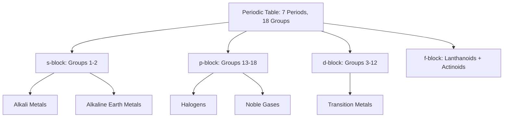

> Master the modern periodic law, periodic table structure, and electronic configuration patterns for JEE Chemistry.

## The Hook: Why Did Mendeleev Leave Gaps?

> **★ Key point · Connect: The Detective Work of Chemistry**
>
> In *Sherlock Holmes* movies, the detective predicts criminals before meeting them. In 1869, Dmitri Mendeleev did something similar - he left **blank spaces** in his periodic table for elements that hadn’t been discovered yet! He predicted their properties so accurately that when Gallium was discovered 6 years later, it matched his predictions perfectly.
>
> But here’s the twist: Mendeleev arranged elements by **atomic mass**. Sometimes this failed. Modern periodic law fixed this by using **atomic number** instead. Why does atomic number work better? That’s what makes chemistry predictable!

---

## The Core Concept: Modern Periodic Law

### The Revolutionary Change

**Mendeleev’s Periodic Law (1869):**

> Properties of elements are periodic functions of their **atomic masses**.

**Modern Periodic Law (1913 - Moseley):**

> Properties of elements are periodic functions of their **atomic numbers**.

$$\boxed{\text{Properties} = f(\text{Atomic Number})}$$

**In simple terms:** When you arrange elements by atomic number (number of protons), their properties repeat in a pattern. It’s like a musical scale - the notes repeat after every octave!

### Why Atomic Number, Not Mass?

> **◐ In simple terms · The Problem with Atomic Mass**
>
> **Mendeleev’s Challenges:**
>
> 1. **Isotopes:** Same element, different masses (Cl-35 and Cl-37)

> 2. **Inversions:** Ar (39.9) came before K (39.1) by mass, but properties didn’t match

> 3. **Cobalt-Nickel:** Co (58.9) should come after Ni (58.7) by mass, but properties reversed
>
> **Moseley’s Solution:**

> Atomic number = number of protons = defines the element
>
> - Same atomic number → same element (regardless of mass)

> - Explains all anomalies perfectly!

---

## Structure of Modern Periodic Table

### The Layout



### Key Numbers to Remember

| Feature | Count |
| --- | --- |
| **Periods** | 7 horizontal rows |
| **Groups** | 18 vertical columns |
| **s-block elements** | 14 (Groups 1, 2) |
| **p-block elements** | 36 (Groups 13-18) |
| **d-block elements** | 40 (Groups 3-12) |
| **f-block elements** | 28 (Lanthanoids + Actinoids) |
| **Total elements** | 118 (as of 2023) |

### Interactive Demo: Explore the Periodic Table

See the organization of elements, blocks, and groups in an interactive periodic table.

---

## Electronic Configuration and Periodic Position

### The SPDF Rule

Electronic configuration determines where an element sits in the periodic table!

**General Pattern:**

$$\text{1s}^2 \, \text{2s}^2 \, \text{2p}^6 \, \text{3s}^2 \, \text{3p}^6 \, \text{4s}^2 \, \text{3d}^{10} \, \text{4p}^6 \, ...$$

### Block Classification

The **last electron** determines the block:

| Last Electron in | Block | Groups | Example |
| --- | --- | --- | --- |
| **ns¹⁻²** | s-block | 1, 2 | Na: [Ne] 3s¹ |
| **np¹⁻⁶** | p-block | 13-18 | Cl: [Ne] 3s² 3p⁵ |
| **(n-1)d¹⁻¹⁰** | d-block | 3-12 | Fe: [Ar] 3d⁶ 4s² |
| **(n-2)f¹⁻¹⁴** | f-block | Lanthanoids/Actinoids | Ce: [Xe] 4f¹ 5d¹ 6s² |

> **★ Key point · Memory Trick: S-P-D-F Stands For...**
>
> **“Smart People Don’t Forget”**
>
> - **S** = s-block (Groups 1-2)

> - **P** = p-block (Groups 13-18)

> - **D** = d-block (Groups 3-12)

> - **F** = f-block (separate rows below)

---

## Finding Period and Group from Electronic Configuration

### Step-by-Step Method

**Step 1: Find Period**
Period number = **Highest principal quantum number (n)**

**Step 2: Find Group**

- **s-block:** Group = number of valence electrons (1 or 2)
- **p-block:** Group = 10 + number of p electrons
- **d-block:** Group = number of d electrons + number of s electrons

### Examples

#### Example 1: Sodium (Na)

Electronic configuration: 1s² 2s² 2p⁶ 3s¹

**Period:** Highest n = 3 → **Period 3**
**Group:** Last electron in 3s¹ → s-block → 1 valence electron → **Group 1**

#### Example 2: Chlorine (Cl)

Electronic configuration: 1s² 2s² 2p⁶ 3s² 3p⁵

**Period:** Highest n = 3 → **Period 3**
**Group:** Last electron in 3p⁵ → p-block → Group = 10 + 5 = **Group 15**&mldr; WAIT!

Actually: 3s² 3p⁵ = 7 valence electrons → **Group 17**

> **⚠ Trap: p-block Group Number**
>
> **WRONG:** Group = 10 + number of p electrons

> **RIGHT:** Group = 10 + total valence electrons (s + p)
>
> For Cl: 3s² 3p⁵ → 2 + 5 = 7 valence electrons → Group = 10 + 7 = **17**

#### Example 3: Iron (Fe)

Electronic configuration: [Ar] 3d⁶ 4s²

**Period:** Highest n = 4 → **Period 4**
**Group:** d-block → Group = d electrons + s electrons = 6 + 2 = **Group 8**

---

## Memory Tricks & Patterns

### Pattern 1: Period Length Pattern

| Period | Number of Elements | Why? |
| --- | --- | --- |
| 1 | 2 | Only 1s |
| 2 | 8 | 2s + 2p (2 + 6) |
| 3 | 8 | 3s + 3p (2 + 6) |
| 4 | 18 | 4s + 3d + 4p (2 + 10 + 6) |
| 5 | 18 | 5s + 4d + 5p (2 + 10 + 6) |
| 6 | 32 | 6s + 4f + 5d + 6p (2 + 14 + 10 + 6) |
| 7 | 32* | 7s + 5f + 6d + 7p (incomplete) |

**Pattern:** 2, 8, 8, 18, 18, 32, 32

**Memory trick:** “2 Ate 8 At 18 In 32” (completely made up, but it works!)

### Pattern 2: Aufbau Order

> **★ Key point · The Diagonal Rule**
>
> Remember the filling order using diagonals:
>
> 1s

> 2s 2p

> 3s 3p 3d

> 4s 4p 4d 4f

> 5s 5p 5d 5f

> 6s 6p 6d

> 7s 7p
>
> Fill diagonally from top-right to bottom-left!
>
> **Or use:** 1s 2s 2p 3s 3p 4s 3d 4p 5s 4d 5p 6s 4f 5d 6p 7s 5f 6d 7p

### Pattern 3: Exceptions to Remember

**Half-filled and Fully-filled d orbitals are stable!**

| Element | Expected | Actual | Reason |
| --- | --- | --- | --- |
| Cr (24) | [Ar] 3d⁴ 4s² | [Ar] 3d⁵ 4s¹ | Half-filled d⁵ stable |
| Cu (29) | [Ar] 3d⁹ 4s² | [Ar] 3d¹⁰ 4s¹ | Fully-filled d¹⁰ stable |
| Mo (42) | [Kr] 4d⁴ 5s² | [Kr] 4d⁵ 5s¹ | Half-filled d⁵ stable |
| Ag (47) | [Kr] 4d⁹ 5s² | [Kr] 4d¹⁰ 5s¹ | Fully-filled d¹⁰ stable |

**Memory trick:** “Crazy Copper Makes Silver” (Cr, Cu, Mo, Ag)

---

## Common Mistakes to Avoid

> **⚠ Trap #1: d-block Group Number**
>
> **Mistake:** Thinking Group = only d electrons

> **Correct:** Group = d electrons + s electrons
>
> Example: Fe [Ar] 3d⁶ 4s²

> Wrong: Group 6

> **Right: Group 8** (6 + 2)

> **⚠ Trap #2: Period Number for d-block**
>
> **Mistake:** Using (n-1) from d orbital for period

> **Correct:** Use highest n value (from s orbital)
>
> Example: Fe [Ar] 3d⁶ 4s²

> Wrong: Period 3 (from 3d)

> **Right: Period 4** (from 4s)

> **⚠ Trap #3: Noble Gas Core**
>
> **Mistake:** Forgetting to account for noble gas core

> **Correct:** Expand it when counting electrons
>
> Example: Fe [Ar] 3d⁶ 4s²

> Ar = 18 electrons, then add 6 + 2 = 8 more

> **Total = 26 electrons** (atomic number of Fe)

---

## When to Use This

> **★ Key point · Decision Tree**
>
> **Use electronic configuration to:**
>
> 1. Determine element’s position in periodic table

> 2. Predict chemical properties (valency, oxidation states)

> 3. Understand periodic trends

> 4. Identify elements from their properties
>
> **Quick identification:**
>
> - Last electron in **s¹** → Group 1 (alkali metal)

> - Last electron in **s²** → Group 2 (alkaline earth)

> - Last electron in **p⁵** → Group 17 (halogen)

> - Last electron in **p⁶** → Group 18 (noble gas)

---

## Practice Problems

### Level 1: Foundation (NCERT)

> **↗ Connection · Problem 1**
>
> **Question:** An element has electronic configuration [Ne] 3s² 3p³. Identify its period and group.
>
> **Solution:**
>
> - **Period:** Highest n = 3 → **Period 3**

> - **Group:** p-block, valence electrons = 2 + 3 = 5 → Group = 10 + 5 = **Group 15**

> - **Element:** Phosphorus (P)

> **↗ Connection · Problem 2**
>
> **Question:** How many elements are present in the 5th period?
>
> **Solution:**

> Period 5 contains: 5s + 4d + 5p = 2 + 10 + 6 = **18 elements**

### Level 2: JEE Main

> **↗ Connection · Problem 3**
>
> **Question:** An element with atomic number 26 belongs to which block, period, and group?
>
> **Solution:**

> Z = 26 → Electronic configuration: 1s² 2s² 2p⁶ 3s² 3p⁶ 4s² 3d⁶

> Or: [Ar] 3d⁶ 4s²
>
> - **Block:** Last electron in d → **d-block**

> - **Period:** Highest n = 4 → **Period 4**

> - **Group:** d + s = 6 + 2 = **Group 8**

> - **Element:** Iron (Fe)

> **↗ Connection · Problem 4**
>
> **Question:** The electronic configuration of an element is [Ar] 3d¹⁰ 4s¹. Identify the element and explain any exception.
>
> **Solution:**

> Expected: [Ar] 3d⁹ 4s²

> Actual: [Ar] 3d¹⁰ 4s¹ ← **This is given**
>
> **Reason:** Fully-filled d¹⁰ is more stable than d⁹

> Element has total electrons: 18 + 10 + 1 = 29 → **Copper (Cu)**
>
> Group: 10 + 1 = 11, Period: 4

### Level 3: JEE Advanced

> **↗ Connection · Problem 5**
>
> **Question:** How many elements in the periodic table have their valence electrons in d-orbitals?
>
> **Solution:**

> d-block elements = Groups 3-12 × 4 periods (4, 5, 6, 7)

> However, Period 7 is incomplete.
>
> - Period 4: 10 elements (Sc to Zn)

> - Period 5: 10 elements (Y to Cd)

> - Period 6: 10 elements (La, Hf to Hg) - Note: La has 5d¹

> - Period 7: 10 elements (Ac, Rf to Cn) - Note: Ac has 6d¹
>
> **Total = 40 elements**
>
> But the question asks for “valence electrons in d-orbitals” - this means only elements where d is the outermost orbital. Elements like Pd [Kr] 4d¹⁰ have no s electrons, making d the valence orbital.
>
> **Answer: Most d-block elements, specifically 40** (standard answer for JEE)

> **↗ Connection · Problem 6**
>
> **Question:** An element X forms X³⁺ ion which has electronic configuration [Ar] 3d⁵. Identify element X and its position.
>
> **Solution:**

> X³⁺ has configuration: [Ar] 3d⁵

> Electrons in X³⁺ = 18 + 5 = 23
>
> Since X lost 3 electrons to form X³⁺:

> **Neutral X has 23 + 3 = 26 electrons**
>
> Z = 26 → **Iron (Fe)**

> Configuration of Fe: [Ar] 3d⁶ 4s²
>
> Position:
>
> - **Period 4** (highest n = 4)

> - **Group 8** (6 + 2 = 8)

> - **d-block**

---

## Quick Revision Box

| Question | Quick Answer |
| --- | --- |
| What determines period? | Highest principal quantum number (n) |
| What determines group in s-block? | Number of valence electrons (1 or 2) |
| What determines group in p-block? | 10 + total valence electrons |
| What determines group in d-block? | d electrons + s electrons |
| Which elements have exceptions? | Cr, Cu, Mo, Ag (half/full d orbitals) |
| Period length pattern? | 2, 8, 8, 18, 18, 32, 32 |
| Modern periodic law basis? | Atomic number (not mass) |

---

## JEE Strategy: High-Yield Points

> **★ Key point · Exam Time-Savers**
>
> **What JEE Loves to Ask:**
>
> 1. Electronic configuration → Find period/group (direct 1-marker)

> 2. Exceptions in d-block (Cr, Cu especially)

> 3. Number of elements in a period

> 4. Identifying element from ion’s configuration

> 5. Comparing Mendeleev vs Modern periodic law
>
> **Time-saving tip:** Memorize configurations of elements 1-30. Questions become 10-second solves!
>
> **Common trap:** d-block group number - always add s electrons!

---

## Teacher’s Summary

> **★ Key point · Key Takeaways**
>
> 1. **Modern Periodic Law:** Properties depend on atomic number, not mass - this is why the periodic table works!

> 2. **Electronic configuration determines position:** Last electron tells you the block, highest n gives period, counting rules give group.

> 3. **Remember the exceptions:** Cr, Cu, Mo, Ag prefer half-filled or fully-filled d orbitals.

> 4. **Period length pattern:** 2, 8, 8, 18, 18, 32, 32 - comes from orbital filling capacity.

> 5. **For JEE:** Master configurations 1-30, know the traps (d-block group calculation), practice ion-based questions.
>
> **“The periodic table is like a city map - once you know how the streets are organized, you can find any address!”**

---

## Related Topics

### Prerequisites

- [Electronic Configuration](https://jeenotes.in/chemistry/atomic-structure/electronic-configuration/) - Master orbital filling before periodic table
- [Quantum Numbers](https://jeenotes.in/chemistry/atomic-structure/quantum-model/) - Understand n, l, m, s values
- [Aufbau Principle](https://jeenotes.in/chemistry/atomic-structure/electronic-configuration/) - Orbital filling order

### Next Steps in Periodic Classification

- [Periodic Trends](../periodic-trends/index.md) - How properties change across periods and groups
- [s-block Elements](../s-block-elements/index.md) - Chemistry of Groups 1 & 2
- [p-block Introduction](../p-block-introduction/index.md) - Overview of Groups 13-18

### Cross-Subject Connections

- [Chemical Bonding](https://jeenotes.in/chemistry/chemical-bonding/) - Valence electrons determine bonding
- [Atomic Structure](https://jeenotes.in/chemistry/atomic-structure/) - Foundation for periodic behavior

---

From TestGuru · our mock-test platform

## You've read Modern Periodic Law and Electronic Configuration.You've read this topic. Find out what you actually got.

A free JEE Main mock with this chapter in it, and a report that shows which sub-topics cost you marks.

[Take a free JEE Main mock →](https://app.testguru.co/signup?tg_chapter=periodic-classification&tg_exam=jee-main&tg_page=%2Fchemistry%2Fperiodic-classification%2Fperiodic-law%2F&tg_subject=chemistry&utm_campaign=notes-jee-main-free-test&utm_content=article-end&utm_medium=referral&utm_source=jeenotes)
Free, no card. Opens TestGuru in a new tab.

## Stay exam-ready

One email every Sunday: new notes, the week's hardest challenge question and a revision plan.One email every Sunday.

## Comments

Have a question or spotted a mistake? Join the discussion below.

Advertisement

Advertisement

---

## Extracted page code (interactive scripts & widgets)


### inline-script-16

```js
if(!document.getElementById("animation-fullscreen-overlay")){const e=document.createElement("div");e.id="animation-fullscreen-overlay",e.className="animation-fullscreen-overlay",e.innerHTML=`
      <div class="fullscreen-modal">
        <div class="fullscreen-header">
          <span class="fullscreen-title">Interactive Demo</span>
          <button class="fullscreen-close-btn" onclick="JEEAnimations.closeFullscreen()" title="Close (Esc)" aria-label="Close fullscreen">
            <svg width="24" height="24" viewBox="0 0 24 24" fill="none" stroke="currentColor" stroke-width="2" stroke-linecap="round" stroke-linejoin="round">
              <line x1="18" y1="6" x2="6" y2="18"></line>
              <line x1="6" y1="6" x2="18" y2="18"></line>
            </svg>
          </button>
        </div>
        <div class="fullscreen-content"></div>
      </div>
    `,document.body.appendChild(e),document.addEventListener("keydown",function(e){e.key==="Escape"&&document.body.classList.contains("animation-fullscreen-active")&&JEEAnimations.closeFullscreen()}),e.addEventListener("click",function(t){t.target===e&&JEEAnimations.closeFullscreen()})}
```


### inline-script-17

```js
(function(){var t,e=document.getElementById("disqus-load");if(!e)return;t=!1,e.addEventListener("click",function(){if(t)return;t=!0,e.setAttribute("disabled","disabled"),e.textContent="Loading comments…",window.disqus_config=function(){this.page.url="https://jeenotes.in/chemistry/periodic-classification/periodic-law/",this.page.identifier="/chemistry/periodic-classification/periodic-law/"};var s=document,n=s.createElement("script");n.src="https://https-jeenotes-in.disqus.com/embed.js",n.setAttribute("data-timestamp",+new Date),n.onload=function(){e.style.display="none"},n.onerror=function(){t=!1,e.removeAttribute("disabled"),e.textContent="Could not load comments. Tap to retry"},(s.head||s.body).appendChild(n)})})()
```


### inline-script-18

```js
(function(){var t,e=document.currentScript.previousElementSibling;function n(){(window.adsbygoogle=window.adsbygoogle||[]).push({})}if(!window.ResizeObserver||e.clientWidth>0){n();return}t=new ResizeObserver(function(){e.clientWidth>0&&(t.disconnect(),n())}),t.observe(e)})()
```


### interactive-widget-1

```html
<div class="animation-wrapper" data-animation="periodicTable" id="anim-periodicTable-1795396420397033792"><div class="animation-header"><button aria-label="Toggle fullscreen" class="anim-fullscreen-btn" onclick='JEEAnimations.toggleFullscreen("anim-periodicTable-1795396420397033792")' title="Fullscreen (F)">
<svg class="fullscreen-icon-expand" fill="none" height="18" stroke="currentColor" stroke-linecap="round" stroke-linejoin="round" stroke-width="2" viewbox="0 0 24 24" width="18"><polyline points="15 3 21 3 21 9"></polyline><polyline points="9 21 3 21 3 15"></polyline><line x1="21" x2="14" y1="3" y2="10"></line><line x1="3" x2="10" y1="21" y2="14"></line></svg>
<svg class="fullscreen-icon-collapse" fill="none" height="18" stroke="currentColor" stroke-linecap="round" stroke-linejoin="round" stroke-width="2" viewbox="0 0 24 24" width="18"><polyline points="4 14 10 14 10 20"></polyline><polyline points="20 10 14 10 14 4"></polyline><line x1="14" x2="21" y1="10" y2="3"></line><line x1="3" x2="10" y1="21" y2="14"></line></svg>
<span class="fullscreen-text">Fullscreen</span></button></div><div class="animation-content"><noscript><div class="callout callout-warning"><div class="callout-title">JavaScript Required</div><p>This interactive animation requires JavaScript to be enabled.</p></div></noscript></div></div>
```


---

_Source: [https://jeenotes.in/chemistry/periodic-classification/periodic-law/](https://jeenotes.in/chemistry/periodic-classification/periodic-law/) · raw HTML: `offline/chemistry/periodic-classification/periodic-law/index.html`_
