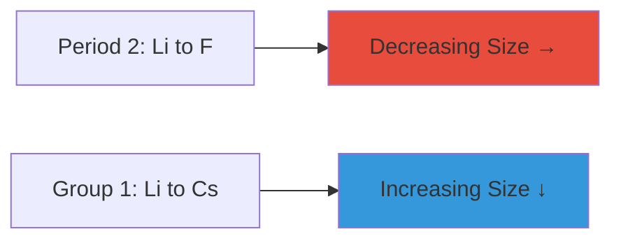

> Master atomic radius, ionization energy, electronegativity, and electron affinity trends across periods and groups for JEE.

## The Hook: Why Does Size Matter in Chemistry?

> **★ Key point · Connect: The Avengers Height Analogy**
>
> In the Avengers movies, we see characters of different sizes - from tiny Ant-Man to giant Hulk. Their size directly affects their abilities! Similarly, atoms come in different sizes, and this determines how they behave.
>
> Here’s the fascinating part: Fluorine is tiny but super aggressive (highest electronegativity), while Francium is huge but super reactive (lowest ionization energy). Why? It’s all about the **distance between nucleus and outer electrons**.
>
> Understanding periodic trends is like having a cheat code - you can predict element behavior without memorizing thousands of facts!

---

## The Core Concept: What Are Periodic Trends?

**Periodic Trends** are predictable patterns in element properties as you move across periods (→) and down groups (↓).

### The Big Four Trends

1. **Atomic Radius** - Size of the atom
2. **Ionization Energy** - Energy to remove an electron
3. **Electron Affinity** - Energy released when adding an electron
4. **Electronegativity** - Tendency to attract electrons in a bond

**In simple terms:** Think of atoms as people in a tug-of-war. The nucleus pulls electrons toward it. The farther the electrons are (bigger atom), the weaker the pull. The stronger the pull, the harder to remove electrons!

---

## 1. Atomic Radius (Size of Atom)

### Definition

**Atomic radius** is half the distance between nuclei of two adjacent atoms of the same element.

> **◐ In simple terms · Types of Atomic Radius**
>
> - **Covalent radius:** Half of internuclear distance in covalent bond (Cl-Cl)

> - **Metallic radius:** Half of distance between adjacent metal atoms

> - **Van der Waals radius:** Half of distance between non-bonded atoms

### Trends

#### Across a Period (→)

$$\boxed{\text{Atomic Radius DECREASES} \rightarrow}$$

**Example:** Na > Mg > Al > Si > P > S > Cl

**Why?**

- Same number of shells
- Nuclear charge (Z) increases
- More protons pull electrons closer
- Effective nuclear charge (Zeff) increases

**Think:** More protons = stronger magnet pulling electrons inward

#### Down a Group (↓)

$$\boxed{\text{Atomic Radius INCREASES} \downarrow}$$

**Example:** Li < Na < K < Rb < Cs

**Why?**

- New electron shell added
- Distance from nucleus increases
- Shielding effect increases
- Electrons are farther from nucleus

**Think:** Adding floors to a building - top floor gets farther from ground

### Visual Representation



### Important Size Comparisons

| Type | Comparison | Example |
| --- | --- | --- |
| **Atoms in Period 3** | Na > Mg > Al > Si > P > S > Cl | Decreases across |
| **Atoms in Group 1** | Li < Na < K < Rb < Cs < Fr | Increases down |
| **Isoelectronic species** | Higher Z → Smaller size | O²⁻ > F⁻ > Na⁺ > Mg²⁺ |

### Interactive Demo: Visualize Periodic Trends

See how atomic radius, ionization energy, and electronegativity change across the periodic table.

> **★ Key point · Memory Trick: Atomic Radius**
>
> **“Rich People Get Smaller Homes”**
>
> - **R**ight (across period) → **P**rotons increase → **G**et **S**maller

> - Down group → More **H**ouses (shells) → Bigger size!
>
> Or simply: **→ decreases, ↓ increases**

---

## 2. Ionic Radius

### Cation vs Anion Size

$$\boxed{\text{Cation < Neutral Atom < Anion}}$$

**Cations (Positive ions):**

- Lost electrons → electron-electron repulsion decreases
- Same nuclear charge pulling fewer electrons
- **Size decreases**

Example: Na (186 pm) → Na⁺ (102 pm)

**Anions (Negative ions):**

- Gained electrons → electron-electron repulsion increases
- Same nuclear charge pulling more electrons
- **Size increases**

Example: Cl (99 pm) → Cl⁻ (181 pm)

### Isoelectronic Series

**Isoelectronic** = same number of electrons, different nuclear charge

For isoelectronic species: **Higher Z → Smaller radius**

> **↗ Connection · Example: O²⁻, F⁻, Na⁺, Mg²⁺, Al³⁺**
>
> All have 10 electrons (Ne configuration)
>
> | Ion | Z (Protons) | Radius (pm) |

> | --- | --- | --- |

> | O²⁻ | 8 | 140 |

> | F⁻ | 9 | 136 |

> | Na⁺ | 11 | 102 |

> | Mg²⁺ | 12 | 72 |

> | Al³⁺ | 13 | 54 |
>
> **Order:** O²⁻ > F⁻ > Na⁺ > Mg²⁺ > Al³⁺
>
> **Why?** More protons = stronger pull on same number of electrons = smaller size

### Interactive Demo: Explore Periodic Trends Visually

Interact with the periodic table to see how atomic radius, ionization energy, electronegativity, and other properties change across periods and groups.

---

## 3. Ionization Energy (IE)

### Definition

**Ionization Energy** is the minimum energy required to remove an electron from an isolated gaseous atom.

$$\text{M(g)} \rightarrow \text{M}^+(g) + e^- \quad \Delta H = IE_1$$

**Units:** kJ/mol or eV/atom

### Successive Ionization Energies

$$\boxed{IE_1 < IE_2 < IE_3 < ... < IE_n}$$

Removing each successive electron requires MORE energy because:

- Positive charge increases (harder to remove - from +1, then +2, etc.)
- Electrons get closer to nucleus
- Less electron-electron repulsion

### Trends

#### Across a Period (→)

$$\boxed{\text{Ionization Energy INCREASES} \rightarrow}$$

**Example:** Na < Mg < Al < Si < P < S < Cl < Ar

**Why?**

- Atomic size decreases
- Nuclear charge increases
- Electrons held more tightly
- Harder to remove

**Exception Pattern:**

- **Group 13 < Group 2** (e.g., Al < Mg)
  - Why? Al removes from 3p¹ (easier) vs Mg from 3s² (stable)
- **Group 16 < Group 15** (e.g., O < N)
  - Why? N has half-filled p³ (stable) vs O has p⁴ (less stable)

#### Down a Group (↓)

$$\boxed{\text{Ionization Energy DECREASES} \downarrow}$$

**Example:** Li > Na > K > Rb > Cs

**Why?**

- Atomic size increases
- Outer electron farther from nucleus
- Shielding increases
- Easier to remove

### Important IE Values

| Element | IE₁ (kJ/mol) | Why Important? |
| --- | --- | --- |
| He | 2372 | Highest IE (most stable) |
| H | 1312 | Reference point |
| Li | 520 | Alkali metals - low IE |
| F | 1681 | High IE despite small size |
| Ar | 1521 | Noble gas - stable |

> **★ Key point · Memory Trick: Ionization Energy**
>
> **“Noble People Resist Change”**
>
> - **Noble** gases have highest IE (don’t want to lose electrons)

> - **P**eriod: moving right → **R**esistance increases

> - Down group → easier to **C**hange (lower IE)
>
> **Quick Rule:** Opposite of atomic radius!
>
> - → Radius decreases, IE increases

> - ↓ Radius increases, IE decreases

### The Anomalies Explained

> **⚠ Trap: IE Exceptions**
>
> **Exception 1: Be (899) > B (801)**
>
> - Be: [He] 2s² (filled subshell, stable)

> - B: [He] 2s² 2p¹ (2p electron easier to remove)
>
> **Exception 2: N (1402) > O (1314)**
>
> - N: [He] 2s² 2p³ (half-filled p, extra stable)

> - O: [He] 2s² 2p⁴ (pairing in one 2p orbital, repulsion)
>
> **Exception 3: Mg (738) > Al (578)**
>
> - Mg: [Ne] 3s² (filled subshell)

> - Al: [Ne] 3s² 3p¹ (3p electron easier to remove)
>
> **Pattern:** Half-filled and fully-filled configurations resist electron loss!

---

## 4. Electron Affinity (EA)

### Definition

**Electron Affinity** is the energy change when an electron is added to an isolated gaseous atom.

$$\text{M(g)} + e^- \rightarrow \text{M}^-(g) \quad \Delta H = EA$$

**Convention:**

- **Negative EA** = energy released (favorable) - most elements
- **Positive EA** = energy absorbed (unfavorable) - noble gases

### Trends

#### Across a Period (→)

$$\boxed{\text{Electron Affinity becomes MORE NEGATIVE} \rightarrow}$$

**Example:** C < N < O < F (in magnitude)

**Why?**

- Smaller atomic size
- Stronger nuclear attraction
- More energy released when electron added

**Exception:** Chlorine has MORE negative EA than Fluorine!

- Cl: -349 kJ/mol
- F: -328 kJ/mol
- **Why?** F is so small that electron-electron repulsion in compact 2p orbital reduces EA

#### Down a Group (↓)

$$\boxed{\text{Electron Affinity becomes LESS NEGATIVE} \downarrow}$$

**Example:** F > Cl > Br > I (in magnitude)

**Why?**

- Atomic size increases
- Added electron farther from nucleus
- Less energy released

### Special Cases

| Element | EA (kJ/mol) | Note |
| --- | --- | --- |
| **Cl** | -349 | Most negative (highest EA) |
| **F** | -328 | Should be highest but repulsion |
| **N** | ~0 | Half-filled 2p³ stable, resists electron |
| **Noble gases** | Positive | Stable configuration, don’t want electron |

> **★ Key point · Memory Trick: Electron Affinity**
>
> **“Chlorine Craves Electrons Most”**
>
> - **Cl** has highest EA (most negative)

> - F should win but too small (repulsion)

> - Noble gases don’t want electrons (positive EA)
>
> **Pattern:** Similar to IE but:
>
> - Cl > F (special exception)

> - Generally increases across period, decreases down group

---

## 5. Electronegativity (EN)

### Definition

**Electronegativity** is the tendency of an atom to attract shared electrons in a chemical bond.

**Not a measurable energy** - it’s a relative scale!

### Pauling Scale

Fluorine = 4.0 (highest, reference point)

$$\boxed{\text{F(4.0) > O(3.5) > N(3.0) > Cl(3.0)}}$$

### Trends

#### Across a Period (→)

$$\boxed{\text{Electronegativity INCREASES} \rightarrow}$$

**Example:** Li (1.0) < Be (1.5) < B (2.0) < C (2.5) < N (3.0) < O (3.5) < F (4.0)

**Why?**

- Atomic size decreases
- Effective nuclear charge increases
- Stronger attraction for bonding electrons

#### Down a Group (↓)

$$\boxed{\text{Electronegativity DECREASES} \downarrow}$$

**Example:** F (4.0) > Cl (3.0) > Br (2.8) > I (2.5)

**Why?**

- Atomic size increases
- Bonding electrons farther from nucleus
- Weaker attraction

### Electronegativity Values (Pauling Scale)

| Element | EN | Category |
| --- | --- | --- |
| F | 4.0 | Most electronegative |
| O | 3.5 | Very high |
| N, Cl | 3.0 | High |
| C | 2.5 | Moderate |
| H | 2.1 | Reference |
| Metals | < 2.0 | Low |
| Cs, Fr | 0.7 | Lowest |

### Applications

**Predicting Bond Type:**

- ΔEN < 0.5 → Non-polar covalent (equal sharing)
- 0.5 < ΔEN < 1.7 → Polar covalent (unequal sharing)
- ΔEN > 1.7 → Ionic (electron transfer)

> **↗ Connection · Example: HCl**
>
> H (2.1) and Cl (3.0)

> ΔEN = 3.0 - 2.1 = 0.9
>
> **Bond type:** Polar covalent (Cl is δ⁻, H is δ⁺)

> **★ Key point · Memory Trick: Electronegativity**
>
> **“FON-Cl Bully Steals Electrons”**
>
> - **F, O, N, Cl** = highest electronegativities

> - They “bully” (attract) electrons in bonds

> - **F** is the biggest bully (4.0)
>
> **Or:** “**F**luorine **O**bviously **N**eeds **Cl**osest electrons” (decreasing order: F > O > N ≈ Cl)

---

## Comparison Table: All Trends at a Glance

| Property | Across Period (→) | Down Group (↓) | Reason |
| --- | --- | --- | --- |
| **Atomic Radius** | Decreases | Increases | Zeff ↑ / Shells ↑ |
| **Ionic Radius** | Decreases (for cations/anions) | Increases | Same as atomic |
| **Ionization Energy** | Increases | Decreases | Size ↓ / Size ↑ |
| **Electron Affinity** | More negative | Less negative | Size ↓ / Size ↑ |
| **Electronegativity** | Increases | Decreases | Size ↓ / Size ↑ |
| **Metallic Character** | Decreases | Increases | IE ↑ / IE ↓ |

> **★ Key point · The Master Pattern**
>
> **Everything relates to atomic size and nuclear charge!**
>
> **Across period:**
>
> - Size ↓ → Zeff ↑ → Hold electrons tighter → IE ↑, EA ↑, EN ↑
>
> **Down group:**
>
> - Size ↑ → Shielding ↑ → Hold electrons weaker → IE ↓, EA ↓, EN ↓
>
> **Remember:** Atomic radius is the foundation. Other trends follow from it!

---

## Advanced Concepts

### Effective Nuclear Charge (Zeff)

$$\boxed{Z_{eff} = Z - S}$$

where:

- Z = actual nuclear charge (number of protons)
- S = shielding constant (screening by inner electrons)

**Key points:**

- Zeff increases across a period (Z increases, S roughly constant)
- Zeff stays roughly same down a group (both Z and S increase)

> **◐ In simple terms · Slater's Rules for Shielding**
>
> Approximate shielding contribution:
>
> - Same n: each electron contributes 0.35

> - n-1 shell: each electron contributes 0.85

> - n-2 and lower: each electron contributes 1.00
>
> **Example for Oxygen (1s² 2s² 2p⁴):**

> For a 2p electron:
>
> - Other 2p and 2s electrons (5 total): 5 × 0.35 = 1.75

> - 1s electrons (2 total): 2 × 0.85 = 1.70

> - S = 3.45

> - Zeff = 8 - 3.45 = **4.55**

### Diagonal Relationship

Elements in diagonal positions show similar properties due to similar charge/radius ratio:

| Pair | Why Similar? |
| --- | --- |
| **Li ~ Mg** | Similar polarizing power |
| **Be ~ Al** | Similar charge density |
| **B ~ Si** | Similar electronegativities |

**Example:** LiCl is covalent (like MgCl₂), not ionic like other Group 1 chlorides!

---

## Common Mistakes to Avoid

> **⚠ Trap #1: Electron Affinity Sign Convention**
>
> **Mistake:** Thinking higher EA = more positive value

> **Correct:** Higher EA = more negative value (more energy released)
>
> Cl has EA = -349 kJ/mol (highly negative = high EA)

> He has EA = +48 kJ/mol (positive = doesn’t want electron)

> **⚠ Trap #2: F vs Cl Electron Affinity**
>
> **Mistake:** Assuming F > Cl in EA because F > Cl in EN

> **Correct:** Cl has MORE negative EA than F (-349 vs -328 kJ/mol)
>
> **Reason:** F is too small, electron-electron repulsion in compact 2p

> **⚠ Trap #3: Noble Gas Radii**
>
> **Mistake:** Comparing noble gas covalent radii with other elements

> **Correct:** Noble gases have Van der Waals radii (much larger, not directly comparable)
>
> Example: Ar has largest “radius” in Period 3, but it’s Van der Waals, not covalent!

> **⚠ Trap #4: Isoelectronic Species**
>
> **Mistake:** Thinking more electrons = larger size

> **Correct:** For isoelectronic species, more PROTONS = smaller size
>
> O²⁻ (8p⁺, 10e⁻) > F⁻ (9p⁺, 10e⁻) > Na⁺ (11p⁺, 10e⁻) > Mg²⁺ (12p⁺, 10e⁻)

---

## Practice Problems

### Level 1: Foundation (NCERT)

> **↗ Connection · Problem 1**
>
> **Question:** Arrange the following in increasing order of atomic radius: N, O, F, Ne
>
> **Solution:**

> All are in Period 2. Across period, radius decreases.
>
> **Order:** Ne < F < O < N
>
> Wait! Noble gases have Van der Waals radius (not comparable).

> Excluding Ne: **F < O < N**
>
> Actually, Ne is measured differently, so typical answer: **F < O < N** (excluding noble gas)

> **↗ Connection · Problem 2**
>
> **Question:** Which has larger radius: Na or Na⁺?
>
> **Solution:**

> Na⁺ lost one electron (3s¹ removed)
>
> - Less electron-electron repulsion

> - Same nuclear charge pulling fewer electrons
>
> **Answer:** Na > Na⁺ (neutral atom always larger than cation)

### Level 2: JEE Main

> **↗ Connection · Problem 3**
>
> **Question:** Arrange in increasing order of first ionization energy: Na, Mg, Al, Si
>
> **Solution:**

> All in Period 3. Generally IE increases across period.

> But exception: Al < Mg (3p¹ easier to remove than 3s²)
>
> **Order:** Na < Al < Mg < Si
>
> Explanation:
>
> - Na (496) - lowest, alkali metal

> - Al (578) - 3p¹ electron

> - Mg (738) - 3s² stable configuration

> - Si (786) - highest in this set

> **↗ Connection · Problem 4**
>
> **Question:** Which has the most negative electron affinity: F, Cl, Br, I?
>
> **Solution:**

> Generally EA decreases down group, so F should have highest.

> But exception: Cl > F in EA magnitude
>
> **Answer:** Chlorine (Cl) has EA = -349 kJ/mol (most negative)
>
> **Reason:** F is too small (electron repulsion in compact 2p orbital)

> **↗ Connection · Problem 5**
>
> **Question:** Arrange isoelectronic species in increasing size: N³⁻, O²⁻, F⁻, Na⁺, Mg²⁺
>
> **Solution:**

> All have 10 electrons (Ne configuration)

> For isoelectronic: higher Z → smaller radius
>
> | Ion | Z | Size trend |

> | --- | --- | --- |

> | N³⁻ | 7 | Largest |

> | O²⁻ | 8 |  |

> | F⁻ | 9 |  |

> | Na⁺ | 11 |  |

> | Mg²⁺ | 12 | Smallest |
>
> **Order:** Mg²⁺ < Na⁺ < F⁻ < O²⁻ < N³⁻

### Level 3: JEE Advanced

> **↗ Connection · Problem 6**
>
> **Question:** Explain why the second ionization energy of sodium (4562 kJ/mol) is much higher than its first ionization energy (496 kJ/mol).
>
> **Solution:**

> **First ionization:**

> Na → Na⁺ + e⁻

> Na: [Ne] 3s¹ → Na⁺: [Ne] (stable noble gas configuration)

> Removing 3s¹ is relatively easy (496 kJ/mol)
>
> **Second ionization:**

> Na⁺ → Na²⁺ + e⁻

> Must remove from stable [Ne] configuration (2p⁶)
>
> - Breaking noble gas stability

> - Electron much closer to nucleus

> - Higher effective nuclear charge
>
> IE₂/IE₁ = 4562/496 ≈ **9.2 times higher!**
>
> **Key insight:** Huge jump in IE when breaking into inner noble gas core.

> **↗ Connection · Problem 7**
>
> **Question:** The first ionization energy of nitrogen (1402 kJ/mol) is higher than that of oxygen (1314 kJ/mol). Explain this anomaly.
>
> **Solution:**

> **Electronic configurations:**
>
> - N: [He] 2s² 2p³ (three unpaired electrons in p orbitals)

> - O: [He] 2s² 2p⁴ (one pair + two unpaired in p orbitals)
>
> **Nitrogen advantage:**
>
> - Half-filled 2p³ configuration (extra stability)

> - All p electrons unpaired (exchange energy)

> - Symmetric electron distribution
>
> **Oxygen disadvantage:**
>
> - 2p⁴ has one paired orbital

> - Electron-electron repulsion in paired orbital

> - Easier to remove one electron to relieve repulsion
>
> **Answer:** N has higher IE due to half-filled 2p³ stability. O’s paired electron is easier to remove.
>
> **General rule:** Half-filled and fully-filled configurations show anomalously high IE!

> **↗ Connection · Problem 8**
>
> **Question:** Calculate the effective nuclear charge felt by a 3s electron in sodium (Z = 11) using Slater’s rules.
>
> **Solution:**

> Na: 1s² 2s² 2p⁶ 3s¹
>
> For the 3s¹ electron:

> **Shielding (S):**
>
> - Electrons in n-1 shell (2s² 2p⁶ = 8 electrons): 8 × 0.85 = 6.80

> - Electrons in n-2 shell (1s² = 2 electrons): 2 × 1.00 = 2.00

> - Total S = 6.80 + 2.00 = **8.80**
>
> **Effective nuclear charge:**
>
> $$Z_{eff} = Z - S = 11 - 8.80 = 2.2$$
>
> **Interpretation:** The 3s electron “feels” only 2.2 protons worth of attraction (not all 11) due to shielding by inner electrons.
>
> This explains why 3s is easy to remove (low IE of Na)!

---

## Quick Revision Box

| Trend | Across Period (→) | Down Group (↓) | Remember |
| --- | --- | --- | --- |
| **Atomic Radius** | ↓ Decreases | ↑ Increases | Opposite of IE |
| **Ionization Energy** | ↑ Increases* | ↓ Decreases | *Except Al, O |
| **Electron Affinity** | More negative | Less negative | Cl > F exception |
| **Electronegativity** | ↑ Increases | ↓ Decreases | F = 4.0 highest |
| **Metallic Character** | ↓ Decreases | ↑ Increases | Opposite of EN |

**Master Formula:** Size controls everything!

- Small size → High Zeff → High IE, EA, EN
- Large size → Low Zeff → Low IE, EA, EN

---

## When to Use This

> **★ Key point · Decision Tree for JEE**
>
> **Question asks about&mldr;**
>
> **Atomic size?**

> → Check: period or group? Apply trend

> → Watch for: ionic vs atomic, isoelectronic species
>
> **Ionization energy?**

> → Check exceptions first: Group 2 vs 13, Group 15 vs 16

> → Remember: half-filled/full stability
>
> **Electron affinity?**

> → Check if F vs Cl (Cl wins!)

> → Check if noble gas (positive EA)
>
> **Electronegativity?**

> → F > O > N ≈ Cl always

> → Use for bond polarity predictions
>
> **Comparing elements?**

> → Same period: left < right (in IE, EN)

> → Same group: top > bottom (in IE, EN)

---

## JEE Strategy: High-Yield Points

> **★ Key point · Exam Time-Savers**
>
> **What JEE Loves to Ask:**
>
> 1. **Isoelectronic species ordering** (guaranteed 1-2 questions)

> 2. **IE anomalies** (Be > B, N > O, Mg > Al)

> 3. **EA of Cl vs F** (most missed exception!)

> 4. **Successive IE jumps** (identifying element from IE pattern)

> 5. **Predicting properties** from position in periodic table
>
> **Time-saving shortcuts:**
>
> - For atomic radius: just remember → decreases, ↓ increases

> - For IE: opposite of radius (with 3 exceptions)

> - For EN: F(4.0) > O(3.5) > N,Cl(3.0) - memorize these

> - For isoelectronic: more protons = smaller (just count Z)
>
> **Common traps to avoid:**
>
> 1. Noble gas radii (Van der Waals, not covalent)

> 2. Cl > F in EA (counter-intuitive!)

> 3. Forgetting half-filled stability (N, Cr⁺, Mn²⁺)
>
> **Weightage:** 3-5 questions in JEE Main, 2-3 in Advanced - HIGH YIELD!

---

## Teacher’s Summary

> **★ Key point · Key Takeaways**
>
> 1. **Atomic radius is the foundation** - everything else follows from size and effective nuclear charge (Zeff).

> 2. **Two simple rules:**
>
>    - Across period: size ↓, everything else ↑ (IE, EA, EN)

>    - Down group: size ↑, everything else ↓ (IE, EA, EN)

> 3. **Three critical exceptions to memorize:**
>
>    - **IE:** Be > B, N > O, Mg > Al (half-filled/full stability)

>    - **EA:** Cl > F (-349 > -328 kJ/mol due to repulsion in F)

>    - **Noble gases:** Positive EA, Van der Waals radius

> 4. **Isoelectronic species:** Same electrons, different Z → higher Z = smaller radius (more protons pull tighter)

> 5. **For JEE success:** Master the exceptions, practice isoelectronic ordering, understand WHY trends exist (don’t just memorize arrows).
>
> **“Periodic trends aren’t random - they’re the universe’s way of organizing matter. Master the pattern, predict the chemistry!”**

---

## Related Topics

### Prerequisites

- [Modern Periodic Law](../periodic-law/index.md) - Understand periodic table organization first
- [Electronic Configuration](https://jeenotes.in/chemistry/atomic-structure/electronic-configuration/) - Foundation for understanding trends
- [Quantum Numbers](https://jeenotes.in/chemistry/atomic-structure/quantum-model/) - Explains orbital filling and stability

### Next Steps in Periodic Classification

- [s-block Elements](../s-block-elements/index.md) - Apply trends to Groups 1 & 2
- [p-block Introduction](../p-block-introduction/index.md) - Apply trends to Groups 13-18

### Where These Trends Apply

- [Chemical Bonding](https://jeenotes.in/chemistry/chemical-bonding/) - Electronegativity determines bond type
- [Ionic Compounds](https://jeenotes.in/chemistry/chemical-bonding/ionic-bonding/) - Ionic radii affect lattice energy
- [Covalent Bonding](https://jeenotes.in/chemistry/chemical-bonding/covalent-bonding/) - Bond polarity from EN differences

### Cross-Subject Connections

- [Electrostatics](https://jeenotes.in/chemistry/atomic-structure/) - Nuclear charge and electron attraction
- [Thermodynamics](https://jeenotes.in/chemistry/thermodynamics/) - IE and EA are enthalpy changes

---

From TestGuru · our mock-test platform

## You've read Periodic Trends: Atomic Properties.You've read this topic. Find out what you actually got.

A free JEE Main mock with this chapter in it, and a report that shows which sub-topics cost you marks.

[Take a free JEE Main mock →](https://app.testguru.co/signup?tg_chapter=periodic-classification&tg_exam=jee-main&tg_page=%2Fchemistry%2Fperiodic-classification%2Fperiodic-trends%2F&tg_subject=chemistry&utm_campaign=notes-jee-main-free-test&utm_content=article-end&utm_medium=referral&utm_source=jeenotes)
Free, no card. Opens TestGuru in a new tab.

## Stay exam-ready

One email every Sunday: new notes, the week's hardest challenge question and a revision plan.One email every Sunday.

## Comments

Have a question or spotted a mistake? Join the discussion below.

Advertisement

Advertisement

---

## Extracted page code (interactive scripts & widgets)


### inline-script-16

```js
if(!document.getElementById("animation-fullscreen-overlay")){const e=document.createElement("div");e.id="animation-fullscreen-overlay",e.className="animation-fullscreen-overlay",e.innerHTML=`
      <div class="fullscreen-modal">
        <div class="fullscreen-header">
          <span class="fullscreen-title">Interactive Demo</span>
          <button class="fullscreen-close-btn" onclick="JEEAnimations.closeFullscreen()" title="Close (Esc)" aria-label="Close fullscreen">
            <svg width="24" height="24" viewBox="0 0 24 24" fill="none" stroke="currentColor" stroke-width="2" stroke-linecap="round" stroke-linejoin="round">
              <line x1="18" y1="6" x2="6" y2="18"></line>
              <line x1="6" y1="6" x2="18" y2="18"></line>
            </svg>
          </button>
        </div>
        <div class="fullscreen-content"></div>
      </div>
    `,document.body.appendChild(e),document.addEventListener("keydown",function(e){e.key==="Escape"&&document.body.classList.contains("animation-fullscreen-active")&&JEEAnimations.closeFullscreen()}),e.addEventListener("click",function(t){t.target===e&&JEEAnimations.closeFullscreen()})}
```


### inline-script-17

```js
if(!document.getElementById("animation-fullscreen-overlay")){const e=document.createElement("div");e.id="animation-fullscreen-overlay",e.className="animation-fullscreen-overlay",e.innerHTML=`
      <div class="fullscreen-modal">
        <div class="fullscreen-header">
          <span class="fullscreen-title">Interactive Demo</span>
          <button class="fullscreen-close-btn" onclick="JEEAnimations.closeFullscreen()" title="Close (Esc)" aria-label="Close fullscreen">
            <svg width="24" height="24" viewBox="0 0 24 24" fill="none" stroke="currentColor" stroke-width="2" stroke-linecap="round" stroke-linejoin="round">
              <line x1="18" y1="6" x2="6" y2="18"></line>
              <line x1="6" y1="6" x2="18" y2="18"></line>
            </svg>
          </button>
        </div>
        <div class="fullscreen-content"></div>
      </div>
    `,document.body.appendChild(e),document.addEventListener("keydown",function(e){e.key==="Escape"&&document.body.classList.contains("animation-fullscreen-active")&&JEEAnimations.closeFullscreen()}),e.addEventListener("click",function(t){t.target===e&&JEEAnimations.closeFullscreen()})}
```


### inline-script-18

```js
(function(){var t,e=document.getElementById("disqus-load");if(!e)return;t=!1,e.addEventListener("click",function(){if(t)return;t=!0,e.setAttribute("disabled","disabled"),e.textContent="Loading comments…",window.disqus_config=function(){this.page.url="https://jeenotes.in/chemistry/periodic-classification/periodic-trends/",this.page.identifier="/chemistry/periodic-classification/periodic-trends/"};var s=document,n=s.createElement("script");n.src="https://https-jeenotes-in.disqus.com/embed.js",n.setAttribute("data-timestamp",+new Date),n.onload=function(){e.style.display="none"},n.onerror=function(){t=!1,e.removeAttribute("disabled"),e.textContent="Could not load comments. Tap to retry"},(s.head||s.body).appendChild(n)})})()
```


### inline-script-19

```js
(function(){var t,e=document.currentScript.previousElementSibling;function n(){(window.adsbygoogle=window.adsbygoogle||[]).push({})}if(!window.ResizeObserver||e.clientWidth>0){n();return}t=new ResizeObserver(function(){e.clientWidth>0&&(t.disconnect(),n())}),t.observe(e)})()
```


### interactive-widget-1

```html
<div class="animation-wrapper" data-animation="periodicTable" id="anim-periodicTable-1795396420402796352"><div class="animation-header"><button aria-label="Toggle fullscreen" class="anim-fullscreen-btn" onclick='JEEAnimations.toggleFullscreen("anim-periodicTable-1795396420402796352")' title="Fullscreen (F)">
<svg class="fullscreen-icon-expand" fill="none" height="18" stroke="currentColor" stroke-linecap="round" stroke-linejoin="round" stroke-width="2" viewbox="0 0 24 24" width="18"><polyline points="15 3 21 3 21 9"></polyline><polyline points="9 21 3 21 3 15"></polyline><line x1="21" x2="14" y1="3" y2="10"></line><line x1="3" x2="10" y1="21" y2="14"></line></svg>
<svg class="fullscreen-icon-collapse" fill="none" height="18" stroke="currentColor" stroke-linecap="round" stroke-linejoin="round" stroke-width="2" viewbox="0 0 24 24" width="18"><polyline points="4 14 10 14 10 20"></polyline><polyline points="20 10 14 10 14 4"></polyline><line x1="14" x2="21" y1="10" y2="3"></line><line x1="3" x2="10" y1="21" y2="14"></line></svg>
<span class="fullscreen-text">Fullscreen</span></button></div><div class="animation-content"><noscript><div class="callout callout-warning"><div class="callout-title">JavaScript Required</div><p>This interactive animation requires JavaScript to be enabled.</p></div></noscript></div></div>
```


### interactive-widget-2

```html
<div class="animation-wrapper" data-animation="periodicTable" id="anim-periodicTable-1795396420403145721"><div class="animation-header"><button aria-label="Toggle fullscreen" class="anim-fullscreen-btn" onclick='JEEAnimations.toggleFullscreen("anim-periodicTable-1795396420403145721")' title="Fullscreen (F)">
<svg class="fullscreen-icon-expand" fill="none" height="18" stroke="currentColor" stroke-linecap="round" stroke-linejoin="round" stroke-width="2" viewbox="0 0 24 24" width="18"><polyline points="15 3 21 3 21 9"></polyline><polyline points="9 21 3 21 3 15"></polyline><line x1="21" x2="14" y1="3" y2="10"></line><line x1="3" x2="10" y1="21" y2="14"></line></svg>
<svg class="fullscreen-icon-collapse" fill="none" height="18" stroke="currentColor" stroke-linecap="round" stroke-linejoin="round" stroke-width="2" viewbox="0 0 24 24" width="18"><polyline points="4 14 10 14 10 20"></polyline><polyline points="20 10 14 10 14 4"></polyline><line x1="14" x2="21" y1="10" y2="3"></line><line x1="3" x2="10" y1="21" y2="14"></line></svg>
<span class="fullscreen-text">Fullscreen</span></button></div><div class="animation-content"><noscript><div class="callout callout-warning"><div class="callout-title">JavaScript Required</div><p>This interactive animation requires JavaScript to be enabled.</p></div></noscript></div></div>
```


---

_Source: [https://jeenotes.in/chemistry/periodic-classification/periodic-trends/](https://jeenotes.in/chemistry/periodic-classification/periodic-trends/) · raw HTML: `offline/chemistry/periodic-classification/periodic-trends/index.html`_
