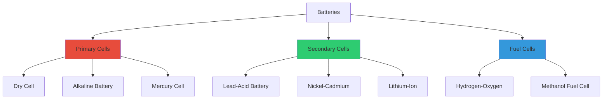

> Master primary batteries, secondary batteries, fuel cells, and their applications in modern technology for JEE.

## Introduction

From the smartphone in your pocket to the electric car in your garage, **batteries** power our modern world! These portable electrochemical cells have revolutionized technology, enabling everything from pacemakers saving lives to Mars rovers exploring other planets. Understanding battery chemistry is essential not just for JEE, but for comprehending the energy revolution happening right now!

> **★ Key point · The EV Revolution of 2025**
>
> The Tesla Model Y and BYD Seagull dominate 2025’s EV market with ranges exceeding 300 miles per charge! Each car contains thousands of cylindrical lithium-ion cells (Tesla uses 4680 format cells). When you accelerate, lithium ions flow from anode to cathode through an electrolyte separator. The global battery market hit $200 billion in 2025, with solid-state batteries (no liquid electrolyte!) entering mass production. You’re learning the chemistry powering the future!

---

## Interactive: Battery Discharge Animation

Watch lithium ions migrate during battery discharge:

---

## What is a Battery?

A **battery** is a collection of one or more **electrochemical cells** that convert stored chemical energy into electrical energy through spontaneous redox reactions.

### Key Terminology

- **Cell:** Single electrochemical unit
- **Battery:** One or more cells connected together
- **Primary cell:** Non-rechargeable (single use)
- **Secondary cell:** Rechargeable (reversible reactions)
- **Fuel cell:** Continuous supply of reactants from external source

### Classification



---

## Primary Cells (Non-Rechargeable)

Primary cells cannot be recharged because the electrode reactions are **irreversible**. Once reactants are consumed, the cell is “dead.”

### 1. Dry Cell (Leclanché Cell)

The most common battery in flashlights, remote controls, and wall clocks!

**Construction:**

- **Anode:** Zinc container (Zn)
- **Cathode:** Carbon rod surrounded by MnO₂ + carbon powder
- **Electrolyte:** Paste of NH₄Cl + ZnCl₂
- **Voltage:** ~1.5 V

**Reactions:**

**At Anode (Zn container):**

$$\text{Zn} \rightarrow \text{Zn}^{2+} + 2e^-$$

**At Cathode (Carbon rod):**

$$2\text{MnO}_2 + 2\text{NH}_4^+ + 2e^- \rightarrow \text{Mn}_2\text{O}_3 + 2\text{NH}_3 + \text{H}_2\text{O}$$

**Overall:**

$$\boxed{\text{Zn} + 2\text{MnO}_2 + 2\text{NH}_4^+ \rightarrow \text{Zn}^{2+} + \text{Mn}_2\text{O}_3 + 2\text{NH}_3 + \text{H}_2\text{O}}$$

**Characteristics:**

- Voltage slowly decreases as reactants deplete
- NH₃ forms complexes: Zn²⁺ + 2NH₃ → [Zn(NH₃)₂]²⁺
- Not truly “dry” - contains moist paste
- Shelf life: ~2 years

> **◐ In simple terms · Why Batteries Leak**
>
> Old dry cells leak black goo! The zinc container corrodes completely, and the acidic NH₄Cl paste leaks out. This happened in countless TV remotes in the 2000s. The white crystalline deposits you see? That’s NH₄Cl and zinc salts. Modern alkaline batteries last longer and leak less!

### Interactive Demo: See How Different Batteries Work

Explore the electrochemistry inside different types of batteries. Watch electron flow and ion migration during discharge and charging cycles.

---

### 2. Alkaline Battery

Improved version of dry cell with better performance!

**Construction:**

- **Anode:** Powdered Zn in gel
- **Cathode:** MnO₂ powder
- **Electrolyte:** Concentrated KOH (alkaline)
- **Voltage:** ~1.5 V

**Reactions:**

**At Anode:**

$$\text{Zn} + 2\text{OH}^- \rightarrow \text{ZnO} + \text{H}_2\text{O} + 2e^-$$

**At Cathode:**

$$2\text{MnO}_2 + \text{H}_2\text{O} + 2e^- \rightarrow \text{Mn}_2\text{O}_3 + 2\text{OH}^-$$

**Overall:**

$$\boxed{\text{Zn} + 2\text{MnO}_2 \rightarrow \text{ZnO} + \text{Mn}_2\text{O}_3}$$

**Advantages over dry cell:**

- Longer shelf life (5-10 years)
- More stable voltage
- Better performance in high-drain devices (cameras, toys)
- Less likely to leak

---

### 3. Mercury Cell (Button Cell)

Used in watches, hearing aids, and calculators.

**Construction:**

- **Anode:** Zinc-mercury amalgam (Zn-Hg)
- **Cathode:** Paste of HgO + carbon
- **Electrolyte:** Paste of KOH + ZnO
- **Voltage:** ~1.35 V (very stable)

**Reactions:**

**At Anode:**

$$\text{Zn}(\text{Hg}) + 2\text{OH}^- \rightarrow \text{ZnO} + \text{H}_2\text{O} + 2e^-$$

**At Cathode:**

$$\text{HgO} + \text{H}_2\text{O} + 2e^- \rightarrow \text{Hg} + 2\text{OH}^-$$

**Overall:**

$$\boxed{\text{Zn}(\text{Hg}) + \text{HgO} \rightarrow \text{ZnO} + \text{Hg}}$$

**Characteristics:**

- Very constant voltage (ideal for watches)
- Long shelf life
- Compact size (button shape)
- **Environmental concern:** Mercury is toxic (being phased out)

> **★ Key point · JEE Key Point**
>
> **Common exam question:** Why does mercury cell have constant voltage?
>
> **Answer:** Because the electrolyte composition (KOH concentration) doesn’t change during discharge - ZnO and H₂O formed don’t affect [OH⁻]. In dry cells, NH₄Cl concentration changes, so voltage drops!

---

## Secondary Cells (Rechargeable)

Secondary cells have **reversible** electrode reactions. They can be recharged by passing current in the opposite direction (electrolysis).

### 1. Lead-Acid Battery (Lead Storage Battery)

The most common car battery since 1859!

**Construction:**

- **Anode:** Lead (Pb) grid
- **Cathode:** Lead dioxide (PbO₂) grid
- **Electrolyte:** 38% H₂SO₄ solution (≈6 M)
- **Voltage per cell:** ~2 V
- **Car battery:** 6 cells in series = 12 V

**During Discharge (Galvanic mode):**

**At Anode (Pb):**

$$\text{Pb} + \text{SO}_4^{2-} \rightarrow \text{PbSO}_4 + 2e^-$$

**At Cathode (PbO₂):**

$$\text{PbO}_2 + 4\text{H}^+ + \text{SO}_4^{2-} + 2e^- \rightarrow \text{PbSO}_4 + 2\text{H}_2\text{O}$$

**Overall:**

$$\boxed{\text{Pb} + \text{PbO}_2 + 2\text{H}_2\text{SO}_4 \xrightarrow{\text{discharge}} 2\text{PbSO}_4 + 2\text{H}_2\text{O}}$$

**During Charging (Electrolytic mode):**

Reverse the discharge reaction by applying external voltage (>2 V):

$$\boxed{2\text{PbSO}_4 + 2\text{H}_2\text{O} \xrightarrow{\text{charge}} \text{Pb} + \text{PbO}_2 + 2\text{H}_2\text{SO}_4}$$

**Key Observations:**

- **H₂SO₄ is consumed** during discharge → concentration decreases
- **Density decreases** during discharge (can measure state of charge!)
- **Both electrodes** convert to PbSO₄ when discharged
- **Water is produced** during discharge

> **★ Key point · Battery Testing Trick**
>
> Mechanics use a **hydrometer** to test car batteries! They measure H₂SO₄ density:
>
> - **Fully charged:** Density = 1.28-1.30 g/cm³ (38% H₂SO₄)

> - **50% discharged:** Density ≈ 1.20 g/cm³

> - **Dead:** Density < 1.15 g/cm³
>
> This works because H₂SO₄ (dense) is consumed to make H₂O (less dense) during discharge!

**Advantages:**

- High current output (can start car engines!)
- Relatively cheap
- Well-established technology
- Reliable

**Disadvantages:**

- Heavy (lead is dense: 11.3 g/cm³)
- Contains toxic lead and sulfuric acid
- Lower energy density than modern batteries
- Susceptible to sulfation if left discharged

---

### 2. Nickel-Cadmium (NiCd) Battery

Used in cordless tools, emergency lighting, and portable electronics.

**Construction:**

- **Anode:** Cadmium (Cd)
- **Cathode:** Nickel oxyhydroxide (NiO(OH))
- **Electrolyte:** Concentrated KOH
- **Voltage:** ~1.2 V

**During Discharge:**

**At Anode:**

$$\text{Cd} + 2\text{OH}^- \rightarrow \text{Cd(OH)}_2 + 2e^-$$

**At Cathode:**

$$2\text{NiO(OH)} + 2\text{H}_2\text{O} + 2e^- \rightarrow 2\text{Ni(OH)}_2 + 2\text{OH}^-$$

**Overall:**

$$\boxed{\text{Cd} + 2\text{NiO(OH)} + 2\text{H}_2\text{O} \xrightarrow{\text{discharge}} \text{Cd(OH)}_2 + 2\text{Ni(OH)}_2}$$

**During Charging:** Reverse the reaction

**Characteristics:**

- Can deliver high discharge currents
- Long cycle life (1000+ charges)
- **Memory effect:** Loses capacity if not fully discharged
- **Toxic:** Cadmium is harmful (being replaced by NiMH)

---

### 3. Nickel-Metal Hydride (NiMH) Battery

Improved replacement for NiCd!

**Construction:**

- **Anode:** Hydrogen-absorbing alloy (e.g., LaNi₅)
- **Cathode:** NiO(OH)
- **Electrolyte:** KOH
- **Voltage:** ~1.2 V

**During Discharge:**

**At Anode:**

$$\text{MH} + \text{OH}^- \rightarrow \text{M} + \text{H}_2\text{O} + e^-$$

(M = metal alloy)

**At Cathode:**

$$\text{NiO(OH)} + \text{H}_2\text{O} + e^- \rightarrow \text{Ni(OH)}_2 + \text{OH}^-$$

**Advantages over NiCd:**

- Higher capacity (30-40% more)
- Less memory effect
- Non-toxic (no cadmium)
- Better for environment

**Used in:** Hybrid cars (Toyota Prius used NiMH before switching to Li-ion), rechargeable AA/AAA batteries

---

### 4. Lithium-Ion (Li-ion) Battery

The battery powering the modern world!

**Construction:**

- **Anode:** Graphite (carbon sheets)
- **Cathode:** Lithium cobalt oxide (LiCoO₂), or lithium iron phosphate (LiFePO₄)
- **Electrolyte:** Lithium salt (LiPF₆) in organic solvent
- **Separator:** Porous polymer membrane
- **Voltage:** ~3.7 V (higher than other batteries!)

**During Discharge:**

**At Anode (graphite):**

$$\text{Li}_x\text{C}_6 \rightarrow x\text{Li}^+ + 6\text{C} + xe^-$$

**At Cathode (LiCoO₂):**

$$\text{Li}_{1-x}\text{CoO}_2 + x\text{Li}^+ + xe^- \rightarrow \text{LiCoO}_2$$

**Overall:**

$$\boxed{\text{LiCoO}_2 + 6\text{C} \xrightarrow{\text{discharge}} \text{Li}_{1-x}\text{CoO}_2 + \text{Li}_x\text{C}_6}$$

**Lithium ions** shuttle back and forth between electrodes (called “rocking chair” mechanism)!

**During Charging:** Li⁺ ions move from cathode back to anode

> **◐ In simple terms · Why iPhones Charge to 80% in Optimized Mode**
>
> The iPhone 15’s “Optimized Battery Charging” stops at 80% to extend battery life! Here’s why:
>
> 1. **Stress on cathode:** Charging to 100% means extracting ALL lithium from LiCoO₂, which stresses the crystal structure

> 2. **Dendrite formation:** At high voltage (>4.2V), lithium can plate as metal, causing short circuits

> 3. **Heat generation:** The last 20% generates more heat, degrading the electrolyte
>
> Apple’s software stops at 80% overnight, then charges to 100% just before you wake up. This reduces charging cycles and extends lifespan from ~500 to 1000+ cycles! Pure electrochemistry optimization!

**Advantages:**

- **Highest energy density** (150-250 Wh/kg)
- **High voltage** (3.7 V vs 1.2 V for NiMH)
- **No memory effect**
- Lightweight (lithium is lightest metal: 0.53 g/cm³)
- Low self-discharge

**Disadvantages:**

- Expensive (requires cobalt)
- Can overheat (requires battery management system)
- Degrades over time (even when not used)
- Safety concerns (can catch fire if damaged)

**Applications:** Smartphones, laptops, EVs, power tools, drones

---

### Comparison of Secondary Batteries

| Feature | Lead-Acid | NiCd | NiMH | Li-ion |
| --- | --- | --- | --- | --- |
| **Voltage/cell** | 2.0 V | 1.2 V | 1.2 V | 3.7 V |
| **Energy density** | 30-50 Wh/kg | 40-60 Wh/kg | 60-120 Wh/kg | **150-250 Wh/kg** |
| **Cycle life** | 200-300 | 1000+ | 500-1000 | 500-1500 |
| **Memory effect** | No | Yes | Slight | No |
| **Self-discharge** | 5%/month | 20%/month | 30%/month | **2-5%/month** |
| **Cost** | Low | Medium | Medium | High |
| **Toxicity** | High (Pb) | High (Cd) | Low | Medium |
| **Applications** | Cars | Tools | Hybrids | Electronics, EVs |

---

## Fuel Cells

**Fuel cells** convert chemical energy directly to electrical energy with **continuous supply** of reactants from outside. Unlike batteries, they don’t run out as long as fuel is supplied!

### Hydrogen-Oxygen Fuel Cell

The most important fuel cell - used in spacecraft and future cars!

**Construction:**

- **Anode:** Porous carbon with Pt catalyst
- **Cathode:** Porous carbon with Pt catalyst
- **Electrolyte:** Concentrated KOH or acidic polymer membrane
- **Fuel:** H₂ gas (continuous supply)
- **Oxidant:** O₂ gas (continuous supply)
- **Voltage:** ~1.0 V per cell

**Reactions (Alkaline electrolyte):**

**At Anode:**

$$2\text{H}_2 + 4\text{OH}^- \rightarrow 4\text{H}_2\text{O} + 4e^-$$

**At Cathode:**

$$\text{O}_2 + 2\text{H}_2\text{O} + 4e^- \rightarrow 4\text{OH}^-$$

**Overall:**

$$\boxed{2\text{H}_2 + \text{O}_2 \rightarrow 2\text{H}_2\text{O}}$$

**Energy released:** ΔG° = -237 kJ/mol H₂O

**Only product:** Pure water! (Can be used for drinking in spacecraft)

**Reactions (Acidic electrolyte - PEM fuel cell):**

**At Anode:**

$$2\text{H}_2 \rightarrow 4\text{H}^+ + 4e^-$$

**At Cathode:**

$$\text{O}_2 + 4\text{H}^+ + 4e^- \rightarrow 2\text{H}_2\text{O}$$

**Overall:** Same as above!

> **★ Key point · NASA's Apollo Missions**
>
> The Apollo 11 mission (1969) that landed humans on the Moon used hydrogen-oxygen fuel cells! They provided:
>
> - **Electrical power** for spacecraft systems

> - **Drinking water** for astronauts (byproduct!)

> - **Heat** for temperature control
>
> The same technology powers the 2024 Toyota Mirai hydrogen fuel cell car, achieving 400-mile range with only water vapor emissions. From Moon to your driveway - that’s electrochemistry!

**Advantages:**

- **High efficiency** (60-70% vs 40% for combustion engines)
- **Zero emissions** (only water produced)
- **Quiet operation** (no moving parts)
- Continuous operation (as long as fuel supplied)
- Scalable (stack cells for more power)

**Disadvantages:**

- **Hydrogen storage** is difficult (high pressure tanks or cryogenic)
- **Expensive** (platinum catalysts)
- **Hydrogen production** requires energy (often from fossil fuels)
- Limited refueling infrastructure

**Applications:**

- Spacecraft (Apollo, Space Shuttle, ISS)
- Submarines (German Type 212)
- Cars (Toyota Mirai, Hyundai Nexo)
- Backup power systems

---

### Other Fuel Cells

**Methanol Fuel Cell (DMFC):**

- Fuel: Methanol (CH₃OH)
- Anode: CH₃OH + H₂O → CO₂ + 6H⁺ + 6e⁻
- More convenient than H₂ (liquid fuel)
- Lower efficiency

**Solid Oxide Fuel Cell (SOFC):**

- High temperature (800-1000°C)
- Can use natural gas
- High efficiency (60%+)
- Stationary power generation

---

## Practice Problems

### Level 1: JEE Main

**Q1.** Which of the following is a primary cell?

- (a) Lead-acid battery
- (b) Dry cell
- (c) Nickel-cadmium battery
- (d) Lithium-ion battery

**Q2.** What is the voltage of a typical lead-acid car battery?

- (a) 1.5 V (b) 6 V (c) 12 V (d) 24 V

**Q3.** Write the cathode reaction in a dry cell.

---

### Level 2: JEE Main/Advanced

**Q4.** In a lead-acid battery during discharge:

- (a) H₂SO₄ concentration increases
- (b) H₂SO₄ concentration decreases
- (c) Density of electrolyte increases
- (d) Water is consumed

**Q5.** Why does a mercury cell maintain constant voltage during discharge?

**Q6.** Calculate the mass of PbO₂ required at the cathode to deliver 0.2 F of charge in a lead-acid battery.
Given: M(PbO₂) = 239

**Q7.** In a hydrogen-oxygen fuel cell, what volume of H₂ (at STP) is needed to produce 1.5 kWh of energy?
Given: ΔG° = -237 kJ/mol for H₂O formation, 1 kWh = 3600 kJ

---

### Level 3: JEE Advanced

**Q8.** A lead-acid battery has 500 g of H₂SO₄ in 1 L of solution (density = 1.28 g/mL). After discharge, 100 g of H₂SO₄ remains. Calculate:

- (a) Initial concentration of H₂SO₄
- (b) Final concentration of H₂SO₄
- (c) Total charge delivered (assume complete reaction)

**Q9.** In a lithium-ion battery, the cathode reaction is:

$$\text{LiCoO}_2 \rightleftharpoons \text{Li}_{1-x}\text{CoO}_2 + x\text{Li}^+ + xe^-$$

If a battery with 10 g of LiCoO₂ can extract 0.5 moles of Li⁺, calculate:

- (a) Value of x
- (b) Theoretical capacity in mAh
  Given: M(LiCoO₂) = 98

**Q10.** Why can’t we use aqueous electrolytes in lithium-ion batteries? What would happen?

---

## Solutions to Practice Problems

**A1.** (b) Dry cell - Non-rechargeable

**A2.** (c) 12 V - Six 2V cells in series

**A3.** $2\text{MnO}_2 + 2\text{NH}_4^+ + 2e^- \rightarrow \text{Mn}_2\text{O}_3 + 2\text{NH}_3 + \text{H}_2\text{O}$

**A4.** (b) H₂SO₄ concentration decreases - It’s consumed in the reaction

**A5.** Because the electrolyte composition (KOH concentration) remains constant. ZnO and H₂O formed don’t affect [OH⁻].

**A6.**
PbO₂ + 4H⁺ + SO₄²⁻ + 2e⁻ → PbSO₄ + 2H₂O (n = 2)
Moles = 0.2/2 = 0.1 mol
Mass = 0.1 × 239 = **23.9 g**

**A7.**
Energy needed = 1.5 × 3600 = 5400 kJ
Moles of H₂O = 5400/237 = 22.78 mol
Moles of H₂ = 22.78 mol
Volume = 22.78 × 22.4 = **510.3 L**

**A8.**
(a) Initial M = 500/98 ÷ 1 = **5.1 M**
(b) Final M = 100/98 ÷ 1 = **1.02 M**
(c) H₂SO₄ consumed = 400 g = 4.08 mol
From reaction: 2 mol H₂SO₄ → 2 mol e⁻
Charge = 4.08 × 96500 = **393,720 C = 109.4 Ah**

**A9.**
(a) Moles of LiCoO₂ = 10/98 = 0.102 mol
x = 0.5/0.102 = **4.9** (This is theoretical maximum, impractical!)

**A10.** Lithium reacts violently with water!

$$2\text{Li} + 2\text{H}_2\text{O} \rightarrow 2\text{LiOH} + \text{H}_2$$

The battery would fail immediately and potentially explode. That’s why Li-ion batteries use organic solvents like ethylene carbonate.

---

## Common Mistakes to Avoid

> **★ Key point · Battery Exam Pitfalls**
>
> **Mistake 1:** Confusing primary and secondary cells
>
> - **Primary:** One-way reaction (dry cell, alkaline, mercury)

> - **Secondary:** Reversible (lead-acid, NiCd, NiMH, Li-ion)
>
> **Mistake 2:** Wrong lead-acid battery equation direction
>
> - **Discharge:** Pb + PbO₂ + 2H₂SO₄ → 2PbSO₄ + 2H₂O

> - **Charge:** Reverse direction!
>
> **Mistake 3:** Thinking fuel cells store energy
>
> - **NO!** Fuel cells are energy **converters**, not storage devices

> - They need continuous fuel supply
>
> **Mistake 4:** Wrong voltage values
>
> - Dry cell/Alkaline: **1.5 V**

> - Mercury cell: **1.35 V**

> - NiCd/NiMH: **1.2 V**

> - Lead-acid per cell: **2 V** (car battery = 6 cells = 12 V)

> - Li-ion: **3.7 V**

> - Fuel cell: **~1 V** per cell
>
> **Mistake 5:** Forgetting H₂SO₄ concentration change in lead-acid
>
> - During discharge, H₂SO₄ is **consumed** → density **decreases**

> - This is how we test battery state of charge!

---

## Key Takeaways for JEE

### Must Remember

1. **Primary cells:** Irreversible, non-rechargeable (dry, alkaline, mercury)
2. **Secondary cells:** Reversible, rechargeable (lead-acid, NiCd, NiMH, Li-ion)
3. **Fuel cells:** Continuous fuel supply, high efficiency, only water byproduct
4. **Lead-acid discharge:** Both electrodes → PbSO₄, H₂SO₄ consumed
5. **Li-ion:** Highest energy density, no memory effect, 3.7 V

### Voltage Summary

| Battery Type | Voltage per Cell |
| --- | --- |
| Dry cell / Alkaline | 1.5 V |
| Mercury cell | 1.35 V |
| Lead-acid | 2.0 V |
| NiCd / NiMH | 1.2 V |
| Li-ion | 3.7 V |
| H₂-O₂ fuel cell | ~1.0 V |

---

## Future Battery Technologies (2025+)

> **◐ In simple terms · Solid-State Batteries Are Here!**
>
> **2025 breakthrough:** Toyota and Samsung announced solid-state batteries for mass production!
>
> **Advantages over Li-ion:**
>
> - **Solid electrolyte** (no flammable liquid)

> - **Double the energy density** (up to 500 Wh/kg)

> - **Faster charging** (10 minutes to 80%)

> - **Safer** (no thermal runaway)

> - **Longer lifespan** (2000+ cycles)
>
> **Challenge:** Manufacturing cost and scaling
>
> **Applications:** EVs with 600+ mile range, lighter laptops, safer phones
>
> The first solid-state EV (Nissan prototype) hit the roads in 2024. This is JEE chemistry becoming reality!

### Emerging Technologies

- **Sodium-ion batteries:** Cheaper than Li-ion (sodium abundant)
- **Aluminum-air batteries:** 1300 Wh/kg theoretical energy density!
- **Lithium-sulfur:** 2-5× energy density of Li-ion
- **Flow batteries:** Large-scale grid storage

---

## Real-Life Applications

### Electric Vehicles (2025)

| Model | Battery Type | Capacity | Range |
| --- | --- | --- | --- |
| Tesla Model Y | Li-ion (NCA) | 75 kWh | 330 miles |
| BYD Seagull | LiFePO₄ | 30 kWh | 190 miles |
| Toyota Mirai | H₂ fuel cell | 5.6 kg H₂ | 400 miles |
| Nissan Leaf | Li-ion (NMC) | 62 kWh | 226 miles |

### Energy Storage

- **Grid storage:** Tesla Megapack (3 MWh Li-ion)
- **Home backup:** Tesla Powerwall (13.5 kWh)
- **Portable:** Power banks (10,000-30,000 mAh Li-ion)

---

## Related Topics

### Within Electrochemistry

- [Electrochemical Cells](../electrochemical-cells/index.md) — Fundamental cell principles
- [Electrode Potentials](../electrode-potentials/index.md) — Predicting cell voltages
- [Nernst Equation](../nernst-equation/index.md) — Voltage vs concentration
- [Electrolysis](../electrolysis/index.md) — Charging secondary batteries

### Cross-Chapter Connections

- [Thermodynamics](../../thermodynamics/index.md) — Energy efficiency, ΔG calculations
- [Chemical Kinetics](../../chemical-kinetics/index.md) — Rate of discharge/charge
- [Coordination Compounds](../../coordination-compounds/index.md) — Battery electrolytes

### Physics Connections

- [Current Electricity](../../../physics/current-electricity/index.md) — Power, energy, resistance
- [Electromagnetism](../../../physics/magnetism/index.md) — Magnetic effects in batteries

---

From TestGuru · our mock-test platform

## You've read Batteries and Fuel Cells.You've read this topic. Find out what you actually got.

A free JEE Main mock with this chapter in it, and a report that shows which sub-topics cost you marks.

[Take a free JEE Main mock →](https://app.testguru.co/signup?tg_chapter=redox-electrochemistry&tg_exam=jee-main&tg_page=%2Fchemistry%2Fredox-electrochemistry%2Fbatteries%2F&tg_subject=chemistry&utm_campaign=notes-jee-main-free-test&utm_content=article-end&utm_medium=referral&utm_source=jeenotes)
Free, no card. Opens TestGuru in a new tab.

## Stay exam-ready

One email every Sunday: new notes, the week's hardest challenge question and a revision plan.One email every Sunday.

## Comments

Have a question or spotted a mistake? Join the discussion below.

Advertisement

Advertisement

---

## Extracted page code (interactive scripts & widgets)


### inline-script-16

```js
if(!document.getElementById("animation-fullscreen-overlay")){const e=document.createElement("div");e.id="animation-fullscreen-overlay",e.className="animation-fullscreen-overlay",e.innerHTML=`
      <div class="fullscreen-modal">
        <div class="fullscreen-header">
          <span class="fullscreen-title">Interactive Demo</span>
          <button class="fullscreen-close-btn" onclick="JEEAnimations.closeFullscreen()" title="Close (Esc)" aria-label="Close fullscreen">
            <svg width="24" height="24" viewBox="0 0 24 24" fill="none" stroke="currentColor" stroke-width="2" stroke-linecap="round" stroke-linejoin="round">
              <line x1="18" y1="6" x2="6" y2="18"></line>
              <line x1="6" y1="6" x2="18" y2="18"></line>
            </svg>
          </button>
        </div>
        <div class="fullscreen-content"></div>
      </div>
    `,document.body.appendChild(e),document.addEventListener("keydown",function(e){e.key==="Escape"&&document.body.classList.contains("animation-fullscreen-active")&&JEEAnimations.closeFullscreen()}),e.addEventListener("click",function(t){t.target===e&&JEEAnimations.closeFullscreen()})}
```


### inline-script-17

```js
if(!document.getElementById("animation-fullscreen-overlay")){const e=document.createElement("div");e.id="animation-fullscreen-overlay",e.className="animation-fullscreen-overlay",e.innerHTML=`
      <div class="fullscreen-modal">
        <div class="fullscreen-header">
          <span class="fullscreen-title">Interactive Demo</span>
          <button class="fullscreen-close-btn" onclick="JEEAnimations.closeFullscreen()" title="Close (Esc)" aria-label="Close fullscreen">
            <svg width="24" height="24" viewBox="0 0 24 24" fill="none" stroke="currentColor" stroke-width="2" stroke-linecap="round" stroke-linejoin="round">
              <line x1="18" y1="6" x2="6" y2="18"></line>
              <line x1="6" y1="6" x2="18" y2="18"></line>
            </svg>
          </button>
        </div>
        <div class="fullscreen-content"></div>
      </div>
    `,document.body.appendChild(e),document.addEventListener("keydown",function(e){e.key==="Escape"&&document.body.classList.contains("animation-fullscreen-active")&&JEEAnimations.closeFullscreen()}),e.addEventListener("click",function(t){t.target===e&&JEEAnimations.closeFullscreen()})}
```


### inline-script-18

```js
(function(){var t,e=document.getElementById("disqus-load");if(!e)return;t=!1,e.addEventListener("click",function(){if(t)return;t=!0,e.setAttribute("disabled","disabled"),e.textContent="Loading comments…",window.disqus_config=function(){this.page.url="https://jeenotes.in/chemistry/redox-electrochemistry/batteries/",this.page.identifier="/chemistry/redox-electrochemistry/batteries/"};var s=document,n=s.createElement("script");n.src="https://https-jeenotes-in.disqus.com/embed.js",n.setAttribute("data-timestamp",+new Date),n.onload=function(){e.style.display="none"},n.onerror=function(){t=!1,e.removeAttribute("disabled"),e.textContent="Could not load comments. Tap to retry"},(s.head||s.body).appendChild(n)})})()
```


### inline-script-19

```js
(function(){var t,e=document.currentScript.previousElementSibling;function n(){(window.adsbygoogle=window.adsbygoogle||[]).push({})}if(!window.ResizeObserver||e.clientWidth>0){n();return}t=new ResizeObserver(function(){e.clientWidth>0&&(t.disconnect(),n())}),t.observe(e)})()
```


### interactive-widget-1

```html
<div class="animation-wrapper" data-animation="electrochemicalCell" id="anim-electrochemicalCell-1795396420482439292"><div class="animation-header"><button aria-label="Toggle fullscreen" class="anim-fullscreen-btn" onclick='JEEAnimations.toggleFullscreen("anim-electrochemicalCell-1795396420482439292")' title="Fullscreen (F)">
<svg class="fullscreen-icon-expand" fill="none" height="18" stroke="currentColor" stroke-linecap="round" stroke-linejoin="round" stroke-width="2" viewbox="0 0 24 24" width="18"><polyline points="15 3 21 3 21 9"></polyline><polyline points="9 21 3 21 3 15"></polyline><line x1="21" x2="14" y1="3" y2="10"></line><line x1="3" x2="10" y1="21" y2="14"></line></svg>
<svg class="fullscreen-icon-collapse" fill="none" height="18" stroke="currentColor" stroke-linecap="round" stroke-linejoin="round" stroke-width="2" viewbox="0 0 24 24" width="18"><polyline points="4 14 10 14 10 20"></polyline><polyline points="20 10 14 10 14 4"></polyline><line x1="14" x2="21" y1="10" y2="3"></line><line x1="3" x2="10" y1="21" y2="14"></line></svg>
<span class="fullscreen-text">Fullscreen</span></button></div><div class="animation-content"><noscript><div class="callout callout-warning"><div class="callout-title">JavaScript Required</div><p>This interactive animation requires JavaScript to be enabled.</p></div></noscript></div></div>
```


### interactive-widget-2

```html
<div class="animation-wrapper" data-animation="electrochemicalCell" id="anim-electrochemicalCell-1795396420482582525"><div class="animation-header"><button aria-label="Toggle fullscreen" class="anim-fullscreen-btn" onclick='JEEAnimations.toggleFullscreen("anim-electrochemicalCell-1795396420482582525")' title="Fullscreen (F)">
<svg class="fullscreen-icon-expand" fill="none" height="18" stroke="currentColor" stroke-linecap="round" stroke-linejoin="round" stroke-width="2" viewbox="0 0 24 24" width="18"><polyline points="15 3 21 3 21 9"></polyline><polyline points="9 21 3 21 3 15"></polyline><line x1="21" x2="14" y1="3" y2="10"></line><line x1="3" x2="10" y1="21" y2="14"></line></svg>
<svg class="fullscreen-icon-collapse" fill="none" height="18" stroke="currentColor" stroke-linecap="round" stroke-linejoin="round" stroke-width="2" viewbox="0 0 24 24" width="18"><polyline points="4 14 10 14 10 20"></polyline><polyline points="20 10 14 10 14 4"></polyline><line x1="14" x2="21" y1="10" y2="3"></line><line x1="3" x2="10" y1="21" y2="14"></line></svg>
<span class="fullscreen-text">Fullscreen</span></button></div><div class="animation-content"><noscript><div class="callout callout-warning"><div class="callout-title">JavaScript Required</div><p>This interactive animation requires JavaScript to be enabled.</p></div></noscript></div></div>
```


---

_Source: [https://jeenotes.in/chemistry/redox-electrochemistry/batteries/](https://jeenotes.in/chemistry/redox-electrochemistry/batteries/) · raw HTML: `offline/chemistry/redox-electrochemistry/batteries/index.html`_
