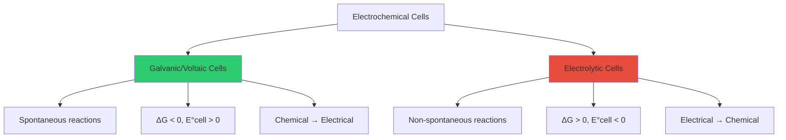

> Master galvanic cells, cell notation, EMF, and the fundamentals of converting chemical energy to electrical energy.

## Introduction

Every smartphone, laptop, and electric vehicle runs on **electrochemical cells**! These ingenious devices convert chemical energy directly into electrical energy through spontaneous redox reactions. Understanding how they work is essential not just for JEE, but for comprehending the technology powering our modern world.

> **★ Key point · Electric Vehicles Revolution**
>
> The 2024 BYD Seagull and Tesla Model Y dominate global EV sales with ranges exceeding 300 miles. Each car contains thousands of lithium-ion cells working together! When you accelerate, lithium ions flow through an electrolyte while electrons power the motor. The chemistry you’ll learn here enables this green revolution. By 2025, EVs are projected to make up 20% of global car sales!

---

## Electrochemical Cell Diagram

Visualize the complete galvanic cell with anode, cathode, salt bridge, and electron flow:

## Interactive: Electrochemical Cell in Action

See how electrons flow through the external circuit while ions migrate through the salt bridge:

---

## What is an Electrochemical Cell?

An **electrochemical cell** is a device that converts chemical energy into electrical energy (or vice versa) through redox reactions.

### Types of Electrochemical Cells



| Feature | Galvanic Cell | Electrolytic Cell |
| --- | --- | --- |
| **Energy conversion** | Chemical → Electrical | Electrical → Chemical |
| **Nature of reaction** | Spontaneous | Non-spontaneous |
| **ΔG** | Negative | Positive |
| **E°cell** | Positive | Negative |
| **Anode** | Negative terminal | Positive terminal |
| **Cathode** | Positive terminal | Negative terminal |
| **Example** | Daniell cell, batteries | Electrolysis of water |

> **★ Key point · Common JEE Mistake**
>
> **Mistake:** Thinking anode is always positive
>
> **Truth:**
>
> - In **galvanic cells**: Anode is **negative** (electrons leave here)

> - In **electrolytic cells**: Anode is **positive** (connected to + terminal)
>
> **Remember:** Anode = where oxidation occurs (AN OX). Cathode = where reduction occurs (RED CAT)

---

## The Daniell Cell: A Classic Example

The **Daniell cell** was invented by John Frederic Daniell in 1836 and powered early telegraph systems!

### Construction

**Setup:**

- **Left half-cell:** Zinc electrode in ZnSO₄ solution
- **Right half-cell:** Copper electrode in CuSO₄ solution
- **Salt bridge:** KCl or NH₄NO₃ solution in agar-agar gel

### Reactions

**At Anode (Zn electrode):** Oxidation

$$\text{Zn}_{(s)} \rightarrow \text{Zn}^{2+}_{(aq)} + 2e^-$$

**At Cathode (Cu electrode):** Reduction

$$\text{Cu}^{2+}_{(aq)} + 2e^- \rightarrow \text{Cu}_{(s)}$$

**Overall Cell Reaction:**

$$\boxed{\text{Zn}_{(s)} + \text{Cu}^{2+}_{(aq)} \rightarrow \text{Zn}^{2+}_{(aq)} + \text{Cu}_{(s)}}$$

### Cell Diagram (Cell Notation)

$$\boxed{\text{Zn}_{(s)} | \text{Zn}^{2+}_{(aq)} || \text{Cu}^{2+}_{(aq)} | \text{Cu}_{(s)}}$$

**Convention:**

- Anode (oxidation) on **left**
- Cathode (reduction) on **right**
- **|** = phase boundary
- **||** = salt bridge
- Concentration usually written: Zn | Zn²⁺(1M) || Cu²⁺(1M) | Cu

---

## Components of Electrochemical Cells

### 1. Electrodes

**Anode:**

- Electrode where **oxidation** occurs
- Electrons are **released**
- In galvanic cells: **negative terminal**
- Mass **decreases** if electrode participates in reaction

**Cathode:**

- Electrode where **reduction** occurs
- Electrons are **consumed**
- In galvanic cells: **positive terminal**
- Mass **increases** if metal ions deposit

### 2. Electrolyte

Ionic solution that allows ion flow between electrodes. Must contain ions of the electrode material or other species that can undergo redox reactions.

### 3. Salt Bridge

**Function:**

- Maintains **electrical neutrality** in half-cells
- Allows ion migration without mixing solutions
- Completes the internal circuit

**Why needed?**
Without salt bridge:

- Zn²⁺ accumulates in anode compartment → positive charge builds up
- Cu²⁺ depletes in cathode compartment → negative charge builds up
- This charge separation stops electron flow!

**Salt bridge action:**

- Anions (Cl⁻) migrate toward anode
- Cations (K⁺) migrate toward cathode
- Neutralizes charge buildup

> **◐ In simple terms · Why KCl or NH₄NO₃?**
>
> The salt bridge uses salts with nearly equal ionic mobilities:
>
> - **KCl:** K⁺ and Cl⁻ have similar speeds

> - **NH₄NO₃:** NH₄⁺ and NO₃⁻ migrate at similar rates
>
> This prevents liquid junction potential! Also, these ions don’t react with electrode materials.

---

## Cell Notation (Cell Diagram)

### Standard Representation

$$\text{Anode} | \text{Anode electrolyte} || \text{Cathode electrolyte} | \text{Cathode}$$

### Notation Rules

1. **Anode on left, cathode on right**
2. **|** represents phase boundary (solid|liquid, gas|liquid)
3. **||** represents salt bridge
4. **,** separates species in same phase
5. Concentrations/pressures in parentheses
6. Inert electrodes (Pt, graphite) written explicitly

### Examples

**Example 1:** Daniell cell

$$\text{Zn}_{(s)} | \text{Zn}^{2+}_{(1M)} || \text{Cu}^{2+}_{(1M)} | \text{Cu}_{(s)}$$

**Example 2:** Hydrogen-silver cell

$$\text{Pt}_{(s)} | \text{H}_2_{(1 \text{ atm})} | \text{H}^+_{(1M)} || \text{Ag}^+_{(1M)} | \text{Ag}_{(s)}$$

**Example 3:** Gas electrode with inert electrode

$$\text{Pt}_{(s)} | \text{Fe}^{2+}_{(aq)}, \text{Fe}^{3+}_{(aq)} || \text{Cl}_2_{(g)} | \text{Cl}^-_{(aq)} | \text{Pt}_{(s)}$$

**Example 4:** Concentration cell

$$\text{Pt}_{(s)} | \text{H}_2_{(1 \text{ atm})} | \text{H}^+_{(0.1M)} || \text{H}^+_{(1M)} | \text{H}_2_{(1 \text{ atm})} | \text{Pt}_{(s)}$$

> **★ Key point · JEE Convention Alert**
>
> **Always write:**
>
> - More dilute solution or lower pressure on **left** (anode)

> - Higher concentration or pressure on **right** (cathode)
>
> This ensures **positive EMF** for spontaneous direction!

---

## Electromotive Force (EMF)

### Definition

**EMF (E°cell)** is the potential difference between two electrodes when **no current is flowing** (open circuit).

### Standard EMF

**Standard conditions:**

- Temperature: **298 K** (25°C)
- Pressure: **1 bar** (≈ 1 atm)
- Concentration: **1 M** for all solutions
- Pure solids and liquids

$$\boxed{E°_{\text{cell}} = E°_{\text{cathode}} - E°_{\text{anode}}}$$

### Calculating Cell EMF

**For Daniell cell:**

- $E°(\text{Cu}^{2+}/\text{Cu}) = +0.34 \text{ V}$ (cathode)
- $E°(\text{Zn}^{2+}/\text{Zn}) = -0.76 \text{ V}$ (anode)

$$E°_{\text{cell}} = 0.34 - (-0.76) = \boxed{1.10 \text{ V}}$$

> **★ Key point · Memory Trick: CROP**
>
> **C**athode → **R**eduction → **O**xidizing agent → **P**ositive terminal (in galvanic cell)
>
> **Anode → Oxidation → Reducing agent → Negative terminal**

---

## Standard Hydrogen Electrode (SHE)

The **SHE** is the universal reference electrode with assigned potential of **0.00 V**.

### Construction

- **Electrode:** Platinum foil coated with platinum black (high surface area)
- **Gas:** Pure H₂ at 1 bar pressure
- **Electrolyte:** 1 M H⁺ (usually HCl)
- **Temperature:** 298 K

### Reaction

**As anode (oxidation):**

$$\text{H}_2 \rightarrow 2\text{H}^+ + 2e^-$$

(E° = 0.00 V)

**As cathode (reduction):**

$$2\text{H}^+ + 2e^- \rightarrow \text{H}_2$$

(E° = 0.00 V)

### Cell Notation

$$\text{Pt}_{(s)} | \text{H}_2_{(1 \text{ bar})} | \text{H}^+_{(1M)} || \text{...}$$

> **◐ In simple terms · Why Platinum Black?**
>
> Platinum black provides **huge surface area** for:
>
> 1. Better adsorption of H₂ molecules

> 2. Faster electron transfer

> 3. Establishment of equilibrium: H₂ ⇌ 2H⁺ + 2e⁻
>
> Plus, platinum is **inert** and doesn’t react with H₂ or H⁺!

---

## Common Electrode Systems

### 1. Metal-Metal Ion Electrode

**Example:** Zn/Zn²⁺, Cu/Cu²⁺

$$\text{M}^{n+} + ne^- \rightarrow \text{M}$$

**Cell notation:** $\text{M} | \text{M}^{n+}$

### 2. Gas Electrode

**Example:** Hydrogen electrode, Chlorine electrode

$$\text{Cl}_2 + 2e^- \rightarrow 2\text{Cl}^-$$

**Cell notation:** $\text{Pt} | \text{Cl}_2 | \text{Cl}^-$

Requires **inert electrode** (Pt) to transfer electrons

### 3. Redox Electrode

**Example:** Fe³⁺/Fe²⁺

$$\text{Fe}^{3+} + e^- \rightarrow \text{Fe}^{2+}$$

**Cell notation:** $\text{Pt} | \text{Fe}^{2+}, \text{Fe}^{3+}$

Both species in same solution, need inert electrode

### 4. Metal-Insoluble Salt Electrode

**Example:** Calomel electrode (Hg/Hg₂Cl₂)

$$\text{Hg}_2\text{Cl}_2 + 2e^- \rightarrow 2\text{Hg} + 2\text{Cl}^-$$

**Example:** Silver-silver chloride electrode

$$\text{AgCl} + e^- \rightarrow \text{Ag} + \text{Cl}^-$$

**Cell notation:** $\text{Ag} | \text{AgCl}_{(s)} | \text{Cl}^-$

---

## Measuring Standard Electrode Potential

### Setup with SHE

To find $E°(\text{Zn}^{2+}/\text{Zn})$:

**Cell:**

$$\text{Zn}_{(s)} | \text{Zn}^{2+}_{(1M)} || \text{H}^+_{(1M)} | \text{H}_2_{(1 \text{ bar})} | \text{Pt}_{(s)}$$

**Measured EMF:** E°cell = +0.76 V

$$E°_{\text{cell}} = E°_{\text{cathode}} - E°_{\text{anode}}$$

$$0.76 = 0.00 - E°(\text{Zn}^{2+}/\text{Zn})$$

$$\boxed{E°(\text{Zn}^{2+}/\text{Zn}) = -0.76 \text{ V}}$$

---

## Spontaneity and Cell Potential

### Relationship with Gibbs Free Energy

$$\boxed{\Delta G° = -nFE°_{\text{cell}}}$$

where:

- $n$ = number of electrons transferred
- $F$ = Faraday’s constant = 96,500 C/mol
- $E°_{\text{cell}}$ in volts
- $\Delta G°$ in joules

### Spontaneity Criteria

| E°cell | ΔG° | Reaction |
| --- | --- | --- |
| **Positive** | **Negative** | **Spontaneous** |
| Zero | Zero | At equilibrium |
| Negative | Positive | Non-spontaneous |

**For Daniell cell:**

$$\Delta G° = -2 \times 96500 \times 1.10 = -212,300 \text{ J} = -212.3 \text{ kJ}$$

The large negative ΔG° confirms highly spontaneous reaction!

> **↗ Connection · Quick Check**
>
> **Q:** If E°cell = 0, what does it mean?
>
> **A:** The system is at **equilibrium**. No net reaction occurs, and the battery is “dead”!

---

## Practice Problems

### Level 1: JEE Main

**Q1.** Write the cell notation for a cell with the following reaction:

$$\text{Mg}_{(s)} + 2\text{Ag}^+_{(aq)} \rightarrow \text{Mg}^{2+}_{(aq)} + 2\text{Ag}_{(s)}$$

**Q2.** In a galvanic cell, which electrode is the cathode?

- (a) Where oxidation occurs
- (b) Where reduction occurs
- (c) The negative terminal
- (d) Where electrons are produced

**Q3.** Calculate E°cell for:

$$\text{Zn}_{(s)} + 2\text{Ag}^+_{(aq)} \rightarrow \text{Zn}^{2+}_{(aq)} + 2\text{Ag}_{(s)}$$

Given: E°(Ag⁺/Ag) = +0.80 V, E°(Zn²⁺/Zn) = -0.76 V

---

### Level 2: JEE Main/Advanced

**Q4.** For the cell:

$$\text{Pt} | \text{H}_2(1 \text{ atm}) | \text{H}^+(1M) || \text{Ni}^{2+}(1M) | \text{Ni}$$

If E°cell = -0.25 V, find E°(Ni²⁺/Ni).

**Q5.** A galvanic cell is set up with aluminum and silver electrodes. Write:

- (a) Half-reactions at each electrode
- (b) Overall cell reaction
- (c) Cell notation
  Given: E°(Al³⁺/Al) = -1.66 V, E°(Ag⁺/Ag) = +0.80 V

**Q6.** Why is a salt bridge necessary in a galvanic cell? What happens if it’s removed?

---

### Level 3: JEE Advanced

**Q7.** For the cell:

$$\text{Pt} | \text{Fe}^{2+}(0.1M), \text{Fe}^{3+}(0.01M) || \text{Ag}^+(1M) | \text{Ag}$$

Write the cell reaction and calculate E°cell.
Given: E°(Fe³⁺/Fe²⁺) = +0.77 V, E°(Ag⁺/Ag) = +0.80 V

**Q8.** Calculate ΔG° for the reaction:

$$3\text{Cu}_{(s)} + 2\text{Au}^{3+}_{(aq)} \rightarrow 3\text{Cu}^{2+}_{(aq)} + 2\text{Au}_{(s)}$$

Given: E°(Au³⁺/Au) = +1.50 V, E°(Cu²⁺/Cu) = +0.34 V

**Q9.** Design a galvanic cell that uses the reaction:

$$2\text{Al}_{(s)} + 3\text{Cd}^{2+}_{(aq)} \rightarrow 2\text{Al}^{3+}_{(aq)} + 3\text{Cd}_{(s)}$$

Write cell notation and calculate E°cell.
Given: E°(Al³⁺/Al) = -1.66 V, E°(Cd²⁺/Cd) = -0.40 V

---

## Solutions to Practice Problems

**A1.** $\text{Mg}_{(s)} | \text{Mg}^{2+}_{(aq)} || \text{Ag}^+_{(aq)} | \text{Ag}_{(s)}$

**A2.** (b) Where reduction occurs

**A3.** E°cell = 0.80 - (-0.76) = **1.56 V**

**A4.** E°(Ni²⁺/Ni) = E°cathode = E°cell + E°anode = -0.25 + 0 = **-0.25 V**

**A7.** Cell reaction: Fe²⁺ + Ag⁺ → Fe³⁺ + Ag; E°cell = 0.80 - 0.77 = **0.03 V**

**A8.** n = 6, E°cell = 1.50 - 0.34 = 1.16 V
ΔG° = -6 × 96500 × 1.16 = **-671.88 kJ**

**A9.** $\text{Al}_{(s)} | \text{Al}^{3+}_{(aq)} || \text{Cd}^{2+}_{(aq)} | \text{Cd}_{(s)}$; E°cell = -0.40 - (-1.66) = **1.26 V**

---

## Common Mistakes to Avoid

> **★ Key point · Sign Convention Pitfalls**
>
> **Mistake 1:** Confusing anode/cathode polarity
>
> - **Galvanic:** Anode = negative, Cathode = positive

> - **Electrolytic:** Anode = positive, Cathode = negative
>
> **Mistake 2:** Wrong formula for E°cell
>
> - **Correct:** E°cell = E°cathode - E°anode

> - **Wrong:** E°cell = E°anode - E°cathode
>
> **Mistake 3:** Forgetting to identify cathode correctly
>
> - **Remember:** Reduction occurs at cathode (species with **higher** reduction potential)
>
> **Mistake 4:** Writing cell notation backwards
>
> - **Correct:** Anode || Cathode (oxidation on left)

> - **Wrong:** Cathode || Anode

---

## Key Points for JEE

### Must Remember

1. **AN OX, RED CAT** - Anode oxidation, Reduction cathode
2. E°cell = E°cathode - E°anode (ALWAYS!)
3. Positive E°cell → Spontaneous → Galvanic cell
4. Standard conditions: 298 K, 1 bar, 1 M
5. Salt bridge maintains electrical neutrality

### Quick Formulas

$$\boxed{E°_{\text{cell}} = E°_{\text{cathode}} - E°_{\text{anode}}}$$

$$\boxed{\Delta G° = -nFE°_{\text{cell}}}$$

$$\boxed{E°_{\text{cell}} > 0 \implies \text{Spontaneous}}$$

---

## Real-Life Applications

> **◐ In simple terms · Why Phone Batteries Degrade**
>
> Your iPhone’s lithium-ion battery (2024 models have ~3,200 mAh capacity) degrades over time because:
>
> 1. **Side reactions** consume electrolyte

> 2. **Dendrite formation** can short-circuit cells

> 3. **SEI layer** (solid-electrolyte interphase) thickens, increasing resistance
>
> This is why Apple recommends keeping battery between 20-80% charge - it minimizes stress on the electrochemical reactions! The E°cell slowly decreases with age.

---

## Related Topics

### Within Electrochemistry

- [Oxidation-Reduction](../oxidation-reduction/index.md) - Understanding redox fundamentals
- [Electrode Potentials](../electrode-potentials/index.md) - Electrochemical series and predictions
- [Nernst Equation](../nernst-equation/index.md) - EMF at non-standard conditions
- [Electrolysis](../electrolysis/index.md) - Non-spontaneous electrochemical reactions
- [Batteries](../batteries/index.md) - Practical galvanic cells (primary and secondary)
- [Corrosion](../corrosion/index.md) - Electrochemical degradation of metals

### Cross-Chapter Connections

- [Thermodynamics - Gibbs Energy](../../thermodynamics/gibbs-energy/index.md) - ΔG° = -nFE° relationship
- [Thermodynamics - Enthalpy](../../thermodynamics/enthalpy/index.md) - Heat effects in cells
- [Chemical Equilibrium](../../equilibrium/chemical-equilibrium/index.md) - Relationship between K and E°
- [Chemical Kinetics](../../chemical-kinetics/rate-of-reaction/index.md) - Reaction rates at electrodes
- [Ionic Equilibrium](../../equilibrium/ionic-equilibrium/index.md) - Ion concentrations in cells
- [Solutions - Concentration Methods](../../solutions/concentration-methods/index.md) - Molarity in cell calculations

### Foundation Topics

- [Stoichiometry](../../basic-concepts/stoichiometry/index.md) - Mole calculations in electrolysis
- [Mole Concept](../../basic-concepts/mole-concept/index.md) - Faraday’s laws calculations

### Physics Connections

- [Current Electricity](../../../physics/current-electricity/index.md) - Ohm’s law, resistance in circuits
- [Electrostatics](../../../physics/electrostatics/index.md) - Electric potential concepts
- [Drift Velocity](../../../physics/current-electricity/drift-velocity/index.md) - Electron movement

---

From TestGuru · our mock-test platform

## You've read Electrochemical Cells.You've read this topic. Find out what you actually got.

A free JEE Main mock with this chapter in it, and a report that shows which sub-topics cost you marks.

[Take a free JEE Main mock →](https://app.testguru.co/signup?tg_chapter=redox-electrochemistry&tg_exam=jee-main&tg_page=%2Fchemistry%2Fredox-electrochemistry%2Felectrochemical-cells%2F&tg_subject=chemistry&utm_campaign=notes-jee-main-free-test&utm_content=article-end&utm_medium=referral&utm_source=jeenotes)
Free, no card. Opens TestGuru in a new tab.

## Stay exam-ready

One email every Sunday: new notes, the week's hardest challenge question and a revision plan.One email every Sunday.

## Comments

Have a question or spotted a mistake? Join the discussion below.

Advertisement

Advertisement

---

## Extracted page code (interactive scripts & widgets)


### inline-script-16

```js
if(!document.getElementById("animation-fullscreen-overlay")){const e=document.createElement("div");e.id="animation-fullscreen-overlay",e.className="animation-fullscreen-overlay",e.innerHTML=`
      <div class="fullscreen-modal">
        <div class="fullscreen-header">
          <span class="fullscreen-title">Interactive Demo</span>
          <button class="fullscreen-close-btn" onclick="JEEAnimations.closeFullscreen()" title="Close (Esc)" aria-label="Close fullscreen">
            <svg width="24" height="24" viewBox="0 0 24 24" fill="none" stroke="currentColor" stroke-width="2" stroke-linecap="round" stroke-linejoin="round">
              <line x1="18" y1="6" x2="6" y2="18"></line>
              <line x1="6" y1="6" x2="18" y2="18"></line>
            </svg>
          </button>
        </div>
        <div class="fullscreen-content"></div>
      </div>
    `,document.body.appendChild(e),document.addEventListener("keydown",function(e){e.key==="Escape"&&document.body.classList.contains("animation-fullscreen-active")&&JEEAnimations.closeFullscreen()}),e.addEventListener("click",function(t){t.target===e&&JEEAnimations.closeFullscreen()})}
```


### inline-script-17

```js
(function(){var t,e=document.getElementById("disqus-load");if(!e)return;t=!1,e.addEventListener("click",function(){if(t)return;t=!0,e.setAttribute("disabled","disabled"),e.textContent="Loading comments…",window.disqus_config=function(){this.page.url="https://jeenotes.in/chemistry/redox-electrochemistry/electrochemical-cells/",this.page.identifier="/chemistry/redox-electrochemistry/electrochemical-cells/"};var s=document,n=s.createElement("script");n.src="https://https-jeenotes-in.disqus.com/embed.js",n.setAttribute("data-timestamp",+new Date),n.onload=function(){e.style.display="none"},n.onerror=function(){t=!1,e.removeAttribute("disabled"),e.textContent="Could not load comments. Tap to retry"},(s.head||s.body).appendChild(n)})})()
```


### inline-script-18

```js
(function(){var t,e=document.currentScript.previousElementSibling;function n(){(window.adsbygoogle=window.adsbygoogle||[]).push({})}if(!window.ResizeObserver||e.clientWidth>0){n();return}t=new ResizeObserver(function(){e.clientWidth>0&&(t.disconnect(),n())}),t.observe(e)})()
```


### interactive-widget-1

```html
<div class="animation-wrapper" data-animation="electrochemicalCell" id="anim-electrochemicalCell-1795396420484565608"><div class="animation-header"><button aria-label="Toggle fullscreen" class="anim-fullscreen-btn" onclick='JEEAnimations.toggleFullscreen("anim-electrochemicalCell-1795396420484565608")' title="Fullscreen (F)">
<svg class="fullscreen-icon-expand" fill="none" height="18" stroke="currentColor" stroke-linecap="round" stroke-linejoin="round" stroke-width="2" viewbox="0 0 24 24" width="18"><polyline points="15 3 21 3 21 9"></polyline><polyline points="9 21 3 21 3 15"></polyline><line x1="21" x2="14" y1="3" y2="10"></line><line x1="3" x2="10" y1="21" y2="14"></line></svg>
<svg class="fullscreen-icon-collapse" fill="none" height="18" stroke="currentColor" stroke-linecap="round" stroke-linejoin="round" stroke-width="2" viewbox="0 0 24 24" width="18"><polyline points="4 14 10 14 10 20"></polyline><polyline points="20 10 14 10 14 4"></polyline><line x1="14" x2="21" y1="10" y2="3"></line><line x1="3" x2="10" y1="21" y2="14"></line></svg>
<span class="fullscreen-text">Fullscreen</span></button></div><div class="animation-content"><noscript><div class="callout callout-warning"><div class="callout-title">JavaScript Required</div><p>This interactive animation requires JavaScript to be enabled.</p></div></noscript></div></div>
```


---

_Source: [https://jeenotes.in/chemistry/redox-electrochemistry/electrochemical-cells/](https://jeenotes.in/chemistry/redox-electrochemistry/electrochemical-cells/) · raw HTML: `offline/chemistry/redox-electrochemistry/electrochemical-cells/index.html`_
