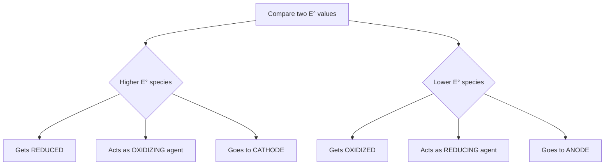

> Master standard electrode potentials, electrochemical series, and prediction of reaction spontaneity for JEE.

## Introduction

Why does zinc dissolve in copper sulfate solution but copper doesn’t dissolve in zinc sulfate? Why can’t we store ferrous sulfate solution in a copper container? The answer lies in **electrode potentials** - a ranking system that predicts which metals are stronger reducing agents and which ions are better oxidizing agents!

> **★ Key point · Why Gold Doesn't Rust**
>
> King Tutankhamun’s golden death mask (1323 BC) looks pristine after 3,300+ years, while the iron tools buried nearby have completely rusted away! Gold’s electrode potential (+1.50 V) is so high that it refuses to oxidize under normal conditions. Meanwhile, iron’s potential (-0.44 V) means it eagerly gives up electrons. This is why the 2024 Paris Olympics gold medals contain only 6g of actual gold - the rest is silver and copper!

---

## Interactive: Electrochemical Series

Explore the electrochemical series and predict reactions:

---

## Standard Electrode Potential (E°)

### Definition

The **standard electrode potential (E°)** is the potential difference developed between the electrode and the electrolyte when:

- Concentration of ions = **1 M**
- Temperature = **298 K** (25°C)
- Pressure (for gases) = **1 bar**
- The other electrode is **Standard Hydrogen Electrode (SHE)** at E° = 0.00 V

### Convention

All electrode potentials are written as **reduction potentials**:

$$\boxed{\text{Oxidized form} + ne^- \rightarrow \text{Reduced form}} \quad E°$$

**Examples:**

- $\text{Cu}^{2+} + 2e^- \rightarrow \text{Cu}$    E° = +0.34 V
- $\text{Zn}^{2+} + 2e^- \rightarrow \text{Zn}$    E° = -0.76 V
- $\text{Ag}^+ + e^- \rightarrow \text{Ag}$    E° = +0.80 V

> **★ Key point · Sign Convention Alert!**
>
> **Always write electrode potentials as REDUCTION reactions!**
>
> If you need the oxidation potential, simply **reverse the reaction** and **change the sign**:
>
> **Reduction:** $\text{Zn}^{2+} + 2e^- \rightarrow \text{Zn}$    E° = -0.76 V
>
> **Oxidation:** $\text{Zn} \rightarrow \text{Zn}^{2+} + 2e^-$    E° = +0.76 V

---

## Measuring Electrode Potential

### Setup with Standard Hydrogen Electrode

To measure E°(Cu²⁺/Cu):

**Cell:**

$$\text{Pt} | \text{H}_2(1 \text{ bar}) | \text{H}^+(1M) || \text{Cu}^{2+}(1M) | \text{Cu}$$

**Measured EMF:** +0.34 V

Since H₂ is oxidized (anode) and Cu²⁺ is reduced (cathode):

$$E°_{\text{cell}} = E°_{\text{cathode}} - E°_{\text{anode}}$$

$$0.34 = E°(\text{Cu}^{2+}/\text{Cu}) - 0$$

$$\boxed{E°(\text{Cu}^{2+}/\text{Cu}) = +0.34 \text{ V}}$$

### For Negative Electrode Potentials

To measure E°(Zn²⁺/Zn):

**Cell:**

$$\text{Zn} | \text{Zn}^{2+}(1M) || \text{H}^+(1M) | \text{H}_2(1 \text{ bar}) | \text{Pt}$$

**Measured EMF:** +0.76 V

Here Zn is oxidized (anode) and H⁺ is reduced (cathode):

$$0.76 = 0 - E°(\text{Zn}^{2+}/\text{Zn})$$

$$\boxed{E°(\text{Zn}^{2+}/\text{Zn}) = -0.76 \text{ V}}$$

---

## The Electrochemical Series

The **electrochemical series** arranges elements in order of their standard reduction potentials (E°).

### Complete Electrochemical Series

| Half-Reaction | E° (V) | Strength |
| --- | --- | --- |
| F₂ + 2e⁻ → 2F⁻ | +2.87 | ↑ |
| Au³⁺ + 3e⁻ → Au | +1.50 |  |
| Cl₂ + 2e⁻ → 2Cl⁻ | +1.36 | **Strong** |
| MnO₄⁻ + 8H⁺ + 5e⁻ → Mn²⁺ + 4H₂O | +1.51 | **Oxidizing** |
| Br₂ + 2e⁻ → 2Br⁻ | +1.09 | **Agents** |
| Ag⁺ + e⁻ → Ag | +0.80 |  |
| Fe³⁺ + e⁻ → Fe²⁺ | +0.77 |  |
| I₂ + 2e⁻ → 2I⁻ | +0.54 |  |
| Cu²⁺ + 2e⁻ → Cu | +0.34 | ↓ |
| **2H⁺ + 2e⁻ → H₂** | **0.00** | **Reference** |
| Pb²⁺ + 2e⁻ → Pb | -0.13 | ↑ |
| Sn²⁺ + 2e⁻ → Sn | -0.14 |  |
| Ni²⁺ + 2e⁻ → Ni | -0.25 |  |
| Fe²⁺ + 2e⁻ → Fe | -0.44 | **Strong** |
| Zn²⁺ + 2e⁻ → Zn | -0.76 | **Reducing** |
| Al³⁺ + 3e⁻ → Al | -1.66 | **Agents** |
| Mg²⁺ + 2e⁻ → Mg | -2.37 |  |
| Na⁺ + e⁻ → Na | -2.71 |  |
| Ca²⁺ + 2e⁻ → Ca | -2.87 |  |
| K⁺ + e⁻ → K | -2.93 |  |
| Li⁺ + e⁻ → Li | -3.05 | ↓ |

> **★ Key point · Memory Trick: Electrochemical Series**
>
> **Top to Bottom (Decreasing E°):**
>
> **F**luorine **A**lways **C**laims **B**eing **S**trongest **O**xidizing **A**gent, **C**opper **H**elps **Z**inc **A**nd **M**agnesium **N**ever **K**eeps **L**osing **E**lectrons
>
> **F** - Au - **C**l₂ - **B**r₂ - Ag - Cu - **H** - Zn - Al - Mg - Na - K - Li
>
> For JEE, remember these key values:
>
> - **Li⁺/Li = -3.05 V** (most negative)

> - **Zn²⁺/Zn = -0.76 V**

> - **H⁺/H₂ = 0.00 V** (reference)

> - **Cu²⁺/Cu = +0.34 V**

> - **Ag⁺/Ag = +0.80 V**

> - **F₂/F⁻ = +2.87 V** (most positive)

---

## Interpreting the Electrochemical Series

### 1. As Oxidizing Agents (Getting Reduced)

**Higher E° = Stronger oxidizing agent**

- **Top of series** (F₂, Au³⁺, Cl₂) are **excellent oxidizing agents**
- They readily **gain electrons** (get reduced)
- F₂ is the strongest oxidizing agent known!

**Order of oxidizing strength:**

$$\text{F}_2 > \text{MnO}_4^- > \text{Cl}_2 > \text{Br}_2 > \text{Ag}^+ > \text{Cu}^{2+} > \text{H}^+$$

### 2. As Reducing Agents (Getting Oxidized)

**Lower E° = Stronger reducing agent**

- **Bottom of series** (Li, K, Na, Mg) are **excellent reducing agents**
- They readily **lose electrons** (get oxidized)
- Li is the strongest reducing agent in the series!

**Order of reducing strength:**

$$\text{Li} > \text{K} > \text{Na} > \text{Mg} > \text{Al} > \text{Zn} > \text{Fe} > \text{H}_2$$

> **◐ In simple terms · Diagonal Relationship**
>
> **Top-right** → Strong oxidizing agents (want electrons)
>
> **Bottom-left** → Strong reducing agents (give electrons)
>
> This creates a **diagonal trend** in the periodic table!

---

## Predicting Reaction Spontaneity

### Rule for Spontaneity

A redox reaction is **spontaneous** if:

$$\boxed{E°_{\text{cell}} = E°_{\text{cathode}} - E°_{\text{anode}} > 0}$$

Equivalently:

$$\boxed{E°_{\text{reduction}} > E°_{\text{oxidation}}}$$

### The Higher-Lower Rule

**Spontaneous reaction occurs when:**

- Species with **higher E°** gets **reduced** (cathode)
- Species with **lower E°** gets **oxidized** (anode)

### Example 1: Zn + Cu²⁺

**Question:** Will Zn reduce Cu²⁺?

**Half-reactions:**

- $\text{Cu}^{2+} + 2e^- \rightarrow \text{Cu}$    E° = +0.34 V
- $\text{Zn}^{2+} + 2e^- \rightarrow \text{Zn}$    E° = -0.76 V

**Analysis:**

- Cu²⁺ has higher E° → gets reduced (cathode)
- Zn has lower E° → gets oxidized (anode)

**E°cell = 0.34 - (-0.76) = +1.10 V > 0**

**Answer:** Yes, spontaneous! ✓

### Example 2: Cu + Zn²⁺

**Question:** Will Cu reduce Zn²⁺?

**Analysis:**

- Zn²⁺/Zn: E° = -0.76 V (lower)
- Cu²⁺/Cu: E° = +0.34 V (higher)

For Cu to reduce Zn²⁺:

- Zn²⁺ must be reduced (cathode)
- Cu must be oxidized (anode)

**E°cell = -0.76 - 0.34 = -1.10 V < 0**

**Answer:** No, non-spontaneous! ✗

> **↗ Connection · Quick Check**
>
> **Q:** Can Fe²⁺ reduce Ag⁺ to Ag?
>
> **Given:** E°(Ag⁺/Ag) = +0.80 V, E°(Fe³⁺/Fe²⁺) = +0.77 V
>
> **A:** Yes! Ag⁺ has higher E° (+0.80 V), so it gets reduced. Fe²⁺ gets oxidized to Fe³⁺.

> E°cell = 0.80 - 0.77 = +0.03 V (spontaneous)

---

## Applications of Electrochemical Series

### 1. Predicting Displacement Reactions

**Rule:** A metal can displace another metal from its salt solution if it has **lower** reduction potential.

**Example:** Can Zn displace Cu from CuSO₄?

- E°(Zn²⁺/Zn) = -0.76 V (lower)
- E°(Cu²⁺/Cu) = +0.34 V (higher)

Yes! Zn is a stronger reducing agent.

$$\text{Zn} + \text{CuSO}_4 \rightarrow \text{ZnSO}_4 + \text{Cu}$$

### 2. Reactivity of Metals with Acids

**Rule:** Metals with **negative** E° (below hydrogen) can displace H₂ from acids.

**Can react with dilute acids (E° < 0):**

- Zn, Fe, Al, Mg, Na, K (all below H in series)
- Example: $\text{Zn} + 2\text{HCl} \rightarrow \text{ZnCl}_2 + \text{H}_2$

**Cannot react with dilute acids (E° > 0):**

- Cu, Ag, Au (all above H in series)
- Cu + HCl → No reaction

> **◐ In simple terms · Why Cu Dissolves in HNO₃ but not HCl**
>
> HNO₃ is a **strong oxidizing acid**:
>
> - HCl provides only H⁺ (E° = 0.00 V) - cannot oxidize Cu

> - HNO₃ provides NO₃⁻ which acts as oxidizing agent (E° » 0)
>
> $$3\text{Cu} + 8\text{HNO}_3(\text{dil.}) \rightarrow 3\text{Cu(NO}_3)_2 + 2\text{NO} + 4\text{H}_2\text{O}$$
>
> This is why 2025’s semiconductor industry uses HNO₃-based etchants for copper circuits!

### 3. Galvanic Cell Design

**Rule:** Use two half-cells with **large difference** in E° for maximum EMF.

**Best combination:**

- Anode: Li/Li⁺ (E° = -3.05 V)
- Cathode: F₂/F⁻ (E° = +2.87 V)
- **E°cell = 2.87 - (-3.05) = 5.92 V!**

(Impractical due to reactivity, but shows the principle)

### 4. Corrosion Prevention

**Rule:** Metals with **lower** E° corrode preferentially (sacrificial protection).

For protecting iron ships (E°(Fe²⁺/Fe) = -0.44 V):

- Attach Zn blocks (E° = -0.76 V) → Zn corrodes instead
- Attach Mg blocks (E° = -2.37 V) → Even better protection!

---

## Comparing Oxidizing and Reducing Powers

### Strongest Oxidizing Agents

| Species | E° (V) | Common Use |
| --- | --- | --- |
| F₂/F⁻ | +2.87 | Uranium enrichment |
| MnO₄⁻/Mn²⁺ (acidic) | +1.51 | Titrations in labs |
| Cl₂/Cl⁻ | +1.36 | Water purification |
| Cr₂O₇²⁻/Cr³⁺ (acidic) | +1.33 | Oxidizing agent |

### Strongest Reducing Agents

| Species | E° (V) | Common Use |
| --- | --- | --- |
| Li/Li⁺ | -3.05 | Batteries |
| K/K⁺ | -2.93 | Reduction reactions |
| Na/Na⁺ | -2.71 | Metallurgy |
| Mg/Mg²⁺ | -2.37 | Grignard reagents |
| Al/Al³⁺ | -1.66 | Thermite reactions |

---

## Standard Electrode Potentials - Important Values

### For JEE: Must Memorize

| Half-Reaction | E° (V) |
| --- | --- |
| **Halogens** |  |
| F₂ + 2e⁻ → 2F⁻ | **+2.87** |
| Cl₂ + 2e⁻ → 2Cl⁻ | **+1.36** |
| Br₂ + 2e⁻ → 2Br⁻ | +1.09 |
| I₂ + 2e⁻ → 2I⁻ | +0.54 |
| **Metals** |  |
| Ag⁺ + e⁻ → Ag | **+0.80** |
| Cu²⁺ + 2e⁻ → Cu | **+0.34** |
| 2H⁺ + 2e⁻ → H₂ | **0.00** |
| Pb²⁺ + 2e⁻ → Pb | -0.13 |
| Ni²⁺ + 2e⁻ → Ni | -0.25 |
| Fe²⁺ + 2e⁻ → Fe | -0.44 |
| Zn²⁺ + 2e⁻ → Zn | **-0.76** |
| Al³⁺ + 3e⁻ → Al | **-1.66** |
| Mg²⁺ + 2e⁻ → Mg | -2.37 |
| Na⁺ + e⁻ → Na | -2.71 |
| Li⁺ + e⁻ → Li | **-3.05** |
| **Important Ions** |  |
| MnO₄⁻ + 8H⁺ + 5e⁻ → Mn²⁺ + 4H₂O | +1.51 |
| Cr₂O₇²⁻ + 14H⁺ + 6e⁻ → 2Cr³⁺ + 7H₂O | +1.33 |
| Fe³⁺ + e⁻ → Fe²⁺ | **+0.77** |

---

## Practice Problems

### Level 1: JEE Main

**Q1.** Which is the strongest reducing agent?

- (a) Li (b) Na (c) K (d) Mg

**Q2.** Which metal cannot displace hydrogen from dilute HCl?

- (a) Zn (b) Fe (c) Cu (d) Mg

**Q3.** Arrange in order of increasing oxidizing power:
Cl₂, Br₂, I₂, F₂

**Q4.** Calculate E°cell for:

$$\text{Fe} + \text{CuSO}_4 \rightarrow \text{FeSO}_4 + \text{Cu}$$

Given: E°(Cu²⁺/Cu) = +0.34 V, E°(Fe²⁺/Fe) = -0.44 V

---

### Level 2: JEE Main/Advanced

**Q5.** Predict whether the following reactions are spontaneous:

- (a) $2\text{Ag} + \text{Zn}^{2+} \rightarrow 2\text{Ag}^+ + \text{Zn}$
- (b) $\text{Mg} + 2\text{Ag}^+ \rightarrow \text{Mg}^{2+} + 2\text{Ag}$

**Q6.** Which of the following can reduce Fe³⁺ to Fe²⁺?

- (a) Cu (b) Zn (c) I⁻ (d) Br⁻
  Given: E°(Fe³⁺/Fe²⁺) = +0.77 V, E°(I₂/I⁻) = +0.54 V

**Q7.** In the electrochemical series, if E°(M²⁺/M) = -0.50 V:

- (a) Can M displace hydrogen from acids?
- (b) Can M reduce Cu²⁺ to Cu?
- (c) Can M reduce Ag⁺ to Ag?

---

### Level 3: JEE Advanced

**Q8.** A solution contains Fe²⁺, Cu²⁺, and Ag⁺ ions. What happens when zinc metal is added?
Given: E°(Ag⁺/Ag) = +0.80 V, E°(Cu²⁺/Cu) = +0.34 V, E°(Fe³⁺/Fe²⁺) = +0.77 V, E°(Fe²⁺/Fe) = -0.44 V, E°(Zn²⁺/Zn) = -0.76 V

**Q9.** Three metals X, Y, Z have E° values -0.76 V, +0.34 V, and +0.80 V respectively. Which metal will:

- (a) Corrode most easily?
- (b) Be best for sacrificial protection of iron?
- (c) Be used as cathode in a cell with maximum EMF?

**Q10.** For the reaction:

$$a\text{MnO}_4^- + b\text{Fe}^{2+} + c\text{H}^+ \rightarrow d\text{Mn}^{2+} + e\text{Fe}^{3+} + f\text{H}_2\text{O}$$

Find a:b ratio and calculate E°cell.
Given: E°(MnO₄⁻/Mn²⁺) = +1.51 V, E°(Fe³⁺/Fe²⁺) = +0.77 V

---

## Solutions to Practice Problems

**A1.** (a) Li - Most negative E° = -3.05 V

**A2.** (c) Cu - E° = +0.34 V (above hydrogen)

**A3.** I₂ < Br₂ < Cl₂ < F₂ (increasing E°)

**A4.** E°cell = 0.34 - (-0.44) = **0.78 V**

**A5.**

- (a) E°cell = -0.76 - 0.80 = -1.56 V → **Non-spontaneous**
- (b) E°cell = 0.80 - (-2.37) = +3.17 V → **Spontaneous**

**A6.** (c) I⁻ - E°(I₂/I⁻) = +0.54 V < E°(Fe³⁺/Fe²⁺) = +0.77 V
So I⁻ can reduce Fe³⁺

**A7.**

- (a) Yes (E° < 0)
- (b) Yes (E° = -0.50 < +0.34)
- (c) Yes (E° = -0.50 < +0.80)

**A8.** Zn will reduce all three: Ag⁺ → Ag, Cu²⁺ → Cu, and Fe²⁺ → Fe (all have higher E° than Zn)

**A9.**

- (a) X (-0.76 V, lowest/most negative)
- (b) X (needs lower E° than Fe)
- (c) Z (+0.80 V, highest)

**A10.** a:b = 1:5 (from electron balance); E°cell = 1.51 - 0.77 = **0.74 V**

---

## Common Mistakes to Avoid

> **★ Key point · JEE Pitfalls**
>
> **Mistake 1:** Confusing oxidizing/reducing agent strength
>
> - **Higher E°** = stronger **oxidizing** agent (wants to gain electrons)

> - **Lower E°** = stronger **reducing** agent (wants to lose electrons)
>
> **Mistake 2:** Wrong subtraction order
>
> - **Always:** E°cell = E°(higher) - E°(lower) = E°cathode - E°anode

> - Sign of E°cell tells spontaneity!
>
> **Mistake 3:** Multiplying E° by stoichiometric coefficients
>
> - **Wrong:** For $2\text{Ag}^+ + 2e^- \rightarrow 2\text{Ag}$, E° ≠ 2(0.80) = 1.60 V

> - **Correct:** E° remains 0.80 V (intensive property!)
>
> **Mistake 4:** Not all oxidizing agents are “oxidized” themselves
>
> - Oxidizing agent **gets reduced** (gains electrons)

> - Example: MnO₄⁻ is oxidizing agent but gets **reduced** to Mn²⁺
>
> **Mistake 5:** Forgetting medium dependency
>
> - E°(MnO₄⁻/Mn²⁺) = +1.51 V in **acidic** medium

> - Different in neutral or basic medium!

---

## Key Takeaways for JEE

### Must Remember Concepts

1. **Electrochemical series** ranks elements by E° (reduction potential)
2. **Higher E°** → Better oxidizing agent (top of series)
3. **Lower E°** → Better reducing agent (bottom of series)
4. **Spontaneity:** E°cell > 0 (reduction > oxidation potential)
5. **Metals below H₂** (E° < 0) react with dilute acids
6. **E° is intensive** - doesn’t multiply with stoichiometry

### Quick Decision Tree



---

## Real-Life Applications

> **◐ In simple terms · Underwater Welding Anodes**
>
> Deep-sea oil rigs (like those in the Gulf of Mexico, 2025) use **sacrificial zinc anodes** to protect steel structures. The zinc (E° = -0.76 V) preferentially corrodes instead of iron (E° = -0.44 V), extending the rig’s lifespan by decades! Divers replace these anodes yearly - it’s literally electrochemistry in action at 300 feet underwater.

---

## Related Topics

### Within Electrochemistry

- [Oxidation-Reduction](../oxidation-reduction/index.md) — Foundation of redox reactions
- [Electrochemical Cells](../electrochemical-cells/index.md) — Building cells using E° values
- [Nernst Equation](../nernst-equation/index.md) — E° at non-standard conditions
- [Batteries](../batteries/index.md) — Practical applications of electrode potentials

### Cross-Chapter Connections

- [Thermodynamics](../../thermodynamics/index.md) — ΔG° = -nFE° relationship
- [Chemical Equilibrium](../../equilibrium/index.md) — Connection via equilibrium constant
- [Periodic Properties](../../periodic-classification/index.md) — Trends in E° values

### Physics Connections

- [Current Electricity](../../../physics/current-electricity/index.md) — Potential difference concepts
- [Electrostatics](../../../physics/electrostatics/index.md) — Electric potential fundamentals

---

From TestGuru · our mock-test platform

## You've read Electrode Potentials and Electrochemical Series.You've read this topic. Find out what you actually got.

A free JEE Main mock with this chapter in it, and a report that shows which sub-topics cost you marks.

[Take a free JEE Main mock →](https://app.testguru.co/signup?tg_chapter=redox-electrochemistry&tg_exam=jee-main&tg_page=%2Fchemistry%2Fredox-electrochemistry%2Felectrode-potentials%2F&tg_subject=chemistry&utm_campaign=notes-jee-main-free-test&utm_content=article-end&utm_medium=referral&utm_source=jeenotes)
Free, no card. Opens TestGuru in a new tab.

## Stay exam-ready

One email every Sunday: new notes, the week's hardest challenge question and a revision plan.One email every Sunday.

## Comments

Have a question or spotted a mistake? Join the discussion below.

Advertisement

Advertisement

---

## Extracted page code (interactive scripts & widgets)


### inline-script-16

```js
if(!document.getElementById("animation-fullscreen-overlay")){const e=document.createElement("div");e.id="animation-fullscreen-overlay",e.className="animation-fullscreen-overlay",e.innerHTML=`
      <div class="fullscreen-modal">
        <div class="fullscreen-header">
          <span class="fullscreen-title">Interactive Demo</span>
          <button class="fullscreen-close-btn" onclick="JEEAnimations.closeFullscreen()" title="Close (Esc)" aria-label="Close fullscreen">
            <svg width="24" height="24" viewBox="0 0 24 24" fill="none" stroke="currentColor" stroke-width="2" stroke-linecap="round" stroke-linejoin="round">
              <line x1="18" y1="6" x2="6" y2="18"></line>
              <line x1="6" y1="6" x2="18" y2="18"></line>
            </svg>
          </button>
        </div>
        <div class="fullscreen-content"></div>
      </div>
    `,document.body.appendChild(e),document.addEventListener("keydown",function(e){e.key==="Escape"&&document.body.classList.contains("animation-fullscreen-active")&&JEEAnimations.closeFullscreen()}),e.addEventListener("click",function(t){t.target===e&&JEEAnimations.closeFullscreen()})}
```


### inline-script-17

```js
(function(){var t,e=document.getElementById("disqus-load");if(!e)return;t=!1,e.addEventListener("click",function(){if(t)return;t=!0,e.setAttribute("disabled","disabled"),e.textContent="Loading comments…",window.disqus_config=function(){this.page.url="https://jeenotes.in/chemistry/redox-electrochemistry/electrode-potentials/",this.page.identifier="/chemistry/redox-electrochemistry/electrode-potentials/"};var s=document,n=s.createElement("script");n.src="https://https-jeenotes-in.disqus.com/embed.js",n.setAttribute("data-timestamp",+new Date),n.onload=function(){e.style.display="none"},n.onerror=function(){t=!1,e.removeAttribute("disabled"),e.textContent="Could not load comments. Tap to retry"},(s.head||s.body).appendChild(n)})})()
```


### inline-script-18

```js
(function(){var t,e=document.currentScript.previousElementSibling;function n(){(window.adsbygoogle=window.adsbygoogle||[]).push({})}if(!window.ResizeObserver||e.clientWidth>0){n();return}t=new ResizeObserver(function(){e.clientWidth>0&&(t.disconnect(),n())}),t.observe(e)})()
```


### interactive-widget-1

```html
<div class="animation-wrapper" data-animation="electrochemicalCell" id="anim-electrochemicalCell-1795396420489461738"><div class="animation-header"><button aria-label="Toggle fullscreen" class="anim-fullscreen-btn" onclick='JEEAnimations.toggleFullscreen("anim-electrochemicalCell-1795396420489461738")' title="Fullscreen (F)">
<svg class="fullscreen-icon-expand" fill="none" height="18" stroke="currentColor" stroke-linecap="round" stroke-linejoin="round" stroke-width="2" viewbox="0 0 24 24" width="18"><polyline points="15 3 21 3 21 9"></polyline><polyline points="9 21 3 21 3 15"></polyline><line x1="21" x2="14" y1="3" y2="10"></line><line x1="3" x2="10" y1="21" y2="14"></line></svg>
<svg class="fullscreen-icon-collapse" fill="none" height="18" stroke="currentColor" stroke-linecap="round" stroke-linejoin="round" stroke-width="2" viewbox="0 0 24 24" width="18"><polyline points="4 14 10 14 10 20"></polyline><polyline points="20 10 14 10 14 4"></polyline><line x1="14" x2="21" y1="10" y2="3"></line><line x1="3" x2="10" y1="21" y2="14"></line></svg>
<span class="fullscreen-text">Fullscreen</span></button></div><div class="animation-content"><noscript><div class="callout callout-warning"><div class="callout-title">JavaScript Required</div><p>This interactive animation requires JavaScript to be enabled.</p></div></noscript></div></div>
```


---

_Source: [https://jeenotes.in/chemistry/redox-electrochemistry/electrode-potentials/](https://jeenotes.in/chemistry/redox-electrochemistry/electrode-potentials/) · raw HTML: `offline/chemistry/redox-electrochemistry/electrode-potentials/index.html`_
