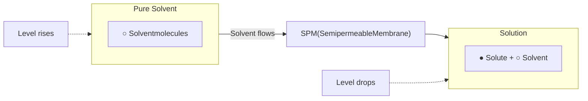
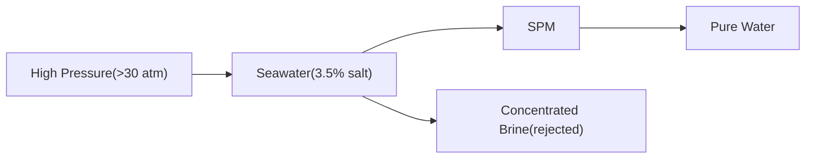

> Master osmosis, osmotic pressure, reverse osmosis, and biological applications for JEE Main and Advanced

# Osmotic Pressure: The Life-Sustaining Colligative Property

## The Real-Life Hook: Why Salt Kills Slugs and Cells Need Balance

Ever wondered why salt kills garden slugs? Why drinking seawater makes you more dehydrated? Why doctors carefully control IV fluid concentrations? Why your cells would burst in pure water? The answer is **osmosis and osmotic pressure** - perhaps the most biologically important colligative property!

**Daily & Medical Applications:**

- **Medical saline (0.9% NaCl)**: Isotonic with blood - safe for IV drips
- **Red blood cells**: Burst in pure water (hypotonic), shrivel in salt water (hypertonic)
- **Reverse osmosis**: Desalination of seawater for drinking water
- **Food preservation**: Salt/sugar prevents bacterial growth by osmosis
- **Kidney dialysis**: Removes waste products from blood using osmosis
- **Plant cell turgidity**: Plants stand upright due to osmotic pressure

---

## What is Osmosis?

### Definition

**Osmosis:** The spontaneous movement of solvent molecules from a solution of lower concentration (or pure solvent) to a solution of higher concentration through a **semi-permeable membrane**.

**Semi-Permeable Membrane (SPM):**
A membrane that allows solvent molecules to pass through but blocks solute molecules.

**Examples of SPMs:**

- Cellophane paper
- Parchment paper
- Animal bladder
- Cell membranes (biological)
- Thin films of Cu₂[Fe(CN)₆] (copper ferrocyanide)

### The Osmosis Setup



**What happens:**

1. Solvent flows from left to right (dilute → concentrated)
2. Right side level rises
3. Pressure difference builds up
4. Eventually, flow stops

---

## Osmotic Pressure: The Equilibrium State

### Definition

**Osmotic Pressure (π):** The external pressure that must be applied to the solution side to just prevent osmosis (to stop the flow of solvent).

### Van’t Hoff Equation

$$\boxed{\pi = CRT}$$

Where:

- π = Osmotic pressure (atm or Pa)
- C = Molar concentration (molarity) in mol/L
- R = Universal gas constant = 0.0821 L·atm/(mol·K) or 8.314 J/(mol·K)
- T = Absolute temperature (K)

**Alternative Forms:**

In terms of moles and volume:

$$\boxed{\pi = \frac{n}{V} RT}$$

In terms of mass and molar mass:

$$\boxed{\pi = \frac{w}{M \times V} RT}$$

Where:

- w = mass of solute (g)
- M = molar mass of solute (g/mol)
- V = volume of solution (L)

**For molar mass determination:**

$$\boxed{M = \frac{wRT}{\pi V}}$$

### Similarity to Ideal Gas Equation

Notice the striking similarity:

- **Ideal Gas:** PV = nRT → P = (n/V)RT
- **Osmotic Pressure:** π = (n/V)RT

**Van’t Hoff’s Insight:** Solute particles in solution behave like gas molecules!

**Memory Trick:**

> **“π = CRT”** - “Pressure Is Clearly Related to Temperature”

---

## Why is Osmotic Pressure Special?

### Advantages Over Other Colligative Properties

| Property | Magnitude | Measurement | Best For |
| --- | --- | --- | --- |
| RLVP | Very small (~ torr) | Difficult | Small molecules |
| ΔT_b | Very small (~ 0.5 K) | Moderate | Non-polymers |
| ΔT_f | Small (~ 2 K) | Good | Non-polymers |
| **π** | **Large (~ atm)** | **Easy & Precise** | **Polymers, proteins** |

**Example Comparison:**
For 1% glucose solution at 25°C:

- ΔT_f ≈ 0.1°C (hard to measure precisely)
- π ≈ 2.5 atm (easy to measure with manometer!)

**Why π is Superior:**

1. ✅ Measureable at **room temperature** (no heating/cooling needed)
2. ✅ **Large magnitude** → more precise measurements
3. ✅ Best for **high molar mass** substances (polymers, proteins)
4. ✅ Doesn’t require exact temperature control
5. ✅ Works for **dilute solutions** where other methods fail

**Berkeley and Hartley Method:**
Special apparatus to measure osmotic pressure accurately - most precise method for determining molar masses of macromolecules!

---

## Types of Solutions Based on Osmotic Pressure

When two solutions are separated by SPM:

### 1. Isotonic Solutions

**Definition:** Two solutions with equal osmotic pressure.

$$\boxed{\pi_1 = \pi_2 \implies C_1 = C_2 \text{ (at same temperature)}}$$

**Characteristics:**

- No net osmosis
- No change in volume
- Cells maintain normal shape

**Examples:**

- **0.9% NaCl (normal saline)** is isotonic with blood
- **5% glucose solution** is isotonic with blood
- Red blood cells in these solutions remain normal

**Medical Importance:**
All IV fluids MUST be isotonic to avoid cell damage!

---

### 2. Hypertonic Solution

**Definition:** Solution with higher osmotic pressure (higher concentration).

**Effect on Cells:**

- Water flows OUT of cells
- Cells **shrink** (crenation in RBCs)
- Cell becomes dehydrated

**Examples:**

- Seawater (3.5% salt) is hypertonic compared to blood
- 10% NaCl solution
- Concentrated sugar syrup

**Real-Life Examples:**

- 🧂 **Salt on slugs**: Salt solution is hypertonic → water leaves slug → slug dehydrates and dies
- 🌊 **Drinking seawater**: Makes you MORE dehydrated (water leaves cells)
- 🥒 **Pickling**: High salt/vinegar concentration preserves vegetables

---

### 3. Hypotonic Solution

**Definition:** Solution with lower osmotic pressure (lower concentration).

**Effect on Cells:**

- Water flows INTO cells
- Cells **swell** and may **burst** (hemolysis in RBCs)
- Cell becomes over-hydrated

**Examples:**

- Pure water (0% solute)
- 0.1% NaCl solution
- Dilute sugar solution

**Real-Life Examples:**

- 💧 **RBCs in pure water**: Burst due to osmotic pressure
- 🌱 **Plant cells in rain**: Swell but don’t burst (cell wall protection)
- 🏥 **Wrong IV fluid**: Hypotonic saline would burst RBCs!

---

## Visual Summary: Cell Behavior

> **◐ In simple terms · Cell Response to Osmotic Conditions**
>
> | Condition | Solution | Water Flow | Cell Response |

> | --- | --- | --- | --- |

> | **Hypotonic** | < 0.9% NaCl | Water IN | Cell swells (may burst) |

> | **Isotonic** | 0.9% NaCl | No net flow | Normal cell |

> | **Hypertonic** | > 0.9% NaCl | Water OUT | Cell shrinks (crenation) |

---

## Reverse Osmosis: Osmosis in Reverse!

### Concept

**Normal Osmosis:** Solvent flows from dilute → concentrated (natural direction)

**Reverse Osmosis:** Apply pressure GREATER than π to force solvent from concentrated → dilute

**Condition:**

$$\boxed{P_{\text{applied}} > \pi}$$

The solvent is forced to flow “uphill” against its natural tendency!

### Applications

#### 1. Desalination of Seawater

**Problem:** Seawater has ~3.5% salt (π ≈ 25-30 atm)

**Solution:**

1. Apply pressure > 30 atm to seawater
2. Pure water forced through SPM
3. Salt and minerals left behind
4. Result: Drinking water from ocean!

**Process:**



**Real-World Use:**

- Middle East countries (UAE, Saudi Arabia)
- Israel (50% of drinking water from RO)
- California desalination plants
- Ships and submarines

---

#### 2. Water Purification

**Home RO Systems:**

- Remove dissolved salts, heavy metals, bacteria
- Apply 3-6 atm pressure
- 99% pure water output

**Removes:**

- Dissolved salts (NaCl, CaCl₂)
- Heavy metals (Pb²⁺, Hg²⁺, As³⁺)
- Fluoride, nitrates
- Microorganisms

---

#### 3. Waste Water Treatment

- Industrial effluent treatment
- Recovering valuable materials
- Producing ultra-pure water for semiconductors

---

## Interactive Demo: Complete Calculation

### Problem 1: Basic Osmotic Pressure

**Question:** Calculate the osmotic pressure of a solution containing 6 g urea (MW = 60) in 1 L solution at 27°C. (R = 0.0821 L·atm/(mol·K))

**Solution:**

**Step 1: Calculate molarity**
Moles of urea = 6/60 = 0.1 mol
Volume = 1 L
C = 0.1/1 = 0.1 M

**Step 2: Convert temperature**
T = 27 + 273 = 300 K

**Step 3: Calculate π**
π = CRT
π = 0.1 × 0.0821 × 300
π = **2.463 atm**

**Conversion to other units:**

- In mmHg: 2.463 × 760 = **1,872 mmHg**
- In Pa: 2.463 × 101,325 = **249,600 Pa** ≈ **250 kPa**

---

### Problem 2: Molar Mass Determination

**Question:** 2.5 g of a protein dissolved in 100 mL solution shows osmotic pressure of 0.164 atm at 27°C. Calculate the molar mass of protein.

**Solution:**

**Given:**

- w = 2.5 g
- V = 100 mL = 0.1 L
- π = 0.164 atm
- T = 300 K

**Using formula:**
M = wRT / (πV)
M = (2.5 × 0.0821 × 300) / (0.164 × 0.1)
M = 61.575 / 0.0164
M = **3,755 g/mol**

**Interpretation:** This is a protein with molar mass ~3,750 g/mol - typical for small proteins!

**Why Osmotic Pressure?**
If we used freezing point depression:
ΔT_f = K_f × m = 1.86 × (2.5/3755) / 0.1 ≈ 0.012°C

This is too small to measure accurately! But π = 0.164 atm is easy to measure!

---

### Problem 3: Isotonic Solutions

**Question:** A 5% (w/v) glucose solution is isotonic with blood. What concentration of NaCl solution would be isotonic? (MW: glucose = 180, NaCl = 58.5)
Assume NaCl fully ionizes (i = 2).

**Solution:**

**Step 1: Calculate π for glucose solution**
5% w/v = 5 g per 100 mL = 50 g/L
C_glucose = 50/180 = 0.278 M

π_glucose = 0.278 × RT

**Step 2: For isotonic NaCl solution**
π_NaCl = π_glucose
But NaCl ionizes: Na⁺ + Cl⁻ (2 particles)

i × C_NaCl × RT = C_glucose × RT
2 × C_NaCl = 0.278
C_NaCl = 0.139 M

**Step 3: Convert to % (w/v)**
Mass = 0.139 × 58.5 = 8.13 g/L = 0.813 g per 100 mL

**Answer: 0.813% NaCl ≈ 0.9% NaCl** (normal saline!)

**Note:** This is why physiological saline is 0.9% NaCl, not 5% like glucose!

---

## Abnormal Osmotic Pressure: Association and Dissociation

### Case 1: Dissociation (Electrolytes)

For electrolytes that ionize:

$$\boxed{\pi = iCRT}$$

Where **i** = van’t Hoff factor (number of particles per formula unit)

**Examples:**

- NaCl → Na⁺ + Cl⁻ (i = 2)
- CaCl₂ → Ca²⁺ + 2Cl⁻ (i = 3)
- Glucose (non-electrolyte, i = 1)

**Effect:**
π_observed = i × π_theoretical

**Example:**
0.1 M NaCl: π = 2 × 0.1 × RT = 0.2 RT (double the pressure!)

---

### Case 2: Association (Dimerization)

Some molecules associate (stick together) in solution:

**Example:** Acetic acid in benzene forms dimers
2 CH₃COOH ⇌ (CH₃COOH)₂

**Effect:**

- Fewer particles than expected
- π_observed < π_theoretical
- i < 1

**Example:**
If 50% dimerization:

- Start with 1 mol (100 particles)
- Form dimers: 50% → 25 dimers + 50 monomers = 75 particles
- i = 75/100 = 0.75

---

## Practical Applications in Detail

### 1. Medical: IV Fluids

**Requirements for IV fluids:**

1. Must be isotonic (π ≈ 7.8 atm at 37°C)
2. Must be sterile
3. Must be physiologically compatible

**Common IV Solutions:**

- **0.9% NaCl** (“Normal Saline”)
- **5% Glucose** (D5W - Dextrose 5% in Water)
- **Ringer’s Lactate** (balanced electrolytes)

**Why 0.9% NaCl specifically?**

- Blood plasma has π ≈ 7.8 atm
- 0.9% NaCl has π ≈ 7.8 atm (isotonic!)
- Safe for direct blood contact

---

### 2. Biological: Plant Cell Turgidity

**Turgid Cell:** Plant cell in hypotonic solution

- Water enters cell by osmosis
- Cell swells against rigid cell wall
- Creates turgor pressure
- Plant stands upright!

**Plasmolyzed Cell:** Plant cell in hypertonic solution

- Water leaves cell
- Cell membrane shrinks away from cell wall
- Plant wilts

**This is why:**

- 🌱 Plants need water to stay upright (turgor)
- 🥀 Plants wilt in salty soil (plasmolysis)
- 🌾 Fertilizer “burn” happens with too much fertilizer (hypertonic)

---

### 3. Food Preservation

**High Salt/Sugar Preserves Food:**

**Principle:**

- Salt/sugar solution is hypertonic
- Bacteria cells lose water by osmosis
- Bacteria dehydrate and die
- Food preserved!

**Examples:**

- 🥒 Pickles (high salt)
- 🍯 Honey (high sugar, π > 100 atm!)
- 🐟 Salted fish
- 🍇 Dried fruits (concentrated sugar)

---

### 4. Kidney Dialysis

**Problem:** Kidney failure → waste products (urea, creatinine) accumulate in blood

**Solution: Hemodialysis**

```fallback
Blood (high waste) →  SPM  ← Dialysate (clean)
                      ↓
            Waste flows to dialysate
```

**Mechanism:**

- Blood flows on one side of membrane
- Clean dialysate on other side
- Waste products diffuse out (high → low concentration)
- Essential electrolytes maintained at proper levels

**Osmotic Balance:**
Dialysate is carefully formulated to be isotonic for essential components (Na⁺, K⁺, Ca²⁺) but hypotonic for waste products (urea, creatinine).

---

## Common JEE Mistake Traps

### Mistake 1: Using Molality Instead of Molarity

❌ **Wrong:** π = mRT (using molality)
✅ **Correct:** π = CRT (using molarity)

**Why?** π depends on number of particles per unit VOLUME, not per unit mass!

---

### Mistake 2: Forgetting van’t Hoff Factor

❌ **Wrong:** For NaCl, π = CRT
✅ **Correct:** For NaCl, π = iCRT = 2CRT

**Remember:** Electrolytes dissociate!

---

### Mistake 3: Wrong R Value

❌ **Wrong:** Using R = 8.314 J/(mol·K) with atm
✅ **Correct:** Use R = 0.0821 L·atm/(mol·K) when π is in atm

**Or:** Use R = 8.314 J/(mol·K) when π is in Pa

---

### Mistake 4: Celsius vs Kelvin

❌ **Wrong:** π = CRT with T in °C
✅ **Correct:** T must be in Kelvin (K = °C + 273)

---

### Mistake 5: Concentration Direction in Osmosis

❌ **Wrong:** Water flows from concentrated → dilute
✅ **Correct:** Water flows from dilute → concentrated

**Memory Aid:** “Water goes where salt is” - it follows the solute!

---

## Practice Problems: Three-Level Mastery

### Level 1: JEE Main Foundation

**Q1.** Calculate osmotic pressure of 0.2 M glucose solution at 27°C. (R = 0.0821 L·atm/(mol·K))

<details><summary>Solution</summary><p>T = 27 + 273 = 300 K
π = CRT = 0.2 × 0.0821 × 300
π = <strong>4.926 atm</strong></p></details>

---

**Q2.** A solution has osmotic pressure of 2.46 atm at 300 K. Calculate its molarity. (R = 0.0821)

<details><summary>Solution</summary><p>π = CRT
2.46 = C × 0.0821 × 300
C = 2.46 / (0.0821 × 300)
C = 2.46 / 24.63
C = <strong>0.1 M</strong></p></details>

---

**Q3.** Which has higher osmotic pressure at same temperature?
(a) 0.1 M glucose
(b) 0.1 M NaCl
(c) 0.1 M CaCl₂

<details><summary>Solution</summary><p>Calculate effective concentration (C × i):</p><ul><li>Glucose: 0.1 × 1 = 0.1</li><li>NaCl: 0.1 × 2 = 0.2 (Na⁺ + Cl⁻)</li><li>CaCl₂: 0.1 × 3 = 0.3 (Ca²⁺ + 2Cl⁻)</li></ul><p><strong>Answer: (c) 0.1 M CaCl₂</strong> has highest osmotic pressure!</p></details>

---

### Level 2: JEE Main Advanced

**Q4.** 3 g of glucose (MW = 180) and 5.85 g NaCl (MW = 58.5) are dissolved in 500 mL water. Calculate osmotic pressure at 27°C. Assume complete ionization of NaCl.

<details><summary>Solution</summary><p><strong>Glucose:</strong>
Moles = 3/180 = 0.0167 mol
Effective moles = 0.0167 (i = 1)</p><p><strong>NaCl:</strong>
Moles = 5.85/58.5 = 0.1 mol
Effective moles = 0.1 × 2 = 0.2 mol (i = 2)</p><p><strong>Total effective moles</strong> = 0.0167 + 0.2 = 0.2167 mol</p><p><strong>Concentration:</strong>
C = 0.2167/0.5 = 0.4334 M</p><p><strong>Osmotic Pressure:</strong>
T = 300 K
π = 0.4334 × 0.0821 × 300
π = <strong>10.67 atm</strong></p></details>

---

**Q5.** A 1.8% (w/v) solution of a substance is isotonic with 0.9% (w/v) NaCl solution. Calculate molar mass of the substance. (MW of NaCl = 58.5)

<details><summary>Solution</summary><p>For isotonic solutions: π₁ = π₂</p><p><strong>NaCl solution:</strong>
C_NaCl = 0.9/58.5 = 0.01538 M
Effective C = 0.01538 × 2 = 0.03076 M</p><p><strong>Substance solution:</strong>
C_substance = 1.8/M (where M is molar mass)</p><p><strong>Equating:</strong>
1.8/M = 0.03076
M = 1.8/0.03076
M = <strong>58.5 g/mol</strong></p><p><strong>Note:</strong> The substance has same molar mass as NaCl but doesn’t ionize (i = 1), so needs double the concentration!</p></details>

---

**Q6.** 200 cm³ of an aqueous solution containing 0.6 g of a protein shows osmotic pressure of 2.46 × 10⁻³ atm at 300 K. Calculate molar mass of protein.

<details><summary>Solution</summary><p><strong>Given:</strong></p><ul><li>w = 0.6 g</li><li>V = 200 cm³ = 0.2 L</li><li>π = 2.46 × 10⁻³ atm</li><li>T = 300 K</li></ul><p><strong>Formula:</strong>
M = wRT / (πV)
M = (0.6 × 0.0821 × 300) / (2.46 × 10⁻³ × 0.2)
M = 14.778 / (4.92 × 10⁻⁴)
M = <strong>30,037 g/mol</strong> ≈ <strong>30 kDa</strong></p><p><strong>Note:</strong> This is typical for small proteins. The small π value shows why osmotic pressure is best for macromolecules!</p></details>

---

### Level 3: JEE Advanced Challenge

**Q7.** (JEE Advanced Type) Two solutions A and B are separated by semi-permeable membrane:

- Solution A: 0.1 M glucose
- Solution B: 0.05 M CaCl₂

At 27°C, which direction will osmosis occur and what is the effective pressure difference?

<details><summary>Solution</summary><p><strong>Solution A (glucose):</strong>
Effective C_A = 0.1 × 1 = 0.1 M (non-electrolyte)
π_A = 0.1 × 0.0821 × 300 = 2.463 atm</p><p><strong>Solution B (CaCl₂):</strong>
CaCl₂ → Ca²⁺ + 2Cl⁻ (i = 3)
Effective C_B = 0.05 × 3 = 0.15 M
π_B = 0.15 × 0.0821 × 300 = 3.695 atm</p><p><strong>Comparison:</strong>
π_B &gt; π_A</p><p><strong>Direction:</strong> Water flows from A → B (from lower to higher π)</p><p><strong>Pressure difference:</strong>
Δπ = 3.695 - 2.463 = <strong>1.232 atm</strong></p><p><strong>Answer:</strong> Osmosis occurs from glucose solution to CaCl₂ solution with driving force of <strong>1.23 atm</strong>.</p></details>

---

**Q8.** (JEE Advanced 2017 Type) At what concentration will a glucose solution be isotonic with 1% (w/v) NaCl solution at the same temperature? Assume complete dissociation. (MW: glucose = 180, NaCl = 58.5)

<details><summary>Solution</summary><p><strong>NaCl solution:</strong>
1% w/v = 1 g per 100 mL = 10 g/L
C_NaCl = 10/58.5 = 0.171 M
Effective C = 0.171 × 2 = 0.342 M (i = 2)
π_NaCl = 0.342 RT</p><p><strong>Glucose solution (isotonic):</strong>
π_glucose = π_NaCl
C_glucose × RT = 0.342 RT
C_glucose = 0.342 M</p><p><strong>Convert to % (w/v):</strong>
Mass = 0.342 × 180 = 61.56 g/L = 6.156 g per 100 mL</p><p><strong>Answer: 6.16% (w/v) glucose solution</strong></p><p><strong>Interpretation:</strong> Glucose solution needs ~6× higher concentration than NaCl to be isotonic because glucose doesn’t ionize!</p></details>

---

**Q9.** (Challenging) A solution contains a mixture of glucose and sucrose. 1 L of this solution has osmotic pressure of 4.926 atm at 300 K. If the solution contains 18 g glucose, calculate the amount of sucrose. (MW: glucose = 180, sucrose = 342)

<details><summary>Solution</summary><p><strong>Total osmotic pressure:</strong>
π_total = 4.926 atm
C_total = π/(RT) = 4.926/(0.0821 × 300) = 0.2 M</p><p><strong>From glucose:</strong>
Moles of glucose = 18/180 = 0.1 mol
C_glucose = 0.1/1 = 0.1 M</p><p><strong>From sucrose:</strong>
C_sucrose = C_total - C_glucose = 0.2 - 0.1 = 0.1 M
Moles of sucrose = 0.1 × 1 = 0.1 mol
Mass of sucrose = 0.1 × 342 = <strong>34.2 g</strong></p><p><strong>Answer: 34.2 g sucrose</strong></p></details>

---

**Q10.** (JEE Advanced Level) Calculate the minimum pressure required to desalinate seawater at 25°C. Assume seawater contains 3.5% (w/v) NaCl and complete ionization. (MW of NaCl = 58.5)

<details><summary>Solution</summary><p><strong>Seawater concentration:</strong>
3.5% w/v = 35 g/L
C_NaCl = 35/58.5 = 0.598 M</p><p><strong>Effective concentration (with ionization):</strong>
C_eff = 0.598 × 2 = 1.196 M</p><p><strong>Osmotic pressure of seawater:</strong>
T = 25 + 273 = 298 K
π = 1.196 × 0.0821 × 298
π = <strong>29.26 atm</strong></p><p><strong>Minimum pressure for reverse osmosis:</strong>
P_min = π = <strong>29.26 atm</strong> ≈ <strong>30 atm</strong></p><p><strong>In practice:</strong></p><ul><li>Applied pressure = 50-80 atm (to ensure good flow rate)</li><li>Energy intensive process!</li><li>This is why RO plants are expensive to operate</li></ul><p><strong>Additional calculation:</strong>
30 atm = 30 × 101.325 kPa = <strong>3,040 kPa</strong> = <strong>3.04 MPa</strong>
= 30 × 14.7 psi = <strong>441 psi</strong></p><p><strong>Answer: Minimum ~30 atm, practical ~50-80 atm</strong></p></details>

### Interactive Demo: Visualize Osmosis

Watch water molecules move through a semi-permeable membrane from dilute to concentrated solution.

---

## Conceptual Questions for JEE

**Q1.** Why does osmotic pressure measurement give more accurate molar masses for proteins than freezing point depression?

<details><summary>Answer</summary><p><strong>Reasons:</strong></p><ol><li><strong>Magnitude:</strong> π is measurable in atm, while ΔT_f is tiny (&lt; 0.01°C) for dilute protein solutions</li><li><strong>Room temperature:</strong> No heating/cooling required</li><li><strong>Precision:</strong> Pressure measured to ±0.001 atm, temperature to ±0.01°C</li><li><strong>Proportionality:</strong> For macromolecules, π is still large enough but ΔT_f is too small</li></ol><p><strong>Example:</strong> 1% protein solution</p><ul><li>ΔT_f ≈ 0.003°C (very hard to measure!)</li><li>π ≈ 0.1 atm (easy to measure!)</li></ul></details>

---

**Q2.** Why do plants wilt when soil is over-fertilized?

<details><summary>Answer</summary><p><strong>Explanation:</strong></p><ol><li>Excess fertilizer increases salt concentration in soil water</li><li>Soil water becomes <strong>hypertonic</strong> relative to plant cells</li><li>Water flows OUT of plant cells by osmosis</li><li>Cells lose turgor pressure → <strong>plasmolysis</strong></li><li>Plant wilts</li></ol><p><strong>This is called “fertilizer burn”</strong> - not actual burning, but osmotic dehydration!</p><p><strong>Prevention:</strong> Use dilute fertilizer solutions, water after fertilizing</p></details>

---

**Q3.** Explain why drinking seawater causes dehydration.

<details><summary>Answer</summary><p><strong>Process:</strong></p><ol><li>Seawater has ~3.5% salt → <strong>hypertonic</strong> compared to body fluids (~0.9% salt)</li><li>Drinking seawater → intestines absorb some salt</li><li>Blood becomes hypertonic</li><li>Body cells lose water to blood by osmosis</li><li>Kidneys try to excrete excess salt → need water</li><li>Net result: <strong>More water lost than gained</strong> → dehydration</li></ol><p><strong>Calculation:</strong>
To excrete salt from 1 L seawater, body needs to produce ~1.5 L urine → net loss of 0.5 L water!</p><p><strong>Moral:</strong> Never drink seawater for survival!</p></details>

---

## Summary Table: Osmotic Pressure

| Aspect | Details |
| --- | --- |
| **Formula** | π = CRT = (n/V)RT |
| **Units** | atm, Pa, mmHg |
| **Depends on** | Molarity (not molality!) |
| **Best for** | Polymers, proteins (high MW) |
| **Temperature** | Room temperature measurement |
| **Advantage** | Large, measurable values |

**Comparison with other colligative properties:**

| Property | Formula | Advantage |
| --- | --- | --- |
| RLVP | ΔP/P° = χ | Fundamental basis |
| ΔT_b | K_b m | Simple apparatus |
| ΔT_f | K_f m | More sensitive than ΔT_b |
| **π** | **CRT** | **Best for macromolecules** |

---

## Cross-Connections to Other Chapters

### 🔗 Link to Colligative Properties

- Fourth colligative property
- All stem from vapor pressure lowering
- See: [Colligative Properties](../colligative-properties/index.md)

### 🔗 Link to van’t Hoff Factor

- π = iCRT for electrolytes
- Abnormal molar masses from association/dissociation
- See: [van’t Hoff Factor](../vant-hoff-factor/index.md)

### 🔗 Link to Chemical Equilibrium

- Osmosis is an equilibrium process
- ΔG = 0 at osmotic equilibrium
- See: [Equilibrium](../../equilibrium/index.md)

### 🔗 Link to Thermodynamics

- Osmotic work = πV
- Spontaneous process (ΔG < 0) until equilibrium
- See: [Gibbs Free Energy](../../thermodynamics/gibbs-energy/index.md)

### 🔗 Link to Electrochemistry

- Similar to membrane potential in cells
- Nernst equation analogy
- See: [Electrochemical Cells](../../redox-electrochemistry/electrochemical-cells/index.md)

### 🔗 Link to Biology

- Cell membrane transport
- Active vs passive transport
- Homeostasis maintenance

---

## Formula Sheet: Quick Reference

### Basic Formula

$$\boxed{\pi = CRT = \frac{n}{V}RT = \frac{w}{MV}RT}$$

### Molar Mass Determination

$$\boxed{M = \frac{wRT}{\pi V}}$$

### For Electrolytes

$$\boxed{\pi = iCRT}$$

### Isotonic Condition

$$\boxed{\pi_1 = \pi_2 \implies C_1 = C_2}$$

### Reverse Osmosis

$$\boxed{P_{\text{applied}} > \pi}$$

### Important Constants

- R = 0.0821 L·atm/(mol·K)
- R = 8.314 J/(mol·K)
- Normal saline: 0.9% NaCl (isotonic with blood)

---

## Final JEE Strategy

✅ **Highest Weightage Topics:**

1. Molar mass from π (60% probability)
2. Isotonic solutions (50% probability)
3. Direction of osmosis (40% probability)
4. Reverse osmosis concept (30% probability in Advanced)

✅ **Must-Remember Facts:**

- π = CRT (uses molarity, not molality!)
- Normal saline = 0.9% NaCl
- Seawater ≈ 3.5% salt → π ≈ 30 atm
- Isotonic glucose ≈ 5% (w/v)

✅ **Common Question Types:**

1. Calculate π from concentration
2. Calculate M from π
3. Isotonic solution problems
4. Compare π of different solutions
5. Effect on cells (hypo/iso/hyper-tonic)

✅ **Calculation Checklist:**

- Using molarity (C), not molality (m)? ✓
- Temperature in Kelvin? ✓
- Correct R value (0.0821 for atm)? ✓
- Applied van’t Hoff factor for electrolytes? ✓
- Volume in liters? ✓

✅ **Conceptual Understanding:**

- Water flows from low π to high π
- Reverse osmosis needs P > π
- Cells burst in hypotonic, shrink in hypertonic
- π is best for high MW compounds

**Previous Topic:** [Colligative Properties](../colligative-properties/index.md)
**Next Topic:** [van’t Hoff Factor](../vant-hoff-factor/index.md) - understanding abnormal colligative properties!

---

*Last Updated: June 2025 | For JEE Main & Advanced 2026*

From TestGuru · our mock-test platform

## You've read Osmotic Pressure: The Life-Sustaining Colligative Property.You've read this topic. Find out what you actually got.

A free JEE Main mock with this chapter in it, and a report that shows which sub-topics cost you marks.

[Take a free JEE Main mock →](https://app.testguru.co/signup?tg_chapter=solutions&tg_exam=jee-main&tg_page=%2Fchemistry%2Fsolutions%2Fosmotic-pressure%2F&tg_subject=chemistry&utm_campaign=notes-jee-main-free-test&utm_content=article-end&utm_medium=referral&utm_source=jeenotes)
Free, no card. Opens TestGuru in a new tab.

## Stay exam-ready

One email every Sunday: new notes, the week's hardest challenge question and a revision plan.One email every Sunday.

## Comments

Have a question or spotted a mistake? Join the discussion below.

Advertisement

Advertisement

---

## Extracted page code (interactive scripts & widgets)


### inline-script-16

```js
if(!document.getElementById("animation-fullscreen-overlay")){const e=document.createElement("div");e.id="animation-fullscreen-overlay",e.className="animation-fullscreen-overlay",e.innerHTML=`
      <div class="fullscreen-modal">
        <div class="fullscreen-header">
          <span class="fullscreen-title">Interactive Demo</span>
          <button class="fullscreen-close-btn" onclick="JEEAnimations.closeFullscreen()" title="Close (Esc)" aria-label="Close fullscreen">
            <svg width="24" height="24" viewBox="0 0 24 24" fill="none" stroke="currentColor" stroke-width="2" stroke-linecap="round" stroke-linejoin="round">
              <line x1="18" y1="6" x2="6" y2="18"></line>
              <line x1="6" y1="6" x2="18" y2="18"></line>
            </svg>
          </button>
        </div>
        <div class="fullscreen-content"></div>
      </div>
    `,document.body.appendChild(e),document.addEventListener("keydown",function(e){e.key==="Escape"&&document.body.classList.contains("animation-fullscreen-active")&&JEEAnimations.closeFullscreen()}),e.addEventListener("click",function(t){t.target===e&&JEEAnimations.closeFullscreen()})}
```


### inline-script-17

```js
(function(){var t,e=document.getElementById("disqus-load");if(!e)return;t=!1,e.addEventListener("click",function(){if(t)return;t=!0,e.setAttribute("disabled","disabled"),e.textContent="Loading comments…",window.disqus_config=function(){this.page.url="https://jeenotes.in/chemistry/solutions/osmotic-pressure/",this.page.identifier="/chemistry/solutions/osmotic-pressure/"};var s=document,n=s.createElement("script");n.src="https://https-jeenotes-in.disqus.com/embed.js",n.setAttribute("data-timestamp",+new Date),n.onload=function(){e.style.display="none"},n.onerror=function(){t=!1,e.removeAttribute("disabled"),e.textContent="Could not load comments. Tap to retry"},(s.head||s.body).appendChild(n)})})()
```


### inline-script-18

```js
(function(){var t,e=document.currentScript.previousElementSibling;function n(){(window.adsbygoogle=window.adsbygoogle||[]).push({})}if(!window.ResizeObserver||e.clientWidth>0){n();return}t=new ResizeObserver(function(){e.clientWidth>0&&(t.disconnect(),n())}),t.observe(e)})()
```


### interactive-widget-1

```html
<div class="animation-wrapper" data-animation="osmosis" id="anim-osmosis-1795396420552712887"><div class="animation-header"><button aria-label="Toggle fullscreen" class="anim-fullscreen-btn" onclick='JEEAnimations.toggleFullscreen("anim-osmosis-1795396420552712887")' title="Fullscreen (F)">
<svg class="fullscreen-icon-expand" fill="none" height="18" stroke="currentColor" stroke-linecap="round" stroke-linejoin="round" stroke-width="2" viewbox="0 0 24 24" width="18"><polyline points="15 3 21 3 21 9"></polyline><polyline points="9 21 3 21 3 15"></polyline><line x1="21" x2="14" y1="3" y2="10"></line><line x1="3" x2="10" y1="21" y2="14"></line></svg>
<svg class="fullscreen-icon-collapse" fill="none" height="18" stroke="currentColor" stroke-linecap="round" stroke-linejoin="round" stroke-width="2" viewbox="0 0 24 24" width="18"><polyline points="4 14 10 14 10 20"></polyline><polyline points="20 10 14 10 14 4"></polyline><line x1="14" x2="21" y1="10" y2="3"></line><line x1="3" x2="10" y1="21" y2="14"></line></svg>
<span class="fullscreen-text">Fullscreen</span></button></div><div class="animation-content"><noscript><div class="callout callout-warning"><div class="callout-title">JavaScript Required</div><p>This interactive animation requires JavaScript to be enabled.</p></div></noscript></div></div>
```


---

_Source: [https://jeenotes.in/chemistry/solutions/osmotic-pressure/](https://jeenotes.in/chemistry/solutions/osmotic-pressure/) · raw HTML: `offline/chemistry/solutions/osmotic-pressure/index.html`_
