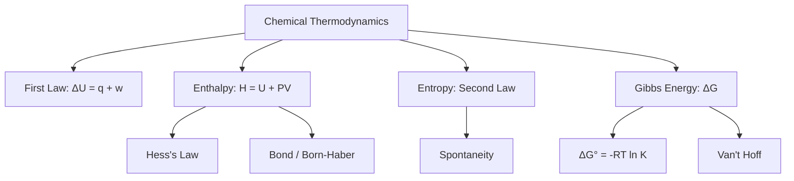

> All key Chemical Thermodynamics formulas: first law, enthalpy, Hess's law, entropy, Gibbs energy, equilibrium, bond energy & Born-Haber. JEE Main & Advanced revision.

Last-minute revision sheet for the entire Chemical Thermodynamics chapter: systems and state functions, the First Law, work in different processes, enthalpy and Hess’s law, entropy and the Second Law, Gibbs energy and spontaneity, equilibrium relations, and thermochemistry (bond energy, Born-Haber, lattice energy). Every formula, relation, and value below is pulled straight from the chapter pages.

## Chapter Map



## Systems, State & Path Functions

| Type of system | Matter exchange | Energy exchange |
| --- | --- | --- |
| Open | Yes | Yes |
| Closed | No | Yes |
| Isolated | No | No |

| Function class | Members | Property |
| --- | --- | --- |
| State functions | $U,\ H,\ S,\ G$ | Depend only on initial and final state |
| Path functions | $q,\ w$ | Depend on the route taken |

For a cyclic process: $\oint dU = 0$ but $\oint dq \neq 0,\ \oint dw \neq 0$.

> **★ Key point · Sign Convention (Chemistry / JEE)**
>
> “Heat IN, Work ON are positive.”
>
> - Heat absorbed by system: $q > 0$ (endothermic); released: $q < 0$ (exothermic).

> - Work done ON system (compression): $w > 0$; work done BY system (expansion): $w < 0$.
>
> Physics often takes work done BY the system as positive — always check the convention in the question.

## First Law of Thermodynamics

$$\boxed{\Delta U = q + w}$$

$$\Delta U = U_{final} - U_{initial}$$

For an ideal gas, internal energy depends only on temperature (no intermolecular forces):

$$U = f\cdot\frac{nRT}{2}\quad\left(\text{monatomic } U=\tfrac{3}{2}nRT,\ \text{diatomic } U=\tfrac{5}{2}nRT\right)$$

where $f$ = degrees of freedom.

## Work in Thermodynamic Processes

$$\boxed{w = -P_{ext}\,\Delta V}$$

| Process | Work $w$ | Key results |
| --- | --- | --- |
| Free expansion (into vacuum) | $0$ | $P_{ext}=0$; for ideal gas $q=0,\ \Delta U=0$ |
| Against constant $P_{ext}$ | $-P_{ext}\Delta V = -\Delta n_g RT$ | Irreversible |
| Reversible isothermal (ideal gas) | $-nRT\ln\dfrac{V_2}{V_1}$ | Maximum work |
| Adiabatic (ideal gas) | $\Delta U = nC_V\Delta T$ | $q=0$ |

Reversible isothermal work (ideal gas), all equivalent forms:

$$\boxed{w = -nRT\ln\frac{V_2}{V_1} = -2.303\,nRT\log\frac{V_2}{V_1} = -nRT\ln\frac{P_1}{P_2} = -2.303\,nRT\log\frac{P_1}{P_2}}$$

Adiabatic work for ideal gas:

$$w = \Delta U = nC_V(T_2 - T_1) = \frac{nR(T_2 - T_1)}{\gamma - 1},\qquad \gamma = \frac{C_P}{C_V}$$

> **★ Key point · Isothermal Ideal Gas Shortcut**
>
> For isothermal expansion of an ideal gas: $\Delta U = 0 \Rightarrow q = -w$, i.e. heat absorbed = work done by the gas.
>
> Reversible expansion always extracts **more** work than irreversible between the same two states.

## Heat, Heat Capacity & Process Map

| Process | $\Delta T$ | $\Delta U$ | $w$ | $q$ |
| --- | --- | --- | --- | --- |
| Isothermal (ideal gas) | $0$ | $0$ | $-nRT\ln\frac{V_2}{V_1}$ | $-w$ |
| Adiabatic | changes | $nC_V\Delta T$ | $\Delta U$ | $0$ |
| Isochoric (const $V$) | changes | $nC_V\Delta T$ | $0$ | $\Delta U$ |
| Isobaric (const $P$) | changes | $nC_V\Delta T$ | $-P\Delta V$ | $nC_P\Delta T$ |
| Free expansion (ideal) | $0$ | $0$ | $0$ | $0$ |
| Cyclic | $0$ | $0$ | $-q$ | $q$ |

Heat capacities and the key relation:

$$C_V = \left(\frac{dU}{dT}\right)_V,\qquad C_P = \left(\frac{dH}{dT}\right)_P,\qquad q_V = nC_V\Delta T,\qquad q_P = nC_P\Delta T$$

$$\boxed{C_P - C_V = R\quad(\text{ideal gas})}$$

At constant volume $q_V = \Delta U$; at constant pressure $q_P = \Delta H$.

## Enthalpy

$$\boxed{H = U + PV},\qquad \Delta H = q_P$$

At constant pressure, and for gas-phase reactions (ideal gas $PV = nRT$):

$$\boxed{\Delta H = \Delta U + P\Delta V = \Delta U + \Delta n_g RT}$$

where $\Delta n_g$ = (moles of gaseous products) − (moles of gaseous reactants). **Count gaseous moles only.**

| $\Delta n_g$ | Relation |
| --- | --- |
| $>0$ | $\Delta H > \Delta U$ |
| $<0$ | $\Delta H < \Delta U$ |
| $0$ | $\Delta H = \Delta U$ |

| Reaction type | $\Delta H$ sign |
| --- | --- |
| Exothermic (e.g. combustion, freezing) | $\Delta H < 0$ |
| Endothermic (e.g. melting, photosynthesis) | $\Delta H > 0$ |

### Types of Enthalpy Change

| Type | Symbol | Definition |
| --- | --- | --- |
| Formation | $\Delta_f H°$ | 1 mol compound from elements in standard states |
| Combustion | $\Delta_c H°$ | 1 mol burned completely in O₂ (always $<0$) |
| Neutralization | $\Delta_{neut} H°$ | 1 mol H⁺ + 1 mol OH⁻ → H₂O |
| Atomization | $\Delta_a H°$ | 1 mol converted to gaseous atoms |
| Bond dissociation | $\Delta_{bond} H°$ | Break 1 mol of a specific bond |
| Sublimation | $\Delta_{sub} H°$ | Solid → gas |
| Fusion | $\Delta_{fus} H°$ | Solid → liquid |
| Vaporization | $\Delta_{vap} H°$ | Liquid → gas |
| Ionization | $\Delta_{ion} H$ | Remove electron from gaseous atom |
| Electron gain | $\Delta_{eg} H$ | Add electron to gaseous atom |
| Hydration | $\Delta_{hyd} H$ | Gaseous ion → aqueous ion |
| Solution | $\Delta_{sol} H$ | Dissolve substance in solvent |

> **★ Key point · Standard State & Formation**
>
> Standard state: 298 K (unless stated), 1 bar pressure, 1 M for solutions, most stable form of the substance.
>
> $\Delta_f H°[\text{element in standard state}] = 0$ — e.g. O₂(g), H₂(g), C(graphite), Br₂(l) are zero; O₃(g) and C(diamond) are **not**. Strong acid + strong base neutralization is a near-constant $\Delta_{neut} H° = -57.1$ kJ/mol (the real reaction is just H⁺ + OH⁻ → H₂O).

## Calculating Reaction Enthalpy

Using standard enthalpies of formation (multiply each by its stoichiometric coefficient):

$$\boxed{\Delta_r H° = \sum \Delta_f H°(\text{products}) - \sum \Delta_f H°(\text{reactants})}$$

Using combustion data (note the **reversed** sign relative to formation):

$$\Delta_r H° = \sum \Delta_c H°(\text{reactants}) - \sum \Delta_c H°(\text{products})$$

Formation from combustion data:

$$\Delta_f H°(\text{compound}) = \sum \Delta_c H°(\text{elements}) - \Delta_c H°(\text{compound})$$

### Hess’s Law

$$\boxed{\Delta H_{overall} = \sum \Delta H_{steps}}$$

Because $H$ is a state function. Rules when manipulating equations:

- Reverse a reaction → change sign of $\Delta H$.
- Multiply a reaction by a factor → multiply $\Delta H$ by the same factor.
- Add reactions → add their $\Delta H$ values.

## Bond Enthalpy & Thermochemistry

$$\boxed{\Delta H_{rxn} = \sum(\text{bonds broken}) - \sum(\text{bonds formed})}$$

equivalently $\sum(\text{BE of reactants}) - \sum(\text{BE of products})$.

- Breaking bonds: endothermic, **positive** (“Break Bad”).
- Forming bonds: exothermic, **negative**.
- Bond dissociation energy (specific bond, specific molecule) vs average bond energy (mean across many molecules); average O–H from H₂O $= \tfrac{499+428}{2} = 464$ kJ/mol.

### Common Average Bond Energies (kJ/mol)

| Single | BE | Double | BE | Triple | BE |
| --- | --- | --- | --- | --- | --- |
| H–H | 436 | C=C | 611 | N≡N | 946 |
| C–C | 347 | C=O | 741 | C≡C | 837 |
| C–H | 414 | O=O | 498 | C≡O | 1072 |
| O–H | 464 | C=N | 615 | C≡N | 891 |

Trends: triple > double > single; smaller atoms form stronger bonds (H–F 568 > H–Cl 431 > H–Br 366 > H–I 298).

### Born-Haber Cycle (lattice energy)

$$\boxed{\Delta_f H° = \Delta_{sub} H + \Delta_{diss} H + \Delta_{ion} H + \Delta_{eg} H + U}$$

(Match stoichiometry: e.g. $\tfrac{1}{2}\text{Cl}_2 \to \text{Cl}$ uses half the Cl–Cl bond energy.) Mnemonic “Some Dumb Idiots Eat Lettuce” = Sublimation, Dissociation, Ionization, Electron gain, Lattice.

Lattice energy ($\text{M}^{n+}(g) + \text{X}^{n-}(g) \to \text{MX}(s)$, exothermic so $U<0$):

$$U \propto \frac{|z_+|\,|z_-|}{r_+ + r_-}$$

Higher ionic charge and smaller ions → more negative $U$ (e.g. MgO ≈ −3791 vs NaCl ≈ −788 kJ/mol).

### Resonance Energy

$$E_{res} = \Delta H_{\text{calculated (Kekulé/bonds)}} - \Delta H_{\text{experimental}}$$

A more stable (resonance-stabilized) molecule releases **less** heat on combustion. Benzene resonance energy ≈ −150 kJ/mol.

## Entropy & the Second Law

Statistical (Boltzmann) and thermodynamic definitions:

$$S = k_B \ln W,\qquad k_B = 1.38\times10^{-23}\ \text{J/K}$$

$$\boxed{\Delta S = \frac{q_{rev}}{T}}\quad(\text{units J/K or J}\cdot\text{mol}^{-1}\text{K}^{-1})$$

$$\boxed{\Delta S_{universe} = \Delta S_{system} + \Delta S_{surroundings} \geq 0}$$

$$\Delta S_{surroundings} = -\frac{\Delta H_{system}}{T}\quad(\text{const } T,P)$$

| $\Delta S_{universe}$ | Process |
| --- | --- |
| $>0$ | Spontaneous |
| $=0$ | Equilibrium / reversible |
| $<0$ | Non-spontaneous |

### Entropy in Specific Processes

| Process | Formula | Condition |
| --- | --- | --- |
| Phase transition | $\Delta S = \dfrac{\Delta H_{trans}}{T_{trans}}$ | Use $T_m$ or $T_b$ |
| Heating (const $P$) | $\Delta S = nC_P\ln\dfrac{T_2}{T_1}$ | — |
| Heating (const $V$) | $\Delta S = nC_V\ln\dfrac{T_2}{T_1}$ | — |
| Isothermal expansion (ideal gas) | $\Delta S = nR\ln\dfrac{V_2}{V_1} = -nR\ln\dfrac{P_2}{P_1}$ | $T$ constant |
| Mixing of ideal gases | $\Delta S_{mix} = -nR(x_1\ln x_1 + x_2\ln x_2)$ | Always $>0$ |
| Reaction | $\Delta S°_{rxn} = \sum S°(\text{prod}) - \sum S°(\text{react})$ | Use **absolute** $S°$ |

> **⚠ Trap · Common Entropy Traps**
>
> Use **Kelvin**, never °C. For reactions use absolute entropies $S°$ (not “formation” entropies) — justified by the Third Law: $S = 0$ for a perfect crystal at 0 K. For a phase change use the actual transition temperature ($T_m$, $T_b$), not 298 K.

### Entropy Trends

| Factor | Effect on $S$ |
| --- | --- |
| Solid → liquid → gas | Increases ($S_g \gg S_l > S_s$) |
| Temperature ↑ | Increases |
| Volume ↑ | Increases |
| Number of particles/moles ↑ | Increases |
| Molecular complexity ↑ | Increases |
| Dissolution (usually) | Increases |

$\Delta S > 0$ when $n_{products} > n_{reactants}$ (especially when gas is produced).

## Gibbs Free Energy & Spontaneity

$$\boxed{G = H - TS}\qquad\boxed{\Delta G = \Delta H - T\Delta S}$$

$$\boxed{\Delta G = -T\,\Delta S_{universe}},\qquad w_{max} = -\Delta G$$

| $\Delta G$ | Meaning |
| --- | --- |
| $<0$ | Spontaneous (forward) |
| $=0$ | Equilibrium |
| $>0$ | Non-spontaneous (reverse favored) |

### The Four Cases ($\Delta H$ vs $\Delta S$)

| $\Delta H$ | $\Delta S$ | $\Delta G$ | Spontaneity | Example |
| --- | --- | --- | --- | --- |
| − | + | always − | Always spontaneous | Combustion |
| + | − | always + | Never spontaneous | Reverse combustion |
| − | − | − at low $T$ | Spontaneous at low $T$ | Freezing water, Haber |
| + | + | − at high $T$ | Spontaneous at high $T$ | Melting ice, CaCO₃ decomposition |

Crossover temperature (where $\Delta G = 0$):

$$\boxed{T_{eq} = \frac{\Delta H}{\Delta S}}$$

> **★ Key point · Memory Hook**
>
> “Give Her The Stuff”: $\Delta G = \Delta H - T\Delta S$.
>
> Keep units consistent — $\Delta H$ in kJ and $\Delta S$ in J/K is the classic blunder; convert one before subtracting.

### Standard Gibbs Energy & Equilibrium

$$\Delta_r G° = \sum \Delta_f G°(\text{products}) - \sum \Delta_f G°(\text{reactants}),\qquad \Delta_f G°[\text{element}] = 0$$

$$\Delta G° = \Delta H° - T\Delta S°$$

$$\boxed{\Delta G° = -RT\ln K = -2.303\,RT\log K}$$

$$\boxed{\Delta G = \Delta G° + RT\ln Q}$$

At equilibrium $Q = K$ and $\Delta G = 0$. Rearrangements:

$$K = e^{-\Delta G°/RT},\qquad \log K = -\frac{\Delta G°}{2.303RT}$$

At 298 K (with $\Delta G°$ in kJ/mol):

$$\boxed{\log K = -\frac{\Delta G°\ (\text{kJ/mol})}{5.7}}$$

so every 5.7 kJ/mol change in $\Delta G°$ shifts $K$ by a factor of 10.

| $Q$ vs $K$ | $\Delta G$ | Direction |
| --- | --- | --- |
| $Q < K$ | $<0$ | Forward (toward products) |
| $Q = K$ | $0$ | At equilibrium |
| $Q > K$ | $>0$ | Backward (toward reactants) |

> **⚠ Trap · ΔG vs ΔG°**
>
> $\Delta G°$ fixes the **equilibrium position** (value of $K$); $\Delta G$ tells you the **spontaneity right now** at the actual $Q$. A reaction with $\Delta G° > 0$ can still run forward if $Q$ is small enough ($Q < K$).

### Van’t Hoff Equation ($K$ vs $T$)

$$\ln K = -\frac{\Delta H°}{RT} + \frac{\Delta S°}{R},\qquad \frac{d\ln K}{dT} = \frac{\Delta H°}{RT^2}$$

$$\boxed{\ln\frac{K_2}{K_1} = -\frac{\Delta H°}{R}\left(\frac{1}{T_2} - \frac{1}{T_1}\right)}$$

- Exothermic ($\Delta H° < 0$): $K$ decreases as $T$ increases.
- Endothermic ($\Delta H° > 0$): $K$ increases as $T$ increases.

## Reference Data Tables

Values quoted in the chapter (298 K unless noted).

### Standard Enthalpies of Formation $\Delta_f H°$ (kJ/mol)

| Compound | $\Delta_f H°$ | Compound | $\Delta_f H°$ |
| --- | --- | --- | --- |
| H₂O(l) | −285.8 | NH₃(g) | −46 |
| H₂O(g) | −241.8 | NO(g) | +90 |
| CO₂(g) | −393.5 | NO₂(g) | +33 |
| CO(g) | −110.5 | SO₂(g) | −297 |
| CH₄(g) | −74.8 | SO₃(g) | −396 |
| C₂H₆(g) | −85 | HCl(g) | −92 |
| C₂H₄(g) | +52 | NaCl(s) | −411 |
| C₂H₂(g) | +227 | CaO(s) | −635 |

### Standard Entropies $S°$ (J·mol⁻¹·K⁻¹)

| Substance | $S°$ | Substance | $S°$ |
| --- | --- | --- | --- |
| H₂(g) | 131 | H₂O(l) | 70 |
| O₂(g) | 205 | H₂O(g) | 189 |
| N₂(g) | 192 | CO₂(g) | 214 |
| CH₄(g) | 186 |  |  |

Typical ranges: solids 50–100, liquids 100–200, gases 150–300 J·mol⁻¹·K⁻¹.

### Heats of Combustion $\Delta_c H°$ (kJ/mol)

| Substance | $\Delta_c H°$ | Substance | $\Delta_c H°$ |
| --- | --- | --- | --- |
| H₂(g) | −286 | C₃H₈(g) | −2220 |
| C(graphite) | −394 | C₄H₁₀(g) | −2878 |
| CH₄(g) | −890 | C₂H₅OH(l) | −1367 |
| C₂H₆(g) | −1560 | C₆H₁₂O₆(s) | −2808 |
|  |  | C₈H₁₈(l) | −5471 |

### Lattice Energies $U$ (kJ/mol)

| Compound | $U$ | Compound | $U$ |
| --- | --- | --- | --- |
| LiF | −1037 | MgO | −3791 |
| NaCl | −788 | CaO | −3520 |
| KBr | −689 | Al₂O₃ | −15916 |
| CsI | −604 |  |  |

### Useful Constants

| Constant | Value |
| --- | --- |
| Gas constant $R$ | 8.314 J·mol⁻¹·K⁻¹ |
| Boltzmann constant $k_B$ | $1.38\times10^{-23}$ J/K |
| $2.303\,R$ | 19.15 J·mol⁻¹·K⁻¹ |
| $2.303\,RT$ at 298 K | 5.708 kJ/mol |

## Quick-Fire Recall

> **★ Key point · One-Liners to Burn In**
>
> - First law: $\Delta U = q + w$ — Heat IN, Work ON positive.

> - Constant V → $q_V = \Delta U$; constant P → $q_P = \Delta H$.

> - $\Delta H = \Delta U + \Delta n_g RT$ — gaseous moles only.

> - $C_P - C_V = R$ (ideal gas).

> - Hess: $\Delta H$ is path-independent (state function).

> - Bond method: broken − formed; breaking is positive.

> - $\Delta S_{universe} \geq 0$ decides spontaneity; $\Delta S_{surr} = -\Delta H/T$.

> - $\Delta G = \Delta H - T\Delta S = -T\Delta S_{universe}$; $T_{eq} = \Delta H/\Delta S$.

> - $\Delta G° = -RT\ln K$; at 298 K $\log K = -\Delta G°/5.7$.

> - $\Delta G = \Delta G° + RT\ln Q$; Van’t Hoff for $K$ vs $T$.

## Related Pages

- [First Law of Thermodynamics](../first-law/index.md)
- [Enthalpy and Heat of Reaction](../enthalpy/index.md)
- [Entropy and the Second Law](../entropy/index.md)
- [Gibbs Free Energy and Spontaneity](../gibbs-energy/index.md)
- [Thermochemistry: Bond Energies and Heats of Reaction](../thermochemistry/index.md)

From TestGuru · our mock-test platform

## You've read Chemical Thermodynamics Formula Sheet.You've read this topic. Find out what you actually got.

A free JEE Main mock with this chapter in it, and a report that shows which sub-topics cost you marks.

[Take a free JEE Main mock →](https://app.testguru.co/signup?tg_chapter=thermodynamics&tg_exam=jee-main&tg_page=%2Fchemistry%2Fthermodynamics%2Fformula-sheet%2F&tg_subject=chemistry&utm_campaign=notes-jee-main-free-test&utm_content=article-end&utm_medium=referral&utm_source=jeenotes)
Free, no card. Opens TestGuru in a new tab.

## Stay exam-ready

One email every Sunday: new notes, the week's hardest challenge question and a revision plan.One email every Sunday.

## Comments

Have a question or spotted a mistake? Join the discussion below.

Advertisement

Advertisement

---

## Extracted page code (interactive scripts & widgets)


### inline-script-14

```js
(function(){var t,e=document.getElementById("disqus-load");if(!e)return;t=!1,e.addEventListener("click",function(){if(t)return;t=!0,e.setAttribute("disabled","disabled"),e.textContent="Loading comments…",window.disqus_config=function(){this.page.url="https://jeenotes.in/chemistry/thermodynamics/formula-sheet/",this.page.identifier="/chemistry/thermodynamics/formula-sheet/"};var s=document,n=s.createElement("script");n.src="https://https-jeenotes-in.disqus.com/embed.js",n.setAttribute("data-timestamp",+new Date),n.onload=function(){e.style.display="none"},n.onerror=function(){t=!1,e.removeAttribute("disabled"),e.textContent="Could not load comments. Tap to retry"},(s.head||s.body).appendChild(n)})})()
```


### inline-script-15

```js
(function(){var t,e=document.currentScript.previousElementSibling;function n(){(window.adsbygoogle=window.adsbygoogle||[]).push({})}if(!window.ResizeObserver||e.clientWidth>0){n();return}t=new ResizeObserver(function(){e.clientWidth>0&&(t.disconnect(),n())}),t.observe(e)})()
```


---

_Source: [https://jeenotes.in/chemistry/thermodynamics/formula-sheet/](https://jeenotes.in/chemistry/thermodynamics/formula-sheet/) · raw HTML: `offline/chemistry/thermodynamics/formula-sheet/index.html`_
