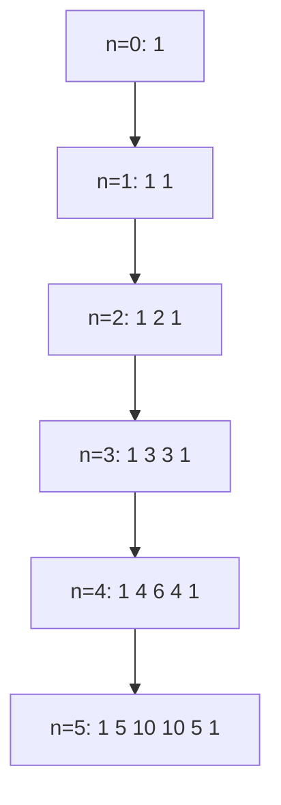

> All key Binomial Theorem formulas — expansion, general & middle term, coefficient identities, multinomial theorem and approximations for JEE quick revision.

Every must-know Binomial Theorem result in one scannable place — expansion, general and middle term, coefficient identities, the multinomial theorem, and approximation formulas. Use this for last-minute JEE Main and Advanced revision.

## The Binomial Theorem

For any positive integer $n$:

$$\boxed{(a + b)^n = \sum_{r=0}^{n} \binom{n}{r} a^{n-r} b^r}$$

$$= \binom{n}{0}a^n + \binom{n}{1}a^{n-1}b + \binom{n}{2}a^{n-2}b^2 + \cdots + \binom{n}{n}b^n$$

where the binomial coefficient is

$$\binom{n}{r} = {}^nC_r = \frac{n!}{r!(n-r)!}$$

> **★ Key point · Core facts**
>
> The expansion of $(a+b)^n$ has exactly $(n+1)$ terms, and in **every** term the sum of the powers of $a$ and $b$ equals $n$.

### Standard forms

| Form | Expansion |
| --- | --- |
| $(1 + x)^n$ | $1 + nx + \dfrac{n(n-1)}{2!}x^2 + \dfrac{n(n-1)(n-2)}{3!}x^3 + \cdots + x^n$ |
| $(1 - x)^n$ | $1 - nx + \dfrac{n(n-1)}{2!}x^2 - \cdots + (-1)^n x^n$ |
| $(x + a)^n$ | $x^n + nx^{n-1}a + \dfrac{n(n-1)}{2!}x^{n-2}a^2 + \cdots + a^n$ |

> **⚠ Trap · Sign trap in $(a-b)^n$**
>
> For $(a - b)^n$, replace $b$ with $(-b)$ and include the sign **before** raising to the power. E.g. in $(x-2y)^5$, $T_3 = \binom{5}{2}x^3(-2y)^2 = 40x^3y^2$, not $\binom{5}{2}x^3(2y)^2$.

## General Term & Term Finding

The general term — the $(r+1)^{\text{th}}$ term — of $(a+b)^n$:

$$\boxed{T_{r+1} = \binom{n}{r} a^{n-r} b^r}, \quad r = 0, 1, 2, \ldots, n$$

| Expansion | General term $T_{r+1}$ |
| --- | --- |
| $(x + a)^n$ | $\binom{n}{r} x^{n-r} a^r$ |
| $(1 + x)^n$ | $\binom{n}{r} x^r$ |
| $(ax + b)^n$ | $\binom{n}{r} a^{n-r} b^r x^{n-r}$ |
| $\left(x + \tfrac{1}{x}\right)^n$ | $\binom{n}{r} x^{n-2r}$ |

> **★ Key point · r vs term number**
>
> Term number $= r + 1$. The 5th term means $T_5$, so $r = 4$. **Term independent of $x$:** set the net power of $x$ in $T_{r+1}$ to $0$ and solve for $r$. If $r$ is not a non-negative integer, that term (or coefficient) is $0$.

### Term from the end

$$r^{\text{th}} \text{ term from the end} = (n - r + 2)^{\text{th}} \text{ term from the start}$$

## Middle Term(s)

| Case | Middle term(s) |
| --- | --- |
| $n$ even | one term: $T_{\frac{n}{2}+1}$ |
| $n$ odd | two terms: $T_{\frac{n+1}{2}}$ and $T_{\frac{n+3}{2}}$ |

For $n$ even:

$$\boxed{T_{\frac{n}{2}+1} = \binom{n}{n/2}\, a^{n/2} b^{n/2}}$$

For $n$ odd:

$$\boxed{T_{\frac{n+1}{2}} = \binom{n}{(n-1)/2}\, a^{(n+1)/2} b^{(n-1)/2}}$$

$$\boxed{T_{\frac{n+3}{2}} = \binom{n}{(n+1)/2}\, a^{(n-1)/2} b^{(n+1)/2}}$$

**Greatest coefficient:** $\binom{n}{n/2}$ if $n$ is even; $\binom{n}{(n-1)/2} = \binom{n}{(n+1)/2}$ if $n$ is odd.

## Greatest Term (Numerically)

For $(a + b)^n$, the numerically greatest term is $T_{r+1}$ where

$$\boxed{r = \left[\frac{(n+1)\,|b|}{|a| + |b|}\right]} \quad ([\,\cdot\,] = \text{greatest integer})$$

Equivalently, $T_{r+1} > T_r$ as long as

$$\frac{(n - r + 1)\,|b|}{r\,|a|} > 1$$

For $(1+x)^n$ with $x > 0$: if $\dfrac{(n+1)x}{1+x}$ is an integer $m$, then $T_m$ and $T_{m+1}$ are both greatest; otherwise $T_{[m]+1}$ is greatest.

## Binomial Coefficient Properties

$$\binom{n}{0} = \binom{n}{n} = 1, \quad \binom{n}{1} = \binom{n}{n-1} = n$$

| Identity | Formula |
| --- | --- |
| Symmetry | $\binom{n}{r} = \binom{n}{n-r}$ |
| Pascal’s identity | $\binom{n}{r} = \binom{n-1}{r-1} + \binom{n-1}{r}$ |
| Sum of consecutive | $\binom{n}{r} + \binom{n}{r+1} = \binom{n+1}{r+1}$ |
| Ratio of consecutive | $\dfrac{\binom{n}{r}}{\binom{n}{r-1}} = \dfrac{n-r+1}{r}$ |
| Index relation | $r\binom{n}{r} = n\binom{n-1}{r-1}$ |

> **⚠ Trap · Symmetry needs equal top index**
>
> $\binom{10}{3} = \binom{10}{7}$, **not** $\binom{3}{10}$. And Pascal’s identity goes to the **previous** row: $\binom{n}{r} = \binom{n-1}{r-1} + \binom{n-1}{r}$ — never same-row neighbours.

## Sum Identities (with $C_r = \binom{n}{r}$)

| Sum | Result |
| --- | --- |
| $C_0 + C_1 + C_2 + \cdots + C_n$ | $2^n$ |
| $C_0 - C_1 + C_2 - \cdots + (-1)^n C_n$ | $0$ |
| $C_0 + C_2 + C_4 + \cdots$ | $2^{n-1}$ |
| $C_1 + C_3 + C_5 + \cdots$ | $2^{n-1}$ |
| $C_1 + 2C_2 + 3C_3 + \cdots + nC_n = \sum r\,C_r$ | $n\cdot 2^{n-1}$ |
| $\sum_{r=0}^{n} r^2 \binom{n}{r}$ | $n(n+1)\,2^{n-2}$ |
| $C_0^2 + C_1^2 + \cdots + C_n^2 = \sum \binom{n}{r}^2$ | $\binom{2n}{n}$ |

Headline results:

$$\boxed{\sum_{r=0}^{n}\binom{n}{r} = 2^n} \qquad \boxed{\sum_{r=0}^{n}\binom{n}{r}^2 = \binom{2n}{n}}$$

$$\boxed{\sum_{r=0}^{n} r\binom{n}{r} = n\cdot 2^{n-1}}$$

### Vandermonde’s identity

$$\boxed{\sum_{r=0}^{k} \binom{m}{r}\binom{n}{k-r} = \binom{m+n}{k}}$$

### Integration / differentiation results

$$\sum_{r=0}^{n} \frac{\binom{n}{r}}{r+1} = \frac{2^{n+1} - 1}{n+1}$$

$$\sum_{r=0}^{n}(-1)^r\binom{n}{r}^2 = \begin{cases} 0 & n \text{ odd} \\ (-1)^{n/2}\binom{n}{n/2} & n \text{ even} \end{cases}$$

> **★ Key point · How sum identities are generated**
>
> Put $x = 1$ in $(1+x)^n$ for the total $2^n$; put $x = -1$ for the alternating sum $0$. For weighted sums ($\sum rC_r$, $\sum r^2 C_r$) differentiate $(1+x)^n$ then put $x=1$; for $\sum \frac{C_r}{r+1}$ integrate from $0$ to $1$.

## Multinomial Theorem

For a positive integer $n$ and $k$ variables:

$$\boxed{(x_1 + x_2 + \cdots + x_k)^n = \sum \frac{n!}{n_1!\, n_2! \cdots n_k!}\, x_1^{n_1} x_2^{n_2} \cdots x_k^{n_k}}$$

where $n_1 + n_2 + \cdots + n_k = n$, all $n_i \ge 0$.

**Multinomial coefficient:**

$$\binom{n}{n_1, n_2, \ldots, n_k} = \frac{n!}{n_1!\, n_2! \cdots n_k!} = \binom{n}{n_1}\binom{n-n_1}{n_2}\binom{n-n_1-n_2}{n_3}\cdots$$

**Trinomial special case:**

$$(a + b + c)^n = \sum_{p+q+r=n} \frac{n!}{p!\,q!\,r!}\, a^p b^q c^r$$

| Quantity | Formula | Notes |
| --- | --- | --- |
| Number of terms | $\binom{n+k-1}{k-1} = \binom{n+k-1}{n}$ | stars-and-bars; $\binom{n+2}{2}$ for trinomial |
| Sum of all coefficients | $k^n$ | put every variable $= 1$ |
| Greatest coefficient | powers as equal as possible | if $n = kq + r$: $r$ terms get power $q+1$, rest get $q$ |

> **⚠ Trap · Factorials go on the bottom**
>
> Coefficient of $x^a y^b z^c$ in $(x+y+z)^n$ is $\dfrac{n!}{a!\,b!\,c!}$ — total factorial on top. It exists **only** if $a + b + c = n$; otherwise the coefficient is $0$.

## Approximations (small $x$)

For $|x| < 1$ and **any** real $n$ (positive, negative, or fractional):

$$\boxed{(1 + x)^n = 1 + nx + \frac{n(n-1)}{2!}x^2 + \frac{n(n-1)(n-2)}{3!}x^3 + \cdots}$$

- First order: $(1+x)^n \approx 1 + nx$
- Second order: $(1+x)^n \approx 1 + nx + \dfrac{n(n-1)}{2}x^2$

| Expression | Approximation (small $x$) |
| --- | --- |
| $(1 + x)^n$ | $1 + nx$ |
| $(1 - x)^n$ | $1 - nx$ |
| $\sqrt{1 + x}$ | $1 + \dfrac{x}{2}$ |
| $\sqrt[3]{1 + x}$ | $1 + \dfrac{x}{3}$ |
| $\dfrac{1}{1 + x}$ | $1 - x$ |
| $\dfrac{1}{\sqrt{1 + x}}$ | $1 - \dfrac{x}{2}$ |
| $\dfrac{1}{(1 + x)^2}$ | $1 - 2x$ |

Higher-order single-variable expansions used in JEE:

$$\sqrt{1+x} \approx 1 + \frac{x}{2} - \frac{x^2}{8}, \qquad \sqrt[3]{1+x} \approx 1 + \frac{x}{3} - \frac{x^2}{9}$$

$$\frac{1}{1+x} = (1+x)^{-1} \approx 1 - x + x^2 - x^3 + \cdots$$

**Relative error** when using $(1+x)^n \approx 1 + nx$:

$$\text{Relative error} \approx \frac{n(n-1)x^2}{2}$$

> **⚠ Trap · When approximation is valid**
>
> Use $(1+x)^n \approx 1+nx$ only when $|x| \ll 1$ (typically $|x| < 0.1$). To apply it, first factor the base close to $1$: e.g. $(2.03)^5 = 2^5\left(1 + \tfrac{0.03}{2}\right)^5$ and $\sqrt{99} = 10\left(1 - \tfrac{1}{100}\right)^{1/2}$.

## Pascal’s Triangle

Each entry is the sum of the two directly above it (Pascal’s identity), giving the binomial coefficients row by row.



## One-Glance Summary

| Quantity | Formula |
| --- | --- |
| Expansion | $(a+b)^n = \sum_{r=0}^{n}\binom{n}{r}a^{n-r}b^r$ |
| Number of terms | $n + 1$ |
| General term | $T_{r+1} = \binom{n}{r}a^{n-r}b^r$ |
| Middle term ($n$ even) | $T_{\frac{n}{2}+1}$ |
| Middle terms ($n$ odd) | $T_{\frac{n+1}{2}},\ T_{\frac{n+3}{2}}$ |
| Greatest term index | $r = \left[\dfrac{(n+1) |
| Symmetry | $\binom{n}{r} = \binom{n}{n-r}$ |
| Pascal’s identity | $\binom{n}{r} = \binom{n-1}{r-1} + \binom{n-1}{r}$ |
| Ratio | $\dfrac{\binom{n}{r}}{\binom{n}{r-1}} = \dfrac{n-r+1}{r}$ |
| $\sum C_r$ | $2^n$ |
| $\sum (-1)^r C_r$ | $0$ |
| Even = odd place sum | $2^{n-1}$ |
| $\sum r\,C_r$ | $n\,2^{n-1}$ |
| $\sum r^2 C_r$ | $n(n+1)2^{n-2}$ |
| $\sum C_r^2$ | $\binom{2n}{n}$ |
| Vandermonde | $\sum_r \binom{m}{r}\binom{n}{k-r} = \binom{m+n}{k}$ |
| Multinomial terms | $\binom{n+k-1}{k-1}$ |
| Multinomial coeff. sum | $k^n$ |
| Approximation | $(1+x)^n \approx 1 + nx,\ |

## Related Topics

- [Binomial Theorem for Positive Integer](../binomial-expansion/index.md)
- [General Term and Middle Term](../general-term/index.md)
- [Properties of Binomial Coefficients](../binomial-coefficients/index.md)
- [Multinomial Theorem](../multinomial-theorem/index.md)
- [Applications in Approximations](../applications/index.md)
- [Permutations and Combinations](../../permutations-combinations/index.md)
- [Sequences and Series](../../sequences-series/index.md)

From TestGuru · our mock-test platform

## You've read Binomial Theorem Formula Sheet.You've read this topic. Find out what you actually got.

A free JEE Main mock with this chapter in it, and a report that shows which sub-topics cost you marks.

[Take a free JEE Main mock →](https://app.testguru.co/signup?tg_chapter=binomial-theorem&tg_exam=jee-main&tg_page=%2Fmathematics%2Fbinomial-theorem%2Fformula-sheet%2F&tg_subject=mathematics&utm_campaign=notes-jee-main-free-test&utm_content=article-end&utm_medium=referral&utm_source=jeenotes)
Free, no card. Opens TestGuru in a new tab.

## Stay exam-ready

One email every Sunday: new notes, the week's hardest challenge question and a revision plan.One email every Sunday.

## Comments

Have a question or spotted a mistake? Join the discussion below.

Advertisement

Advertisement

---

## Extracted page code (interactive scripts & widgets)


### inline-script-14

```js
(function(){var t,e=document.getElementById("disqus-load");if(!e)return;t=!1,e.addEventListener("click",function(){if(t)return;t=!0,e.setAttribute("disabled","disabled"),e.textContent="Loading comments…",window.disqus_config=function(){this.page.url="https://jeenotes.in/mathematics/binomial-theorem/formula-sheet/",this.page.identifier="/mathematics/binomial-theorem/formula-sheet/"};var s=document,n=s.createElement("script");n.src="https://https-jeenotes-in.disqus.com/embed.js",n.setAttribute("data-timestamp",+new Date),n.onload=function(){e.style.display="none"},n.onerror=function(){t=!1,e.removeAttribute("disabled"),e.textContent="Could not load comments. Tap to retry"},(s.head||s.body).appendChild(n)})})()
```


### inline-script-15

```js
(function(){var t,e=document.currentScript.previousElementSibling;function n(){(window.adsbygoogle=window.adsbygoogle||[]).push({})}if(!window.ResizeObserver||e.clientWidth>0){n();return}t=new ResizeObserver(function(){e.clientWidth>0&&(t.disconnect(),n())}),t.observe(e)})()
```


---

_Source: [https://jeenotes.in/mathematics/binomial-theorem/formula-sheet/](https://jeenotes.in/mathematics/binomial-theorem/formula-sheet/) · raw HTML: `offline/mathematics/binomial-theorem/formula-sheet/index.html`_
