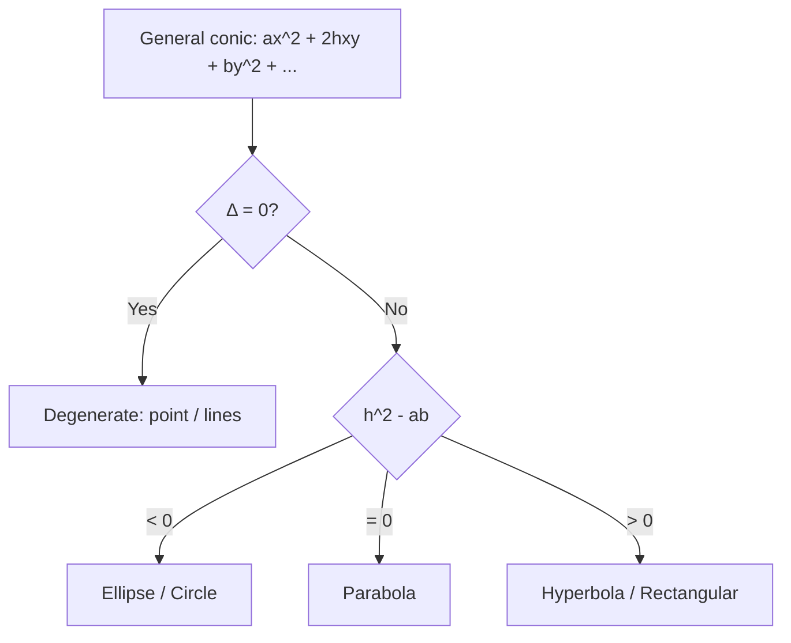

> Every key Coordinate Geometry formula for JEE: straight lines, circles, parabola, ellipse, hyperbola, conics, tangents & chord of contact - quick revision.

A single scannable sheet of every must-know Coordinate Geometry formula - basics, straight lines, circles, and all four conics - for last-minute JEE Main and Advanced revision. Group by sub-topic and skim the headline boxed formulas first.

## Basics: Points, Distances, Division

| Quantity | Formula | Notes |
| --- | --- | --- |
| Distance between two points | $d = \sqrt{(x_2-x_1)^2 + (y_2-y_1)^2}$ | Pythagoras |
| Section (internal, $m:n$) | $\left(\dfrac{mx_2 + nx_1}{m+n}, \dfrac{my_2 + ny_1}{m+n}\right)$ | Point divides internally |
| Section (external, $m:n$) | $\left(\dfrac{mx_2 - nx_1}{m-n}, \dfrac{my_2 - ny_1}{m-n}\right)$ | Point divides externally |
| Midpoint | $\left(\dfrac{x_1+x_2}{2}, \dfrac{y_1+y_2}{2}\right)$ | $m:n = 1:1$ |
| Centroid of triangle | $\left(\dfrac{x_1+x_2+x_3}{3}, \dfrac{y_1+y_2+y_3}{3}\right)$ | Average of three vertices |

---

## Straight Lines

### Forms of the Line

| Form | Equation |
| --- | --- |
| Slope-intercept | $y = mx + c$ |
| Point-slope | $y - y_1 = m(x - x_1)$ |
| Two-point | $\dfrac{y - y_1}{y_2 - y_1} = \dfrac{x - x_1}{x_2 - x_1}$ |
| Intercept | $\dfrac{x}{a} + \dfrac{y}{b} = 1$ |
| Normal (perpendicular) | $x\cos\alpha + y\sin\alpha = p$ |
| General | $Ax + By + C = 0$ |

For the general form $Ax + By + C = 0$: slope $m = -\dfrac{A}{B}$, x-intercept $= -\dfrac{C}{A}$, y-intercept $= -\dfrac{C}{B}$.

### Slope and Angle

$$\boxed{m = \tan\theta = \frac{y_2 - y_1}{x_2 - x_1}}$$

$$\boxed{\tan\theta = \left|\frac{m_1 - m_2}{1 + m_1 m_2}\right|}$$

| Relation | Slope condition | Coefficient condition |
| --- | --- | --- |
| Parallel | $m_1 = m_2$ | $\dfrac{A_1}{A_2} = \dfrac{B_1}{B_2} \neq \dfrac{C_1}{C_2}$ |
| Perpendicular | $m_1 m_2 = -1$ | $A_1 A_2 + B_1 B_2 = 0$ |
| Coincident | same line | $\dfrac{A_1}{A_2} = \dfrac{B_1}{B_2} = \dfrac{C_1}{C_2}$ |

### Distances

$$\boxed{d = \frac{|Ax_1 + By_1 + C|}{\sqrt{A^2 + B^2}}} \qquad \text{(point to line)}$$

$$\boxed{d = \frac{|C_1 - C_2|}{\sqrt{A^2 + B^2}}} \qquad \text{(between parallel lines, same } A,B)$$

### Other Key Results

| Quantity | Formula | Notes |
| --- | --- | --- |
| Foot of perpendicular from $(x_1,y_1)$ to $ax+by+c=0$ | $\dfrac{x - x_1}{a} = \dfrac{y - y_1}{b} = -\dfrac{ax_1 + by_1 + c}{a^2 + b^2}$ | Gives foot directly |
| Family of lines through intersection | $L_1 + \lambda L_2 = 0$ | Avoids solving for intersection |
| Triangle area from intercept form $\frac{x}{a}+\frac{y}{b}=1$ | $\dfrac{1}{2}\lvert ab\rvert$ | With coordinate axes |

> **★ Key point · High-Yield: Position of a Point**
>
> For two points relative to $Ax + By + C = 0$: same sign of $Ax_i + By_i + C$ means **same side**; opposite signs mean **opposite sides**.
>
> The point-to-line distance formula shows up in the majority of straight-line problems - always convert to $Ax + By + C = 0$ first.

---

## Circles

### Equations

$$\boxed{(x - h)^2 + (y - k)^2 = r^2} \qquad \text{center } (h,k),\ \text{radius } r$$

$$\boxed{x^2 + y^2 + 2gx + 2fy + c = 0}$$

| Quantity | From general form |
| --- | --- |
| Center | $(-g, -f)$ |
| Radius | $\sqrt{g^2 + f^2 - c}$ |
| Real circle | $g^2 + f^2 - c > 0$ (point circle if $=0$, imaginary if $<0$) |
| Diameter-endpoint form | $(x-x_1)(x-x_2) + (y-y_1)(y-y_2) = 0$ |
| Parametric | $x = h + r\cos\theta,\ y = k + r\sin\theta$ |

### Tangent, Normal, Chords

| Result | Formula |
| --- | --- |
| Tangent at $(x_1,y_1)$ on $x^2+y^2=r^2$ | $xx_1 + yy_1 = r^2$ |
| Tangent at $(x_1,y_1)$ on general circle | $xx_1 + yy_1 + g(x+x_1) + f(y+y_1) + c = 0$ |
| Tangent with slope $m$ on $x^2+y^2=r^2$ | $y = mx \pm r\sqrt{1 + m^2}$ |
| Tangency condition for $y=mx+c$ | $c^2 = r^2(1 + m^2)$ |
| Normal | always passes through the center (use two-point form) |
| Length of tangent from $(x_1,y_1)$ | $\sqrt{x_1^2 + y_1^2 + 2gx_1 + 2fy_1 + c}$ |
| Chord length (perp. distance $d$) | $2\sqrt{r^2 - d^2}$ |
| Chord of contact from $(x_1,y_1)$ | $xx_1 + yy_1 = r^2$ |

### Position of a Point and Families

With $S_1 = x_1^2 + y_1^2 + 2gx_1 + 2fy_1 + c$: $S_1>0$ outside, $S_1=0$ on, $S_1<0$ inside.

$$\boxed{S_1 + \lambda S_2 = 0 \ \text{(family through intersection)}, \qquad S_1 - S_2 = 0 \ \text{(radical axis / common chord)}}$$

Concentric circles: keep $g, f$, vary the constant. **Orthogonal circles** condition:

$$\boxed{2g_1 g_2 + 2f_1 f_2 = c_1 + c_2}$$

**Director circle** of $x^2+y^2=a^2$ (locus of perpendicular tangents): $x^2 + y^2 = 2a^2$.

> **★ Key point · Tangent Shortcut (T-rule)**
>
> For tangent / chord of contact / polar: replace $x^2 \to xx_1$, $y^2 \to yy_1$, $x \to \tfrac{x+x_1}{2}$, $y \to \tfrac{y+y_1}{2}$, constant unchanged. Same formula whether $(x_1,y_1)$ is **on** the circle (tangent) or **outside** (chord of contact).

---

## Parabola

### Standard Forms

| Equation | Vertex | Focus | Directrix | Axis | Opens | Latus rectum |
| --- | --- | --- | --- | --- | --- | --- |
| $y^2 = 4ax$ | $(0,0)$ | $(a,0)$ | $x=-a$ | $y=0$ | Right | $4a$ |
| $y^2 = -4ax$ | $(0,0)$ | $(-a,0)$ | $x=a$ | $y=0$ | Left | $4a$ |
| $x^2 = 4ay$ | $(0,0)$ | $(0,a)$ | $y=-a$ | $x=0$ | Up | $4a$ |
| $x^2 = -4ay$ | $(0,0)$ | $(0,-a)$ | $y=a$ | $x=0$ | Down | $4a$ |

Eccentricity $e = 1$ for every parabola. LR endpoints of $y^2=4ax$: $(a, 2a)$ and $(a, -2a)$.

Vertex at $(h,k)$: $(y-k)^2 = 4a(x-h)$ -> focus $(h+a, k)$, directrix $x = h-a$.

### Parametric, Tangent, Normal

$$\boxed{x = at^2, \quad y = 2at}$$

| Result | Formula |
| --- | --- |
| Tangent at $(x_1,y_1)$ | $yy_1 = 2a(x + x_1)$ |
| Tangent at parameter $t$ | $ty = x + at^2$ |
| Tangent with slope $m$ | $y = mx + \dfrac{a}{m}$ (point of contact $\left(\tfrac{a}{m^2}, \tfrac{2a}{m}\right)$) |
| Tangency condition for $y=mx+c$ | $c = \dfrac{a}{m}$ |
| Normal at $(x_1,y_1)$ | $y - y_1 = -\dfrac{y_1}{2a}(x - x_1)$ |
| Normal at parameter $t$ | $y + tx = 2at + at^3$ (slope $-t$) |
| Normal with slope $m$ | $y = mx - 2am - am^3$ |

### Focal Chord and Chords

$$\boxed{t_1 t_2 = -1 \quad \text{(ends of a focal chord)}}$$

| Result | Formula |
| --- | --- |
| Focal chord length | $a(t_1 - t_2)^2 = a\left(t_1 + \tfrac{1}{t_1}\right)^2$ |
| Harmonic relation of segments $p,q$ | $\dfrac{1}{p} + \dfrac{1}{q} = \dfrac{1}{a}$ (semi-LR = HM of segments) |
| Intersection of tangents at $t_1, t_2$ | $\left(a t_1 t_2,\ a(t_1 + t_2)\right)$ |
| Chord with midpoint $(x_1,y_1)$ | $yy_1 - 2a(x + x_1) = y_1^2 - 4ax_1$ (i.e. $T = S_1$) |
| Locus of perpendicular tangents | directrix $x = -a$ |

> **★ Key point · Tangent vs Normal Count**
>
> For a given slope a parabola has exactly **one tangent** but up to **three normals**. Recognition rule: $y^2$ squared -> opens horizontally; $x^2$ squared -> opens vertically. Focus sits at distance $a$ (not $4a$) from the vertex.

---

## Ellipse: $\dfrac{x^2}{a^2} + \dfrac{y^2}{b^2} = 1$

### Key Elements (horizontal, $a > b$)

| Element | Value |
| --- | --- |
| Center | $(0,0)$ |
| Major / minor axis length | $2a$ / $2b$ |
| Vertices | $(\pm a, 0)$ |
| Co-vertices | $(0, \pm b)$ |
| Foci | $(\pm c, 0)$, $c = \sqrt{a^2 - b^2}$ |
| Eccentricity | $e = \dfrac{c}{a} = \dfrac{\sqrt{a^2 - b^2}}{a}$, $0 < e < 1$ |
| Latus rectum | $\dfrac{2b^2}{a}$ |
| Directrices | $x = \pm \dfrac{a}{e}$ |

Vertical ellipse $\dfrac{x^2}{b^2} + \dfrac{y^2}{a^2} = 1$ ($a>b$): foci $(0, \pm c)$, vertices $(0, \pm a)$. **Larger denominator = major axis.**

### Core Relations

$$\boxed{c^2 = a^2 - b^2} \qquad \boxed{e = \frac{c}{a}} \qquad \boxed{b^2 = a^2(1 - e^2)}$$

### Parametric, Tangent, Normal, Properties

$$\boxed{x = a\cos\theta, \quad y = b\sin\theta}$$

| Result | Formula |
| --- | --- |
| Tangent at $(x_1,y_1)$ | $\dfrac{xx_1}{a^2} + \dfrac{yy_1}{b^2} = 1$ |
| Tangent at parameter $\theta$ | $\dfrac{x\cos\theta}{a} + \dfrac{y\sin\theta}{b} = 1$ |
| Tangent with slope $m$ | $y = mx \pm \sqrt{a^2 m^2 + b^2}$ |
| Tangency condition for $y=mx+c$ | $c^2 = a^2 m^2 + b^2$ |
| Normal at $(x_1,y_1)$ | $\dfrac{a^2 x}{x_1} - \dfrac{b^2 y}{y_1} = a^2 - b^2$ |
| Normal at parameter $\theta$ | $ax\sec\theta - by\csc\theta = a^2 - b^2$ |
| Sum of focal distances | $PF_1 + PF_2 = 2a$ |
| Chord of contact from $(x_1,y_1)$ | $\dfrac{xx_1}{a^2} + \dfrac{yy_1}{b^2} = 1$ |
| Auxiliary circle | $x^2 + y^2 = a^2$ |
| Director circle | $x^2 + y^2 = a^2 + b^2$ |
| Max / min focal distance | $a + c$ / $a - c$ |

> **★ Key point · Sign Trap**
>
> Ellipse **subtracts**: $c^2 = a^2 - b^2$ (foci inside, $c

---

## Hyperbola: $\dfrac{x^2}{a^2} - \dfrac{y^2}{b^2} = 1$

### Key Elements (horizontal)

| Element | Value |
| --- | --- |
| Center | $(0,0)$ |
| Transverse / conjugate axis | $2a$ / $2b$ |
| Vertices | $(\pm a, 0)$ |
| Foci | $(\pm c, 0)$, $c = \sqrt{a^2 + b^2}$ |
| Eccentricity | $e = \dfrac{c}{a} = \dfrac{\sqrt{a^2 + b^2}}{a}$, $e > 1$ |
| Latus rectum | $\dfrac{2b^2}{a}$ |
| Asymptotes | $y = \pm \dfrac{b}{a}x$ |
| Directrices | $x = \pm \dfrac{a}{e}$ |

Vertical hyperbola $\dfrac{y^2}{a^2} - \dfrac{x^2}{b^2} = 1$: foci $(0, \pm c)$, asymptotes $y = \pm \dfrac{a}{b}x$. **The positive term gives the opening direction.**

### Core Relations

$$\boxed{c^2 = a^2 + b^2} \qquad \boxed{e = \frac{c}{a} > 1} \qquad \boxed{b^2 = a^2(e^2 - 1)} \qquad \boxed{c^2 = a^2 e^2}$$

Asymptotes: set the equation to $0$, i.e. $\dfrac{x^2}{a^2} - \dfrac{y^2}{b^2} = 0$.

### Parametric, Tangent, Normal, Properties

$$\boxed{x = a\sec\theta, \quad y = b\tan\theta}$$

| Result | Formula |
| --- | --- |
| Tangent at $(x_1,y_1)$ | $\dfrac{xx_1}{a^2} - \dfrac{yy_1}{b^2} = 1$ |
| Tangent at parameter $\theta$ | $\dfrac{x\sec\theta}{a} - \dfrac{y\tan\theta}{b} = 1$ |
| Tangent with slope $m$ | $y = mx \pm \sqrt{a^2 m^2 - b^2}$ (needs $\lvert m\rvert > \tfrac{b}{a}$) |
| Tangency condition for $y=mx+c$ | $c^2 = a^2 m^2 - b^2$ |
| Normal at $(x_1,y_1)$ | $\dfrac{a^2 x}{x_1} + \dfrac{b^2 y}{y_1} = a^2 + b^2$ |
| Normal at parameter $\theta$ | $ax\cos\theta + by\cot\theta = a^2 + b^2$ |
| Difference of focal distances | $\lvert PF_1 - PF_2\rvert = 2a$ |
| Chord of contact from $(x_1,y_1)$ | $\dfrac{xx_1}{a^2} - \dfrac{yy_1}{b^2} = 1$ |
| Director circle | $x^2 + y^2 = a^2 - b^2$ (real only if $a > b$) |
| Conjugate hyperbola | $\dfrac{y^2}{b^2} - \dfrac{x^2}{a^2} = 1$ (same asymptotes) |

### Rectangular Hyperbola

$$\boxed{a = b \iff e = \sqrt{2}} \qquad x^2 - y^2 = a^2 \quad\text{or, rotated 45°,}\quad xy = c^2$$

| Result (for $xy = c^2$) | Formula |
| --- | --- |
| Parametric | $x = ct,\ y = \dfrac{c}{t}$ ($t \neq 0$) |
| Asymptotes | $x = 0$ and $y = 0$ |
| Tangent at $(ct, c/t)$ | $\dfrac{x}{t} + ty = 2c$ |
| Tangent at $(x_1,y_1)$ | $xy_1 + yx_1 = 2c^2$ |
| Normal at $(ct, c/t)$ | $xt^3 - yt - ct^4 + c = 0$ |
| Chord of contact from $(x_1,y_1)$ | $xy_1 + yx_1 = 2c^2$ |

> **★ Key point · Ellipse vs Hyperbola**
>
> **Hyperbola adds** ($c^2 = a^2 + b^2$), **ellipse subtracts**. Hyperbola tangent slope form uses **minus** under the root and only exists for $\lvert m\rvert > \tfrac{b}{a}$. Any $xy = k$ is a rectangular hyperbola with $e=\sqrt{2}$.

---

## General Second-Degree Conic

$$\boxed{ax^2 + 2hxy + by^2 + 2gx + 2fy + c = 0}$$

$$\boxed{\Delta = abc + 2fgh - af^2 - bg^2 - ch^2}$$

### Classification (non-degenerate, $\Delta \neq 0$)

| Condition | Conic | Special case |
| --- | --- | --- |
| $h^2 - ab < 0$ | Ellipse | Circle if $a = b$, $h = 0$ |
| $h^2 - ab = 0$ | Parabola | — |
| $h^2 - ab > 0$ | Hyperbola | Rectangular if $a + b = 0$ |

Degenerate cases ($\Delta = 0$): $h^2-ab<0 \to$ point; $=0 \to$ two coincident lines; $>0 \to$ two intersecting lines.

### Centre, Axes, Asymptotes

$$\boxed{ax_0 + hy_0 + g = 0, \quad hx_0 + by_0 + f = 0} \implies x_0 = \frac{hf - bg}{ab - h^2},\ \ y_0 = \frac{gh - af}{ab - h^2}$$

Parabola has no centre ($ab - h^2 = 0$). Principal axes: $\tan 2\theta = \dfrac{2h}{a-b}$ (same angle removes the $xy$ term under rotation). Asymptotes of a central conic (origin at centre): $ax^2 + 2hxy + by^2 = 0$.

### Pair of Straight Lines

$ax^2 + 2hxy + by^2 + 2gx + 2fy + c = 0$ is a pair of lines iff $\Delta = 0$.

Homogeneous $ax^2 + 2hxy + by^2 = 0$ (lines through origin): real distinct if $h^2 > ab$, coincident if $h^2 = ab$, imaginary if $h^2 < ab$.

$$\boxed{\tan\theta = \frac{2\sqrt{h^2 - ab}}{a + b}} \qquad \text{perpendicular lines} \iff a + b = 0$$

### Invariants Under Rotation

$a + b$, $\ ab - h^2$, and $\Delta$ all stay constant.

> **★ Key point · Identification Algorithm**
>
> Check $\Delta$ first - if $\Delta = 0$ it is degenerate (point / lines). Only then use $h^2 - ab$ to classify. Remember the $2h, 2g, 2f$ doubling; if a problem gives coefficients without the 2, adjust before plugging in.

---

## Universal Conic Tools (T-rule)

For any conic, apply the **T-substitution** to its equation to get tangent / chord of contact / polar:

$$\boxed{x^2 \to xx_1,\quad y^2 \to yy_1,\quad xy \to \tfrac{xy_1 + x_1y}{2},\quad x \to \tfrac{x+x_1}{2},\quad y \to \tfrac{y+y_1}{2}}$$

| Use case | Equation |
| --- | --- |
| Tangent (point on conic) | $T = 0$ |
| Chord of contact / polar of $(x_1,y_1)$ | $T = 0$ (same form) |
| Chord with given midpoint $(h,k)$ | $T = S_1$ |
| Conjugate points $P, Q$ | $P$ lies on polar of $Q$ |

### Chord with Midpoint $(h,k)$ — by conic

| Conic | Chord ($T = S_1$) |
| --- | --- |
| Circle $x^2+y^2=r^2$ | $hx + ky = h^2 + k^2$ |
| Parabola $y^2=4ax$ | $ky - 2a(x+h) = k^2 - 4ah$ |
| Ellipse | $\dfrac{hx}{a^2} + \dfrac{ky}{b^2} = \dfrac{h^2}{a^2} + \dfrac{k^2}{b^2}$ |
| Hyperbola | $\dfrac{hx}{a^2} - \dfrac{ky}{b^2} = \dfrac{h^2}{a^2} - \dfrac{k^2}{b^2}$ |

### Conjugate Points Condition

| Conic | Condition |
| --- | --- |
| Circle | $x_1 x_2 + y_1 y_2 = r^2$ |
| Parabola | $y_1 y_2 = 2a(x_1 + x_2)$ |
| Ellipse | $\dfrac{x_1 x_2}{a^2} + \dfrac{y_1 y_2}{b^2} = 1$ |
| Hyperbola | $\dfrac{x_1 x_2}{a^2} - \dfrac{y_1 y_2}{b^2} = 1$ |

Pole of line $hx + ky = r^2$ vs circle $x^2+y^2=r^2$ is $(h,k)$; for line $lx+my+n=0$ vs $x^2+y^2=r^2$ the pole is $\left(\dfrac{r^2 l}{n}, \dfrac{r^2 m}{n}\right)$. Length of chord of contact from $(x_1,y_1)$ to $x^2+y^2=r^2$: $\dfrac{2r\sqrt{x_1^2+y_1^2-r^2}}{\sqrt{x_1^2+y_1^2}}$.

### Director Circle (locus of perpendicular tangents)

| Conic | Locus |
| --- | --- |
| Parabola $y^2 = 4ax$ | directrix $x = -a$ |
| Ellipse | $x^2 + y^2 = a^2 + b^2$ |
| Hyperbola | $x^2 + y^2 = a^2 - b^2$ (if $a>b$) |
| Circle $x^2+y^2=r^2$ | $x^2 + y^2 = 2r^2$ |

---

## Eccentricity Snapshot

| Conic | Eccentricity | Focal-distance property |
| --- | --- | --- |
| Circle | $e = 0$ | foci coincide at centre |
| Ellipse | $0 < e < 1$ | sum $= 2a$ |
| Parabola | $e = 1$ | from focus = from directrix |
| Hyperbola | $e > 1$ | difference $= 2a$ |
| Rectangular hyperbola | $e = \sqrt{2}$ | $a = b$ |



> **★ Key point · Last-Minute Reminders**
>
> - Convert any line to $Ax + By + C = 0$ before applying distance formulas.

> - Circle centre from general form is $(-g, -f)$, radius $\sqrt{g^2+f^2-c}$ - both signs and the square matter.

> - Conic focal relations: ellipse $c^2 = a^2 - b^2$, hyperbola $c^2 = a^2 + b^2$.

> - Latus rectum: parabola $4a$; ellipse and hyperbola $\dfrac{2b^2}{a}$.

> - One tangent per slope on a parabola; two on circle/ellipse; hyperbola needs $\lvert m\rvert > \tfrac{b}{a}$.

> - Tangent, chord of contact, and polar all share the $T = 0$ form; midpoint chords use $T = S_1$.

From TestGuru · our mock-test platform

## You've read Coordinate Geometry Formula Sheet.You've read this topic. Find out what you actually got.

A free JEE Main mock with this chapter in it, and a report that shows which sub-topics cost you marks.

[Take a free JEE Main mock →](https://app.testguru.co/signup?tg_chapter=coordinate-geometry&tg_exam=jee-main&tg_page=%2Fmathematics%2Fcoordinate-geometry%2Fformula-sheet%2F&tg_subject=mathematics&utm_campaign=notes-jee-main-free-test&utm_content=article-end&utm_medium=referral&utm_source=jeenotes)
Free, no card. Opens TestGuru in a new tab.

## Stay exam-ready

One email every Sunday: new notes, the week's hardest challenge question and a revision plan.One email every Sunday.

## Comments

Have a question or spotted a mistake? Join the discussion below.

Advertisement

Advertisement

---

## Extracted page code (interactive scripts & widgets)


### inline-script-14

```js
(function(){var t,e=document.getElementById("disqus-load");if(!e)return;t=!1,e.addEventListener("click",function(){if(t)return;t=!0,e.setAttribute("disabled","disabled"),e.textContent="Loading comments…",window.disqus_config=function(){this.page.url="https://jeenotes.in/mathematics/coordinate-geometry/formula-sheet/",this.page.identifier="/mathematics/coordinate-geometry/formula-sheet/"};var s=document,n=s.createElement("script");n.src="https://https-jeenotes-in.disqus.com/embed.js",n.setAttribute("data-timestamp",+new Date),n.onload=function(){e.style.display="none"},n.onerror=function(){t=!1,e.removeAttribute("disabled"),e.textContent="Could not load comments. Tap to retry"},(s.head||s.body).appendChild(n)})})()
```


### inline-script-15

```js
(function(){var t,e=document.currentScript.previousElementSibling;function n(){(window.adsbygoogle=window.adsbygoogle||[]).push({})}if(!window.ResizeObserver||e.clientWidth>0){n();return}t=new ResizeObserver(function(){e.clientWidth>0&&(t.disconnect(),n())}),t.observe(e)})()
```


---

_Source: [https://jeenotes.in/mathematics/coordinate-geometry/formula-sheet/](https://jeenotes.in/mathematics/coordinate-geometry/formula-sheet/) · raw HTML: `offline/mathematics/coordinate-geometry/formula-sheet/index.html`_
