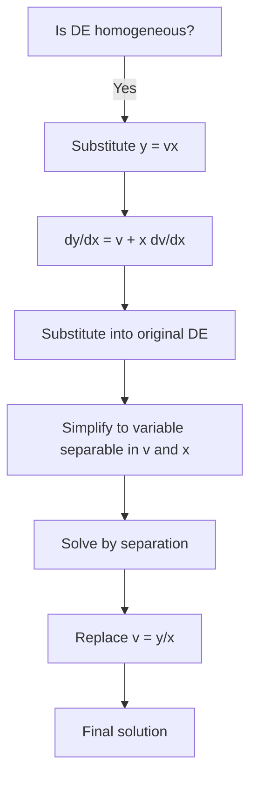

> All key Differential Equations formulas for JEE Main & Advanced: order, degree, formation, variable separable, homogeneous, linear DE, integrating factor and applications. Quick revision.

A scannable, exam-day revision sheet covering every key definition, standard form, solution method, and application from the Differential Equations chapter.

## Basic Definitions

A **differential equation (DE)** contains derivatives of a dependent variable with respect to an independent variable.

| Term | Definition |
| --- | --- |
| **Order** | Highest order derivative present in the DE |
| **Degree** | Power of the highest order derivative, when the DE is a polynomial in derivatives |
| **General solution** | Solution containing arbitrary constants equal to the order |
| **Particular solution** | Obtained by giving specific values to the constants (using initial conditions) |

$$\boxed{\text{Order} = \text{Highest order derivative in the DE}}$$

$$\boxed{\text{Degree} = \text{Power of highest order derivative (if polynomial in derivatives)}}$$

> **★ Key point · When degree is NOT defined**
>
> Degree is undefined if any derivative appears inside a **R**adical, **E**xponent, **F**raction, or **T**ranscendental function (sin, cos, log, $e^{(\cdot)}$). Remember: **“No REFT allowed.”** Always simplify to polynomial form (remove radicals/fractional powers) *before* reading off the degree.

### Standard Forms

$$\boxed{\text{First order, first degree: } \frac{dy}{dx} = f(x, y)}$$

$$\boxed{\text{Second order, first degree: } \frac{d^2y}{dx^2} + P(x)\frac{dy}{dx} + Q(x)y = R(x)}$$

A DE is **linear** if there are no products or powers of $y$ and its derivatives (e.g. no $y\,y'$, no $(y')^2$).

---

## Formation of Differential Equations

Formation = creating a DE from a relation by **eliminating arbitrary constants** (reverse of solving).

$$\boxed{\text{Number of arbitrary constants} = \text{Order of the DE}}$$

**Procedure (D-E-R):** **D**ifferentiate the relation as many times as there are constants → **E**liminate the constants → **R**earrange to standard form. The final DE must contain only $x, y$ and derivatives.

### Standard Results (eliminate the constant → DE)

| Given Relation | Differential Equation |
| --- | --- |
| $y = ae^{kx}$ | $\dfrac{dy}{dx} = ky$ |
| $y = ae^{x} + be^{-x}$ | $\dfrac{d^2y}{dx^2} - y = 0$ |
| $y = a\cos kx + b\sin kx$ | $\dfrac{d^2y}{dx^2} + k^2 y = 0$ |
| $x^2 + y^2 = a^2$ | $x + y\dfrac{dy}{dx} = 0$ |
| $y^2 = 4ax$ | $y\dfrac{dy}{dx} = 2a$ (or $y = 2x\,y'$ if $a$ arbitrary) |
| $(y - a)^2 = 4a(x - b)$ | $(y')^2 = 4a\,y''$ (after elimination) |

### Special Exponential–Trigonometric Forms

$$y = e^{ax}(A\cos bx + B\sin bx) \;\Rightarrow\; \boxed{\frac{d^2y}{dx^2} - 2a\frac{dy}{dx} + (a^2 + b^2)y = 0}$$

$$y = (c_1 + c_2 x)e^{ax} \;\Rightarrow\; \boxed{\frac{d^2y}{dx^2} - 2a\frac{dy}{dx} + a^2 y = 0}$$

### Conic Section Results

| Curve | DE after one differentiation |
| --- | --- |
| Circle $x^2 + y^2 = r^2$ | $x + y\,y' = 0$ |
| Ellipse $\dfrac{x^2}{a^2} + \dfrac{y^2}{b^2} = 1$ | $\dfrac{x}{a^2} + \dfrac{y}{b^2}y' = 0$ |
| Parabola $y^2 = 4ax$ | $y\,y' = 2a$ |

> **★ Key point · Constants Count = Order Mount**
>
> Differentiate exactly as many times as there are arbitrary constants. Parameters with *given* values are NOT eliminated. The final DE must have no $A, B, C, \dots$ left.

---

## Method 1: Variable Separable

A DE is **variable separable** if it can be written as a product of an $x$-function and a $y$-function.

$$\boxed{\frac{dy}{dx} = h(x)\cdot k(y) \quad\Longrightarrow\quad \frac{dy}{k(y)} = h(x)\,dx}$$

**General solution:**

$$\boxed{\int \frac{dy}{k(y)} = \int h(x)\,dx + C}$$

| Form | Separation | Solution |
| --- | --- | --- |
| $\dfrac{dy}{dx} = f(x)g(y)$ | $\dfrac{dy}{g(y)} = f(x)dx$ | $\displaystyle\int \frac{dy}{g(y)} = \int f(x)dx + C$ |
| $\dfrac{dy}{dx} = \dfrac{f(x)}{g(y)}$ | $g(y)dy = f(x)dx$ | $\displaystyle\int g(y)dy = \int f(x)dx + C$ |
| $f_1(x)g_1(y)dx + f_2(x)g_2(y)dy = 0$ | $\dfrac{f_1(x)}{f_2(x)}dx = -\dfrac{g_2(y)}{g_1(y)}dy$ | integrate both sides |

> **★ Key point · One C is enough**
>
> Add the constant of integration on **one side only**. “If you can say *times* between the $x$-part and $y$-part, it’s separable” — e.g. $\frac{dy}{dx}=e^{x+y}=e^x\cdot e^y$ separates, but $\frac{dy}{dx}=x+y$ does not.

### Integration Formulas Needed

| Integral | Result |
| --- | --- |
| $\displaystyle\int \frac{dx}{x}$ | $\ln\lvert x\rvert + C$ |
| $\displaystyle\int \frac{dx}{x^2 + a^2}$ | $\dfrac{1}{a}\tan^{-1}\!\left(\dfrac{x}{a}\right) + C$ |
| $\displaystyle\int \frac{dx}{\sqrt{a^2 - x^2}}$ | $\sin^{-1}\!\left(\dfrac{x}{a}\right) + C$ |
| $\displaystyle\int e^{ax}\,dx$ | $\dfrac{1}{a}e^{ax} + C$ |
| $\displaystyle\int \tan x\,dx$ | $\ln\lvert \sec x\rvert + C$ |
| $\displaystyle\int \cot x\,dx$ | $\ln\lvert \sin x\rvert + C$ |
| $\displaystyle\int \sec x\,dx$ | $\ln\lvert \sec x + \tan x\rvert + C$ |
| $\displaystyle\int \csc x\,dx$ | $\ln\lvert \csc x - \cot x\rvert + C$ |

---

## Method 2: Homogeneous Differential Equations

A function $f(x,y)$ is **homogeneous of degree $n$** if:

$$\boxed{f(\lambda x, \lambda y) = \lambda^n f(x, y)}$$

A DE is homogeneous if $\dfrac{dy}{dx} = \dfrac{f(x,y)}{g(x,y)}$ with $f, g$ homogeneous of the **same degree**, equivalently:

$$\boxed{\frac{dy}{dx} = F\!\left(\frac{y}{x}\right)}$$

**Substitution:**

$$\boxed{y = vx \quad\Rightarrow\quad \frac{dy}{dx} = v + x\frac{dv}{dx}}$$

After substitution the DE becomes **variable separable** in $v$ and $x$; solve, then replace $v = \dfrac{y}{x}$.

| Standard form | Notes |
| --- | --- |
| $\dfrac{dy}{dx} = f\!\left(\dfrac{y}{x}\right)$ | explicit ratio |
| $\dfrac{dy}{dx} = \dfrac{ax + by}{cx + dy}$ | degree 1 / degree 1 |
| $(ax + by)dx + (cx + dy)dy = 0$ | degrees match |

> **★ Key point · Don't drop the product rule**
>
> With $y = vx$, the derivative is $\dfrac{dy}{dx} = v + x\dfrac{dv}{dx}$ — **not** just $v$. Degree is found by adding powers *within* each term (e.g. $x^2y$ is degree 3), never across terms. A constant term (like $+1$) breaks homogeneity.



---

## Method 3: Linear Differential Equations

**Standard form (linear in $y$):**

$$\boxed{\frac{dy}{dx} + P(x)\,y = Q(x)}$$

**Linear in $x$ (when $x$ is the dependent variable):**

$$\boxed{\frac{dx}{dy} + P(y)\,x = Q(y)}$$

**Integrating Factor:**

$$\boxed{\text{IF} = e^{\int P\,dx}}$$

**General solution:**

$$\boxed{y\cdot \text{IF} = \int Q\cdot \text{IF}\,dx + C}$$

The left side is recognised as $\dfrac{d}{dx}\left(y\cdot \text{IF}\right)$ after multiplying through by IF.

### Common Integrating Factors

| $P(x)$ | $\text{IF} = e^{\int P\,dx}$ |
| --- | --- |
| constant $a$ | $e^{ax}$ |
| $\dfrac{1}{x}$ | $x$ |
| $\dfrac{n}{x}$ | $x^{n}$ |
| $\tan x$ | $\sec x$ |
| $\cot x$ | $\sin x$ |
| $\sec^2 x$ | $e^{\tan x}$ |
| $\dfrac{2x}{1+x^2}$ | $1 + x^2$ |
| $\dfrac{1}{x\log x}$ | $\log x$ |

> **⚠ Trap · Common IF traps**
>
> Do **not** add a constant inside the IF integral. Convert any $-$ sign to standard $+Py$ form first (so $y' - 2y = x$ gives $P = -2$). Always multiply $Q$ by the IF *before* integrating the right side.

### Choosing the Method

| Method | Use when | Form |
| --- | --- | --- |
| Variable Separable | $x$ and $y$ separate cleanly | $\dfrac{dy}{dx} = f(x)g(y)$ |
| Homogeneous | RHS is a function of $\dfrac{y}{x}$ | $\dfrac{dy}{dx} = F(y/x)$ |
| Linear | first power of $y$ and $y'$ only | $\dfrac{dy}{dx} + Py = Q$ |

---

## Applications of Differential Equations

### Growth and Decay

$$\boxed{\frac{dN}{dt} = kN \quad\Longrightarrow\quad N(t) = N_0 e^{kt}}$$

- $k > 0$: exponential **growth**; $k < 0$: exponential **decay** ($\frac{dN}{dt} = -kN$).
- $N_0$ = initial quantity at $t = 0$.

**Radioactive decay / half-life:**

$$\boxed{N(t) = N_0\left(\frac{1}{2}\right)^{t/T_{1/2}}}, \qquad k = \frac{\ln 2}{T_{1/2}}$$

**Carbon dating:** $\;t = \dfrac{1}{k}\ln\!\left(\dfrac{N_0}{N}\right)$, with $k = \dfrac{\ln 2}{5730}$ (C-14 half-life 5730 yr).

### Newton’s Law of Cooling

$$\boxed{\frac{dT}{dt} = -k(T - T_s) \quad\Longrightarrow\quad T(t) = T_s + (T_0 - T_s)e^{-kt}}$$

Time to cool from $T_1$ to $T_2$ in surroundings $T_0$:

$$t = \frac{1}{k}\ln\!\left(\frac{T_1 - T_0}{T_2 - T_0}\right)$$

As $t \to \infty$, $T \to T_s$ (body temperature approaches the surroundings).

### Motion Problems

$$\boxed{m\frac{dv}{dt} = mg - kv}, \qquad v_{\text{terminal}} = \frac{mg}{k}$$

Solution: $v = \dfrac{mg}{k}\left(1 - e^{-kt/m}\right)$.

**Simple Harmonic Motion:**

$$\boxed{\frac{d^2x}{dt^2} + \omega^2 x = 0}, \quad \omega = \sqrt{\frac{k}{m}}$$

General solution: $x(t) = A\cos(\omega t) + B\sin(\omega t) = C\cos(\omega t + \phi)$.

### Electric Circuits

| Circuit | Equation | Solution | Time constant |
| --- | --- | --- | --- |
| **RC (charging)** | $R\dfrac{dQ}{dt} + \dfrac{Q}{C} = V_0$ | $Q = CV_0\left(1 - e^{-t/RC}\right)$, $\;I = \dfrac{V_0}{R}e^{-t/RC}$ | $\tau = RC$ |
| **RL** | $L\dfrac{dI}{dt} + RI = V_0$ | $I = \dfrac{V_0}{R}\left(1 - e^{-Rt/L}\right)$ | $\tau = \dfrac{L}{R}$ |

### Orthogonal Trajectories

Curves cutting a given family at right angles.

**Method:** find the DE of the family (eliminate the constant), then replace $\dfrac{dy}{dx}$ with $-\dfrac{dx}{dy}$ and solve.

| Given family | Orthogonal trajectories |
| --- | --- |
| $x^2 + y^2 = c^2$ (circles) | $y = Ax$ (lines through origin) |
| $xy = c$ (rectangular hyperbolas) | $y^2 - x^2 = K$ (hyperbolas) |
| $y^2 = 4ax$ (parabolas) | $y^2 + 2x^2 = C$ (ellipses) |

### Mixing (Tank) Problems

$$\boxed{\frac{dQ}{dt} = \text{Rate in} - \text{Rate out}}$$

- Rate in $=$ (concentration in) $\times$ (inflow rate)
- Rate out $=$ (tank concentration $\tfrac{Q}{V}$) $\times$ (outflow rate)

This yields a linear DE solved by the integrating factor method.

---

## Master Summary Table

| Application | Differential Equation | Solution |
| --- | --- | --- |
| Growth | $\dfrac{dN}{dt} = kN$ | $N = N_0 e^{kt}$ |
| Decay | $\dfrac{dN}{dt} = -kN$ | $N = N_0 e^{-kt}$ |
| Cooling | $\dfrac{dT}{dt} = -k(T - T_s)$ | $T = T_s + (T_0 - T_s)e^{-kt}$ |
| RC Circuit | $R\dfrac{dQ}{dt} + \dfrac{Q}{C} = V$ | $Q = CV(1 - e^{-t/RC})$ |
| Free Fall | $m\dfrac{dv}{dt} = mg - kv$ | $v = \dfrac{mg}{k}(1 - e^{-kt/m})$ |

> **↗ Connection · Last-Minute Sign Checks**
>
> Decay uses $-kN$; cooling needs the $(T - T_s)$ difference; orthogonal trajectories use the negative-reciprocal slope ($m_1 m_2 = -1$). Always verify units are consistent in word problems.

---

## Related Topics

- [Order and Degree of Differential Equations](../order-degree/index.md)
- [Formation of Differential Equations](../formation-de/index.md)
- [Variable Separable Method](../variable-separable/index.md)
- [Homogeneous Differential Equations](../homogeneous-de/index.md)
- [Linear Differential Equations](../linear-de/index.md)
- [Applications of Differential Equations](../applications-de/index.md)

From TestGuru · our mock-test platform

## You've read Differential Equations Formula Sheet.You've read this topic. Find out what you actually got.

A free JEE Main mock with this chapter in it, and a report that shows which sub-topics cost you marks.

[Take a free JEE Main mock →](https://app.testguru.co/signup?tg_chapter=differential-equations&tg_exam=jee-main&tg_page=%2Fmathematics%2Fdifferential-equations%2Fformula-sheet%2F&tg_subject=mathematics&utm_campaign=notes-jee-main-free-test&utm_content=article-end&utm_medium=referral&utm_source=jeenotes)
Free, no card. Opens TestGuru in a new tab.

## Stay exam-ready

One email every Sunday: new notes, the week's hardest challenge question and a revision plan.One email every Sunday.

## Comments

Have a question or spotted a mistake? Join the discussion below.

Advertisement

Advertisement

---

## Extracted page code (interactive scripts & widgets)


### inline-script-14

```js
(function(){var t,e=document.getElementById("disqus-load");if(!e)return;t=!1,e.addEventListener("click",function(){if(t)return;t=!0,e.setAttribute("disabled","disabled"),e.textContent="Loading comments…",window.disqus_config=function(){this.page.url="https://jeenotes.in/mathematics/differential-equations/formula-sheet/",this.page.identifier="/mathematics/differential-equations/formula-sheet/"};var s=document,n=s.createElement("script");n.src="https://https-jeenotes-in.disqus.com/embed.js",n.setAttribute("data-timestamp",+new Date),n.onload=function(){e.style.display="none"},n.onerror=function(){t=!1,e.removeAttribute("disabled"),e.textContent="Could not load comments. Tap to retry"},(s.head||s.body).appendChild(n)})})()
```


### inline-script-15

```js
(function(){var t,e=document.currentScript.previousElementSibling;function n(){(window.adsbygoogle=window.adsbygoogle||[]).push({})}if(!window.ResizeObserver||e.clientWidth>0){n();return}t=new ResizeObserver(function(){e.clientWidth>0&&(t.disconnect(),n())}),t.observe(e)})()
```


---

_Source: [https://jeenotes.in/mathematics/differential-equations/formula-sheet/](https://jeenotes.in/mathematics/differential-equations/formula-sheet/) · raw HTML: `offline/mathematics/differential-equations/formula-sheet/index.html`_
