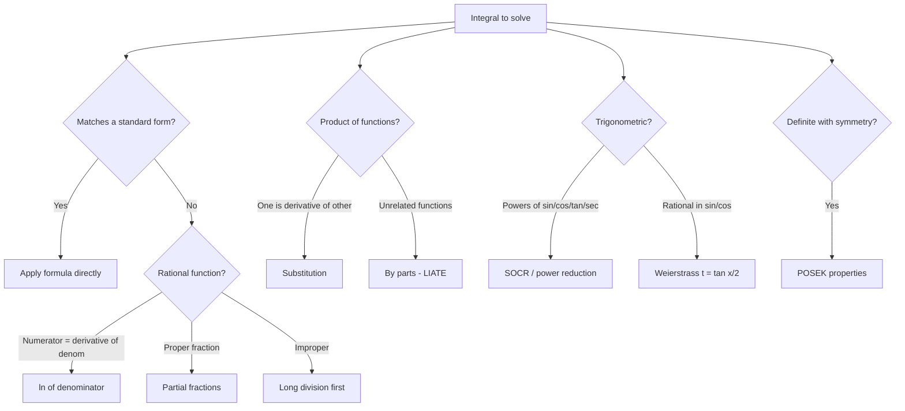

> Every key Integral Calculus formula for JEE Main & Advanced: standard integrals, substitution, by parts, partial fractions, definite-integral properties & areas — fast revision.

One-page rapid revision of every integration formula, technique, definite-integral property, and area result from this chapter. Scan it the night before the exam.

## Indefinite Integral: Definition

$$\boxed{\int f(x)\,dx = F(x) + C \quad \text{where } F'(x) = f(x)}$$

> **★ Key point · The +C is sacred**
>
> Every indefinite integral MUST carry the constant of integration $C$. Dropping it loses marks in JEE. Verify any answer by differentiating it back.

## Standard Integrals

### Power and Exponential

| Function | Integral |
| --- | --- |
| $x^n,\ n \neq -1$ | $\dfrac{x^{n+1}}{n+1} + C$ |
| $\dfrac{1}{x}$ | $\ln\lvert x\rvert + C$ |
| $e^x$ | $e^x + C$ |
| $a^x,\ a>0,\ a\neq 1$ | $\dfrac{a^x}{\ln a} + C$ |

$$\boxed{\int x^n\,dx = \frac{x^{n+1}}{n+1} + C\ (n\neq -1)}\qquad \boxed{\int \frac{1}{x}\,dx = \ln\lvert x\rvert + C}$$

### Trigonometric (the Big 6)

| Function | Integral |
| --- | --- |
| $\sin x$ | $-\cos x + C$ |
| $\cos x$ | $\sin x + C$ |
| $\sec^2 x$ | $\tan x + C$ |
| $\csc^2 x$ | $-\cot x + C$ |
| $\sec x \tan x$ | $\sec x + C$ |
| $\csc x \cot x$ | $-\csc x + C$ |
| $\tan x$ | $\ln\lvert\sec x\rvert + C$ |
| $\cot x$ | $\ln\lvert\sin x\rvert + C$ |

> **★ Key point · Sign mnemonic**
>
> “Some Cops Have Caught Students Cutting” — Sin, Csc², Csc·Cot integrate to a **negative**; Cos, Sec², Sec·Tan integrate to a **positive**.

### Inverse-Trigonometric Forms

$$\int \frac{1}{\sqrt{1-x^2}}\,dx = \sin^{-1}x + C \qquad \int \frac{-1}{\sqrt{1-x^2}}\,dx = \cos^{-1}x + C$$

$$\int \frac{1}{1+x^2}\,dx = \tan^{-1}x + C \qquad \int \frac{-1}{1+x^2}\,dx = \cot^{-1}x + C$$

$$\int \frac{1}{\lvert x\rvert\sqrt{x^2-1}}\,dx = \sec^{-1}x + C$$

## Special Integrals (Standard Forms)

$$\boxed{\int \frac{dx}{x^2 + a^2} = \frac{1}{a}\tan^{-1}\frac{x}{a} + C}$$

$$\boxed{\int \frac{dx}{x^2 - a^2} = \frac{1}{2a}\ln\left\lvert\frac{x-a}{x+a}\right\rvert + C}$$

$$\boxed{\int \frac{dx}{\sqrt{a^2 - x^2}} = \sin^{-1}\frac{x}{a} + C}$$

$$\boxed{\int \frac{dx}{\sqrt{x^2 + a^2}} = \ln\left\lvert x + \sqrt{x^2 + a^2}\right\rvert + C}$$

$$\boxed{\int \frac{dx}{\sqrt{x^2 - a^2}} = \ln\left\lvert x + \sqrt{x^2 - a^2}\right\rvert + C}$$

> **★ Key point · Quadratic denominators**
>
> For $\int \frac{dx}{ax^2+bx+c}$ (or with a square root), **complete the square** first to convert it to one of the standard forms above.

## Properties of Indefinite Integrals

| Property | Formula |
| --- | --- |
| Constant multiple | $\int k\,f(x)\,dx = k\int f(x)\,dx$ |
| Sum / difference | $\int [f(x)\pm g(x)]\,dx = \int f(x)\,dx \pm \int g(x)\,dx$ |

> **⚠ Trap · Not distributive over product/quotient**
>
> $\int f(x)g(x)\,dx \neq \int f\,dx \cdot \int g\,dx$ and $\int \frac{f}{g}\,dx \neq \frac{\int f\,dx}{\int g\,dx}$. Products need by parts or substitution.

## Technique 1: Substitution (Reverse Chain Rule)

$$\boxed{\int f(g(x))\,g'(x)\,dx = \int f(u)\,du,\quad u = g(x)}$$

Key pattern — derivative of denominator on top:

$$\boxed{\int \frac{f'(x)}{f(x)}\,dx = \ln\lvert f(x)\rvert + C}$$

### Trigonometric Substitutions

| Expression | Substitution |
| --- | --- |
| $\sqrt{a^2 - x^2}$ | $x = a\sin\theta$ |
| $\sqrt{a^2 + x^2}$ | $x = a\tan\theta$ |
| $\sqrt{x^2 - a^2}$ | $x = a\sec\theta$ |
| $a + b\sin x$ or $a + b\cos x$ | $\tan\frac{x}{2} = t$ |

### Weierstrass (Universal) Substitution

For $\int R(\sin x, \cos x)\,dx$, let $t = \tan\frac{x}{2}$:

$$\sin x = \frac{2t}{1+t^2}, \qquad \cos x = \frac{1-t^2}{1+t^2}, \qquad dx = \frac{2\,dt}{1+t^2}$$

## Technique 2: Integration by Parts

$$\boxed{\int u\,dv = uv - \int v\,du}$$

> **★ Key point · LIATE — order for choosing u**
>
> Choose $u$ in this priority (highest first), $dv$ is the rest:

> **L**ogarithmic → **I**nverse trig → **A**lgebraic → **T**rigonometric → **E**xponential.

> Mnemonic: “**L**ately **I A**te **T**wo **E**ggs.”

Special result:

$$\boxed{\int e^x\big[f(x) + f'(x)\big]\,dx = e^x f(x) + C}$$

Reduction formula (by parts, applied repeatedly):

$$I_n = \int x^n e^x\,dx = x^n e^x - n\,I_{n-1}$$

Circular trick: $\int e^{ax}\sin bx\,dx$ and $\int e^{ax}\cos bx\,dx$ — apply by parts twice; the integral reappears, then solve algebraically. Example result:

$$\int e^x \sin x\,dx = \frac{e^x(\sin x - \cos x)}{2} + C$$

## Technique 3: Partial Fractions

For a **proper** rational function ($\deg P < \deg Q$); if not proper, do long division first.

| Denominator type | Decomposition |
| --- | --- |
| Distinct linear $(x-a)(x-b)$ | $\dfrac{A}{x-a} + \dfrac{B}{x-b}$ |
| Repeated linear $(x-a)^2(x-b)$ | $\dfrac{A}{x-a} + \dfrac{B}{(x-a)^2} + \dfrac{C}{x-b}$ |
| Irreducible quadratic $(x^2+a^2)(x-b)$ | $\dfrac{Ax+B}{x^2+a^2} + \dfrac{C}{x-b}$ |

> **★ Key point · Decision flow**
>
> Numerator $=$ derivative of denominator? → use $\ln\lvert f(x)\rvert$. Otherwise factor and split, or complete the square for irreducible quadratics.

## Trigonometric Integration

### Power-Reduction / Pythagorean Identities

$$\boxed{\sin^2 x = \frac{1 - \cos 2x}{2}} \qquad \boxed{\cos^2 x = \frac{1 + \cos 2x}{2}}$$

$$\boxed{\tan^2 x = \sec^2 x - 1} \qquad \boxed{\cot^2 x = \csc^2 x - 1}$$

### Product-to-Sum

$$\sin A \cos B = \tfrac{1}{2}[\sin(A+B) + \sin(A-B)]$$

$$\cos A \sin B = \tfrac{1}{2}[\sin(A+B) - \sin(A-B)]$$

$$\cos A \cos B = \tfrac{1}{2}[\cos(A+B) + \cos(A-B)]$$

$$\sin A \sin B = \tfrac{1}{2}[\cos(A-B) - \cos(A+B)]$$

### Triple-Angle

$$\sin^3 x = \frac{3\sin x - \sin 3x}{4} \qquad \cos^3 x = \frac{3\cos x + \cos 3x}{4}$$

### Must-Memorize Trig Integrals

$$\boxed{\int \sec x\,dx = \ln\lvert\sec x + \tan x\rvert + C}$$

$$\boxed{\int \csc x\,dx = \ln\lvert\csc x - \cot x\rvert + C}$$

### Reduction Formula for $\sin^n x$

$$I_n = \int \sin^n x\,dx = -\frac{\sin^{n-1}x\,\cos x}{n} + \frac{n-1}{n}\,I_{n-2}$$

### Strategy Table

| Integral | First step | Key identity |
| --- | --- | --- |
| $\int \sin^m x\cos^n x\,dx$ ($m$ or $n$ odd) | Save one factor, substitute | $\sin^2 = 1-\cos^2$ / $\cos^2 = 1-\sin^2$ |
| $\int \sin^m x\cos^n x\,dx$ (both even) | Power reduction | $\sin^2 x = \frac{1-\cos 2x}{2}$ |
| $\int \tan^m x\sec^n x\,dx$ ($n$ even) | Peel $\sec^2 x$ | $\sec^2 x = 1 + \tan^2 x$ |
| $\int \tan^m x\sec^n x\,dx$ ($m$ odd) | Peel $\sec x\tan x$ | $\tan^2 x = \sec^2 x - 1$ |
| $\int \sin Ax\cos Bx\,dx$ | Product-to-sum | Convert to sum of sines |
| $\int \frac{1}{a+b\sin x}\,dx$ | Weierstrass / rationalize | $t = \tan(x/2)$ |

> **★ Key point · SOCR mnemonic**
>
> For $\int \sin^m x\cos^n x\,dx$: **S**ave **O**ne factor of the odd power, **C**onvert the **R**est with a Pythagorean identity, then substitute.

## Definite Integrals

### Fundamental Theorem of Calculus

$$\boxed{\int_a^b f(x)\,dx = F(b) - F(a) = \big[F(x)\big]_a^b}$$

$$\boxed{\frac{d}{dx}\left[\int_a^x f(t)\,dt\right] = f(x)}$$

### Properties

| # | Property |
| --- | --- |
| 1 | $\int_a^b f(x)\,dx = -\int_b^a f(x)\,dx$ |
| 2 | $\int_a^a f(x)\,dx = 0$ |
| 3 | $\int_a^b f(x)\,dx + \int_b^c f(x)\,dx = \int_a^c f(x)\,dx$ |
| 4 | $\int_a^b [k f(x) + g(x)]\,dx = k\int_a^b f(x)\,dx + \int_a^b g(x)\,dx$ |

### Symmetry & King Property

$$\boxed{\int_0^a f(x)\,dx = \int_0^a f(a-x)\,dx} \qquad \boxed{\int_a^b f(x)\,dx = \int_a^b f(a+b-x)\,dx}$$

### Even / Odd Functions (symmetric limits)

$$\boxed{\int_{-a}^a f(x)\,dx = 2\int_0^a f(x)\,dx \ \ (f \text{ even})} \qquad \boxed{\int_{-a}^a f(x)\,dx = 0 \ \ (f \text{ odd})}$$

### Periodic Functions (period $T$)

$$\boxed{\int_0^{nT} f(x)\,dx = n\int_0^T f(x)\,dx} \qquad \int_a^{a+T} f(x)\,dx = \int_0^T f(x)\,dx$$

> **★ Key point · POSEK — property recall**
>
> **P**eriodic, **O**dd ($=0$), **S**ymmetry $f(a-x)$, **E**ven ($=2\int_0^a$), **K**ing $f(a+b-x)$. Check these BEFORE calculating — they can turn a 3-minute problem into a 5-second one.

### Standard Definite Results

$$\int_0^{\pi/2} \sin^n x\,dx = \int_0^{\pi/2} \cos^n x\,dx$$

Wallis’s formula:

$$\int_0^{\pi/2} \sin^{2n} x\,dx = \int_0^{\pi/2} \cos^{2n} x\,dx = \frac{(2n-1)(2n-3)\cdots 3\cdot 1}{(2n)(2n-2)\cdots 4\cdot 2}\cdot\frac{\pi}{2}$$

$$\int_0^{\pi/2} \sin^{2n+1} x\,dx = \int_0^{\pi/2} \cos^{2n+1} x\,dx = \frac{(2n)(2n-2)\cdots 4\cdot 2}{(2n+1)(2n-1)\cdots 3\cdot 1}$$

Recurring King-property result (any power $n$):

$$\int_0^{\pi/2} \frac{\sin^n x}{\sin^n x + \cos^n x}\,dx = \frac{\pi}{4}$$

### Leibniz Rule (variable limits)

$$\boxed{\frac{d}{d\alpha}\left[\int_{g(\alpha)}^{h(\alpha)} f(x)\,dx\right] = f(h(\alpha))\,h'(\alpha) - f(g(\alpha))\,g'(\alpha)}$$

### Estimation Inequalities

If $f(x) \le g(x)$ on $[a,b]$: $\displaystyle\int_a^b f\,dx \le \int_a^b g\,dx$.

If $m \le f(x) \le M$ on $[a,b]$: $\displaystyle m(b-a) \le \int_a^b f(x)\,dx \le M(b-a)$.

## Applications: Area

| Region | Formula |
| --- | --- |
| Under $y=f(x)$, x-axis, $x=a$ to $b$ | $A = \int_a^b f(x)\,dx$ (if $f\ge 0$) |
| Actual (signed) area | $A = \int_a^b \lvert f(x)\rvert\,dx$ |
| Between curves, $f \ge g$ | $A = \int_a^b [f(x)-g(x)]\,dx$ |
| Horizontal strips, $x = g(y)$ | $A = \int_c^d g(y)\,dy$ |
| Between $x=g_2(y) \ge g_1(y)$ | $A = \int_c^d [g_2(y)-g_1(y)]\,dy$ |
| Parametric curve | $A = \int_\alpha^\beta y(t)\,x'(t)\,dt$ |

### Standard Areas

| Curve | Area |
| --- | --- |
| Circle $x^2+y^2=a^2$ | $\pi a^2$ |
| Ellipse $\frac{x^2}{a^2}+\frac{y^2}{b^2}=1$ | $\pi ab$ |
| Parabola $y^2=4ax$, $0$ to $x$ | $\frac{4}{3}x\sqrt{ax}$ |
| One hump of $\sin x$ ($0$ to $\pi$) | $2$ |
| One hump of $\cos x$ ($-\frac{\pi}{2}$ to $\frac{\pi}{2}$) | $2$ |
| $\lvert x\rvert + \lvert y\rvert = 1$ (diamond) | $2$ |

> **⚠ Trap · Area gotchas**
>
> Always (1) sketch, (2) find intersection points before fixing limits, (3) use **top − bottom**, and (4) split at axis crossings and take absolute values — a signed integral is not the geometric area.

## Method Selection Cheat Sheet



## Cross-Links

- [Indefinite Integrals](../indefinite-integrals/index.md)
- [Integration Techniques](../integration-techniques/index.md)
- [Trigonometric Integration](../trigonometric-integration/index.md)
- [Definite Integrals](../definite-integrals/index.md)
- [Applications of Integrals](../applications-integrals/index.md)

From TestGuru · our mock-test platform

## You've read Integral Calculus Formula Sheet.You've read this topic. Find out what you actually got.

A free JEE Main mock with this chapter in it, and a report that shows which sub-topics cost you marks.

[Take a free JEE Main mock →](https://app.testguru.co/signup?tg_chapter=integral-calculus&tg_exam=jee-main&tg_page=%2Fmathematics%2Fintegral-calculus%2Fformula-sheet%2F&tg_subject=mathematics&utm_campaign=notes-jee-main-free-test&utm_content=article-end&utm_medium=referral&utm_source=jeenotes)
Free, no card. Opens TestGuru in a new tab.

## Stay exam-ready

One email every Sunday: new notes, the week's hardest challenge question and a revision plan.One email every Sunday.

## Comments

Have a question or spotted a mistake? Join the discussion below.

Advertisement

Advertisement

---

## Extracted page code (interactive scripts & widgets)


### inline-script-14

```js
(function(){var t,e=document.getElementById("disqus-load");if(!e)return;t=!1,e.addEventListener("click",function(){if(t)return;t=!0,e.setAttribute("disabled","disabled"),e.textContent="Loading comments…",window.disqus_config=function(){this.page.url="https://jeenotes.in/mathematics/integral-calculus/formula-sheet/",this.page.identifier="/mathematics/integral-calculus/formula-sheet/"};var s=document,n=s.createElement("script");n.src="https://https-jeenotes-in.disqus.com/embed.js",n.setAttribute("data-timestamp",+new Date),n.onload=function(){e.style.display="none"},n.onerror=function(){t=!1,e.removeAttribute("disabled"),e.textContent="Could not load comments. Tap to retry"},(s.head||s.body).appendChild(n)})})()
```


### inline-script-15

```js
(function(){var t,e=document.currentScript.previousElementSibling;function n(){(window.adsbygoogle=window.adsbygoogle||[]).push({})}if(!window.ResizeObserver||e.clientWidth>0){n();return}t=new ResizeObserver(function(){e.clientWidth>0&&(t.disconnect(),n())}),t.observe(e)})()
```


---

_Source: [https://jeenotes.in/mathematics/integral-calculus/formula-sheet/](https://jeenotes.in/mathematics/integral-calculus/formula-sheet/) · raw HTML: `offline/mathematics/integral-calculus/formula-sheet/index.html`_
