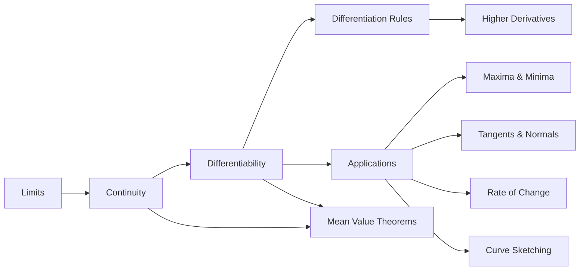

> Every key Limits, Continuity & Differentiability formula for JEE Main & Advanced - standard limits, L'Hopital, derivatives, MVT, maxima-minima & curve sketching in one quick-revision sheet.

One-page rapid revision of every formula, standard result, and test from this chapter. Use it the night before the exam to refresh limits, continuity, differentiability, the differentiation toolkit, and all derivative applications.

> **★ Key point · How to use this sheet**
>
> Each section maps to a full topic page. If a formula feels unfamiliar, click through to the linked deep-dive at the bottom.
>
> marks the highest-yield, most-tested results.

## Limits: Definition & Basics

| Concept | Result | Notes |
| --- | --- | --- |
| Limit | $\lim_{x \to a} f(x) = L$ | $f(x)$ approaches $L$ as $x \to a$ |
| Existence | $\lim_{x \to a} f(x)$ exists $\iff$ LHL $=$ RHL | First check for piecewise functions |
| LHL | $\lim_{x \to a^-} f(x)$ | Approach from the left |
| RHL | $\lim_{x \to a^+} f(x)$ | Approach from the right |

**$\varepsilon$-$\delta$ definition:** For every $\varepsilon > 0$, there exists $\delta > 0$ such that

$$0 < |x - a| < \delta \implies |f(x) - L| < \varepsilon$$

### Algebra of Limits

If $\lim_{x \to a} f(x) = L$ and $\lim_{x \to a} g(x) = M$:

| Property | Formula |
| --- | --- |
| Sum / Difference | $\lim [f(x) \pm g(x)] = L \pm M$ |
| Product | $\lim [f(x) \cdot g(x)] = L \cdot M$ |
| Quotient | $\lim \dfrac{f(x)}{g(x)} = \dfrac{L}{M}$ $(M \neq 0)$ |
| Power | $\lim [f(x)]^n = L^n$ |
| Constant multiple | $\lim [c \cdot f(x)] = c \cdot L$ |

### Limits at Infinity (Rational Functions)

For $\lim_{x \to \infty} \dfrac{a_n x^n + \ldots}{b_m x^m + \ldots}$:

| Condition | Limit |
| --- | --- |
| $n < m$ | $0$ |
| $n = m$ | $\dfrac{a_n}{b_m}$ |
| $n > m$ | $\pm \infty$ |

## Standard Limits

### Trigonometric

$$\boxed{\lim_{x \to 0} \frac{\sin x}{x} = 1}$$

| Limit | Value |
| --- | --- |
| $\lim_{x \to 0} \dfrac{\tan x}{x}$ | $1$ |
| $\lim_{x \to 0} \dfrac{\sin^{-1} x}{x}$ | $1$ |
| $\lim_{x \to 0} \dfrac{\tan^{-1} x}{x}$ | $1$ |
| $\lim_{x \to 0} \dfrac{1 - \cos x}{x^2}$ | $\dfrac{1}{2}$ |
| $\lim_{x \to 0} \dfrac{1 - \cos x}{x}$ | $0$ |
| $\lim_{x \to 0} \dfrac{\sin(ax)}{x}$ | $a$ |
| $\lim_{x \to 0} \dfrac{\sin(ax)}{\sin(bx)}$ | $\dfrac{a}{b}$ |
| $\lim_{x \to 0} \dfrac{\tan(ax)}{\tan(bx)}$ | $\dfrac{a}{b}$ |
| $\lim_{x \to 0} \dfrac{1 - \cos(ax)}{x^2}$ | $\dfrac{a^2}{2}$ |

> Always in **radians**, never degrees.

### Exponential & Logarithmic

$$\boxed{\lim_{x \to 0} \frac{e^x - 1}{x} = 1} \qquad \boxed{\lim_{x \to 0} \frac{\ln(1 + x)}{x} = 1}$$

| Limit | Value |
| --- | --- |
| $\lim_{x \to 0} \dfrac{a^x - 1}{x}$ | $\ln a$ |
| $\lim_{x \to 0} \dfrac{a^x - b^x}{x}$ | $\ln\!\left(\dfrac{a}{b}\right)$ |
| $\lim_{x \to 0} \dfrac{\log_a(1 + x)}{x}$ | $\dfrac{1}{\ln a}$ |
| $\lim_{x \to 0} \dfrac{\ln(1 + ax)}{x}$ | $a$ |

### The “Magic $e$” Family

$$\boxed{\lim_{x \to 0} (1 + x)^{1/x} = e} \qquad \boxed{\lim_{x \to \infty} \left(1 + \frac{1}{x}\right)^x = e}$$

$$\lim_{x \to \infty} \left(1 + \frac{a}{x}\right)^x = e^a \qquad \lim_{x \to a} \left(1 + \frac{1}{f(x)}\right)^{f(x)} = e \;\; (f(x) \to \infty)$$

### Algebraic (Power) Limits

$$\boxed{\lim_{x \to a} \frac{x^n - a^n}{x - a} = na^{n-1}} \qquad \lim_{x \to 0} \frac{(1 + x)^n - 1}{x} = n$$

> **★ Key point · The 1^infinity weapon**
>
> When $f(x) \to 1$ and $g(x) \to \infty$:
>
> $$\lim [f(x)]^{g(x)} = e^{\lim g(x)[f(x) - 1]}$$
>
> This cracks every $1^\infty$ form in one line.

## Indeterminate Forms & L’Hopital

The seven indeterminate forms: $\dfrac{0}{0}$, $\dfrac{\infty}{\infty}$, $0 \times \infty$, $\infty - \infty$, $1^\infty$, $0^0$, $\infty^0$.

> $\dfrac{1}{0}$ (or $\dfrac{c}{0}$, $c \neq 0$) is **undefined** ($\pm\infty$), not indeterminate.

**L’Hopital’s Rule** (for $\dfrac{0}{0}$ or $\dfrac{\infty}{\infty}$ only):

$$\boxed{\lim_{x \to a} \frac{f(x)}{g(x)} = \lim_{x \to a} \frac{f'(x)}{g'(x)}}$$

Differentiate numerator and denominator **separately** (not the quotient rule).

| Form | Technique |
| --- | --- |
| $\dfrac{0}{0}$ | Factor / rationalize / L’Hopital |
| $\dfrac{\infty}{\infty}$ | Divide by highest power / L’Hopital |
| $0 \cdot \infty$ | Rewrite as $\dfrac{\ln x}{1/x}$ type |
| $\infty - \infty$ | Combine into single fraction / rationalize |
| $1^\infty,\; 0^0,\; \infty^0$ | Take $\ln$, apply L’Hopital, then $\lim y = e^{\lim \ln y}$ |

## Continuity

A function $f$ is continuous at $x = a$ when all three (mnemonic **DEL**) hold:

$$\boxed{\lim_{x \to a} f(x) = f(a)}$$

1. **D**efined: $f(a)$ exists
2. Limit **E**xists: LHL $=$ RHL
3. **L**imit equals value: $\lim_{x \to a} f(x) = f(a)$

**On a closed interval $[a, b]$:** continuous on $(a, b)$, right-continuous at $a$ $(\lim_{x \to a^+} f = f(a))$, and left-continuous at $b$ $(\lim_{x \to b^-} f = f(b))$.

### Types of Discontinuity

| Type | Condition | Removable? | Example |
| --- | --- | --- | --- |
| Removable | Limit exists but $\neq f(a)$ | Yes (redefine $f(a)$) | $\dfrac{x^2-1}{x-1}$ at $x=1$ |
| Jump | LHL $\neq$ RHL | No | $\lfloor x \rfloor$ at integers |
| Infinite | Limit $= \pm\infty$ | No | $\dfrac{1}{x}$ at $x=0$ |
| Oscillatory | Limit DNE (oscillation) | No | $\sin(1/x)$ at $x=0$ |

### Continuity Reference

| Function | Continuous? |
| --- | --- |
| Polynomials | Everywhere |
| $\sin x,\ \cos x$ | Everywhere |
| $\tan x,\ \sec x$ | Except $\frac{\pi}{2} + n\pi$ |
| $e^x,\ a^x$ | Everywhere |
| $\ln x$ | For $x > 0$ |
| $1/x$ | Except $x = 0$ |
| $ | x |
| $\lfloor x \rfloor$ | Except integers |

Sums, differences, products of continuous functions are continuous; quotients where denominator $\neq 0$; compositions of continuous functions are continuous.

### Intermediate Value Theorem (IVT)

If $f$ is continuous on $[a, b]$ and $k$ lies between $f(a)$ and $f(b)$, then $\exists\, c \in (a, b)$ with $f(c) = k$.

> **★ Key point · Root-finding template**
>
> To show $f(x) = 0$ has a root in $(a, b)$: confirm $f$ continuous on $[a, b]$, then show $f(a) \cdot f(b) < 0$. IVT guarantees a root.

## Differentiability

**Derivative (first principles):**

$$\boxed{f'(a) = \lim_{h \to 0} \frac{f(a + h) - f(a)}{h} = \lim_{x \to a} \frac{f(x) - f(a)}{x - a}}$$

**LHD / RHD and the test:**

$$f'(a^-) = \lim_{h \to 0^-} \frac{f(a+h) - f(a)}{h}, \qquad f'(a^+) = \lim_{h \to 0^+} \frac{f(a+h) - f(a)}{h}$$

$$\boxed{f \text{ differentiable at } a \iff f'(a^-) = f'(a^+) \text{ (both finite)}}$$

**Key implication chain:**

$$\boxed{\text{Differentiable} \implies \text{Continuous} \implies \text{Limit exists}}$$

> The converse is **false**: $f(x) = |x|$ is continuous at $0$ but not differentiable (sharp corner).

**NOT differentiable when:** sharp corner/cusp, vertical tangent (e.g. $x^{1/3}$ at $0$, derivative $\to \infty$), or any discontinuity.

## Basic Derivatives

| $f(x)$ | $f'(x)$ |
| --- | --- |
| $c$ | $0$ |
| $x^n$ | $nx^{n-1}$ |
| $\sqrt{x}$ | $\dfrac{1}{2\sqrt{x}}$ |
| $e^x$ | $e^x$ |
| $a^x$ | $a^x \ln a$ |
| $\ln x$ | $\dfrac{1}{x}$ |
| $\log_a x$ | $\dfrac{1}{x \ln a}$ |

### Trigonometric

| $f(x)$ | $f'(x)$ |
| --- | --- |
| $\sin x$ | $\cos x$ |
| $\cos x$ | $-\sin x$ |
| $\tan x$ | $\sec^2 x$ |
| $\cot x$ | $-\csc^2 x$ |
| $\sec x$ | $\sec x \tan x$ |
| $\csc x$ | $-\csc x \cot x$ |

### Inverse Trigonometric

| $f(x)$ | $f'(x)$ |
| --- | --- |
| $\sin^{-1} x$ | $\dfrac{1}{\sqrt{1-x^2}}$ |
| $\cos^{-1} x$ | $\dfrac{-1}{\sqrt{1-x^2}}$ |
| $\tan^{-1} x$ | $\dfrac{1}{1+x^2}$ |
| $\cot^{-1} x$ | $\dfrac{-1}{1+x^2}$ |
| $\sec^{-1} x$ | $\dfrac{1}{ |
| $\csc^{-1} x$ | $\dfrac{-1}{ |

## Rules of Differentiation

| Rule | Formula |
| --- | --- |
| **Product** | $(uv)' = u'v + uv'$ |
| **Product (triple)** | $(uvw)' = u'vw + uv'w + uvw'$ |
| **Quotient** | $\left(\dfrac{u}{v}\right)' = \dfrac{u'v - uv'}{v^2}$ |
| **Chain** | $[f(g(x))]' = f'(g(x)) \cdot g'(x)$ |
| **Chain (nested)** | $[f(g(h(x)))]' = f'(g(h(x))) \cdot g'(h(x)) \cdot h'(x)$ |

### Pattern Shortcuts

| Pattern | Derivative |
| --- | --- |
| $(ax + b)^n$ | $an(ax + b)^{n-1}$ |
| $e^{ax}$ | $ae^{ax}$ |
| $\sin(ax)$ | $a\cos(ax)$ |
| $\ln(ax + b)$ | $\dfrac{a}{ax + b}$ |

### Logarithmic, Implicit & Parametric

| Technique | When | Method / Formula |
| --- | --- | --- |
| **Logarithmic** | Variable exponents ($x^x$, $x^{\sin x}$), big products | Take $\ln$ both sides, then differentiate |
| **Implicit** | Equation not solved for $y$ | Differentiate both sides w.r.t. $x$; $\dfrac{d}{dx}(y^n) = ny^{n-1}\dfrac{dy}{dx}$ |
| **Parametric** | $x = f(t),\ y = g(t)$ | $\dfrac{dy}{dx} = \dfrac{dy/dt}{dx/dt}$ |

**Implicit key patterns:**

$$\frac{d}{dx}(y^n) = ny^{n-1}\frac{dy}{dx}, \quad \frac{d}{dx}(xy) = y + x\frac{dy}{dx}, \quad \frac{d}{dx}(\sin y) = \cos y \cdot \frac{dy}{dx}, \quad \frac{d}{dx}(e^y) = e^y\frac{dy}{dx}$$

## Higher Order Derivatives

**Notation:** $f''(x) = \dfrac{d^2y}{dx^2}$ (not $(dy/dx)^2$), up to $f^{(n)}(x) = \dfrac{d^n y}{dx^n}$.

### $n$th Derivative Formulas

| Function | $n$th derivative |
| --- | --- |
| $x^n$ | $n!$ (and $0$ for higher orders) |
| $e^{ax}$ | $a^n e^{ax}$ |
| $a^x$ | $a^x (\ln a)^n$ |
| $\sin(ax)$ | $a^n \sin\!\left(ax + \dfrac{n\pi}{2}\right)$ |
| $\cos(ax)$ | $a^n \cos\!\left(ax + \dfrac{n\pi}{2}\right)$ |
| $\ln x$ | $\dfrac{(-1)^{n-1}(n-1)!}{x^n}$ |
| $\dfrac{1}{ax+b}$ | $\dfrac{(-1)^n \, n! \, a^n}{(ax+b)^{n+1}}$ |

### Leibniz’s Theorem ($n$th derivative of a product)

$$\boxed{(uv)^{(n)} = \sum_{k=0}^{n} \binom{n}{k} u^{(k)} v^{(n-k)}}$$

Same coefficients as the binomial expansion $(a+b)^n$.

### Second Derivative — Special Forms

| Form | Formula |
| --- | --- |
| **Parametric** | $\dfrac{d^2y}{dx^2} = \dfrac{\frac{d}{dt}\!\left(\frac{dy}{dx}\right)}{\frac{dx}{dt}}$ |
| **Implicit** | Differentiate $\dfrac{dy}{dx}$ implicitly again |

> Parametric second derivative is **NOT** $\dfrac{d^2y/dt^2}{d^2x/dt^2}$.

## Applications of Derivatives

### Monotonicity

$$\boxed{f'(x) > 0 \Rightarrow \text{increasing}, \quad f'(x) < 0 \Rightarrow \text{decreasing}, \quad f'(x) = 0 \Rightarrow \text{constant (on interval)}}$$

### Maxima & Minima

**Critical point:** $f'(c) = 0$ or $f'(c)$ does not exist. All local extrema occur at critical points (but not every critical point is an extremum).

| Test | Condition | Result |
| --- | --- | --- |
| **First derivative** | $f'$ changes $+ \to -$ | Local **maximum** |
|  | $f'$ changes $- \to +$ | Local **minimum** |
|  | No sign change | Neither (inflection) |
| **Second derivative** | $f''(c) < 0$ | Local **maximum** (concave down $\cap$) |
|  | $f''(c) > 0$ | Local **minimum** (concave up $\cup$) |
|  | $f''(c) = 0$ | Inconclusive — use first-derivative test |

**Global extrema on $[a, b]$:** evaluate $f$ at all critical points **and** both endpoints; compare. (Extreme Value Theorem guarantees they exist if $f$ is continuous on $[a, b]$.)

> **★ Key point · Cup vs Cap**
>
> $f'' > 0$ = concave **up** = **cup** $\cup$ = **minimum**. $f'' < 0$ = concave down = cap $\cap$ = maximum.

### Tangents & Normals

At $(x_0, y_0)$ on $y = f(x)$, with $m_T = f'(x_0)$:

$$\boxed{\text{Tangent: } y - y_0 = f'(x_0)(x - x_0)} \qquad \boxed{\text{Normal: } y - y_0 = -\frac{1}{f'(x_0)}(x - x_0)}$$

**Angle between two curves** (slopes $m_1, m_2$ at intersection):

$$\tan\theta = \left|\frac{m_1 - m_2}{1 + m_1 m_2}\right|$$

Orthogonal (perpendicular) curves: $m_1 \cdot m_2 = -1$.

**Implicit tangent example:** $x^2 + y^2 = r^2 \Rightarrow \dfrac{dy}{dx} = -\dfrac{x}{y}$. Polar slope: $\dfrac{dy}{dx} = \dfrac{r'\sin\theta + r\cos\theta}{r'\cos\theta - r\sin\theta}$.

### Rate of Change (Related Rates)

Differentiate the relating equation w.r.t. time $t$, **then** substitute given values.

- Expanding circle: $A = \pi r^2 \Rightarrow \dfrac{dA}{dt} = 2\pi r \dfrac{dr}{dt}$
- Sliding ladder: $x^2 + y^2 = L^2 \Rightarrow x\dfrac{dx}{dt} + y\dfrac{dy}{dt} = 0$

## Mean Value Theorems

| Theorem | Conditions | Conclusion |
| --- | --- | --- |
| **Rolle’s** | Continuous on $[a,b]$, differentiable on $(a,b)$, $f(a)=f(b)$ | $\exists c:\ f'(c) = 0$ |
| **Lagrange (LMVT)** | Continuous on $[a,b]$, differentiable on $(a,b)$ | $\exists c:\ f'(c) = \dfrac{f(b)-f(a)}{b-a}$ |
| **Cauchy** | $f, g$ continuous on $[a,b]$, differentiable on $(a,b)$, $g' \neq 0$ | $\exists c:\ \dfrac{f'(c)}{g'(c)} = \dfrac{f(b)-f(a)}{g(b)-g(a)}$ |

$$\boxed{f'(c) = \frac{f(b) - f(a)}{b - a}}$$

> LMVT is a special case of Cauchy’s ($g(x) = x$); Rolle’s is LMVT with $f(a) = f(b)$.

**Bounding via LMVT:** if $|f'(x)| \le M$ on $[a, b]$, then $|f(b) - f(a)| \le M|b - a|$.

> **★ Key point · Exactly one root**
>
> IVT (sign change $\Rightarrow$ existence) $+$ Rolle’s by contradiction (if $f' \neq 0$ everywhere, two roots are impossible) $\Rightarrow$ exactly one real root.

## Curve Sketching

### Sign Tests

| Concept | Test | Meaning |
| --- | --- | --- |
| Increasing | $f'(x) > 0$ | Rises |
| Decreasing | $f'(x) < 0$ | Falls |
| Concave up $\cup$ | $f''(x) > 0$ | Cup |
| Concave down $\cap$ | $f''(x) < 0$ | Cap |
| Inflection point | $f''(x) = 0$ (or undefined) **AND** $f''$ changes sign | Concavity switches |

> $f''(c) = 0$ alone is **not** an inflection point (e.g. $x^4$ at $0$). The sign change is required.

### Asymptotes (the “Three D’s”)

| Type | Condition |
| --- | --- |
| **Vertical** | Denominator $= 0$ (limit $\to \pm\infty$) |
| **Horizontal** | $\lim_{x \to \pm\infty} f(x) = L \Rightarrow y = L$ |
| **Oblique** | $\deg(\text{num}) = \deg(\text{den}) + 1 \Rightarrow$ long division gives $y = mx + c$ |

For rational $\dfrac{p(x)}{q(x)}$: $\deg p < \deg q \Rightarrow y = 0$; $\deg p = \deg q \Rightarrow y = \dfrac{\text{lead}(p)}{\text{lead}(q)}$; $\deg p > \deg q \Rightarrow$ no horizontal asymptote.

### Symmetry & Polynomials

- Even: $f(-x) = f(x)$ ($y$-axis symmetry). Odd: $f(-x) = -f(x)$ (origin symmetry).
- Degree-$n$ polynomial: at most $n - 1$ turning points. Even degree $\Rightarrow$ same end behavior; odd degree $\Rightarrow$ opposite ends.

**Checklist order:** Domain $\to$ Intercepts $\to$ Symmetry $\to$ Asymptotes $\to$ $f'$ (monotonicity) $\to$ $f''$ (concavity) $\to$ key points $\to$ sketch.

## The Big Picture



## Topic Deep-Dives

- [Introduction to Limits](../limits-basics/index.md)
- [Standard Limits & L’Hopital’s Rule](../standard-limits/index.md)
- [Continuity of Functions](../continuity/index.md)
- [Differentiability & Derivatives](../differentiability/index.md)
- [Rules of Differentiation](../differentiation-rules/index.md)
- [Implicit Differentiation & Parametric Forms](../implicit-differentiation/index.md)
- [Higher Order Derivatives](../higher-derivatives/index.md)
- [Applications of Derivatives](../applications-derivatives/index.md)
- [Maxima and Minima](../maxima-minima/index.md)
- [Mean Value Theorems](../mean-value-theorems/index.md)
- [Curve Sketching](../curve-sketching/index.md)

From TestGuru · our mock-test platform

## You've read Limits, Continuity & Differentiability Formula Sheet.You've read this topic. Find out what you actually got.

A free JEE Main mock with this chapter in it, and a report that shows which sub-topics cost you marks.

[Take a free JEE Main mock →](https://app.testguru.co/signup?tg_chapter=limits-continuity-differentiability&tg_exam=jee-main&tg_page=%2Fmathematics%2Flimits-continuity-differentiability%2Fformula-sheet%2F&tg_subject=mathematics&utm_campaign=notes-jee-main-free-test&utm_content=article-end&utm_medium=referral&utm_source=jeenotes)
Free, no card. Opens TestGuru in a new tab.

## Stay exam-ready

One email every Sunday: new notes, the week's hardest challenge question and a revision plan.One email every Sunday.

## Comments

Have a question or spotted a mistake? Join the discussion below.

Advertisement

Advertisement

---

## Extracted page code (interactive scripts & widgets)


### inline-script-14

```js
(function(){var t,e=document.getElementById("disqus-load");if(!e)return;t=!1,e.addEventListener("click",function(){if(t)return;t=!0,e.setAttribute("disabled","disabled"),e.textContent="Loading comments…",window.disqus_config=function(){this.page.url="https://jeenotes.in/mathematics/limits-continuity-differentiability/formula-sheet/",this.page.identifier="/mathematics/limits-continuity-differentiability/formula-sheet/"};var s=document,n=s.createElement("script");n.src="https://https-jeenotes-in.disqus.com/embed.js",n.setAttribute("data-timestamp",+new Date),n.onload=function(){e.style.display="none"},n.onerror=function(){t=!1,e.removeAttribute("disabled"),e.textContent="Could not load comments. Tap to retry"},(s.head||s.body).appendChild(n)})})()
```


### inline-script-15

```js
(function(){var t,e=document.currentScript.previousElementSibling;function n(){(window.adsbygoogle=window.adsbygoogle||[]).push({})}if(!window.ResizeObserver||e.clientWidth>0){n();return}t=new ResizeObserver(function(){e.clientWidth>0&&(t.disconnect(),n())}),t.observe(e)})()
```


---

_Source: [https://jeenotes.in/mathematics/limits-continuity-differentiability/formula-sheet/](https://jeenotes.in/mathematics/limits-continuity-differentiability/formula-sheet/) · raw HTML: `offline/mathematics/limits-continuity-differentiability/formula-sheet/index.html`_
