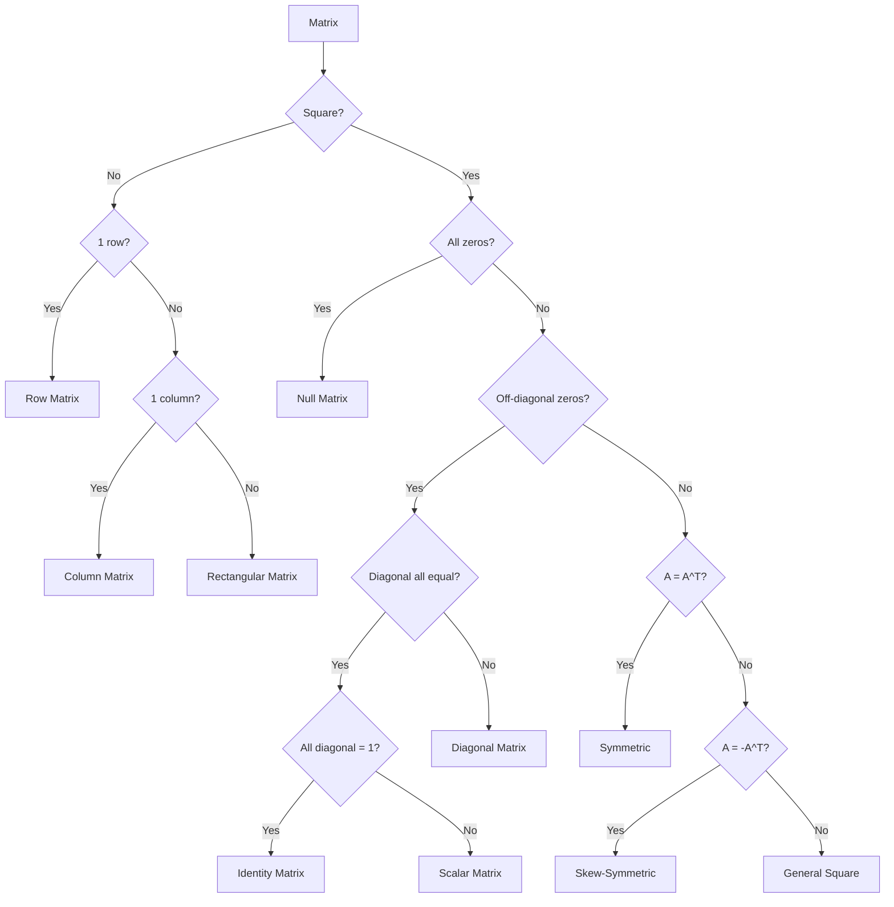

> Master matrix notation, order, types of matrices including symmetric, skew-symmetric, diagonal, and identity matrices for JEE Main & Advanced.

## The Hook: The Matrix in Your Pocket

> **★ Key point · Connect: Every Instagram Filter Uses Matrices**
>
> Ever wondered how Instagram applies filters to your photos in milliseconds? When you select “Nashville” or “Clarendon,” your phone multiplies a **3×3 color transformation matrix** with millions of pixels simultaneously!
>
> Each pixel’s RGB values are arranged in a matrix, and a transformation matrix changes the colors:
>
> $$\begin{bmatrix} R' \\ G' \\ B' \end{bmatrix} = \begin{bmatrix} 1.2 & 0.1 & 0 \\ 0 & 1.1 & 0.2 \\ 0.1 & 0 & 0.9 \end{bmatrix} \begin{bmatrix} R \\ G \\ B \end{bmatrix}$$
>
> **Real applications:** Computer graphics, 3D game rotations, Google’s PageRank algorithm, AI neural networks, encryption, and even solving traffic flow problems — all use matrices!
>
> **Why this matters for JEE:** Matrices appear in 3-4 questions in JEE Main and form the foundation for determinants, linear equations, and advanced coordinate geometry in JEE Advanced.

---

## Prerequisites

Before diving into matrices, you should be comfortable with:

- [Sets and Relations](../../sets-relations-functions/sets-basics/index.md) — Understanding of ordered pairs
- Basic algebra — Working with variables and equations
- Array/table representation — Organizing data in rows and columns

---

## Interactive Demo: Matrix Visualization

### Create Your Own Matrix

Click on elements to change values and see how matrix notation works!

Rows: 
Columns:

---

## What is a Matrix?

### Definition

A **matrix** is a rectangular array of numbers (or expressions) arranged in rows and columns, enclosed in brackets.

$$A = \begin{bmatrix}
a_{11} & a_{12} & a_{13} \\
a_{21} & a_{22} & a_{23}
\end{bmatrix}$$

**Components:**

- **Elements/Entries:** The individual numbers $a_{ij}$ where $i$ = row number, $j$ = column number
- **Rows:** Horizontal lines of elements
- **Columns:** Vertical lines of elements

### Order of a Matrix

The **order** (or dimension) of a matrix is given by:

$$\boxed{\text{Order} = m \times n}$$

where:

- $m$ = number of rows
- $n$ = number of columns

**Read as:** “m by n” or “m cross n”

### Examples

> **◐ In simple terms · Example 1**
>
> $$A = \begin{bmatrix} 1 & 2 & 3 \\ 4 & 5 & 6 \end{bmatrix}$$
>
> **Order:** $2 \times 3$ (2 rows, 3 columns)
>
> **Elements:** $a_{11} = 1, a_{12} = 2, a_{13} = 3, a_{21} = 4, a_{22} = 5, a_{23} = 6$

> **◐ In simple terms · Example 2**
>
> $$B = \begin{bmatrix} 7 \\ -2 \\ 5 \end{bmatrix}$$
>
> **Order:** $3 \times 1$ (3 rows, 1 column)

---

## Notation and Element Reference

### Standard Notation

A matrix is denoted by:

- **Capital letters:** $A, B, C, M, X$
- **Elements** denoted by corresponding lowercase letters with subscripts: $a_{ij}, b_{ij}$

### Subscript Convention

For element $a_{ij}$:

- First subscript $i$ → **row number**
- Second subscript $j$ → **column number**

$$a_{ij} = \text{element in } i^{\text{th}} \text{ row and } j^{\text{th}} \text{ column}$$

> **★ Key point · Memory Trick: RC Cola**
>
> Think **“RC”** = **Row first, Column second**
>
> Just like drinking RC Cola: **R** (row) comes before **C** (column)!
>
> $a_{23}$ means: Row 2, Column 3 (not the other way around)

### Compact Notation

A matrix $A$ with elements $a_{ij}$ can be written as:

$$A = [a_{ij}]_{m \times n}$$

**Example:** $A = [2i + 3j]_{2 \times 3}$ means:

$$A = \begin{bmatrix}
2(1) + 3(1) & 2(1) + 3(2) & 2(1) + 3(3) \\
2(2) + 3(1) & 2(2) + 3(2) & 2(2) + 3(3)
\end{bmatrix} = \begin{bmatrix}
5 & 8 & 11 \\
7 & 10 & 13
\end{bmatrix}$$

---

## Types of Matrices

### 1. Row Matrix

A matrix with **only one row**.

**Order:** $1 \times n$

**Example:** $A = \begin{bmatrix} 1 & -2 & 5 & 7 \end{bmatrix}$ is a $1 \times 4$ row matrix.

### 2. Column Matrix

A matrix with **only one column**.

**Order:** $m \times 1$

**Example:** $B = \begin{bmatrix} 3 \\ -1 \\ 0 \end{bmatrix}$ is a $3 \times 1$ column matrix.

### 3. Square Matrix

A matrix where **number of rows = number of columns**.

**Order:** $n \times n$

**Example:** $C = \begin{bmatrix} 1 & 2 \\ 3 & 4 \end{bmatrix}$ is a $2 \times 2$ square matrix.

**Important terms for square matrices:**

**Principal/Main Diagonal:** Elements $a_{ii}$ where row number = column number

- For $2 \times 2$: Elements $a_{11}, a_{22}$
- For $3 \times 3$: Elements $a_{11}, a_{22}, a_{33}$

**Trace:** Sum of diagonal elements

$$\boxed{\text{tr}(A) = \sum_{i=1}^{n} a_{ii}}$$

**Example:** For $A = \begin{bmatrix} 1 & 2 & 3 \\ 0 & 5 & 6 \\ 7 & 8 & 9 \end{bmatrix}$, $\text{tr}(A) = 1 + 5 + 9 = 15$

### 4. Diagonal Matrix

A **square matrix** where all non-diagonal elements are zero.

$$a_{ij} = 0 \text{ when } i \neq j$$

**Example:** $D = \begin{bmatrix} 3 & 0 & 0 \\ 0 & -5 & 0 \\ 0 & 0 & 2 \end{bmatrix}$

**Compact notation:** $D = \text{diag}(3, -5, 2)$

> **◐ Important**
>
> Diagonal elements can be zero! As long as all off-diagonal elements are zero, it’s a diagonal matrix.
>
> $\begin{bmatrix} 1 & 0 & 0 \\ 0 & 0 & 0 \\ 0 & 0 & 3 \end{bmatrix}$ is still diagonal.

### 5. Scalar Matrix

A **diagonal matrix** where all diagonal elements are equal.

$$a_{ij} = \begin{cases} k & \text{if } i = j \\ 0 & \text{if } i \neq j \end{cases}$$

**Example:** $S = \begin{bmatrix} 5 & 0 & 0 \\ 0 & 5 & 0 \\ 0 & 0 & 5 \end{bmatrix} = 5I$

### 6. Identity Matrix (Unit Matrix)

A **scalar matrix** where all diagonal elements equal **1**.

Denoted by $I$ or $I_n$ (for $n \times n$ identity matrix)

$$I_n = \begin{bmatrix}
1 & 0 & 0 & \cdots & 0 \\
0 & 1 & 0 & \cdots & 0 \\
0 & 0 & 1 & \cdots & 0 \\
\vdots & \vdots & \vdots & \ddots & \vdots \\
0 & 0 & 0 & \cdots & 1
\end{bmatrix}$$

**Examples:**

$$I_2 = \begin{bmatrix} 1 & 0 \\ 0 & 1 \end{bmatrix}, \quad I_3 = \begin{bmatrix} 1 & 0 & 0 \\ 0 & 1 & 0 \\ 0 & 0 & 1 \end{bmatrix}$$

**Property:** $AI = IA = A$ (Identity is the “1” of matrix multiplication)

### 7. Zero/Null Matrix

A matrix where **all elements are zero**.

Denoted by $O$ or $0$

**Example:** $O = \begin{bmatrix} 0 & 0 & 0 \\ 0 & 0 & 0 \end{bmatrix}$ is a $2 \times 3$ null matrix.

**Property:** $A + O = O + A = A$ (Zero matrix is the additive identity)

### 8. Upper Triangular Matrix

A **square matrix** where all elements **below** the main diagonal are zero.

$$a_{ij} = 0 \text{ when } i > j$$

**Example:** $U = \begin{bmatrix} 1 & 2 & 3 \\ 0 & 4 & 5 \\ 0 & 0 & 6 \end{bmatrix}$

### 9. Lower Triangular Matrix

A **square matrix** where all elements **above** the main diagonal are zero.

$$a_{ij} = 0 \text{ when } i < j$$

**Example:** $L = \begin{bmatrix} 1 & 0 & 0 \\ 2 & 3 & 0 \\ 4 & 5 & 6 \end{bmatrix}$

### 10. Symmetric Matrix

A **square matrix** where $A = A^T$ (matrix equals its transpose).

$$a_{ij} = a_{ji} \text{ for all } i, j$$

**Example:** $S = \begin{bmatrix} 1 & 2 & 3 \\ 2 & 4 & 5 \\ 3 & 5 & 6 \end{bmatrix}$

Notice: Elements are symmetric about the main diagonal.

**Visual check:** Mirror image across diagonal should be identical.

### 11. Skew-Symmetric Matrix

A **square matrix** where $A = -A^T$ (matrix equals negative of its transpose).

$$a_{ij} = -a_{ji} \text{ for all } i, j$$

**Important consequence:** All diagonal elements must be zero! (Since $a_{ii} = -a_{ii} \Rightarrow a_{ii} = 0$)

**Example:** $K = \begin{bmatrix} 0 & 2 & -3 \\ -2 & 0 & 5 \\ 3 & -5 & 0 \end{bmatrix}$

> **★ Key point · Memory Trick: Symmetric vs Skew-Symmetric**
>
> **Symmetric:** Like looking in a mirror — same reflection
>
> - $A = A^T$

> - Elements: $a_{ij} = a_{ji}$

> - Diagonal can be anything
>
> **Skew-Symmetric:** Like looking in an evil mirror — opposite reflection
>
> - $A = -A^T$

> - Elements: $a_{ij} = -a_{ji}$

> - Diagonal MUST be zero
>
> **Quick test:** Check element $(1,2)$ and $(2,1)$:
>
> - If they’re equal → might be symmetric

> - If they’re negatives → might be skew-symmetric

---

## Equality of Matrices

Two matrices $A$ and $B$ are **equal** if and only if:

1. They have the **same order** ($m \times n$)
2. **All corresponding elements are equal**: $a_{ij} = b_{ij}$ for all $i, j$

$$\boxed{A = B \iff [a_{ij}]_{m \times n} = [b_{ij}]_{m \times n}}$$

### Example

$$A = \begin{bmatrix} 1 & 2 \\ 3 & 4 \end{bmatrix}, \quad B = \begin{bmatrix} 1 & 2 \\ 3 & 4 \end{bmatrix}, \quad C = \begin{bmatrix} 1 & 2 & 0 \\ 3 & 4 & 0 \end{bmatrix}$$

- $A = B$ ✓ (same order, same elements)
- $A \neq C$ ✗ (different order)

> **⚠ Trap · Common Mistake**
>
> $$\begin{bmatrix} 1 & 2 & 3 \end{bmatrix} \neq \begin{bmatrix} 1 \\ 2 \\ 3 \end{bmatrix}$$
>
> Left is $1 \times 3$ (row matrix), right is $3 \times 1$ (column matrix).
>
> Even though they have the same numbers, they are **NOT equal** because orders differ!

---

## Properties Summary

| Matrix Type | Key Property | Diagonal Elements | Example Order |
| --- | --- | --- | --- |
| Row | 1 row | N/A | $1 \times n$ |
| Column | 1 column | N/A | $m \times 1$ |
| Square | Rows = Columns | Any values | $n \times n$ |
| Diagonal | Off-diagonal = 0 | Any values | $n \times n$ |
| Scalar | Diagonal all equal | All equal | $n \times n$ |
| Identity | Diagonal all 1, rest 0 | All = 1 | $n \times n$ |
| Null | All elements = 0 | All = 0 | $m \times n$ |
| Upper Triangular | Below diagonal = 0 | Any values | $n \times n$ |
| Lower Triangular | Above diagonal = 0 | Any values | $n \times n$ |
| Symmetric | $A = A^T$ | Any values | $n \times n$ |
| Skew-Symmetric | $A = -A^T$ | All = 0 | $n \times n$ |

---

## Common Mistakes to Avoid

> **⚠ Trap #1: Order Confusion**
>
> **Wrong:** $A$ is $3 \times 2$ means 3 columns and 2 rows
>
> **Right:** $A$ is $3 \times 2$ means 3 **rows** and 2 **columns**
>
> Remember: **“Rows × Columns”** (RC Cola!)

> **⚠ Trap #2: Diagonal Matrix Zero Elements**
>
> **Wrong:** All diagonal elements must be non-zero in a diagonal matrix
>
> **Right:** Diagonal elements can be zero! The requirement is only that **off-diagonal elements are zero**.
>
> $\begin{bmatrix} 1 & 0 \\ 0 & 0 \end{bmatrix}$ is a valid diagonal matrix.

> **⚠ Trap #3: Symmetric Matrix Diagonal**
>
> **Wrong:** Diagonal elements must be zero in symmetric matrices
>
> **Right:** Only **skew-symmetric** matrices require zero diagonal. Symmetric matrices can have any diagonal values!
>
> Symmetric: $\begin{bmatrix} 5 & 2 \\ 2 & 3 \end{bmatrix}$ ✓
>
> Skew-symmetric: $\begin{bmatrix} 0 & 2 \\ -2 & 0 \end{bmatrix}$ ✓ (must have zero diagonal)

> **⚠ Trap #4: Matrix Element Reference**
>
> **Wrong:** For $A = \begin{bmatrix} 1 & 2 \\ 3 & 4 \end{bmatrix}$, $a_{21} = 2$
>
> **Right:** $a_{21} = 3$ (row 2, column 1)
>
> First subscript is always row, second is always column!

---

## Quick Identification Flowchart



---

## Practice Problems

### Level 1: Foundation (NCERT)

> **↗ Connection · Problem 1.1**
>
> What is the order of matrix $A = \begin{bmatrix} 1 & 2 & 3 \\ 4 & 5 & 6 \\ 7 & 8 & 9 \\ 10 & 11 & 12 \end{bmatrix}$?
>
> **Solution:**
>
> Count rows: 4

> Count columns: 3
>
> **Answer:** $4 \times 3$

> **↗ Connection · Problem 1.2**
>
> For $A = \begin{bmatrix} 2 & 3 & 4 \\ 5 & 6 & 7 \\ 8 & 9 & 10 \end{bmatrix}$, find $a_{23}$ and $a_{32}$.
>
> **Solution:**
>
> $a_{23}$ = element in row 2, column 3 = **7**
>
> $a_{32}$ = element in row 3, column 2 = **9**
>
> **Answer:** $a_{23} = 7$, $a_{32} = 9$

> **↗ Connection · Problem 1.3**
>
> Construct a $2 \times 3$ matrix $A = [a_{ij}]$ where $a_{ij} = i + j$.
>
> **Solution:**
>
> $a_{11} = 1 + 1 = 2$, $a_{12} = 1 + 2 = 3$, $a_{13} = 1 + 3 = 4$
>
> $a_{21} = 2 + 1 = 3$, $a_{22} = 2 + 2 = 4$, $a_{23} = 2 + 3 = 5$
>
> **Answer:** $A = \begin{bmatrix} 2 & 3 & 4 \\ 3 & 4 & 5 \end{bmatrix}$

### Level 2: JEE Main

> **↗ Connection · Problem 2.1**
>
> If $A = \begin{bmatrix} x+2 & 3 \\ 4 & y-1 \end{bmatrix}$ and $B = \begin{bmatrix} 5 & 3 \\ 4 & 2 \end{bmatrix}$, find $x$ and $y$ such that $A = B$.
>
> **Solution:**
>
> For $A = B$:
>
> - $x + 2 = 5 \Rightarrow x = 3$

> - $y - 1 = 2 \Rightarrow y = 3$
>
> **Answer:** $x = 3$, $y = 3$

> **↗ Connection · Problem 2.2**
>
> Identify the type of matrix: $A = \begin{bmatrix} 0 & 5 & -3 \\ -5 & 0 & 2 \\ 3 & -2 & 0 \end{bmatrix}$
>
> **Solution:**
>
> Check if symmetric: $a_{12} = 5$ but $a_{21} = -5$, so $a_{12} \neq a_{21}$. Not symmetric.
>
> Check if skew-symmetric:
>
> - $a_{12} = 5 = -a_{21} = -(-5)$ ✓

> - $a_{13} = -3 = -a_{31} = -(3)$ ✓

> - $a_{23} = 2 = -a_{32} = -(-2)$ ✓

> - All diagonal elements are 0 ✓
>
> **Answer:** Skew-symmetric matrix

> **↗ Connection · Problem 2.3**
>
> Find the trace of $A = \begin{bmatrix} 2 & 3 & 1 \\ 0 & -1 & 4 \\ 5 & 2 & 3 \end{bmatrix}$.
>
> **Solution:**
>
> $\text{tr}(A) = a_{11} + a_{22} + a_{33} = 2 + (-1) + 3 = 4$
>
> **Answer:** 4

### Level 3: JEE Advanced

> **↗ Connection · Problem 3.1**
>
> If $A$ is a $3 \times 3$ matrix such that $A = [a_{ij}]$ where $a_{ij} = i^2 - j^2$, determine whether $A$ is symmetric, skew-symmetric, or neither.
>
> **Solution:**
>
> First, construct the matrix:
>
> - $a_{11} = 1^2 - 1^2 = 0$, $a_{12} = 1^2 - 2^2 = -3$, $a_{13} = 1^2 - 3^2 = -8$

> - $a_{21} = 2^2 - 1^2 = 3$, $a_{22} = 2^2 - 2^2 = 0$, $a_{23} = 2^2 - 3^2 = -5$

> - $a_{31} = 3^2 - 1^2 = 8$, $a_{32} = 3^2 - 2^2 = 5$, $a_{33} = 3^2 - 3^2 = 0$
>
> $$A = \begin{bmatrix} 0 & -3 & -8 \\ 3 & 0 & -5 \\ 8 & 5 & 0 \end{bmatrix}$$
>
> Check: $a_{12} = -3$ and $a_{21} = 3 = -a_{12}$ ✓
>
> All diagonal elements are 0 ✓
>
> **Answer:** Skew-symmetric matrix

> **↗ Connection · Problem 3.2**
>
> Prove that every square matrix can be uniquely expressed as the sum of a symmetric and a skew-symmetric matrix.
>
> **Solution:**
>
> Let $A$ be any square matrix. We can write:
>
> $$A = \frac{A + A^T}{2} + \frac{A - A^T}{2}$$
>
> Let $P = \frac{A + A^T}{2}$ and $Q = \frac{A - A^T}{2}$
>
> **Check if $P$ is symmetric:**
>
> $$P^T = \left(\frac{A + A^T}{2}\right)^T = \frac{A^T + (A^T)^T}{2} = \frac{A^T + A}{2} = P$$
>
> ✓
>
> **Check if $Q$ is skew-symmetric:**
>
> $$Q^T = \left(\frac{A - A^T}{2}\right)^T = \frac{A^T - (A^T)^T}{2} = \frac{A^T - A}{2} = -\frac{A - A^T}{2} = -Q$$
>
> ✓
>
> Therefore: $A = P + Q$ where $P$ is symmetric and $Q$ is skew-symmetric.
>
> **Uniqueness:** Suppose $A = P_1 + Q_1 = P_2 + Q_2$. Then:

> $P_1 - P_2 = Q_2 - Q_1$
>
> Left side is symmetric, right side is skew-symmetric. The only matrix that is both symmetric and skew-symmetric is the zero matrix.
>
> Therefore: $P_1 = P_2$ and $Q_1 = Q_2$ **Proved!**

---

## Quick Revision Box

| Concept | Key Point |
| --- | --- |
| Matrix order | $m \times n$ = rows × columns |
| Element notation | $a_{ij}$ = row $i$, column $j$ (RC!) |
| Square matrix | $m = n$ |
| Diagonal matrix | $a_{ij} = 0$ for $i \neq j$ |
| Identity matrix | $I_n$ has diagonal = 1, rest = 0 |
| Symmetric | $A = A^T$ (mirror across diagonal) |
| Skew-symmetric | $A = -A^T$ (diagonal must be 0) |
| Trace | Sum of diagonal elements |
| Matrix equality | Same order + all elements equal |

---

## Related Topics

### Within Matrices & Determinants Chapter

- [Matrix Algebra](../matrix-algebra/index.md) — Operations: addition, multiplication, transpose
- [Determinants Evaluation](../determinants-evaluation/index.md) — Finding determinant values
- [Adjoint and Inverse](../adjoint-inverse/index.md) — Inverse matrices using symmetric properties

### Math Connections

- [Linear Algebra](../index.md) — Vector spaces and linear transformations
- [Coordinate Geometry](../../coordinate-geometry/index.md) — Transformation matrices for rotations
- [Systems of Equations](../linear-equations/index.md) — Matrix representation of linear systems
- [Complex Numbers](../../complex-numbers/index.md) — Matrices with complex entries

### Real-World Applications

- Computer Graphics — Transformation matrices for 3D rotations
- Machine Learning — Neural network weight matrices
- Cryptography — Encryption using matrix operations
- Economics — Input-output models using matrices

---

## Teacher’s Summary

> **★ Key point · Key Takeaways**
>
> 1. **Matrix order** is always **rows × columns** (remember “RC Cola”)

> 2. **Element notation** $a_{ij}$: first index = row, second = column

> 3. **Square matrices** ($n \times n$) are special — they can have determinants and inverses

> 4. **Diagonal matrices** have zeros off the diagonal; diagonal elements can be anything

> 5. **Symmetric matrices** satisfy $A = A^T$ (mirror property)

> 6. **Skew-symmetric matrices** satisfy $A = -A^T$ and **must** have zero diagonal

> 7. **Identity matrix** $I$ acts like the number 1 in multiplication

> 8. Any square matrix = symmetric part + skew-symmetric part
>
> **“Master matrix types — they’re the building blocks for all matrix operations in JEE!”**
>
> **Exam Strategy:** For JEE, quickly identify matrix types by checking:
>
> 1. Is it square? → Check for special types

> 2. Compare $a_{ij}$ and $a_{ji}$ → Symmetric or skew-symmetric?

> 3. Check diagonal → Diagonal/scalar/identity?

---

**[Next: Matrix Algebra →](../matrix-algebra/index.md)**

From TestGuru · our mock-test platform

## You've read Matrix Basics: Notation and Types.You've read this topic. Find out what you actually got.

A free JEE Main mock with this chapter in it, and a report that shows which sub-topics cost you marks.

[Take a free JEE Main mock →](https://app.testguru.co/signup?tg_chapter=matrices-determinants&tg_exam=jee-main&tg_page=%2Fmathematics%2Fmatrices-determinants%2Fmatrix-basics%2F&tg_subject=mathematics&utm_campaign=notes-jee-main-free-test&utm_content=article-end&utm_medium=referral&utm_source=jeenotes)
Free, no card. Opens TestGuru in a new tab.

## Stay exam-ready

One email every Sunday: new notes, the week's hardest challenge question and a revision plan.One email every Sunday.

## Comments

Have a question or spotted a mistake? Join the discussion below.

Advertisement

Advertisement

---

## Extracted page code (interactive scripts & widgets)


### inline-script-16

```js
function createMatrix(){const t=parseInt(document.getElementById("matRows").value)||2,n=parseInt(document.getElementById("matCols").value)||3;let e='<table style="margin: 0 auto; border-collapse: separate; border-spacing: 5px;">';for(let s=0;s<t;s++){e+="<tr>";for(let t=0;t<n;t++){const s=Math.floor(Math.random()*10);e+=`<td><input type="number" value="${s}" style="width: 50px; height: 50px; text-align: center; font-size: 16px; background: rgba(255,255,255,0.9); border: 2px solid white; border-radius: 4px; font-weight: bold;"></td>`}e+="</tr>"}e+="</table>",document.getElementById("matrixDisplay").innerHTML=e,document.getElementById("matrixOrder").innerHTML=`Order: ${t} × ${n}`}document.readyState==="loading"?document.addEventListener("DOMContentLoaded",createMatrix):createMatrix()
```


### inline-script-17

```js
if(!document.getElementById("animation-fullscreen-overlay")){const e=document.createElement("div");e.id="animation-fullscreen-overlay",e.className="animation-fullscreen-overlay",e.innerHTML=`
      <div class="fullscreen-modal">
        <div class="fullscreen-header">
          <span class="fullscreen-title">Interactive Demo</span>
          <button class="fullscreen-close-btn" onclick="JEEAnimations.closeFullscreen()" title="Close (Esc)" aria-label="Close fullscreen">
            <svg width="24" height="24" viewBox="0 0 24 24" fill="none" stroke="currentColor" stroke-width="2" stroke-linecap="round" stroke-linejoin="round">
              <line x1="18" y1="6" x2="6" y2="18"></line>
              <line x1="6" y1="6" x2="18" y2="18"></line>
            </svg>
          </button>
        </div>
        <div class="fullscreen-content"></div>
      </div>
    `,document.body.appendChild(e),document.addEventListener("keydown",function(e){e.key==="Escape"&&document.body.classList.contains("animation-fullscreen-active")&&JEEAnimations.closeFullscreen()}),e.addEventListener("click",function(t){t.target===e&&JEEAnimations.closeFullscreen()})}
```


### inline-script-18

```js
(function(){var t,e=document.getElementById("disqus-load");if(!e)return;t=!1,e.addEventListener("click",function(){if(t)return;t=!0,e.setAttribute("disabled","disabled"),e.textContent="Loading comments…",window.disqus_config=function(){this.page.url="https://jeenotes.in/mathematics/matrices-determinants/matrix-basics/",this.page.identifier="/mathematics/matrices-determinants/matrix-basics/"};var s=document,n=s.createElement("script");n.src="https://https-jeenotes-in.disqus.com/embed.js",n.setAttribute("data-timestamp",+new Date),n.onload=function(){e.style.display="none"},n.onerror=function(){t=!1,e.removeAttribute("disabled"),e.textContent="Could not load comments. Tap to retry"},(s.head||s.body).appendChild(n)})})()
```


### inline-script-19

```js
(function(){var t,e=document.currentScript.previousElementSibling;function n(){(window.adsbygoogle=window.adsbygoogle||[]).push({})}if(!window.ResizeObserver||e.clientWidth>0){n();return}t=new ResizeObserver(function(){e.clientWidth>0&&(t.disconnect(),n())}),t.observe(e)})()
```


### interactive-widget-1

```html
<div class="animation-wrapper" data-animation="matrixVisualizer" id="anim-matrixVisualizer-1795396421955052411"><div class="animation-header"><button aria-label="Toggle fullscreen" class="anim-fullscreen-btn" onclick='JEEAnimations.toggleFullscreen("anim-matrixVisualizer-1795396421955052411")' title="Fullscreen (F)">
<svg class="fullscreen-icon-expand" fill="none" height="18" stroke="currentColor" stroke-linecap="round" stroke-linejoin="round" stroke-width="2" viewbox="0 0 24 24" width="18"><polyline points="15 3 21 3 21 9"></polyline><polyline points="9 21 3 21 3 15"></polyline><line x1="21" x2="14" y1="3" y2="10"></line><line x1="3" x2="10" y1="21" y2="14"></line></svg>
<svg class="fullscreen-icon-collapse" fill="none" height="18" stroke="currentColor" stroke-linecap="round" stroke-linejoin="round" stroke-width="2" viewbox="0 0 24 24" width="18"><polyline points="4 14 10 14 10 20"></polyline><polyline points="20 10 14 10 14 4"></polyline><line x1="14" x2="21" y1="10" y2="3"></line><line x1="3" x2="10" y1="21" y2="14"></line></svg>
<span class="fullscreen-text">Fullscreen</span></button></div><div class="animation-content"><noscript><div class="callout callout-warning"><div class="callout-title">JavaScript Required</div><p>This interactive animation requires JavaScript to be enabled.</p></div></noscript></div></div>
```


---

_Source: [https://jeenotes.in/mathematics/matrices-determinants/matrix-basics/](https://jeenotes.in/mathematics/matrices-determinants/matrix-basics/) · raw HTML: `offline/mathematics/matrices-determinants/matrix-basics/index.html`_
